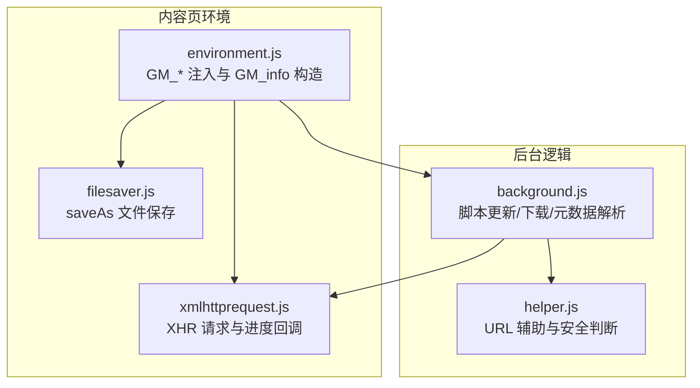
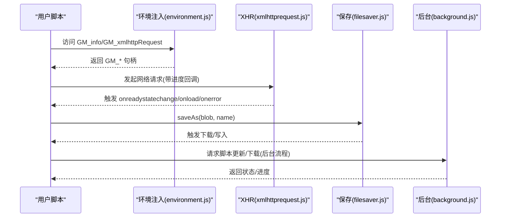
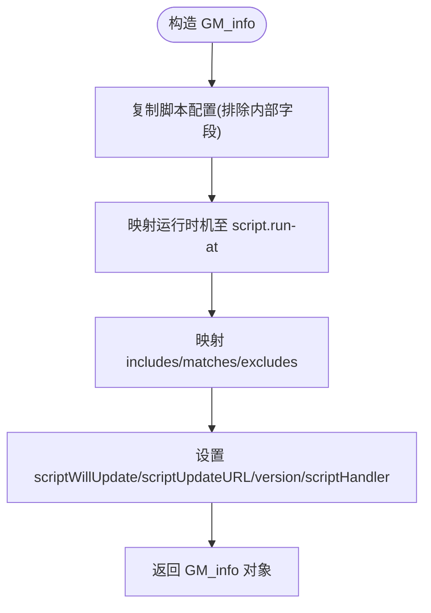
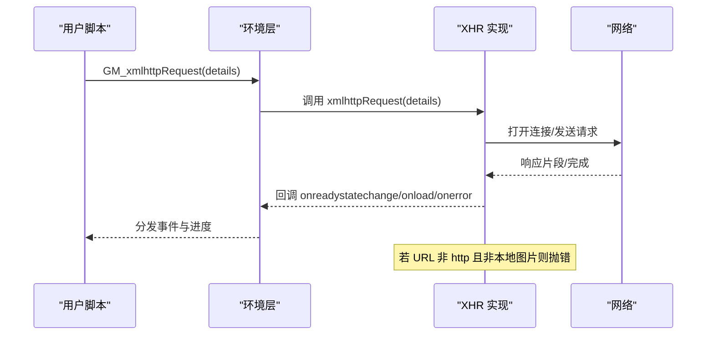
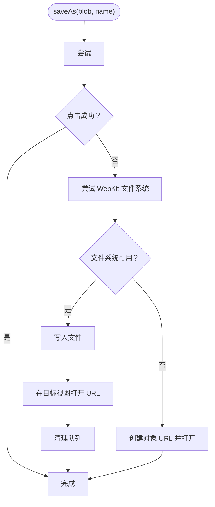
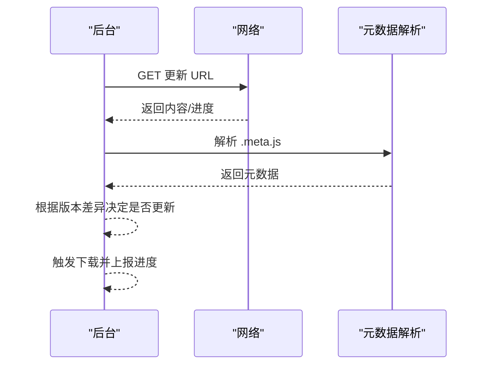
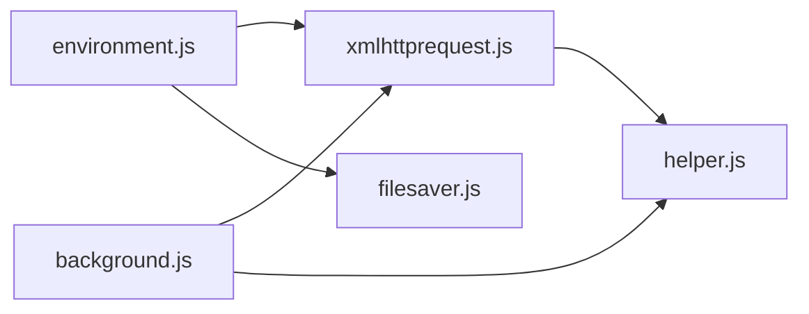

# 系统工具 API

<cite>
**本文引用的文件**
- [environment.js](file://src/environment.js)
- [xmlhttprequest.js](file://src/xmlhttprequest.js)
- [filesaver.js](file://src/saveas/filesaver.js)
- [background.js](file://src/background.js)
- [helper.js](file://src/helper.js)
</cite>

## 目录
1. [简介](#简介)
2. [项目结构](#项目结构)
3. [核心组件](#核心组件)
4. [架构总览](#架构总览)
5. [详细组件分析](#详细组件分析)
6. [依赖关系分析](#依赖关系分析)
7. [性能考量](#性能考量)
8. [故障排查指南](#故障排查指南)
9. [结论](#结论)
10. [附录](#附录)

## 简介
本文件为 Tampermonkey 的系统工具相关 GM_* API 提供权威参考，重点覆盖以下内容：
- GM_info：系统信息对象的属性结构与来源
- GM_xmlhttpRequest：底层网络请求能力（用于实现下载等）
- 与下载相关的文件保存与管理流程
- 版本兼容性、浏览器支持与安全限制
- 权限与安全边界说明

本参考以源码为依据，避免臆测，所有要点均在相应章节给出“章节来源”定位。

## 项目结构
与系统工具 API 相关的核心模块分布如下：
- 环境注入与 GM_* 暴露：src/environment.js
- 网络请求与进度回调：src/xmlhttprequest.js
- 文件保存实现：src/saveas/filesaver.js
- 脚本更新与下载流程（后台）：src/background.js
- URL 安全与辅助工具：src/helper.js

图表来源
- [environment.js:790-818](file://src/environment.js#L790-L818)
- [xmlhttprequest.js:17-153](file://src/xmlhttprequest.js#L17-L153)
- [filesaver.js:16-213](file://src/saveas/filesaver.js#L16-L213)
- [background.js:2846-2875](file://src/background.js#L2846-L2875)
- [helper.js:12-15](file://src/helper.js#L12-L15)

章节来源
- [environment.js:790-818](file://src/environment.js#L790-L818)
- [xmlhttprequest.js:17-153](file://src/xmlhttprequest.js#L17-L153)
- [filesaver.js:16-213](file://src/saveas/filesaver.js#L16-L213)
- [background.js:2846-2875](file://src/background.js#L2846-L2875)
- [helper.js:12-15](file://src/helper.js#L12-L15)

## 核心组件
- GM_info 对象：由环境层构造，包含脚本元信息、运行时信息、平台标识等
- GM_xmlhttpRequest：封装底层 XHR，支持进度回调、重试与安全校验
- 文件保存：通过 saveAs 实现本地文件写入或触发下载
- 后台下载：负责脚本更新、元数据解析与下载流程控制

章节来源
- [environment.js:790-818](file://src/environment.js#L790-L818)
- [xmlhttprequest.js:17-153](file://src/xmlhttprequest.js#L17-L153)
- [filesaver.js:16-213](file://src/saveas/filesaver.js#L16-L213)
- [background.js:2846-2875](file://src/background.js#L2846-L2875)

## 架构总览
GM_* API 在内容页环境中被注入到用户脚本上下文，GM_info 由环境层生成；网络请求通过 xmlhttprequest.js 封装，文件保存通过 filesaver.js 实现；后台负责脚本更新与下载流程，并对 URL 进行安全校验。

图表来源
- [environment.js:1053-1131](file://src/environment.js#L1053-L1131)
- [xmlhttprequest.js:17-153](file://src/xmlhttprequest.js#L17-L153)
- [filesaver.js:16-213](file://src/saveas/filesaver.js#L16-L213)
- [background.js:2846-2875](file://src/background.js#L2846-L2875)

## 详细组件分析

### GM_info 属性结构与来源
GM_info 是由环境层构造的只读对象，包含脚本元信息、运行时信息与平台标识等。其关键字段来源如下：
- script：来自脚本配置对象，排除内部字段
- script.run-at：运行时机映射
- script.excludes/includes/matches：匹配规则映射
- script.unwrap：布尔值
- scriptMetaStr：脚本头部字符串
- scriptSource：脚本源码
- scriptWillUpdate/scriptUpdateURL：是否可更新及更新地址
- version：脚本版本
- scriptHandler：固定标识

图表来源
- [environment.js:790-818](file://src/environment.js#L790-L818)

章节来源
- [environment.js:790-818](file://src/environment.js#L790-L818)

### GM_xmlhttpRequest 行为与安全
GM_xmlhttpRequest 通过环境层转发到底层 XHR 实现，具备以下特性：
- 支持 responseType（在特定条件下启用）
- 支持进度回调（onreadystatechange），从响应头或 Content-Length 推导总大小
- 支持重试（当状态非 200 且 retries > 0）
- URL 安全校验：仅允许 http 开头或本地图片资源
- 错误处理：抛出 Forbidden 状态并返回空响应体

图表来源
- [environment.js:693-747](file://src/environment.js#L693-L747)
- [xmlhttprequest.js:17-153](file://src/xmlhttprequest.js#L17-L153)

章节来源
- [environment.js:693-747](file://src/environment.js#L693-L747)
- [xmlhttprequest.js:17-153](file://src/xmlhttprequest.js#L17-L153)

### 文件保存与下载流程
文件保存通过 saveAs 实现，优先尝试 <a download>，否则回退到 WebKit 文件系统或对象 URL。流程要点：
- 优先使用 <a download> 触发下载
- 在 Chrome 中强制使用二进制类型以规避保存问题
- WebKit 下若无法保存则回退到对象 URL 并在新窗口打开
- 写入完成后清理对象 URL 或删除临时文件

图表来源
- [filesaver.js:16-213](file://src/saveas/filesaver.js#L16-L213)

章节来源
- [filesaver.js:16-213](file://src/saveas/filesaver.js#L16-L213)

### 脚本更新与下载（后台）
后台负责脚本更新与下载流程，包括：
- 元数据解析：根据脚本的 fileURL/downloadURL/updateURL 推导 .meta.js 地址
- 更新检查：定期拉取远程数据库版本，必要时触发下载
- 下载进度：通过 progress 回调更新状态
- 错误处理：解析失败、状态异常时重置状态并提示

图表来源
- [background.js:2846-2875](file://src/background.js#L2846-L2875)
- [background.js:925-931](file://src/background.js#L925-L931)

章节来源
- [background.js:2846-2875](file://src/background.js#L2846-L2875)
- [background.js:925-931](file://src/background.js#L925-L931)

## 依赖关系分析
- environment.js 依赖 xmlhttprequest.js 提供底层网络能力，并依赖 filesaver.js 提供文件保存能力
- background.js 依赖 xmlhttprequest.js 进行网络请求，并依赖 helper.js 进行 URL 安全判断
- xmlhttprequest.js 依赖 helper.js 判断 URL 是否合法（http 或本地图片）

图表来源
- [environment.js:1053-1131](file://src/environment.js#L1053-L1131)
- [xmlhttprequest.js:17-153](file://src/xmlhttprequest.js#L17-L153)
- [background.js:2846-2875](file://src/background.js#L2846-L2875)
- [helper.js:12-15](file://src/helper.js#L12-L15)

章节来源
- [environment.js:1053-1131](file://src/environment.js#L1053-L1131)
- [xmlhttprequest.js:17-153](file://src/xmlhttprequest.js#L17-L153)
- [background.js:2846-2875](file://src/background.js#L2846-L2875)
- [helper.js:12-15](file://src/helper.js#L12-L15)

## 性能考量
- 进度回调：基于 lengthComputable 或 Content-Length 推导总大小，避免阻塞主线程
- 重试策略：非 200 状态自动重试，减少瞬时网络波动影响
- 文件保存：优先 <a download>，降低文件系统写入开销；WebKit 回退路径尽量减少对象 URL 数量
- 后台下载：分阶段更新与进度上报，避免长时间占用 UI 线程

[本节为通用性能建议，不直接分析具体文件]

## 故障排查指南
- URL 非法导致请求失败
  - 现象：GM_xmlhttpRequest 抛出 Forbidden 状态
  - 原因：URL 不是 http 开头且不是本地图片资源
  - 处理：确保下载地址为 http(s) 或本地资源
  - 章节来源
    - [xmlhttprequest.js:115-117](file://src/xmlhttprequest.js#L115-L117)

- 进度回调缺失
  - 现象：onreadystatechange 未收到 progress
  - 原因：无 lengthComputable 且无法解析 Content-Length
  - 处理：确认服务端正确设置 Content-Length 或使用可计算的传输方式
  - 章节来源
    - [xmlhttprequest.js:94-109](file://src/xmlhttprequest.js#L94-L109)

- 文件保存失败
  - 现象：saveAs 无法触发下载或报错
  - 原因：文件系统不可用或对象 URL 无法创建
  - 处理：回退到对象 URL 并在新窗口打开；检查浏览器兼容性
  - 章节来源
    - [filesaver.js:140-143](file://src/saveas/filesaver.js#L140-L143)
    - [filesaver.js:186-187](file://src/saveas/filesaver.js#L186-L187)

- 后台下载异常
  - 现象：更新失败或进度不更新
  - 原因：远程响应解析失败、状态码异常
  - 处理：检查更新 URL 与 .meta.js 格式，确认网络可达
  - 章节来源
    - [background.js:933-931](file://src/background.js#L933-L931)
    - [background.js:2856-2865](file://src/background.js#L2856-L2865)

## 结论
- GM_info 提供了脚本与运行时的完整元信息，便于脚本自检与跨平台适配
- GM_xmlhttpRequest 在保证安全的前提下提供了可控的网络访问能力，支持进度与重试
- 文件保存通过 saveAs 实现跨浏览器的可靠下载
- 后台流程负责脚本更新与下载，配合元数据解析与进度上报，形成闭环

[本节为总结性内容，不直接分析具体文件]

## 附录

### API 使用示例（步骤化说明）
- 获取版本信息
  - 步骤：在用户脚本中读取 GM_info，提取 version、scriptUpdateURL 等字段
  - 章节来源
    - [environment.js:790-818](file://src/environment.js#L790-L818)

- 远程资源下载
  - 步骤：调用 GM_xmlhttpRequest，设置 onload/onerror/onreadystatechange，处理响应与进度
  - 章节来源
    - [environment.js:693-747](file://src/environment.js#L693-L747)
    - [xmlhttprequest.js:17-153](file://src/xmlhttprequest.js#L17-L153)

- 文件保存与管理
  - 步骤：构造 Blob，调用 saveAs(blob, name)，处理 writestart/progress/writeend 事件
  - 章节来源
    - [filesaver.js:16-213](file://src/saveas/filesaver.js#L16-L213)

- 版本兼容性与浏览器支持
  - 说明：GM_xmlhttpRequest 在启用 responseType 时走新路径；saveAs 在不同浏览器有差异化回退
  - 章节来源
    - [environment.js:703-704](file://src/environment.js#L703-L704)
    - [filesaver.js:121-128](file://src/saveas/filesaver.js#L121-L128)

- 安全限制与权限
  - 说明：GM_xmlhttpRequest 仅允许 http(s) 或本地图片资源；后台下载受元数据与权限约束
  - 章节来源
    - [xmlhttprequest.js:12-15](file://src/xmlhttprequest.js#L12-L15)
    - [background.js:2846-2875](file://src/background.js#L2846-L2875)