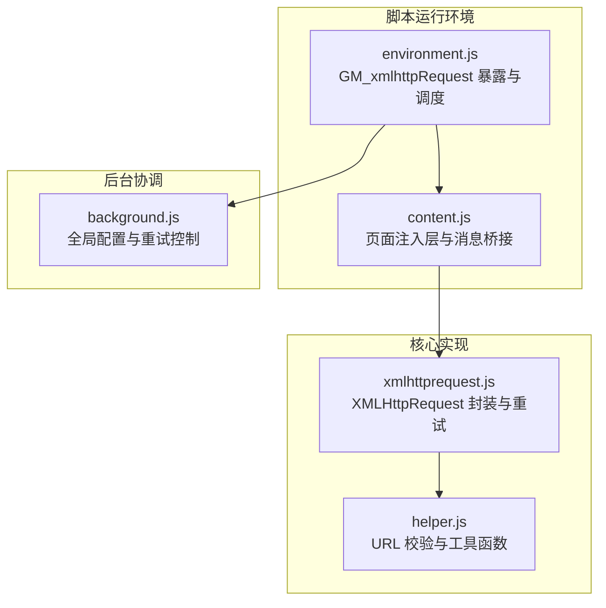
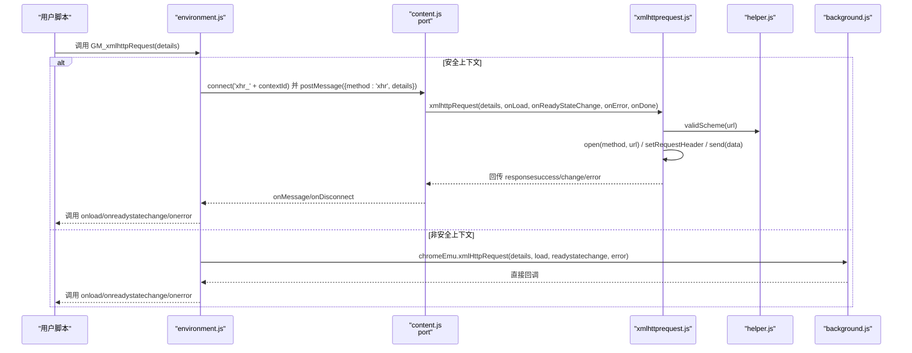
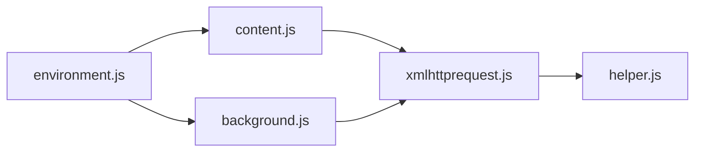
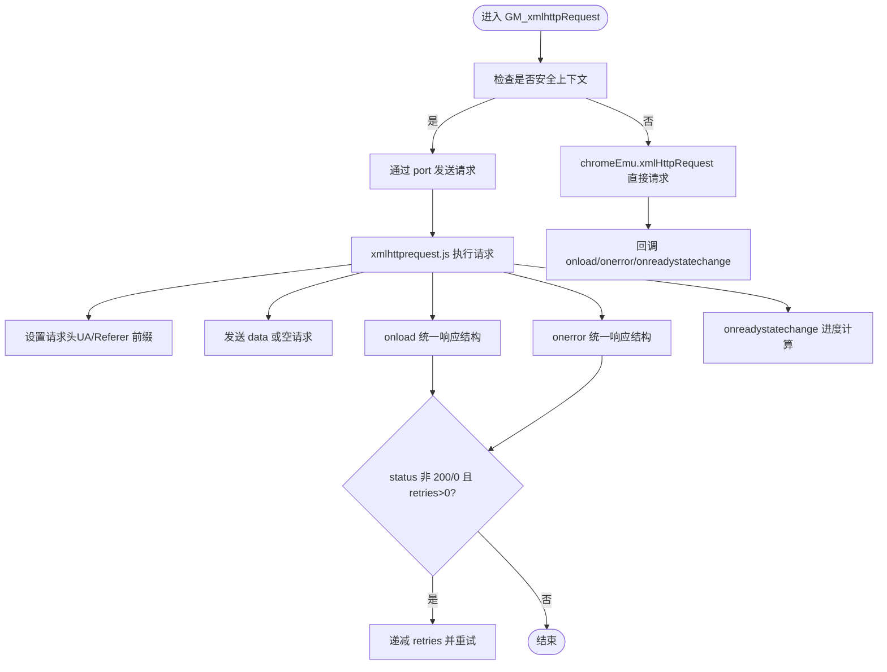

# 网络请求 API

<cite>
**本文引用的文件**
- [xmlhttprequest.js](file://src/xmlhttprequest.js)
- [environment.js](file://src/environment.js)
- [content.js](file://src/content.js)
- [background.js](file://src/background.js)
- [helper.js](file://src/helper.js)
- [project-overview.md](file://docs/project-overview.md)
- [README.md](file://README.md)
- [tamperfireDB.tamper.js](file://src/system/tamperfireDB.tamper.js)
</cite>

## 目录
1. [简介](#简介)
2. [项目结构](#项目结构)
3. [核心组件](#核心组件)
4. [架构总览](#架构总览)
5. [详细组件分析](#详细组件分析)
6. [依赖关系分析](#依赖关系分析)
7. [性能考量](#性能考量)
8. [故障排查指南](#故障排查指南)
9. [结论](#结论)
10. [附录](#附录)

## 简介
本文件为 Tampermonkey 的网络请求相关 GM_* API 的权威参考，重点聚焦 GM_xmlhttpRequest 的完整 API 规范与行为说明。内容涵盖：
- 请求参数配置（url、method、headers、data、timeout、responseType、overrideMimeType、retries 等）
- 响应处理机制（onload、onerror、onreadystatechange、progress 信息）
- 安全限制与跨域处理策略
- 请求头自定义、POST 数据格式、响应数据类型处理
- 使用示例（GET/POST、文件上传、JSON 处理、错误与超时）
- 与标准 XMLHttpRequest 的差异与优势
- 在不同浏览器环境下的兼容性表现

## 项目结构
与 GM_xmlhttpRequest 直接相关的模块与职责如下：
- environment.js：对外暴露 GM_xmlhttpRequest，并在安全上下文中通过 port 与 content/background 通信；在非安全上下文直接调用 chromeEmu.xmlHttpRequest。
- xmlhttprequest.js：封装底层 XMLHttpRequest，统一响应结构、进度计算、重试逻辑与错误处理。
- content.js：在页面注入层接收来自脚本侧的请求，建立与后台的连接通道，转发 onLoad/onError/onReadyStateChange。
- background.js：作为后台协调者，维护全局重试次数、WebRequest 配置、本地文件读取等。
- helper.js：提供 URL 校验、字符串解析等辅助能力。

图表来源
- [environment.js:693-747](file://src/environment.js#L693-L747)
- [content.js:309-342](file://src/content.js#L309-L342)
- [xmlhttprequest.js:17-160](file://src/xmlhttprequest.js#L17-L160)
- [helper.js:82-87](file://src/helper.js#L82-L87)
- [background.js:60-62](file://src/background.js#L60-L62)

章节来源
- [environment.js:693-747](file://src/environment.js#L693-L747)
- [xmlhttprequest.js:17-160](file://src/xmlhttprequest.js#L17-L160)
- [content.js:309-342](file://src/content.js#L309-L342)
- [background.js:60-62](file://src/background.js#L60-L62)
- [helper.js:82-87](file://src/helper.js#L82-L87)

## 核心组件
- GM_xmlhttpRequest（environment.js）：对外 API，负责将 details 转发给 content/background，绑定回调并在必要时返回 abort 对象。
- xmlhttprequest.js：内部实现，负责：
  - 校验 URL Scheme（仅允许 http/https 或本地图片资源）
  - 设置请求头（对 User-Agent、Referer 使用前缀以兼容 WebRequest）
  - 统一响应结构（responseXML、responseText、response、status/statusText、finalUrl、responseHeaders）
  - 计算进度（onreadystatechange 中的 progress）
  - 重试逻辑（当 status 非 200/0 且 details.retries > 0）
  - 异常兜底（抛出 Forbidden 响应）
- content.js：在页面层建立 port，将 onLoad/onError/onReadyStateChange 事件回传给脚本侧。
- background.js：全局 retries 控制、WebRequest 配置、本地文件读取等。

章节来源
- [environment.js:693-747](file://src/environment.js#L693-L747)
- [xmlhttprequest.js:17-160](file://src/xmlhttprequest.js#L17-L160)
- [content.js:309-342](file://src/content.js#L309-L342)
- [background.js:60-62](file://src/background.js#L60-L62)

## 架构总览
GM_xmlhttpRequest 的调用路径分为两类：
- 安全上下文（responseType 未设置或为空）：通过 port 与后台通信，后台再发起实际请求。
- 非安全上下文（responseType 非空）：直接调用 chromeEmu.xmlHttpRequest，绕过 port。

图表来源
- [environment.js:693-747](file://src/environment.js#L693-L747)
- [content.js:309-342](file://src/content.js#L309-L342)
- [xmlhttprequest.js:17-160](file://src/xmlhttprequest.js#L17-L160)
- [helper.js:12-15](file://src/helper.js#L12-L15)
- [background.js:60-62](file://src/background.js#L60-L62)

## 详细组件分析

### GM_xmlhttpRequest 参数规范
- 必填
  - url：目标地址（必须为 http/https 或本地图片资源）
- 常用
  - method：HTTP 方法（默认 GET）
  - headers：请求头对象（User-Agent、Referer 会被带前缀以兼容 WebRequest）
  - data：请求体（支持字符串、FormData、ArrayBuffer 等）
  - responseType：响应类型（如 'json'、'arraybuffer' 等）
  - overrideMimeType：覆盖 MIME 类型
  - retries：失败重试次数（默认由后台全局变量控制）
- 回调
  - onload(response)：请求成功回调
  - onerror(response)：请求失败回调
  - onreadystatechange(response)：状态变化回调（携带 progress）
- 返回
  - abort()：取消请求

章节来源
- [xmlhttprequest.js:118-138](file://src/xmlhttprequest.js#L118-L138)
- [xmlhttprequest.js:119-126](file://src/xmlhttprequest.js#L119-L126)
- [xmlhttprequest.js:131-133](file://src/xmlhttprequest.js#L131-L133)
- [xmlhttprequest.js:134-137](file://src/xmlhttprequest.js#L134-L137)
- [environment.js:693-747](file://src/environment.js#L693-L747)

### 响应结构与进度
- 统一响应字段
  - readyState、status、statusText、responseHeaders、finalUrl
  - responseXML、responseText、response（根据 responseType 是否为空决定是否填充）
- 进度计算
  - onreadystatechange 中尝试从 Content-Length 推断 total/totalSize，否则使用已接收长度
- 重试机制
  - 当 readyState==4 且 status!=200 且 status!=0 且 retries>0 时自动重试

章节来源
- [xmlhttprequest.js:25-60](file://src/xmlhttprequest.js#L25-L60)
- [xmlhttprequest.js:94-110](file://src/xmlhttprequest.js#L94-L110)
- [xmlhttprequest.js:62-75](file://src/xmlhttprequest.js#L62-L75)
- [xmlhttprequest.js:76-93](file://src/xmlhttprequest.js#L76-L93)

### 安全限制与跨域处理
- URL 校验：仅允许 http/https 或本地图片资源
- 请求头兼容：User-Agent、Referer 通过前缀写入以兼容 WebRequest
- 跨域：通过后台通道与 port 机制实现跨页面/跨进程通信
- 非安全上下文：直接走 chromeEmu.xmlHttpRequest，避免 port 限制

章节来源
- [helper.js:82-87](file://src/helper.js#L82-L87)
- [xmlhttprequest.js:115-126](file://src/xmlhttprequest.js#L115-L126)
- [environment.js:704-716](file://src/environment.js#L704-L716)

### 请求头自定义与 POST 数据格式
- 请求头：headers 对象逐项设置；UA/Referer 会加前缀
- POST 数据：支持字符串、FormData、ArrayBuffer 等；由底层 send(data) 发送

章节来源
- [xmlhttprequest.js:119-126](file://src/xmlhttprequest.js#L119-L126)
- [xmlhttprequest.js:134-137](file://src/xmlhttprequest.js#L134-L137)

### 响应数据类型处理
- responseType 为空：返回 responseXML/responseText/response
- responseType 非空：仅返回 response，其他字段置空
- JSON：若 responseType 为 'json'，则 response 为解析后的对象

章节来源
- [xmlhttprequest.js:46-54](file://src/xmlhttprequest.js#L46-L54)

### 错误处理与超时
- 异常兜底：抛出 Forbidden 响应（status=403）
- 重试：当 status 非 200/0 且 retries>0 时自动重试
- 超时：未发现显式 timeout 参数；可通过业务层自行实现超时控制（例如在 onload/onerror 中判断）

章节来源
- [xmlhttprequest.js:139-152](file://src/xmlhttprequest.js#L139-L152)
- [xmlhttprequest.js:64-72](file://src/xmlhttprequest.js#L64-L72)
- [xmlhttprequest.js:78-85](file://src/xmlhttprequest.js#L78-L85)

### 与标准 XMLHttpRequest 的差异与优势
- 差异
  - 参数更丰富：headers、responseType、overrideMimeType、retries
  - 回调更细粒度：onreadystatechange 提供 progress
  - 跨域与跨进程：通过 port 与 chromeEmu 实现
- 优势
  - 更易用的 GM_* API 风格
  - 统一的响应结构与错误处理
  - 与 WebRequest 兼容的请求头处理

章节来源
- [xmlhttprequest.js:118-138](file://src/xmlhttprequest.js#L118-L138)
- [environment.js:704-716](file://src/environment.js#L704-L716)

### 兼容性与浏览器环境
- 支持 Chrome/Chromium 17+（Manifest V2）
- 在 Android 平台通过 window.chrome.xmlHttpRequest 分支处理
- 非安全上下文（responseType 非空）直接走 chromeEmu，避免 port 限制

章节来源
- [README.md:66-69](file://README.md#L66-L69)
- [xmlhttprequest.js:18-23](file://src/xmlhttprequest.js#L18-L23)
- [environment.js:704-716](file://src/environment.js#L704-L716)

## 依赖关系分析
- environment.js 依赖 chromeEmu/port 与 xmlhttprequest.js
- content.js 依赖 xmlhttprequest.js 与 port 机制
- xmlhttprequest.js 依赖 helper.js 的 URL 校验
- background.js 提供全局 retries 与 WebRequest 配置

图表来源
- [environment.js:693-747](file://src/environment.js#L693-L747)
- [content.js:309-342](file://src/content.js#L309-L342)
- [xmlhttprequest.js:17-160](file://src/xmlhttprequest.js#L17-L160)
- [helper.js:82-87](file://src/helper.js#L82-L87)
- [background.js:60-62](file://src/background.js#L60-L62)

章节来源
- [environment.js:693-747](file://src/environment.js#L693-L747)
- [content.js:309-342](file://src/content.js#L309-L342)
- [xmlhttprequest.js:17-160](file://src/xmlhttprequest.js#L17-L160)
- [helper.js:82-87](file://src/helper.js#L82-L87)
- [background.js:60-62](file://src/background.js#L60-L62)

## 性能考量
- 进度计算：优先使用 Content-Length，否则使用已接收长度估算
- 重试策略：仅在非 200/0 且 retries>0 时重试，避免无效重试
- 数据传输：非安全上下文直接走 chromeEmu，减少 port 序列化开销
- 建议：对大文件上传建议设置 responseType 为 'arraybuffer' 或 'blob'，并合理设置 retries

章节来源
- [xmlhttprequest.js:98-107](file://src/xmlhttprequest.js#L98-L107)
- [xmlhttprequest.js:64-72](file://src/xmlhttprequest.js#L64-L72)
- [xmlhttprequest.js:78-85](file://src/xmlhttprequest.js#L78-L85)

## 故障排查指南
- URL 不合法：校验失败会抛出 Forbidden 响应
- 请求头被拒绝：User-Agent/Referer 会被带前缀写入
- 无 progress：若无 Content-Length，进度可能不可用
- 重试无效：确保 retries>0 且 status 非 200/0
- Android 平台：通过 window.chrome.xmlHttpRequest 分支处理

章节来源
- [xmlhttprequest.js:115-117](file://src/xmlhttprequest.js#L115-L117)
- [xmlhttprequest.js:122-124](file://src/xmlhttprequest.js#L122-L124)
- [xmlhttprequest.js:98-107](file://src/xmlhttprequest.js#L98-L107)
- [xmlhttprequest.js:64-72](file://src/xmlhttprequest.js#L64-L72)
- [xmlhttprequest.js:78-85](file://src/xmlhttprequest.js#L78-L85)
- [xmlhttprequest.js:18-23](file://src/xmlhttprequest.js#L18-L23)

## 结论
GM_xmlhttpRequest 在 Tampermonkey 中提供了稳定、易用且与 WebRequest 兼容的跨域请求能力。其统一的响应结构、细粒度的回调与进度信息、以及自动重试机制，使其在用户脚本场景中具备良好的可用性与可靠性。结合本文的参数规范与最佳实践，可在不同浏览器环境下高效完成各类网络请求任务。

## 附录

### 使用示例（路径引用）
- GET 请求示例：[tamperfireDB.tamper.js:309-314](file://src/system/tamperfireDB.tamper.js#L309-L314)
- POST/JSON 示例：可在用户脚本中构造 headers 与 data，参考 [xmlhttprequest.js:119-137](file://src/xmlhttprequest.js#L119-L137)
- 错误与超时：参考 [xmlhttprequest.js:139-152](file://src/xmlhttprequest.js#L139-L152)
- 进度监听：参考 [xmlhttprequest.js:94-110](file://src/xmlhttprequest.js#L94-L110)

### API 行为流程图

图表来源
- [environment.js:693-747](file://src/environment.js#L693-L747)
- [xmlhttprequest.js:17-160](file://src/xmlhttprequest.js#L17-L160)
- [xmlhttprequest.js:62-75](file://src/xmlhttprequest.js#L62-L75)
- [xmlhttprequest.js:76-93](file://src/xmlhttprequest.js#L76-L93)
- [xmlhttprequest.js:94-110](file://src/xmlhttprequest.js#L94-L110)