# 扩展 API 接口

<cite>
**本文档引用的文件**
- [background.js](file://src/background.js)
- [content.js](file://src/content.js)
- [emulation.js](file://src/emulation.js)
- [xmlhttprequest.js](file://src/xmlhttprequest.js)
- [registry.js](file://src/registry.js)
- [helper.js](file://src/helper.js)
- [parser.js](file://src/parser.js)
- [compat.js](file://src/compat.js)
- [convert.js](file://src/convert.js)
- [syncinfo.js](file://src/syncinfo.js)
- [i18n.js](file://src/i18n.js)
- [action.js](file://src/action.js)
- [options.js](file://src/options.js)
- [README.md](file://README.md)
</cite>

## 目录
1. [简介](#简介)
2. [项目结构](#项目结构)
3. [核心组件](#核心组件)
4. [架构概览](#架构概览)
5. [详细组件分析](#详细组件分析)
6. [依赖关系分析](#依赖关系分析)
7. [性能考虑](#性能考虑)
8. [故障排除指南](#故障排除指南)
9. [结论](#结论)

## 简介

Tampermonkey 是 Google Chrome 最受欢迎的用户脚本管理器扩展。该版本（2.9）提供了完整的扩展 API 接口实现，支持用户脚本的管理、执行和与浏览器的深度集成。本文档详细分析了 Tampermonkey 的扩展 API 接口，包括 tmCE 对象的所有方法和属性，自定义消息协议，以及扩展间通信机制。

## 项目结构

Tampermonkey 采用模块化的 JavaScript 架构，通过注册表系统管理各个功能模块：

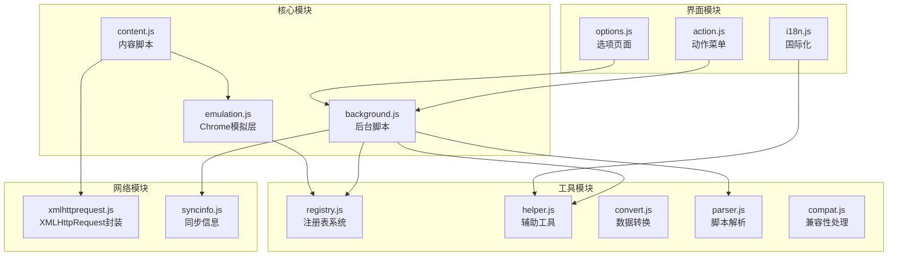

**图表来源**
- [background.js:1-100](file://src/background.js#L1-L100)
- [content.js:1-100](file://src/content.js#L1-L100)
- [emulation.js:1-100](file://src/emulation.js#L1-L100)

**章节来源**
- [README.md:1-112](file://README.md#L1-L112)

## 核心组件

### tmCE 对象

tmCE（Tampermonkey Content Emulation）是内容脚本中的核心对象，提供了与后台脚本通信的完整接口：

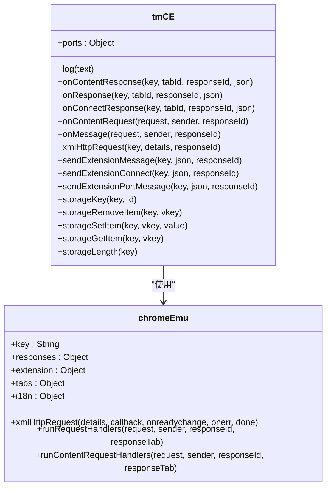

**图表来源**
- [content.js:217-453](file://src/content.js#L217-L453)
- [emulation.js:40-329](file://src/emulation.js#L40-L329)

### 注册表系统

注册表系统是 Tampermonkey 的核心架构组件，负责模块的动态加载和依赖管理：

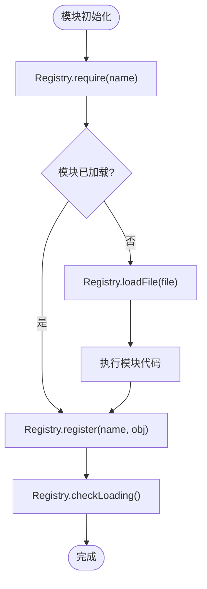

**图表来源**
- [registry.js:48-104](file://src/registry.js#L48-L104)

**章节来源**
- [content.js:217-453](file://src/content.js#L217-L453)
- [registry.js:11-104](file://src/registry.js#L11-L104)

## 架构概览

Tampermonkey 采用了分层架构设计，实现了内容脚本与后台脚本之间的安全通信：

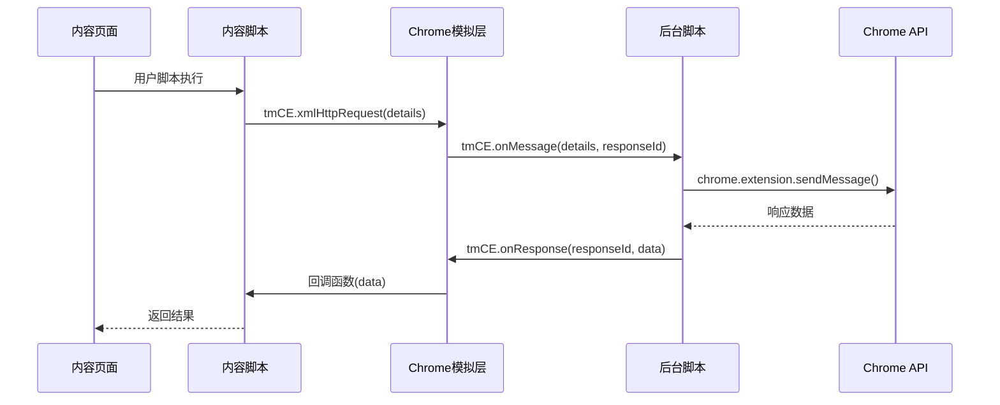

**图表来源**
- [content.js:309-342](file://src/content.js#L309-L342)
- [emulation.js:126-146](file://src/emulation.js#L126-L146)

## 详细组件分析

### 后台脚本系统

后台脚本负责管理用户脚本的生命周期、存储操作和扩展间通信：

#### 脚本管理功能

后台脚本实现了完整的用户脚本生命周期管理：

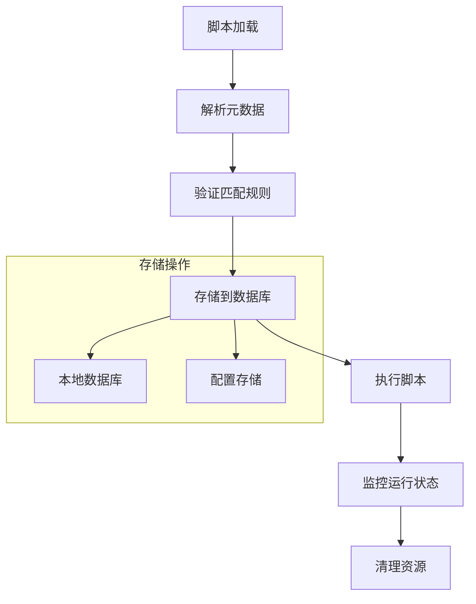

**图表来源**
- [background.js:163-224](file://src/background.js#L163-L224)
- [parser.js:72-282](file://src/parser.js#L72-L282)

#### 扩展通信机制

后台脚本提供了多种扩展间通信方式：

| 通信类型 | 方法 | 描述 |
|---------|------|------|
| 消息传递 | `chrome.extension.sendMessage()` | 单向消息传递 |
| 连接通信 | `chrome.extension.connect()` | 双向连接通信 |
| 存储访问 | `chrome.storage.sync` | 同步存储操作 |
| 标签页控制 | `chrome.tabs` | 标签页管理 |

**章节来源**
- [background.js:788-850](file://src/background.js#L788-L850)

### 内容脚本系统

内容脚本通过 tmCE 对象与后台脚本进行通信：

#### tmCE 方法分类

| 功能类别 | 方法名称 | 用途 |
|---------|----------|------|
| 日志记录 | `log()` | 输出调试信息 |
| 请求处理 | `onMessage()` | 处理扩展消息 |
| 连接管理 | `sendExtensionConnect()` | 建立持久连接 |
| 存储操作 | `storageSetItem()` | 设置存储项 |
| 网络请求 | `xmlHttpRequest()` | 发起HTTP请求 |

#### 消息协议格式

内容脚本与后台脚本之间的消息协议采用统一的数据格式：

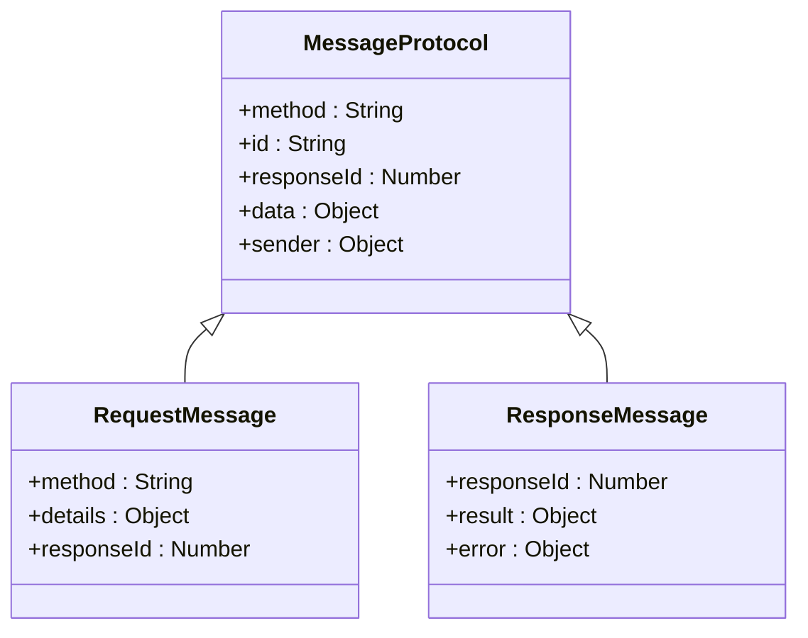

**图表来源**
- [content.js:273-307](file://src/content.js#L273-L307)
- [emulation.js:197-207](file://src/emulation.js#L197-L207)

**章节来源**
- [content.js:217-453](file://src/content.js#L217-L453)
- [emulation.js:126-195](file://src/emulation.js#L126-L195)

### Chrome 模拟层

Chrome 模拟层提供了完整的 Chrome API 兼容性：

#### 扩展 API 兼容性

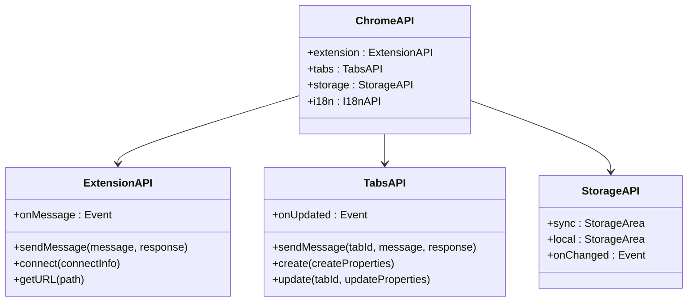

**图表来源**
- [emulation.js:209-312](file://src/emulation.js#L209-L312)

#### 异步处理模式

Chrome 模拟层实现了标准的异步处理模式：

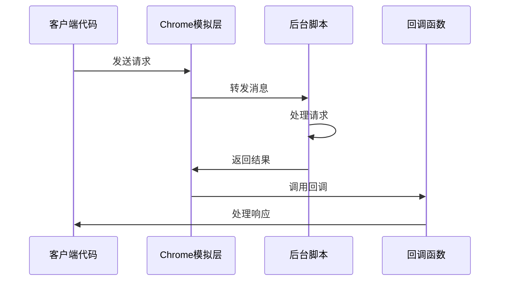

**图表来源**
- [emulation.js:256-266](file://src/emulation.js#L256-L266)

**章节来源**
- [emulation.js:40-329](file://src/emulation.js#L40-L329)

### 网络请求系统

XMLHttpRequest 封装提供了增强的网络请求功能：

#### 请求处理流程

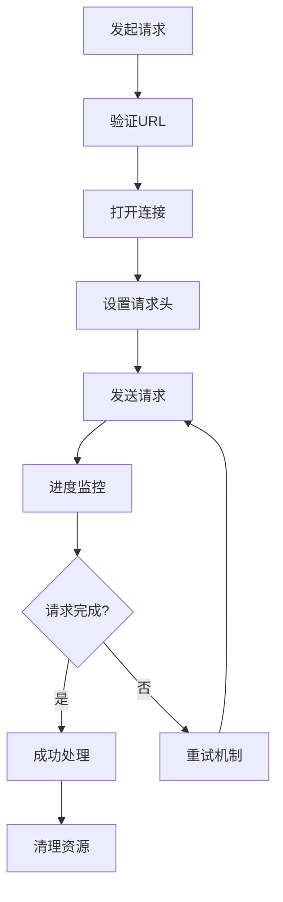

**图表来源**
- [xmlhttprequest.js:17-153](file://src/xmlhttprequest.js#L17-L153)

#### 错误处理机制

网络请求系统实现了多层次的错误处理：

| 错误类型 | 处理策略 | 重试次数 |
|---------|---------|---------|
| 网络超时 | 自动重试 | 3次 |
| 服务器错误 | 降级处理 | 无限制 |
| URL无效 | 直接返回 | 0次 |
| 权限拒绝 | 用户提示 | 0次 |

**章节来源**
- [xmlhttprequest.js:17-153](file://src/xmlhttprequest.js#L17-L153)

### 数据存储系统

Tampermonkey 实现了多层存储架构：

#### 存储层次结构

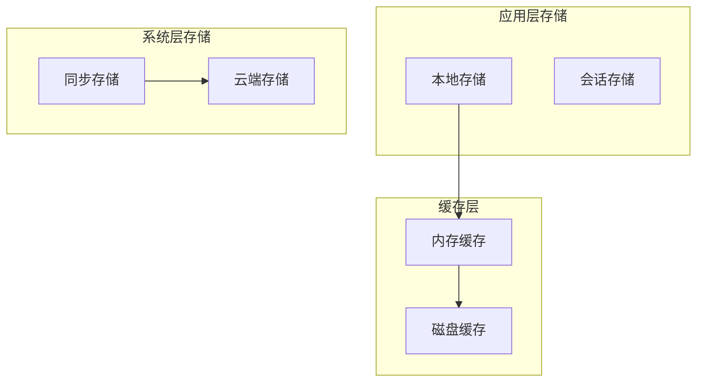

**图表来源**
- [background.js:788-850](file://src/background.js#L788-L850)

#### 存储操作接口

| 操作类型 | 方法 | 参数 | 返回值 |
|---------|------|------|--------|
| 读取 | `storageGetItem()` | key | value |
| 写入 | `storageSetItem()` | key, value | Boolean |
| 删除 | `storageRemoveItem()` | key | Boolean |
| 清空 | `storageClear()` | 无 | Boolean |

**章节来源**
- [content.js:434-452](file://src/content.js#L434-L452)

## 依赖关系分析

### 模块依赖图

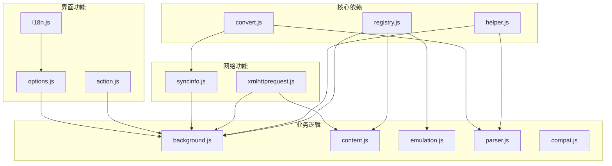

**图表来源**
- [registry.js:11-104](file://src/registry.js#L11-L104)
- [helper.js:184-208](file://src/helper.js#L184-L208)

### 关键依赖关系

| 组件 | 依赖组件 | 用途 |
|------|----------|------|
| background.js | parser.js, syncinfo.js, helper.js | 脚本管理和存储 |
| content.js | emulation.js, xmlhttprequest.js, helper.js | 内容脚本执行 |
| emulation.js | registry.js, convert.js | Chrome API 兼容性 |
| parser.js | helper.js, convert.js, compat.js | 脚本解析和兼容性 |
| syncinfo.js | xmlhttprequest.js, helper.js | 同步功能 |

**章节来源**
- [parser.js:8-16](file://src/parser.js#L8-L16)
- [syncinfo.js:8-10](file://src/syncinfo.js#L8-L10)

## 性能考虑

### 内存管理

Tampermonkey 实现了高效的内存管理策略：

- **对象池模式**：复用频繁创建的对象实例
- **延迟加载**：按需加载模块，减少初始内存占用
- **垃圾回收优化**：及时清理不再使用的事件监听器

### 缓存策略

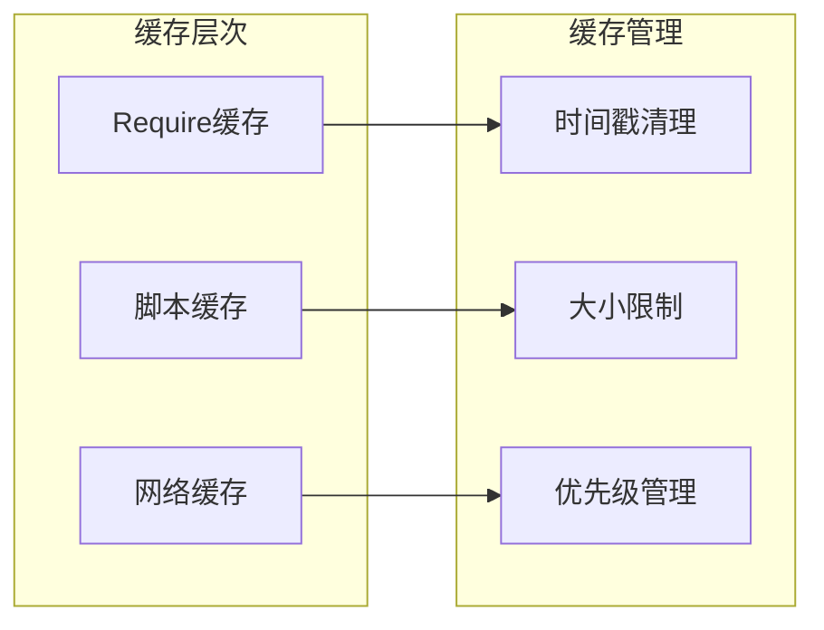

**图表来源**
- [background.js:395-431](file://src/background.js#L395-L431)

### 并发处理

后台脚本实现了多线程并发处理：

- **异步任务队列**：管理长时间运行的任务
- **资源限制**：防止内存泄漏和性能问题
- **错误隔离**：单个脚本错误不影响整体系统

## 故障排除指南

### 常见问题诊断

#### 脚本执行失败

**症状**：用户脚本无法正常执行
**可能原因**：
1. 脚本语法错误
2. 权限不足
3. 兼容性问题

**解决步骤**：
1. 检查浏览器控制台错误信息
2. 验证脚本元数据配置
3. 测试基本功能是否正常

#### 网络请求异常

**症状**：XMLHttpRequest 请求失败
**可能原因**：
1. CORS 限制
2. URL 格式错误
3. 网络连接问题

**解决步骤**：
1. 检查请求 URL 和参数
2. 验证跨域设置
3. 测试网络连接

#### 存储访问失败

**症状**：无法读写存储数据
**可能原因**：
1. 权限被拒绝
2. 存储空间不足
3. 同步冲突

**解决步骤**：
1. 检查存储 API 权限
2. 清理不必要的数据
3. 解决同步冲突

### 调试工具

#### 开发者工具

Tampermonkey 提供了丰富的调试功能：

- **日志输出**：详细的执行日志
- **性能监控**：脚本执行时间统计
- **内存分析**：内存使用情况监控

#### 错误报告

当出现问题时，系统会自动收集以下信息：

- 浏览器版本和配置
- 脚本执行栈跟踪
- 网络请求详情
- 存储操作日志

**章节来源**
- [background.js:38-48](file://src/background.js#L38-L48)
- [content.js:69-76](file://src/content.js#L69-L76)

## 结论

Tampermonkey 的扩展 API 接口设计体现了现代浏览器扩展的最佳实践。通过模块化的架构设计、完善的错误处理机制和高效的性能优化，该系统为用户脚本的开发和执行提供了强大的支持。

主要特点包括：

1. **完整的 API 兼容性**：实现了大部分 Chrome 扩展 API
2. **安全的通信机制**：通过 tmCE 对象确保内容脚本与后台脚本的安全通信
3. **灵活的扩展架构**：基于注册表系统的模块化设计
4. **强大的存储系统**：支持本地、同步和云端存储
5. **完善的调试工具**：提供全面的错误诊断和性能监控

该系统为开发者提供了构建复杂用户脚本的基础设施，同时也为最终用户提供了稳定可靠的使用体验。