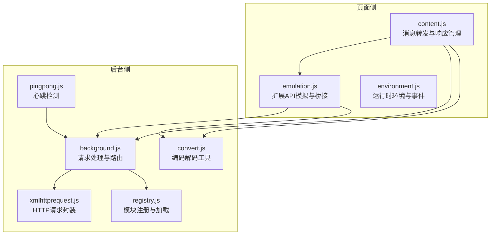
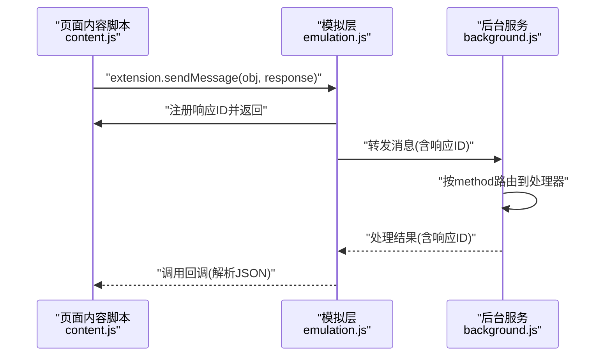
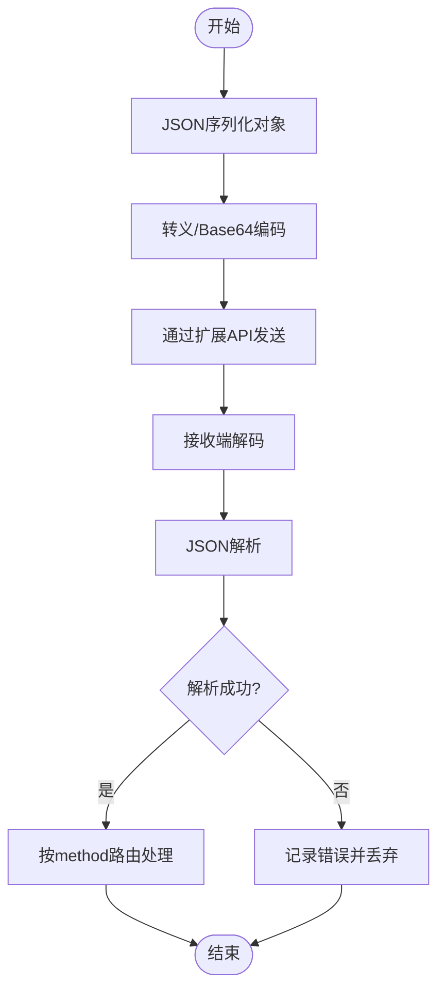
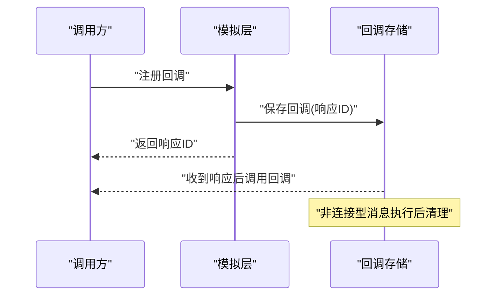
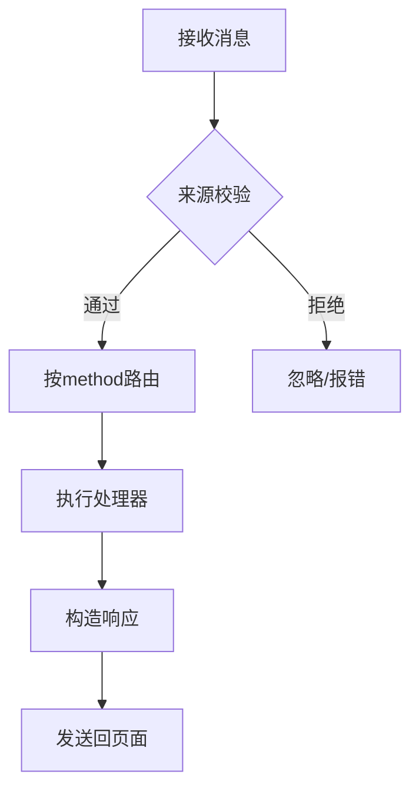
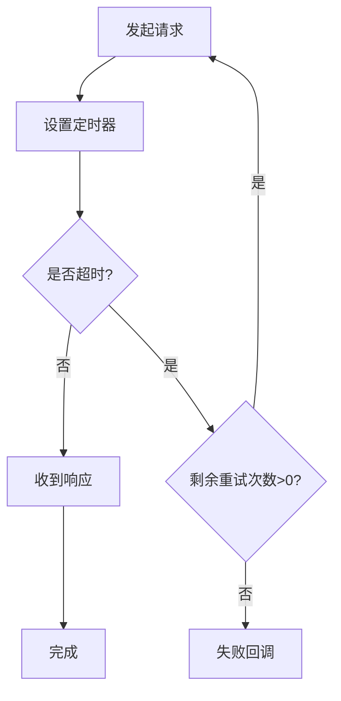
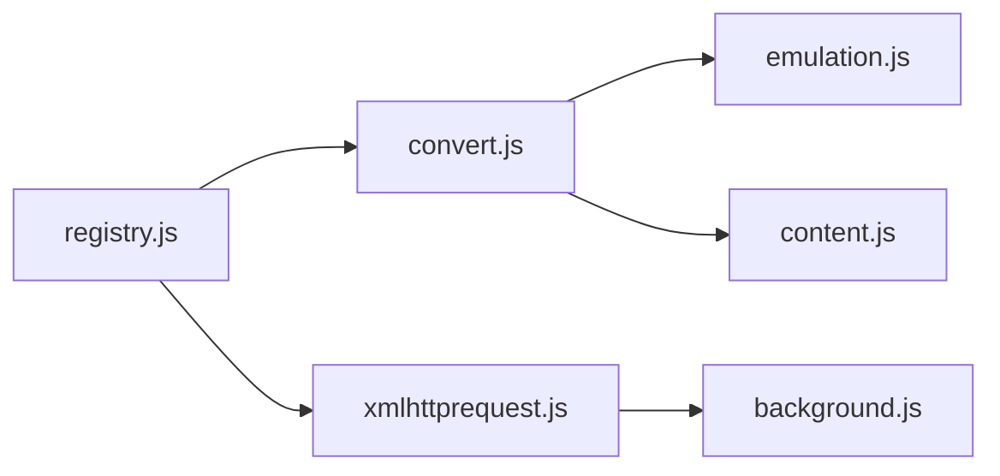

# 消息协议规范

<cite>
**本文档引用的文件**
- [background.js](file://src/background.js)
- [content.js](file://src/content.js)
- [emulation.js](file://src/emulation.js)
- [pingpong.js](file://src/pingpong.js)
- [xmlhttprequest.js](file://src/xmlhttprequest.js)
- [convert.js](file://src/convert.js)
- [registry.js](file://src/registry.js)
- [environment.js](file://src/environment.js)
</cite>

## 目录
1. [简介](#简介)
2. [项目结构](#项目结构)
3. [核心组件](#核心组件)
4. [架构总览](#架构总览)
5. [详细组件分析](#详细组件分析)
6. [依赖关系分析](#依赖关系分析)
7. [性能考虑](#性能考虑)
8. [故障排查指南](#故障排查指南)
9. [结论](#结论)
10. [附录](#附录)

## 简介
本文件为 Tampermonkey 扩展内部消息协议的技术规范文档，系统性阐述扩展在页面内容脚本与后台服务之间传递消息的机制。重点覆盖消息格式定义、字段含义、数据类型与约束、异步处理与超时重试、错误恢复、消息类型与处理逻辑、序列化与反序列化实现、安全校验与防篡改措施，以及协议扩展与版本兼容性指导。

## 项目结构
消息协议涉及的关键模块包括：
- 页面内容脚本层：负责注入环境、事件分发、请求转发与响应回调管理
- 后台服务层：负责请求路由、权限校验、持久化与跨标签通信
- 模拟层（emulation）：桥接页面与后台，提供扩展 API 的模拟实现
- 工具与基础设施：注册表、转换器、XMLHttpRequest 封装、心跳检测等

图表来源
- [content.js:108-317](file://src/content.js#L108-L317)
- [emulation.js:40-300](file://src/emulation.js#L40-L300)
- [background.js:4503-5855](file://src/background.js#L4503-L5855)
- [xmlhttprequest.js:17-153](file://src/xmlhttprequest.js#L17-L153)
- [registry.js:11-104](file://src/registry.js#L11-L104)
- [convert.js:7-38](file://src/convert.js#L7-L38)
- [pingpong.js:7-52](file://src/pingpong.js#L7-L52)

章节来源
- [content.js:108-317](file://src/content.js#L108-L317)
- [emulation.js:40-300](file://src/emulation.js#L40-L300)
- [background.js:4503-5855](file://src/background.js#L4503-L5855)

## 核心组件
- 消息编解码与传输
  - 编码：统一使用字符串化后进行转义/Base64 编码，避免跨上下文传输丢失或破坏
  - 解码：在接收端还原为原始对象，再进行 JSON 解析
  - 关键实现参考：[convert.js:7-38](file://src/convert.js#L7-L38)，[content.js:183-214](file://src/content.js#L183-L214)，[emulation.js:148-195](file://src/emulation.js#L148-L195)
- 响应 ID 管理
  - 生成唯一响应 ID，用于匹配请求与响应，支持连接型消息（端口消息）不立即清理
  - 参考：[emulation.js:197-207](file://src/emulation.js#L197-L207)，[content.js:183-193](file://src/content.js#L183-L193)
- 请求路由与处理
  - 页面侧通过扩展 API 将消息转发至后台；后台根据方法名路由到对应处理器
  - 参考：[content.js:290-307](file://src/content.js#L290-L307)，[background.js:4503-4521](file://src/background.js#L4503-L4521)
- 异步与超时
  - 使用定时器与重试机制控制超时与失败恢复
  - 参考：[pingpong.js:14-49](file://src/pingpong.js#L14-L49)，[xmlhttprequest.js:62-92](file://src/xmlhttprequest.js#L62-L92)

章节来源
- [convert.js:7-38](file://src/convert.js#L7-L38)
- [content.js:183-214](file://src/content.js#L183-L214)
- [emulation.js:148-207](file://src/emulation.js#L148-L207)
- [pingpong.js:14-49](file://src/pingpong.js#L14-L49)
- [xmlhttprequest.js:62-92](file://src/xmlhttprequest.js#L62-L92)

## 架构总览
消息在页面与后台之间的流转路径如下：

图表来源
- [emulation.js:260-272](file://src/emulation.js#L260-L272)
- [content.js:290-307](file://src/content.js#L290-L307)
- [background.js:4503-4521](file://src/background.js#L4503-L4521)

## 详细组件分析

### 组件A：消息编解码与传输
- 字段与类型
  - method: 字符串，标识消息类型（如 ping、tabs.sendMessage、extension.sendMessage）
  - 其他业务字段：由具体消息类型定义（例如 tabs.sendMessage 的 tabId、obj）
  - responseId: 字符串，唯一响应标识
- 序列化策略
  - 对象先 JSON 序列化，再进行转义或 Base64 编码，确保跨上下文传输安全
  - 接收端先解码，再 JSON 反序列化
- 错误处理
  - 解析异常时记录日志并丢弃无效消息
- 安全性
  - 仅允许来自扩展上下文的消息进入后台处理
  - 路由前进行来源校验（扩展ID、页面类型）

图表来源
- [convert.js:7-38](file://src/convert.js#L7-L38)
- [content.js:290-307](file://src/content.js#L290-L307)
- [emulation.js:148-195](file://src/emulation.js#L148-L195)

章节来源
- [convert.js:7-38](file://src/convert.js#L7-L38)
- [content.js:290-307](file://src/content.js#L290-L307)
- [emulation.js:148-195](file://src/emulation.js#L148-L195)

### 组件B：响应ID管理与回调
- 唯一ID生成
  - 基于时间戳与随机数生成，避免冲突
- 回调注册与清理
  - 非连接型消息在回调执行后清理
  - 连接型消息（端口）保留回调直到断开
- 超时与重试
  - 心跳检测设置超时与重试次数，失败时触发回调

图表来源
- [emulation.js:197-207](file://src/emulation.js#L197-L207)
- [pingpong.js:14-49](file://src/pingpong.js#L14-L49)

章节来源
- [emulation.js:197-207](file://src/emulation.js#L197-L207)
- [pingpong.js:14-49](file://src/pingpong.js#L14-L49)

### 组件C：请求路由与处理
- 方法路由
  - 后台根据 request.method 分派到对应处理器
  - 支持扩展页面、选项页、脚本页等来源校验
- 权限控制
  - 仅允许合法来源的消息进入后台处理
- 处理流程
  - 解析参数 → 校验权限 → 执行业务逻辑 → 返回结果

图表来源
- [background.js:4503-4521](file://src/background.js#L4503-L4521)

章节来源
- [background.js:4503-4521](file://src/background.js#L4503-L4521)

### 组件D：异步处理、超时与重试
- 超时机制
  - 心跳检测设置固定超时时间，超时则重试指定次数
- 重试策略
  - 在网络错误或状态码异常时自动重试
- 连接型消息
  - 端口消息保持长连接，消息到达后触发监听器，断开时清理

图表来源
- [pingpong.js:14-49](file://src/pingpong.js#L14-L49)
- [xmlhttprequest.js:62-92](file://src/xmlhttprequest.js#L62-L92)

章节来源
- [pingpong.js:14-49](file://src/pingpong.js#L14-L49)
- [xmlhttprequest.js:62-92](file://src/xmlhttprequest.js#L62-L92)

### 组件E：消息类型与处理逻辑
- 脚本执行消息
  - 通过扩展 API 发送，后台路由到脚本执行器
  - 参考：[content.js:290-307](file://src/content.js#L290-L307)
- 配置同步消息
  - 后台维护配置状态，通过消息接口查询/更新
  - 参考：[background.js:770-786](file://src/background.js#L770-L786)
- 状态更新消息
  - 包括脚本状态、数据库状态、更新进度等
  - 参考：[background.js:800-812](file://src/background.js#L800-L812)，[background.js:814-886](file://src/background.js#L814-L886)
- 网络请求消息
  - 通过模拟层转发到后台的 HTTP 封装
  - 参考：[emulation.js:52-82](file://src/emulation.js#L52-L82)，[xmlhttprequest.js:17-153](file://src/xmlhttprequest.js#L17-L153)

章节来源
- [content.js:290-307](file://src/content.js#L290-L307)
- [background.js:770-886](file://src/background.js#L770-L886)
- [emulation.js:52-82](file://src/emulation.js#L52-L82)
- [xmlhttprequest.js:17-153](file://src/xmlhttprequest.js#L17-L153)

## 依赖关系分析
- 模块注册与加载
  - 通过注册表统一管理模块加载与依赖
  - 参考：[registry.js:11-104](file://src/registry.js#L11-L104)
- 编解码工具
  - 提供统一的编码/解码接口，被消息编解码流程复用
  - 参考：[convert.js:7-38](file://src/convert.js#L7-L38)
- HTTP 请求封装
  - 为消息中的网络请求提供统一实现，支持重试与进度回调
  - 参考：[xmlhttprequest.js:17-153](file://src/xmlhttprequest.js#L17-L153)

图表来源
- [registry.js:11-104](file://src/registry.js#L11-L104)
- [convert.js:7-38](file://src/convert.js#L7-L38)
- [xmlhttprequest.js:17-153](file://src/xmlhttprequest.js#L17-L153)
- [emulation.js:40-300](file://src/emulation.js#L40-L300)
- [content.js:108-317](file://src/content.js#L108-L317)
- [background.js:4503-5855](file://src/background.js#L4503-L5855)

章节来源
- [registry.js:11-104](file://src/registry.js#L11-L104)
- [convert.js:7-38](file://src/convert.js#L7-L38)
- [xmlhttprequest.js:17-153](file://src/xmlhttprequest.js#L17-L153)

## 性能考虑
- 消息编解码成本
  - 尽量减少不必要的序列化层级，优先使用轻量字段
- 响应ID管理
  - 及时清理非连接型回调，避免内存泄漏
- 超时与重试
  - 合理设置超时阈值与重试次数，避免阻塞主线程
- 端口消息
  - 连接型消息应尽量批量处理，降低频繁回调带来的开销

## 故障排查指南
- 常见问题
  - 响应ID未找到：检查回调注册与清理逻辑
    - 参考：[emulation.js:168-169](file://src/emulation.js#L168-L169)
  - JSON 解析失败：检查编码/解码链路与消息体完整性
    - 参考：[emulation.js:132-134](file://src/emulation.js#L132-L134)，[content.js:196-214](file://src/content.js#L196-L214)
  - 来源校验失败：确认消息来源是否为扩展上下文
    - 参考：[background.js:4503-4521](file://src/background.js#L4503-L4521)
  - 超时与重试：检查心跳与网络状态
    - 参考：[pingpong.js:22-30](file://src/pingpong.js#L22-L30)，[xmlhttprequest.js:62-92](file://src/xmlhttprequest.js#L62-L92)

章节来源
- [emulation.js:132-169](file://src/emulation.js#L132-L169)
- [content.js:196-214](file://src/content.js#L196-L214)
- [background.js:4503-4521](file://src/background.js#L4503-L4521)
- [pingpong.js:22-30](file://src/pingpong.js#L22-L30)
- [xmlhttprequest.js:62-92](file://src/xmlhttprequest.js#L62-L92)

## 结论
本规范系统梳理了 Tampermonkey 扩展的消息协议设计与实现要点，明确了消息格式、编解码、路由与处理、异步与超时、错误恢复、安全性与扩展性等方面的要求。遵循该规范可确保消息在页面与后台之间的稳定、高效与安全流转，并为后续协议演进提供清晰的边界与兼容性指导。

## 附录
- 协议扩展与版本兼容
  - 新增消息类型需在后台路由表中注册，并提供默认行为与降级策略
  - 版本升级时，旧字段应向后兼容，新增字段应具备默认值
- 安全建议
  - 严格限制来源校验，避免跨页面注入
  - 对敏感操作增加二次确认与审计日志
  - 对外部网络请求设置合理的超时与重试上限