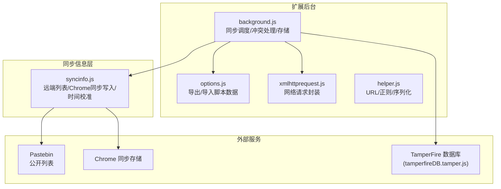
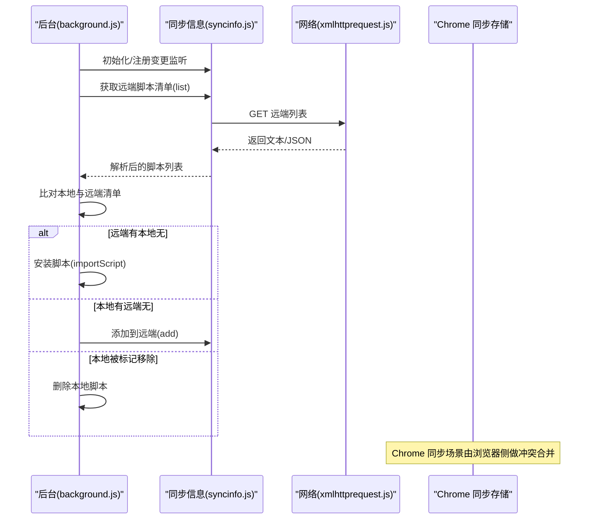
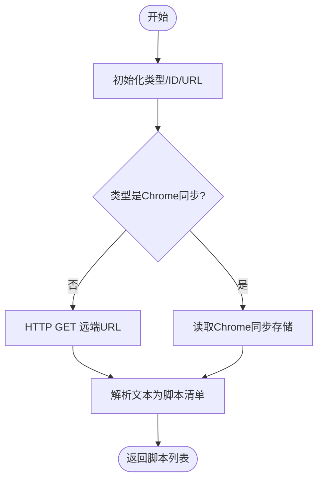
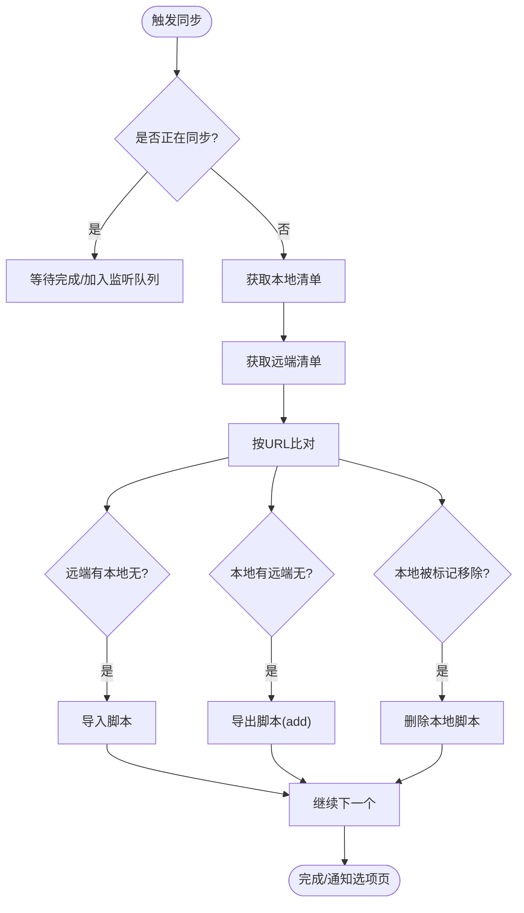
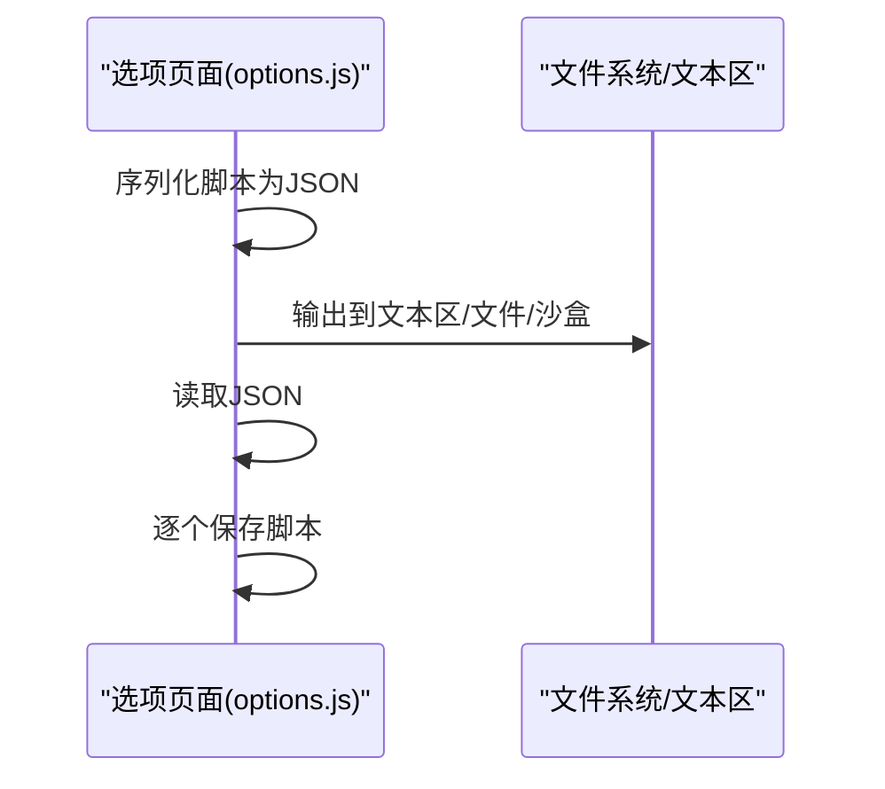
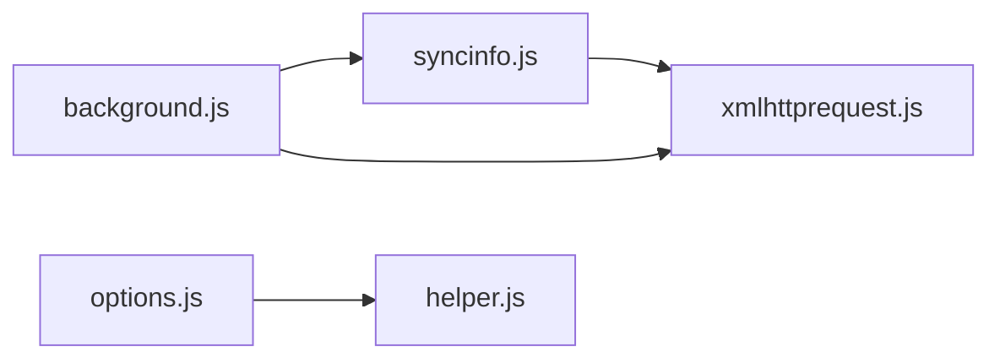

# 同步和备份系统

<cite>
**本文引用的文件**
- [README.md](file://README.md)
- [src/syncinfo.js](file://src/syncinfo.js)
- [src/background.js](file://src/background.js)
- [src/options.js](file://src/options.js)
- [src/xmlhttprequest.js](file://src/xmlhttprequest.js)
- [src/helper.js](file://src/helper.js)
- [src/system/tamperfireDB.tamper.js](file://src/system/tamperfireDB.tamper.js)
</cite>

## 目录
1. [简介](#简介)
2. [项目结构](#项目结构)
3. [核心组件](#核心组件)
4. [架构总览](#架构总览)
5. [详细组件分析](#详细组件分析)
6. [依赖关系分析](#依赖关系分析)
7. [性能考量](#性能考量)
8. [故障排查指南](#故障排查指南)
9. [结论](#结论)
10. [附录](#附录)

## 简介
本文件面向 Tampermonkey 的“同步与备份”系统，围绕双向同步协议、冲突解决策略、增量更新机制、数据存储与序列化、版本控制与一致性、备份与恢复、错误处理与重试、以及性能优化与网络适配进行系统化文档化。目标读者既包括需要快速上手的用户，也包括希望深入理解实现细节的开发者。

## 项目结构
- 同步与备份相关的关键模块集中在后台脚本与同步信息模块中：
  - 同步信息模块：负责远端列表解析、Chrome 同步存储写入/监听、时间偏移校准等。
  - 后台脚本：负责同步调度、本地与远端脚本对比、导入导出、冲突处理、通知与配置联动。
  - 配置界面：提供导出/导入脚本数据（非同步通道），用于备份与迁移。
  - 网络请求封装：统一的 XHR 封装，支持重试与进度回调。
  - 辅助工具：通用正则、URL 处理、序列化等。

图表来源
- [src/background.js:1922-2303](file://src/background.js#L1922-L2303)
- [src/syncinfo.js:1-395](file://src/syncinfo.js#L1-L395)
- [src/options.js:474-718](file://src/options.js#L474-L718)
- [src/xmlhttprequest.js:17-153](file://src/xmlhttprequest.js#L17-L153)
- [src/system/tamperfireDB.tamper.js:1-352](file://src/system/tamperfireDB.tamper.js#L1-L352)

章节来源
- [README.md:1-112](file://README.md#L1-L112)
- [src/background.js:1922-2303](file://src/background.js#L1922-L2303)
- [src/syncinfo.js:1-395](file://src/syncinfo.js#L1-L395)
- [src/options.js:474-718](file://src/options.js#L474-L718)
- [src/xmlhttprequest.js:17-153](file://src/xmlhttprequest.js#L17-L153)
- [src/system/tamperfireDB.tamper.js:1-352](file://src/system/tamperfireDB.tamper.js#L1-L352)

## 核心组件
- 同步信息模块（syncinfo）
  - 远端列表解析：从 Pastebin 等公开列表解析脚本清单。
  - Chrome 同步写入：将脚本同步元数据写入 chrome.storage.sync，支持去重与延迟批量提交。
  - 时间校准：通过 HTTP 头或 JSON 接口获取服务器时间偏移，保证时间戳一致性。
  - 变更监听：监听 chrome.storage.onChanged，触发远端变更回调。
- 后台同步客户端（background.js）
  - 调度与周期：定时任务与事件驱动结合，避免并发冲突。
  - 冲突处理：基于 URL 去重与“移除标记”（removed）实现冲突消解；Chrome 同步场景由浏览器侧做冲突合并。
  - 导入/导出：根据远端清单决定本地安装或删除；根据本地清单决定远端新增或移除。
  - 配置联动：与配置项（启用/类型/ID）变化联动，动态启用/禁用与重排程。
- 配置界面（options）
  - 提供导出/导入脚本数据（非同步通道），用于备份与迁移。
  - 支持多种介质：文本区、沙盒文件系统、下载文件。
- 网络请求（xmlhttprequest）
  - 统一 XHR 封装，支持重试、进度回调、响应头解析、最终 URL 获取。
- 辅助工具（helper）
  - URL 正则构建、HTML 编码/解码、对象序列化等。

章节来源
- [src/syncinfo.js:68-395](file://src/syncinfo.js#L68-L395)
- [src/background.js:1922-2303](file://src/background.js#L1922-L2303)
- [src/options.js:474-718](file://src/options.js#L474-L718)
- [src/xmlhttprequest.js:17-153](file://src/xmlhttprequest.js#L17-L153)
- [src/helper.js:148-206](file://src/helper.js#L148-L206)

## 架构总览
下图展示同步主流程：后台启动后初始化同步客户端，按需拉取远端清单，与本地清单比对，执行导入/导出，最后通知选项页刷新。

图表来源
- [src/background.js:2095-2254](file://src/background.js#L2095-L2254)
- [src/syncinfo.js:220-242](file://src/syncinfo.js#L220-L242)
- [src/xmlhttprequest.js:17-153](file://src/xmlhttprequest.js#L17-L153)

章节来源
- [src/background.js:2095-2254](file://src/background.js#L2095-L2254)
- [src/syncinfo.js:220-242](file://src/syncinfo.js#L220-L242)
- [src/xmlhttprequest.js:17-153](file://src/xmlhttprequest.js#L17-L153)

## 详细组件分析

### 同步信息模块（syncinfo）
- 远端列表解析
  - 支持从指定 URL 拉取文本，按行解析为脚本清单，每行可包含名称、选项与 URL。
  - 对换行、制表符进行归一化，过滤无效行。
- Chrome 同步写入
  - 将脚本 URL 与选项序列化为 JSON，写入 chrome.storage.sync。
  - 使用延迟队列（setTimeout）合并多次写入，减少写入次数。
  - 支持“移除标记”（options.removed），用于表达删除意图。
- 时间校准
  - 通过 HTTP HEAD/GET 请求获取服务器时间偏移，修正本地时间戳，保证跨实例一致性。
- 变更监听
  - 监听 chrome.storage.onChanged，过滤非脚本键、非脚本后缀，触发回调以触发后续同步。

图表来源
- [src/syncinfo.js:68-242](file://src/syncinfo.js#L68-L242)

章节来源
- [src/syncinfo.js:68-242](file://src/syncinfo.js#L68-L242)
- [src/syncinfo.js:244-288](file://src/syncinfo.js#L244-L288)
- [src/syncinfo.js:333-361](file://src/syncinfo.js#L333-L361)
- [src/syncinfo.js:90-141](file://src/syncinfo.js#L90-L141)

### 后台同步客户端（background.js）
- 启用与初始化
  - 根据配置启用/禁用同步，注册远端变更回调。
- 调度与并发
  - 使用计时器与“正在同步计数”避免并发；支持强制重排程。
  - 周期性检查与事件驱动（如权限确认）结合。
- 清单比对与冲突处理
  - 以 URL 作为主键进行比对（同时考虑更新 URL 与文件 URL）。
  - 远端存在且本地标记移除：删除本地脚本。
  - 本地存在但远端不存在：导出到远端（add）。
  - 远端存在且本地不存在：导入本地（installFromUrl）。
  - Chrome 同步场景由浏览器侧做冲突合并，避免重复导入。
- 事件回调
  - 远端变更回调：触发短延时同步。
  - 本地脚本增删改回调：触发相应导出/移除操作。

图表来源
- [src/background.js:2095-2254](file://src/background.js#L2095-L2254)
- [src/background.js:2256-2302](file://src/background.js#L2256-L2302)

章节来源
- [src/background.js:1942-1954](file://src/background.js#L1942-L1954)
- [src/background.js:1973-2019](file://src/background.js#L1973-L2019)
- [src/background.js:2095-2254](file://src/background.js#L2095-L2254)
- [src/background.js:2256-2302](file://src/background.js#L2256-L2302)

### 配置界面（options）与备份/恢复
- 备份（导出）
  - 将当前所有脚本序列化为 JSON 文本，支持输出到文本区、下载文件或沙盒文件系统。
- 恢复（导入）
  - 从文本区/文件/沙盒读取 JSON，逐个调用保存接口安装脚本。
- 注意
  - 该流程不经过同步通道，仅用于本地备份与迁移。

图表来源
- [src/options.js:474-718](file://src/options.js#L474-L718)

章节来源
- [src/options.js:474-718](file://src/options.js#L474-L718)

### 网络请求与重试机制
- 统一封装
  - 支持方法、URL、头部、重试次数、响应类型等参数。
  - onload/onerror/onreadystatechange 统一回调，支持进度上报。
- 重试策略
  - 当状态码非 200 且剩余重试次数 > 0 时自动重试。
  - 适用于远端列表拉取与资源加载等场景。
- 最终 URL
  - 从响应头中提取最终 URL，便于日志与调试。

章节来源
- [src/xmlhttprequest.js:17-153](file://src/xmlhttprequest.js#L17-L153)

### 版本控制与一致性
- 时间偏移校准
  - 通过 HTTP 头或 JSON 接口获取服务器时间，修正本地时间戳，保证跨实例一致性。
- 冲突消解
  - URL 去重为主；远端标记移除（removed）表达删除意图；Chrome 同步场景由浏览器侧合并。
- 版本迁移
  - 背景脚本在启动时执行多阶段数据迁移与转换，确保历史数据兼容新版本。

章节来源
- [src/syncinfo.js:90-141](file://src/syncinfo.js#L90-L141)
- [src/background.js:145-391](file://src/background.js#L145-L391)

## 依赖关系分析
- 模块耦合
  - background.js 依赖 syncinfo.js 进行远端交互与 Chrome 同步写入。
  - background.js 依赖 xmlhttprequest.js 进行网络请求。
  - options.js 依赖 helper.js 进行序列化与 DOM 工具。
- 外部依赖
  - Chrome 同步存储（chrome.storage.sync）用于双向同步。
  - Pastebin 等第三方公开列表用于非 Chrome 同步场景。

图表来源
- [src/background.js:32-34](file://src/background.js#L32-L34)
- [src/syncinfo.js:8-9](file://src/syncinfo.js#L8-L9)
- [src/options.js:8-17](file://src/options.js#L8-L17)
- [src/xmlhttprequest.js:8-9](file://src/xmlhttprequest.js#L8-L9)
- [src/helper.js:184-206](file://src/helper.js#L184-L206)

章节来源
- [src/background.js:32-34](file://src/background.js#L32-L34)
- [src/syncinfo.js:8-9](file://src/syncinfo.js#L8-L9)
- [src/options.js:8-17](file://src/options.js#L8-L17)
- [src/xmlhttprequest.js:8-9](file://src/xmlhttprequest.js#L8-L9)
- [src/helper.js:184-206](file://src/helper.js#L184-L206)

## 性能考量
- 批量写入与延迟提交
  - syncinfo.js 使用延迟队列合并多次写入，降低写入频率。
- 并发控制
  - background.js 通过“正在同步计数”与定时器避免并发同步。
- 缓存与重试
  - 资源与 require 文件缓存减少重复请求；XHR 封装支持重试提升稳定性。
- 网络适配
  - 支持自定义 UA/Referer 前缀，绕过某些站点限制；最终 URL 与进度上报便于监控。

章节来源
- [src/syncinfo.js:292-300](file://src/syncinfo.js#L292-L300)
- [src/background.js:2095-2108](file://src/background.js#L2095-L2108)
- [src/xmlhttprequest.js:155-159](file://src/xmlhttprequest.js#L155-L159)

## 故障排查指南
- 同步未触发
  - 检查配置项（启用/类型/ID）是否正确设置。
  - Chrome 同步场景需确认存储权限已授予。
- 冲突未解决
  - 确认远端是否正确标记移除（removed）。
  - Chrome 同步场景由浏览器侧合并，避免重复导入。
- 网络问题
  - 查看重试日志与状态码；必要时调整重试次数。
  - 检查最终 URL 与响应头，定位跳转或限速问题。
- 备份/恢复失败
  - 确认 JSON 格式正确；逐个脚本尝试导入以定位异常。

章节来源
- [src/background.js:2000-2014](file://src/background.js#L2000-L2014)
- [src/background.js:2183-2207](file://src/background.js#L2183-L2207)
- [src/xmlhttprequest.js:67-92](file://src/xmlhttprequest.js#L67-L92)
- [src/options.js:518-555](file://src/options.js#L518-L555)

## 结论
该同步系统通过“远端清单 + 本地清单”的比对与“URL 去重 + 移除标记”的冲突消解，实现了稳定可靠的双向同步。配合 Chrome 同步存储的冲突合并与时间偏移校准，确保了跨实例的一致性。备份/恢复通过配置界面的导出/导入能力实现，适合离线迁移与灾难恢复。网络层的统一封装与重试机制提升了可靠性，适合不同网络环境下的运行。

## 附录
- 使用建议
  - 自动同步：启用同步并选择合适类型（Pastebin 或 Chrome 同步），系统会周期性与事件驱动结合进行同步。
  - 手动同步：在选项页触发同步或等待事件回调。
  - 备份与迁移：使用导出功能生成 JSON，迁移时在新环境导入。
- 最佳实践
  - 在弱网环境下适当提高重试次数与等待间隔。
  - 使用 Chrome 同步场景以获得浏览器侧的冲突合并能力。
  - 定期导出备份，防止意外丢失。