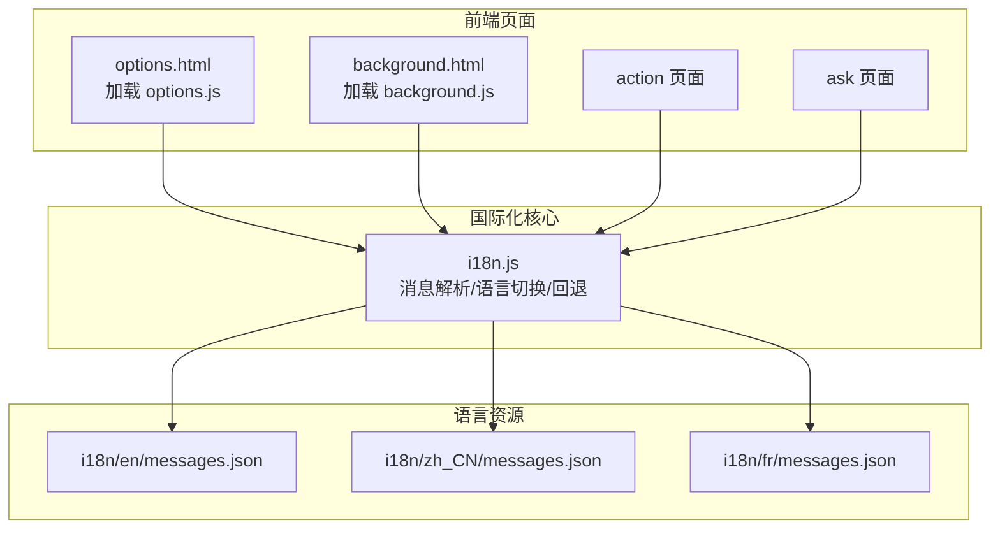
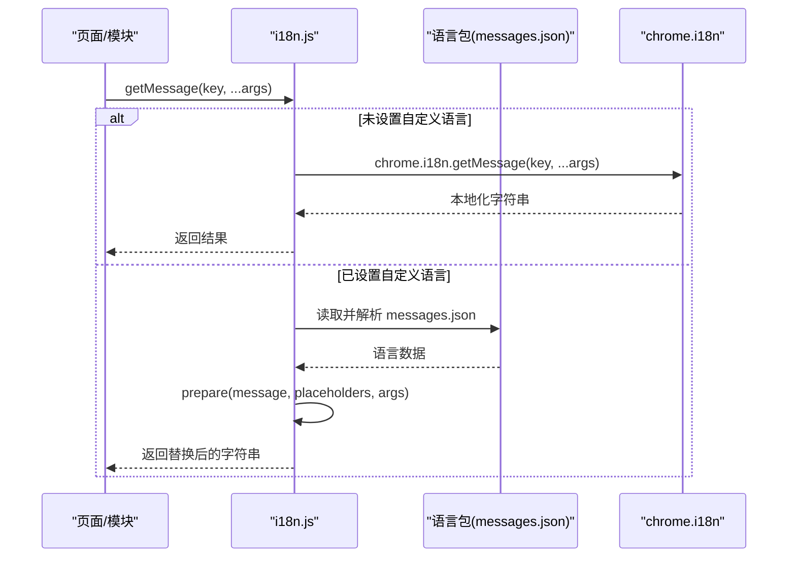
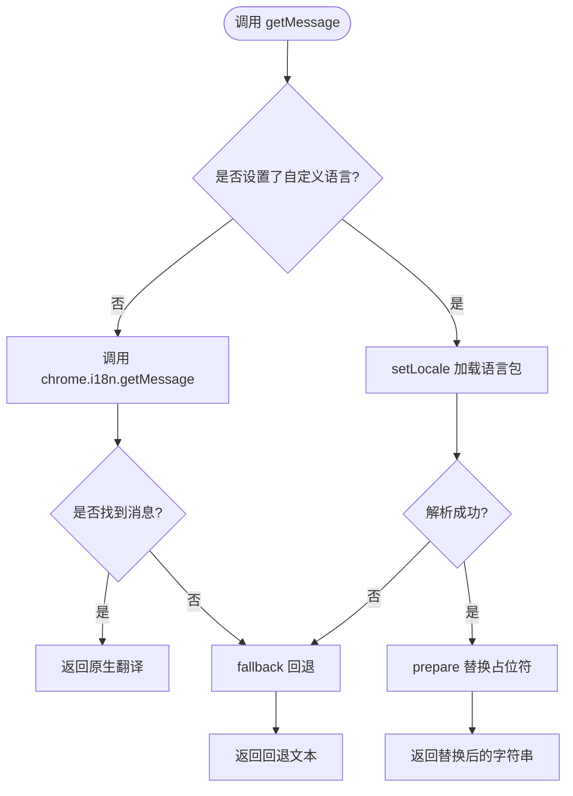
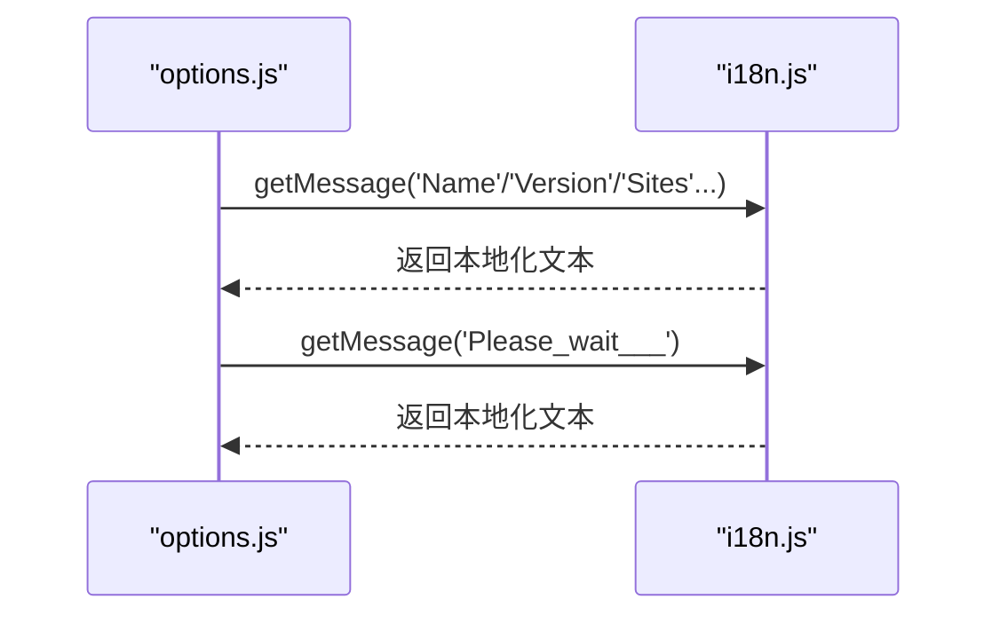
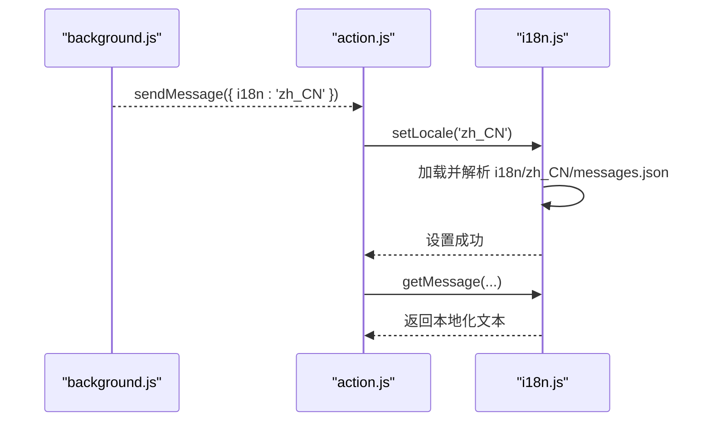
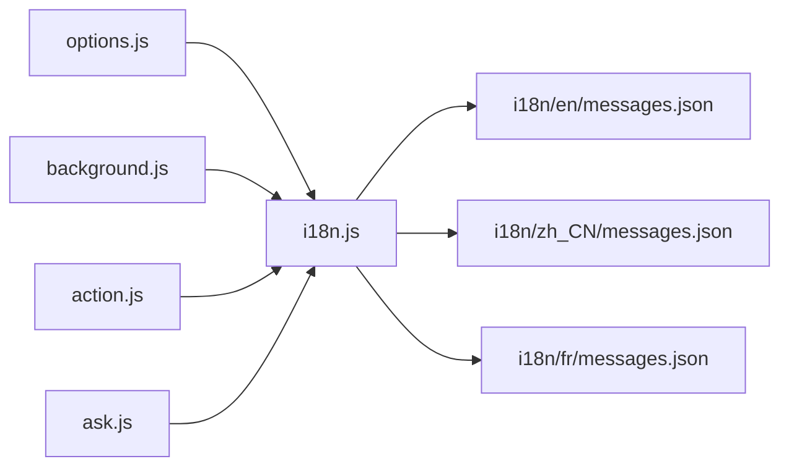

# 国际化系统

<cite>
**本文档引用的文件**
- [src/i18n.js](file://src/i18n.js)
- [i18n/en/messages.json](file://i18n/en/messages.json)
- [i18n/zh_CN/messages.json](file://i18n/zh_CN/messages.json)
- [i18n/fr/messages.json](file://i18n/fr/messages.json)
- [src/options.js](file://src/options.js)
- [src/background.js](file://src/background.js)
- [src/action.js](file://src/action.js)
- [src/ask.js](file://src/ask.js)
- [src/options.html](file://src/options.html)
- [src/background.html](file://src/background.html)
- [README.md](file://README.md)
</cite>

## 目录
1. [简介](#简介)
2. [项目结构](#项目结构)
3. [核心组件](#核心组件)
4. [架构总览](#架构总览)
5. [详细组件分析](#详细组件分析)
6. [依赖关系分析](#依赖关系分析)
7. [性能考虑](#性能考虑)
8. [故障排查指南](#故障排查指南)
9. [结论](#结论)
10. [附录](#附录)

## 简介
本文件系统性梳理 Tampermonkey 的国际化（i18n）体系，涵盖消息文件组织、动态语言切换机制、占位符系统与回退策略；解释语言文件的维护流程、格式规范与最佳实践；并提供测试与验证方法，帮助翻译人员与开发者高效维护多语言内容。

## 项目结构
国际化相关的核心文件分布如下：
- 核心库：src/i18n.js 提供消息获取、语言切换与回退逻辑
- 语言包：i18n/<lang>/messages.json 定义各语言的消息键值与占位符
- 页面集成：各 HTML 页面通过引入 i18n.js 并在 JS 中调用 I18N 接口
- 使用方：options.js、background.js、action.js、ask.js 等模块广泛使用 I18N 接口

图表来源
- [src/options.html](file://src/options.html)
- [src/background.html](file://src/background.html)
- [src/i18n.js](file://src/i18n.js)
- [i18n/en/messages.json](file://i18n/en/messages.json)
- [i18n/zh_CN/messages.json](file://i18n/zh_CN/messages.json)
- [i18n/fr/messages.json](file://i18n/fr/messages.json)

章节来源
- [src/options.html](file://src/options.html)
- [src/background.html](file://src/background.html)
- [src/i18n.js](file://src/i18n.js)

## 核心组件
- i18n.js：提供以下能力
  - 动态语言切换：setLocale(locale) 加载指定语言包
  - 消息获取：getMessage(key, ...args) 返回本地化字符串
  - 回退机制：当语言包缺失或解析失败时，回退到原生 chrome.i18n 或自定义回退
  - 占位符处理：prepare() 解析 placeholders 并替换参数
- 语言包：messages.json 采用键值对结构，支持 placeholders 字段用于参数化替换

章节来源
- [src/i18n.js](file://src/i18n.js)
- [i18n/en/messages.json](file://i18n/en/messages.json)
- [i18n/zh_CN/messages.json](file://i18n/zh_CN/messages.json)
- [i18n/fr/messages.json](file://i18n/fr/messages.json)

## 架构总览
i18n.js 作为统一入口，负责：
- 语言包加载与缓存
- 消息解析与占位符替换
- 回退策略（原生 chrome.i18n 与自定义回退）
- 与业务模块解耦，通过 Registry 注册并对外暴露接口

图表来源
- [src/i18n.js](file://src/i18n.js)

## 详细组件分析

### 组件一：i18n.js 核心功能
- 动态语言切换
  - setLocale(locale)：根据传入的语言代码加载对应语言包，解析 JSON 并缓存
  - 当传入 null 或 "null" 时，清空自定义语言包，回到原生 chrome.i18n
- 消息获取
  - getMessage(key, ...args)：优先使用自定义语言包；若无则回退至 chrome.i18n
  - getMessageOrig()：直接调用 chrome.i18n.getMessage
  - getMessageEx()/getMessageInternal()：内部实现，结合语言包与回退
- 占位符系统
  - prepare()：解析 placeholders，按 content 中的序号替换 $placeholder$ 为实际参数
  - fallback()：当 chrome.i18n 未命中或参数不匹配时，进行简单回退（下划线转空格等）
- 语言请求
  - askForLocale(cb)：向扩展后台请求当前语言设置

图表来源
- [src/i18n.js](file://src/i18n.js)

章节来源
- [src/i18n.js](file://src/i18n.js)

### 组件二：语言包结构与占位符
- 结构要点
  - 键名：如 "Name"、"Settings"、"Update_URL_" 等
  - message：目标语言的翻译文本
  - placeholders：可选，定义占位符映射，content 使用 $1/$2 序号指代参数
- 示例
  - 多参数占位符：键 "run_script_0url0___0name0"，message 中包含 $url$ 与 $name$，placeholders 对应 $1 与 $2
  - 单参数占位符：键 "Update_found_for_0name0_"，placeholders 对应 $1

章节来源
- [i18n/en/messages.json](file://i18n/en/messages.json)
- [i18n/zh_CN/messages.json](file://i18n/zh_CN/messages.json)
- [i18n/fr/messages.json](file://i18n/fr/messages.json)

### 组件三：页面与模块中的使用
- 页面加载
  - options.html、background.html 在头部引入 i18n.js，随后加载各自主 JS 文件
- 模块使用
  - options.js：大量调用 I18N.getMessage 获取表头与文案
  - background.js：日志输出、通知标题等使用 I18N.getMessage
  - action.js：菜单项、提示信息等使用 I18N.getMessage
  - ask.js：安装确认、等待提示等使用 I18N.getMessage

图表来源
- [src/options.js](file://src/options.js)
- [src/i18n.js](file://src/i18n.js)

章节来源
- [src/options.html](file://src/options.html)
- [src/background.html](file://src/background.html)
- [src/options.js](file://src/options.js)
- [src/background.js](file://src/background.js)
- [src/action.js](file://src/action.js)
- [src/ask.js](file://src/ask.js)

### 组件四：动态语言切换流程
- 触发点
  - action.js 中通过 chrome.extension.sendMessage 接收后台响应，若包含 i18n 字段，则调用 I18N.setLocale 切换语言
- 流程
  - setLocale(locale) -> Registry.getRaw 加载 messages.json -> JSON.parse -> 缓存 locale_data
  - 后续 getMessage 直接从缓存取值，无需再次 IO

图表来源
- [src/action.js](file://src/action.js)
- [src/i18n.js](file://src/i18n.js)

章节来源
- [src/action.js](file://src/action.js)
- [src/i18n.js](file://src/i18n.js)

## 依赖关系分析
- 模块内聚与耦合
  - i18n.js 低耦合：仅依赖 Registry 与 chrome.i18n，便于替换与测试
  - 业务模块高内聚：通过 I18N 接口统一获取本地化文本，避免硬编码
- 关键依赖链
  - 页面 → i18n.js → 语言包 JSON
  - 业务模块 → i18n.js → chrome.i18n（回退）

图表来源
- [src/options.js](file://src/options.js)
- [src/background.js](file://src/background.js)
- [src/action.js](file://src/action.js)
- [src/ask.js](file://src/ask.js)
- [src/i18n.js](file://src/i18n.js)
- [i18n/en/messages.json](file://i18n/en/messages.json)
- [i18n/zh_CN/messages.json](file://i18n/zh_CN/messages.json)
- [i18n/fr/messages.json](file://i18n/fr/messages.json)

章节来源
- [src/options.js](file://src/options.js)
- [src/background.js](file://src/background.js)
- [src/action.js](file://src/action.js)
- [src/ask.js](file://src/ask.js)
- [src/i18n.js](file://src/i18n.js)

## 性能考虑
- 语言包缓存：setLocale 成功后将整包 JSON 缓存在内存，后续 getMessage 直接从缓存取值，避免重复 IO
- 按需加载：仅在切换语言时加载对应语言包，减少初始开销
- 占位符替换：prepare 在内存中完成字符串替换，复杂度与消息长度线性相关
- 回退路径：chrome.i18n 命中时无需解析本地 JSON，提升性能

## 故障排查指南
- 语言包加载失败
  - 现象：setLocale 返回 false，控制台打印“解析/获取语言包失败”
  - 排查：确认 messages.json 路径与 JSON 格式正确；检查 Registry.getRaw 是否可读
- 占位符参数不匹配
  - 现象：prepare 抛出参数数量警告或替换异常
  - 排查：核对 placeholders.content 与调用时传入参数顺序一致
- 回退机制触发
  - 现象：未命中语言包时，返回原始键名或经 fallback 处理的文本
  - 排查：确认键名拼写与语言包一致；必要时补充缺失键

章节来源
- [src/i18n.js](file://src/i18n.js)

## 结论
Tampermonkey 的国际化系统以 i18n.js 为核心，通过“原生回退 + 自定义语言包”的双轨机制，实现了灵活且高性能的多语言支持。语言包采用标准化 JSON 结构，配合占位符系统满足复杂文案需求。页面与模块通过统一接口使用 I18N，既保证了开发效率，也便于后期维护与扩展。

## 附录

### 语言文件维护流程
- 新语言添加
  - 在 i18n/ 下新增目录，复制 i18n/en/messages.json 为模板
  - 翻译所有 message，并确保占位符 $placeholder$ 与 placeholders.content 对应
  - 验证页面加载与显示
- 消息键管理
  - 保持键名稳定，避免破坏回退逻辑
  - 批量替换时，先在英文包中更新，再同步到其他语言包
- 翻译质量保证
  - 使用占位符一致性校验工具或脚本扫描
  - 在多语言环境下进行 UI 截图对比，确保布局与字符集兼容

### i18n.js 接口规范
- getMessage(key, ...args)
  - 返回本地化字符串；支持数组参数或多个参数
- getOriginalMessage(key, ...args)
  - 强制使用 chrome.i18n.getMessage
- askForLocale(cb)
  - 请求当前语言设置回调
- getLocale()/setLocale(locale)
  - 查询/设置当前语言；传入 null 或 "null" 清空自定义语言包

章节来源
- [src/i18n.js](file://src/i18n.js)

### 国际化测试与验证方法
- 自动化测试建议
  - 读取各语言包，逐键执行 getMessage(key) 并断言返回非空
  - 对含占位符的消息，构造不同参数组合验证替换结果
- 手工验证步骤
  - 在 options 页面切换语言，观察表头与按钮文案变化
  - 在 background/action/ask 页面触发提示与通知，确认本地化显示正确
- 常见问题定位
  - 若出现乱码，检查页面 meta charset 与语言包编码
  - 若出现键名未替换，检查占位符 content 与调用参数顺序

章节来源
- [src/options.js](file://src/options.js)
- [src/background.js](file://src/background.js)
- [src/action.js](file://src/action.js)
- [src/ask.js](file://src/ask.js)