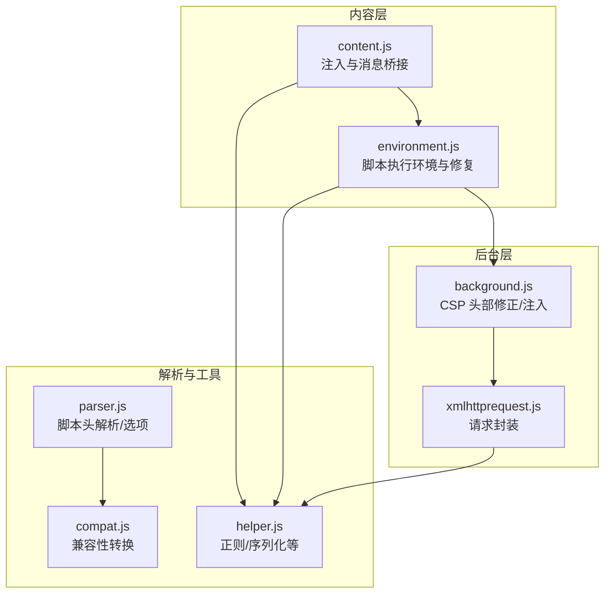
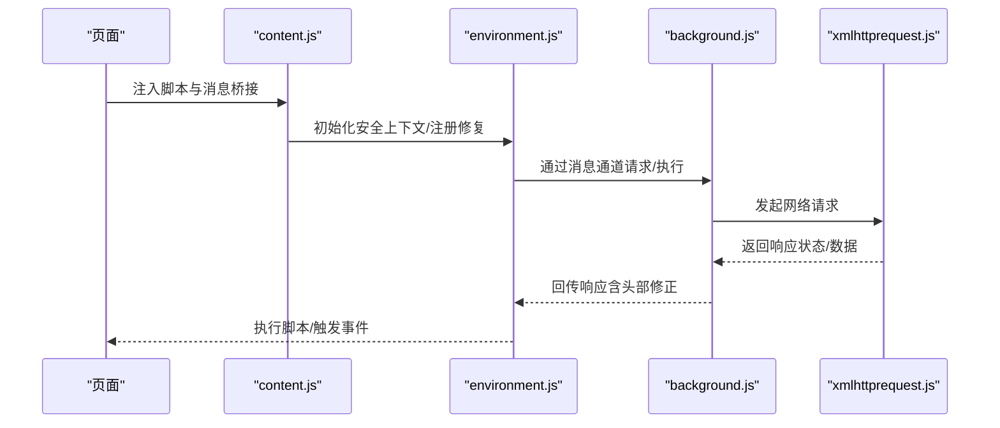
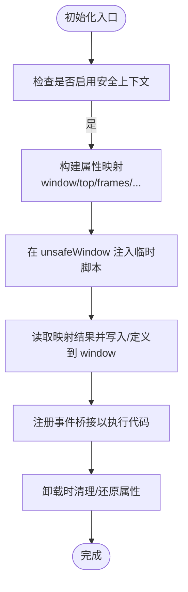
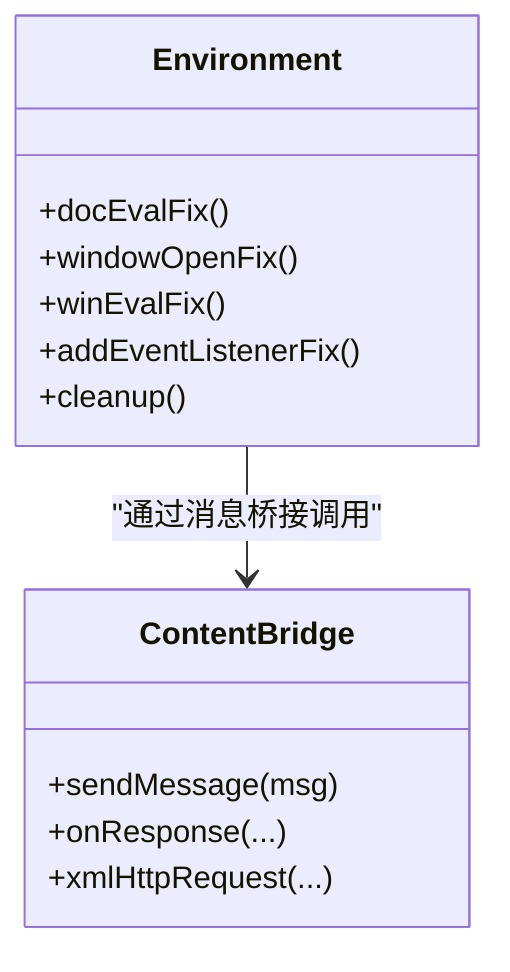
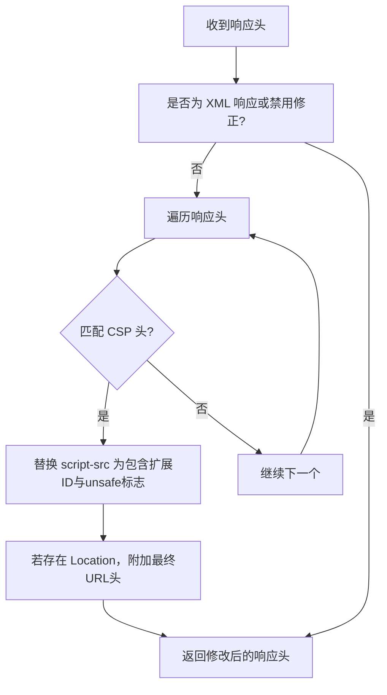
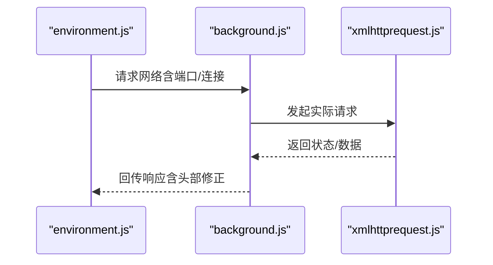
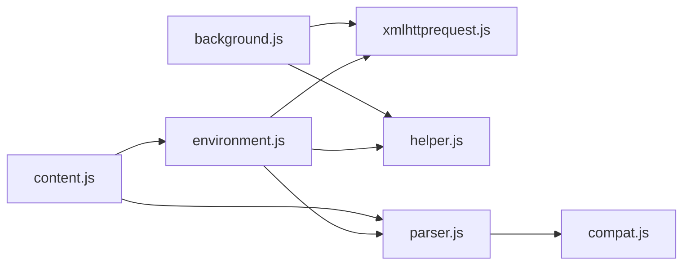

# CSP 兼容性

<cite>
**本文引用的文件**
- [content.js](file://src/content.js)
- [environment.js](file://src/environment.js)
- [background.js](file://src/background.js)
- [xmlhttprequest.js](file://src/xmlhttprequest.js)
- [compat.js](file://src/compat.js)
- [parser.js](file://src/parser.js)
- [helper.js](file://src/helper.js)
</cite>

## 目录
1. [简介](#简介)
2. [项目结构](#项目结构)
3. [核心组件](#核心组件)
4. [架构总览](#架构总览)
5. [组件详解](#组件详解)
6. [依赖关系分析](#依赖关系分析)
7. [性能考量](#性能考量)
8. [故障排查指南](#故障排查指南)
9. [结论](#结论)
10. [附录](#附录)

## 简介
本文件系统化阐述 Tampermonkey 在“内容安全策略（CSP）”方面的兼容性设计与实现，覆盖以下关键点：
- 如何在严格 CSP 环境下运行用户脚本，包括对内联脚本与外部资源的处理策略
- 与浏览器 CSP 实现的差异处理（如 X-WebKit-CSP、X-Content-Security-Policy）
- 通过后台注入与安全上下文切换实现的“unsafe 上下文”访问机制
- 配置项与调试手段，帮助开发者定位与解决 CSP 相关问题
- 对 eval、内联事件处理器等受限能力的替代与兼容方案
- 测试方法与最佳实践建议

## 项目结构
围绕 CSP 兼容性的核心代码分布在以下模块：
- 内容注入与执行环境：content.js、environment.js
- 后台网络与 CSP 处理：background.js
- 请求封装与跨域：xmlhttprequest.js
- 脚本解析与兼容适配：parser.js、compat.js
- 工具与辅助：helper.js

图表来源
- [content.js:1-1202](file://src/content.js#L1-L1202)
- [environment.js:1-1337](file://src/environment.js#L1-L1337)
- [background.js:5870-6069](file://src/background.js#L5870-L6069)
- [xmlhttprequest.js:1-161](file://src/xmlhttprequest.js#L1-L161)
- [parser.js:1-286](file://src/parser.js#L1-L286)
- [compat.js:1-275](file://src/compat.js#L1-L275)
- [helper.js:1-209](file://src/helper.js#L1-L209)

章节来源
- [content.js:1-1202](file://src/content.js#L1-L1202)
- [environment.js:1-1337](file://src/environment.js#L1-L1337)
- [background.js:5870-6069](file://src/background.js#L5870-L6069)
- [xmlhttprequest.js:1-161](file://src/xmlhttprequest.js#L1-L161)
- [parser.js:1-286](file://src/parser.js#L1-L286)
- [compat.js:1-275](file://src/compat.js#L1-L275)
- [helper.js:1-209](file://src/helper.js#L1-L209)

## 核心组件
- 安全上下文初始化与“unsafe 上下文”暴露：通过在页面上下文与扩展上下文之间建立桥接，允许脚本在受限环境下仍可访问 window.top、frames 等对象，并提供安全清理机制。
- CSP 头部修正与注入：在响应头中追加扩展 ID 与“unsafe-inline/unsafe-eval”，以放宽脚本执行限制。
- 执行环境修复：对 document.evaluate、window.open、定时器字符串参数等进行适配，确保脚本在严格 CSP 下仍能正常工作。
- 请求封装与本地文件访问：统一处理 HTTP(S) 请求与本地文件读取，规避 CSP 对本地协议的限制。

章节来源
- [content.js:455-608](file://src/content.js#L455-L608)
- [environment.js:520-625](file://src/environment.js#L520-L625)
- [background.js:5878-5928](file://src/background.js#L5878-L5928)
- [xmlhttprequest.js:17-153](file://src/xmlhttprequest.js#L17-L153)

## 架构总览
下图展示 CSP 兼容性在 Tampermonkey 中的整体流程：页面内容脚本负责注入与桥接；执行环境负责修复与适配；后台负责网络拦截与 CSP 头部修正；请求封装负责统一的网络访问。

图表来源
- [content.js:108-215](file://src/content.js#L108-L215)
- [environment.js:1321-1336](file://src/environment.js#L1321-L1336)
- [background.js:5870-6069](file://src/background.js#L5870-L6069)
- [xmlhttprequest.js:17-153](file://src/xmlhttprequest.js#L17-L153)

## 组件详解

### 安全上下文初始化与“unsafe 上下文”暴露
- 通过在 unsafeWindow 中创建临时脚本节点，注入属性映射，从而在受控条件下暴露 window.top、frames 等对象。
- 若检测到脚本拦截器（如 ScriptNo），会记录告警并通过扩展消息上报，便于用户识别与调整。
- 提供事件桥接机制，使用自定义 MutationEvent 触发在 unsafe 上下文中执行代码，避免直接 eval 暴露。

图表来源
- [content.js:455-608](file://src/content.js#L455-L608)
- [content.js:509-518](file://src/content.js#L509-L518)

章节来源
- [content.js:455-608](file://src/content.js#L455-L608)
- [content.js:509-518](file://src/content.js#L509-L518)

### 执行环境修复与适配
- document.evaluate 修复：当查询元素不在文档树中时自动添加相对路径前缀，提升 XPath 查询成功率。
- window.open 修复：在安全上下文中重定向至 unsafeWindow 的 window.open 结果，保证返回值可用。
- 定时器字符串参数修复：将字符串形式的定时器回调包装为函数，避免 CSP 对内联脚本的限制。
- 事件监听修复：对 DOMContentLoaded/DOMNodeInserted 等事件进行重放与顺序控制，确保脚本生命周期正确。

图表来源
- [environment.js:520-625](file://src/environment.js#L520-L625)
- [environment.js:1321-1336](file://src/environment.js#L1321-L1336)
- [content.js:108-215](file://src/content.js#L108-L215)

章节来源
- [environment.js:520-625](file://src/environment.js#L520-L625)
- [environment.js:1321-1336](file://src/environment.js#L1321-L1336)
- [content.js:108-215](file://src/content.js#L108-L215)

### CSP 头部修正与注入
- 在响应头中检测 X-WebKit-CSP 或 X-Content-Security-Policy，将 script-src 替换为包含扩展 ID 与“unsafe-inline/unsafe-eval”的宽松策略，以满足脚本执行需求。
- 对重定向场景保留最终 URL，避免后续请求误判。
- 提供配置项“将 Tampermonkey 添加到 CSP”，默认开启，可在严格拦截场景下关闭以观察行为差异。

图表来源
- [background.js:5878-5928](file://src/background.js#L5878-L5928)

章节来源
- [background.js:5092-5100](file://src/background.js#L5092-L5100)
- [background.js:5878-5928](file://src/background.js#L5878-L5928)

### 请求封装与本地文件访问
- 统一的 XMLHttpRequest 封装，支持重试、进度回调、响应类型与 MIME 类型覆盖。
- 对本地文件访问提供两种路径：XMLHttpRequest 与 iframe message，后者用于规避某些页面对本地协议的限制。
- 对非 http(s) 协议进行校验，防止不安全的本地文件读取。

图表来源
- [environment.js:693-747](file://src/environment.js#L693-L747)
- [xmlhttprequest.js:17-153](file://src/xmlhttprequest.js#L17-L153)
- [background.js:5870-6069](file://src/background.js#L5870-L6069)

章节来源
- [environment.js:693-747](file://src/environment.js#L693-L747)
- [xmlhttprequest.js:17-153](file://src/xmlhttprequest.js#L17-L153)
- [background.js:5870-6069](file://src/background.js#L5870-L6069)

### 脚本解析与兼容性转换
- 解析用户脚本头，提取 includes/matches/excludes/requires 等元数据，并根据脚本内容推断兼容性选项。
- 提供多种兼容性转换：元数据块转换、for each 语法转换、数组解构赋值转换、严格模式规避等，降低脚本在严格 CSP 环境下的执行门槛。

章节来源
- [parser.js:72-281](file://src/parser.js#L72-L281)
- [compat.js:14-271](file://src/compat.js#L14-L271)

## 依赖关系分析
- content.js 依赖 environment.js 进行执行环境初始化与修复；同时通过消息桥接与后台交互。
- environment.js 依赖 xmlhttprequest.js 进行网络请求封装，并依赖 helper.js 提供的序列化与工具方法。
- background.js 依赖 xmlhttprequest.js 进行网络请求，并对响应头进行 CSP 修正。
- parser.js 与 compat.js 为脚本解析与兼容性转换提供基础能力，贯穿脚本加载与执行链路。

图表来源
- [content.js:80-92](file://src/content.js#L80-L92)
- [environment.js:1321-1336](file://src/environment.js#L1321-L1336)
- [xmlhttprequest.js:159-160](file://src/xmlhttprequest.js#L159-L160)
- [parser.js:9-16](file://src/parser.js#L9-L16)
- [compat.js:273-275](file://src/compat.js#L273-L275)
- [helper.js:184-209](file://src/helper.js#L184-L209)

章节来源
- [content.js:80-92](file://src/content.js#L80-L92)
- [environment.js:1321-1336](file://src/environment.js#L1321-L1336)
- [xmlhttprequest.js:159-160](file://src/xmlhttprequest.js#L159-L160)
- [parser.js:9-16](file://src/parser.js#L9-L16)
- [compat.js:273-275](file://src/compat.js#L273-L275)
- [helper.js:184-209](file://src/helper.js#L184-L209)

## 性能考量
- 事件重放与监听器管理：对 DOMContentLoaded/DOMNodeInserted 等事件进行延迟重放与顺序控制，避免重复注册导致的性能损耗。
- 请求缓存与重试：对 require 资源设置缓存与清理周期，减少重复网络开销；对失败请求进行有限次数重试。
- 头部修正按需处理：仅在非 XML 请求且启用修正时才进行 CSP 头部修改，降低不必要的 CPU 开销。
- 序列化与反序列化：通过序列化传递复杂对象，避免直接 eval 带来的安全与性能风险。

## 故障排查指南
- 无法访问 unsafe 上下文
  - 现象：控制台提示“unsafeWindow 获取失败”或脚本被拦截器阻止
  - 排查：确认已启用“将 Tampermonkey 添加到 CSP”选项；检查是否存在 ScriptNo 等脚本拦截器；查看扩展消息上报
  - 参考
    - [content.js:475-500](file://src/content.js#L475-L500)
    - [background.js:5092-5100](file://src/background.js#L5092-L5100)

- eval/内联事件处理器被拒绝
  - 现象：定时器字符串参数无效、内联事件处理器不触发
  - 排查：使用环境修复函数（定时器字符串包装、事件桥接）；避免直接使用 eval
  - 参考
    - [environment.js:591-625](file://src/environment.js#L591-L625)
    - [content.js:509-518](file://src/content.js#L509-L518)

- 网络请求失败或被拦截
  - 现象：本地文件读取失败、CSP 导致的脚本加载异常
  - 排查：确认请求协议为 http(s) 或本地图片；启用 CSP 修正；检查响应头是否被修改
  - 参考
    - [xmlhttprequest.js:12-153](file://src/xmlhttprequest.js#L12-L153)
    - [background.js:5878-5928](file://src/background.js#L5878-L5928)

- 调试与日志
  - 使用日志级别调整与消息桥接输出，定位执行阶段与网络阶段问题
  - 参考
    - [content.js:69-77](file://src/content.js#L69-L77)
    - [environment.js:18-35](file://src/environment.js#L18-L35)

章节来源
- [content.js:475-500](file://src/content.js#L475-L500)
- [content.js:509-518](file://src/content.js#L509-L518)
- [environment.js:591-625](file://src/environment.js#L591-L625)
- [xmlhttprequest.js:12-153](file://src/xmlhttprequest.js#L12-L153)
- [background.js:5092-5100](file://src/background.js#L5092-L5100)
- [background.js:5878-5928](file://src/background.js#L5878-L5928)
- [content.js:69-77](file://src/content.js#L69-L77)
- [environment.js:18-35](file://src/environment.js#L18-L35)

## 结论
Tampermonkey 通过“安全上下文桥接 + 执行环境修复 + 后台 CSP 头部修正 + 统一请求封装”的组合，在严格 CSP 场景下实现了对用户脚本的兼容运行。开发者可通过配置项与调试手段快速定位问题，并遵循最佳实践（避免 eval、使用事件桥接、启用 CSP 修正）获得稳定体验。

## 附录

### 配置项与调试要点
- 将 Tampermonkey 添加到 CSP：默认启用，必要时可关闭以对比差异
- 允许脚本修改请求头：支持“是/自动/否”，按需开启
- 禁止页面列表：可配置禁止运行脚本的页面集合
- 日志级别：通过调整日志等级输出更详细的执行与网络信息

章节来源
- [background.js:5092-5119](file://src/background.js#L5092-L5119)

### 最佳实践建议
- 避免直接使用 eval 与内联事件处理器，优先采用事件桥接与函数式回调
- 使用 matches/include/exclude 精准限定脚本生效范围，减少不必要的网络与执行
- 在严格 CSP 环境下启用“将 Tampermonkey 添加到 CSP”，并配合请求头修正
- 对 require 资源进行缓存与重试策略优化，提升加载稳定性