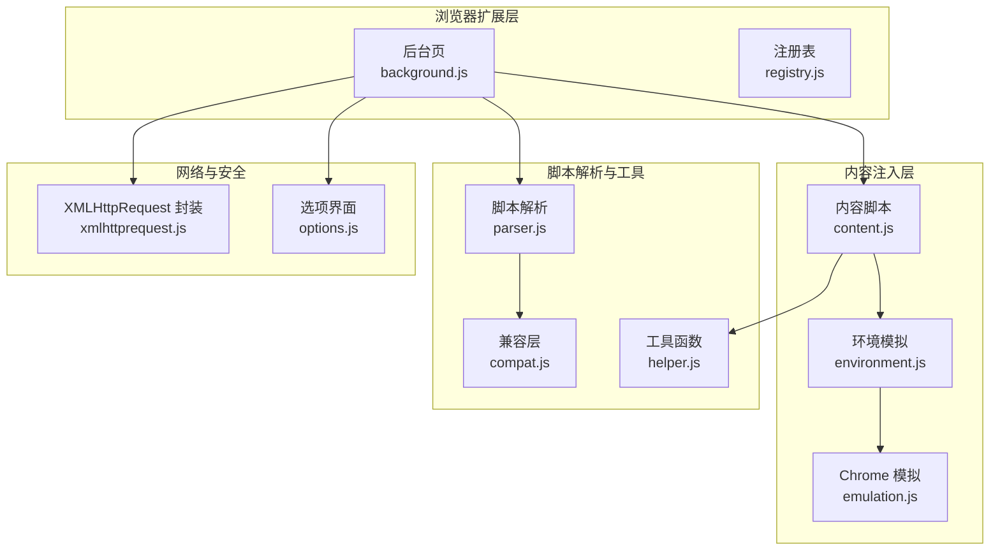
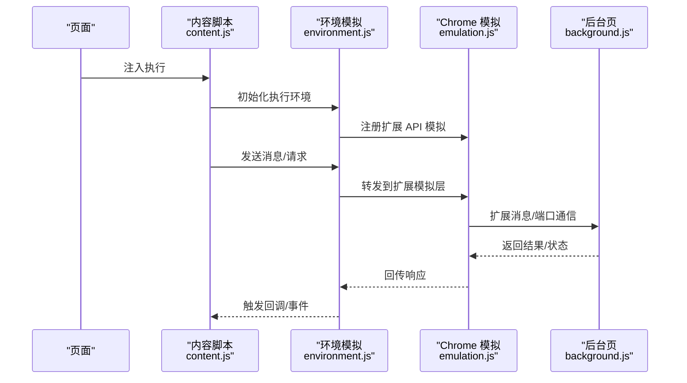
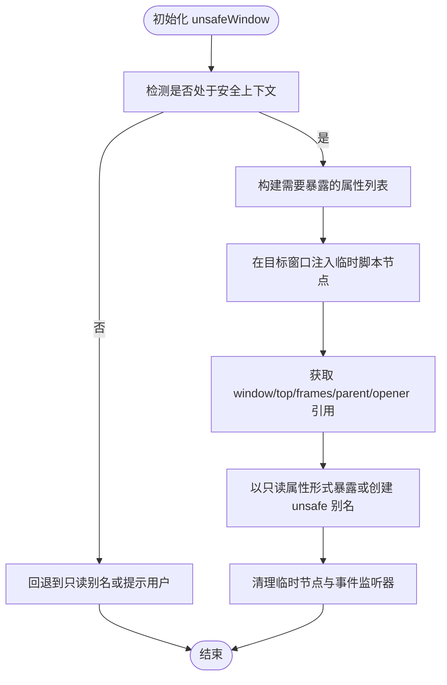
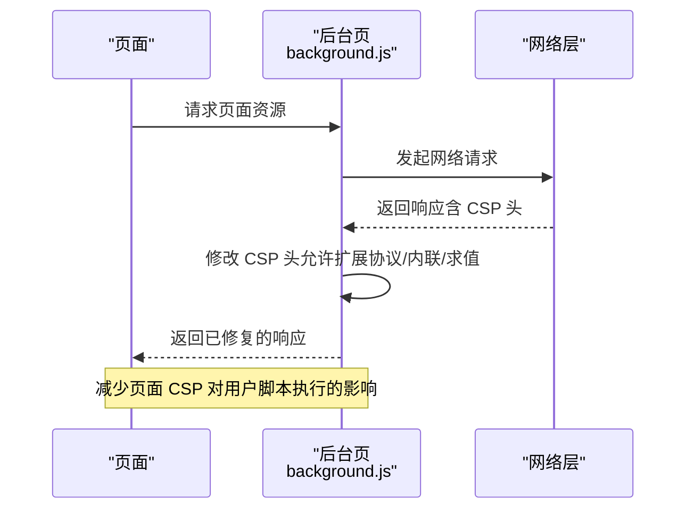
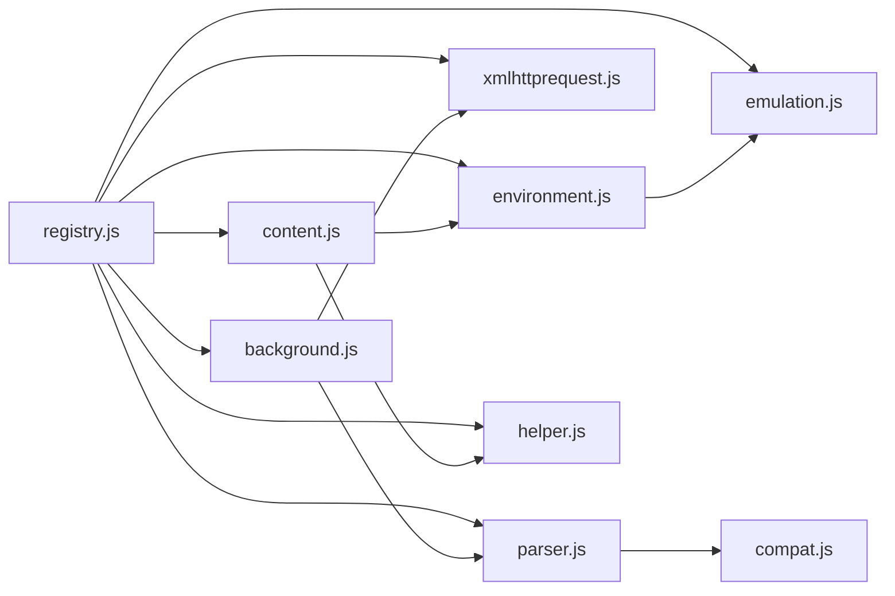

# 安全和权限系统

<cite>
**本文档引用的文件**
- [README.md](file://README.md)
- [background.js](file://src/background.js)
- [content.js](file://src/content.js)
- [environment.js](file://src/environment.js)
- [emulation.js](file://src/emulation.js)
- [xmlhttprequest.js](file://src/xmlhttprequest.js)
- [parser.js](file://src/parser.js)
- [compat.js](file://src/compat.js)
- [helper.js](file://src/helper.js)
- [options.js](file://src/options.js)
- [registry.js](file://src/registry.js)
</cite>

## 目录
1. [简介](#简介)
2. [项目结构](#项目结构)
3. [核心组件](#核心组件)
4. [架构总览](#架构总览)
5. [详细组件分析](#详细组件分析)
6. [依赖关系分析](#依赖关系分析)
7. [性能考量](#性能考量)
8. [故障排查指南](#故障排查指南)
9. [结论](#结论)
10. [附录](#附录)

## 简介
本文件面向 Tampermonkey 的安全与权限系统，系统性阐述其安全模型、权限声明与检查机制、沙箱隔离、CSP 兼容与 XSS 防护、恶意脚本检测与防护、unsafeWindow 访问控制、安全最佳实践与漏洞预防策略，以及与浏览器安全模型的集成与兼容性。

## 项目结构
Tampermonkey 采用多模块协作的架构：后台页负责脚本生命周期管理、权限与网络请求拦截、CSP 修复；内容注入层负责在页面上下文中执行用户脚本并提供受限的 unsafeWindow 访问；环境模拟层提供与浏览器扩展 API 的桥接；解析器负责解析用户脚本元数据与运行选项；工具与兼容层提供 URL 匹配、正则转换、兼容性适配等基础能力。

图表来源
- [background.js](file://src/background.js)
- [content.js](file://src/content.js)
- [environment.js](file://src/environment.js)
- [emulation.js](file://src/emulation.js)
- [xmlhttprequest.js](file://src/xmlhttprequest.js)
- [parser.js](file://src/parser.js)
- [compat.js](file://src/compat.js)
- [helper.js](file://src/helper.js)
- [options.js](file://src/options.js)
- [registry.js](file://src/registry.js)

章节来源
- [README.md](file://README.md)
- [registry.js](file://src/registry.js)

## 核心组件
- 后台页（background.js）
  - 负责脚本安装校验、黑名单过滤、CSP 头修改、网络请求拦截与重写、脚本点击安装流程、权限申请与状态维护。
  - 提供脚本 URL 检测、本地文件读取桥接、上下文注册与统计、更新检查与存储监听。
- 内容脚本（content.js）
  - 在页面上下文中初始化执行环境，建立安全上下文与 unsafeWindow 访问桥接，处理事件与消息转发，提供受限的 XMLHttpRequest 代理。
- 环境模拟（environment.js）
  - 在受控环境中执行用户脚本，提供事件重放、定时器安全包装、GM/TM API 模拟、XHR 请求桥接、清理资源与回退机制。
- Chrome 模拟（emulation.js）
  - 提供与扩展 API 对应的模拟层，封装消息、端口、请求处理器、国际化等调用，作为 content.js 与后台页之间的桥梁。
- XMLHTTPRequest 封装（xmlhttprequest.js）
  - 统一封装 XHR 行为，进行协议校验、头信息处理、进度回调、错误重试与响应状态提取。
- 脚本解析（parser.js）
  - 解析用户脚本元数据（@include/@match/@exclude/@require/@resource 等），生成脚本对象与运行选项，识别兼容性需求。
- 兼容层（compat.js）
  - 提供对旧语法与非标准特性的兼容转换，避免严格模式限制与原型链问题。
- 工具与辅助（helper.js）
  - 提供 URL 正则转换、本地资源判断、序列化、类型判断、HTML 编解码等通用能力。
- 选项界面（options.js）
  - 展示脚本特征图标（如 unsafeWindow、GM_xmlhttpRequest、存储等），提示用户权限范围。

章节来源
- [background.js](file://src/background.js)
- [content.js](file://src/content.js)
- [environment.js](file://src/environment.js)
- [emulation.js](file://src/emulation.js)
- [xmlhttprequest.js](file://src/xmlhttprequest.js)
- [parser.js](file://src/parser.js)
- [compat.js](file://src/compat.js)
- [helper.js](file://src/helper.js)
- [options.js](file://src/options.js)

## 架构总览
Tampermonkey 的安全架构围绕“内容注入 + 受限桥接 + 后台控制”展开：

- 内容注入层在页面上下文中执行用户脚本，但通过安全上下文与事件桥接限制直接访问全局对象，仅暴露必要的只读或受控属性。
- unsafeWindow 访问通过在目标窗口中注入脚本节点，使用自定义事件通道传递源代码片段，避免直接跨上下文赋值带来的风险。
- 后台页统一管理网络请求、CSP 修复、脚本安装与权限申请，对可疑脚本与危险 URL 进行拦截与告警。
- 解析器与兼容层确保脚本在不同环境下稳定运行，同时规避严格模式与原型污染等潜在问题。

图表来源
- [content.js](file://src/content.js)
- [environment.js](file://src/environment.js)
- [emulation.js](file://src/emulation.js)
- [background.js](file://src/background.js)

## 详细组件分析

### 安全模型与权限声明
- 权限声明
  - 用户脚本通过元数据声明匹配规则（@match/@include/@exclude）、资源依赖（@require/@resource）、运行时机（@run-at）与 UA 覆盖（@user-agent）等。
  - 解析器在加载时提取这些元数据，生成脚本对象与运行选项，并识别兼容性需求（如 @noframes、@nocompat 等）。
- 权限检查与拦截
  - 后台页对脚本安装来源进行校验，禁止从非原始路径安装脚本，避免仓库镜像站点的非 raw 链接被误认为安装链接。
  - 对 require 资源实施黑名单过滤，防止加载黑名单中的外部资源。
  - 对本地文件读取提供基于消息与 iframe 的桥接，避免直接 file:// 协议访问导致的跨域与缓存问题。
- 最小权限原则
  - 默认仅启用必要功能，按需开启 UA 覆盖、@noframes 等选项，减少脚本对页面上下文的侵入。
  - 通过选项界面展示脚本特征图标，帮助用户识别高风险操作（如 unsafeWindow、GM_xmlhttpRequest、存储）。

章节来源
- [parser.js](file://src/parser.js)
- [background.js](file://src/background.js)
- [options.js](file://src/options.js)

### 沙箱隔离与 unsafeWindow 访问
- 安全上下文
  - 内容脚本在安全上下文中执行，通过事件桥接方式在目标窗口中注入脚本节点，以自定义 MutationEvent 触发源代码执行，避免直接赋值导致的跨上下文攻击面。
- unsafeWindow 访问
  - 通过在目标窗口中创建临时元素并设置属性，获取 window/top/frames/parent/opener 等对象的引用，再以只读属性形式暴露给脚本，或在无法直接写入时创建 unsafeTop 等只读别名。
  - 若检测到脚本拦截器（如 ScriptNo），会向后台页上报并提示用户重新加载页面以启用脚本执行。
- 清理与回退
  - 执行完成后清理注入的属性与事件监听器，避免残留影响页面上下文。
  - 对不支持的场景提供回退方案（如使用 eval 包裹字符串执行），并记录日志便于诊断。

图表来源
- [content.js](file://src/content.js)
- [environment.js](file://src/environment.js)

章节来源
- [content.js](file://src/content.js)
- [environment.js](file://src/environment.js)

### CSP 兼容性与 XSS 防护
- CSP 修复
  - 后台页在请求响应头中检测 X-WebKit-CSP 或 X-Content-Security-Policy，将 script-src 替换为允许扩展协议与内联/求值的策略，缓解页面 CSP 对用户脚本执行的影响。
- URL 安全与协议校验
  - XHR 封装仅允许 http/https 或特定本地图片资源，拒绝 file:// 等高风险协议，防止本地文件读取与跨站脚本。
- 事件与回调安全
  - 通过事件桥接与响应 ID 管理，确保回调在受控范围内执行，避免跨上下文注入与反射型 XSS。
- 日志与告警
  - 在关键路径输出调试日志，便于定位 CSP 与脚本拦截问题；当检测到脚本拦截器时，弹出提示引导用户重新加载页面。

图表来源
- [background.js](file://src/background.js)
- [xmlhttprequest.js](file://src/xmlhttprequest.js)

章节来源
- [background.js](file://src/background.js)
- [xmlhttprequest.js](file://src/xmlhttprequest.js)

### 恶意脚本检测与防护
- 脚本来源校验
  - 仅允许来自指定域名的原始链接安装脚本，禁止非 raw 链接，降低钓鱼与篡改风险。
- require 黑名单
  - 对 require 资源实施黑名单过滤，阻止加载黑名单中的外部资源，减少供应链攻击面。
- 安装流程与兼容性
  - 对使用 unsafeWindow.gmonkey 的脚本直接拒绝安装，避免潜在的高危 API 使用。
  - 对不兼容的脚本进行兼容性标记，提示用户注意潜在问题。
- 用户警告与提示
  - 当检测到脚本拦截器时，向用户弹窗提示并建议重新加载页面以启用脚本执行。
  - 选项界面通过图标直观展示脚本的高风险特征，帮助用户做出知情选择。

章节来源
- [background.js](file://src/background.js)
- [parser.js](file://src/parser.js)
- [options.js](file://src/options.js)

### 权限管理最佳实践
- 最小权限原则
  - 仅授予脚本完成任务所需的最小权限，避免滥用 unsafeWindow、GM_xmlhttpRequest、存储等高风险能力。
- 明确的元数据声明
  - 使用 @match/@include/@exclude 精确限定脚本生效范围，减少误触发与越权访问。
- 透明的权限展示
  - 通过选项界面的图标与描述，让用户清楚了解脚本的权限范围与潜在风险。
- 定期审计与更新
  - 对长期未更新的脚本保持警惕，优先使用可信来源与官方仓库。
- 与浏览器安全模型的集成
  - 遵循 CSP、同源策略与扩展权限模型，避免绕过浏览器内置保护机制。

章节来源
- [options.js](file://src/options.js)
- [parser.js](file://src/parser.js)
- [background.js](file://src/background.js)

### 安全漏洞预防与应对策略
- 预防
  - 严格校验脚本来源与 require 资源，避免加载不受信任的第三方代码。
  - 限制 unsafeWindow 访问范围，仅暴露必要属性并以只读形式提供。
  - 对 CSP 进行最小化放宽，避免过度放宽导致 XSS 风险上升。
- 应对
  - 当检测到脚本拦截器时，立即提示用户重新加载页面并提供一键跳转安装入口。
  - 对异常网络请求与错误进行日志记录，便于后续分析与修复。
  - 在开发与测试阶段启用详细日志，快速定位问题根因。

章节来源
- [background.js](file://src/background.js)
- [content.js](file://src/content.js)

## 依赖关系分析
- 模块耦合
  - content.js 依赖 environment.js 与 emulation.js 提供的执行与桥接能力；environment.js 依赖 emulation.js 的扩展 API 模拟。
  - background.js 依赖 xmlhttprequest.js 进行网络请求，依赖 parser.js 解析脚本元数据，依赖 helper.js 进行 URL 匹配与正则转换。
  - registry.js 作为模块加载器，协调各模块的注册与依赖加载。
- 外部依赖与集成点
  - 与浏览器扩展 API 的集成通过 emulation.js 的模拟层实现，屏蔽底层差异。
  - 与页面上下文的交互通过事件桥接与消息转发，避免直接跨上下文赋值。

图表来源
- [registry.js](file://src/registry.js)
- [content.js](file://src/content.js)
- [environment.js](file://src/environment.js)
- [emulation.js](file://src/emulation.js)
- [background.js](file://src/background.js)
- [xmlhttprequest.js](file://src/xmlhttprequest.js)
- [parser.js](file://src/parser.js)
- [compat.js](file://src/compat.js)
- [helper.js](file://src/helper.js)

章节来源
- [registry.js](file://src/registry.js)

## 性能考量
- 脚本执行性能
  - 通过事件桥接与最小化 DOM 操作，减少对页面主线程的阻塞。
  - 对 require 资源进行缓存与失效时间控制，降低重复加载开销。
- 网络请求优化
  - XHR 封装支持重试与进度回调，提升弱网环境下的稳定性。
- 日志与调试
  - 提供细粒度的日志开关，便于在生产与调试场景间切换，避免日志成为性能瓶颈。

## 故障排查指南
- 脚本拦截器导致的执行失败
  - 现象：unsafeWindow 获取失败，控制台提示脚本拦截器存在。
  - 处理：后台页检测到后会弹窗提示用户重新加载页面；若用户同意，将尝试覆盖内容设置以允许脚本执行。
- CSP 导致的脚本执行失败
  - 现象：页面 CSP 限制导致用户脚本无法执行。
  - 处理：后台页自动修复响应头中的 CSP，放宽 script-src 以允许扩展协议与内联/求值。
- 本地文件读取失败
  - 现象：file:// 协议读取超时或失败。
  - 处理：通过 iframe + postMessage 方案读取本地资源，并添加时间戳避免缓存。
- require 资源加载失败
  - 现象：@require 的外部资源无法加载。
  - 处理：检查黑名单配置与网络连通性，确认 URL 是否在黑名单中。

章节来源
- [background.js](file://src/background.js)
- [content.js](file://src/content.js)
- [xmlhttprequest.js](file://src/xmlhttprequest.js)

## 结论
Tampermonkey 的安全与权限系统通过“内容注入 + 受限桥接 + 后台控制”的设计，在保证用户脚本灵活性的同时，有效降低了 XSS、脚本拦截与供应链攻击的风险。通过对 CSP 的最小化放宽、严格的脚本来源与 require 校验、以及对 unsafeWindow 访问的严格限制，系统在可用性与安全性之间取得了平衡。建议用户遵循最小权限原则，审慎授予高风险权限，并定期审计脚本来源与更新情况。

## 附录
- 关键实现位置参考
  - unsafeWindow 初始化与注入：[content.js](file://src/content.js)
  - 扩展 API 模拟与消息桥接：[emulation.js](file://src/emulation.js)
  - 环境执行与事件重放：[environment.js](file://src/environment.js)
  - 网络请求与 CSP 修复：[background.js](file://src/background.js)、[xmlhttprequest.js](file://src/xmlhttprequest.js)
  - 脚本元数据解析与兼容性：[parser.js](file://src/parser.js)、[compat.js](file://src/compat.js)
  - URL 匹配与本地资源判断：[helper.js](file://src/helper.js)
  - 权限展示与用户提示：[options.js](file://src/options.js)