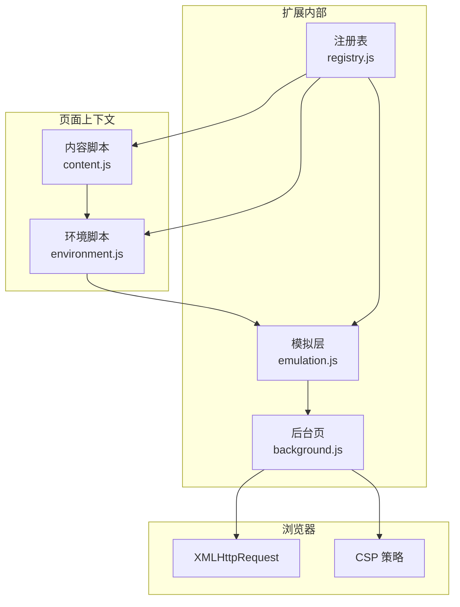
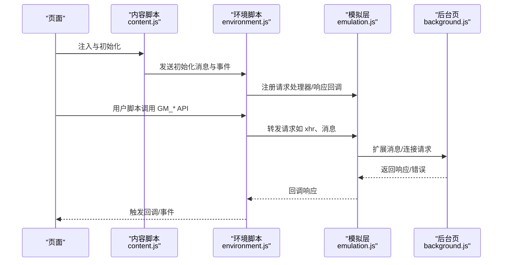
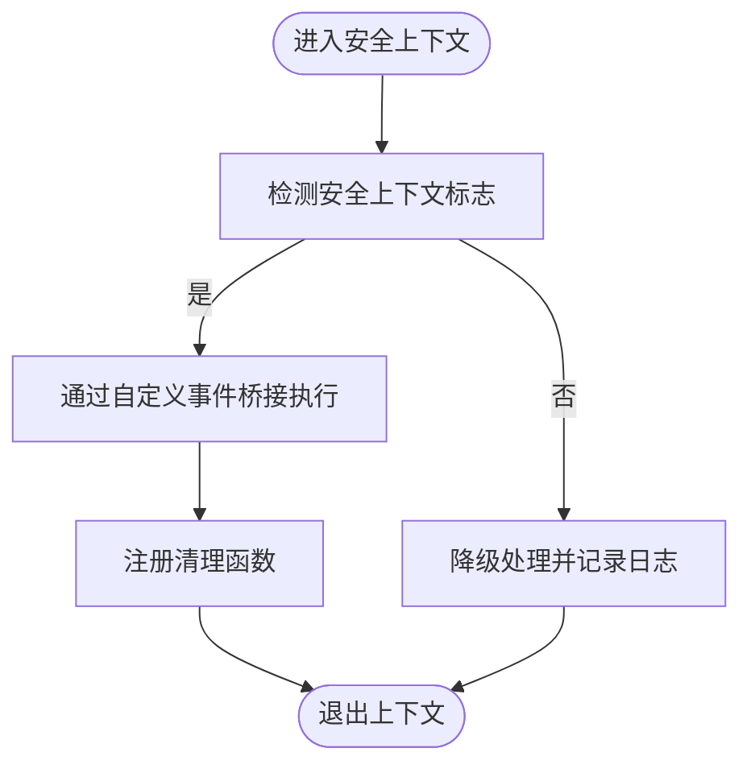
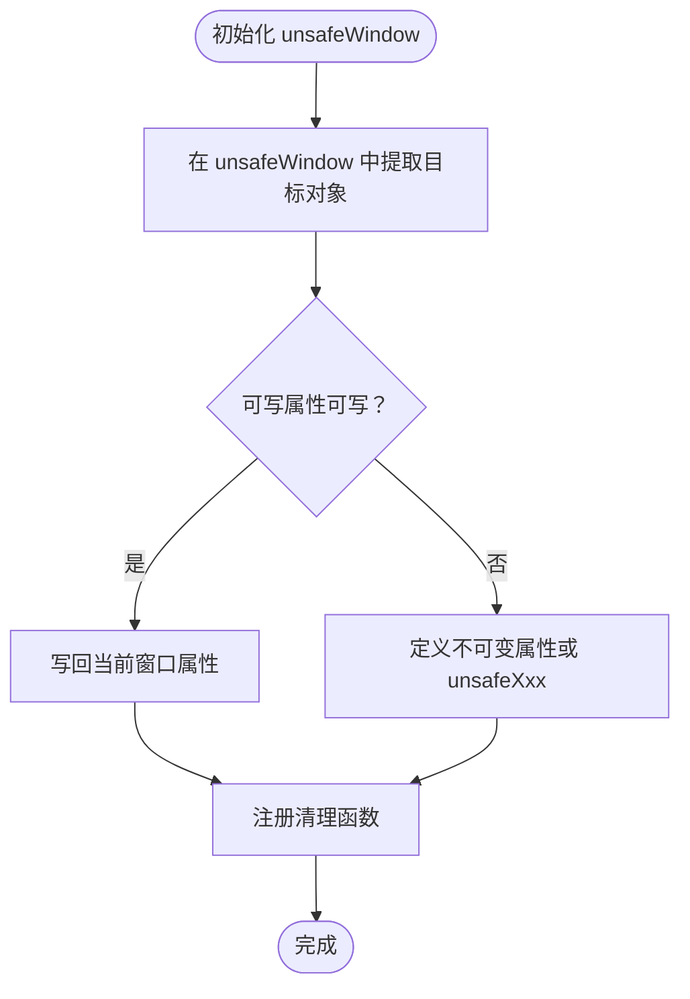
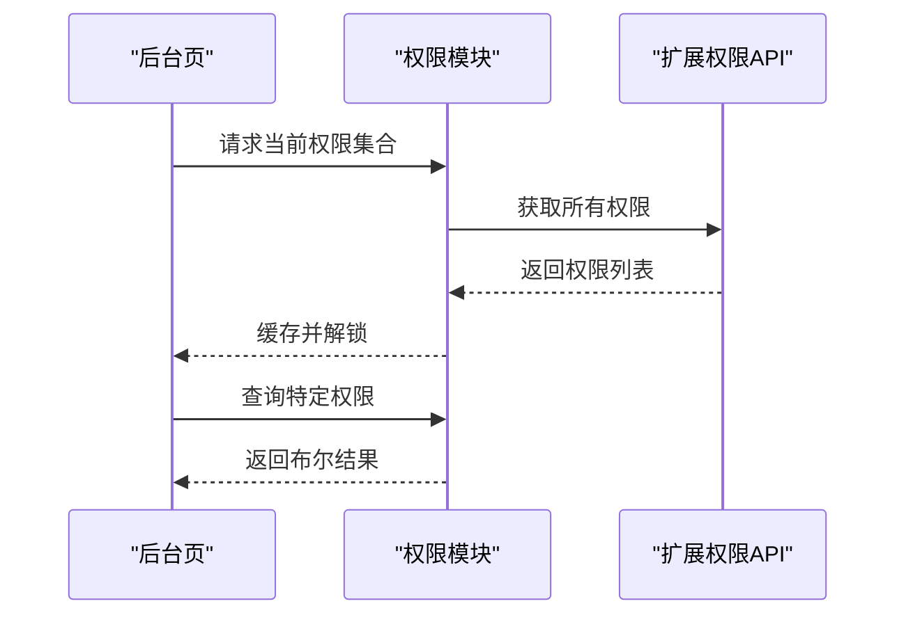
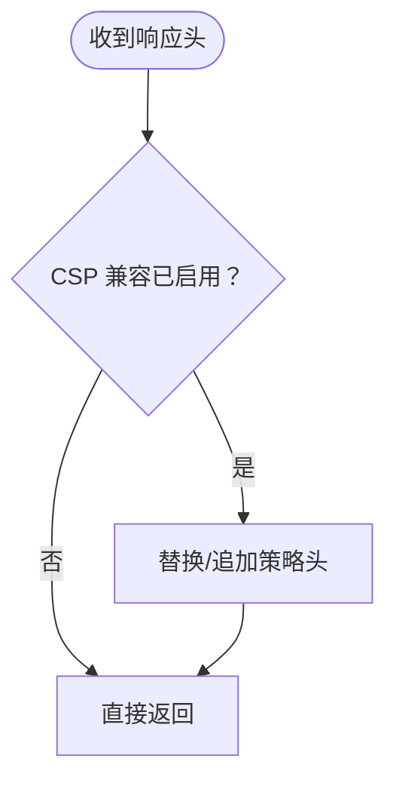
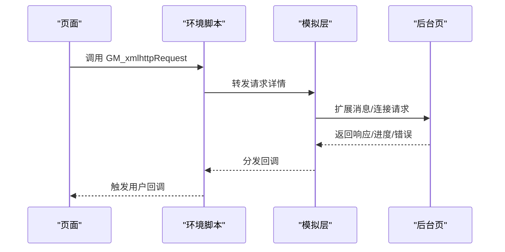
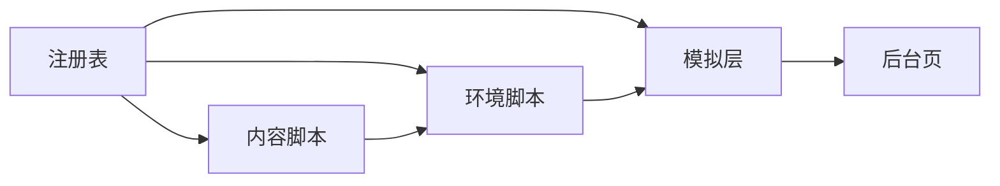

# 安全模型设计

<cite>
**本文档引用的文件**
- [README.md](file://README.md)
- [content.js](file://src/content.js)
- [environment.js](file://src/environment.js)
- [emulation.js](file://src/emulation.js)
- [xmlhttprequest.js](file://src/xmlhttprequest.js)
- [background.js](file://src/background.js)
- [registry.js](file://src/registry.js)
- [manifest.json.legacy.com](file://build_sys/manifest.json.legacy.com)
- [manifest.json.google.com](file://build_sys/manifest.json.google.com)
</cite>

## 目录
1. [引言](#引言)
2. [项目结构](#项目结构)
3. [核心组件](#核心组件)
4. [架构总览](#架构总览)
5. [详细组件分析](#详细组件分析)
6. [依赖关系分析](#依赖关系分析)
7. [性能考量](#性能考量)
8. [故障排查指南](#故障排查指南)
9. [结论](#结论)
10. [附录](#附录)

## 引言
本文件面向 Tampermonkey 的安全模型设计，聚焦于沙箱隔离、权限声明与检查、unsafeWindow 访问控制、以及与浏览器安全模型（尤其是 CSP）的集成方式。文档通过代码级分析与可视化图示，系统阐述内容脚本与用户脚本之间的安全边界、权限验证流程、以及在多组件协作下的信任边界与数据流。

## 项目结构
Tampermonkey 在 Manifest V2 中采用“内容脚本 + 后台页 + 模拟层”的分层结构：
- 内容脚本：在页面上下文中运行，负责注入环境、初始化 unsafeWindow、事件桥接与请求转发。
- 环境脚本：在受控环境中执行用户脚本，提供 GM_* API、事件重放与清理。
- 模拟层：桥接页面与后台，封装 chrome.* API 的调用与响应。
- 后台页：集中处理权限、网络请求、CSP 处理、脚本生命周期管理等。

图表来源
- [content.js:108-215](file://src/content.js#L108-L215)
- [environment.js:1-120](file://src/environment.js#L1-L120)
- [emulation.js:40-329](file://src/emulation.js#L40-L329)
- [background.js:1-120](file://src/background.js#L1-L120)
- [registry.js:11-104](file://src/registry.js#L11-L104)

章节来源
- [content.js:1-120](file://src/content.js#L1-L120)
- [environment.js:1-120](file://src/environment.js#L1-L120)
- [emulation.js:1-60](file://src/emulation.js#L1-L60)
- [background.js:1-120](file://src/background.js#L1-L120)
- [registry.js:1-60](file://src/registry.js#L1-L60)

## 核心组件
- 内容脚本（content.js）
  - 负责在页面中注入环境、初始化 unsafeWindow、事件桥接、消息转发与请求代理。
  - 关键职责：安全上下文标记、unsafeWindow 初始化、事件与请求的跨层传递。
- 环境脚本（environment.js）
  - 在受控环境中执行用户脚本，提供 GM_* API、事件重放、DOM 事件修复、定时器字符串参数转译等。
  - 关键职责：脚本执行上下文隔离、API 模拟、资源加载与清理。
- 模拟层（emulation.js）
  - 将 chrome.* API 在页面上下文中以受控方式暴露，统一请求/响应通道与连接端口。
  - 关键职责：请求路由、响应回调注册、端口消息转发。
- 后台页（background.js）
  - 集中处理权限、网络请求、CSP 修改、脚本运行统计与上下文注册。
  - 关键职责：权限校验、CSP 兼容、请求拦截与重写、上下文状态维护。
- 注册表（registry.js）
  - 模块化加载与依赖管理，支持按需加载与回调触发。
  - 关键职责：模块注册、原始内容读取、动态脚本注入。

章节来源
- [content.js:455-608](file://src/content.js#L455-L608)
- [environment.js:520-780](file://src/environment.js#L520-L780)
- [emulation.js:40-200](file://src/emulation.js#L40-L200)
- [background.js:435-558](file://src/background.js#L435-L558)
- [registry.js:35-104](file://src/registry.js#L35-L104)

## 架构总览
下图展示了从页面到后台的完整数据流与信任边界：

图表来源
- [content.js:108-215](file://src/content.js#L108-L215)
- [environment.js:646-760](file://src/environment.js#L646-L760)
- [emulation.js:126-195](file://src/emulation.js#L126-L195)
- [background.js:4503-4520](file://src/background.js#L4503-L4520)

## 详细组件分析

### 沙箱隔离与安全上下文
- 安全上下文标记
  - 内容脚本通过标志位标识当前是否处于“安全上下文”，并在需要时通过自定义事件桥接执行页面侧逻辑。
- 事件桥接机制
  - 使用自定义 MutationEvent 名称前缀触发页面侧执行，避免直接在页面上下文执行不受控代码。
- 清理与回退
  - 提供 Clean 列表用于在卸载或异常时恢复/删除临时属性，降低持久性风险。

图表来源
- [content.js:61-76](file://src/content.js#L61-L76)
- [content.js:610-628](file://src/content.js#L610-L628)
- [environment.js:309-323](file://src/environment.js#L309-L323)

章节来源
- [content.js:61-76](file://src/content.js#L61-L76)
- [content.js:610-628](file://src/content.js#L610-L628)
- [environment.js:309-323](file://src/environment.js#L309-L323)

### unsafeWindow 访问与权限控制
- unsafeWindow 初始化流程
  - 通过在 unsafeWindow 文档中注入脚本，提取 window/top/frames/parent/opener 等对象，并尝试写回或定义为不可变属性。
  - 若检测到脚本拦截器（如 ScriptNo），会向后台发送告警消息以便提示用户。
- 访问限制与命名空间
  - 对可写属性优先尝试写回；否则通过定义不可变属性或创建“unsafeXxx”别名的方式暴露。
- 安全边界
  - 仅在安全上下文启用时进行 unsafeWindow 初始化；失败时启用脚本拦截告警。

图表来源
- [content.js:455-608](file://src/content.js#L455-L608)
- [environment.js:1146-1165](file://src/environment.js#L1146-L1165)

章节来源
- [content.js:455-608](file://src/content.js#L455-L608)
- [environment.js:1146-1165](file://src/environment.js#L1146-L1165)

### 权限声明与检查机制
- Manifest 权限
  - Manifest V1/V2 声明了 webRequest/webRequestBlocking、tabs、management、webNavigation、<all_urls> 等权限，用于网络拦截与标签页操作。
  - 可选权限包含 contentSettings，用于更细粒度的页面设置控制。
- 后台权限检查
  - 后台维护权限集合，提供获取与判断接口，避免并发查询导致的竞态。
  - 对于 CSP 相关修改，后台根据配置选择性地替换策略头，允许扩展脚本在受限环境下执行。

图表来源
- [background.js:5329-5352](file://src/background.js#L5329-L5352)
- [background.js:5354-5359](file://src/background.js#L5354-L5359)
- [manifest.json.legacy.com:34-36](file://build_sys/manifest.json.legacy.com#L34-L36)
- [manifest.json.google.com:34-41](file://build_sys/manifest.json.google.com#L34-L41)

章节来源
- [background.js:5329-5359](file://src/background.js#L5329-L5359)
- [manifest.json.legacy.com:34-36](file://build_sys/manifest.json.legacy.com#L34-L36)
- [manifest.json.google.com:34-41](file://build_sys/manifest.json.google.com#L34-L41)

### 浏览器安全模型集成与 CSP 兼容
- CSP 处理策略
  - 后台在拦截响应头时，若开启 CSP 兼容选项，则将策略中的 script-src 追加扩展 ID 与“内联/求值”豁免，使用户脚本可在受限站点正常运行。
- 网络请求与头部改写
  - 支持对 UA/Referer 等头部进行前缀化处理，避免与页面脚本冲突；同时保留对 responseType 的原生支持路径。

图表来源
- [background.js:5886-5914](file://src/background.js#L5886-L5914)
- [xmlhttprequest.js:115-138](file://src/xmlhttprequest.js#L115-L138)

章节来源
- [background.js:5886-5914](file://src/background.js#L5886-L5914)
- [xmlhttprequest.js:115-138](file://src/xmlhttprequest.js#L115-L138)

### 数据流与 API 调用序列
- GM_xmlhttpRequest 调用链
  - 页面脚本通过环境脚本发起请求，模拟层将请求转发至后台，后台执行真实 XHR 并回调前端。
- 扩展消息与连接
  - 通过扩展消息/连接端口实现双向通信，响应使用唯一 ID 绑定回调。

图表来源
- [environment.js:693-747](file://src/environment.js#L693-L747)
- [emulation.js:52-82](file://src/emulation.js#L52-L82)
- [background.js:4503-4520](file://src/background.js#L4503-L4520)

章节来源
- [environment.js:693-747](file://src/environment.js#L693-L747)
- [emulation.js:52-82](file://src/emulation.js#L52-L82)
- [background.js:4503-4520](file://src/background.js#L4503-L4520)

## 依赖关系分析
- 模块化与加载
  - 注册表负责模块注册与按需加载，支持原始内容读取与动态注入，确保内容脚本、环境脚本与模拟层协同工作。
- 组件耦合
  - 内容脚本与环境脚本强耦合（事件桥接与初始化），环境脚本与模拟层强耦合（API 模拟与回调），模拟层与后台弱耦合（通过消息/连接）。

图表来源
- [registry.js:76-92](file://src/registry.js#L76-L92)
- [content.js:80-91](file://src/content.js#L80-L91)
- [environment.js:1-40](file://src/environment.js#L1-L40)
- [emulation.js:9-32](file://src/emulation.js#L9-L32)

章节来源
- [registry.js:76-92](file://src/registry.js#L76-L92)
- [content.js:80-91](file://src/content.js#L80-L91)
- [environment.js:1-40](file://src/environment.js#L1-L40)
- [emulation.js:9-32](file://src/emulation.js#L9-L32)

## 性能考量
- 请求重试与进度上报
  - XHR 实现具备重试与进度上报能力，减少失败重试对用户体验的影响。
- 缓存与清理
  - 后台维护 require 缓存与清理周期，降低重复加载开销；环境脚本提供 Clean 列表确保卸载时释放资源。
- 事件与回调
  - 通过唯一 ID 绑定回调，避免全局监听器带来的内存压力。

章节来源
- [xmlhttprequest.js:67-92](file://src/xmlhttprequest.js#L67-L92)
- [background.js:403-431](file://src/background.js#L403-L431)
- [environment.js:309-323](file://src/environment.js#L309-L323)

## 故障排查指南
- unsafeWindow 初始化失败
  - 现象：控制台提示脚本拦截器检测，且无法获取 unsafeWindow。
  - 排查：确认是否安装脚本拦截器；查看后台是否收到脚本拦截告警消息。
- CSP 导致脚本无法执行
  - 现象：受限站点下用户脚本不生效。
  - 排查：检查后台 CSP 兼容选项是否启用；确认响应头是否被正确替换。
- 权限不足
  - 现象：网络请求失败或标签页操作受限。
  - 排查：通过权限模块检查所需权限是否已授予；必要时请求相应权限。

章节来源
- [content.js:487-499](file://src/content.js#L487-L499)
- [background.js:5092-5110](file://src/background.js#L5092-L5110)
- [background.js:5329-5359](file://src/background.js#L5329-L5359)

## 结论
Tampermonkey 的安全模型通过“内容脚本 + 环境脚本 + 模拟层 + 后台页”的分层设计，在页面上下文与扩展权限之间建立了清晰的信任边界。unsafeWindow 的初始化与属性保护、CSP 的策略兼容、以及权限的集中管理与检查，共同构成了多维度的安全保障。通过事件桥接与消息通道，系统在保证功能完整性的同时，最大限度降低了页面侧攻击面与权限滥用风险。

## 附录
- Manifest 权限与可选权限
  - Manifest V1/V2 均声明了 webRequest/webRequestBlocking、tabs、management、webNavigation、<all_urls> 等权限；可选权限包含 contentSettings。
- 功能特性摘要
  - README 显示支持 unsafeWindow 访问与大量 GM_* API。

章节来源
- [manifest.json.legacy.com:34-36](file://build_sys/manifest.json.legacy.com#L34-L36)
- [manifest.json.google.com:34-41](file://build_sys/manifest.json.google.com#L34-L41)
- [README.md:12-16](file://README.md#L12-L16)