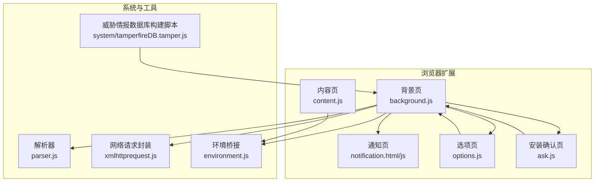
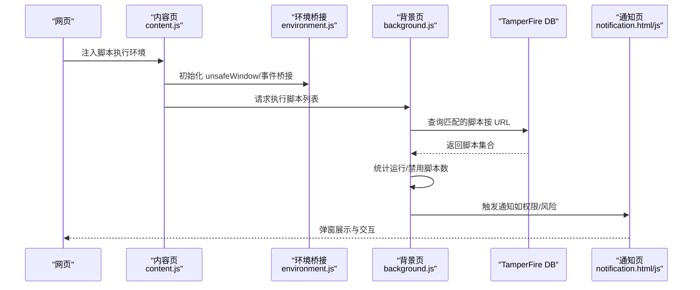
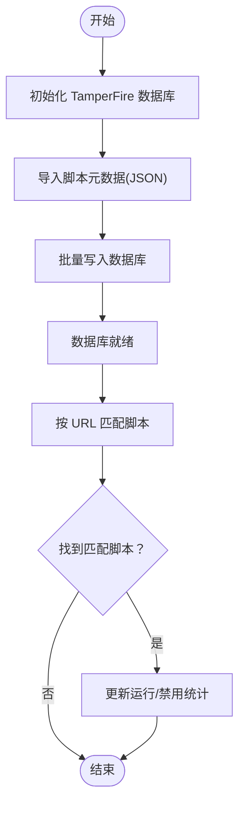
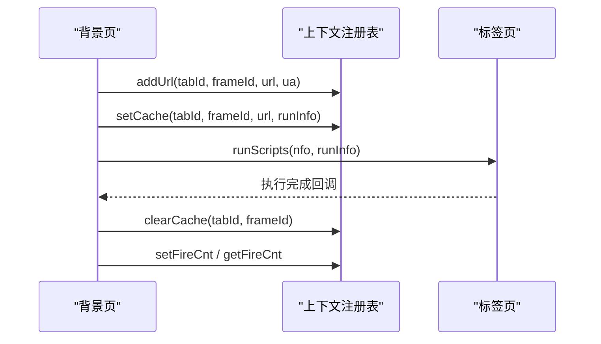
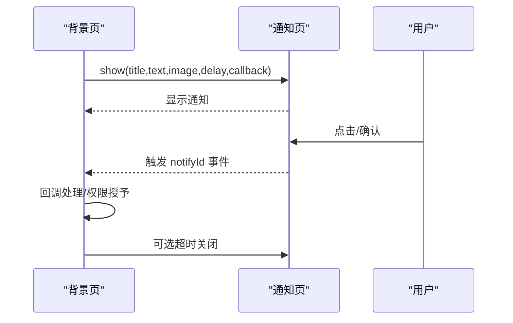
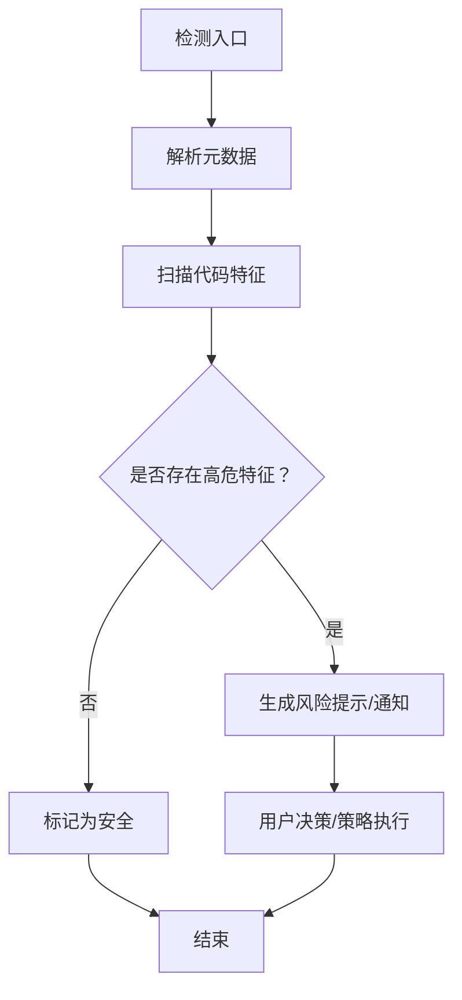
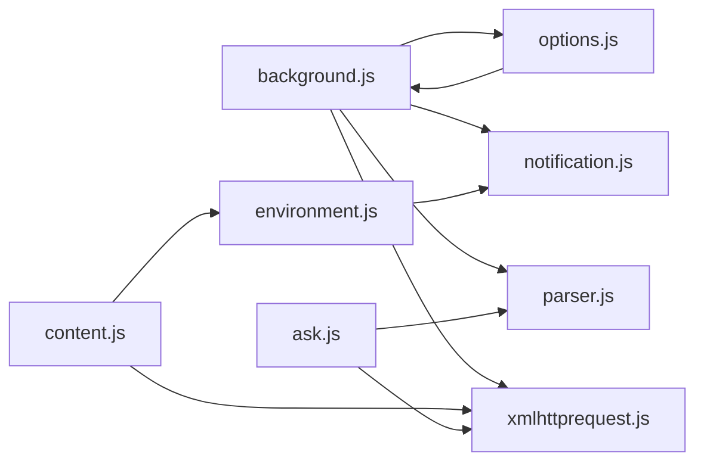

# 恶意脚本检测

<cite>
**本文引用的文件**
- [README.md](file://README.md)
- [background.js](file://src/background.js)
- [content.js](file://src/content.js)
- [notification.js](file://src/notification.js)
- [notification.html](file://src/notification.html)
- [options.js](file://src/options.js)
- [parser.js](file://src/parser.js)
- [xmlhttprequest.js](file://src/xmlhttprequest.js)
- [environment.js](file://src/environment.js)
- [ask.js](file://src/ask.js)
- [tamperfireDB.tamper.js](file://src/system/tamperfireDB.tamper.js)
</cite>

## 目录
1. [简介](#简介)
2. [项目结构](#项目结构)
3. [核心组件](#核心组件)
4. [架构总览](#架构总览)
5. [详细组件分析](#详细组件分析)
6. [依赖关系分析](#依赖关系分析)
7. [性能考量](#性能考量)
8. [故障排查指南](#故障排查指南)
9. [结论](#结论)
10. [附录](#附录)

## 简介
本文件面向 Tampermonkey 的“恶意脚本检测”能力，基于仓库中的现有实现进行系统化梳理与说明。重点覆盖以下方面：
- 自动扫描机制：基于脚本元数据与运行时行为的识别线索
- 行为监控系统：对脚本执行模式与潜在威胁行为的跟踪
- 用户警告系统：威胁等级评估与用户通知机制
- 恶意脚本识别特征：常见攻击模式与检测规则
- 配置选项与自定义规则支持：可扩展的策略接口
- 准确性评估与误报处理：评估方法与缓解策略
- 外部安全服务集成：与威胁情报共享机制

说明：本仓库版本为公开源码，恶意脚本检测能力以“TamperFire 数据库”和“运行时上下文统计”为核心；未发现内置的深度机器学习或实时网络签名检测模块。

## 项目结构
Tampermonkey 采用多页面/多模块架构：
- 背景页（background）负责脚本生命周期管理、数据库初始化与查询、运行时统计、通知与权限请求
- 内容页（content）负责注入环境、模拟 Chrome API、执行用户脚本
- 通知页（notification）负责弹窗展示与交互
- 选项页（options）负责脚本列表、元数据与安全提示图标
- 解析器（parser）负责解析用户脚本元数据与兼容性标记
- 请求封装（xmlhttprequest）负责网络请求代理与错误处理
- 环境（environment）提供 GM_* API 与通知等桥接
- 安装确认页（ask）负责安装流程与二次确认
- 系统脚本（tamperfireDB.tamper.js）用于构建 TamperFire 数据库

图表来源
- [background.js](file://src/background.js)
- [content.js](file://src/content.js)
- [notification.js](file://src/notification.js)
- [options.js](file://src/options.js)
- [parser.js](file://src/parser.js)
- [xmlhttprequest.js](file://src/xmlhttprequest.js)
- [environment.js](file://src/environment.js)
- [ask.js](file://src/ask.js)
- [tamperfireDB.tamper.js](file://src/system/tamperfireDB.tamper.js)

章节来源
- [README.md](file://README.md)
- [background.js](file://src/background.js)
- [content.js](file://src/content.js)
- [notification.js](file://src/notification.js)
- [options.js](file://src/options.js)
- [parser.js](file://src/parser.js)
- [xmlhttprequest.js](file://src/xmlhttprequest.js)
- [environment.js](file://src/environment.js)
- [ask.js](file://src/ask.js)
- [tamperfireDB.tamper.js](file://src/system/tamperfireDB.tamper.js)

## 核心组件
- 脚本解析与元数据提取：从用户脚本头部解析标签、匹配规则、资源与兼容性标记
- 运行时上下文与统计：记录每个标签页内脚本运行数量、禁用数量、执行状态
- TamperFire 数据库：存储脚本元数据、包含/排除规则，支持按 URL 匹配查询
- 通知与权限：通过 HTML Notification 展示威胁信息，并支持权限请求
- 安全提示图标：在选项页中根据脚本代码特征显示“网络访问”“本地存储”“unsafeWindow”等风险提示

章节来源
- [parser.js](file://src/parser.js)
- [background.js](file://src/background.js)
- [options.js](file://src/options.js)
- [notification.js](file://src/notification.js)
- [ask.js](file://src/ask.js)

## 架构总览
下图展示了从页面加载到脚本执行、数据库查询与通知展示的关键路径：

图表来源
- [content.js](file://src/content.js)
- [environment.js](file://src/environment.js)
- [background.js](file://src/background.js)
- [notification.html](file://src/notification.html)
- [notification.js](file://src/notification.js)

## 详细组件分析

### 组件A：自动扫描机制（TamperFire 数据库与脚本匹配）
- 数据库初始化：背景页在首次使用时创建脚本表、包含/排除规则表及关联表
- 数据导入：支持从 JSON 导入脚本元数据，批量写入数据库
- URL 匹配：根据当前 URL 在数据库中查找匹配的脚本，支持正则与通用规则
- 性能优化：使用事务批量写入、SQL 查询缓存与进度反馈

图表来源
- [background.js](file://src/background.js)
- [tamperfireDB.tamper.js](file://src/system/tamperfireDB.tamper.js)

章节来源
- [background.js](file://src/background.js)
- [tamperfireDB.tamper.js](file://src/system/tamperfireDB.tamper.js)

### 组件B：行为监控系统（运行时统计与上下文注册）
- 上下文注册：记录每个标签页的 URL 计数、用户代理、运行/禁用脚本数量
- 缓存机制：在准备阶段生成运行信息缓存，避免重复计算
- 统计聚合：在脚本执行前累加运行/禁用计数，便于徽章与统计展示

图表来源
- [background.js](file://src/background.js)

章节来源
- [background.js](file://src/background.js)

### 组件C：用户警告系统（威胁等级与通知）
- 威胁等级：基于脚本特征（网络访问、本地存储、unsafeWindow、兼容性选项）生成风险提示
- 通知展示：通过 HTML Notification 展示标题、文本、图片、链接与超时
- 权限请求：支持向用户请求特定权限，并等待确认结果
- 交互回调：点击通知后触发回调，支持延时关闭与超时自动关闭

图表来源
- [background.js](file://src/background.js)
- [notification.html](file://src/notification.html)
- [notification.js](file://src/notification.js)

章节来源
- [background.js](file://src/background.js)
- [notification.html](file://src/notification.html)
- [notification.js](file://src/notification.js)

### 组件D：恶意脚本识别特征与检测规则
- 元数据特征：包含/排除规则、匹配规则、资源依赖
- 代码特征：是否使用 unsafeWindow、是否发起网络请求、是否写入本地存储
- 兼容性选项：某些兼容性开关可能被滥用以规避限制
- 安装来源：脚本 URL 类型与来源可信度（例如仅允许特定路径）

图表来源
- [parser.js](file://src/parser.js)
- [options.js](file://src/options.js)

章节来源
- [parser.js](file://src/parser.js)
- [options.js](file://src/options.js)

### 组件E：配置选项与自定义规则支持
- 选项页：展示脚本列表、启用/禁用、站点规则、功能图标与导出导入
- 自定义规则：通过 @include/@match/@exclude 等标签控制脚本生效范围
- 兼容性选项：部分兼容性开关可能影响安全策略，建议默认关闭

章节来源
- [options.js](file://src/options.js)
- [parser.js](file://src/parser.js)

### 组件F：安装与二次确认流程
- 安装确认页：在安装前展示脚本源码与提示，支持原生安装或 Tampermonkey 安装
- 二次确认：通过对话框确认安装意图，降低误操作风险

章节来源
- [ask.js](file://src/ask.js)

## 依赖关系分析
- 背景页依赖解析器、网络封装、帮助工具与国际化模块
- 内容页依赖网络封装与转换工具，负责注入与事件桥接
- 通知页依赖帮助工具与注册机制，负责参数解析与交互
- 选项页依赖多种工具与视图组件，负责脚本管理与安全提示
- 环境桥接提供 GM_* API 与通知封装，连接内容页与背景页
- 安装确认页依赖解析器与网络封装，负责脚本加载与确认

图表来源
- [background.js](file://src/background.js)
- [content.js](file://src/content.js)
- [notification.js](file://src/notification.js)
- [options.js](file://src/options.js)
- [parser.js](file://src/parser.js)
- [xmlhttprequest.js](file://src/xmlhttprequest.js)
- [environment.js](file://src/environment.js)
- [ask.js](file://src/ask.js)

章节来源
- [background.js](file://src/background.js)
- [content.js](file://src/content.js)
- [notification.js](file://src/notification.js)
- [options.js](file://src/options.js)
- [parser.js](file://src/parser.js)
- [xmlhttprequest.js](file://src/xmlhttprequest.js)
- [environment.js](file://src/environment.js)
- [ask.js](file://src/ask.js)

## 性能考量
- 数据库批量写入：分批导入、事务提交，减少锁竞争与 I/O 开销
- SQL 查询优化：针对 URL 匹配使用索引友好条件，避免全表扫描
- 缓存与复用：运行信息缓存减少重复计算，提高页面响应速度
- 日志级别控制：通过日志开关降低调试开销，避免影响生产性能

## 故障排查指南
- 通知不显示：检查通知页面参数解析与超时设置，确认回调监听是否正确注册
- 安装失败：核对脚本源码加载状态与解析结果，确认安装确认页逻辑
- 数据库异常：查看建表与写入错误回调，确认事务与重试策略
- 权限请求无响应：检查权限请求回调与事件移除逻辑，确保超时清理

章节来源
- [notification.js](file://src/notification.js)
- [ask.js](file://src/ask.js)
- [background.js](file://src/background.js)

## 结论
本仓库实现了以“元数据+运行时统计+威胁情报数据库”为核心的恶意脚本检测框架：
- 通过 TamperFire 数据库与 URL 匹配实现自动扫描
- 通过上下文注册与运行统计实现行为监控
- 通过通知与权限机制实现用户警告与交互
- 通过解析器与选项页实现特征识别与策略配置

建议后续增强方向：
- 引入动态规则引擎与外部威胁情报订阅
- 加强对脚本运行时 API 使用的细粒度审计
- 提供误报申诉与白名单机制
- 增加检测准确性评估指标与可视化报告

## 附录
- 项目目标与特性概述参见根目录说明文件
- API 与元数据规范参见解析器与环境桥接模块

章节来源
- [README.md](file://README.md)
- [parser.js](file://src/parser.js)
- [environment.js](file://src/environment.js)