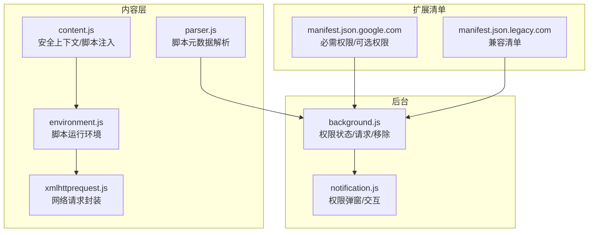
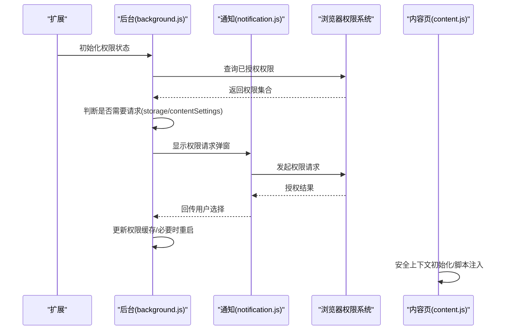
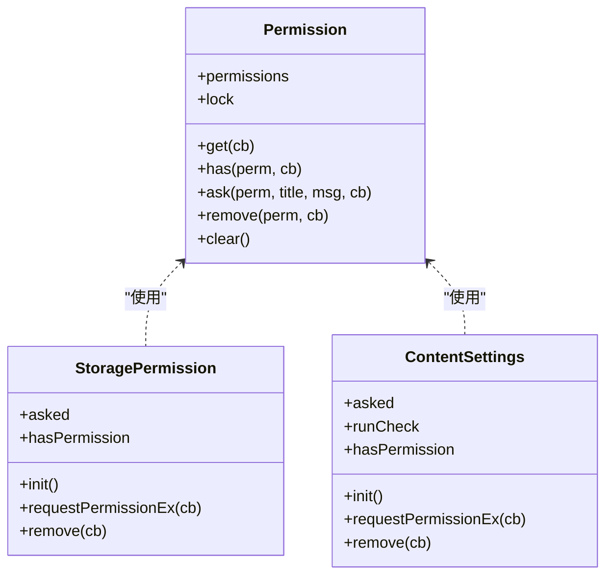
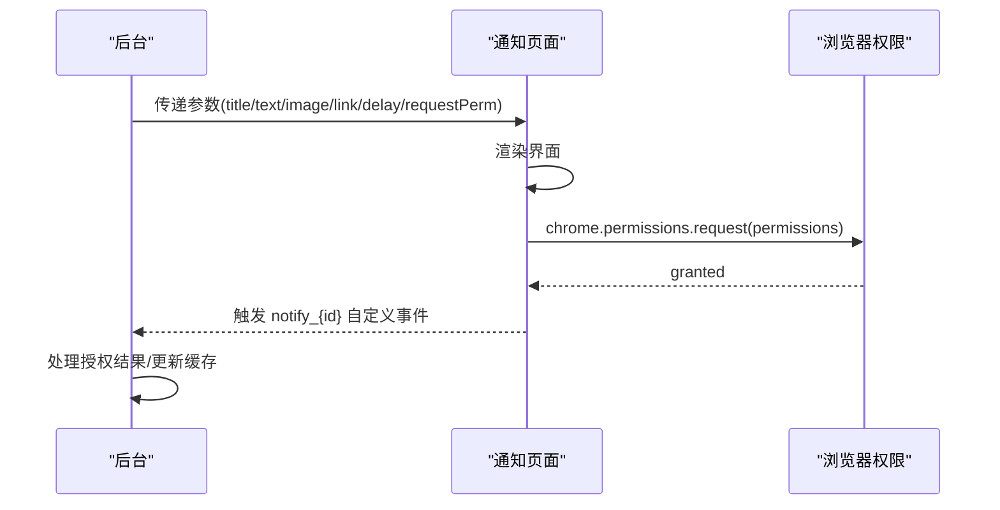
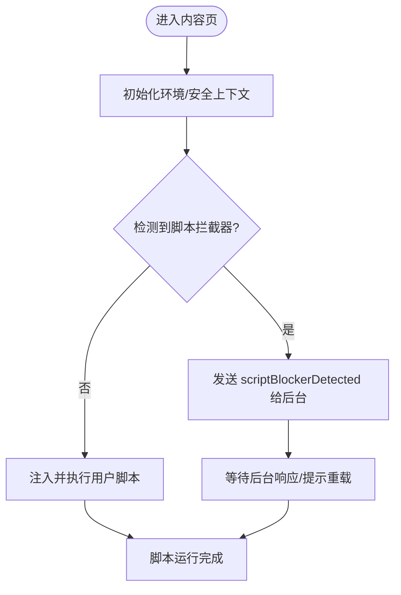
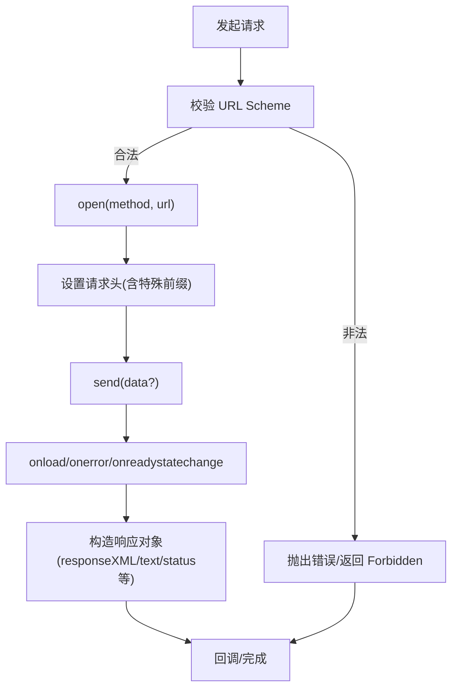
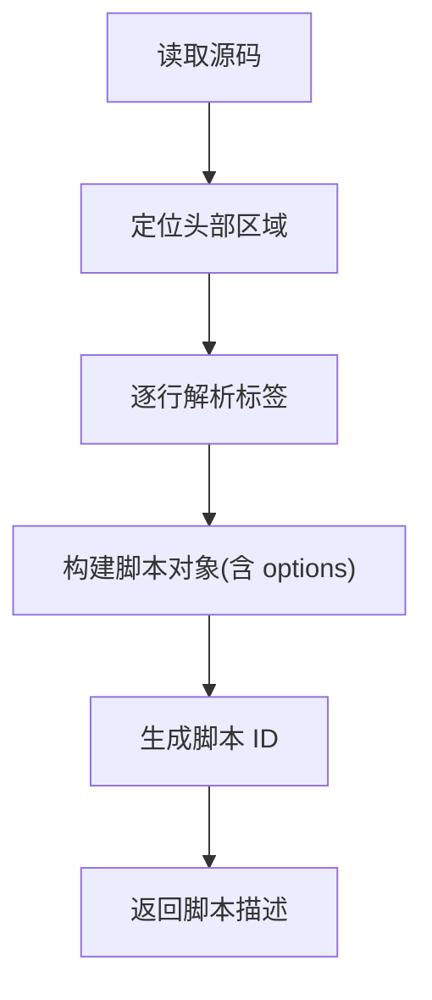
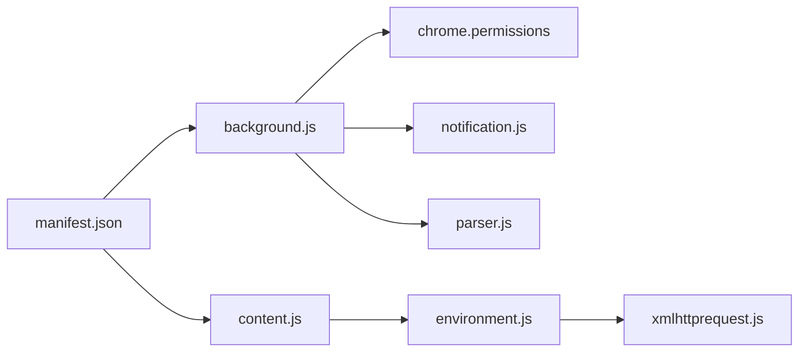

# 权限管理

<cite>
**本文档引用的文件**
- [background.js](file://src/background.js)
- [content.js](file://src/content.js)
- [environment.js](file://src/environment.js)
- [xmlhttprequest.js](file://src/xmlhttprequest.js)
- [parser.js](file://src/parser.js)
- [notification.js](file://src/notification.js)
- [manifest.json.google.com](file://build_sys/manifest.json.google.com)
- [manifest.json.legacy.com](file://build_sys/manifest.json.legacy.com)
</cite>

## 目录
1. [简介](#简介)
2. [项目结构](#项目结构)
3. [核心组件](#核心组件)
4. [架构总览](#架构总览)
5. [详细组件分析](#详细组件分析)
6. [依赖关系分析](#依赖关系分析)
7. [性能考量](#性能考量)
8. [故障排查指南](#故障排查指南)
9. [结论](#结论)

## 简介
本文件系统性梳理 Tampermonkey 的权限管理体系，覆盖以下方面：
- manifest.json 中的权限声明与可选权限
- 运行时权限检查与请求流程
- 脚本权限模型（网络访问、本地文件读取、存储访问等）
- 权限提升与降级机制
- 与浏览器原生权限系统的集成（用户授权、撤销）
- 错误处理与用户提示机制
- 最佳实践与安全建议

## 项目结构
围绕权限管理的相关模块分布如下：
- 扩展清单：定义必需与可选权限
- 后台逻辑：权限状态维护、请求与移除、通知交互
- 内容环境：脚本运行上下文、XHR 封装、安全上下文切换
- 通知页面：弹窗式权限请求与用户交互
- 解析器：脚本元数据解析（影响匹配与运行条件）

**图表来源**
- [manifest.json.google.com:1-43](file://build_sys/manifest.json.google.com#L1-L43)
- [manifest.json.legacy.com:1-38](file://build_sys/manifest.json.legacy.com#L1-L38)
- [background.js:5329-5399](file://src/background.js#L5329-L5399)
- [notification.js:15-98](file://src/notification.js#L15-L98)
- [content.js:456-608](file://src/content.js#L456-L608)
- [environment.js:693-747](file://src/environment.js#L693-L747)
- [xmlhttprequest.js:17-153](file://src/xmlhttprequest.js#L17-L153)
- [parser.js:95-222](file://src/parser.js#L95-L222)

**章节来源**
- [manifest.json.google.com:1-43](file://build_sys/manifest.json.google.com#L1-L43)
- [manifest.json.legacy.com:1-38](file://build_sys/manifest.json.legacy.com#L1-L38)
- [background.js:5329-5399](file://src/background.js#L5329-L5399)
- [notification.js:15-98](file://src/notification.js#L15-L98)
- [content.js:456-608](file://src/content.js#L456-L608)
- [environment.js:693-747](file://src/environment.js#L693-L747)
- [xmlhttprequest.js:17-153](file://src/xmlhttprequest.js#L17-L153)
- [parser.js:95-222](file://src/parser.js#L95-L222)

## 核心组件
- 权限状态与请求器（permission）：集中管理权限状态、查询、请求与移除
- 存储权限与内容设置权限：两类可选权限的初始化、请求与降级
- 通知系统：弹窗式权限请求与用户交互
- 内容环境与脚本注入：安全上下文切换、XHR 请求封装
- 清单声明：必需权限与可选权限在 manifest 中的体现

**章节来源**
- [background.js:5329-5399](file://src/background.js#L5329-L5399)
- [background.js:5401-5452](file://src/background.js#L5401-L5452)
- [background.js:5454-5511](file://src/background.js#L5454-L5511)
- [notification.js:66-91](file://src/notification.js#L66-L91)
- [content.js:456-608](file://src/content.js#L456-L608)
- [environment.js:693-747](file://src/environment.js#L693-L747)
- [manifest.json.google.com:34-42](file://build_sys/manifest.json.google.com#L34-L42)

## 架构总览
权限管理的整体流程：
- 扩展启动时读取清单，声明必需与可选权限
- 后台根据当前权限状态决定是否需要向用户请求
- 用户通过通知弹窗确认或拒绝
- 成功授权后更新权限缓存，必要时重启以生效
- 内容层在脚本运行时受权限与安全上下文约束

**图表来源**
- [background.js:5342-5390](file://src/background.js#L5342-L5390)
- [notification.js:66-91](file://src/notification.js#L66-L91)
- [content.js:456-608](file://src/content.js#L456-L608)

**章节来源**
- [background.js:5329-5399](file://src/background.js#L5329-L5399)
- [notification.js:15-98](file://src/notification.js#L15-L98)
- [content.js:456-608](file://src/content.js#L456-L608)

## 详细组件分析

### 组件A：权限状态与请求器（permission）
- 职责
  - 缓存浏览器权限状态
  - 提供 has/get/ask/remove 接口
  - 与通知系统协作进行用户授权
- 关键点
  - 使用锁避免并发查询导致的状态不一致
  - 通过 chrome.permissions 接口与浏览器交互
  - 支持 contentSettings 与 storage 两类可选权限

**图表来源**
- [background.js:5329-5399](file://src/background.js#L5329-L5399)
- [background.js:5401-5452](file://src/background.js#L5401-L5452)
- [background.js:5454-5511](file://src/background.js#L5454-L5511)

**章节来源**
- [background.js:5329-5399](file://src/background.js#L5329-L5399)
- [background.js:5401-5452](file://src/background.js#L5401-L5452)
- [background.js:5454-5511](file://src/background.js#L5454-L5511)

### 组件B：通知弹窗与权限请求
- 职责
  - 展示标题、文本、图片与超链接
  - 处理用户点击事件，调用 chrome.permissions.request
  - 通过自定义事件回传授权结果给后台
- 关键点
  - 支持延时自动关闭
  - 支持请求特定权限并回传 granted 结果

**图表来源**
- [notification.js:15-98](file://src/notification.js#L15-L98)
- [notification.js:66-91](file://src/notification.js#L66-L91)

**章节来源**
- [notification.js:15-98](file://src/notification.js#L15-L98)
- [notification.js:66-91](file://src/notification.js#L66-L91)

### 组件C：内容环境与脚本注入
- 职责
  - 在安全上下文中注入与执行用户脚本
  - 提供 TM_xmlhttpRequest 封装
  - 检测并提示脚本拦截器（如 ScriptNo）
- 关键点
  - 通过 MutationEvent 触发 unsafeWindow 访问
  - 对 window.open、定时器等进行适配
  - 与后台通信注册菜单命令、打开标签等

**图表来源**
- [content.js:456-608](file://src/content.js#L456-L608)
- [content.js:475-506](file://src/content.js#L475-L506)
- [environment.js:693-747](file://src/environment.js#L693-L747)

**章节来源**
- [content.js:456-608](file://src/content.js#L456-L608)
- [content.js:475-506](file://src/content.js#L475-L506)
- [environment.js:693-747](file://src/environment.js#L693-L747)

### 组件D：网络请求封装与权限校验
- 职责
  - 封装 XMLHttpRequest，支持进度回调与重试
  - 校验 URL Scheme（仅允许 http/https 或特定图片类型）
  - 处理响应头与最终 URL
- 关键点
  - 内部模式下对 URL 进行合法性检查
  - 支持 responseType、overrideMimeType 等高级特性

**图表来源**
- [xmlhttprequest.js:17-153](file://src/xmlhttprequest.js#L17-L153)

**章节来源**
- [xmlhttprequest.js:17-153](file://src/xmlhttprequest.js#L17-L153)

### 组件E：脚本元数据与运行条件
- 职责
  - 解析用户脚本头部元数据（name、namespace、version、include/match/exclude、run-at、user-agent 等）
  - 生成脚本 ID，辅助匹配与排序
- 关键点
  - include/match/exclude 影响脚本在哪些页面运行
  - run-at 控制脚本注入时机

**图表来源**
- [parser.js:95-222](file://src/parser.js#L95-L222)

**章节来源**
- [parser.js:95-222](file://src/parser.js#L95-L222)

## 依赖关系分析
- 清单声明
  - 必需权限：notifications、unlimited_storage、tabs、management、webNavigation、webRequest、webRequestBlocking、<all_urls>
  - 可选权限：contentSettings、storage
- 后台依赖
  - permission 模块依赖 chrome.permissions
  - 通知模块依赖 webkitNotifications 与 chrome.permissions
  - 内容环境依赖 chrome.tabs、chrome.management、chrome.webRequest 等
- 内容层依赖
  - xmlhttprequest.js 封装 XHR
  - environment.js 提供脚本运行环境与 API

**图表来源**
- [manifest.json.google.com:34-42](file://build_sys/manifest.json.google.com#L34-L42)
- [background.js:5329-5399](file://src/background.js#L5329-L5399)
- [notification.js:66-91](file://src/notification.js#L66-L91)
- [content.js:456-608](file://src/content.js#L456-L608)
- [environment.js:693-747](file://src/environment.js#L693-L747)
- [xmlhttprequest.js:17-153](file://src/xmlhttprequest.js#L17-L153)
- [parser.js:95-222](file://src/parser.js#L95-L222)

**章节来源**
- [manifest.json.google.com:34-42](file://build_sys/manifest.json.google.com#L34-L42)
- [manifest.json.legacy.com:29-37](file://build_sys/manifest.json.legacy.com#L29-L37)
- [background.js:5329-5399](file://src/background.js#L5329-L5399)
- [notification.js:66-91](file://src/notification.js#L66-L91)
- [content.js:456-608](file://src/content.js#L456-L608)
- [environment.js:693-747](file://src/environment.js#L693-L747)
- [xmlhttprequest.js:17-153](file://src/xmlhttprequest.js#L17-L153)
- [parser.js:95-222](file://src/parser.js#L95-L222)

## 性能考量
- 权限查询与缓存
  - 使用锁避免并发查询竞争，减少重复请求
  - 缓存权限集合，按需刷新
- 请求重试与进度
  - XHR 封装支持重试与进度回调，降低失败率
- 安全上下文切换
  - MutationEvent 触发 unsafeWindow 访问，避免直接暴露高危 API
- 通知弹窗
  - 延时自动关闭，避免长时间阻塞用户操作

[本节为通用性能讨论，无需具体文件分析]

## 故障排查指南
- 权限未生效
  - 检查后台权限缓存是否正确更新
  - 若为 contentSettings/storage，确认用户已授权且未撤销
- 脚本被拦截器阻止
  - 内容页会检测并上报，后台提示重载页面
- 网络请求失败
  - 检查 URL Scheme 是否为 http/https 或允许的图片类型
  - 查看响应头与最终 URL，确认跨域与重定向情况
- 通知弹窗无响应
  - 确认弹窗是否被浏览器阻止
  - 检查权限请求参数与回调事件

**章节来源**
- [background.js:5342-5390](file://src/background.js#L5342-L5390)
- [content.js:475-506](file://src/content.js#L475-L506)
- [xmlhttprequest.js:115-153](file://src/xmlhttprequest.js#L115-L153)
- [notification.js:66-91](file://src/notification.js#L66-L91)

## 结论
Tampermonkey 的权限管理以清单声明为基础，结合后台缓存与弹窗请求实现可选权限的动态授权；内容层在安全上下文中执行脚本并提供受限的网络能力。通过最小权限原则与严格的运行时校验，系统在功能与安全之间取得平衡。建议开发者遵循“最小权限”原则，仅在确有需要时申请可选权限，并在用户撤销授权后优雅降级。