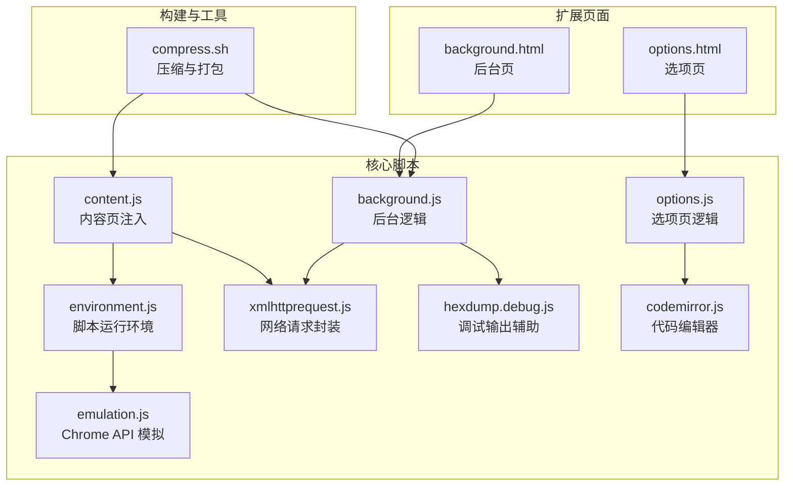
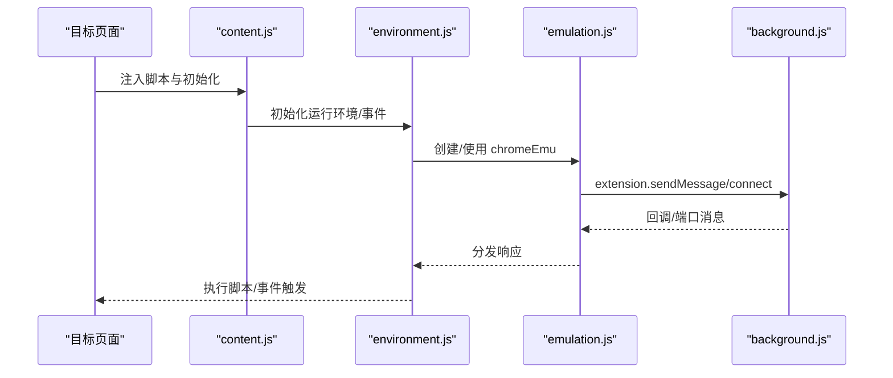
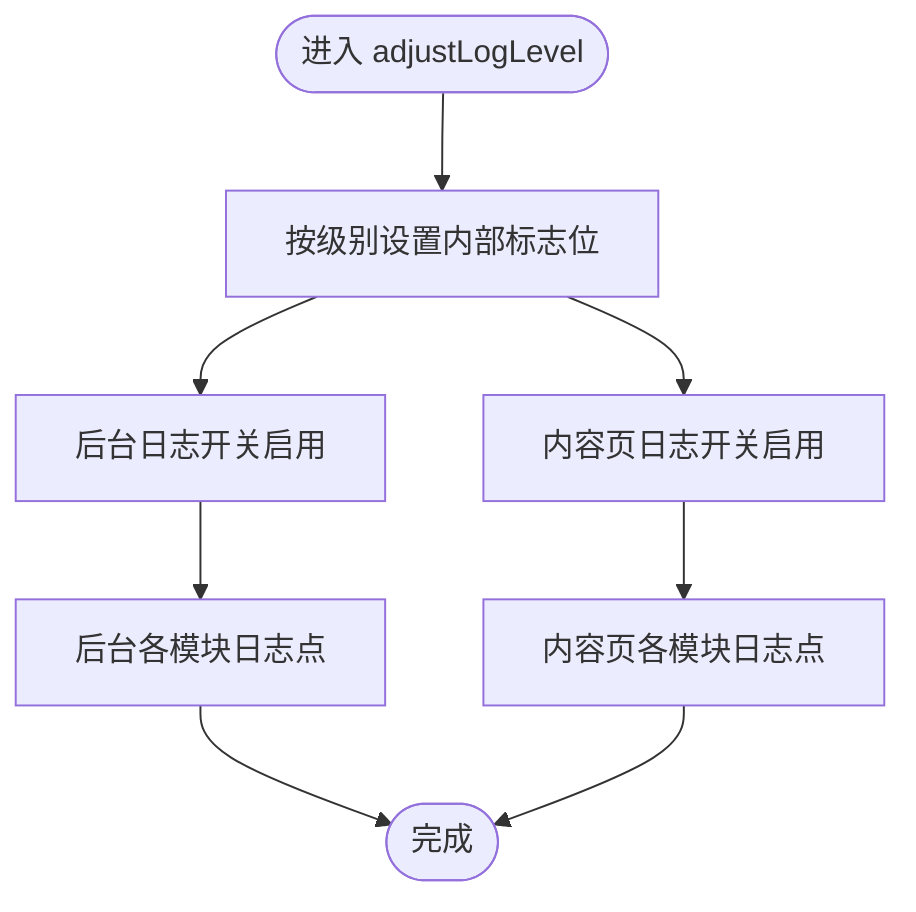
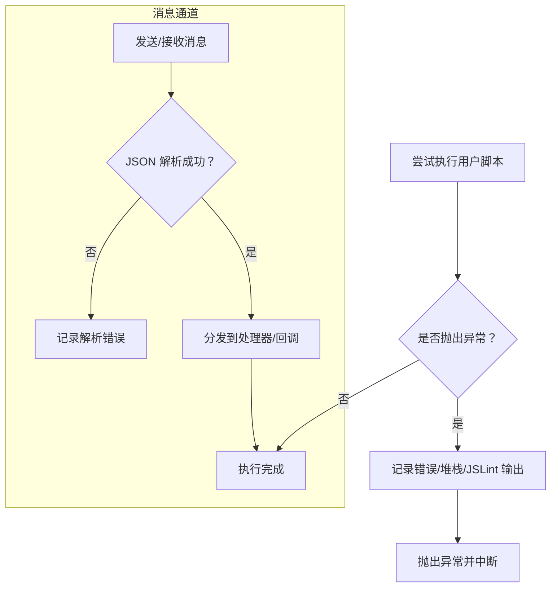
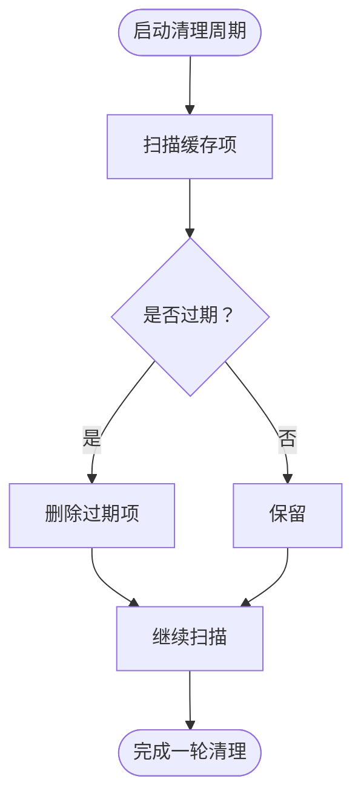
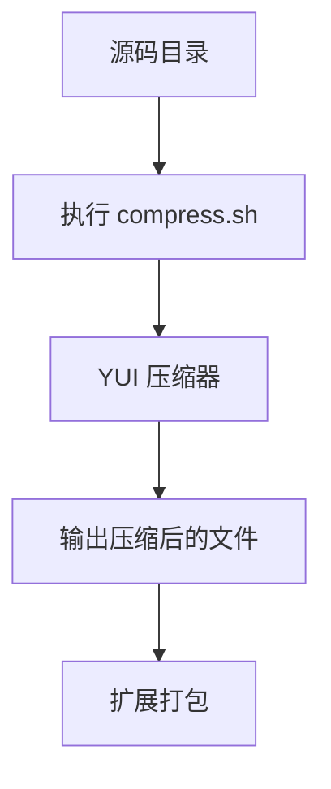
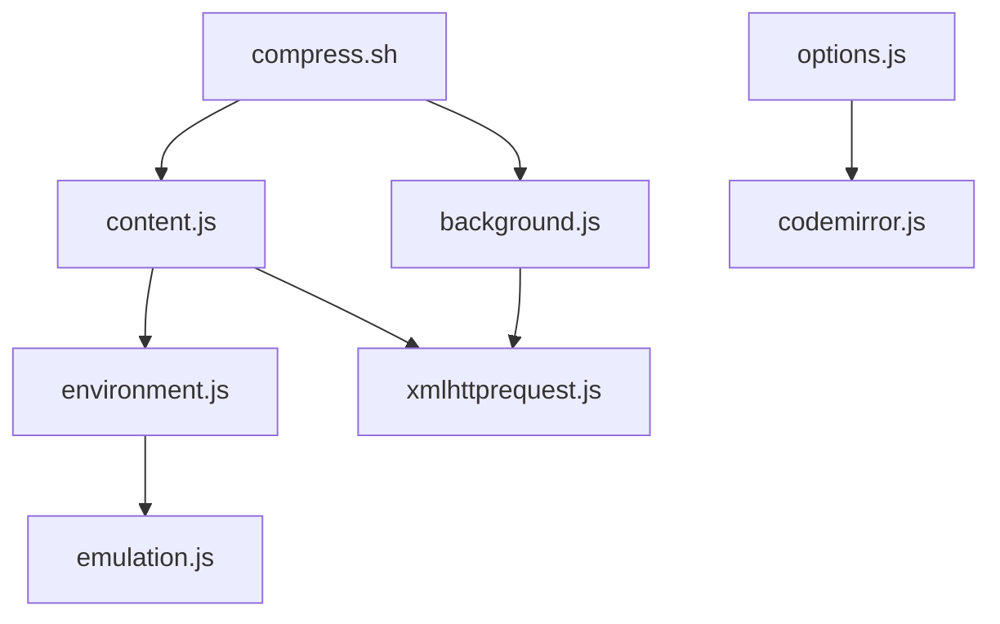

# 开发工具和调试

<cite>
**本文引用的文件**
- [README.md](file://README.md)
- [background.js](file://src/background.js)
- [content.js](file://src/content.js)
- [environment.js](file://src/environment.js)
- [emulation.js](file://src/emulation.js)
- [xmlhttprequest.js](file://src/xmlhttprequest.js)
- [options.js](file://src/options.js)
- [options.html](file://src/options.html)
- [background.html](file://src/background.html)
- [hexdump.debug.js](file://src/hexdump.debug.js)
- [compress.sh](file://build_sys/compress.sh)
- [codemirror.js](file://src/cm/codemirror.js)
</cite>

## 目录
1. [简介](#简介)
2. [项目结构](#项目结构)
3. [核心组件](#核心组件)
4. [架构总览](#架构总览)
5. [详细组件分析](#详细组件分析)
6. [依赖关系分析](#依赖关系分析)
7. [性能考量](#性能考量)
8. [故障排除指南](#故障排除指南)
9. [结论](#结论)
10. [附录](#附录)

## 简介
本指南面向 Tampermonkey 的扩展开发者与维护者，聚焦于开发工具与调试流程。内容涵盖内置调试工具（日志系统、错误跟踪、性能监控）、开发环境配置（源码调试、断点设置、变量检查）、调试技巧与最佳实践、性能分析工具（内存/CPU/体验）以及常见问题排查与测试策略。文档基于仓库中实际代码进行梳理，并提供可操作的建议与图示。

## 项目结构
Tampermonkey 采用多页面/模块化架构：后台页负责脚本管理、更新与持久化；内容页注入到目标页面执行用户脚本；选项页提供编辑与导出导入能力；构建系统包含压缩脚本与打包流程。关键入口与模块如下：

图表来源
- [background.html](file://src/background.html)
- [options.html](file://src/options.html)
- [background.js](file://src/background.js)
- [content.js](file://src/content.js)
- [environment.js](file://src/environment.js)
- [emulation.js](file://src/emulation.js)
- [xmlhttprequest.js](file://src/xmlhttprequest.js)
- [options.js](file://src/options.js)
- [hexdump.debug.js](file://src/hexdump.debug.js)
- [codemirror.js](file://src/cm/codemirror.js)
- [compress.sh](file://build_sys/compress.sh)

章节来源
- [README.md](file://README.md)
- [background.html](file://src/background.html)
- [options.html](file://src/options.html)

## 核心组件
- 后台页与后台逻辑：负责版本迁移、脚本存储、缓存清理、上下文注册、更新检测等。
- 内容页与运行环境：负责在目标页面注入脚本、事件模拟、安全上下文切换、XHR 请求转发。
- Chrome API 模拟层：桥接内容页与后台页的消息通道，实现扩展 API 的调用与响应。
- 网络请求封装：统一处理跨域、重试、进度回调与头部改写。
- 选项页与编辑器：提供脚本列表、编辑、导入导出、同步信息展示。
- 调试与压缩工具：日志开关、十六进制转储、YUI 压缩脚本。

章节来源
- [background.js](file://src/background.js)
- [content.js](file://src/content.js)
- [environment.js](file://src/environment.js)
- [emulation.js](file://src/emulation.js)
- [xmlhttprequest.js](file://src/xmlhttprequest.js)
- [options.js](file://src/options.js)
- [options.html](file://src/options.html)
- [hexdump.debug.js](file://src/hexdump.debug.js)
- [compress.sh](file://build_sys/compress.sh)

## 架构总览
下图展示了从用户脚本执行到后台处理的关键路径，以及消息传递与事件分发机制：

图表来源
- [content.js](file://src/content.js)
- [environment.js](file://src/environment.js)
- [emulation.js](file://src/emulation.js)
- [background.js](file://src/background.js)

## 详细组件分析

### 日志系统与调试开关
- 后台与内容页均定义了多级日志开关（如 D/V/EV/MV/UV/SV/CV/NV/RV），通过调整级别控制输出粒度。
- 调整函数会根据传入级别位或布尔标志启用对应模块的日志。
- 常见输出位置包括：版本比较、数据转换、缓存清理、上下文注册、本地文件读取、XHR 请求等。

图表来源
- [background.js](file://src/background.js)
- [content.js](file://src/content.js)

章节来源
- [background.js](file://src/background.js)
- [content.js](file://src/content.js)

### 错误跟踪与异常处理
- 运行时异常捕获：脚本执行包装函数对语法与运行时错误进行捕获，并输出堆栈与 JSLint 结果（若启用）。
- 消息通道异常：模拟层对 JSON 解析、响应回调、端口断开等情况进行日志记录。
- 网络请求异常：统一的 onload/onerror/progress 回调中处理状态码与重试逻辑，并在失败时返回标准化响应对象。

图表来源
- [environment.js](file://src/environment.js)
- [emulation.js](file://src/emulation.js)
- [xmlhttprequest.js](file://src/xmlhttprequest.js)

章节来源
- [environment.js](file://src/environment.js)
- [emulation.js](file://src/emulation.js)
- [xmlhttprequest.js](file://src/xmlhttprequest.js)

### 性能监控与资源管理
- 缓存清理：后台对 require 缓存定期清理，避免内存膨胀。
- 上下文统计：记录每个标签页的脚本运行次数、URL 计数、UA 等，便于分析热点页面。
- XHR 进度：在 onreadystatechange 中计算下载进度，支持 Content-Length 推断。
- 十六进制转储：用于调试二进制或特殊字符数据的可视输出。

图表来源
- [background.js](file://src/background.js)
- [hexdump.debug.js](file://src/hexdump.debug.js)

章节来源
- [background.js](file://src/background.js)
- [hexdump.debug.js](file://src/hexdump.debug.js)

### 开发环境配置与调试
- 选项页集成 CodeMirror，提供语法高亮、键位映射（Emacs/Vim/Windows）与格式化工具，适合编写与调试用户脚本。
- 通过后台页与内容页的调试开关，可在不同阶段开启更详细的日志输出。
- 使用浏览器开发者工具的“扩展页”查看后台页与内容页的控制台输出，结合选项页的导出导入功能进行快速验证。

图表来源
- [options.html](file://src/options.html)
- [options.js](file://src/options.js)
- [background.js](file://src/background.js)
- [content.js](file://src/content.js)
- [codemirror.js](file://src/cm/codemirror.js)

章节来源
- [options.html](file://src/options.html)
- [options.js](file://src/options.js)
- [codemirror.js](file://src/cm/codemirror.js)

### 断点设置与变量检查
- 在内容页与后台页脚本中，利用浏览器断点工具对关键函数（如事件监听、XHR 发送、消息分发）设置断点。
- 利用选项页的导出/导入功能，将脚本保存为外部文件后直接在浏览器中打开调试，便于逐步执行与变量检查。
- 对于复杂流程（如脚本加载、上下文注册、缓存清理），可在相应日志点前设置断点以观察状态变化。

章节来源
- [content.js](file://src/content.js)
- [background.js](file://src/background.js)
- [options.js](file://src/options.js)

### 调试技巧与最佳实践
- 使用最小化复现：将问题脚本拆分为最小可运行片段，在选项页中新建脚本逐一添加功能，定位问题引入点。
- 切换日志级别：在后台与内容页分别提高日志级别，观察关键路径（版本比较、上下文注册、XHR 请求）。
- 利用十六进制转储：对二进制或特殊字符数据进行转储，辅助排查编码与传输问题。
- 验证网络行为：在 XHR 回调中打印状态与进度，确认跨域、重试与头部改写是否符合预期。

章节来源
- [hexdump.debug.js](file://src/hexdump.debug.js)
- [xmlhttprequest.js](file://src/xmlhttprequest.js)

### 性能分析工具与优化
- 内存使用监控：关注后台缓存清理周期与上下文注册表大小，避免重复注册与未清理的缓存项。
- CPU 性能分析：在关键事件（DOMContentLoaded、XHR 完成）前后记录时间戳，评估脚本执行耗时。
- 用户体验优化：减少不必要的 DOM 事件重放与全局监听器数量，合理使用定时器与异步回调。

章节来源
- [background.js](file://src/background.js)
- [content.js](file://src/content.js)

### 测试策略与质量保证
- 单元式测试：针对独立函数（如 URL 正则生成、缓存清理、XHR 参数处理）编写小用例，确保边界条件正确。
- 集成测试：在选项页中导入/导出脚本，验证序列化/反序列化一致性；在后台页中模拟版本升级路径，确保数据迁移无误。
- 回归测试：每次构建后运行关键场景（脚本加载、XHR 请求、菜单命令、本地文件读取），确保回归稳定。

章节来源
- [options.js](file://src/options.js)
- [background.js](file://src/background.js)

### 开发工具链与自动化构建
- 压缩脚本：使用 YUI 压缩器对 JS 文件进行压缩，支持批量处理与日志输出，便于构建流水线集成。
- 构建流程：结合扩展打包命令与压缩脚本，形成从源码到发布包的自动化流程。

图表来源
- [compress.sh](file://build_sys/compress.sh)

章节来源
- [compress.sh](file://build_sys/compress.sh)

## 依赖关系分析
- 组件耦合：内容页依赖环境与模拟层；环境依赖模拟层与网络封装；后台页依赖网络封装与本地存储。
- 外部依赖：选项页依赖 CodeMirror；构建脚本依赖 YUI 压缩器；网络封装依赖原生 XMLHttpRequest。

图表来源
- [content.js](file://src/content.js)
- [environment.js](file://src/environment.js)
- [emulation.js](file://src/emulation.js)
- [xmlhttprequest.js](file://src/xmlhttprequest.js)
- [background.js](file://src/background.js)
- [options.js](file://src/options.js)
- [codemirror.js](file://src/cm/codemirror.js)
- [compress.sh](file://build_sys/compress.sh)

章节来源
- [content.js](file://src/content.js)
- [environment.js](file://src/environment.js)
- [emulation.js](file://src/emulation.js)
- [xmlhttprequest.js](file://src/xmlhttprequest.js)
- [background.js](file://src/background.js)
- [options.js](file://src/options.js)
- [codemirror.js](file://src/cm/codemirror.js)
- [compress.sh](file://build_sys/compress.sh)

## 性能考量
- 缓存策略：合理设置缓存有效期与清理周期，避免频繁 IO 与内存占用。
- 事件处理：减少不必要的事件重放与监听器数量，优先使用委托与延迟执行。
- 网络请求：启用必要的重试与进度回调，避免阻塞主线程；对大响应体谨慎处理。
- 构建优化：使用压缩脚本减小体积，提升加载速度。

## 故障排除指南
- 脚本无法加载：检查后台页日志中的版本比较与数据转换步骤，确认脚本名称与选项是否存在。
- XHR 失败：查看网络封装的日志与状态码，确认跨域、头部改写与重试逻辑。
- 消息通道异常：检查模拟层的 JSON 解析与响应回调，确认 responseId 是否匹配。
- 本地文件读取：确认本地文件权限与回调超时处理，避免未找到回调导致的警告。

章节来源
- [background.js](file://src/background.js)
- [xmlhttprequest.js](file://src/xmlhttprequest.js)
- [emulation.js](file://src/emulation.js)

## 结论
通过对日志系统、错误跟踪、性能监控与开发工具链的系统化梳理，开发者可以更高效地定位问题、优化性能并保障质量。建议在日常开发中结合最小化复现、分级日志与自动化构建，形成稳定的调试与发布流程。

## 附录
- 快速参考
  - 启用详细日志：在后台与内容页调整日志级别。
  - 导出导入脚本：使用选项页的导出/导入功能进行快速验证。
  - 压缩构建：运行压缩脚本生成发布包。
  - 断点调试：在关键函数处设置断点，结合控制台观察变量与调用栈。