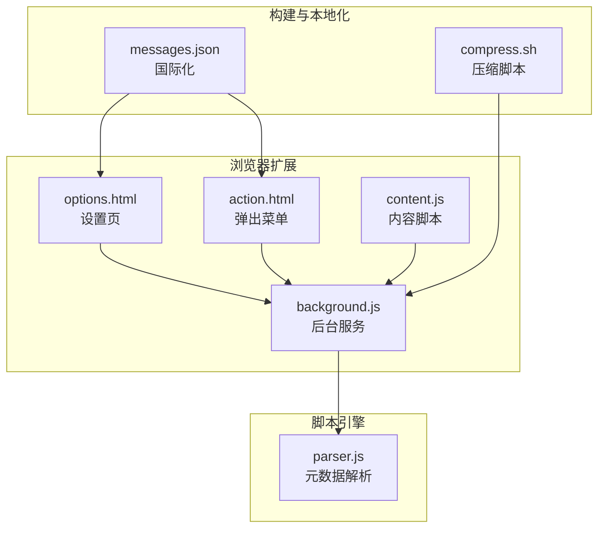
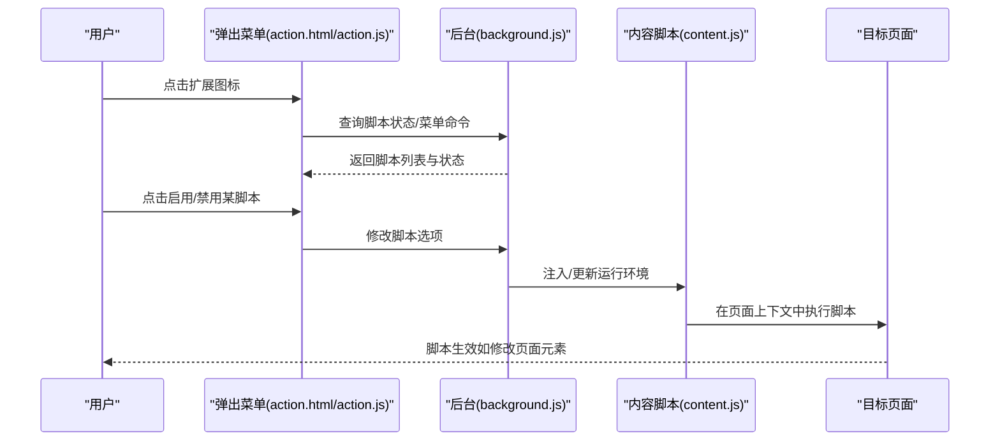
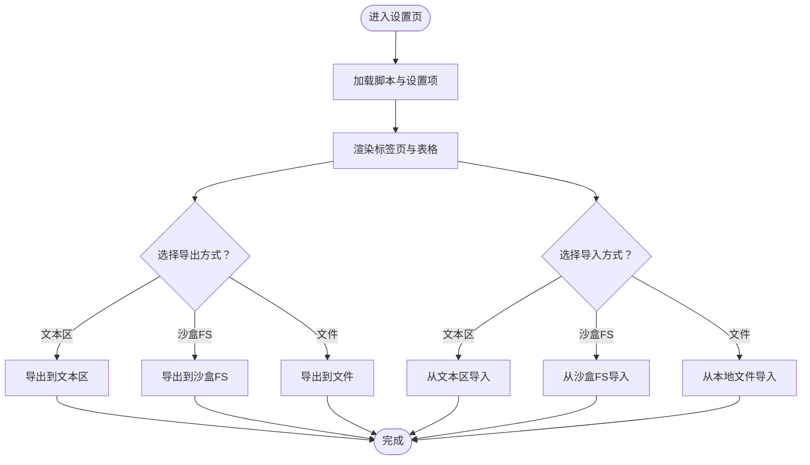
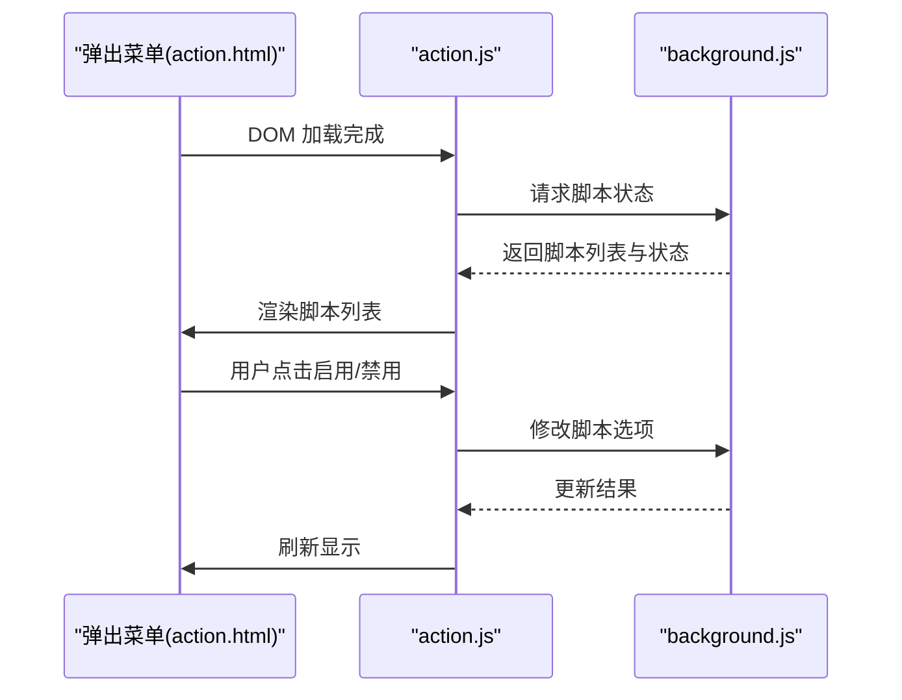
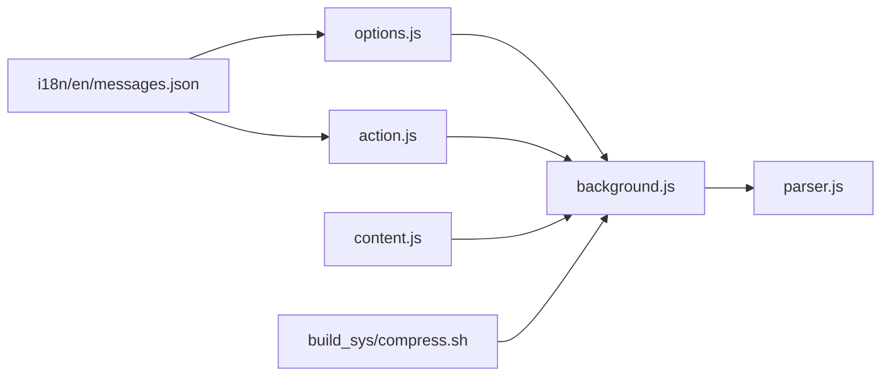

# 快速开始

<cite>
**本文引用的文件**   
- [README.md](file://README.md)
- [compress.sh](file://build_sys/compress.sh)
- [background.js](file://src/background.js)
- [options.js](file://src/options.js)
- [content.js](file://src/content.js)
- [action.js](file://src/action.js)
- [options.html](file://src/options.html)
- [background.html](file://src/background.html)
- [messages.json](file://i18n/en/messages.json)
- [parser.js](file://src/parser.js)
</cite>

## 目录
1. [简介](#简介)
2. [项目结构](#项目结构)
3. [核心组件](#核心组件)
4. [架构总览](#架构总览)
5. [详细组件解析](#详细组件解析)
6. [依赖关系分析](#依赖关系分析)
7. [性能与可用性建议](#性能与可用性建议)
8. [故障排除指南](#故障排除指南)
9. [结论](#结论)
10. [附录：开发环境与构建](#附录开发环境与构建)

## 简介
本指南面向初学者，帮助你在 Chrome 中快速安装并上手 Tampermonkey。你将学会：
- 通过 Chrome Web Store 安装稳定版或测试版
- 从源码构建扩展包（适用于开发者）
- 首次启动后的基础配置
- 创建、安装与启用你的第一个用户脚本
- 常用功能操作：脚本管理、编辑器使用、脚本导入导出
- 常见问题排查
- 开发环境搭建与构建流程

## 项目结构
该仓库包含 Tampermonkey 扩展的核心前端页面与后台逻辑，以及构建脚本与多语言资源。关键入口与模块如下：
- 用户界面入口：options.html（设置页）、action.html（弹出菜单）
- 脚本运行时：content.js（注入到网页上下文）
- 后台服务：background.js（扩展生命周期、脚本调度、存储、更新检查）
- 设置页逻辑：options.js（渲染设置、脚本列表、导入导出）
- 弹出菜单逻辑：action.js（脚本开关、菜单命令、更新检查）
- 构建脚本：build_sys/compress.sh（压缩与打包辅助）
- 国际化资源：i18n/en/messages.json（英文消息）

图表来源
- [options.html:1-38](file://src/options.html#L1-L38)
- [action.js:1-321](file://src/action.js#L1-L321)
- [content.js:1-800](file://src/content.js#L1-L800)
- [background.js:1-800](file://src/background.js#L1-L800)
- [parser.js:1-200](file://src/parser.js#L1-L200)
- [compress.sh:1-84](file://build_sys/compress.sh#L1-L84)
- [messages.json:1-800](file://i18n/en/messages.json#L1-L800)

章节来源
- [README.md:1-112](file://README.md#L1-L112)
- [options.html:1-38](file://src/options.html#L1-L38)
- [background.html:1-19](file://src/background.html#L1-L19)

## 核心组件
- 设置页（options.html + options.js）：提供脚本列表、设置项、导入导出、工具集等。
- 弹出菜单（action.html + action.js）：显示当前页面可运行的脚本、一键启用/禁用、菜单命令、更新检查。
- 内容脚本（content.js）：在目标网页中注入执行环境，桥接页面与后台通信。
- 后台服务（background.js）：负责脚本加载、运行调度、版本迁移、更新检查、存储与同步信息。
- 元数据解析（parser.js）：解析用户脚本头部元数据（名称、版本、匹配规则、资源等）。
- 构建脚本（build_sys/compress.sh）：用于压缩与打包扩展资源。
- 国际化（i18n/en/messages.json）：提供多语言文案。

章节来源
- [options.js:1-800](file://src/options.js#L1-L800)
- [action.js:1-321](file://src/action.js#L1-L321)
- [content.js:1-800](file://src/content.js#L1-L800)
- [background.js:1-800](file://src/background.js#L1-L800)
- [parser.js:1-200](file://src/parser.js#L1-L200)
- [compress.sh:1-84](file://build_sys/compress.sh#L1-L84)
- [messages.json:1-800](file://i18n/en/messages.json#L1-L800)

## 架构总览
下图展示了从用户点击扩展图标到脚本在页面中运行的关键交互路径。

图表来源
- [action.js:1-321](file://src/action.js#L1-L321)
- [background.js:1-800](file://src/background.js#L1-L800)
- [content.js:1-800](file://src/content.js#L1-L800)

## 详细组件解析

### 组件一：安装与首次启动
- 通过 Chrome Web Store 安装稳定版或测试版（参见下载链接与说明）。
- 首次启动后，扩展会初始化后台服务与本地存储；你可以打开设置页查看默认配置项。

章节来源
- [README.md:28-41](file://README.md#L28-L41)
- [background.js:1-800](file://src/background.js#L1-L800)

### 组件二：设置页（options.html + options.js）
- 渲染设置页主体与标签页（通用设置、脚本列表、工具集等）。
- 支持脚本导入导出（支持文本区、沙盒文件系统、本地文件）。
- 提供“实用工具”标签，便于批量导出/导入脚本。

图表来源
- [options.html:1-38](file://src/options.html#L1-L38)
- [options.js:457-718](file://src/options.js#L457-L718)

章节来源
- [options.html:1-38](file://src/options.html#L1-L38)
- [options.js:1-800](file://src/options.js#L1-L800)

### 组件三：弹出菜单（action.html + action.js）
- 显示当前页面可运行的脚本列表，支持一键启用/禁用。
- 支持菜单命令与脚本更新检查。
- 通过消息机制与后台通信，动态刷新脚本状态。

图表来源
- [action.js:1-321](file://src/action.js#L1-L321)
- [background.js:1-800](file://src/background.js#L1-L800)

章节来源
- [action.js:1-321](file://src/action.js#L1-L321)

### 组件四：内容脚本（content.js）
- 在目标页面注入执行环境，桥接页面与后台通信。
- 处理脚本请求、响应与连接事件，支持安全上下文与 unsafeWindow 访问。
- 与后台共享日志级别与调试开关。

章节来源
- [content.js:1-800](file://src/content.js#L1-L800)

### 组件五：后台服务（background.js）
- 负责脚本加载、运行调度、版本迁移、更新检查、存储与同步信息。
- 维护脚本运行上下文注册表、缓存与统计信息。
- 提供脚本检测与本地文件访问能力。

章节来源
- [background.js:1-800](file://src/background.js#L1-L800)

### 组件六：元数据解析（parser.js）
- 解析用户脚本头部元数据，提取名称、版本、匹配规则、资源、运行时机等。
- 支持 @include/@match/@exclude/@require/@resource/@run-at/@user-agent/@noframes 等标签。

章节来源
- [parser.js:1-200](file://src/parser.js#L1-L200)

## 依赖关系分析
- 页面与后台：通过消息通道进行双向通信（设置页、弹出菜单、内容脚本均依赖后台）。
- 脚本引擎：后台依赖解析器处理元数据，再决定是否加载与运行脚本。
- 构建链路：构建脚本负责压缩与打包，配合后台与内容脚本运行。

图表来源
- [options.js:1-800](file://src/options.js#L1-L800)
- [action.js:1-321](file://src/action.js#L1-L321)
- [content.js:1-800](file://src/content.js#L1-L800)
- [background.js:1-800](file://src/background.js#L1-L800)
- [parser.js:1-200](file://src/parser.js#L1-L200)
- [compress.sh:1-84](file://build_sys/compress.sh#L1-L84)
- [messages.json:1-800](file://i18n/en/messages.json#L1-L800)

章节来源
- [options.js:1-800](file://src/options.js#L1-L800)
- [action.js:1-321](file://src/action.js#L1-L321)
- [content.js:1-800](file://src/content.js#L1-L800)
- [background.js:1-800](file://src/background.js#L1-L800)
- [parser.js:1-200](file://src/parser.js#L1-L200)
- [compress.sh:1-84](file://build_sys/compress.sh#L1-L84)
- [messages.json:1-800](file://i18n/en/messages.json#L1-L800)

## 性能与可用性建议
- 启用增强编辑器与合适的缩进模式，提升编写体验。
- 对于大量脚本，开启排序缓存可能提高列表渲染性能，但会增加内存占用。
- 使用“自动重载受影响页面”可在脚本启停时自动刷新页面，减少手动操作。
- 合理配置更新检查间隔，避免频繁网络请求。

章节来源
- [options.js:1-800](file://src/options.js#L1-L800)

## 故障排除指南
- 无法加载脚本或提示“无法解析脚本”：检查脚本头部元数据是否正确，尤其是 @include/@match/@exclude。
- 无法启用某些脚本：确认脚本未被安全策略阻止（例如脚本拦截器），必要时调整兼容选项。
- 导入/导出失败：检查文本区格式或沙盒文件系统权限，确保 JSON 结构正确。
- 更新检查无响应：检查网络连通性与后台更新配置。
- 本地文件读取失败：确认本地文件 URL 与跨域策略，必要时使用内置本地文件访问方法。

章节来源
- [background.js:644-658](file://src/background.js#L644-L658)
- [options.js:496-556](file://src/options.js#L496-L556)
- [content.js:487-499](file://src/content.js#L487-L499)

## 结论
通过本指南，你已掌握 Tampermonkey 的安装、配置、首个脚本的创建与启用、常用功能操作以及常见问题的排查方法。建议在实践中逐步探索设置页中的高级选项，并结合导入导出工具实现脚本的跨设备同步与备份。

## 附录：开发环境与构建

### 从 Chrome Web Store 安装
- 访问官方下载页面，选择稳定版或测试版进行安装。
- 安装完成后，打开扩展设置页，即可进行基础配置与脚本管理。

章节来源
- [README.md:28-41](file://README.md#L28-L41)

### 从源码构建扩展包（开发者）
- 准备环境：安装 Google Chrome 或 Chromium，Windows 下需安装 Cygwin。
- 获取源码：使用 Subversion 从官方仓库检出代码。
- 构建步骤：
  - 进入仓库根目录，创建符号链接指向构建脚本。
  - 执行构建脚本生成打包所需的文件夹。
  - 使用浏览器提供的打包命令生成 .crx 文件与密钥文件。
  - 将 .crx 拖拽至浏览器或通过命令行参数安装。

章节来源
- [README.md:70-104](file://README.md#L70-L104)
- [compress.sh:1-84](file://build_sys/compress.sh#L1-L84)

### 第一个用户脚本：从零到运行
- 在设置页的“脚本列表”中，点击“新建脚本”，进入编辑器。
- 在脚本头部添加必要的元数据（名称、版本、匹配规则等），参考解析器支持的标签。
- 编写脚本逻辑，保存后返回列表，勾选“启用”即可生效。
- 如需从外部链接安装，可直接在浏览器中打开脚本页面，按提示安装。

章节来源
- [parser.js:72-200](file://src/parser.js#L72-L200)
- [options.js:1-800](file://src/options.js#L1-L800)

### 常用功能操作清单
- 脚本管理：在设置页的“脚本列表”中查看、启用/禁用、删除脚本。
- 编辑器使用：在设置页中编辑脚本，支持语法高亮与快捷键映射。
- 同步设置：通过设置页的“实用工具”进行脚本的导入导出，实现跨设备同步。
- 菜单命令：在弹出菜单中执行脚本注册的菜单命令，或检查脚本更新。

章节来源
- [options.js:1-800](file://src/options.js#L1-L800)
- [action.js:1-321](file://src/action.js#L1-L321)