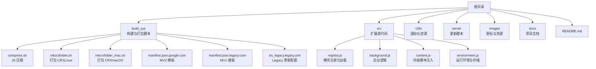
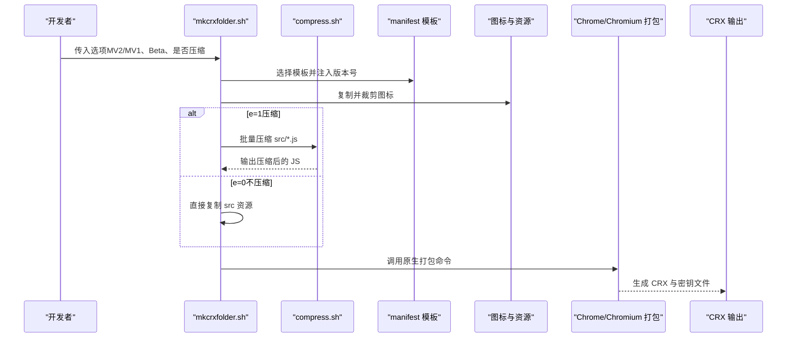
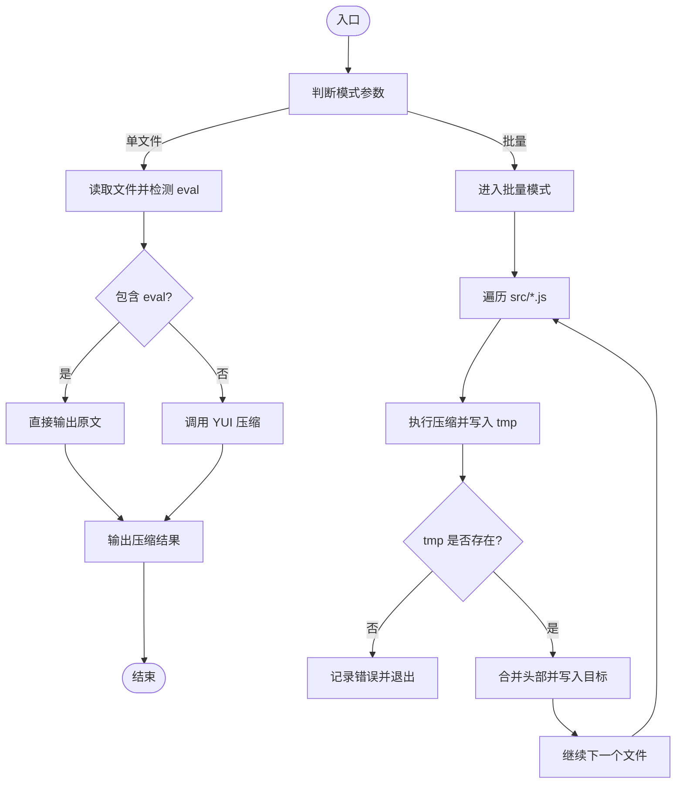
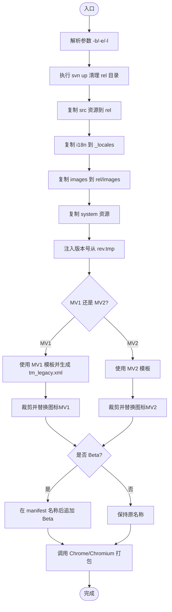
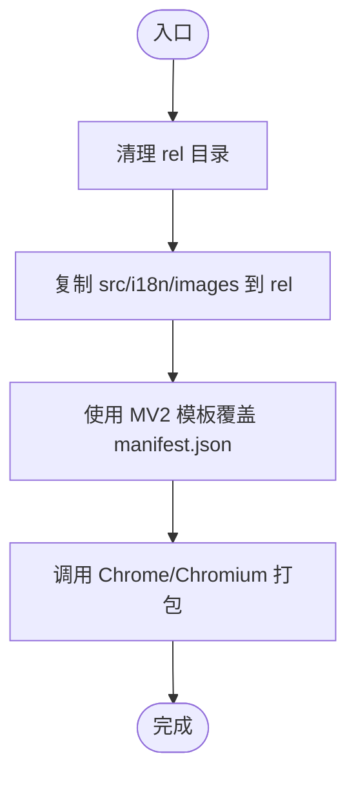
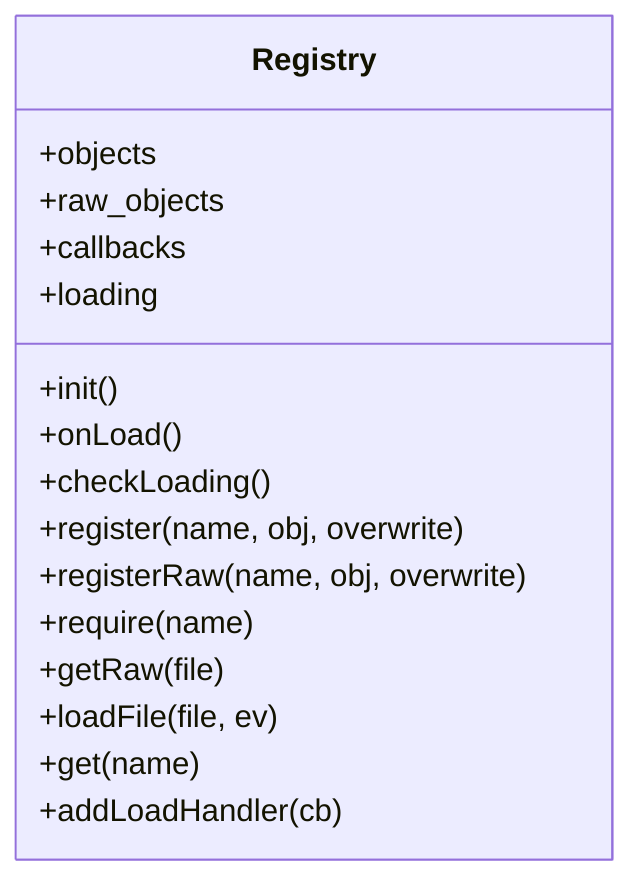
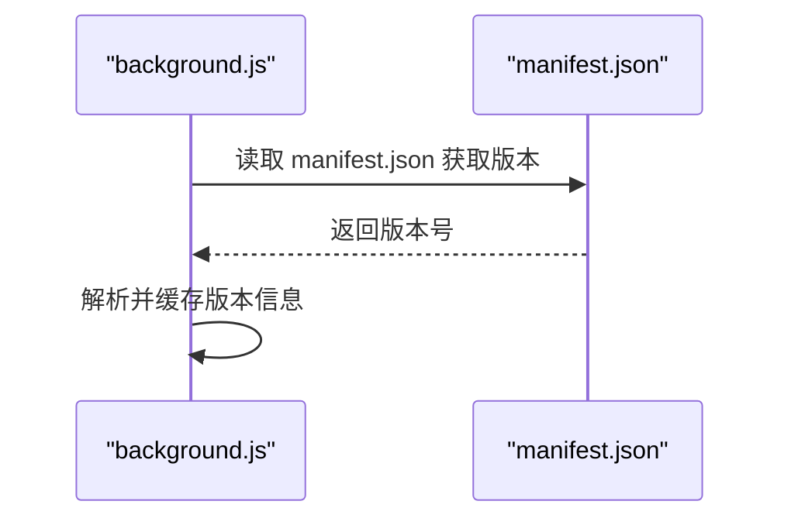
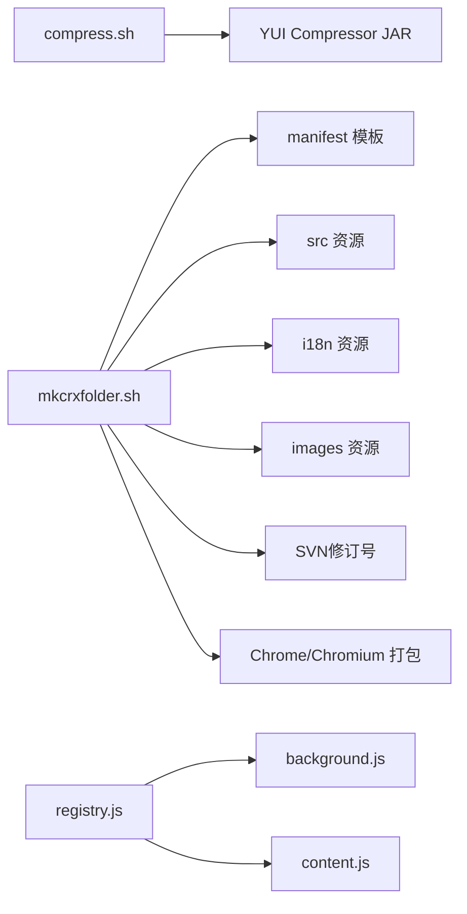

# 构建和部署系统

<cite>
**本文引用的文件**
- [README.md](file://README.md)
- [docs/project-overview.md](file://docs/project-overview.md)
- [build_sys/compress.sh](file://build_sys/compress.sh)
- [build_sys/mkcrxfolder.sh](file://build_sys/mkcrxfolder.sh)
- [build_sys/mkcrxfolder_mac.sh](file://build_sys/mkcrxfolder_mac.sh)
- [build_sys/manifest.json.google.com](file://build_sys/manifest.json.google.com)
- [build_sys/manifest.json.legacy.com](file://build_sys/manifest.json.legacy.com)
- [build_sys/tm_legacy.legacy.xml](file://build_sys/tm_legacy.legacy.xml)
- [src/registry.js](file://src/registry.js)
- [src/background.js](file://src/background.js)
- [src/content.js](file://src/content.js)
- [src/environment.js](file://src/environment.js)
</cite>

## 目录
1. [引言](#引言)
2. [项目结构](#项目结构)
3. [核心组件](#核心组件)
4. [架构总览](#架构总览)
5. [详细组件分析](#详细组件分析)
6. [依赖关系分析](#依赖关系分析)
7. [性能考量](#性能考量)
8. [故障排查指南](#故障排查指南)
9. [结论](#结论)
10. [附录](#附录)

## 引言
本文件系统性梳理 Tampermonkey v2.9 及以前版本的构建与部署体系，重点覆盖以下方面：
- 自动化构建流程设计与实现：打包脚本、版本管理、资源优化
- 多版本支持机制：Chrome 扩展（Manifest V2）与 Legacy（Manifest V1）版本管理及兼容性
- 构建系统配置选项：压缩策略、资源处理、输出格式
- 部署流程：生产发布、版本控制与回滚建议
- 依赖管理与外部工具集成：SVN、Chrome/Chromium 打包、YUI Compressor
- 性能优化与 CI/CD 可行性：构建时间与资源体积优化策略

## 项目结构
该仓库采用“源代码 + 构建脚本 + 多语言资源 + 服务端更新脚本”的组织方式。构建系统的核心位于 build_sys 目录，包含压缩脚本、打包脚本以及两个版本的 manifest 模板；源代码位于 src 目录，包含扩展运行时所需的模块化脚本；国际化资源位于 i18n 目录；服务器端更新脚本位于 server 目录。

图表来源
- [build_sys/compress.sh:1-84](file://build_sys/compress.sh#L1-L84)
- [build_sys/mkcrxfolder.sh:1-137](file://build_sys/mkcrxfolder.sh#L1-L137)
- [build_sys/mkcrxfolder_mac.sh:1-18](file://build_sys/mkcrxfolder_mac.sh#L1-L18)
- [build_sys/manifest.json.google.com:1-43](file://build_sys/manifest.json.google.com#L1-L43)
- [build_sys/manifest.json.legacy.com:1-38](file://build_sys/manifest.json.legacy.com#L1-L38)
- [build_sys/tm_legacy.legacy.xml:1-7](file://build_sys/tm_legacy.legacy.xml#L1-L7)
- [src/registry.js:1-107](file://src/registry.js#L1-L107)
- [src/background.js:1-200](file://src/background.js#L1-L200)
- [src/content.js:1-200](file://src/content.js#L1-L200)
- [src/environment.js:932-978](file://src/environment.js#L932-L978)

章节来源
- [README.md:70-104](file://README.md#L70-L104)
- [docs/project-overview.md:192-200](file://docs/project-overview.md#L192-L200)

## 核心组件
- 压缩脚本 compress.sh：对 JS 文件进行 YUI 压缩，支持单文件与批量处理；在存在 eval 的情况下跳过压缩以避免破坏运行时行为。
- 打包脚本 mkcrxfolder.sh：准备扩展目录结构、复制资源、生成 manifest、处理图标与版本号、生成 Legacy 更新配置；支持 Beta 标识与 MV1/MV2 选择。
- 打包脚本 mkcrxfolder_mac.sh：在 macOS 上直接调用 Chrome/Chromium 的原生打包能力生成 CRX。
- Manifest 模板：MV2（manifest.json.google.com）与 MV1（manifest.json.legacy.com）模板，分别用于现代浏览器与旧版浏览器。
- Legacy 更新配置 tm_legacy.legacy.xml：定义 Legacy 版本的更新地址与版本号占位符。
- 源代码模块：registry.js 提供模块注册与动态加载；background.js 与 content.js 分别负责后台逻辑与页面注入；environment.js 提供运行环境与存储封装。

章节来源
- [build_sys/compress.sh:1-84](file://build_sys/compress.sh#L1-L84)
- [build_sys/mkcrxfolder.sh:1-137](file://build_sys/mkcrxfolder.sh#L1-L137)
- [build_sys/mkcrxfolder_mac.sh:1-18](file://build_sys/mkcrxfolder_mac.sh#L1-L18)
- [build_sys/manifest.json.google.com:1-43](file://build_sys/manifest.json.google.com#L1-L43)
- [build_sys/manifest.json.legacy.com:1-38](file://build_sys/manifest.json.legacy.com#L1-L38)
- [build_sys/tm_legacy.legacy.xml:1-7](file://build_sys/tm_legacy.legacy.xml#L1-L7)
- [src/registry.js:1-107](file://src/registry.js#L1-L107)
- [src/background.js:1-200](file://src/background.js#L1-L200)
- [src/content.js:1-200](file://src/content.js#L1-L200)
- [src/environment.js:932-978](file://src/environment.js#L932-L978)

## 架构总览
构建系统围绕“资源准备 → 版本注入 → 压缩优化 → 打包分发”展开。整体流程如下：

图表来源
- [build_sys/mkcrxfolder.sh:29-92](file://build_sys/mkcrxfolder.sh#L29-L92)
- [build_sys/compress.sh:44-81](file://build_sys/compress.sh#L44-L81)
- [build_sys/manifest.json.google.com:1-43](file://build_sys/manifest.json.google.com#L1-L43)
- [build_sys/manifest.json.legacy.com:1-38](file://build_sys/manifest.json.legacy.com#L1-L38)

## 详细组件分析

### 组件一：压缩脚本 compress.sh
- 功能要点
  - 单文件压缩：对指定 JS 文件进行 YUI 压缩，若文件包含 eval 则跳过压缩。
  - 批量压缩：遍历 src 目录下的 JS 文件，逐个压缩并写入目标目录，记录日志并处理错误。
  - 外部依赖：需要 YUI Compressor 的 JAR 文件，可通过环境变量或工作目录内文件指定。
- 关键流程图

图表来源
- [build_sys/compress.sh:1-84](file://build_sys/compress.sh#L1-L84)

章节来源
- [build_sys/compress.sh:1-84](file://build_sys/compress.sh#L1-L84)

### 组件二：打包脚本 mkcrxfolder.sh（Linux）
- 功能要点
  - 参数解析：支持 -b（Beta）、-e{0|1}（是否压缩）、-l（Legacy 模式）。
  - 版本号注入：从 SVN 信息读取修订号，替换 manifest 模板中的版本字段。
  - 资源复制：复制 src、i18n、images、system 等目录；保留 jslint 版权头；清理临时文件与 debug 文件。
  - 图标处理：根据 MV1/MV2 与 Beta 标志裁剪与替换图标。
  - Legacy 更新：生成 tm_legacy.xml 并注入版本号。
  - 最终命名：Beta 版本在名称后追加 Beta 字样。
- 关键流程图

图表来源
- [build_sys/mkcrxfolder.sh:1-137](file://build_sys/mkcrxfolder.sh#L1-L137)
- [build_sys/manifest.json.google.com:1-43](file://build_sys/manifest.json.google.com#L1-L43)
- [build_sys/manifest.json.legacy.com:1-38](file://build_sys/manifest.json.legacy.com#L1-L38)
- [build_sys/tm_legacy.legacy.xml:1-7](file://build_sys/tm_legacy.legacy.xml#L1-L7)

章节来源
- [build_sys/mkcrxfolder.sh:1-137](file://build_sys/mkcrxfolder.sh#L1-L137)

### 组件三：打包脚本 mkcrxfolder_mac.sh（macOS）
- 功能要点
  - 直接复制 src、i18n、images 至 rel 目录。
  - 使用 MV2 模板覆盖 manifest.json。
  - 调用 Chrome/Chromium 的原生打包命令生成 CRX。
- 关键流程图

图表来源
- [build_sys/mkcrxfolder_mac.sh:1-18](file://build_sys/mkcrxfolder_mac.sh#L1-L18)
- [build_sys/manifest.json.google.com:1-43](file://build_sys/manifest.json.google.com#L1-L43)

章节来源
- [build_sys/mkcrxfolder_mac.sh:1-18](file://build_sys/mkcrxfolder_mac.sh#L1-L18)

### 组件四：多版本支持与兼容性
- MV2（现代浏览器）
  - 使用 Manifest V2 模板，包含 background page、browser_action、icons、permissions 等字段。
  - 通过 Chrome/Chromium 原生打包生成 CRX。
- MV1（Legacy，旧版浏览器）
  - 使用 Manifest V1 模板，包含 background_page、update_url 等字段。
  - 通过 tm_legacy.xml 提供更新地址与版本占位符，打包脚本在构建时注入实际版本号。
- 兼容性处理
  - registry.js 提供模块注册与动态加载，支持在 MV1 环境下通过 eval 执行脚本。
  - background.js 与 content.js 通过 chrome.* API 与扩展运行时交互，MV1 与 MV2 的差异由模板与打包脚本处理。

章节来源
- [build_sys/manifest.json.google.com:1-43](file://build_sys/manifest.json.google.com#L1-L43)
- [build_sys/manifest.json.legacy.com:1-38](file://build_sys/manifest.json.legacy.com#L1-L38)
- [build_sys/tm_legacy.legacy.xml:1-7](file://build_sys/tm_legacy.legacy.xml#L1-L7)
- [src/registry.js:76-92](file://src/registry.js#L76-L92)
- [src/background.js:110-142](file://src/background.js#L110-L142)
- [src/content.js:80-92](file://src/content.js#L80-L92)

### 组件五：模块加载与运行时（registry.js）
- 功能要点
  - 注册与获取模块对象，支持覆盖与回调机制。
  - 动态加载脚本：MV2 通过 <script> 标签注入，MV1 通过 eval 执行。
  - 提供 raw 内容读取接口，便于在运行时拼装与注入。
- 类图

图表来源
- [src/registry.js:1-107](file://src/registry.js#L1-L107)

章节来源
- [src/registry.js:1-107](file://src/registry.js#L1-L107)

### 组件六：后台与内容脚本（background.js、content.js）
- 功能要点
  - background.js：扩展生命周期管理、版本比较、存储与同步、权限与网络请求等。
  - content.js：页面注入、事件桥接、与后台通信、JSON 保护与 DOM 事件兼容。
- 时序图（版本获取）

图表来源
- [src/background.js:110-142](file://src/background.js#L110-L142)

章节来源
- [src/background.js:110-142](file://src/background.js#L110-L142)
- [src/content.js:80-92](file://src/content.js#L80-L92)

## 依赖关系分析
- 外部工具
  - YUI Compressor：用于 JS 压缩，需 JAR 文件。
  - Chrome/Chromium：原生打包工具，生成 CRX 与密钥文件。
  - SVN：历史版本管理工具，用于读取修订号。
  - Cygwin（Windows）：在 Windows 环境下执行 Shell 脚本。
- 内部依赖
  - registry.js 为模块化核心，被 background.js 与 content.js 依赖。
  - 打包脚本依赖 manifest 模板与资源目录结构。
- 依赖图

图表来源
- [build_sys/compress.sh:7-20](file://build_sys/compress.sh#L7-L20)
- [build_sys/mkcrxfolder.sh:29-92](file://build_sys/mkcrxfolder.sh#L29-L92)
- [src/registry.js:1-107](file://src/registry.js#L1-L107)

章节来源
- [build_sys/compress.sh:7-20](file://build_sys/compress.sh#L7-L20)
- [build_sys/mkcrxfolder.sh:29-92](file://build_sys/mkcrxfolder.sh#L29-L92)
- [README.md:70-104](file://README.md#L70-L104)

## 性能考量
- 构建时间优化
  - 批量压缩：优先使用批量模式，减少多次 JVM 启动开销。
  - 条件压缩：对包含 eval 的文件跳过压缩，避免不必要的处理。
  - 资源裁剪：仅复制必要资源，避免冗余文件参与打包。
- 资源体积优化
  - 压缩策略：启用 YUI 压缩，合理设置行断点以平衡可读性与体积。
  - 模块化：registry.js 将功能拆分为独立模块，按需加载，减少初始加载体积。
  - 图标与静态资源：根据 MV1/MV2 与 Beta 标志裁剪图标，避免多余尺寸。
- 运行时性能
  - 事件桥接：content.js 与 background.js 通过消息传递降低耦合，提升响应速度。
  - JSON 保护：在 content.js 中备份原生 JSON，避免页面脚本篡改导致的性能问题。

## 故障排查指南
- YUI 压缩失败
  - 现象：compress.sh 报错并退出。
  - 排查：确认 JAR 文件路径与存在性；检查 compress.log；确保输入文件编码正确。
  - 参考路径：[compress.sh:16-20](file://build_sys/compress.sh#L16-L20)、[compress.sh:67-72](file://build_sys/compress.sh#L67-L72)
- 版本号未注入
  - 现象：manifest.json 中版本号未更新。
  - 排查：确认 SVN 信息可用；检查 rev.tmp 是否生成；验证 sed 表达式。
  - 参考路径：[mkcrxfolder.sh:39-40](file://build_sys/mkcrxfolder.sh#L39-L40)、[mkcrxfolder.sh:91-92](file://build_sys/mkcrxfolder.sh#L91-L92)
- Legacy 更新异常
  - 现象：Legacy 版本无法自动更新。
  - 排查：检查 tm_legacy.xml 的版本占位符是否被正确替换；确认 update_url 指向有效地址。
  - 参考路径：[mkcrxfolder.sh:88-89](file://build_sys/mkcrxfolder.sh#L88-L89)、[build_sys/tm_legacy.legacy.xml:1-7](file://build_sys/tm_legacy.legacy.xml#L1-L7)
- 模块加载失败
  - 现象：require 的模块未找到或执行失败。
  - 排查：确认模块路径与文件名；检查 registry.js 的 getRaw/loadFile 逻辑；确保 MV1/MV2 的 eval 路径可用。
  - 参考路径：[src/registry.js:48-92](file://src/registry.js#L48-L92)

章节来源
- [build_sys/compress.sh:16-20](file://build_sys/compress.sh#L16-L20)
- [build_sys/compress.sh:67-72](file://build_sys/compress.sh#L67-L72)
- [build_sys/mkcrxfolder.sh:39-40](file://build_sys/mkcrxfolder.sh#L39-L40)
- [build_sys/mkcrxfolder.sh:91-92](file://build_sys/mkcrxfolder.sh#L91-L92)
- [build_sys/mkcrxfolder.sh:88-89](file://build_sys/mkcrxfolder.sh#L88-L89)
- [src/registry.js:48-92](file://src/registry.js#L48-L92)

## 结论
该构建与部署系统以 Shell 脚本为核心，结合 YUI 压缩与 Chrome/Chromium 原生打包能力，实现了 MV2 与 MV1（Legacy）双版本支持。通过 manifest 模板注入版本号、资源裁剪与条件压缩，兼顾了构建效率与运行时性能。配合 registry.js 的模块化机制，扩展具备良好的可维护性与兼容性。建议在 CI/CD 场景中引入自动化流水线，统一管理外部工具与版本号，进一步提升稳定性与可重复性。

## 附录
- 基本构建步骤（参考）
  - Linux：建立软链接并执行打包脚本，随后使用 Chrome/Chromium 打包。
  - macOS：直接复制资源并使用 Chrome/Chromium 打包。
- 参考路径
  - [README.md:70-104](file://README.md#L70-L104)
  - [docs/project-overview.md:192-200](file://docs/project-overview.md#L192-L200)