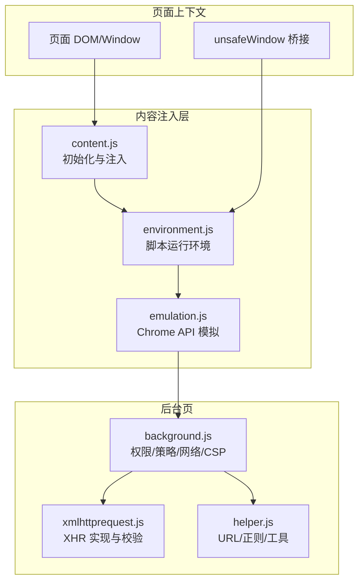
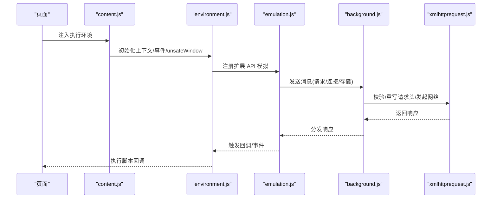
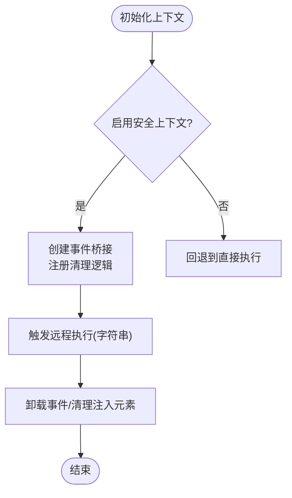
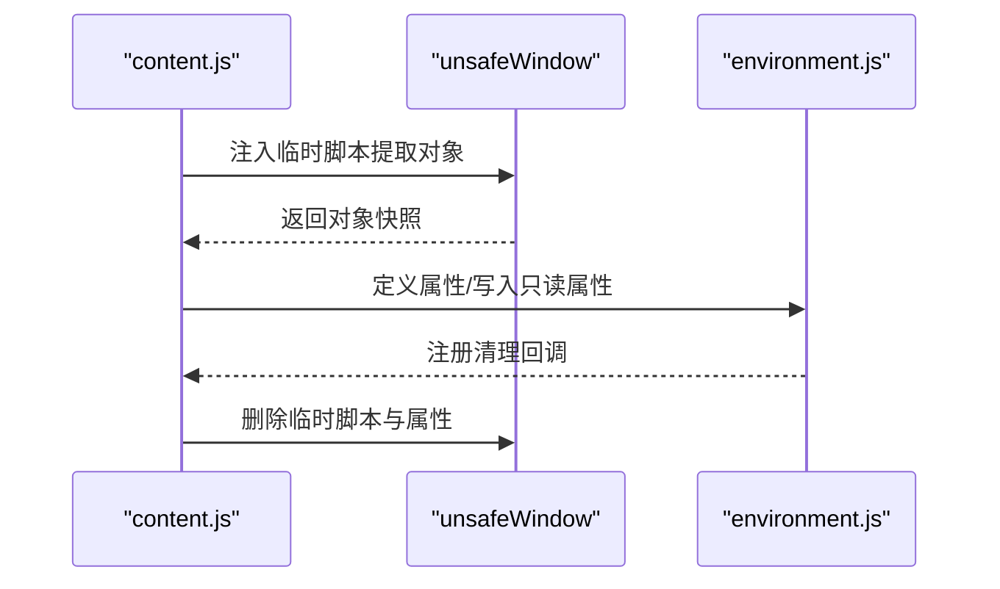
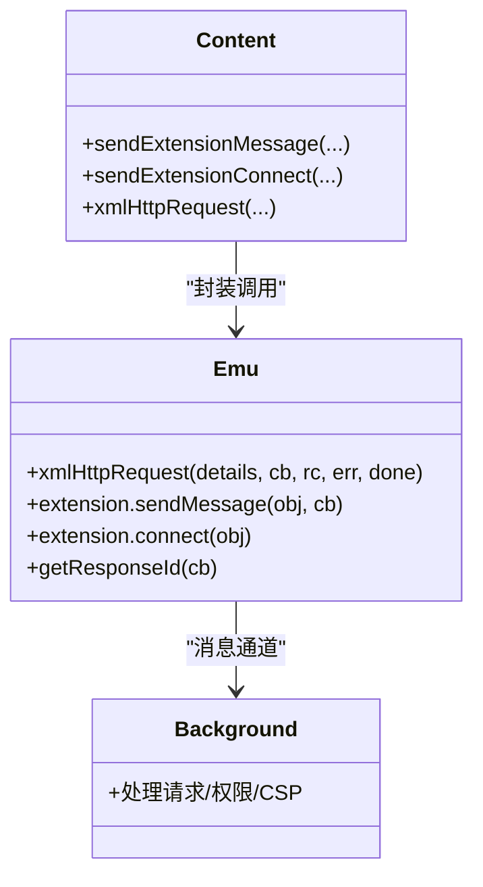
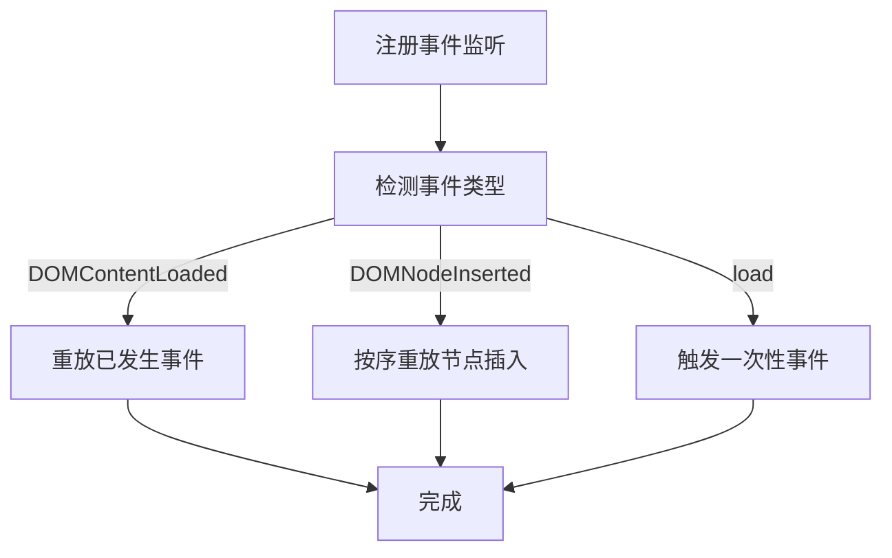
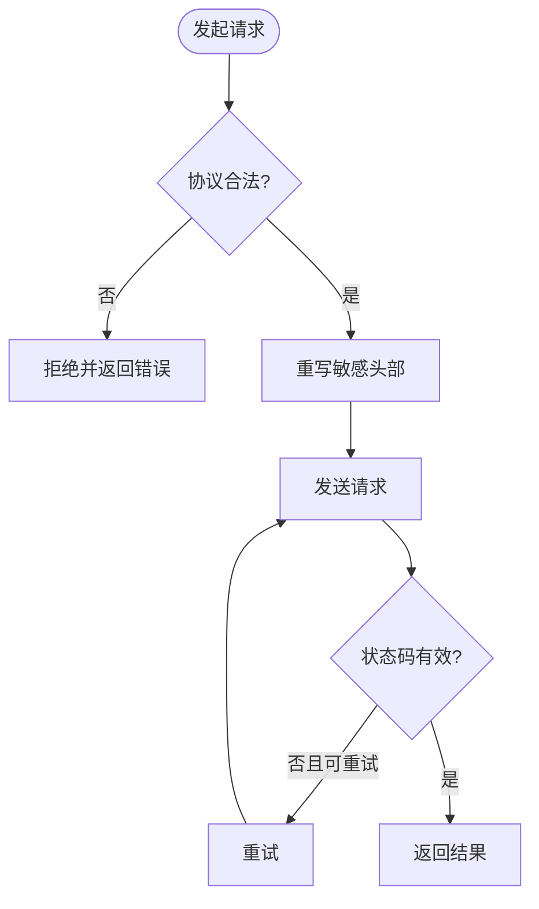
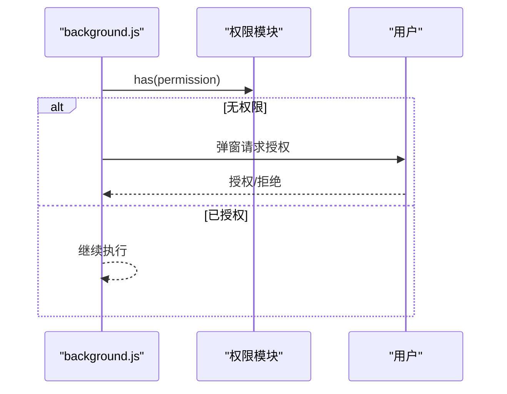
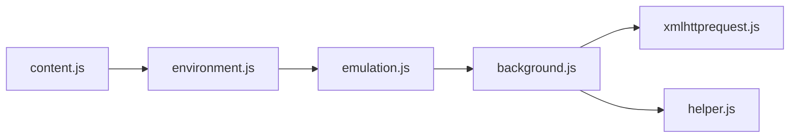

# 安全架构

<cite>
**本文引用的文件**
- [README.md](file://README.md)
- [content.js](file://src/content.js)
- [environment.js](file://src/environment.js)
- [background.js](file://src/background.js)
- [xmlhttprequest.js](file://src/xmlhttprequest.js)
- [emulation.js](file://src/emulation.js)
- [compat.js](file://src/compat.js)
- [helper.js](file://src/helper.js)
- [options.js](file://src/options.js)
</cite>

## 目录
1. [简介](#简介)
2. [项目结构](#项目结构)
3. [核心组件](#核心组件)
4. [架构总览](#架构总览)
5. [详细组件分析](#详细组件分析)
6. [依赖关系分析](#依赖关系分析)
7. [性能考量](#性能考量)
8. [故障排查指南](#故障排查指南)
9. [结论](#结论)
10. [附录](#附录)

## 简介
本文件系统化梳理 Tampermonkey 在用户脚本执行环境中的安全架构，重点覆盖以下方面：
- 沙箱执行模型与上下文隔离
- 权限控制系统与脚本拦截
- 恶意脚本防护机制（含 unsafeWindow 访问控制、API 调用限制、DOM 操作安全策略）
- CSP 兼容性、XSS 防护与 CSRF 保护
- 执行环境的安全隔离、上下文切换与状态保护
- 安全审计日志、威胁检测与异常行为监控
- 安全配置指南与最佳实践
- 安全漏洞修复与应急响应流程

## 项目结构
Tampermonkey 的安全相关实现主要分布在内容注入层、环境模拟层与后台页三部分：
- 内容注入层：负责在页面中注入脚本执行环境，建立安全上下文与 unsafeWindow 访问桥接
- 环境模拟层：提供脚本运行时 API 的模拟与事件分发，确保脚本调用通过受控通道
- 后台页：集中处理权限请求、网络请求策略、CSP 适配与脚本拦截

图示来源
- [content.js:1-800](file://src/content.js#L1-L800)
- [environment.js:1-800](file://src/environment.js#L1-L800)
- [emulation.js:1-329](file://src/emulation.js#L1-L329)
- [background.js:1-800](file://src/background.js#L1-L800)
- [xmlhttprequest.js:1-161](file://src/xmlhttprequest.js#L1-L161)
- [helper.js:1-209](file://src/helper.js#L1-L209)

章节来源
- [README.md:1-112](file://README.md#L1-L112)
- [content.js:1-800](file://src/content.js#L1-L800)
- [environment.js:1-800](file://src/environment.js#L1-L800)
- [background.js:1-800](file://src/background.js#L1-L800)
- [xmlhttprequest.js:1-161](file://src/xmlhttprequest.js#L1-L161)
- [helper.js:1-209](file://src/helper.js#L1-L209)

## 核心组件
- 内容注入与上下文初始化
  - 在页面中创建受控执行上下文，注入事件与清理逻辑，确保脚本生命周期内资源回收
  - 提供安全上下文开关与 unsafeWindow 访问桥接，避免直接暴露宿主对象
- 环境模拟与 API 代理
  - 将 Chrome 扩展 API 映射到页面可调用的模拟层，统一通过消息通道转发
  - 对定时器等高风险 API 进行字符串形式的延迟执行包装，降低直接注入风险
- 后台策略与网络控制
  - 统一处理权限请求、脚本拦截、CSP 适配与网络请求头重写
  - 对本地文件访问与跨域请求进行白名单与协议校验
- 工具与兼容层
  - 提供 URL 正则转换、本地图片识别、严格模式规避等辅助能力
  - 兼容旧版语法与特性，减少脚本侧安全绕过机会

章节来源
- [content.js:455-608](file://src/content.js#L455-L608)
- [environment.js:520-747](file://src/environment.js#L520-L747)
- [emulation.js:40-329](file://src/emulation.js#L40-L329)
- [background.js:5886-5914](file://src/background.js#L5886-L5914)
- [xmlhttprequest.js:17-153](file://src/xmlhttprequest.js#L17-L153)
- [helper.js:56-80](file://src/helper.js#L56-L80)

## 架构总览
下图展示从页面到后台的完整调用链路与安全控制点：

图示来源
- [content.js:108-215](file://src/content.js#L108-L215)
- [environment.js:646-747](file://src/environment.js#L646-L747)
- [emulation.js:126-146](file://src/emulation.js#L126-L146)
- [background.js:5886-5914](file://src/background.js#L5886-L5914)
- [xmlhttprequest.js:17-153](file://src/xmlhttprequest.js#L17-L153)

## 详细组件分析

### 沙箱执行模型与上下文隔离
- 安全上下文开关
  - 通过标志位控制是否启用“安全上下文”，在该模式下所有脚本执行均经由事件桥接，避免直接修改宿主对象
- 事件桥接与延迟执行
  - 使用自定义 MutationEvent 触发远程执行，字符串形式的函数体通过解码后在安全上下文中执行
- 上下文清理
  - 生命周期结束时移除事件监听、清理注入的脚本标签与属性，防止残留污染

图示来源
- [content.js:108-182](file://src/content.js#L108-L182)
- [content.js:612-628](file://src/content.js#L612-L628)
- [environment.js:309-323](file://src/environment.js#L309-L323)

章节来源
- [content.js:69-76](file://src/content.js#L69-L76)
- [content.js:108-182](file://src/content.js#L108-L182)
- [content.js:612-628](file://src/content.js#L612-L628)
- [environment.js:309-323](file://src/environment.js#L309-L323)

### unsafeWindow 访问控制
- 访问路径
  - 通过在 unsafeWindow 中注入临时脚本，提取 window/top/frames/parent/opener 等对象，并以只读或属性定义方式映射到当前上下文
- 强制标记与降级处理
  - 对 top 等属性强制标记为不可写；若检测到脚本拦截器，记录告警并通过后台提示用户刷新页面
- 清理策略
  - 执行后删除临时属性与注入脚本，避免持久污染

图示来源
- [content.js:455-608](file://src/content.js#L455-L608)
- [environment.js:573-589](file://src/environment.js#L573-L589)

章节来源
- [content.js:455-608](file://src/content.js#L455-L608)
- [content.js:487-499](file://src/content.js#L487-L499)
- [environment.js:573-589](file://src/environment.js#L573-L589)

### API 调用限制与事件桥接
- 定时器与字符串执行
  - 对 setTimeout/setInterval 的字符串参数进行包装，转为通过事件桥接执行，避免直接注入代码
- 请求与连接
  - 所有扩展 API 请求通过消息通道发送至后台，后台统一处理权限与策略后再返回
- 回调与响应
  - 响应使用带标识符的回调机制，确保一一对应与超时清理

图示来源
- [emulation.js:52-82](file://src/emulation.js#L52-L82)
- [emulation.js:209-273](file://src/emulation.js#L209-L273)
- [content.js:352-408](file://src/content.js#L352-L408)
- [background.js:5886-5914](file://src/background.js#L5886-L5914)

章节来源
- [environment.js:591-624](file://src/environment.js#L591-L624)
- [emulation.js:52-82](file://src/emulation.js#L52-L82)
- [emulation.js:197-207](file://src/emulation.js#L197-L207)
- [content.js:352-408](file://src/content.js#L352-L408)

### DOM 操作安全策略
- 事件重放与顺序保证
  - 对 DOMContentLoaded/DOMNodeInserted/load 等事件进行重放与优先级调度，避免第三方脚本干扰
- XPath 与选择器增强
  - 对 document.evaluate 进行补丁，自动添加相对路径前缀，降低跨域与注入风险
- 属性变更监听
  - 通过 MutationObserver 或字符串解析方式模拟 DOMAttrModified，确保事件一致性

图示来源
- [environment.js:197-343](file://src/environment.js#L197-L343)
- [environment.js:520-571](file://src/environment.js#L520-L571)

章节来源
- [environment.js:197-343](file://src/environment.js#L197-L343)
- [environment.js:520-571](file://src/environment.js#L520-L571)

### 网络请求与协议校验
- 协议校验
  - 仅允许 http/https 或内置图片资源，拒绝 file 等不安全方案
- 请求头重写
  - 对 UA/Referer 等头部进行前缀处理，避免被目标站点识别为浏览器默认值
- 错误重试与进度上报
  - 对非 200/0 的状态进行有限次数重试，并上报进度信息

图示来源
- [xmlhttprequest.js:17-153](file://src/xmlhttprequest.js#L17-L153)

章节来源
- [xmlhttprequest.js:17-153](file://src/xmlhttprequest.js#L17-L153)

### CSP 兼容性与 XSS 防护
- CSP 适配
  - 自动替换页面 CSP 头中的 script-src，追加扩展 ID、unsafe-inline 与 unsafe-eval，缓解脚本执行受限问题
- XSS 防护
  - 通过安全上下文与事件桥接，避免直接注入可执行代码
  - 对字符串形式的定时器参数进行解码执行，降低反射型 XSS 风险

章节来源
- [background.js:5904-5914](file://src/background.js#L5904-L5914)
- [environment.js:591-624](file://src/environment.js#L591-L624)

### CSRF 保护措施
- 来源校验
  - 后台对请求来源与目标进行匹配校验，避免跨站请求滥用
- 头部重写
  - 对 UA/Referer 等头部进行前缀化处理，降低伪造难度
- 会话隔离
  - 通过响应标识符与端口机制，确保请求与响应一一对应，避免跨请求混淆

章节来源
- [background.js:5886-5914](file://src/background.js#L5886-L5914)
- [emulation.js:214-259](file://src/emulation.js#L214-L259)

### 权限控制系统与脚本拦截
- 权限请求
  - 对存储、内容设置等权限进行显式请求与提示，支持一键授权与重置
- 脚本拦截检测
  - 检测到脚本拦截器时，向后台上报并提示用户刷新页面
- 禁止页面
  - 对禁止访问的页面直接跳过脚本执行，避免无效与潜在风险

图示来源
- [background.js:4395-4401](file://src/background.js#L4395-L4401)
- [background.js:5413-5511](file://src/background.js#L5413-L5511)

章节来源
- [background.js:4395-4401](file://src/background.js#L4395-L4401)
- [background.js:5413-5511](file://src/background.js#L5413-L5511)

### 安全审计日志与异常监控
- 日志级别
  - 通过全局变量控制详细程度，支持调试、事件、内存等多级日志输出
- 异常捕获
  - 脚本执行与 API 调用均包裹异常捕获，记录堆栈与错误信息
- 响应回收
  - 对响应回调进行注册与清理，避免内存泄漏

章节来源
- [content.js:69-76](file://src/content.js#L69-L76)
- [environment.js:128-193](file://src/environment.js#L128-L193)
- [emulation.js:197-207](file://src/emulation.js#L197-L207)

### 兼容性与语法适配
- 严格模式规避
  - 将 "use strict" 替换为包含不间断空格的变体，避免严格模式导致的兼容问题
- 旧语法转换
  - 支持 for each、数组左侧赋值、元数据块等语法转换，减少脚本侧绕过机会

章节来源
- [compat.js:21-26](file://src/compat.js#L21-L26)
- [compat.js:167-213](file://src/compat.js#L167-L213)
- [compat.js:114-151](file://src/compat.js#L114-L151)
- [compat.js:238-270](file://src/compat.js#L238-L270)

## 依赖关系分析
- 组件耦合
  - content.js 依赖 environment.js 提供的事件与 API 模拟
  - emulation.js 作为中间层，屏蔽后台细节，统一消息格式
  - background.js 负责最终策略落地与网络控制
- 关键依赖链
  - content.js → environment.js → emulation.js → background.js
  - background.js → xmlhttprequest.js → 网络栈

图示来源
- [content.js:80-91](file://src/content.js#L80-L91)
- [environment.js:35](file://src/environment.js#L35)
- [emulation.js:9](file://src/emulation.js#L9)
- [background.js:28-34](file://src/background.js#L28-L34)
- [xmlhttprequest.js:7-10](file://src/xmlhttprequest.js#L7-L10)
- [helper.js:7-11](file://src/helper.js#L7-L11)

章节来源
- [content.js:80-91](file://src/content.js#L80-L91)
- [environment.js:35](file://src/environment.js#L35)
- [emulation.js:9](file://src/emulation.js#L9)
- [background.js:28-34](file://src/background.js#L28-L34)
- [xmlhttprequest.js:7-10](file://src/xmlhttprequest.js#L7-L10)
- [helper.js:7-11](file://src/helper.js#L7-L11)

## 性能考量
- 事件重放与延迟执行
  - 通过队列与优先级调度，避免重复事件与阻塞
- 缓存与清理
  - 对 require 资源进行缓存与定期清理，降低网络与解析开销
- 日志级别控制
  - 通过日志等级动态调整输出，减少生产环境开销

章节来源
- [background.js:395-433](file://src/background.js#L395-L433)
- [environment.js:325-343](file://src/environment.js#L325-L343)

## 故障排查指南
- 脚本拦截器告警
  - 若检测到脚本拦截器，后台会弹出提示并要求刷新页面
- 网络请求失败
  - 检查协议合法性与重试机制；确认 UA/Referer 是否被正确重写
- unsafeWindow 获取失败
  - 检查安全上下文开关与属性定义；确认注入脚本是否成功移除
- 权限未授予
  - 通过选项界面重新授权存储与内容设置权限

章节来源
- [content.js:487-499](file://src/content.js#L487-L499)
- [xmlhttprequest.js:115-153](file://src/xmlhttprequest.js#L115-L153)
- [background.js:5413-5511](file://src/background.js#L5413-L5511)

## 结论
Tampermonkey 的安全架构围绕“安全上下文 + 事件桥接 + 后台策略”构建，通过严格的协议校验、CSP 适配、权限控制与 DOM 事件重放，有效降低了用户脚本对页面与系统的风险。配合兼容层与日志体系，既保障了功能可用性，也便于问题定位与持续改进。

## 附录

### 安全配置指南
- 启用安全上下文
  - 确保在安全上下文中执行脚本，避免直接暴露宿主对象
- 配置脚本拦截器覆盖
  - 在需要时申请内容设置权限，允许覆盖常见脚本拦截器
- 网络请求策略
  - 仅允许 http/https；必要时通过后台重写 UA/Referer
- 禁止页面列表
  - 将高风险页面加入禁止执行列表

章节来源
- [content.js:61-61](file://src/content.js#L61-L61)
- [background.js:5413-5511](file://src/background.js#L5413-L5511)
- [xmlhttprequest.js:12-15](file://src/xmlhttprequest.js#L12-L15)
- [background.js:4380-4393](file://src/background.js#L4380-L4393)

### 最佳实践
- 优先使用模拟 API 而非直接调用宿主接口
- 对外部输入进行严格校验与转义
- 合理使用 run_at 时机，避免在 document-start 阶段进行高风险操作
- 定期更新脚本与扩展，及时修复已知漏洞

### 应急响应流程
- 发现异常
  - 提升日志级别，复现并记录堆栈
- 快速处置
  - 临时禁用相关脚本与页面，检查权限与网络策略
- 根因修复
  - 更新模拟层或后台策略，补充协议校验与 CSP 适配
- 验证与回归
  - 在测试环境中验证修复效果，逐步推广