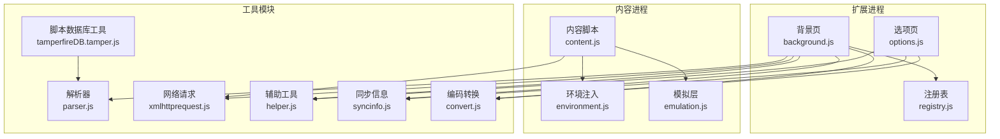
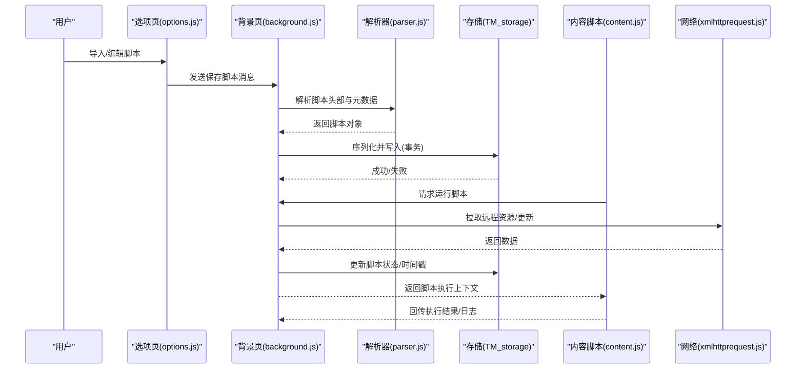
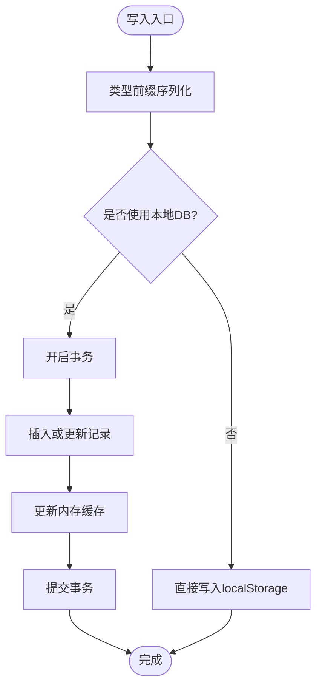
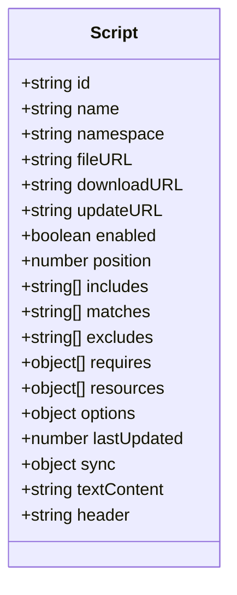
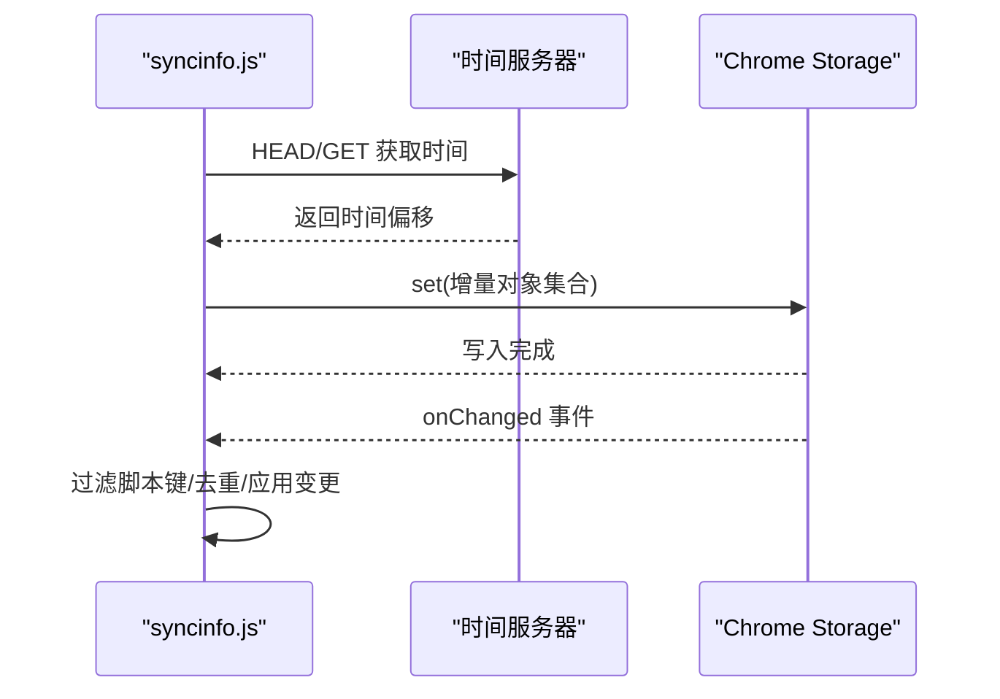
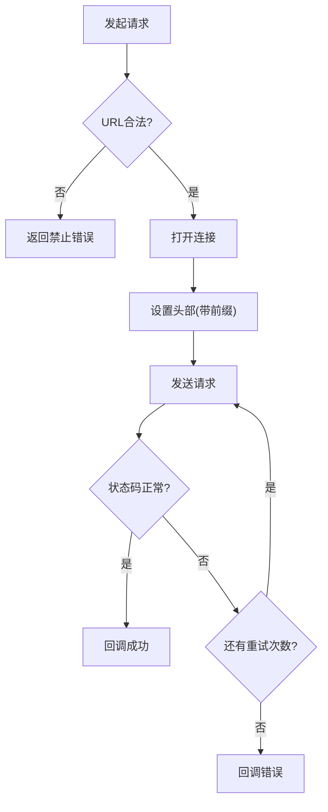
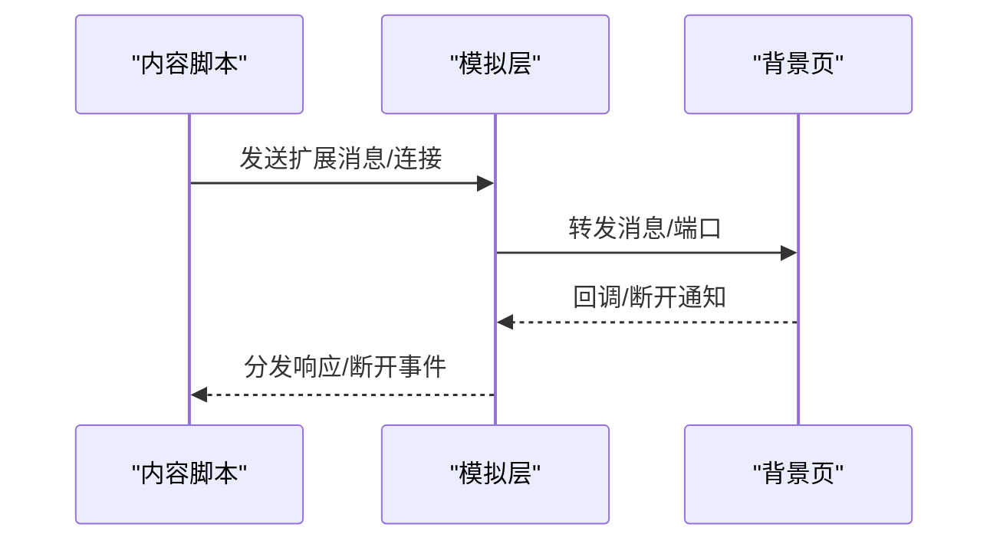
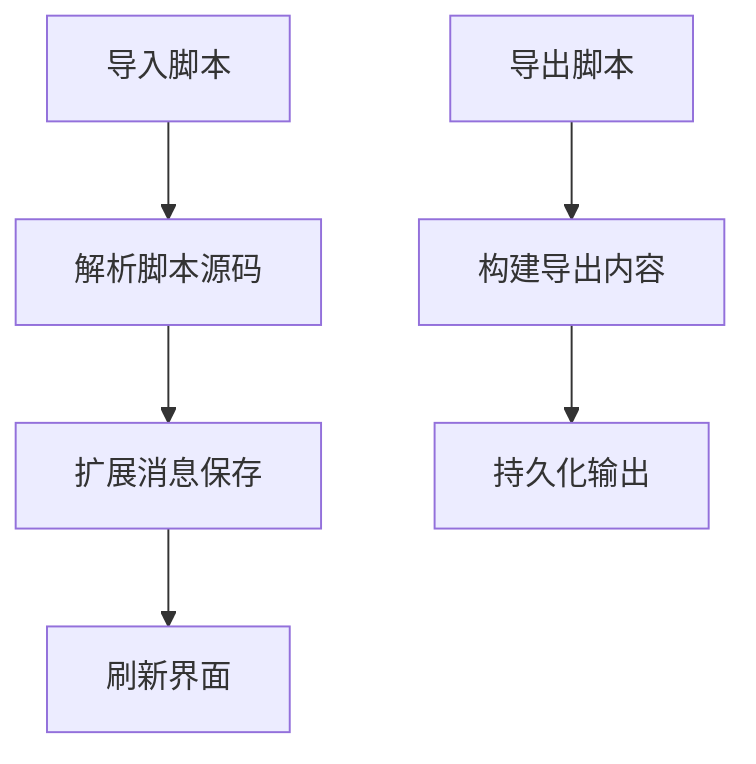
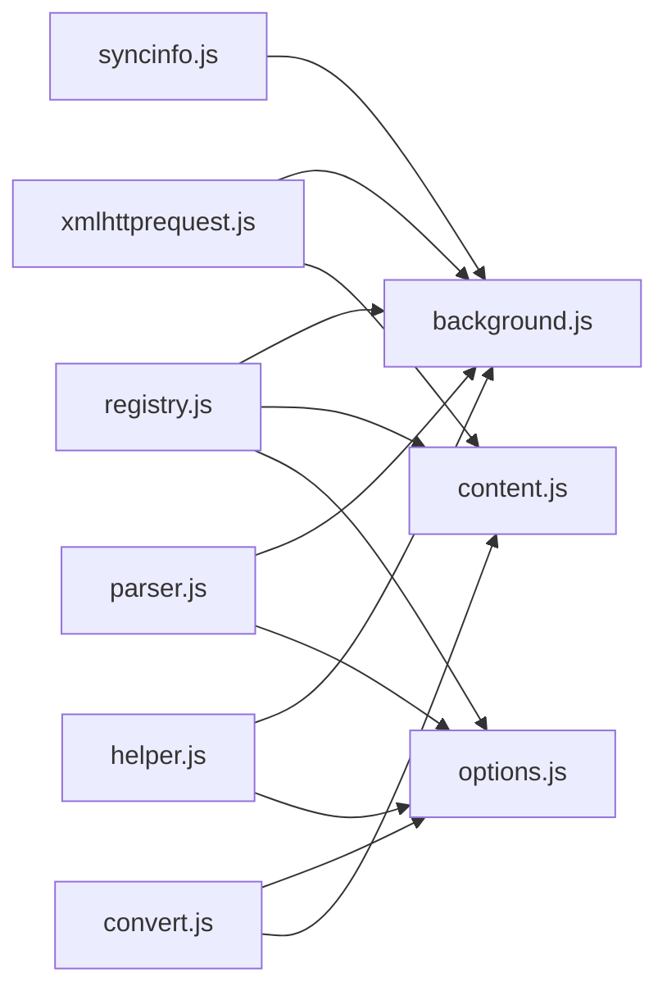

# 数据流设计

<cite>
**本文档引用的文件**
- [background.js](file://src/background.js)
- [options.js](file://src/options.js)
- [content.js](file://src/content.js)
- [xmlhttprequest.js](file://src/xmlhttprequest.js)
- [parser.js](file://src/parser.js)
- [helper.js](file://src/helper.js)
- [syncinfo.js](file://src/syncinfo.js)
- [registry.js](file://src/registry.js)
- [convert.js](file://src/convert.js)
- [tamperfireDB.tamper.js](file://src/system/tamperfireDB.tamper.js)
- [pingpong.js](file://src/pingpong.js)
</cite>

## 目录
1. [简介](#简介)
2. [项目结构](#项目结构)
3. [核心组件](#核心组件)
4. [架构总览](#架构总览)
5. [详细组件分析](#详细组件分析)
6. [依赖分析](#依赖分析)
7. [性能考虑](#性能考虑)
8. [故障排除指南](#故障排除指南)
9. [结论](#结论)
10. [附录](#附录)

## 简介
本文件系统性梳理 Tampermonkey 的数据流设计，覆盖脚本配置数据、运行时状态与用户设置的结构与关系，解释数据在后台、内容脚本与扩展页面之间的流转路径、转换规则与存储策略；阐述缓存机制、增量更新与冲突解决策略；说明跨进程数据传输、序列化格式与网络传输协议；并给出数据一致性、事务处理与回滚机制、迁移与版本升级策略、备份与恢复以及性能优化建议。

## 项目结构
- 背景页负责脚本生命周期管理、存储、同步与更新检查等核心逻辑
- 内容脚本负责注入与执行用户脚本、事件桥接与跨进程通信
- 选项页负责脚本导入导出、设置编辑与批量操作
- 工具模块提供解析、转换、网络请求、注册表与同步信息等通用能力
- 系统工具用于构建与维护脚本数据库

**图表来源**
- [background.js](file://src/background.js)
- [options.js](file://src/options.js)
- [content.js](file://src/content.js)
- [xmlhttprequest.js](file://src/xmlhttprequest.js)
- [parser.js](file://src/parser.js)
- [helper.js](file://src/helper.js)
- [syncinfo.js](file://src/syncinfo.js)
- [convert.js](file://src/convert.js)
- [registry.js](file://src/registry.js)
- [tamperfireDB.tamper.js](file://src/system/tamperfireDB.tamper.js)

**章节来源**
- [background.js](file://src/background.js)
- [options.js](file://src/options.js)
- [content.js](file://src/content.js)
- [xmlhttprequest.js](file://src/xmlhttprequest.js)
- [parser.js](file://src/parser.js)
- [helper.js](file://src/helper.js)
- [syncinfo.js](file://src/syncinfo.js)
- [convert.js](file://src/convert.js)
- [registry.js](file://src/registry.js)
- [tamperfireDB.tamper.js](file://src/system/tamperfireDB.tamper.js)

## 核心组件
- 存储与事务：基于本地 SQLite（Web SQL）与内存缓存的混合存储，支持类型前缀序列化与事务写入
- 解析与元数据：从用户脚本源码中提取头部元数据，生成脚本对象模型
- 同步与时间校准：通过 Chrome Storage 同步与时间服务器校准，实现跨设备脚本列表同步与冲突检测
- 网络与重试：统一的 XMLHttpRequest 封装，支持重试、进度回调与头部改写
- 注册表与模块加载：动态 require 与模块注册，确保组件解耦与按需加载
- 进程间通信：消息与端口通信，支持响应式回调与连接生命周期管理
- 编码与转换：UTF-8/Base64 编解码与字符串转义，保障跨进程数据安全传输

**章节来源**
- [background.js](file://src/background.js)
- [parser.js](file://src/parser.js)
- [syncinfo.js](file://src/syncinfo.js)
- [xmlhttprequest.js](file://src/xmlhttprequest.js)
- [registry.js](file://src/registry.js)
- [convert.js](file://src/convert.js)

## 架构总览
数据流贯穿“配置/元数据 → 解析 → 存储 → 运行时调度 → 执行 → 结果回传”的闭环，并通过“同步/网络 → 时间校准 → 增量写入 → 冲突检测”的机制保证一致性。

**图表来源**
- [options.js](file://src/options.js)
- [background.js](file://src/background.js)
- [parser.js](file://src/parser.js)
- [xmlhttprequest.js](file://src/xmlhttprequest.js)

## 详细组件分析

### 存储与事务（TM_storage）
- 存储策略
  - 优先使用本地 SQLite（Web SQL）持久化，键值以“名称+后缀”区分不同类型数据（条件、源码、存储区等）
  - 内存缓存加速读取，写入时同时更新缓存与数据库
  - 类型前缀序列化：布尔/数字/对象/字符串分别以不同前缀标识，读取时自动反序列化
- 事务与一致性
  - 写入采用事务执行，避免部分写入导致不一致
  - 支持批量更新与删除，减少事务开销
- 增量更新与回滚
  - 通过缓存与事务组合实现增量更新；若事务失败可回滚至上次成功状态
- 备份与恢复
  - 提供列出所有键值与删除全部的能力，便于导出/导入

**图表来源**
- [background.js](file://src/background.js)

**章节来源**
- [background.js](file://src/background.js)

### 脚本解析与元数据（parser.js）
- 元数据标签解析：支持 name、version、namespace、icon、homepage、include/match/exclude、require/resource、run-at、user-agent、noframes 等
- 脚本对象模型：包含 id、name、namespace、includes/matches/excludes、requires/resources、options 等字段
- 兼容性标记：根据源码特征推断兼容性选项，辅助运行时适配

**图表来源**
- [parser.js](file://src/parser.js)

**章节来源**
- [parser.js](file://src/parser.js)

### 同步与时间校准（syncinfo.js）
- 同步类型：支持 Pastebin 与 Chrome Storage 同步
- 时间校准：通过多个时间服务器 HEAD/GET 探测，计算时间偏移，用于冲突排序与去重
- 增量写入：集中变更在定时器后批量写入，避免频繁写入
- 变更监听：监听 Chrome Storage 变化，过滤脚本键并触发回调
- 冲突解决：通过时间戳与“移除标记”实现冲突检测与保留最新

**图表来源**
- [syncinfo.js](file://src/syncinfo.js)

**章节来源**
- [syncinfo.js](file://src/syncinfo.js)

### 网络与重试（xmlhttprequest.js）
- 统一请求封装：支持方法、头、超时、重试、进度回调与响应类型
- 安全校验：仅允许 http(s) 或特定本地图片资源，防止不安全协议
- 头部改写：对 UA/Referer 等头部添加前缀，避免与页面脚本冲突
- 错误与重试：在非 200/0 状态且有剩余重试次数时自动重试

**图表来源**
- [xmlhttprequest.js](file://src/xmlhttprequest.js)

**章节来源**
- [xmlhttprequest.js](file://src/xmlhttprequest.js)

### 进程间通信（content.js 与 background.js）
- 消息与端口：内容脚本通过扩展消息与端口与背景页通信，支持响应式回调与连接生命周期管理
- 序列化与反序列化：通过转换模块进行编码/解码，确保跨进程数据安全
- 事件桥接：内容脚本负责注入与事件分发，背景页负责调度与执行

**图表来源**
- [content.js](file://src/content.js)
- [background.js](file://src/background.js)

**章节来源**
- [content.js](file://src/content.js)
- [background.js](file://src/background.js)

### 选项页与导入导出（options.js）
- 导入：支持从文本、沙盒文件系统与本地文件导入脚本，解析后通过扩展消息保存
- 导出：支持导出到文本、沙盒文件系统与本地文件
- 设置编辑：提供脚本位置、运行时机、注释等设置项的实时修改与批量保存

**图表来源**
- [options.js](file://src/options.js)

**章节来源**
- [options.js](file://src/options.js)

### 注册表与模块加载（registry.js）
- 动态 require：按需加载模块，避免一次性初始化开销
- 模块注册：统一注册与获取，支持原始内容读取与回调加载

**章节来源**
- [registry.js](file://src/registry.js)

### 编码与转换（convert.js）
- UTF-8/UTF-16 双向转换
- Base64 编解码
- 字符串转义/反转义

**章节来源**
- [convert.js](file://src/convert.js)

### 脚本数据库工具（tamperfireDB.tamper.js）
- 从脚本站点抓取元数据，解析并聚合为脚本数据库
- 支持参数化范围与线程并发抓取，具备重试与缺失记录追踪

**章节来源**
- [tamperfireDB.tamper.js](file://src/system/tamperfireDB.tamper.js)

## 依赖分析
- 组件耦合
  - 背景页依赖解析器、存储、网络与同步模块，承担核心协调职责
  - 内容脚本依赖模拟层与环境注入，负责与页面交互
  - 选项页依赖转换与同步模块，提供导入导出与设置编辑
- 直接与间接依赖
  - 解析器被背景页与选项页共同依赖
  - 网络模块被解析器与同步模块复用
  - 注册表为模块加载基础设施，被所有模块 require
- 循环依赖风险
  - 通过注册表与延迟 require 降低循环依赖概率

**图表来源**
- [registry.js](file://src/registry.js)
- [background.js](file://src/background.js)
- [content.js](file://src/content.js)
- [options.js](file://src/options.js)
- [parser.js](file://src/parser.js)
- [xmlhttprequest.js](file://src/xmlhttprequest.js)
- [syncinfo.js](file://src/syncinfo.js)
- [helper.js](file://src/helper.js)
- [convert.js](file://src/convert.js)

**章节来源**
- [registry.js](file://src/registry.js)
- [background.js](file://src/background.js)
- [content.js](file://src/content.js)
- [options.js](file://src/options.js)
- [parser.js](file://src/parser.js)
- [xmlhttprequest.js](file://src/xmlhttprequest.js)
- [syncinfo.js](file://src/syncinfo.js)
- [helper.js](file://src/helper.js)
- [convert.js](file://src/convert.js)

## 性能考虑
- 缓存策略
  - 本地 SQLite + 内存缓存双层缓存，读多写少场景显著降低 IO
  - require 缓存按时间戳清理，避免无限增长
- 批量写入
  - 存储写入采用事务，批量更新减少事务次数
  - 同步写入集中定时器批量提交，降低写入频率
- 并发与限速
  - 网络请求支持重试与退避，避免对目标服务器造成压力
  - 脚本数据库抓取支持线程数与范围参数，平衡吞吐与稳定性
- 序列化与传输
  - 使用 Base64/UTF-8 编解码与字符串转义，减少跨进程传输开销

[本节为通用指导，无需具体文件分析]

## 故障排除指南
- 网络错误与重试
  - 非 200/0 状态且仍有重试次数时自动重试；检查 URL 合法性与头部改写
- 存储异常
  - 事务失败时回滚至上一次成功状态；检查序列化/反序列化与类型前缀
- 同步冲突
  - 通过时间偏移与“移除标记”识别冲突；必要时手动清理或重置
- 进程间通信
  - 检查消息响应回调与端口生命周期；确认模拟层正确转发

**章节来源**
- [xmlhttprequest.js](file://src/xmlhttprequest.js)
- [background.js](file://src/background.js)
- [syncinfo.js](file://src/syncinfo.js)
- [content.js](file://src/content.js)

## 结论
Tampermonkey 的数据流设计以“解析—存储—同步—执行—回传”为主线，结合本地事务、内存缓存与时间校准，实现了高可用与强一致性的跨进程数据管理。通过模块化的工具层与严格的序列化/反序列化规范，系统在复杂脚本生态下仍保持稳定与可维护性。建议在生产环境中配合定期备份与监控，以进一步提升可靠性。

[本节为总结，无需具体文件分析]

## 附录

### 数据结构与关系
- 脚本对象（Script）
  - 关键字段：id、name、namespace、fileURL/downloadURL/updateURL、enabled、position、includes/matches/excludes、requires/resources、options、lastUpdated、sync、textContent、header
  - 关系：与条件存储、源码存储、用户设置存储关联
- 存储键命名约定
  - 条件存储：name + “@re”
  - 源码存储：name + “@st”
  - 脚本存储：name + “@source”
  - 头部元数据：name + “@header”
- 同步键命名
  - 脚本同步键：id + “@us”

**章节来源**
- [parser.js](file://src/parser.js)
- [background.js](file://src/background.js)
- [syncinfo.js](file://src/syncinfo.js)

### 版本升级与迁移策略
- 背景页在启动时执行版本比较与迁移检查，逐版本应用迁移逻辑（如数据复制、字段重命名、默认值填充等）
- 迁移流程采用“条件判断 + 批量处理 + 提交版本号”的模式，确保幂等与可回溯

**章节来源**
- [background.js](file://src/background.js)

### 备份与恢复
- 备份：列出所有键值并导出为可移植格式（文本/文件/沙盒文件系统）
- 恢复：解析导入内容，逐条保存至存储，必要时触发重新解析与索引

**章节来源**
- [options.js](file://src/options.js)
- [background.js](file://src/background.js)