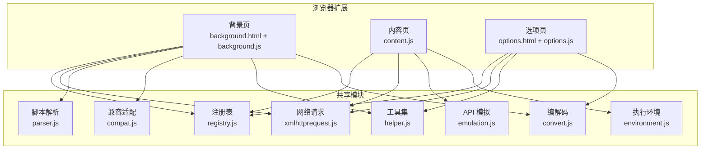
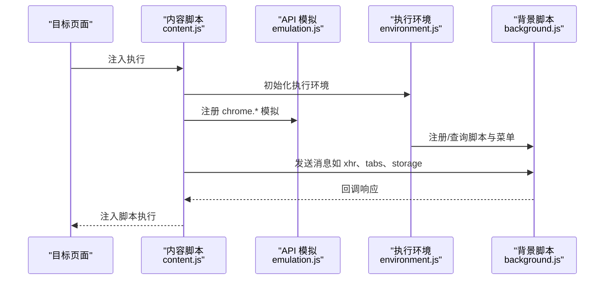
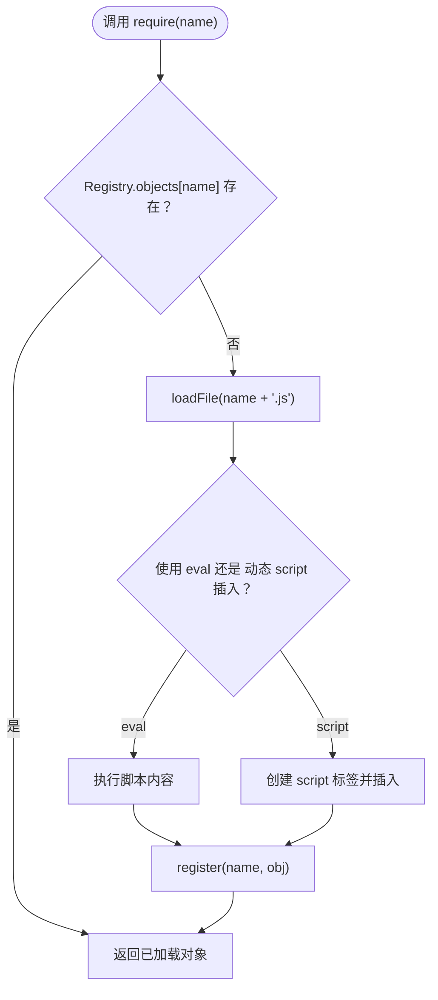
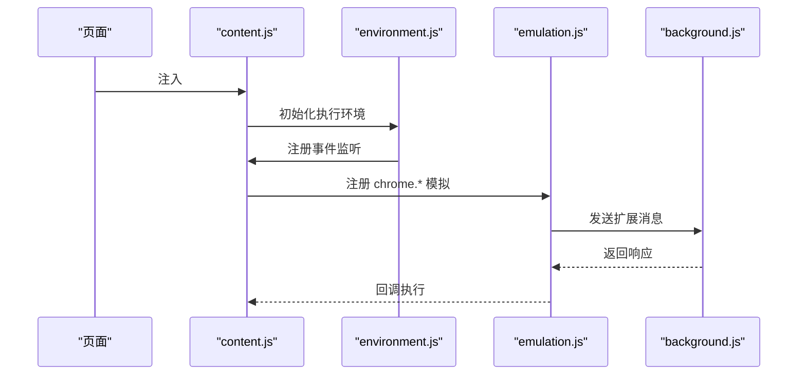
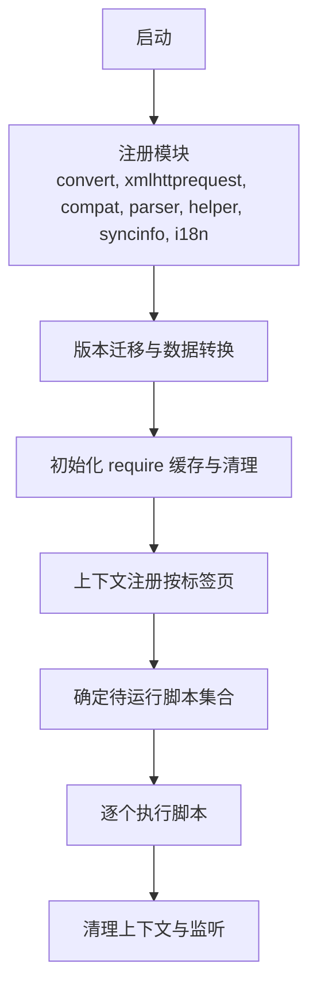
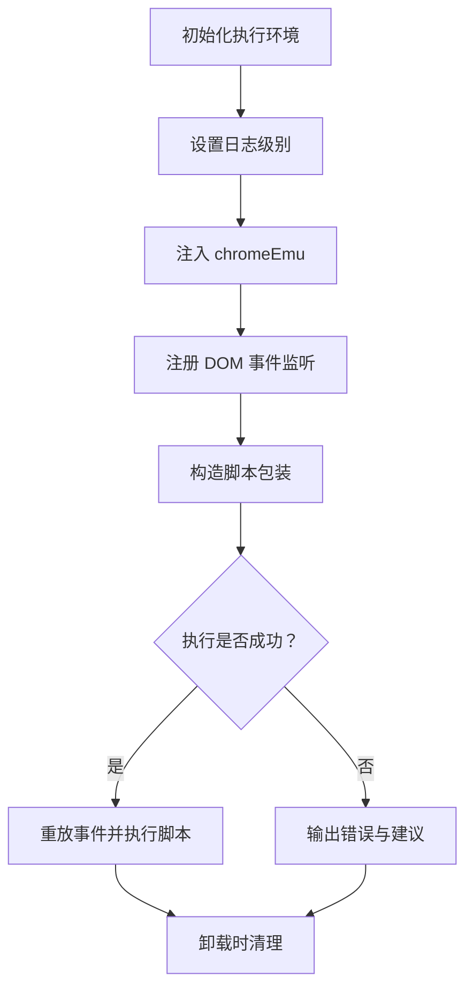
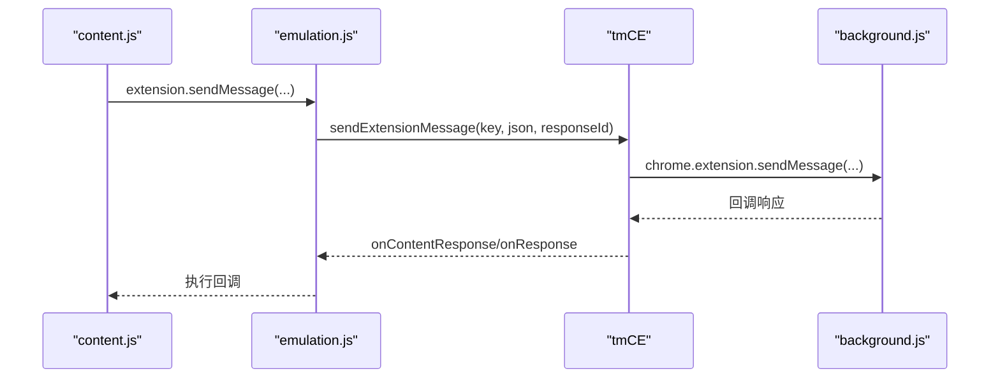
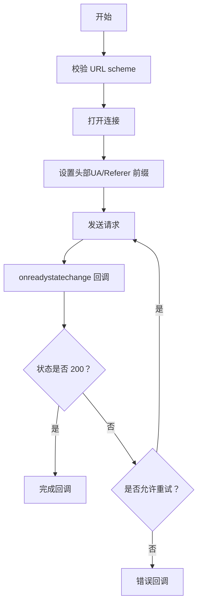
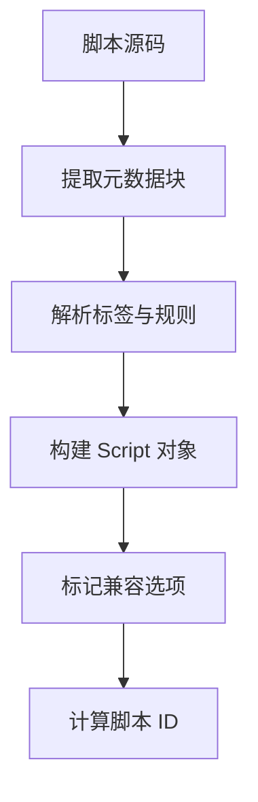
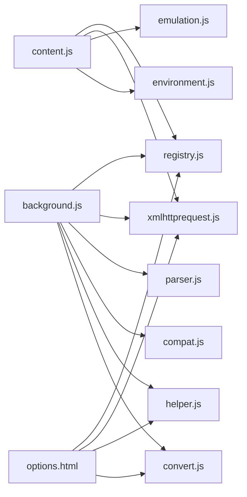

# 架构设计

<cite>
**本文引用的文件**
- [README.md](file://README.md)
- [background.js](file://src/background.js)
- [content.js](file://src/content.js)
- [registry.js](file://src/registry.js)
- [xmlhttprequest.js](file://src/xmlhttprequest.js)
- [parser.js](file://src/parser.js)
- [emulation.js](file://src/emulation.js)
- [environment.js](file://src/environment.js)
- [background.html](file://src/background.html)
- [options.html](file://src/options.html)
- [compat.js](file://src/compat.js)
- [helper.js](file://src/helper.js)
- [convert.js](file://src/convert.js)
</cite>

## 目录
1. [引言](#引言)
2. [项目结构](#项目结构)
3. [核心组件](#核心组件)
4. [架构总览](#架构总览)
5. [详细组件分析](#详细组件分析)
6. [依赖分析](#依赖分析)
7. [性能考量](#性能考量)
8. [故障排查指南](#故障排查指南)
9. [结论](#结论)
10. [附录](#附录)

## 引言
本文件面向 Tampermonkey 扩展的架构设计与实现，聚焦于模块化架构、事件驱动模式、沙箱执行模式等关键设计，并系统化阐述背景脚本、内容脚本、注册表系统之间的协作机制。文档同时覆盖消息传递机制、API 桥接、生命周期管理与状态同步、安全与性能权衡、可扩展性与部署拓扑等主题，帮助开发者快速理解整体系统。

## 项目结构
Tampermonkey 采用“页面注入 + 背景页”的双层架构：内容脚本在目标页面中运行，负责脚本环境初始化、事件桥接与 API 模拟；背景脚本负责脚本解析、存储、更新检查、菜单命令、跨标签通信等后台能力。注册表系统贯穿两者，提供模块加载与依赖管理。

图表来源
- [background.html:1-19](file://src/background.html#L1-L19)
- [options.html:1-38](file://src/options.html#L1-L38)
- [registry.js:1-107](file://src/registry.js#L1-L107)
- [xmlhttprequest.js:1-161](file://src/xmlhttprequest.js#L1-L161)
- [parser.js:1-286](file://src/parser.js#L1-L286)
- [compat.js:1-275](file://src/compat.js#L1-L275)
- [helper.js:1-209](file://src/helper.js#L1-L209)
- [convert.js:1-39](file://src/convert.js#L1-L39)
- [emulation.js:1-329](file://src/emulation.js#L1-L329)
- [environment.js:1-800](file://src/environment.js#L1-L800)

章节来源
- [README.md:1-112](file://README.md#L1-L112)
- [background.html:1-19](file://src/background.html#L1-L19)
- [options.html:1-38](file://src/options.html#L1-L38)

## 核心组件
- 注册表系统（Registry）：统一模块加载、依赖声明与延迟初始化，避免循环依赖与重复加载。
- 内容脚本（content.js）：在页面上下文中注入执行环境，桥接页面事件与扩展 API，模拟 chrome.* 接口。
- 背景脚本（background.js）：负责脚本生命周期管理、存储、更新检查、菜单命令、跨标签通信与持久化。
- 执行环境（environment.js）：提供脚本执行沙箱、事件重放、DOM 兼容修复、函数 ID 标记等。
- API 模拟（emulation.js）：在内容脚本侧提供 chrome.* 的桥接调用，转发至背景脚本处理。
- 网络请求（xmlhttprequest.js）：封装 XHR 行为，支持重试、头信息改写与进度回调。
- 解析器（parser.js）：解析用户脚本元数据块，提取匹配规则、资源与选项。
- 工具与编解码（helper.js、convert.js）：提供正则构造、序列化、URL 处理、Base64/UTF8 编解码等通用能力。
- 兼容适配（compat.js）：对脚本语法进行兼容转换，提升跨浏览器一致性。

章节来源
- [registry.js:1-107](file://src/registry.js#L1-L107)
- [content.js:1-800](file://src/content.js#L1-L800)
- [background.js:1-800](file://src/background.js#L1-L800)
- [environment.js:1-800](file://src/environment.js#L1-L800)
- [emulation.js:1-329](file://src/emulation.js#L1-L329)
- [xmlhttprequest.js:1-161](file://src/xmlhttprequest.js#L1-L161)
- [parser.js:1-286](file://src/parser.js#L1-L286)
- [helper.js:1-209](file://src/helper.js#L1-L209)
- [convert.js:1-39](file://src/convert.js#L1-L39)
- [compat.js:1-275](file://src/compat.js#L1-L275)

## 架构总览
系统采用“内容脚本 + 背景脚本 + 注册表”的分层架构：
- 内容脚本负责“感知页面、注入环境、桥接 API”；
- 背景脚本负责“管理脚本、持久化、更新与菜单”；
- 注册表作为模块化基石，贯穿两者的模块加载与依赖管理。

图表来源
- [content.js:1-800](file://src/content.js#L1-L800)
- [emulation.js:1-329](file://src/emulation.js#L1-L329)
- [environment.js:1-800](file://src/environment.js#L1-L800)
- [background.js:1-800](file://src/background.js#L1-L800)

## 详细组件分析

### 组件一：注册表系统（模块化与依赖管理）
- 设计要点
  - 延迟加载：require 时按需加载脚本或缓存原始文本。
  - 加载完成回调：统一 onLoaded 流程，避免竞态。
  - 防环与覆盖：记录已加载对象，支持覆盖策略。
- 关键流程
  - require → 检查是否存在 → 不存在则 loadFile → eval 或动态插入 script。
  - getRaw 支持直接读取扩展内文件内容。
  - onLoad 触发后续初始化。

图表来源
- [registry.js:48-92](file://src/registry.js#L48-L92)

章节来源
- [registry.js:1-107](file://src/registry.js#L1-L107)

### 组件二：内容脚本（事件桥接与 API 模拟）
- 设计要点
  - 安全上下文：通过自定义事件与 DOM 注入，将脚本执行置于受控环境。
  - 事件重放：监听 DOMContentLoaded/load/DOMNodeInserted 并重放给脚本。
  - API 模拟：将 chrome.* 调用转化为消息，由 emulation.js 转发到背景脚本。
- 关键流程
  - 初始化：注册 Eventing、Converter、Helper，注入 chromeEmu。
  - 事件桥接：将页面事件转为脚本可感知的 DOM 事件。
  - 请求转发：xmlHttpRequest/connect/message 等调用经 tmCE 转发。

图表来源
- [content.js:108-215](file://src/content.js#L108-L215)
- [environment.js:195-343](file://src/environment.js#L195-L343)
- [emulation.js:126-146](file://src/emulation.js#L126-L146)

章节来源
- [content.js:1-800](file://src/content.js#L1-L800)
- [environment.js:1-800](file://src/environment.js#L1-L800)
- [emulation.js:1-329](file://src/emulation.js#L1-L329)

### 组件三：背景脚本（生命周期与状态同步）
- 设计要点
  - 脚本生命周期：解析、缓存、运行、清理；支持按标签页维度的状态维护。
  - 更新检查：版本比较、迁移逻辑、更新配置持久化。
  - 存储与同步：本地存储、配置迁移、更新检查状态。
- 关键流程
  - 启动：注册模块、版本迁移、缓存清理、上下文注册。
  - 运行：根据 URL 匹配决定脚本集合，按顺序执行。
  - 清理：移除上下文、菜单命令、存储监听。

图表来源
- [background.js:28-391](file://src/background.js#L28-L391)
- [background.js:435-558](file://src/background.js#L435-L558)
- [background.js:560-640](file://src/background.js#L560-L640)

章节来源
- [background.js:1-800](file://src/background.js#L1-L800)

### 组件四：执行环境（沙箱与事件重放）
- 设计要点
  - 沙箱执行：通过 with 或函数包装在隔离上下文中执行脚本源码。
  - 事件重放：DOMContentLoaded/load/DOMNodeInserted 事件在脚本注册后重放。
  - 兼容修复：document.evaluate、window.open、setTimeout/setInterval 等适配。
- 关键流程
  - 初始化：设置日志级别、注入 chromeEmu、注册事件监听。
  - 执行：构造脚本包装，捕获异常并输出 JSLint 结果。
  - 清理：移除事件监听、恢复原生属性。

图表来源
- [environment.js:52-193](file://src/environment.js#L52-L193)
- [environment.js:195-343](file://src/environment.js#L195-L343)
- [environment.js:380-493](file://src/environment.js#L380-L493)

章节来源
- [environment.js:1-800](file://src/environment.js#L1-L800)

### 组件五：API 模拟（消息桥接）
- 设计要点
  - 响应 ID：为每个请求分配唯一 ID，回调时匹配响应。
  - 消息转发：将 chrome.* 调用序列化后通过 tmCE 发送到内容脚本侧。
  - 连接管理：connect/port 的 onMessage/onDisconnect 事件桥接。
- 关键流程
  - extension.sendMessage → tmCE.sendExtensionMessage → content 转发 → background 处理 → 回调。
  - extension.connect → tmCE.sendExtensionConnect → 建立 port → onMessage/onDisconnect。

图表来源
- [emulation.js:256-273](file://src/emulation.js#L256-L273)
- [content.js:352-366](file://src/content.js#L352-L366)

章节来源
- [emulation.js:1-329](file://src/emulation.js#L1-L329)
- [content.js:1-800](file://src/content.js#L1-L800)

### 组件六：网络请求（XHR 封装与重试）
- 设计要点
  - 参数校验：限制 scheme，避免不安全协议。
  - 头部改写：对 UA/Referer 前缀处理，支持 webRequest。
  - 进度回调：基于 Content-Length 或实时长度计算。
  - 错误重试：非 200 状态自动重试指定次数。
- 关键流程
  - 校验 URL → 打开连接 → 设置头部 → 发送 → 监听 onload/onerror/onreadystatechange → 回调。

图表来源
- [xmlhttprequest.js:17-153](file://src/xmlhttprequest.js#L17-L153)

章节来源
- [xmlhttprequest.js:1-161](file://src/xmlhttprequest.js#L1-L161)

### 组件七：脚本解析（元数据与匹配规则）
- 设计要点
  - 元数据块：从源码中提取 @name/@version/@include/@match/@resource 等。
  - 规则解析：标准化 include/match/exclude，支持通配符与正则转换。
  - 兼容标记：检测脚本是否需要兼容处理（如 foreach/array left-side）。
- 关键流程
  - 提取头块 → 解析标签 → 构造 Script 对象 → 计算 ID → 标记兼容选项。

图表来源
- [parser.js:75-281](file://src/parser.js#L75-L281)

章节来源
- [parser.js:1-286](file://src/parser.js#L1-L286)

### 组件八：工具与编解码（通用能力）
- 设计要点
  - 正则构造：URL 安全转义、通配符转换、TLD 规则。
  - 序列化：对象序列化用于跨上下文传输。
  - 编解码：UTF8/Base64/escape/unescapex。
- 关键流程
  - URL 匹配 → 正则生成 → 安全替换 → 匹配判断。

章节来源
- [helper.js:24-80](file://src/helper.js#L24-L80)
- [convert.js:7-38](file://src/convert.js#L7-L38)

## 依赖分析
- 模块耦合
  - content.js 依赖 registry、xmlhttprequest、emulation、environment。
  - background.js 依赖 registry、xmlhttprequest、parser、compat、helper、convert、i18n、syncinfo。
  - options.html 依赖 registry、xmlhttprequest、helper、convert、i18n、tabview、htmlutil、syncinfo。
- 外部依赖
  - Chrome 扩展 API：chrome.*（通过 emulation.js 桥接）。
  - 浏览器原生 API：XMLHttpRequest、DOM 事件、正则表达式、Base64 等。

图表来源
- [content.js:80-91](file://src/content.js#L80-L91)
- [background.js:28-35](file://src/background.js#L28-L35)
- [options.html:18-32](file://src/options.html#L18-L32)

章节来源
- [content.js:1-800](file://src/content.js#L1-L800)
- [background.js:1-800](file://src/background.js#L1-L800)
- [options.html:1-38](file://src/options.html#L1-L38)

## 性能考量
- 模块懒加载：通过注册表按需加载，减少初始开销。
- 请求缓存：require 缓存与定期清理，降低重复加载成本。
- 事件重放：仅在必要时重放 DOM 事件，避免重复触发。
- XHR 重试：对非 200 状态自动重试，提升稳定性但需注意幂等性。
- 兼容转换：仅在必要时进行语法转换，避免无谓的字符串处理。

## 故障排查指南
- 脚本执行失败
  - 检查 environment.js 中的异常捕获与 JSLint 输出，定位语法问题。
  - 确认脚本是否被正确注入与执行。
- API 调用无响应
  - 检查 emulation.js 的 responseId 是否匹配，确认 tmCE 转发链路。
  - 核对 background.js 中的消息处理逻辑。
- 网络请求异常
  - 检查 xmlhttprequest.js 的 URL 校验与头部改写逻辑。
  - 关注重试次数与状态码处理。
- 上下文状态异常
  - 检查 background.js 的 ctxRegistry 生命周期与清理逻辑。
  - 确认标签页切换或刷新后的状态重置。

章节来源
- [environment.js:128-193](file://src/environment.js#L128-L193)
- [emulation.js:197-207](file://src/emulation.js#L197-L207)
- [xmlhttprequest.js:114-152](file://src/xmlhttprequest.js#L114-L152)
- [background.js:435-558](file://src/background.js#L435-L558)

## 结论
Tampermonkey 以“内容脚本 + 背景脚本 + 注册表”的分层架构实现了模块化与事件驱动的扩展体系。通过 API 模拟与执行环境，系统在保证安全的前提下提供了接近原生扩展 API 的使用体验。背景脚本负责生命周期与状态管理，内容脚本负责页面事件与 API 桥接，二者通过消息机制协同工作。该设计在可扩展性、安全性与性能之间取得平衡，适合大规模用户脚本管理场景。

## 附录
- 基础设施要求
  - 支持 Chrome/Chromium 17+。
  - 依赖扩展 API（chrome.*），通过 emulation.js 桥接。
- 可扩展性
  - 新增模块通过注册表统一接入，遵循命名规范与依赖声明。
  - API 模拟层可扩展新的 chrome.* 接口，保持向后兼容。
- 部署拓扑
  - 页面注入：content.js 在目标页面执行。
  - 背景页：background.js 常驻，负责全局状态与后台任务。
  - 选项页：options.html 提供脚本管理与导出导入功能。