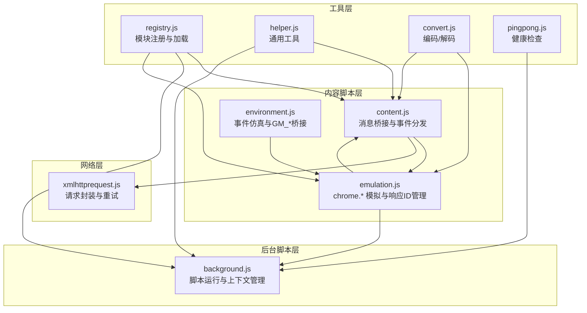
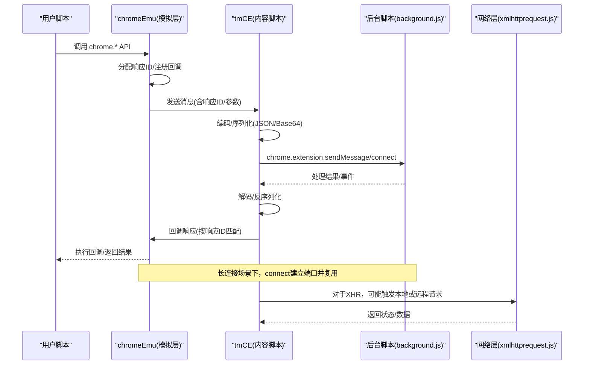
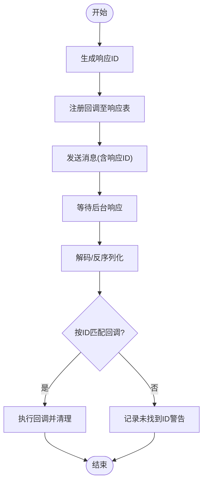
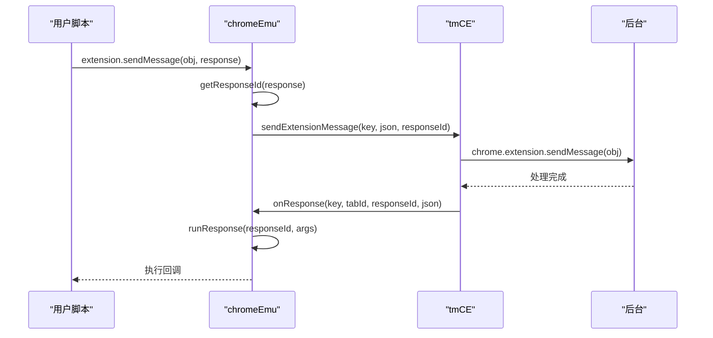
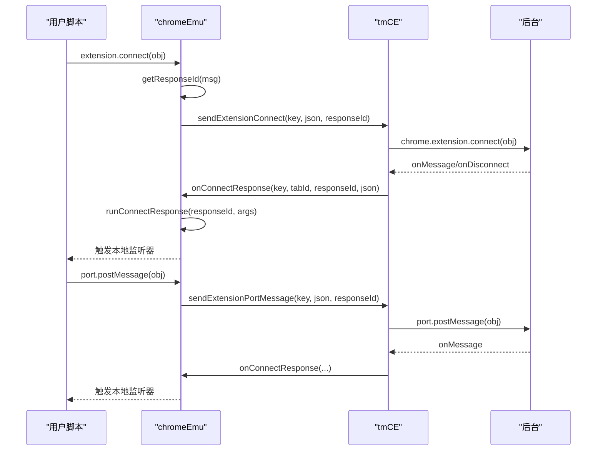
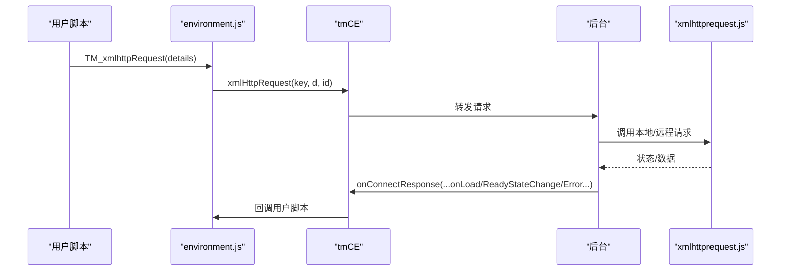
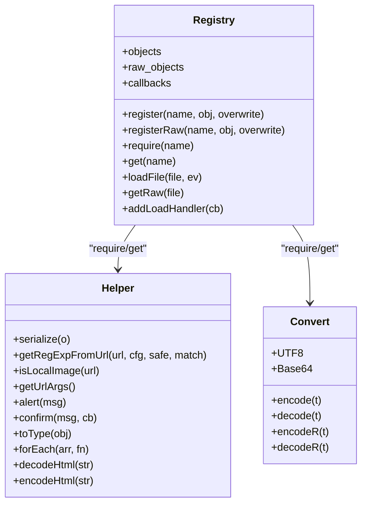
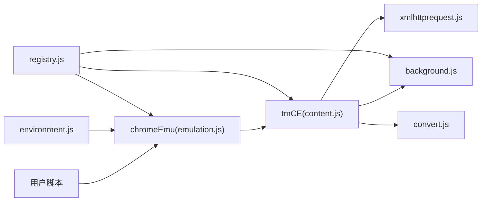

# API 桥接系统

<cite>
**本文引用的文件**
- [content.js](file://src/content.js)
- [background.js](file://src/background.js)
- [emulation.js](file://src/emulation.js)
- [xmlhttprequest.js](file://src/xmlhttprequest.js)
- [environment.js](file://src/environment.js)
- [helper.js](file://src/helper.js)
- [registry.js](file://src/registry.js)
- [convert.js](file://src/convert.js)
- [pingpong.js](file://src/pingpong.js)
</cite>

## 目录
1. [简介](#简介)
2. [项目结构](#项目结构)
3. [核心组件](#核心组件)
4. [架构总览](#架构总览)
5. [详细组件分析](#详细组件分析)
6. [依赖关系分析](#依赖关系分析)
7. [性能考量](#性能考量)
8. [故障排查指南](#故障排查指南)
9. [结论](#结论)

## 简介
本文件系统性阐述 Tampermonkey 的 API 桥接系统：内容脚本如何在用户脚本与扩展后台之间建立通信桥梁，包括消息传递协议、响应处理机制与连接管理策略；并深入解析 sendExtensionMessage、sendExtensionConnect、xmlHttpRequest 等关键 API 的实现细节，解释响应 ID 管理、消息序列化与反序列化过程，提供调用链路、错误处理与性能优化建议，并附带架构图与通信流程图。

## 项目结构
- 内容脚本层（content.js）负责注入环境、事件桥接与消息转发。
- 模拟层（emulation.js）提供 chrome.* API 的用户脚本侧模拟，统一响应 ID 管理与消息编解码。
- 后台脚本层（background.js）负责脚本运行、上下文管理与持久化。
- 请求层（xmlhttprequest.js）封装跨域请求与重试逻辑。
- 工具与注册中心（helper.js、registry.js、convert.js）提供通用工具与模块加载。
- 环境层（environment.js）负责事件仿真、安全上下文与 GM_* API 的桥接。
- 健康检查（pingpong.js）用于后台可达性探测。

图表来源
- [content.js:1-1202](file://src/content.js#L1-L1202)
- [emulation.js:1-329](file://src/emulation.js#L1-L329)
- [background.js:1-6327](file://src/background.js#L1-L6327)
- [xmlhttprequest.js:1-161](file://src/xmlhttprequest.js#L1-L161)
- [environment.js:1-1337](file://src/environment.js#L1-L1337)
- [registry.js:1-107](file://src/registry.js#L1-L107)
- [helper.js:1-209](file://src/helper.js#L1-L209)
- [convert.js:1-39](file://src/convert.js#L1-L39)
- [pingpong.js:1-52](file://src/pingpong.js#L1-L52)

章节来源
- [content.js:1-1202](file://src/content.js#L1-L1202)
- [emulation.js:1-329](file://src/emulation.js#L1-L329)
- [background.js:1-6327](file://src/background.js#L1-L6327)
- [xmlhttprequest.js:1-161](file://src/xmlhttprequest.js#L1-L161)
- [environment.js:1-1337](file://src/environment.js#L1-L1337)
- [registry.js:1-107](file://src/registry.js#L1-L107)
- [helper.js:1-209](file://src/helper.js#L1-L209)
- [convert.js:1-39](file://src/convert.js#L1-L39)
- [pingpong.js:1-52](file://src/pingpong.js#L1-L52)

## 核心组件
- 响应 ID 管理：在模拟层与内容脚本层均维护响应回调映射，生成唯一响应 ID 并在收到后台返回时按 ID 匹配回调执行。
- 消息编解码：使用 Base64/UTF8/URL 编码与 escape/unescapce 组合，确保跨进程传输安全。
- 连接管理：通过 chrome.extension.connect 建立长连接，支持 onMessage/onDisconnect 回调，端口对象在内容脚本侧缓存以复用。
- 请求桥接：xmlHttpRequest 在用户脚本侧通过 tmCE.xmlHttpRequest 转发到内容脚本，再由内容脚本调用后台实现，最终回传状态与数据。

章节来源
- [emulation.js:197-207](file://src/emulation.js#L197-L207)
- [content.js:183-193](file://src/content.js#L183-L193)
- [convert.js:8-38](file://src/convert.js#L8-L38)
- [content.js:368-390](file://src/content.js#L368-L390)
- [xmlhttprequest.js:17-153](file://src/xmlhttprequest.js#L17-L153)

## 架构总览
下图展示了从用户脚本发起 API 调用，经模拟层、内容脚本层，再到后台脚本层的完整链路，以及响应回传路径。

图表来源
- [emulation.js:256-266](file://src/emulation.js#L256-L266)
- [content.js:352-366](file://src/content.js#L352-L366)
- [background.js:109-142](file://src/background.js#L109-L142)
- [xmlhttprequest.js:17-153](file://src/xmlhttprequest.js#L17-L153)

## 详细组件分析

### 组件一：响应 ID 管理与消息编解码
- 响应 ID 生成：模拟层与内容脚本层各自维护响应表，使用时间戳与随机数组合生成唯一 ID，避免冲突。
- 编解码策略：
  - Base64：用于二进制/特殊对象的跨进程传输。
  - UTF8：保证多语言字符正确传输。
  - escape/unescape：URL 安全与字符串转义。
- 反序列化与回调执行：收到后台返回后，按响应 ID 查找回调并执行，同时清理回调表，避免内存泄漏。

图表来源
- [emulation.js:197-207](file://src/emulation.js#L197-L207)
- [content.js:183-193](file://src/content.js#L183-L193)
- [convert.js:8-38](file://src/convert.js#L8-L38)

章节来源
- [emulation.js:148-169](file://src/emulation.js#L148-L169)
- [content.js:194-214](file://src/content.js#L194-L214)
- [convert.js:31-38](file://src/convert.js#L31-L38)

### 组件二：sendExtensionMessage（单次消息）
- 触发路径：用户脚本通过 chromeEmu.extension.sendMessage 调用，分配响应 ID 并序列化参数。
- 内容脚本转发：tmCE.sendExtensionMessage 将消息发送给后台，后台处理后通过 tmCE.onResponse 回传。
- 回调执行：模拟层按响应 ID 查找并执行回调，清理响应表。

图表来源
- [emulation.js:260-266](file://src/emulation.js#L260-L266)
- [content.js:352-366](file://src/content.js#L352-L366)
- [background.js:109-142](file://src/background.js#L109-L142)

章节来源
- [emulation.js:260-266](file://src/emulation.js#L260-L266)
- [content.js:352-366](file://src/content.js#L352-L366)

### 组件三：sendExtensionConnect（长连接）
- 建立连接：chromeEmu.extension.connect 创建端口对象，内部注册 onMessage/onDisconnect 监听。
- 内容脚本管理：tmCE.sendExtensionConnect 建立后台连接，监听 onMessage/onDisconnect，缓存端口以复用。
- 数据传输：tmCE.sendExtensionPortMessage 通过已建立的端口发送消息，后台处理后回传消息或断开通知。

图表来源
- [emulation.js:214-259](file://src/emulation.js#L214-L259)
- [content.js:368-408](file://src/content.js#L368-L408)

章节来源
- [emulation.js:214-259](file://src/emulation.js#L214-L259)
- [content.js:368-408](file://src/content.js#L368-L408)

### 组件四：xmlHttpRequest（网络请求桥接）
- 用户脚本侧：environment.js 中的 TM_xmlhttpRequest 提供 GM_xmlhttpRequest 语义，支持 responseType 与事件回调。
- 内容脚本转发：tmCE.xmlHttpRequest 将请求详情序列化并通过 tmCE.onConnectResponse 回传进度/结果。
- 特殊对象处理：对于包含特殊对象（如 ArrayBuffer/FormData）的请求，通过临时 window 占位键绕过序列化限制。

图表来源
- [environment.js:693-747](file://src/environment.js#L693-L747)
- [content.js:309-342](file://src/content.js#L309-L342)
- [xmlhttprequest.js:17-153](file://src/xmlhttprequest.js#L17-L153)

章节来源
- [environment.js:693-747](file://src/environment.js#L693-L747)
- [content.js:309-342](file://src/content.js#L309-L342)
- [xmlhttprequest.js:17-153](file://src/xmlhttprequest.js#L17-L153)

### 组件五：模块注册与工具链
- 注册中心：registry.js 提供模块注册、加载与依赖管理，支持同步/异步加载与回调。
- 辅助工具：helper.js 提供序列化、正则构造、URL 处理等通用能力。
- 编解码：convert.js 提供 UTF8/Base64/URL 编解码与 escape/unescaple。

图表来源
- [registry.js:11-104](file://src/registry.js#L11-L104)
- [helper.js:148-206](file://src/helper.js#L148-L206)
- [convert.js:31-38](file://src/convert.js#L31-L38)

章节来源
- [registry.js:11-104](file://src/registry.js#L11-L104)
- [helper.js:148-206](file://src/helper.js#L148-L206)
- [convert.js:31-38](file://src/convert.js#L31-L38)

## 依赖关系分析
- 模块耦合：
  - content.js 依赖 emulation.js（响应 ID 与消息桥接）、xmlhttprequest.js（请求转发）、convert.js（编解码）。
  - emulation.js 依赖 content.js（tmCE 方法）、convert.js（编解码）、registry.js（模块注册）。
  - environment.js 依赖 emulation.js（chromeEmu）、content.js（tmCE）、xmlhttprequest.js（XHR）。
  - background.js 作为中枢协调脚本运行、上下文与存储。
- 关键依赖链：
  - 用户脚本 → chromeEmu → tmCE → 后台 → 回传 → chromeEmu → 用户脚本回调。
  - 请求链：用户脚本 → environment.js → tmCE → xmlhttprequest.js → 后台 → 回传。

图表来源
- [emulation.js:19-329](file://src/emulation.js#L19-L329)
- [content.js:1-1202](file://src/content.js#L1-L1202)
- [background.js:1-6327](file://src/background.js#L1-L6327)
- [xmlhttprequest.js:1-161](file://src/xmlhttprequest.js#L1-L161)
- [environment.js:1-1337](file://src/environment.js#L1-L1337)
- [registry.js:1-107](file://src/registry.js#L1-L107)
- [convert.js:1-39](file://src/convert.js#L1-L39)

章节来源
- [emulation.js:19-329](file://src/emulation.js#L19-L329)
- [content.js:1-1202](file://src/content.js#L1-L1202)
- [background.js:1-6327](file://src/background.js#L1-L6327)
- [xmlhttprequest.js:1-161](file://src/xmlhttprequest.js#L1-L161)
- [environment.js:1-1337](file://src/environment.js#L1-L1337)
- [registry.js:1-107](file://src/registry.js#L1-L107)
- [convert.js:1-39](file://src/convert.js#L1-L39)

## 性能考量
- 响应 ID 生成：采用时间戳+随机数组合，冲突概率低；建议在高并发场景下避免频繁创建大量响应表项。
- 序列化成本：Base64/UTF8 编解码与 JSON 序列化会带来额外开销，尽量减少大对象的跨进程传输。
- 连接复用：长连接端口应缓存复用，避免重复建立连接带来的握手与资源消耗。
- 请求重试：xmlhttprequest.js 支持失败重试，需合理设置 retries 参数，避免无限重试导致资源浪费。
- 清理策略：响应完成后及时清理回调表，断开连接时释放监听器，防止内存泄漏。

## 故障排查指南
- 响应 ID 未找到：
  - 现象：日志提示“responseId ... not found!”。
  - 排查：确认响应 ID 是否正确传递、是否被提前清理、回调是否被正确注册。
- 编解码异常：
  - 现象：反序列化抛错或数据损坏。
  - 排查：检查 Base64/UTF8 编解码是否一致，URL 安全字符是否正确处理。
- 端口断开：
  - 现象：onDisconnect 回调触发。
  - 排查：确认端口是否被主动关闭、后台是否异常、网络中断情况。
- 请求失败：
  - 现象：onerror 或状态码非 200。
  - 排查：检查 URL 方案合法性、重试次数、超时设置与网络策略。

章节来源
- [emulation.js:168-169](file://src/emulation.js#L168-L169)
- [content.js:213-214](file://src/content.js#L213-L214)
- [xmlhttprequest.js:76-92](file://src/xmlhttprequest.js#L76-L92)

## 结论
Tampermonkey 的 API 桥接系统通过“模拟层 + 内容脚本 + 后台脚本”的三层协作，实现了用户脚本与浏览器扩展 API 的无缝对接。响应 ID 管理、编解码与连接复用是该系统的核心设计点，既保证了跨进程通信的可靠性，也兼顾了性能与可维护性。通过本文档提供的架构图、流程图与排障建议，开发者可以更高效地理解与扩展该桥接体系。