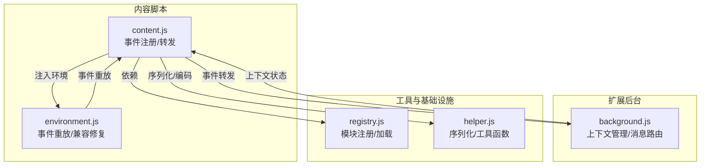
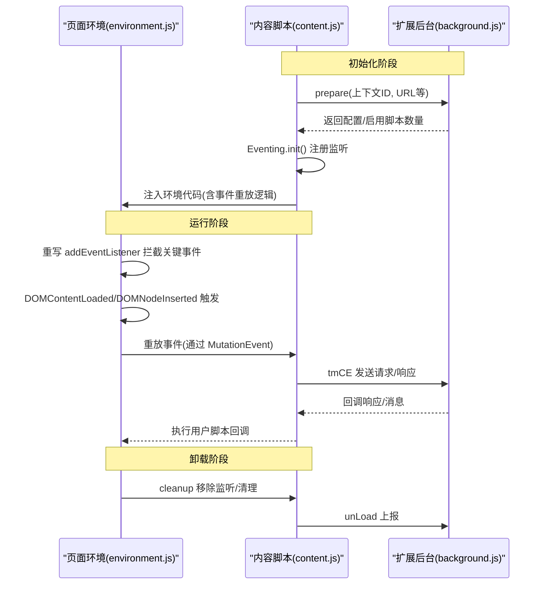
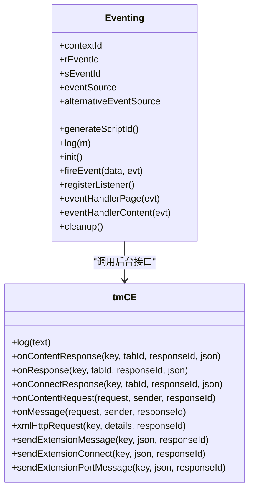
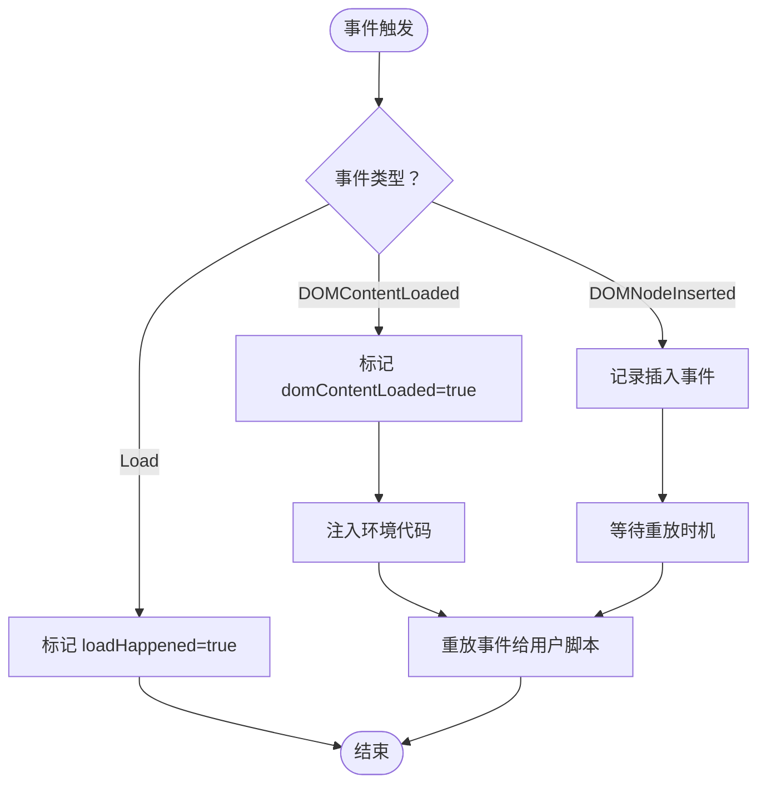
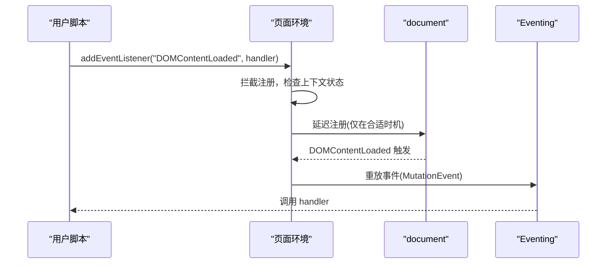
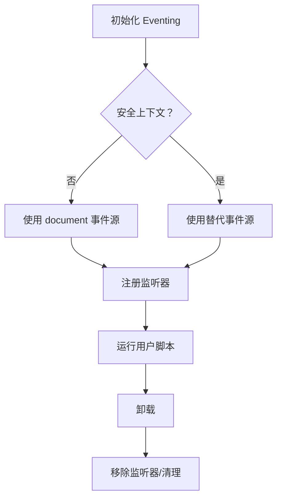
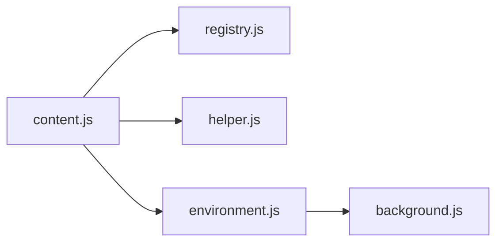

# 事件处理系统

<cite>
**本文档引用的文件**
- [content.js](file://src/content.js)
- [environment.js](file://src/environment.js)
- [background.js](file://src/background.js)
- [registry.js](file://src/registry.js)
- [helper.js](file://src/helper.js)
</cite>

## 目录
1. [简介](#简介)
2. [项目结构](#项目结构)
3. [核心组件](#核心组件)
4. [架构总览](#架构总览)
5. [详细组件分析](#详细组件分析)
6. [依赖关系分析](#依赖关系分析)
7. [性能考量](#性能考量)
8. [故障排除指南](#故障排除指南)
9. [结论](#结论)

## 简介
本文件系统性解析 Tampermonkey 的事件处理系统，重点阐述内容脚本（content script）如何通过 Eventing 对象在页面与扩展后台之间传递和转发事件，以及对关键 DOM 事件（如 DOMContentLoaded、DOMNodeInserted）的监听与处理策略。文档还覆盖事件冒泡、事件捕获与自定义事件的实现机制，解释上下文管理与事件清理策略，并提供事件处理流程图与生命周期示意，帮助开发者理解从事件注册到执行的完整链路。

## 项目结构
事件处理系统主要由以下模块协作完成：
- content.js：内容脚本入口，负责初始化环境、注册事件监听器、转发事件给后台或页面环境。
- environment.js：页面侧运行时环境，模拟标准 DOM 事件行为，重写 addEventListener 以支持事件重放与兼容性修复。
- background.js：扩展后台，协调脚本执行、消息路由与上下文状态维护。
- registry.js：模块注册与加载机制，确保所需模块按需加载。
- helper.js：通用工具函数，包括序列化、正则匹配等辅助能力。

图表来源
- [content.js:1-1202](file://src/content.js#L1-L1202)
- [environment.js:1-1337](file://src/environment.js#L1-L1337)
- [background.js:1-6327](file://src/background.js#L1-L6327)
- [registry.js:1-107](file://src/registry.js#L1-L107)
- [helper.js:1-209](file://src/helper.js#L1-L209)

章节来源
- [content.js:1-1202](file://src/content.js#L1-L1202)
- [environment.js:1-1337](file://src/environment.js#L1-L1337)
- [background.js:1-6327](file://src/background.js#L1-L6327)
- [registry.js:1-107](file://src/registry.js#L1-L107)
- [helper.js:1-209](file://src/helper.js#L1-L209)

## 核心组件
- Eventing 对象：统一的事件桥接层，负责事件的发送、接收与清理，支持安全上下文与脚本拦截器场景下的替代事件源。
- tmCE（内容通信引擎）：封装与后台交互的消息通道，负责请求/响应、连接、端口消息等。
- environment.js 中的事件重放与兼容修复：重写 addEventListener，拦截特定事件（load、DOMContentLoaded、DOMNodeInserted），在合适时机重放事件，保证用户脚本的事件语义一致。
- 清理策略：在卸载时移除所有事件监听器、清理临时变量与 DOM 注入元素，避免内存泄漏。

章节来源
- [content.js:825-965](file://src/content.js#L825-L965)
- [environment.js:197-493](file://src/environment.js#L197-L493)

## 架构总览
事件处理系统采用“内容脚本 ↔ 页面环境 ↔ 扩展后台”的三层架构：
- 内容脚本负责事件注册与转发，使用 MutationEvent 作为载体，通过 document.dispatchEvent 在页面与扩展之间传递数据。
- 页面环境重写 addEventListener，拦截关键事件并在合适时机重放，确保用户脚本在不同运行阶段（document-start/document-body/document-end）获得一致的事件体验。
- 扩展后台维护上下文状态，协调脚本执行与消息路由，提供存储、通知、网络请求等能力。

图表来源
- [content.js:1077-1198](file://src/content.js#L1077-L1198)
- [environment.js:1251-1337](file://src/environment.js#L1251-L1337)
- [background.js:560-640](file://src/background.js#L560-L640)

## 详细组件分析

### Eventing 对象工作原理
- 事件标识：通过生成唯一 contextId 并拼接发送/接收前缀（如 TM_toContent/TM_toPage）形成事件类型，确保跨上下文隔离。
- 事件发送：使用 document.createEvent 创建 MutationEvent，将数据进行编码后放入 attrName，通过 dispatchEvent 发送到目标上下文。
- 事件接收：根据当前上下文（内容脚本或页面）选择对应的处理器，解析数据并调用 tmCE 或直接 eval 执行。
- 替代事件源：当处于安全上下文且检测到脚本拦截器时，使用 AlternativeEventSource（基于 window.AltEventing）作为事件源，绕过限制。
- 清理：在卸载时移除监听器，防止内存泄漏。

图表来源
- [content.js:825-965](file://src/content.js#L825-L965)

章节来源
- [content.js:825-965](file://src/content.js#L825-L965)

### 关键事件监听与处理策略
- DOMContentLoaded：内容脚本在初始化时注册监听，一旦触发，向页面注入环境代码并标记 domContentLoaded 已发生；页面环境在重写 addEventListener 时检测该状态，必要时立即重放事件。
- DOMNodeInserted：记录首次插入节点与后续所有插入事件，用于后续重放；页面环境在重写 addEventListener 时拦截该事件，按运行阶段（document-start/document-body）决定是否仅重放 DOMContentLoaded 之后的事件。
- Load：页面环境记录 loadHappened 状态，配合 DOMContentLoaded 与 DOMNodeInserted 共同决定事件重放时机。

图表来源
- [content.js:94-106](file://src/content.js#L94-L106)
- [environment.js:288-307](file://src/environment.js#L288-L307)
- [environment.js:367-378](file://src/environment.js#L367-L378)

章节来源
- [content.js:94-106](file://src/content.js#L94-L106)
- [environment.js:288-307](file://src/environment.js#L288-L307)
- [environment.js:367-378](file://src/environment.js#L367-L378)

### 事件冒泡、事件捕获与自定义事件
- 自定义事件：Eventing 使用 MutationEvent 作为载体，通过 initMutationEvent 设置事件类型、是否冒泡、是否可取消等属性，从而实现跨上下文的自定义事件传递。
- 事件冒泡：在页面环境重写 addEventListener 时，拦截事件注册，若为关键事件则延迟注册，先在合适时机重放事件，再恢复原生注册，确保事件顺序与冒泡语义正确。
- 事件捕获：在 DOMAttrModified 的兼容性修复中，使用 DOMSubtreeModified 事件进行捕获式监听，结合 MutationObserver 降级方案，确保属性变更事件在不同浏览器环境下的一致性。

图表来源
- [environment.js:402-488](file://src/environment.js#L402-L488)
- [content.js:891-911](file://src/content.js#L891-L911)

章节来源
- [environment.js:402-488](file://src/environment.js#L402-L488)
- [content.js:891-911](file://src/content.js#L891-L911)

### 上下文管理与事件清理策略
- 上下文 ID：每个事件会话拥有唯一 contextId，确保事件隔离与清理。
- 安全上下文：当检测到脚本拦截器时，切换到替代事件源，避免事件丢失。
- 卸载清理：在 unload 事件中移除所有监听器、清理临时变量与 DOM 注入元素，防止内存泄漏。

图表来源
- [content.js:859-889](file://src/content.js#L859-L889)
- [content.js:1031-1061](file://src/content.js#L1031-L1061)
- [environment.js:309-323](file://src/environment.js#L309-L323)

章节来源
- [content.js:859-889](file://src/content.js#L859-L889)
- [content.js:1031-1061](file://src/content.js#L1031-L1061)
- [environment.js:309-323](file://src/environment.js#L309-L323)

### 事件转发机制与内存泄漏防护
- 事件转发：content.js 通过 Eventing.fireEvent 将数据编码后以 MutationEvent 形式分发；environment.js 重写 addEventListener，在合适时机重放事件；tmCE 则负责与后台通信。
- 内存泄漏防护：在 cleanup 中移除所有监听器、清理临时对象与 DOM 注入元素；页面环境在卸载时也执行清理逻辑；Eventing.cleanup 确保监听器被移除。

章节来源
- [content.js:179-181](file://src/content.js#L179-L181)
- [content.js:913-920](file://src/content.js#L913-L920)
- [content.js:1031-1061](file://src/content.js#L1031-L1061)
- [environment.js:309-323](file://src/environment.js#L309-L323)

## 依赖关系分析
- content.js 依赖 registry.js 提供的模块加载能力，依赖 helper.js 的序列化与工具函数。
- environment.js 依赖 chromeEmu（由 content.js 注入）提供的扩展 API 代理，负责与后台通信与上下文管理。
- background.js 维护上下文注册表、脚本运行信息与消息路由，为 content.js 与 environment.js 提供状态支撑。

图表来源
- [content.js:80-91](file://src/content.js#L80-L91)
- [registry.js:48-104](file://src/registry.js#L48-L104)
- [helper.js:184-209](file://src/helper.js#L184-L209)
- [environment.js:1251-1337](file://src/environment.js#L1251-L1337)

章节来源
- [content.js:80-91](file://src/content.js#L80-L91)
- [registry.js:48-104](file://src/registry.js#L48-L104)
- [helper.js:184-209](file://src/helper.js#L184-L209)
- [environment.js:1251-1337](file://src/environment.js#L1251-L1337)

## 性能考量
- 事件重放顺序：通过 nodeInserts.events 队列与 runAllLoadListeners 保证事件按序重放，避免因异步导致的顺序问题。
- 事件类型选择：使用 MutationEvent 作为跨上下文载体，减少额外开销；在 DOMAttrModified 兼容性修复中，优先使用 MutationObserver，降级到 DOMSubtreeModified 以兼容旧浏览器。
- 清理策略：在卸载时彻底移除监听器与临时变量，避免内存泄漏；在事件处理完成后及时释放中间变量，降低 GC 压力。

## 故障排除指南
- 事件未触发：确认 DOMContentLoaded/DOMNodeInserted 是否已发生，检查 environment.js 中的状态标记与重放逻辑。
- 事件顺序异常：检查 addEventListener 重写逻辑，确保在合适时机注册与重放事件。
- 内存泄漏：确认 cleanup 流程是否执行，检查监听器是否被移除、临时变量是否被清理。
- 脚本拦截器影响：当检测到脚本拦截器时，Eventing 会切换到替代事件源，确保事件正常传递。

章节来源
- [content.js:1031-1061](file://src/content.js#L1031-L1061)
- [environment.js:309-323](file://src/environment.js#L309-L323)
- [content.js:880-883](file://src/content.js#L880-L883)

## 结论
Tampermonkey 的事件处理系统通过 Eventing 对象实现了内容脚本与页面环境之间的事件桥接，结合 environment.js 的事件重放与兼容性修复，确保用户脚本在不同运行阶段获得一致的事件体验。系统在安全性、稳定性与性能之间取得平衡，通过严格的上下文管理与清理策略有效避免内存泄漏，为复杂网页环境下的脚本执行提供了可靠的事件基础设施。