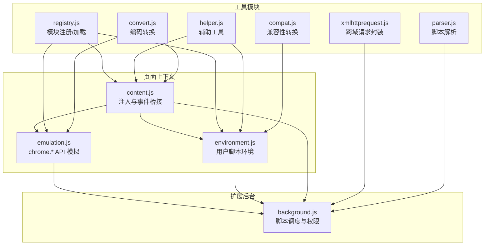
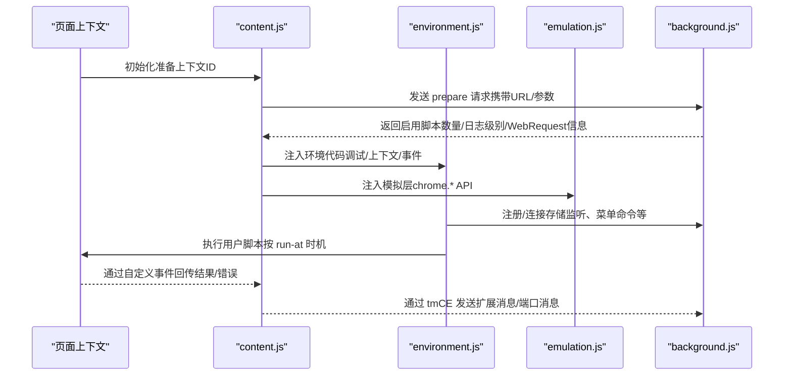
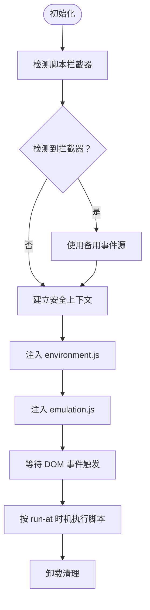
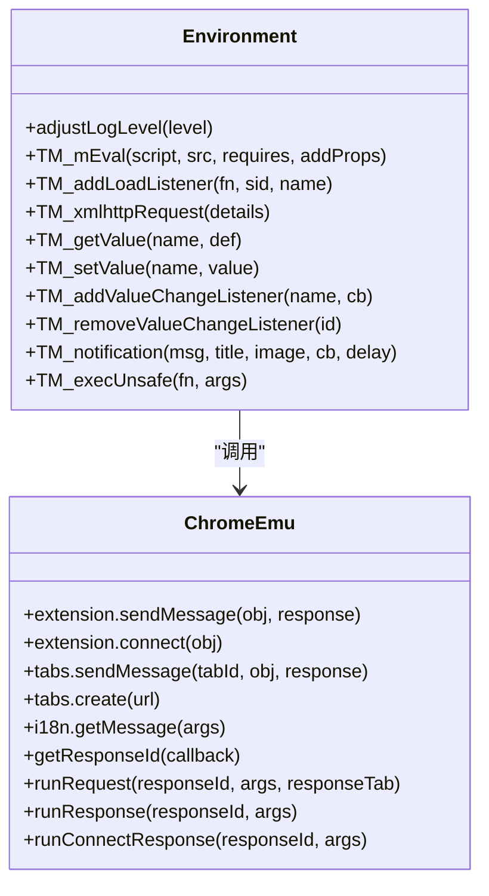
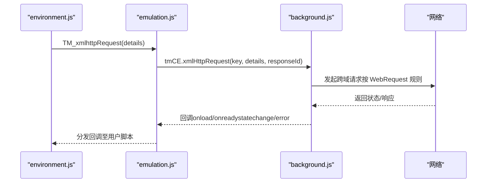
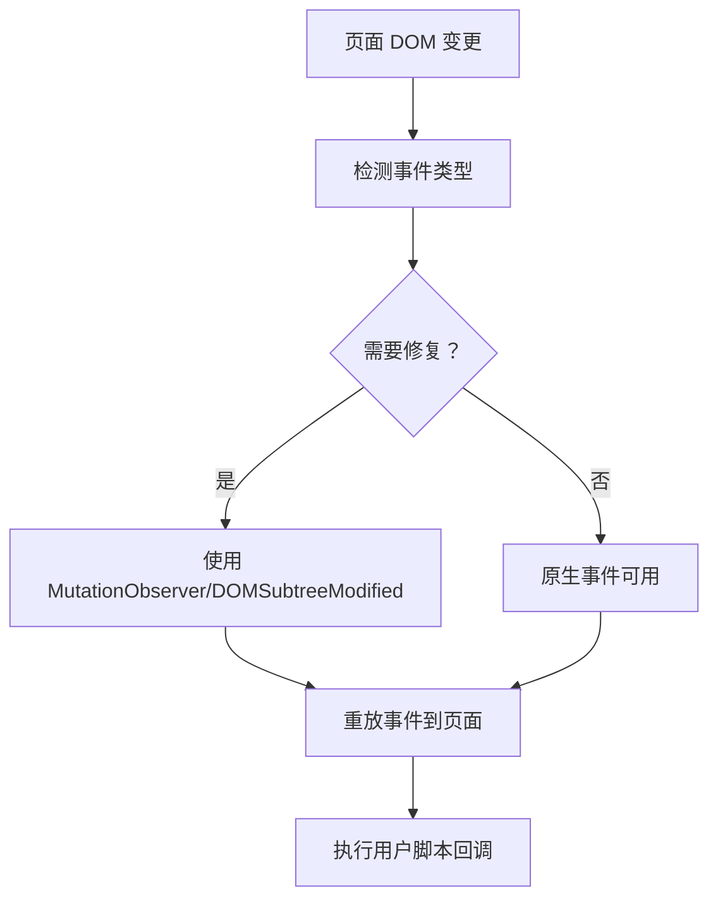
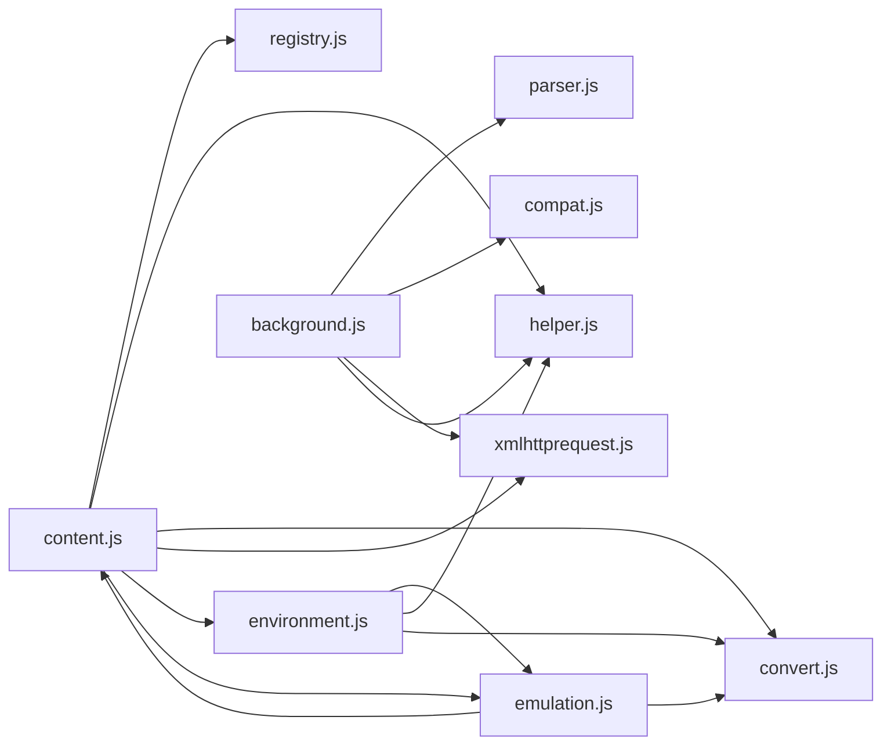
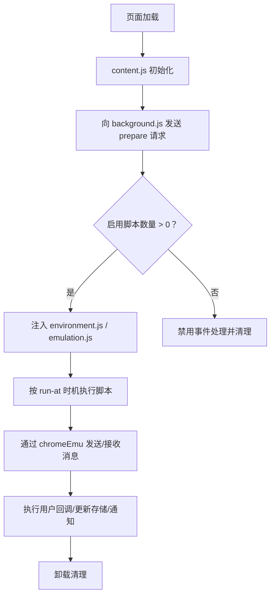
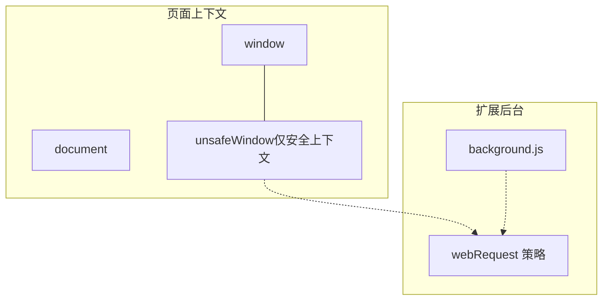

# 内容脚本系统

<cite>
**本文引用的文件**
- [content.js](file://src/content.js)
- [environment.js](file://src/environment.js)
- [emulation.js](file://src/emulation.js)
- [xmlhttprequest.js](file://src/xmlhttprequest.js)
- [background.js](file://src/background.js)
- [registry.js](file://src/registry.js)
- [helper.js](file://src/helper.js)
- [convert.js](file://src/convert.js)
- [compat.js](file://src/compat.js)
- [parser.js](file://src/parser.js)
- [manifest.json.legacy.com](file://build_sys/manifest.json.legacy.com)
- [README.md](file://README.md)
</cite>

## 目录
1. [简介](#简介)
2. [项目结构](#项目结构)
3. [核心组件](#核心组件)
4. [架构总览](#架构总览)
5. [详细组件分析](#详细组件分析)
6. [依赖关系分析](#依赖关系分析)
7. [性能考量](#性能考量)
8. [故障排查指南](#故障排查指南)
9. [结论](#结论)
10. [附录](#附录)

## 简介
本文件系统性阐述 Tampermonkey 的内容脚本（Content Scripts）执行机制，围绕以下主题展开：脚本注入策略、环境模拟、API 桥接、安全隔离、与页面 DOM 的交互、事件与定时器管理、跨域请求与权限控制、以及恶意脚本防护。文档以代码级分析为基础，辅以多种可视化图表，帮助读者从高层到细节全面理解内容脚本系统的工作原理。

## 项目结构
Tampermonkey 的内容脚本系统由三部分协同组成：
- 内容层（content.js）：负责在页面上下文中初始化、注入脚本、桥接消息、事件与 API。
- 环境层（environment.js）：在页面上下文中模拟用户脚本运行环境，提供 GM_* API、DOM 事件重放、存储与网络等能力。
- 模拟层（emulation.js）：在页面上下文中实现 chrome.* API 的桥接与响应分发，屏蔽扩展 API 差异。
- 背景页（background.js）：调度脚本执行、管理上下文、处理跨域请求与权限。

**图表来源**
- [content.js:1066-1198](file://src/content.js#L1066-L1198)
- [environment.js:1-120](file://src/environment.js#L1-L120)
- [emulation.js:1-120](file://src/emulation.js#L1-L120)
- [xmlhttprequest.js:1-161](file://src/xmlhttprequest.js#L1-L161)
- [background.js:1-120](file://src/background.js#L1-L120)
- [registry.js:1-107](file://src/registry.js#L1-L107)
- [helper.js:1-209](file://src/helper.js#L1-L209)
- [convert.js:1-39](file://src/convert.js#L1-L39)
- [compat.js:1-275](file://src/compat.js#L1-L275)
- [parser.js:1-286](file://src/parser.js#L1-L286)

**章节来源**
- [manifest.json.legacy.com:4-13](file://build_sys/manifest.json.legacy.com#L4-L13)
- [README.md:1-112](file://README.md#L1-L112)

## 核心组件
- 注入与桥接（content.js）
  - 初始化安全上下文、检测脚本拦截器、注入环境与模拟层代码。
  - 通过自定义 MutationEvent 实现“消息”事件在页面与扩展之间的传递。
  - 提供 tmCE（内容桥接）对象，统一处理扩展消息、XHR、端口通信等。
- 用户脚本环境（environment.js）
  - 在页面上下文中执行用户脚本，提供 GM_* API、存储、通知、资源访问等。
  - 修复浏览器差异（如 DOMAttrModified、window.open、eval 包装等）。
  - 维护清理列表（Clean），确保卸载时恢复原状。
- API 模拟（emulation.js）
  - 在页面上下文中实现 chrome.* API（extension、tabs、i18n 等）。
  - 响应分发与回调管理，支持连接式消息（port）与一次性消息。
- 跨域请求（xmlhttprequest.js）
  - 封装 XMLHttpRequest，支持重试、进度回调、响应头处理、UA/Referer 改写。
- 脚本解析与兼容（parser.js、compat.js）
  - 解析用户脚本元数据与选项；提供兼容性转换（如 toSource、数组解构、for-each 等）。
- 工具与注册（helper.js、convert.js、registry.js）
  - 提供正则匹配、序列化、编码转换、模块注册与动态加载。

**章节来源**
- [content.js:106-215](file://src/content.js#L106-L215)
- [environment.js:1-120](file://src/environment.js#L1-L120)
- [emulation.js:1-120](file://src/emulation.js#L1-L120)
- [xmlhttprequest.js:1-161](file://src/xmlhttprequest.js#L1-L161)
- [parser.js:1-286](file://src/parser.js#L1-L286)
- [compat.js:1-275](file://src/compat.js#L1-L275)
- [helper.js:1-209](file://src/helper.js#L1-L209)
- [convert.js:1-39](file://src/convert.js#L1-L39)
- [registry.js:1-107](file://src/registry.js#L1-L107)

## 架构总览
内容脚本系统采用“页面上下文 + 扩展后台”的双层架构：
- 页面上下文负责“执行用户脚本 + 模拟 API + 事件桥接”，避免直接使用受限的扩展 API。
- 扩展后台负责“脚本调度 + 权限校验 + 跨域请求 + 上下文管理”。

**图表来源**
- [content.js:1122-1198](file://src/content.js#L1122-L1198)
- [environment.js:1249-1319](file://src/environment.js#L1249-L1319)
- [emulation.js:197-207](file://src/emulation.js#L197-L207)
- [background.js:590-640](file://src/background.js#L590-L640)

## 详细组件分析

### 组件一：脚本注入与安全上下文（content.js）
- 安全上下文初始化
  - 使用 DOM 事件（MutationEvent）在页面中注入脚本标签或通过 eval 执行，避免直接暴露扩展 API。
  - 检测脚本拦截器（如 ScriptNo），若检测到则切换备用事件源。
- 事件桥接
  - 通过自定义事件名（含上下文 ID）在页面与扩展之间传递消息。
  - 支持一次性消息与连接式消息（port）两类。
- 生命周期管理
  - 监听 DOMContentLoaded/DOMNodeInserted/load 等事件，按时机触发第二阶段注入。
  - 卸载时清理事件监听与临时属性。

**图表来源**
- [content.js:455-608](file://src/content.js#L455-L608)
- [content.js:827-962](file://src/content.js#L827-L962)
- [content.js:968-1028](file://src/content.js#L968-L1028)

**章节来源**
- [content.js:455-608](file://src/content.js#L455-L608)
- [content.js:827-962](file://src/content.js#L827-L962)
- [content.js:968-1028](file://src/content.js#L968-L1028)

### 组件二：用户脚本环境与 API 模拟（environment.js、emulation.js）
- 环境初始化
  - 在页面上下文中构造脚本运行所需的全局变量与函数集合（包括 GM_* API）。
  - 修复浏览器差异：DOMAttrModified、document.evaluate、window.open、setTimeout/setInterval 字符串包装等。
- 存储与通知
  - 通过连接端口监听/保存存储变更，提供 getValue/setValue/listValues 等接口。
- 消息与请求
  - 通过 chromeEmu 扩展桥接发送消息、连接端口、发起跨域请求。
- 卸载清理
  - 清理事件监听、移除注入元素、释放端口与响应映射。

**图表来源**
- [environment.js:52-193](file://src/environment.js#L52-L193)
- [environment.js:646-760](file://src/environment.js#L646-L760)
- [environment.js:1053-1131](file://src/environment.js#L1053-L1131)
- [emulation.js:40-329](file://src/emulation.js#L40-L329)

**章节来源**
- [environment.js:52-193](file://src/environment.js#L52-L193)
- [environment.js:646-760](file://src/environment.js#L646-L760)
- [environment.js:1053-1131](file://src/environment.js#L1053-L1131)
- [emulation.js:40-329](file://src/emulation.js#L40-L329)

### 组件三：跨域请求与权限控制（xmlhttprequest.js、background.js）
- 请求封装
  - 支持重试、进度回调、响应头处理、UA/Referer 改写（基于 WebRequest 配置）。
- 后台调度
  - 背景页根据脚本选项与权限决定是否允许请求、是否改写头部。
  - 提供本地文件读取（file://）回退方案（XMLHttpRequest 或 iframe message）。

**图表来源**
- [environment.js:693-747](file://src/environment.js#L693-L747)
- [emulation.js:52-82](file://src/emulation.js#L52-L82)
- [xmlhttprequest.js:17-153](file://src/xmlhttprequest.js#L17-L153)
- [background.js:661-765](file://src/background.js#L661-L765)

**章节来源**
- [xmlhttprequest.js:17-153](file://src/xmlhttprequest.js#L17-L153)
- [background.js:661-765](file://src/background.js#L661-L765)

### 组件四：DOM 交互、事件与定时器（content.js、environment.js）
- DOM 事件重放
  - 通过自定义事件将扩展侧事件重放到页面上下文，支持 DOMContentLoaded、load、DOMNodeInserted 等。
- 事件监听修复
  - 修复浏览器对 DOMAttrModified 的支持，必要时使用 MutationObserver 或 DOMSubtreeModified 降级。
- 定时器与 eval 包装
  - 对 window.setTimeout/setInterval 的字符串参数进行包装，确保在安全上下文中执行。

**图表来源**
- [content.js:679-823](file://src/content.js#L679-L823)
- [environment.js:380-493](file://src/environment.js#L380-L493)

**章节来源**
- [content.js:679-823](file://src/content.js#L679-L823)
- [environment.js:380-493](file://src/environment.js#L380-L493)

### 组件五：脚本解析与兼容（parser.js、compat.js）
- 元数据解析
  - 解析 @name/@namespace/@match/@include/@exclude/@require/@resource/@run-at/@user-agent 等。
- 兼容性转换
  - 提供 toSource、数组解构、for-each、CDATA 等兼容性处理，提升脚本在 Tampermonkey 中的可运行性。

**章节来源**
- [parser.js:29-67](file://src/parser.js#L29-L67)
- [parser.js:95-222](file://src/parser.js#L95-L222)
- [compat.js:13-275](file://src/compat.js#L13-L275)

### 组件六：模块注册与工具（registry.js、helper.js、convert.js）
- 模块注册
  - 动态加载与注册工具模块（如 helper、convert、xmlhttprequest），支持延迟加载与回调。
- 辅助工具
  - 正则匹配（URL/匹配规则）、序列化、编码转换、URL 参数解析等。
- 编码转换
  - 提供 UTF-8/Base64/URL 编解码，用于消息传输与数据持久化。

**章节来源**
- [registry.js:11-107](file://src/registry.js#L11-L107)
- [helper.js:28-80](file://src/helper.js#L28-L80)
- [helper.js:148-166](file://src/helper.js#L148-L166)
- [convert.js:7-38](file://src/convert.js#L7-L38)

## 依赖关系分析
- 模块耦合
  - content.js 依赖 registry.js、helper.js、convert.js、xmlhttprequest.js、environment.js、emulation.js。
  - environment.js 依赖 emulation.js、helper.js、convert.js，并通过 chromeEmu 与背景页通信。
  - emulation.js 依赖 tmCE（content.js 提供）与 Registry 工具。
  - background.js 依赖 parser.js、compat.js、xmlhttprequest.js、helper.js 等。
- 外部依赖
  - Chrome 扩展 API（extension、tabs、i18n、webRequest 等）。
  - 浏览器 DOM 与事件模型。

**图表来源**
- [content.js:80-91](file://src/content.js#L80-L91)
- [environment.js:1-35](file://src/environment.js#L1-L35)
- [emulation.js:1-29](file://src/emulation.js#L1-L29)
- [background.js:28-35](file://src/background.js#L28-L35)

**章节来源**
- [content.js:80-91](file://src/content.js#L80-L91)
- [environment.js:1-35](file://src/environment.js#L1-L35)
- [emulation.js:1-29](file://src/emulation.js#L1-L29)
- [background.js:28-35](file://src/background.js#L28-L35)

## 性能考量
- 事件桥接开销
  - 自定义事件与 JSON 序列化/反序列化存在额外成本，建议减少高频事件的 payload。
- 注入时机
  - document-start/document-body/document-end 的不同 run-at 会影响首屏性能，合理选择可降低阻塞。
- XHR 重试与进度
  - 合理设置 retries 与 progress 回调频率，避免频繁触发 UI 更新。
- 清理与内存
  - 卸载时务必执行清理（事件监听、临时属性、端口），防止内存泄漏。

[本节为通用指导，无需特定文件来源]

## 故障排查指南
- 脚本未执行
  - 检查 content.js 是否成功获取上下文 ID 与启用脚本数量。
  - 确认 background.js 的脚本匹配规则与 run-at 选项。
- 跨域请求失败
  - 检查 WebRequest 配置与 UA/Referer 改写是否生效。
  - 若为本地文件，确认 localFile 回退路径可用。
- 事件未触发
  - 检查 DOMAttrModified 修复逻辑与 MutationObserver 降级路径。
  - 确认事件桥接的自定义事件名与上下文 ID 一致。
- 定时器异常
  - 确认 setTimeout/setInterval 的字符串参数已通过 TM_do 包装执行。

**章节来源**
- [content.js:1122-1198](file://src/content.js#L1122-L1198)
- [background.js:661-765](file://src/background.js#L661-L765)
- [content.js:679-823](file://src/content.js#L679-L823)
- [environment.js:591-624](file://src/environment.js#L591-L624)

## 结论
Tampermonkey 的内容脚本系统通过“页面上下文 + 扩展后台”的协作模式，在保证安全隔离的同时提供了强大的用户脚本执行能力。其关键设计包括：
- 安全上下文与事件桥接，避免直接暴露扩展 API；
- 环境层提供丰富的 GM_* API 与 DOM 事件重放；
- 模拟层统一 chrome.* API，屏蔽平台差异；
- 背景页负责调度、权限与跨域请求；
- 完备的清理与兼容性处理，确保稳定性与可维护性。

[本节为总结，无需特定文件来源]

## 附录

### A. 关键流程图：脚本执行流程

**图表来源**
- [content.js:1122-1198](file://src/content.js#L1122-L1198)
- [environment.js:1249-1319](file://src/environment.js#L1249-L1319)
- [emulation.js:197-207](file://src/emulation.js#L197-L207)

### B. 安全边界示意

**图表来源**
- [content.js:455-608](file://src/content.js#L455-L608)
- [background.js:60-62](file://src/background.js#L60-L62)