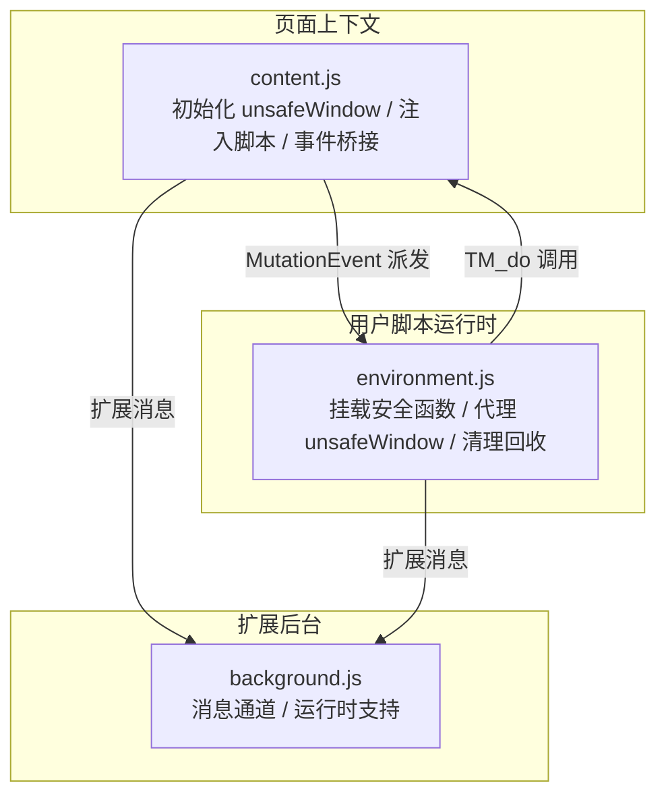
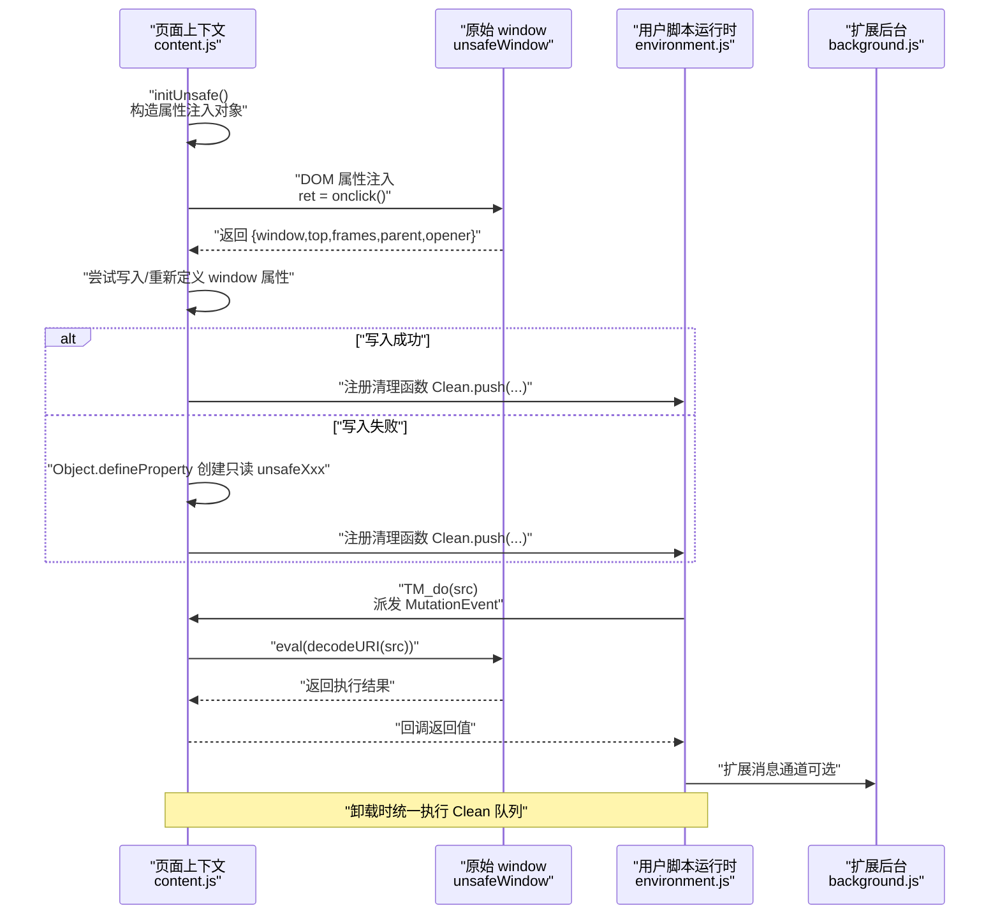
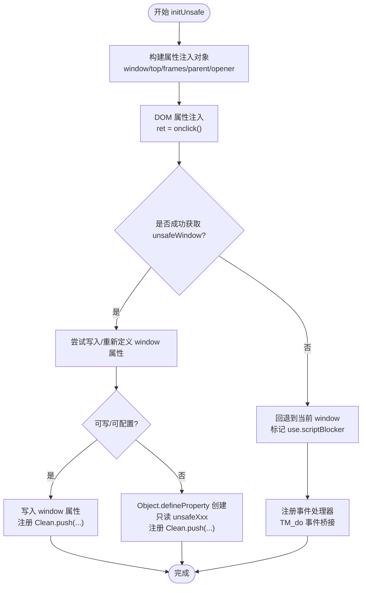
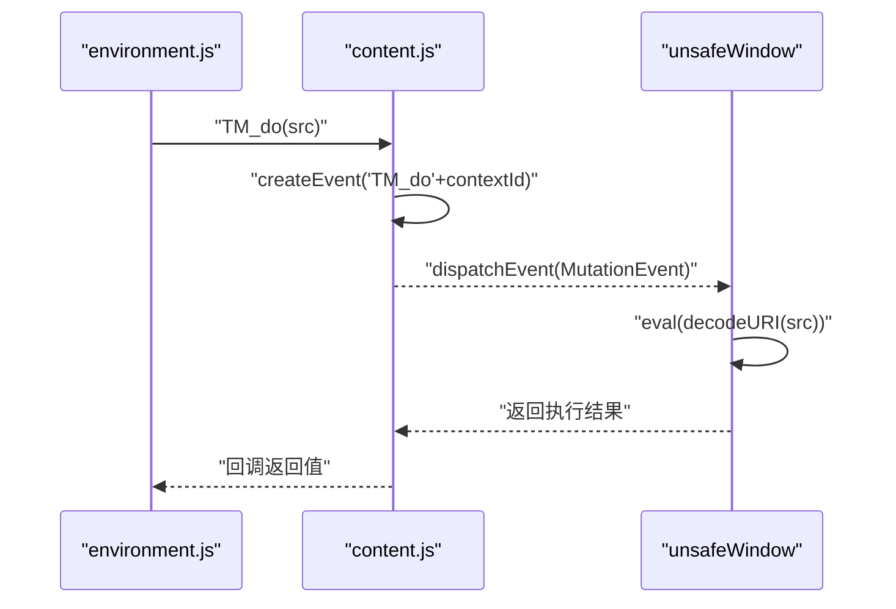
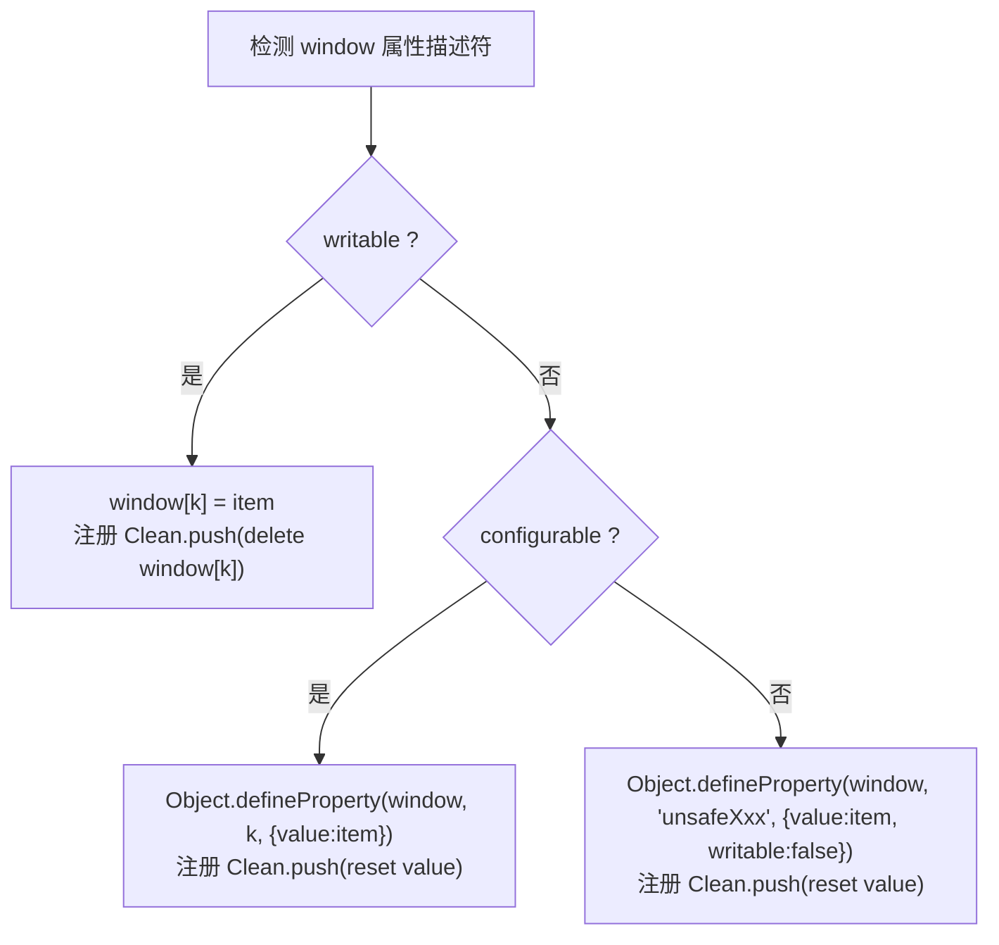
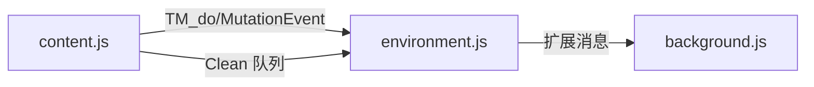

# unsafeWindow 管理

<cite>
**本文引用的文件列表**
- [content.js](file://src/content.js)
- [environment.js](file://src/environment.js)
- [background.js](file://src/background.js)
</cite>

## 目录
1. [简介](#简介)
2. [项目结构](#项目结构)
3. [核心组件](#核心组件)
4. [架构总览](#架构总览)
5. [详细组件分析](#详细组件分析)
6. [依赖关系分析](#依赖关系分析)
7. [性能考量](#性能考量)
8. [故障排查指南](#故障排查指南)
9. [结论](#结论)
10. [附录](#附录)

## 简介
本文件聚焦于 Tampermonkey 中的 unsafeWindow 管理系统，系统性阐述其初始化流程、属性代理机制与安全隔离策略。重点覆盖：
- 如何通过 DOM 属性注入（如 onclick）在受保护的沙箱环境中获取对原始 window 对象的访问权；
- forceUnsafe 标记的作用与属性重写/重新定义策略；
- 写入 window、重新定义属性与清理回收的完整生命周期；
- 枚举属性处理与内存管理；
- 提供架构图与属性代理示意图，帮助读者快速理解跨上下文通信与安全边界。

## 项目结构
unsafeWindow 管理涉及三个关键模块：
- content.js：负责在页面上下文中初始化 unsafeWindow、注入脚本、事件桥接与清理；
- environment.js：在用户脚本运行时环境内挂载安全函数、代理 unsafeWindow 访问、维护清理队列；
- background.js：后台进程，提供扩展消息通道与运行时支持。

图表来源
- [content.js:828-965](file://src/content.js#L828-L965)
- [environment.js:626-644](file://src/environment.js#L626-L644)
- [background.js:1-120](file://src/background.js#L1-L120)

章节来源
- [content.js:455-608](file://src/content.js#L455-L608)
- [environment.js:1133-1165](file://src/environment.js#L1133-L1165)
- [background.js:1188-1196](file://src/background.js#L1188-L1196)

## 核心组件
- unsafeWindow 初始化器（initUnsafe）
  - 通过 DOM 属性注入获取原始 window；
  - 在失败时回退到当前 window 并标记脚本拦截器；
  - 注册事件处理器以规避浏览器安全限制；
  - 将 top/frames/parent/opener 等属性写入或重新定义至 window；
  - 无法写入时创建只读属性 unsafeXxx 以暴露原始对象。
- 事件桥接（TM_do / Eventing）
  - 使用 MutationEvent 触发自定义事件，携带编码后的脚本片段；
  - 页面与内容脚本之间通过 document 与扩展消息进行双向通信。
- 清理回收（Clean 队列）
  - 统一在卸载时执行，确保删除临时属性、恢复原型方法、移除监听器等。

章节来源
- [content.js:455-608](file://src/content.js#L455-L608)
- [content.js:828-965](file://src/content.js#L828-L965)
- [content.js:1031-1061](file://src/content.js#L1031-L1061)
- [environment.js:309-323](file://src/environment.js#L309-L323)

## 架构总览
unsafeWindow 的工作流分为“初始化—代理—清理”三阶段，贯穿页面上下文与用户脚本运行时。

图表来源
- [content.js:455-608](file://src/content.js#L455-L608)
- [content.js:612-628](file://src/content.js#L612-L628)
- [environment.js:1044-1051](file://src/environment.js#L1044-L1051)

## 详细组件分析

### unsafeWindow 初始化器（initUnsafe）
- 目标
  - 在受保护的沙箱中获取对原始 window 的引用；
  - 将 top/frames/parent/opener 等关键属性写入当前 window 或创建只读代理；
  - 处理脚本拦截器导致的失败场景并发出告警。
- 关键步骤
  - 构造属性注入对象，包含 window/top/frames/parent/opener；
  - 使用 DOM 元素的 onclick 属性注入该对象，触发解析并返回包含原始 window 的对象；
  - 若失败则回退到当前 window，并标记 use.scriptBlocker；
  - 注册事件处理器以规避浏览器安全限制；
  - 通过 TM_do 将注入对象传入 unsafeWindow 执行环境；
  - 从返回对象中提取各属性，尝试写入或重新定义 window 属性；
  - 无法写入时创建只读属性 unsafeXxx；
  - 将清理函数加入 Clean 队列，以便卸载时回收。
- 安全与兼容性
  - forceUnsafe 标记用于强制使用 unsafeWindow 的属性（如 top），避免被页面脚本篡改；
  - 针对不可写/不可配置属性，采用重新定义或创建只读属性的方式；
  - 对 MutationObserver 不可用的情况，回退到 DOMSubtreeModified 事件模拟。

图表来源
- [content.js:455-608](file://src/content.js#L455-L608)

章节来源
- [content.js:455-608](file://src/content.js#L455-L608)
- [content.js:612-628](file://src/content.js#L612-L628)

### 事件桥接（TM_do / Eventing）
- TM_do
  - 通过创建自定义 MutationEvent，将编码后的脚本源码传递给页面；
  - 页面侧通过事件处理器解码并执行，返回结果。
- Eventing
  - 维护上下文 ID 与事件源（document 或备用事件源）；
  - 支持在脚本拦截器场景下切换备用事件源；
  - 提供注册监听、派发事件与清理的方法。

图表来源
- [environment.js:626-644](file://src/environment.js#L626-L644)
- [content.js:612-628](file://src/content.js#L612-L628)

章节来源
- [environment.js:626-644](file://src/environment.js#L626-L644)
- [content.js:828-965](file://src/content.js#L828-L965)

### 属性代理与安全边界
- 写入策略
  - 若属性可写：直接赋值 window[k]；
  - 若属性不可写但可配置：使用 Object.defineProperty 重新定义；
  - 否则：创建只读属性 unsafeXxx，避免污染全局命名空间。
- 清理策略
  - 所有写入/重新定义均注册 Clean.push(...) 回调；
  - 卸载时统一执行，删除临时属性、恢复原型方法、移除监听器；
  - 对 wrappedJSObject、addEventListener 等进行特殊处理与恢复。
- 枚举属性与内存管理
  - 只读属性不参与枚举，避免被脚本遍历；
  - 清理函数确保值置空并恢复原状，防止内存泄漏。

图表来源
- [content.js:534-606](file://src/content.js#L534-L606)

章节来源
- [content.js:534-606](file://src/content.js#L534-L606)
- [content.js:1031-1061](file://src/content.js#L1031-L1061)

### 用户脚本运行时中的 unsafeWindow 使用
- TM_execUnsafe/TM_runNative
  - 将函数与参数写入 unsafeWindow，再通过 TM_do 调用；
  - 返回值由 unsafeWindow 执行后回传。
- 代理窗口对象
  - 在非安全上下文模式下，直接创建 unsafeXxx 代理；
  - 在安全上下文模式下，通过 initUnsafe 获取并代理。

章节来源
- [environment.js:1044-1051](file://src/environment.js#L1044-L1051)
- [environment.js:1142-1154](file://src/environment.js#L1142-L1154)

## 依赖关系分析
- 模块耦合
  - content.js 与 environment.js 通过 TM_do 与 MutationEvent 强耦合；
  - environment.js 与 background.js 通过扩展消息通道弱耦合；
  - Clean 队列在两个模块中均有使用，确保资源回收一致性。
- 外部依赖
  - DOM MutationEvent 与 document.addEventListener；
  - 扩展消息通道（chrome.extension.sendMessage/connect）；
  - 浏览器安全限制（脚本拦截器）下的降级策略。

图表来源
- [content.js:828-965](file://src/content.js#L828-L965)
- [environment.js:626-644](file://src/environment.js#L626-L644)
- [background.js:1188-1196](file://src/background.js#L1188-L1196)

章节来源
- [content.js:828-965](file://src/content.js#L828-L965)
- [environment.js:626-644](file://src/environment.js#L626-L644)
- [background.js:1188-1196](file://src/background.js#L1188-L1196)

## 性能考量
- DOM 属性注入成本低，但需注意页面脚本可能已劫持 onclick；
- MutationEvent 派发与 eval 执行存在开销，应尽量减少频繁调用；
- 清理函数在卸载时批量执行，避免重复注册；
- 在脚本拦截器场景下启用备用事件源，降低失败概率。

## 故障排查指南
- 无法获取 unsafeWindow
  - 现象：控制台提示“unsafeWindow retrieval failed”，use.scriptBlocker 标记为真；
  - 排查：确认是否存在脚本拦截器；检查 DOM 属性注入是否被页面脚本覆盖。
- 属性写入失败
  - 现象：日志显示“create unsafeXxx”；
  - 排查：确认属性是否不可写且不可配置；检查 Object.defineProperty 是否可用。
- 事件桥接异常
  - 现象：TM_do 无响应或报错；
  - 排查：确认 MutationEvent 类型是否正确；检查事件源是否为 document 或备用事件源。
- 卸载后残留
  - 现象：属性未清理、监听器未移除；
  - 排查：确认 Clean 队列是否注册；检查卸载事件是否触发。

章节来源
- [content.js:475-500](file://src/content.js#L475-L500)
- [content.js:587-606](file://src/content.js#L587-L606)
- [content.js:1031-1061](file://src/content.js#L1031-L1061)

## 结论
unsafeWindow 管理系统通过 DOM 属性注入与事件桥接，在受限的沙箱环境中实现了对原始 window 的安全访问。其设计兼顾了兼容性与安全性：在可写/可配置时直接写入，在不可写时创建只读代理；通过 Clean 队列实现完善的资源回收。尽管面临脚本拦截器等挑战，系统仍提供了稳健的降级与回退策略，确保用户脚本能够在不同环境下稳定运行。

## 附录
- 关键路径参考
  - unsafeWindow 初始化：[content.js:455-608](file://src/content.js#L455-L608)
  - 事件桥接与 TM_do：[content.js:612-628](file://src/content.js#L612-L628), [environment.js:626-644](file://src/environment.js#L626-L644)
  - 清理回收：[content.js:1031-1061](file://src/content.js#L1031-L1061), [environment.js:309-323](file://src/environment.js#L309-L323)
  - 用户脚本中的 unsafeWindow 使用：[environment.js:1044-1051](file://src/environment.js#L1044-L1051), [environment.js:1142-1154](file://src/environment.js#L1142-L1154)