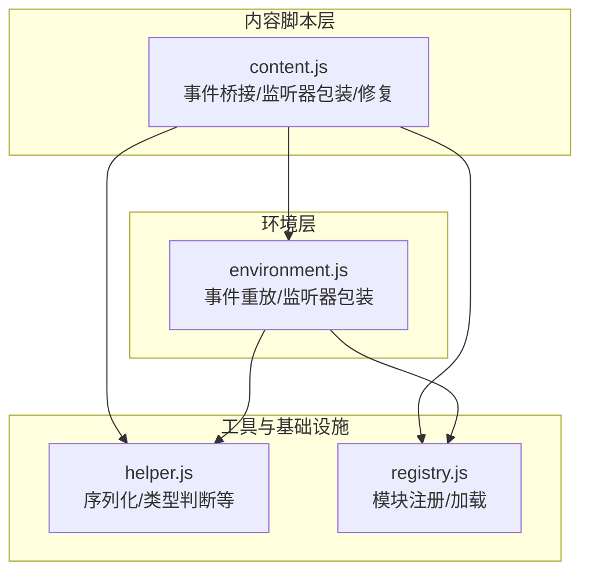
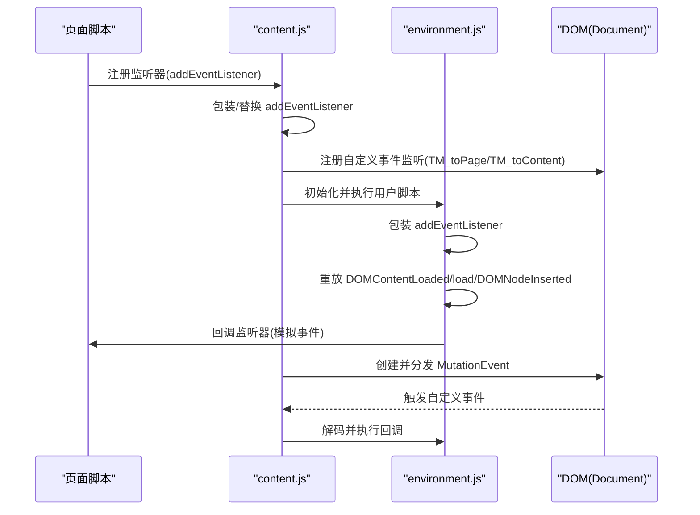
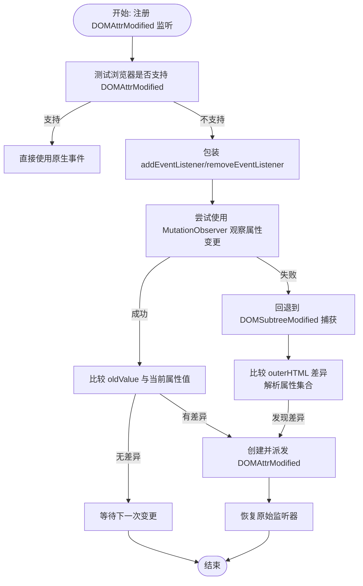
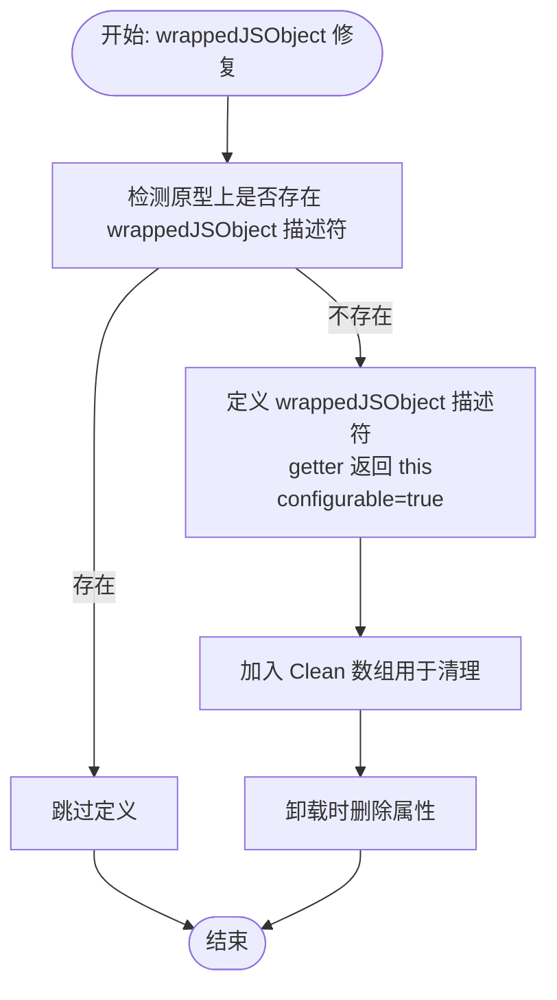
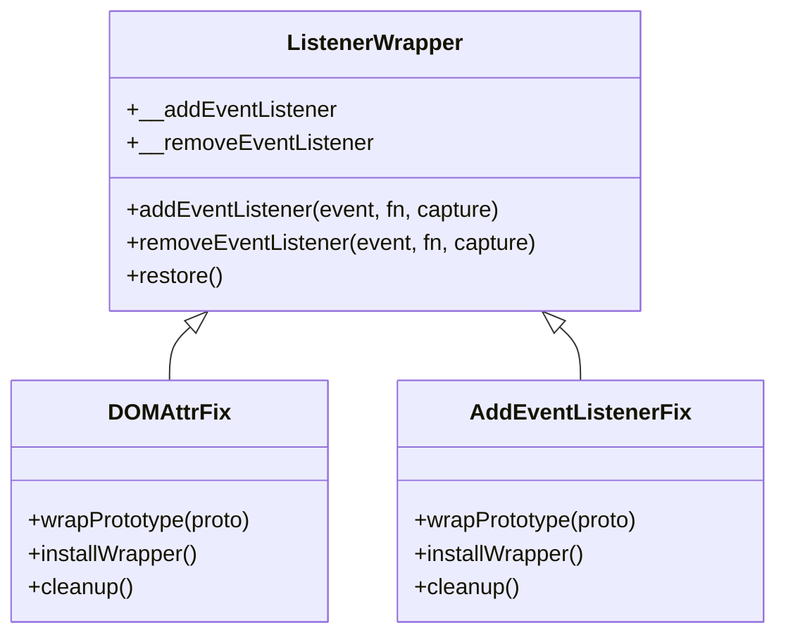
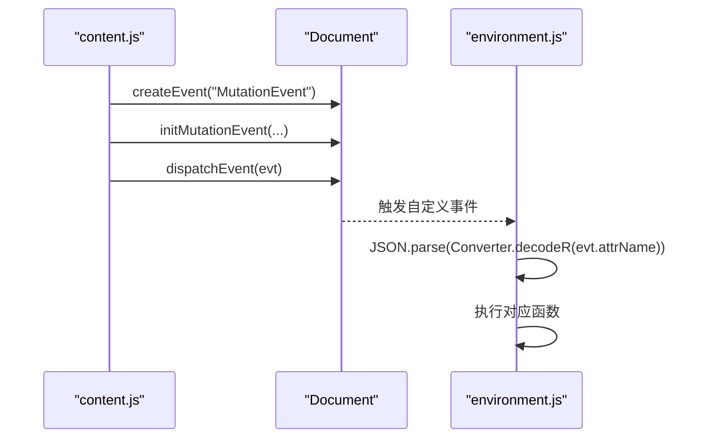
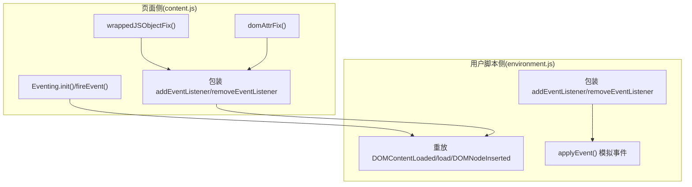
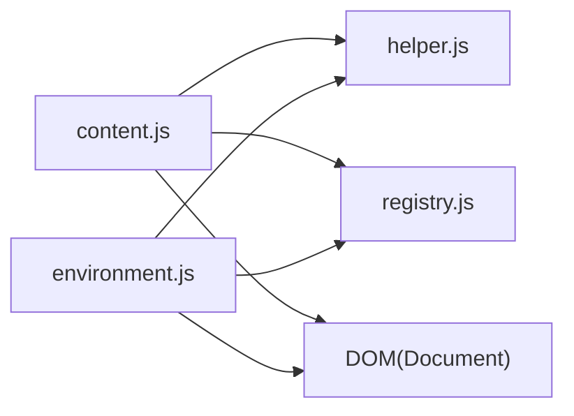

# 事件系统修复

<cite>
**本文档引用的文件**
- [content.js](file://src/content.js)
- [environment.js](file://src/environment.js)
- [helper.js](file://src/helper.js)
- [registry.js](file://src/registry.js)
</cite>

## 目录
1. [简介](#简介)
2. [项目结构](#项目结构)
3. [核心组件](#核心组件)
4. [架构总览](#架构总览)
5. [详细组件分析](#详细组件分析)
6. [依赖关系分析](#依赖关系分析)
7. [性能考量](#性能考量)
8. [故障排除指南](#故障排除指南)
9. [结论](#结论)

## 简介
本文件针对 Tampermonkey 的事件系统修复功能进行深入技术文档化，重点覆盖以下方面：
- DOMAttrModified 事件处理机制与兼容性修复
- MutationObserver 替代方案与回退策略（DOMSubtreeModified）
- wrappedJSObject 修复策略及其清理机制
- 事件监听器包装与替换机制：对 addEventListener/removeEventListener 的重写
- 事件冒泡与捕获的处理方式
- 自定义事件的创建与分发机制
- 事件系统架构图与事件处理流程图
- 具体代码示例路径，展示事件修复过程、监听器注册与事件处理流程

## 项目结构
Tampermonkey 的事件系统修复主要分布在 content.js 与 environment.js 中：
- content.js：负责页面注入、事件桥接、监听器包装、DOMAttrModified/MutationObserver/wrappedJSObject 修复、以及事件发送与接收
- environment.js：在用户脚本运行环境中模拟标准事件行为，包括 DOMContentLoaded/load/DOMNodeInserted 的重放与监听器包装

图表来源
- [content.js:1-1202](file://src/content.js#L1-L1202)
- [environment.js:1-800](file://src/environment.js#L1-L800)
- [helper.js:1-209](file://src/helper.js#L1-L209)
- [registry.js:1-107](file://src/registry.js#L1-L107)

章节来源
- [content.js:1-1202](file://src/content.js#L1-L1202)
- [environment.js:1-800](file://src/environment.js#L1-L800)
- [helper.js:1-209](file://src/helper.js#L1-L209)
- [registry.js:1-107](file://src/registry.js#L1-L107)

## 核心组件
- DOMAttrModified 修复：通过包装 HTMLElement.prototype 与 document 原型，拦截 addEventListener 调用，检测是否监听 DOMAttrModified，并在不支持该事件时使用 MutationObserver 或 DOMSubtreeModified 进行回退
- MutationObserver 替代：优先使用 WebKitMutationObserver 观察属性变更；若不可用则回退到 DOMSubtreeModified 捕获节点树变化
- wrappedJSObject 修复：为 HTMLElement.prototype 与 document.__proto__ 定义 wrappedJSObject 属性，确保某些扩展逻辑能正确获取原生对象
- 事件监听器包装：对 addEventListener/removeEventListener 进行重写，以支持事件重放与监听器移除检测
- 自定义事件分发：通过 document.createEvent("MutationEvent") 创建自定义事件，携带编码后的数据并通过 dispatchEvent 分发

章节来源
- [content.js:650-823](file://src/content.js#L650-L823)
- [content.js:825-965](file://src/content.js#L825-L965)
- [environment.js:380-493](file://src/environment.js#L380-L493)

## 架构总览
事件系统由“内容脚本层”与“环境层”协作完成：
- 内容脚本层负责注入修复逻辑、包装监听器、创建并分发自定义事件
- 环境层负责在用户脚本上下文中模拟标准 DOM 事件行为，重放历史事件并包装监听器

图表来源
- [content.js:825-965](file://src/content.js#L825-L965)
- [environment.js:195-493](file://src/environment.js#L195-L493)

## 详细组件分析

### DOMAttrModified 事件处理机制
- 监听测试：通过在临时元素上注册 DOMAttrModified 监听器并触发 setAttribute，判断浏览器是否支持该事件
- 不支持时的包装：对 HTMLElement.prototype 与 document.__proto__ 的 addEventListener/removeEventListener 进行包装
- 事件转换：当监听 DOMAttrModified 时，内部维护目标元素的 outerHTML 字符串，用于后续比较属性变化
- 变更检测：
  - 优先使用 MutationObserver 观察属性变更（attributeOldValue=true, attributes=true），在回调中比较 oldValue 与当前属性值，必要时派发 DOMAttrModified
  - 若 MutationObserver 不可用，则回退到 DOMSubtreeModified，通过比较 outerHTML 差异计算具体属性变化并派发事件
- 清理：在卸载时恢复原始 addEventListener/removeEventListener

图表来源
- [content.js:679-823](file://src/content.js#L679-L823)

章节来源
- [content.js:679-823](file://src/content.js#L679-L823)

### MutationObserver 替代方案与回退策略
- 优先级：MutationObserver > DOMSubtreeModified
- 观察配置：childList=false, subtree=false, attributeOldValue=true, attributes=true
- 回退条件：当实例化 WebKitMutationObserver 失败或观察失败时，记录日志并切换到 DOMSubtreeModified
- DOMSubtreeModified 策略：在目标节点及其子树上注册捕获阶段监听，通过 outerHTML 字符串对比定位属性差异并逐个派发 DOMAttrModified

章节来源
- [content.js:737-810](file://src/content.js#L737-L810)

### wrappedJSObject 修复策略
- 适用范围：HTMLElement.prototype 与 document.__proto__
- 实现：检测是否存在 wrappedJSObject 描述符，若不存在则定义一个 getter 返回 this，且设置 configurable=true，以便后续清理
- 清理：在卸载时删除该属性，避免污染原型链

图表来源
- [content.js:650-677](file://src/content.js#L650-L677)

章节来源
- [content.js:650-677](file://src/content.js#L650-L677)

### 事件监听器的包装与替换机制
- 包装对象：HTMLElement.prototype 与 HTMLDocument.prototype（在环境层）
- 包装内容：
  - 保存原始 addEventListener/removeEventListener
  - 重写 addEventListener：拦截特定事件（如 DOMContentLoaded/load/DOMNodeInserted），在用户脚本上下文中模拟事件并延迟注册，避免与 jQuery 等库产生冲突
  - 重写 removeEventListener：检测是否在 refireAllNodeInserts 过程中移除监听器，防止事件顺序错乱
- 清理：在卸载时恢复原始方法

图表来源
- [content.js:695-823](file://src/content.js#L695-L823)
- [environment.js:380-493](file://src/environment.js#L380-L493)

章节来源
- [content.js:695-823](file://src/content.js#L695-L823)
- [environment.js:380-493](file://src/environment.js#L380-L493)

### 事件冒泡与捕获的处理方式
- 捕获阶段：DOMSubtreeModified 在捕获阶段注册，确保在子树变化时尽早触发
- 冒泡阶段：DOMAttrModified 事件在冒泡阶段派发，符合 MutationEvent 的语义
- 环境层：对 addEventListener 的包装在捕获阶段检测并控制注册时机，保证事件顺序与一致性

章节来源
- [content.js:707-810](file://src/content.js#L707-L810)
- [environment.js:402-482](file://src/environment.js#L402-L482)

### 自定义事件的创建与分发机制
- 事件类型：使用 document.createEvent("MutationEvent") 创建自定义事件
- 事件初始化：initMutationEvent 设置 type、bubbles、cancelable、relatedNode、prevValue、newValue、attrName、attrChange 等字段
- 数据传递：将 JSON 序列化后通过 Converter.encodeR 编码，作为 MutationEvent 的 attrName 传入
- 接收端解码：在事件处理器中通过 Converter.decodeR 解码并执行对应逻辑

图表来源
- [content.js:891-911](file://src/content.js#L891-L911)
- [content.js:921-955](file://src/content.js#L921-L955)
- [environment.js:201-232](file://src/environment.js#L201-L232)

章节来源
- [content.js:891-911](file://src/content.js#L891-L911)
- [content.js:921-955](file://src/content.js#L921-L955)
- [environment.js:201-232](file://src/environment.js#L201-L232)

### 事件系统架构图

图表来源
- [content.js:650-823](file://src/content.js#L650-L823)
- [content.js:825-965](file://src/content.js#L825-L965)
- [environment.js:380-493](file://src/environment.js#L380-L493)
- [environment.js:195-286](file://src/environment.js#L195-L286)

## 依赖关系分析
- content.js 依赖 helper.js 提供序列化与类型判断能力
- content.js 依赖 registry.js 提供模块注册与加载
- environment.js 同样依赖 helper.js 与 registry.js
- 事件桥接依赖 document.createEvent 与 dispatchEvent

图表来源
- [content.js:80-92](file://src/content.js#L80-L92)
- [environment.js:7-35](file://src/environment.js#L7-L35)
- [helper.js:184-209](file://src/helper.js#L184-L209)
- [registry.js:35-104](file://src/registry.js#L35-L104)

章节来源
- [content.js:80-92](file://src/content.js#L80-L92)
- [environment.js:7-35](file://src/environment.js#L7-L35)
- [helper.js:184-209](file://src/helper.js#L184-L209)
- [registry.js:35-104](file://src/registry.js#L35-L104)

## 性能考量
- MutationObserver 优先：在大多数现代浏览器中，MutationObserver 的性能优于 DOMSubtreeModified
- 外层 HTML 字符串比较：DOMSubtreeModified 回退路径中需要解析 outerHTML 并比较属性集合，可能带来额外开销
- 事件重放：环境层对历史事件的重放会增加首次执行时的延迟，但确保了与用户脚本的兼容性
- 清理机制：所有包装与定义的属性均在卸载时清理，避免内存泄漏与副作用累积

## 故障排除指南
- DOMAttrModified 未触发
  - 检查浏览器是否支持该事件；若不支持，确认 MutationObserver 是否可用；若仍不可用，检查 DOMSubtreeModified 是否被正确注册
  - 参考路径：[content.js:679-823](file://src/content.js#L679-L823)
- wrappedJSObject 访问异常
  - 确认 wrappedJSObject 修复是否已执行；检查原型链上是否已定义该属性
  - 参考路径：[content.js:650-677](file://src/content.js#L650-L677)
- 事件未按预期顺序触发
  - 检查环境层对 addEventListener 的包装是否生效；确认 removeEventListener 是否在 refireAllNodeInserts 过程中被正确检测
  - 参考路径：[environment.js:380-493](file://src/environment.js#L380-L493)
- 自定义事件未被接收
  - 检查 Eventing.init 是否正确设置 eventSource；确认事件类型命名是否一致（TM_toPage/TM_toContent）
  - 参考路径：[content.js:859-889](file://src/content.js#L859-L889)

章节来源
- [content.js:650-823](file://src/content.js#L650-L823)
- [content.js:859-889](file://src/content.js#L859-L889)
- [environment.js:380-493](file://src/environment.js#L380-L493)

## 结论
Tampermonkey 的事件系统修复通过多层包装与回退策略，有效解决了 DOMAttrModified、wrappedJSObject 以及事件监听器兼容性问题。其核心在于：
- 对关键原型方法的包装与替换，确保事件行为的一致性
- 使用 MutationObserver 作为首选替代方案，并在不可用时回退到 DOMSubtreeModified
- 在用户脚本环境中重放历史事件，保证与现有脚本生态的兼容
- 清晰的清理机制，避免长期运行带来的副作用