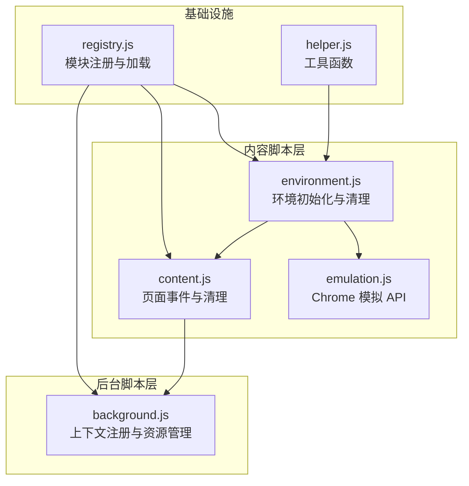
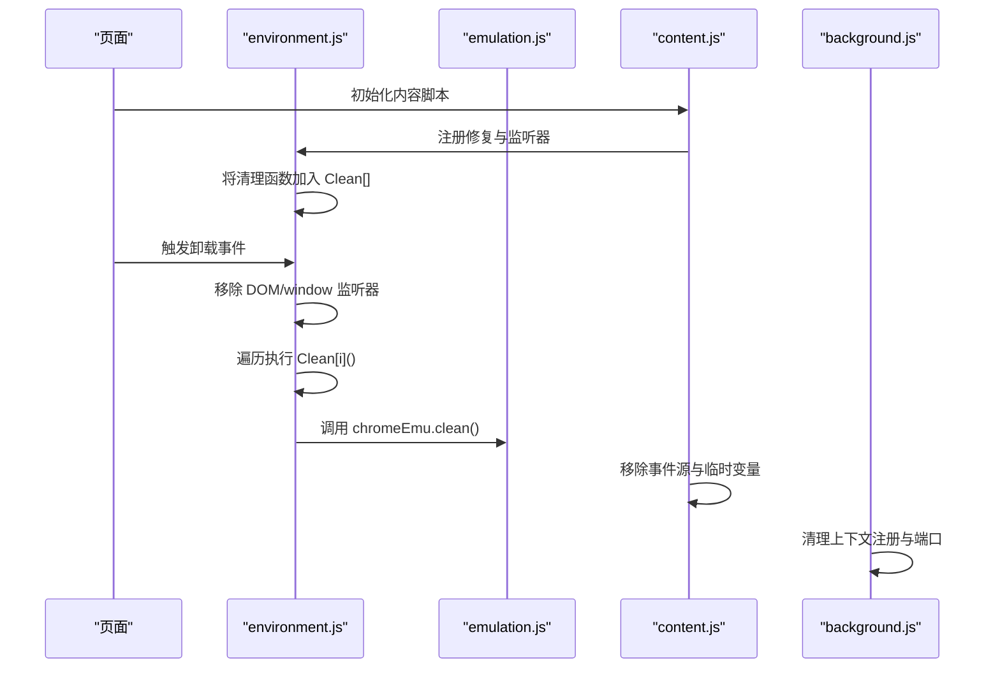
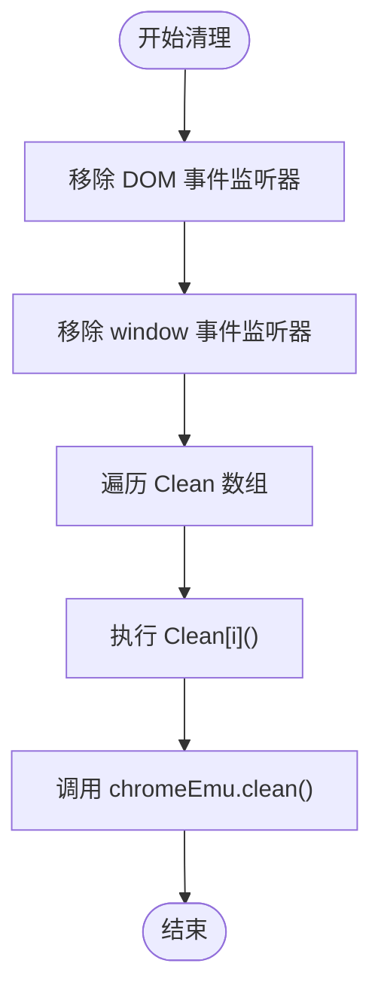
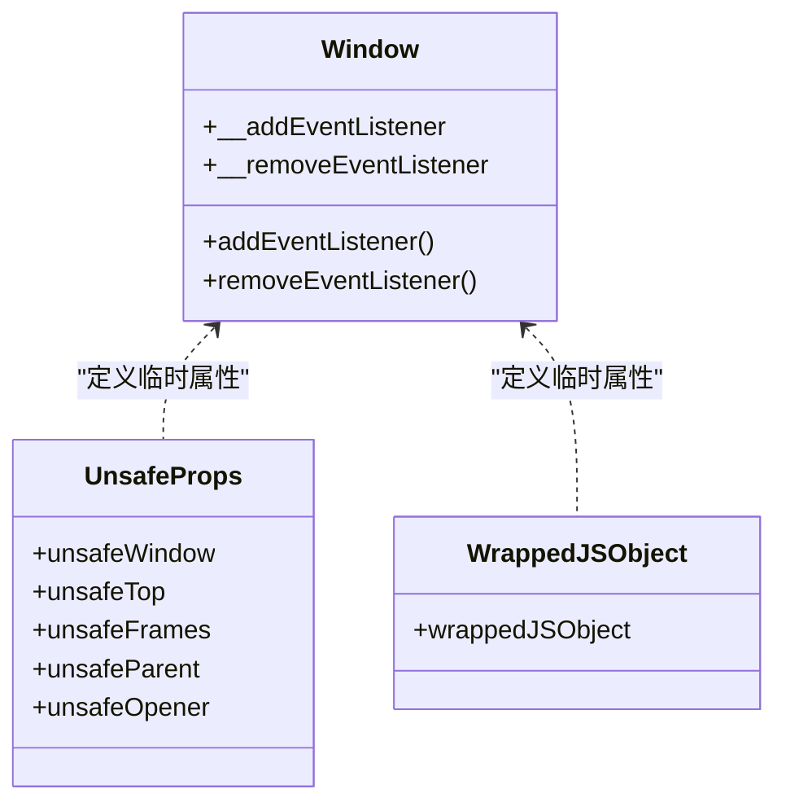
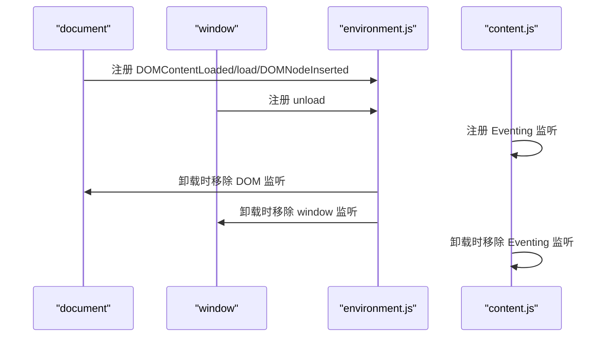
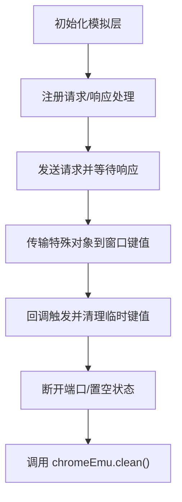
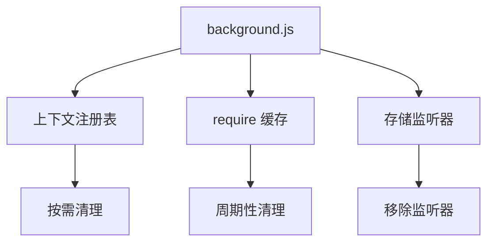
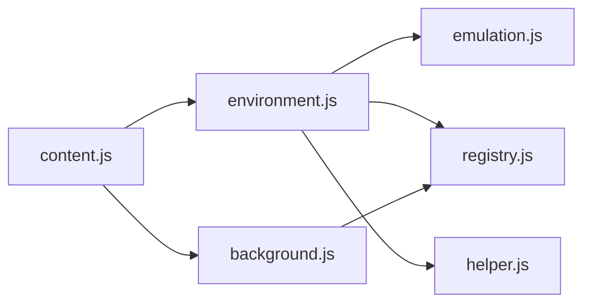

# 内存清理机制

<cite>
**本文档引用的文件**
- [emulation.js](file://src/emulation.js)
- [environment.js](file://src/environment.js)
- [content.js](file://src/content.js)
- [background.js](file://src/background.js)
- [registry.js](file://src/registry.js)
- [helper.js](file://src/helper.js)
</cite>

## 目录
1. [简介](#简介)
2. [项目结构](#项目结构)
3. [核心组件](#核心组件)
4. [架构概览](#架构概览)
5. [详细组件分析](#详细组件分析)
6. [依赖关系分析](#依赖关系分析)
7. [性能考量](#性能考量)
8. [故障排除指南](#故障排除指南)
9. [结论](#结论)

## 简介
本文件系统性阐述 Tampermonkey 在环境模拟过程中的内存清理机制，重点覆盖以下方面：
- Clean 数组的使用与清理函数注册机制
- 属性重写后的恢复过程（含 window 安全上下文属性）
- 事件监听器的移除策略
- 临时变量与临时对象的销毁策略
- 内存泄漏防护措施与性能优化技巧
- 清理时机的选择与批量清理的实现
- 具体的清理流程图与资源管理示意图

## 项目结构
Tampermonkey 的内存清理涉及多个模块协同工作：
- 环境模拟层：在内容脚本环境中注入模拟的 Chrome 扩展 API，并在卸载时进行清理
- 内容脚本层：负责在页面上下文中初始化环境、注册清理钩子、移除事件监听器
- 后台脚本层：维护上下文注册表、端口连接、缓存等，避免长期持有引用导致的内存泄漏
- 注册中心：统一加载与管理模块，确保清理逻辑在正确时机被调用

**图表来源**
- [environment.js:33](file://src/environment.js#L33)
- [emulation.js:9](file://src/emulation.js#L9)
- [content.js:80](file://src/content.js#L80)
- [background.js:28](file://src/background.js#L28)
- [registry.js:11](file://src/registry.js#L11)
- [helper.js:184](file://src/helper.js#L184)

**章节来源**
- [environment.js:33](file://src/environment.js#L33)
- [emulation.js:9](file://src/emulation.js#L9)
- [content.js:80](file://src/content.js#L80)
- [background.js:28](file://src/background.js#L28)
- [registry.js:11](file://src/registry.js#L11)
- [helper.js:184](file://src/helper.js#L184)

## 核心组件
- Clean 数组：集中存放所有需要在卸载时执行的清理函数，形成“批量清理”的统一入口
- 环境模拟（chromeEmu）：封装模拟的扩展 API，提供 clean 方法用于释放其内部状态
- 事件监听器管理：在初始化时注册监听器，在 cleanup 中统一移除
- 属性重写恢复：通过定义清理函数，恢复或删除临时重写的属性
- 资源池与端口：在模拟请求完成后断开连接，释放回调引用

**章节来源**
- [environment.js:33](file://src/environment.js#L33)
- [environment.js:309](file://src/environment.js#L309)
- [emulation.js:45](file://src/emulation.js#L45)
- [content.js:597](file://src/content.js#L597)

## 架构概览
内存清理的整体流程如下：
- 页面加载后，内容脚本初始化环境，注册各类修复与监听器，并将清理函数推入 Clean 数组
- 卸载时，先移除 DOM 与 window 事件监听器，再遍历执行 Clean 数组中的清理函数
- 最后调用 chromeEmu.clean() 释放模拟层的状态与回调
- 后台脚本侧通过上下文注册表与端口管理，避免长期持有引用

**图表来源**
- [environment.js:309](file://src/environment.js#L309)
- [environment.js:1329](file://src/environment.js#L1329)
- [emulation.js:45](file://src/emulation.js#L45)
- [content.js:146](file://src/content.js#L146)
- [background.js:433](file://src/background.js#L433)

## 详细组件分析

### Clean 数组与批量清理机制
- Clean 数组在各模块初始化阶段被创建并使用，用于收集清理函数
- 在卸载时，环境清理函数会移除关键事件监听器，然后顺序执行 Clean 中的所有清理函数
- 清理函数通常负责：
  - 恢复被临时重写的属性（如 addEventListener、removeEventListener）
  - 删除临时定义的属性（如 unsafeXxx、wrappedJSObject）
  - 断开端口连接、移除存储监听器
  - 置空临时对象引用，避免闭包持有

**图表来源**
- [environment.js:309](file://src/environment.js#L309)
- [environment.js:315](file://src/environment.js#L315)
- [emulation.js:45](file://src/emulation.js#L45)

**章节来源**
- [environment.js:309](file://src/environment.js#L309)
- [environment.js:315](file://src/environment.js#L315)
- [content.js:597](file://src/content.js#L597)

### 属性重写后的恢复过程
- addEventListener 与 removeEventListener 的重写：在初始化时保存原始方法，清理时恢复
- window 属性重写：通过 Object.defineProperty 定义临时属性，清理时置空并删除
- wrappedJSObject 与 unsafeXxx：在原型链上动态添加属性，清理时删除以避免残留

**图表来源**
- [content.js:597](file://src/content.js#L597)
- [content.js:650](file://src/content.js#L650)
- [content.js:679](file://src/content.js#L679)

**章节来源**
- [content.js:597](file://src/content.js#L597)
- [content.js:650](file://src/content.js#L650)
- [content.js:679](file://src/content.js#L679)

### 事件监听器的移除与临时变量销毁
- DOMContentLoaded、load、DOMNodeInserted 等关键事件监听器在卸载时被移除
- 页面事件源（Eventing）在卸载时移除监听并清理临时变量
- 模拟层的响应映射（responses）在处理完成后被删除键值，避免内存泄漏

**图表来源**
- [environment.js:1329](file://src/environment.js#L1329)
- [environment.js:1332](file://src/environment.js#L1332)
- [content.js:957](file://src/content.js#L957)

**章节来源**
- [environment.js:1329](file://src/environment.js#L1329)
- [environment.js:1332](file://src/environment.js#L1332)
- [content.js:957](file://src/content.js#L957)

### 模拟层清理与临时对象销毁
- chromeEmu.clean() 会将内部状态（如响应映射、请求处理器、标签页更新监听器）置空或删除
- 模拟 XHR 请求中使用的临时窗口对象键值在传输后立即删除，防止跨线程引用残留
- 连接端口在完成任务后断开，避免回调闭包持有

**图表来源**
- [emulation.js:45](file://src/emulation.js#L45)
- [emulation.js:148](file://src/emulation.js#L148)
- [content.js:309](file://src/content.js#L309)
- [content.js:332](file://src/content.js#L332)

**章节来源**
- [emulation.js:45](file://src/emulation.js#L45)
- [emulation.js:148](file://src/emulation.js#L148)
- [content.js:309](file://src/content.js#L309)
- [content.js:332](file://src/content.js#L332)

### 上下文注册与资源管理
- 后台脚本维护上下文注册表，按需清理缓存与统计信息
- 定期清理 require 缓存，避免长时间运行导致的内存占用
- 存储监听器在脚本卸载时被移除，防止回调链残留

**图表来源**
- [background.js:435](file://src/background.js#L435)
- [background.js:410](file://src/background.js#L410)
- [background.js:3811](file://src/background.js#L3811)

**章节来源**
- [background.js:435](file://src/background.js#L435)
- [background.js:410](file://src/background.js#L410)
- [background.js:3811](file://src/background.js#L3811)

## 依赖关系分析
- environment.js 依赖 emulation.js 提供的模拟 API，并在卸载时调用其 clean 方法
- content.js 作为页面注入脚本，负责在页面上下文中初始化环境与清理
- background.js 维护全局资源与上下文状态，避免模拟层残留引用
- registry.js 与 helper.js 提供模块加载与工具函数支持

**图表来源**
- [environment.js:7](file://src/environment.js#L7)
- [emulation.js:9](file://src/emulation.js#L9)
- [content.js:80](file://src/content.js#L80)
- [background.js:28](file://src/background.js#L28)
- [registry.js:11](file://src/registry.js#L11)
- [helper.js:184](file://src/helper.js#L184)

**章节来源**
- [environment.js:7](file://src/environment.js#L7)
- [emulation.js:9](file://src/emulation.js#L9)
- [content.js:80](file://src/content.js#L80)
- [background.js:28](file://src/background.js#L28)
- [registry.js:11](file://src/registry.js#L11)
- [helper.js:184](file://src/helper.js#L184)

## 性能考量
- 使用 Clean 数组统一执行清理，减少重复的条件判断与分支
- 在模拟层中及时删除临时键值，避免跨线程对象传递造成的内存驻留
- 周期性清理 require 缓存，控制后台内存占用
- 通过事件监听器的有序移除，避免事件风暴与多余回调执行

## 故障排除指南
- 若发现页面卸载后仍有事件触发：检查是否遗漏了 addEventListener 的恢复步骤
- 若模拟层回调未释放：确认 chromeEmu.clean() 是否被调用以及响应映射是否被删除
- 若存储监听器持续触发：确认移除存储监听器的逻辑是否被执行
- 若 require 缓存增长过快：检查缓存清理定时器是否正常运行

**章节来源**
- [environment.js:309](file://src/environment.js#L309)
- [emulation.js:45](file://src/emulation.js#L45)
- [background.js:410](file://src/background.js#L410)
- [background.js:3811](file://src/background.js#L3811)

## 结论
Tampermonkey 的内存清理机制通过 Clean 数组实现了集中式、可扩展的清理策略，结合属性重写恢复、事件监听器移除与模拟层状态清理，有效避免了内存泄漏。配合后台脚本的上下文注册与缓存管理，整体资源占用得到良好控制。建议在新增功能时遵循“先注册、后清理”的模式，确保所有临时状态与引用都能被及时释放。