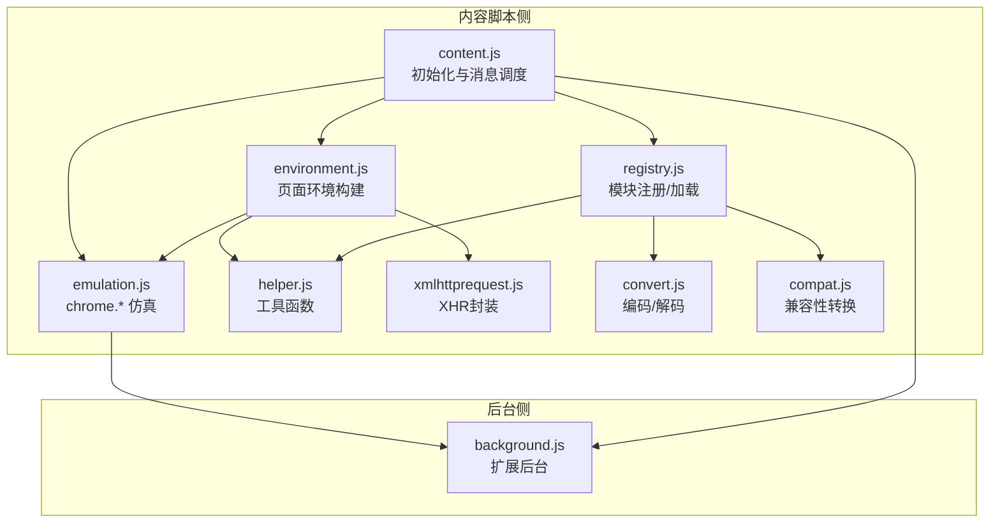
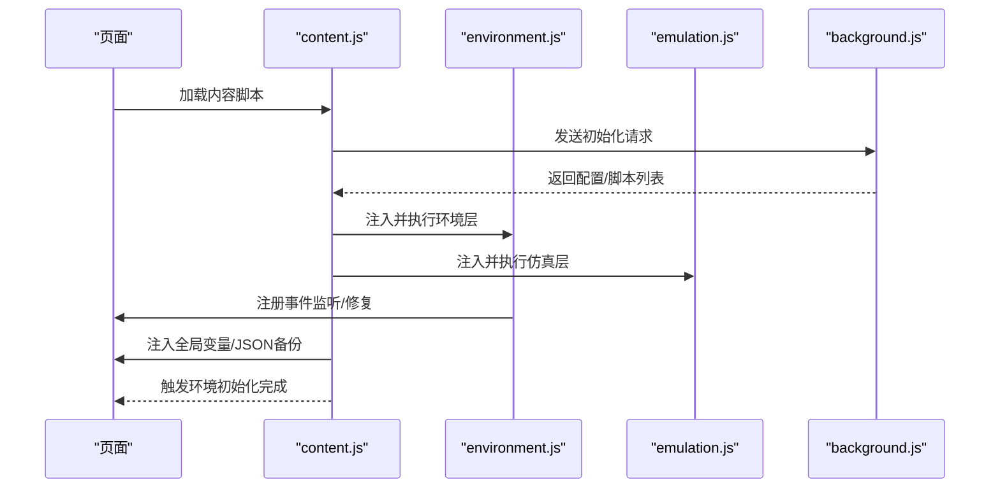
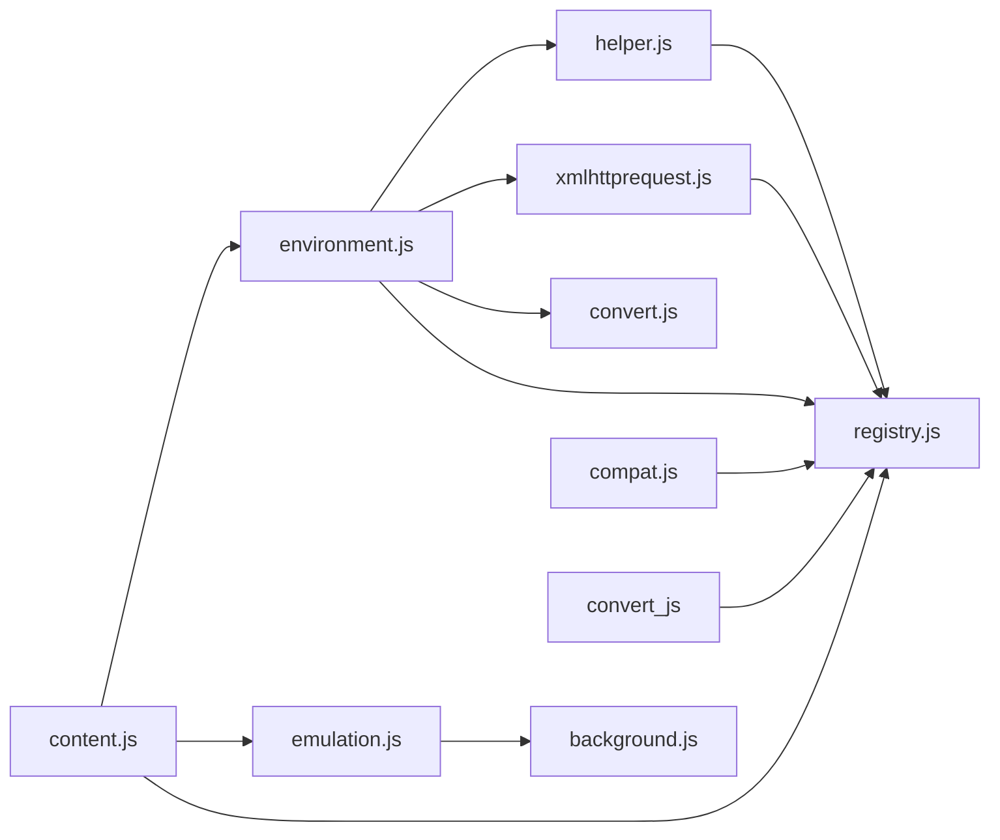

# 环境初始化

<cite>
**本文引用的文件**
- [content.js](file://src/content.js)
- [environment.js](file://src/environment.js)
- [emulation.js](file://src/emulation.js)
- [compat.js](file://src/compat.js)
- [helper.js](file://src/helper.js)
- [xmlhttprequest.js](file://src/xmlhttprequest.js)
- [registry.js](file://src/registry.js)
- [convert.js](file://src/convert.js)
- [background.js](file://src/background.js)
</cite>

## 目录
1. [简介](#简介)
2. [项目结构](#项目结构)
3. [核心组件](#核心组件)
4. [架构总览](#架构总览)
5. [详细组件分析](#详细组件分析)
6. [依赖关系分析](#依赖关系分析)
7. [性能考量](#性能考量)
8. [故障排查指南](#故障排查指南)
9. [结论](#结论)

## 简介
本文件面向 Tampermonkey 的“内容脚本环境初始化”子系统，系统性阐述内容脚本如何在目标网页环境中初始化执行环境的设计与实现。重点覆盖：
- 环境变量设置与日志级别调整
- 全局对象准备（如 unsafeWindow、事件注入、JSON 备份）
- 执行上下文创建与安全上下文切换
- 安全检查（脚本拦截器检测）、兼容性处理与错误恢复
- 提供流程图与安全检查示意，帮助读者快速把握初始化步骤与关键路径

## 项目结构
围绕“环境初始化”，涉及以下关键模块：
- 内容脚本入口：负责与后台通信、加载仿真层与环境层、注入全局变量与事件监听
- 环境层：在页面上下文中构建脚本运行所需的全局对象、事件重放、清理与修复
- 仿真层：桥接页面与扩展后台，提供 chrome.* API 的仿真调用
- 工具与兼容层：提供序列化、正则匹配、兼容转换等通用能力
- 注册表与消息编解码：统一模块加载与数据传输

图表来源
- [content.js:1121-1156](file://src/content.js#L1121-L1156)
- [environment.js:1323-1336](file://src/environment.js#L1323-L1336)
- [emulation.js:40-329](file://src/emulation.js#L40-L329)
- [helper.js:184-209](file://src/helper.js#L184-L209)
- [xmlhttprequest.js:17-159](file://src/xmlhttprequest.js#L17-L159)
- [registry.js:11-107](file://src/registry.js#L11-L107)
- [convert.js:7-39](file://src/convert.js#L7-L39)
- [compat.js:13-275](file://src/compat.js#L13-L275)
- [background.js:28-35](file://src/background.js#L28-L35)

章节来源
- [content.js:1121-1156](file://src/content.js#L1121-L1156)
- [environment.js:1323-1336](file://src/environment.js#L1323-L1336)

## 核心组件
- 内容脚本初始化器（content.js）：负责与后台建立连接、加载仿真与环境脚本、注入全局变量、设置日志级别、触发环境初始化
- 页面环境构建器（environment.js）：在页面上下文中创建脚本运行所需全局对象、事件重放、修复浏览器差异、清理资源
- 仿真层（emulation.js）：提供 chrome.* API 的仿真实现，桥接页面与后台
- 工具与兼容层（helper.js、compat.js）：提供序列化、正则、URL 匹配、兼容性转换等
- 模块注册与加载（registry.js）、消息编解码（convert.js）、XHR 封装（xmlhttprequest.js）

章节来源
- [content.js:1121-1156](file://src/content.js#L1121-L1156)
- [environment.js:1323-1336](file://src/environment.js#L1323-L1336)
- [emulation.js:40-329](file://src/emulation.js#L40-L329)
- [helper.js:184-209](file://src/helper.js#L184-L209)
- [compat.js:13-275](file://src/compat.js#L13-L275)
- [registry.js:11-107](file://src/registry.js#L11-L107)
- [convert.js:7-39](file://src/convert.js#L7-L39)
- [xmlhttprequest.js:17-159](file://src/xmlhttprequest.js#L17-L159)

## 架构总览
内容脚本在页面中通过消息通道与后台交互，按需加载仿真层与环境层脚本，并在页面上下文中完成全局对象准备与事件注入。初始化完成后，进入“事件重放”阶段，确保脚本能在正确的时机触发回调。

图表来源
- [content.js:1121-1156](file://src/content.js#L1121-L1156)
- [environment.js:1323-1336](file://src/environment.js#L1323-L1336)
- [emulation.js:40-329](file://src/emulation.js#L40-L329)
- [background.js:28-35](file://src/background.js#L28-L35)

## 详细组件分析

### 组件一：内容脚本初始化（content.js）
职责与流程要点：
- 向后台发送初始化请求，等待响应以获得日志级别与脚本信息
- 初始化事件系统（Eventing），根据响应决定是否开始执行脚本
- 注入全局变量（如 ENV、TS、Converter、TMwin、TMJSON、_background、console、JSON），并在必要时进行 JSON 备份与回退
- 在安全上下文模式下，通过自定义事件将脚本注入到页面上下文；否则使用 window.eval
- 负责响应后台消息，转发到仿真层或直接执行

关键点与路径：
- 初始化与消息调度：[content.js:1121-1156](file://src/content.js#L1121-L1156)
- 全局变量注入与 JSON 备份逻辑：[content.js:108-182](file://src/content.js#L108-L182)
- 安全上下文注入（TM_do 与自定义事件）：[content.js:612-628](file://src/content.js#L612-L628)
- 脚本拦截器检测与告警：[content.js:487-499](file://src/content.js#L487-L499)

章节来源
- [content.js:1121-1156](file://src/content.js#L1121-L1156)
- [content.js:108-182](file://src/content.js#L108-L182)
- [content.js:612-628](file://src/content.js#L612-L628)
- [content.js:487-499](file://src/content.js#L487-L499)

### 组件二：页面环境构建（environment.js）
职责与流程要点：
- 在页面上下文中创建脚本运行所需的全局对象（如 console、JSON、document、location、undefined 等），并进行备份
- 修复浏览器差异：addEventListener 包装、document.evaluate 适配、window.open 代理、setTimeout/setInterval 字符串参数转译
- 事件重放：在 DOMContentLoaded、load、DOMNodeInserted 等事件发生后，重放用户脚本注册的监听器
- 清理：卸载时移除事件监听、恢复属性、释放仿真层资源

关键点与路径：
- 全局对象备份与注入：[environment.js:1146-1165](file://src/environment.js#L1146-L1165)
- 事件包装与重放：[environment.js:402-493](file://src/environment.js#L402-L493)
- 修复与代理：[environment.js:520-624](file://src/environment.js#L520-L624)
- 初始化完成与事件注册：[environment.js:1323-1336](file://src/environment.js#L1323-L1336)

章节来源
- [environment.js:1146-1165](file://src/environment.js#L1146-L1165)
- [environment.js:402-493](file://src/environment.js#L402-L493)
- [environment.js:520-624](file://src/environment.js#L520-L624)
- [environment.js:1323-1336](file://src/environment.js#L1323-L1336)

### 组件三：仿真层（emulation.js）
职责与流程要点：
- 提供 chrome.* API 的仿真实现，包括 extension.sendMessage/connect、tabs.*、i18n.* 等
- 通过响应 ID 管理回调，支持连接型消息（port）与一次性消息
- 与内容脚本的消息通道配合，将页面请求转发至后台并回传结果

关键点与路径：
- 响应 ID 管理与回调分发：[emulation.js:197-207](file://src/emulation.js#L197-L207)
- 请求/响应处理器分发：[emulation.js:96-146](file://src/emulation.js#L96-L146)
- 连接型消息（port）管理：[emulation.js:214-259](file://src/emulation.js#L214-L259)
- XHR 仿真与数据绕过（特殊对象）：[emulation.js:52-82](file://src/emulation.js#L52-L82)

章节来源
- [emulation.js:197-207](file://src/emulation.js#L197-L207)
- [emulation.js:96-146](file://src/emulation.js#L96-L146)
- [emulation.js:214-259](file://src/emulation.js#L214-L259)
- [emulation.js:52-82](file://src/emulation.js#L52-L82)

### 组件四：工具与兼容层（helper.js、compat.js、convert.js、xmlhttprequest.js、registry.js）
- helper.js：提供字符串处理、URL 正则、序列化、类型判断等工具
- compat.js：对用户脚本源码进行兼容性转换（如严格模式替换、数组解构、for each、CDATA 等）
- convert.js：UTF8/Base64 编解码与通用转义/反转义
- xmlhttprequest.js：封装 XHR，处理响应头、进度、异常与内部重试
- registry.js：模块注册、延迟加载与回调管理

关键点与路径：
- 工具函数注册：[helper.js:184-209](file://src/helper.js#L184-L209)
- 兼容性转换入口：[compat.js:14-26](file://src/compat.js#L14-L26)
- 编解码注册：[convert.js:31-37](file://src/convert.js#L31-L37)
- XHR 封装与内部重试：[xmlhttprequest.js:17-159](file://src/xmlhttprequest.js#L17-L159)
- 模块注册与加载：[registry.js:35-104](file://src/registry.js#L35-L104)

章节来源
- [helper.js:184-209](file://src/helper.js#L184-L209)
- [compat.js:14-26](file://src/compat.js#L14-L26)
- [convert.js:31-37](file://src/convert.js#L31-L37)
- [xmlhttprequest.js:17-159](file://src/xmlhttprequest.js#L17-L159)
- [registry.js:35-104](file://src/registry.js#L35-L104)

## 依赖关系分析
- content.js 依赖 environment.js 与 emulation.js（通过注入脚本方式）
- environment.js 依赖 helper.js、xmlhttprequest.js、convert.js、registry.js
- emulation.js 依赖 content.js 的消息通道（tmCE）与 background.js 的后台处理
- registry.js 作为模块加载中枢，被 content.js、environment.js、helper.js、compat.js、convert.js、xmlhttprequest.js 引用

图表来源
- [content.js:80-91](file://src/content.js#L80-L91)
- [environment.js:1323-1336](file://src/environment.js#L1323-L1336)
- [emulation.js:40-329](file://src/emulation.js#L40-L329)
- [helper.js:184-209](file://src/helper.js#L184-L209)
- [xmlhttprequest.js:17-159](file://src/xmlhttprequest.js#L17-L159)
- [convert.js:31-37](file://src/convert.js#L31-L37)
- [registry.js:35-104](file://src/registry.js#L35-L104)
- [background.js:28-35](file://src/background.js#L28-L35)

章节来源
- [content.js:80-91](file://src/content.js#L80-L91)
- [environment.js:1323-1336](file://src/environment.js#L1323-L1336)
- [emulation.js:40-329](file://src/emulation.js#L40-L329)
- [helper.js:184-209](file://src/helper.js#L184-L209)
- [xmlhttprequest.js:17-159](file://src/xmlhttprequest.js#L17-L159)
- [convert.js:31-37](file://src/convert.js#L31-L37)
- [registry.js:35-104](file://src/registry.js#L35-L104)
- [background.js:28-35](file://src/background.js#L28-L35)

## 性能考量
- 事件重放策略：通过缓存 DOMNodeInserted 事件并在合适时机重放，避免重复注册与顺序错乱
- 日志级别控制：通过日志位开关减少调试输出对性能的影响
- XHR 仿真与数据绕过：对特殊对象（如 ArrayBuffer）采用临时存储与回填，避免跨上下文传递失败
- 模块懒加载：通过 Registry.require 实现按需加载，降低初始开销

章节来源
- [environment.js:263-286](file://src/environment.js#L263-L286)
- [environment.js:402-493](file://src/environment.js#L402-L493)
- [emulation.js:52-82](file://src/emulation.js#L52-L82)
- [registry.js:48-54](file://src/registry.js#L48-L54)

## 故障排查指南
常见问题与定位建议：
- 脚本拦截器导致 unsafeWindow 获取失败
  - 现象：控制台提示“unsafeWindow retrieval failed”
  - 处理：自动标记 use.scriptBlocker 并上报后台，必要时弹窗提示
  - 参考路径：[content.js:487-499](file://src/content.js#L487-L499)
- JSON 对象被篡改导致解析异常
  - 现象：页面 JSON 非原生或被篡改
  - 处理：注入 TMJSON 备份，优先使用原生 JSON，否则回退到备份
  - 参考路径：[content.js:130-142](file://src/content.js#L130-L142)
- 事件未按预期触发
  - 现象：jQuery 等库监听不到 load/DOMContentLoaded
  - 处理：通过 addEventListener 包装与事件重放，确保脚本注册的监听器在正确时机执行
  - 参考路径：[environment.js:402-493](file://src/environment.js#L402-L493)
- XHR 回调异常或数据丢失
  - 现象：responseType 或特殊对象无法正确传递
  - 处理：仿真层对特殊对象采用临时存储与回填，后台侧进行数据桥接
  - 参考路径：[emulation.js:52-82](file://src/emulation.js#L52-L82)

章节来源
- [content.js:487-499](file://src/content.js#L487-L499)
- [content.js:130-142](file://src/content.js#L130-L142)
- [environment.js:402-493](file://src/environment.js#L402-L493)
- [emulation.js:52-82](file://src/emulation.js#L52-L82)

## 结论
Tampermonkey 的环境初始化系统通过“内容脚本 + 页面环境 + 仿真层”的三层协作，在目标网页环境中安全、可控地构建脚本运行上下文。其设计重点在于：
- 安全上下文下的对象注入与清理
- 事件重放与浏览器差异修复
- 与后台的可靠消息通道与错误恢复
- 模块化的工具与兼容层支撑

该体系在保证功能完整性的同时，兼顾了性能与可维护性，是理解 Tampermonkey 用户脚本运行机制的关键。