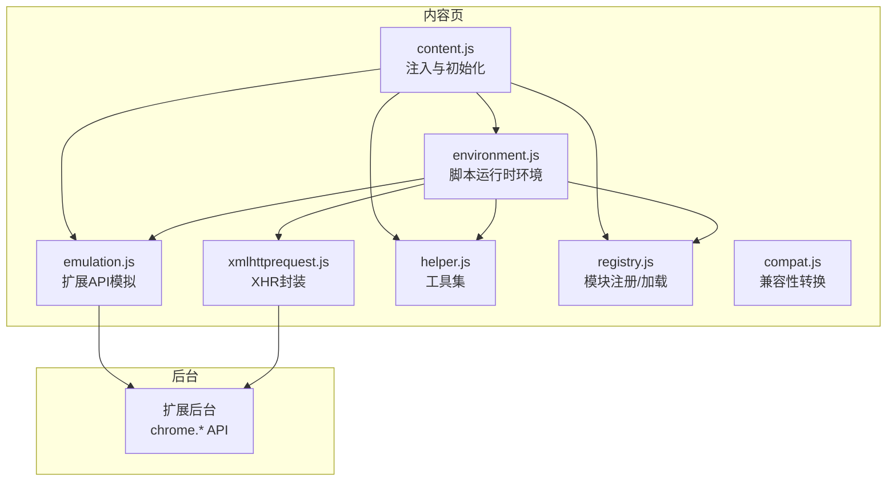
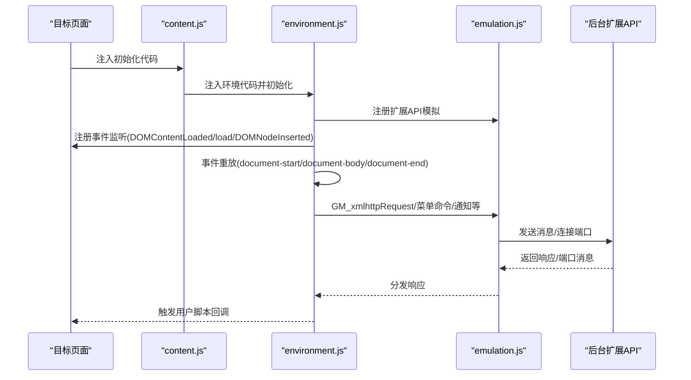
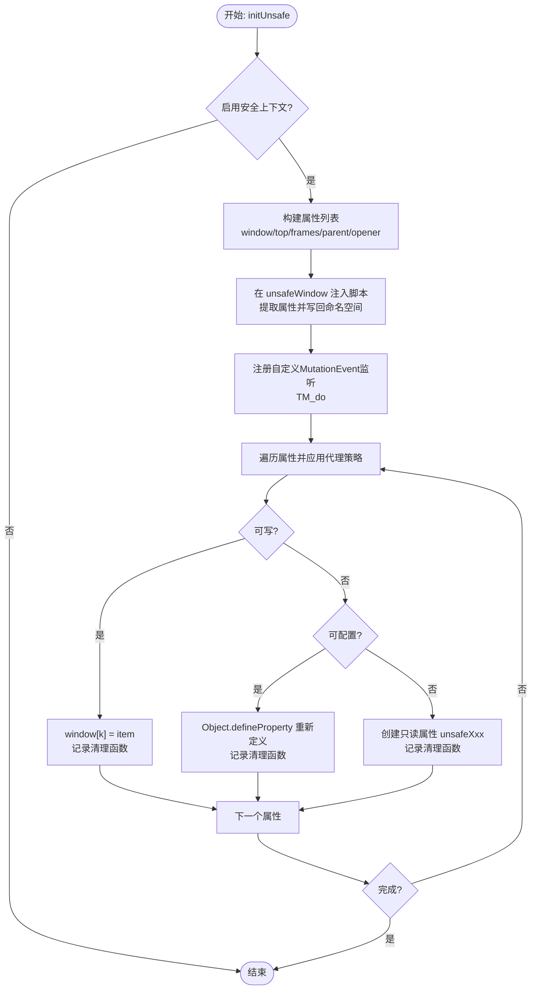
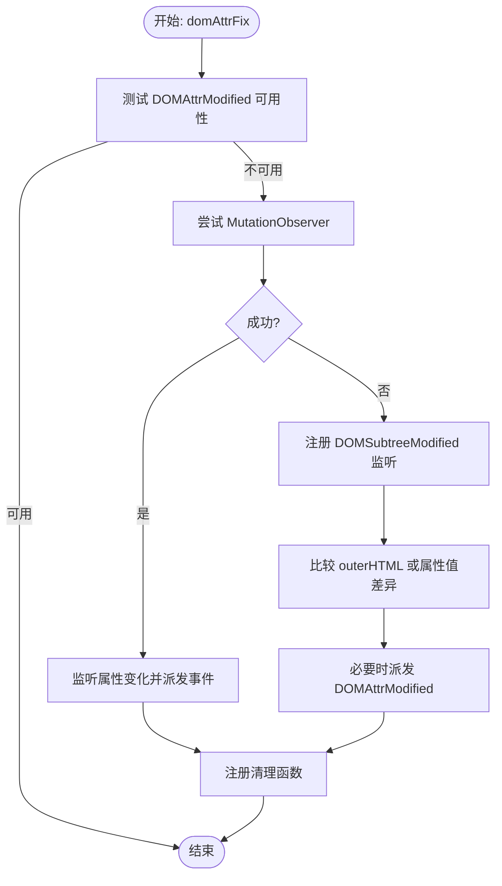
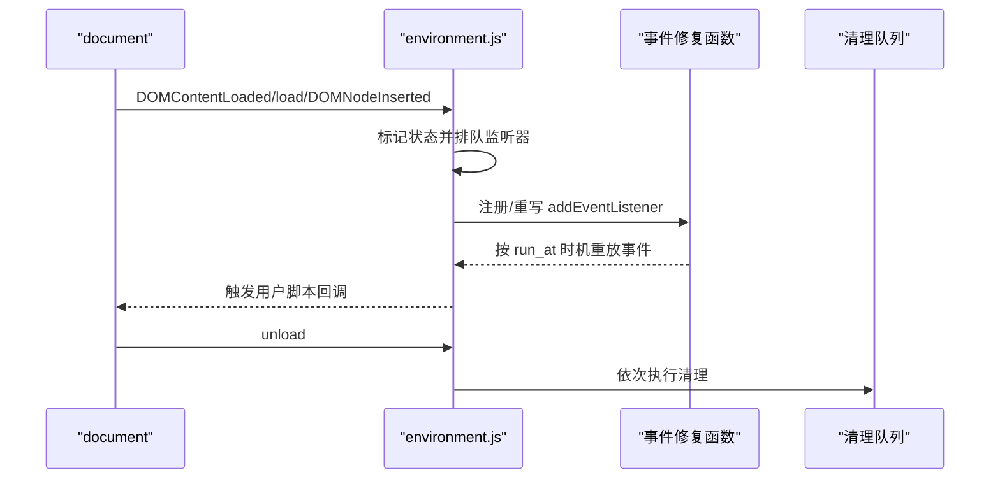
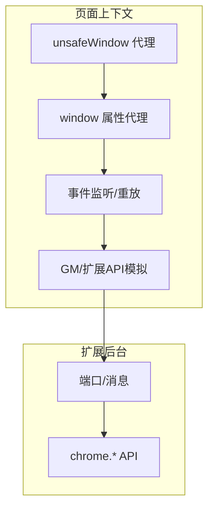
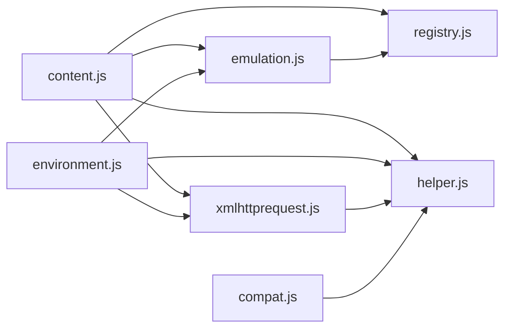

# 环境模拟系统

<cite>
**本文引用的文件**
- [content.js](file://src/content.js)
- [environment.js](file://src/environment.js)
- [emulation.js](file://src/emulation.js)
- [xmlhttprequest.js](file://src/xmlhttprequest.js)
- [helper.js](file://src/helper.js)
- [registry.js](file://src/registry.js)
- [compat.js](file://src/compat.js)
</cite>

## 目录
1. [简介](#简介)
2. [项目结构](#项目结构)
3. [核心组件](#核心组件)
4. [架构总览](#架构总览)
5. [详细组件分析](#详细组件分析)
6. [依赖关系分析](#依赖关系分析)
7. [性能考量](#性能考量)
8. [故障排查指南](#故障排查指南)
9. [结论](#结论)
10. [附录](#附录)

## 简介
本文件面向 Tampermonkey 的“环境模拟系统”，系统性阐述内容脚本如何在目标网页环境中模拟用户脚本执行环境的设计与实现。重点覆盖以下主题：
- unsafeWindow 初始化流程、属性代理与安全隔离策略
- window 对象的属性重写、重新定义与清理机制
- wrappedJSObject 修复、DOMAttrModified 事件处理与 MutationObserver 替代方案
- 环境初始化过程、属性访问控制与内存管理策略
- 提供架构图与安全边界示意，帮助读者快速把握整体设计

## 项目结构
围绕环境模拟系统的关键文件如下：
- content.js：内容脚本入口，负责注入环境、初始化 unsafeWindow、注册事件监听、桥接后台通信
- environment.js：用户脚本运行时环境，负责事件分发、GM/API 模拟、存储与通知等
- emulation.js：Chrome 扩展 API 的模拟层，桥接后台扩展 API 到页面上下文
- xmlhttprequest.js：XMLHttpRequest 封装，支持进度回调、响应类型、重试等
- helper.js：通用工具集（序列化、正则构造、类型判断等）
- registry.js：模块注册与加载器，统一管理依赖与延迟加载
- compat.js：兼容性转换，适配旧式语法与原型缺失场景

图表来源
- [content.js:108-182](file://src/content.js#L108-L182)
- [environment.js:1249-1337](file://src/environment.js#L1249-L1337)
- [emulation.js:9-329](file://src/emulation.js#L9-L329)
- [xmlhttprequest.js:17-153](file://src/xmlhttprequest.js#L17-L153)
- [helper.js:148-209](file://src/helper.js#L148-L209)
- [registry.js:35-104](file://src/registry.js#L35-L104)
- [compat.js:14-275](file://src/compat.js#L14-L275)

章节来源
- [content.js:108-182](file://src/content.js#L108-L182)
- [environment.js:1249-1337](file://src/environment.js#L1249-L1337)
- [emulation.js:9-329](file://src/emulation.js#L9-L329)
- [xmlhttprequest.js:17-153](file://src/xmlhttprequest.js#L17-L153)
- [helper.js:148-209](file://src/helper.js#L148-L209)
- [registry.js:35-104](file://src/registry.js#L35-L104)
- [compat.js:14-275](file://src/compat.js#L14-L275)

## 核心组件
- 注入与初始化（content.js）
  - 注入环境代码到目标页面，建立事件通道与日志级别
  - 初始化 unsafeWindow 并进行属性代理与安全隔离
  - 注册 DOMContentLoaded/load/DOMNodeInserted 事件监听
  - 提供 TM_do 通过自定义 MutationEvent 触发后台执行
- 用户脚本运行时环境（environment.js）
  - 事件分发与重放：对 document-start/document-body/document-end 不同时机进行监听与重放
  - GM/API 模拟：GM_xmlhttpRequest、GM_addValueChangeListener 等
  - 存储与通知：本地存储监听、值变更通知、消息通知
  - 兼容性增强：向源对象添加原型方法与 toSource 支持
- 扩展 API 模拟（emulation.js）
  - 模拟 chrome.* API（extension、tabs、i18n），通过 tmCE 与后台通信
  - 响应管理：请求/响应 ID 映射、连接端口消息转发
- XHR 封装（xmlhttprequest.js）
  - 统一封装 XHR 行为，支持进度回调、响应类型、重试与头部处理
- 工具与注册（helper.js、registry.js）
  - 序列化、正则构造、类型判断等工具
  - 模块注册与延迟加载，避免循环依赖
- 兼容性转换（compat.js）
  - 转换旧式语法（如 for each、数组解构赋值、CDATA）以提升兼容性

章节来源
- [content.js:455-608](file://src/content.js#L455-L608)
- [environment.js:52-193](file://src/environment.js#L52-L193)
- [emulation.js:40-313](file://src/emulation.js#L40-L313)
- [xmlhttprequest.js:17-153](file://src/xmlhttprequest.js#L17-L153)
- [helper.js:148-209](file://src/helper.js#L148-L209)
- [registry.js:35-104](file://src/registry.js#L35-L104)
- [compat.js:14-275](file://src/compat.js#L14-L275)

## 架构总览
下图展示了从内容页到后台的调用链路与数据流，体现“环境模拟”的关键交互点。

图表来源
- [content.js:108-182](file://src/content.js#L108-L182)
- [environment.js:1249-1337](file://src/environment.js#L1249-L1337)
- [emulation.js:96-146](file://src/emulation.js#L96-L146)

## 详细组件分析

### unsafeWindow 初始化与安全隔离
- 目标：在不破坏目标页面安全的前提下，暴露 window/top/frames/parent/opener 等关键对象给用户脚本使用
- 实现要点：
  - 使用 DOM 属性注入方式从 unsafeWindow 中提取所需对象，并通过内联脚本写回目标窗口命名空间
  - 注册自定义 MutationEvent 监听器，用于在安全上下文中触发后台执行
  - 针对 window 上的属性，优先尝试直接赋值；若不可写但可配置，则使用 Object.defineProperty 重新定义；否则创建只读属性（unsafeTop/unsafeParent 等）
  - 记录 Clean 清理队列，在卸载时恢复原状或删除新增属性
- 安全策略：
  - 当检测到脚本拦截器（如 ScriptNo）导致无法获取 unsafeWindow 时，记录告警并通过后台上报
  - 仅在启用安全上下文时进行属性代理，避免破坏目标页面的严格限制

图表来源
- [content.js:455-608](file://src/content.js#L455-L608)

章节来源
- [content.js:455-608](file://src/content.js#L455-L608)

### window 对象属性重写、重新定义与清理
- 属性重写：当 window 上的属性可写时，直接赋值为目标对象，便于用户脚本访问
- 重新定义：当属性不可写但可配置时，使用 Object.defineProperty 重新定义，确保脚本可见且受控
- 创建只读代理：当既不可写也不可配置时，创建以 unsafe 前缀命名的新属性，避免污染 window
- 清理机制：所有操作均记录在 Clean 队列中，页面卸载时逐一恢复或删除，保证内存与状态安全

章节来源
- [content.js:531-606](file://src/content.js#L531-L606)

### wrappedJSObject 修复
- 目标：修复某些环境下 HTMLElement.prototype 缺失 wrappedJSObject 导致的兼容问题
- 实现：检测并为 HTMLElement.prototype 和 document.__proto__ 定义 getter 返回 this，使脚本能正常访问 wrappedJSObject
- 清理：同样纳入 Clean 队列，在卸载时移除

章节来源
- [content.js:650-677](file://src/content.js#L650-L677)

### DOMAttrModified 事件处理与 MutationObserver 替代方案
- 目标：在现代浏览器中，DOMAttrModified 事件已不再可靠，需要替代方案
- 实现：
  - 首先尝试检测 DOMAttrModified 是否可用；若可用则直接返回
  - 若不可用，采用 MutationObserver 监听属性变化；若浏览器不支持 MutationObserver，则退回到 DOMSubtreeModified 事件
  - 在监听回调中比较 oldValue 与当前属性值，必要时手动派发 DOMAttrModified 事件
- 清理：移除事件监听器与观察器，避免内存泄漏

图表来源
- [content.js:679-823](file://src/content.js#L679-L823)

章节来源
- [content.js:679-823](file://src/content.js#L679-L823)

### 环境初始化流程与事件重放
- 初始化阶段：
  - content.js 注入环境代码，设置日志级别、注册事件通道
  - environment.js 注册事件监听器（DOMContentLoaded/load/DOMNodeInserted），并根据 run_at 选择执行时机
- 事件重放：
  - 对于 document-start/document-body，立即执行；对于 document-end，等待 load 事件后重放
  - 对 DOMNodeInserted 事件进行缓存与重放，确保脚本在正确时机收到插入事件
- 清理：
  - 卸载时移除监听器、清理响应映射、释放端口与存储监听

图表来源
- [environment.js:197-343](file://src/environment.js#L197-L343)
- [environment.js:380-493](file://src/environment.js#L380-L493)

章节来源
- [environment.js:197-343](file://src/environment.js#L197-L343)
- [environment.js:380-493](file://src/environment.js#L380-L493)

### 属性访问控制与内存管理策略
- 属性访问控制：
  - 通过 Object.getOwnPropertyDescriptor 获取属性描述符，决定是否可写/可配置
  - 优先直接赋值，其次重新定义，最后创建只读代理
- 内存管理：
  - 所有代理与监听器均登记 Clean 队列，卸载时统一清理
  - 对特殊对象（如 ArrayBuffer/FormData）通过临时变量绕过跨上下文传输问题
  - 对端口与响应映射使用响应 ID 进行生命周期管理

章节来源
- [content.js:531-606](file://src/content.js#L531-L606)
- [emulation.js:52-82](file://src/emulation.js#L52-L82)
- [environment.js:309-323](file://src/environment.js#L309-L323)

### 环境模拟架构图与安全边界示意
- 架构图：内容页通过 content.js 注入 environment.js 与 emulation.js，后者通过 tmCE 与后台通信，形成“页面上下文”与“扩展后台”的双层边界
- 安全边界：
  - unsafeWindow 代理仅暴露必要对象，避免直接访问目标页面敏感上下文
  - 事件与 API 调用通过响应 ID 与端口进行异步解耦，降低跨上下文风险
  - 清理机制确保卸载时无残留，防止内存泄漏与状态污染

图表来源
- [content.js:455-608](file://src/content.js#L455-L608)
- [environment.js:1249-1337](file://src/environment.js#L1249-L1337)
- [emulation.js:96-146](file://src/emulation.js#L96-L146)

## 依赖关系分析
- 模块依赖：
  - content.js 依赖 registry.js、helper.js、xmlhttprequest.js、emulation.js
  - environment.js 依赖 emulation.js、helper.js、xmlhttprequest.js
  - emulation.js 依赖 registry.js、helper.js
  - xmlhttprequest.js 依赖 helper.js
  - compat.js 依赖 helper.js
- 关键耦合点：
  - tmCE（content.js）与 TMwin.chromeEmu（emulation.js）之间的消息桥接
  - Eventing（content.js）与环境事件系统（environment.js）的协作
  - Clean 队列在 content.js 与 environment.js 中的共享与同步

图表来源
- [content.js:80-91](file://src/content.js#L80-L91)
- [environment.js:11-17](file://src/environment.js#L11-L17)
- [emulation.js:9-17](file://src/emulation.js#L9-L17)
- [xmlhttprequest.js:7-10](file://src/xmlhttprequest.js#L7-L10)
- [compat.js:7-12](file://src/compat.js#L7-L12)

章节来源
- [content.js:80-91](file://src/content.js#L80-L91)
- [environment.js:11-17](file://src/environment.js#L11-L17)
- [emulation.js:9-17](file://src/emulation.js#L9-L17)
- [xmlhttprequest.js:7-10](file://src/xmlhttprequest.js#L7-L10)
- [compat.js:7-12](file://src/compat.js#L7-L12)

## 性能考量
- 事件监听与重放：
  - DOMContentLoaded/load/DOMNodeInserted 事件监听在页面生命周期内保持，需注意避免重复注册与内存泄漏
  - 事件重放采用队列与延时调度，减少对主线程的阻塞
- XHR 封装：
  - 支持进度回调与响应类型，避免不必要的数据拷贝与转换
  - 错误重试逻辑需谨慎设置 retries，避免无限重试造成资源浪费
- 清理与回收：
  - Clean 队列确保卸载时释放资源，建议在长驻页面中定期检查未清理项

## 故障排查指南
- 无法获取 unsafeWindow
  - 现象：控制台提示脚本拦截器检测并记录告警
  - 处理：确认是否启用了 ScriptNo 等脚本拦截器；必要时调整拦截策略或升级 Tampermonkey 版本
- DOMAttrModified 事件无效
  - 现象：脚本依赖该事件但未触发
  - 处理：系统会自动降级为 MutationObserver 或 DOMSubtreeModified；检查浏览器兼容性与事件绑定
- GM_xmlhttpRequest 回调异常
  - 现象：onload/onreadystatechange/onerror 未按预期触发
  - 处理：检查响应 ID 映射、端口连接状态与后台扩展 API 权限
- 内存泄漏
  - 现象：长时间运行后内存占用持续增长
  - 处理：确认 Clean 队列是否完整执行；检查自定义监听器与观察器是否正确移除

章节来源
- [content.js:487-499](file://src/content.js#L487-L499)
- [content.js:679-823](file://src/content.js#L679-L823)
- [emulation.js:148-195](file://src/emulation.js#L148-L195)
- [environment.js:309-323](file://src/environment.js#L309-L323)

## 结论
Tampermonkey 的环境模拟系统通过“内容页注入 + 扩展后台桥接”的双层架构，在目标网页环境中实现了对用户脚本的高仿真执行。其核心在于：
- 以安全可控的方式代理 unsafeWindow，确保脚本可访问关键对象而不破坏页面安全
- 通过事件重放与监听器修复，弥补现代浏览器对传统事件模型的支持不足
- 以响应 ID 与端口机制实现 API 调用的异步解耦，配合严格的清理策略保障内存安全

该设计在兼容性、安全性与可维护性之间取得平衡，为用户脚本提供了稳定可靠的运行环境。

## 附录
- 关键路径参考
  - unsafeWindow 初始化：[content.js:455-608](file://src/content.js#L455-L608)
  - 事件重放与监听修复：[environment.js:197-493](file://src/environment.js#L197-L493)
  - 扩展 API 模拟（chrome.*）：[emulation.js:40-313](file://src/emulation.js#L40-L313)
  - XHR 封装与进度回调：[xmlhttprequest.js:17-153](file://src/xmlhttprequest.js#L17-L153)
  - 工具与注册：[helper.js:148-209](file://src/helper.js#L148-L209)，[registry.js:35-104](file://src/registry.js#L35-L104)
  - 兼容性转换：[compat.js:14-275](file://src/compat.js#L14-L275)