# 脚本注入机制

<cite>
**本文引用的文件**
- [content.js](file://src/content.js)
- [environment.js](file://src/environment.js)
- [emulation.js](file://src/emulation.js)
- [xmlhttprequest.js](file://src/xmlhttprequest.js)
- [registry.js](file://src/registry.js)
- [compat.js](file://src/compat.js)
- [helper.js](file://src/helper.js)
- [background.js](file://src/background.js)
- [README.md](file://README.md)
</cite>

## 目录
1. [简介](#简介)
2. [项目结构](#项目结构)
3. [核心组件](#核心组件)
4. [架构总览](#架构总览)
5. [详细组件分析](#详细组件分析)
6. [依赖关系分析](#依赖关系分析)
7. [性能考量](#性能考量)
8. [故障排查指南](#故障排查指南)
9. [结论](#结论)
10. [附录：流程图与示意图](#附录流程图与示意图)

## 简介
本文件围绕 Tampermonkey 的“脚本注入机制”进行系统化技术文档化，重点解释内容脚本如何将用户脚本注入到目标网页环境中，覆盖以下主题：
- 安全上下文模式（safeContext）与非安全上下文模式（unsafeContext）的差异与策略
- TM_do 函数的工作原理与事件驱动注入
- 自定义事件机制（MutationEvent）与事件转发
- 通过 unsafeWindow 访问目标页面全局对象及兼容性修复
- 处理脚本阻塞器（如 ScriptNo）检测与降级策略
- 注入流程、事件触发链路、内存清理策略
- 提供可视化流程图与安全边界示意图

## 项目结构
Tampermonkey 的注入机制由“内容脚本 + 环境执行器 + 模拟层 + 后台协调”构成，核心文件如下：
- 内容脚本：负责初始化、事件桥接、unsafeWindow 访问、脚本注入调度
- 环境执行器：在目标页面上下文中执行用户脚本，提供事件重放、DOM 事件修复等
- 模拟层：模拟 chrome.* API，使用户脚本可调用扩展能力
- 后台协调：根据页面上下文选择注入策略、管理端到端事件与资源

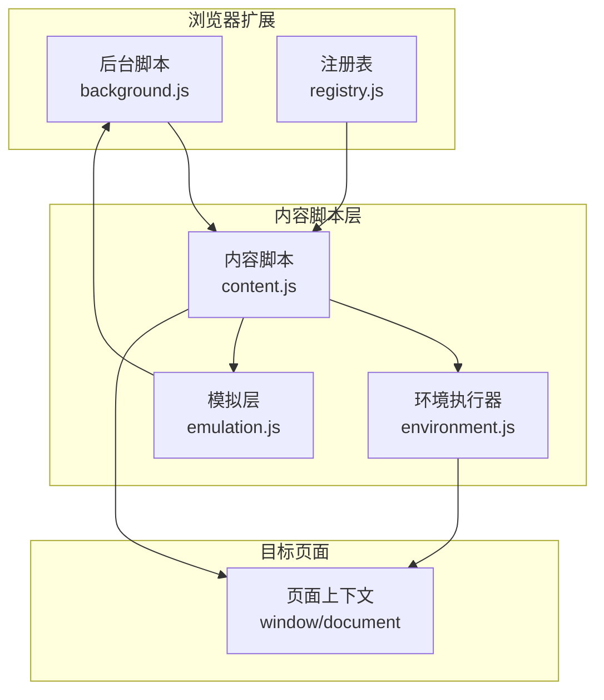

图表来源
- [content.js:1065-1198](file://src/content.js#L1065-L1198)
- [environment.js:1-120](file://src/environment.js#L1-L120)
- [emulation.js:1-120](file://src/emulation.js#L1-L120)
- [background.js:1-120](file://src/background.js#L1-L120)

章节来源
- [content.js:1065-1198](file://src/content.js#L1065-L1198)
- [environment.js:1-120](file://src/environment.js#L1-L120)
- [emulation.js:1-120](file://src/emulation.js#L1-L120)
- [background.js:1-120](file://src/background.js#L1-L120)

## 核心组件
- 内容脚本（content.js）
  - 初始化事件桥接（Eventing）、unsafeWindow 访问、DOM 事件修复、第二阶段注入
  - 提供 TM_do 用于在安全上下文下触发自定义事件以注入代码
- 环境执行器（environment.js）
  - 在页面上下文中执行用户脚本，重放历史 DOM 事件，修复监听器行为
  - 提供 TM_do、TM_xmlhttpRequest、菜单命令等 API
- 模拟层（emulation.js）
  - 模拟 chrome.* API，将请求转发至后台并维护响应回调映射
- 注册表（registry.js）
  - 动态加载与缓存脚本模块，支持 require/register/get/Raw
- 请求封装（xmlhttprequest.js）
  - 封装 XHR，支持重试、进度、头部改写（UA/Referer 前缀）
- 兼容层（compat.js）
  - 对用户脚本语法进行兼容转换（如 CDATA、for each、数组解构等）
- 辅助工具（helper.js）
  - 正则、序列化、类型判断、URL 匹配等通用工具
- 后台协调（background.js）
  - 维护上下文注册表、脚本运行计划、消息路由、本地文件读取等

章节来源
- [content.js:1-200](file://src/content.js#L1-L200)
- [environment.js:1-200](file://src/environment.js#L1-L200)
- [emulation.js:1-200](file://src/emulation.js#L1-L200)
- [registry.js:1-107](file://src/registry.js#L1-L107)
- [xmlhttprequest.js:1-161](file://src/xmlhttprequest.js#L1-L161)
- [compat.js:1-275](file://src/compat.js#L1-L275)
- [helper.js:1-209](file://src/helper.js#L1-L209)
- [background.js:1-200](file://src/background.js#L1-L200)

## 架构总览
注入流程分为“准备阶段（后台）—内容脚本初始化—事件桥接—环境执行器—unsafeWindow 访问—脚本执行—事件回传—内存清理”。

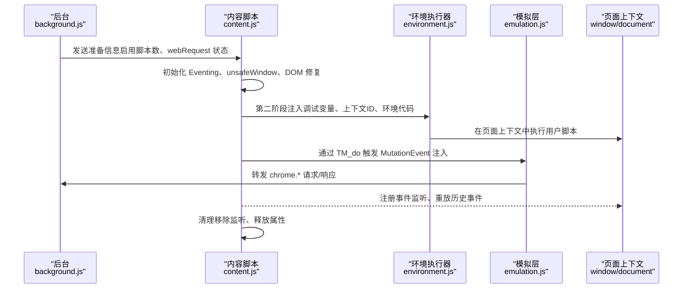

图表来源
- [content.js:1120-1198](file://src/content.js#L1120-L1198)
- [environment.js:520-644](file://src/environment.js#L520-L644)
- [emulation.js:40-120](file://src/emulation.js#L40-L120)
- [background.js:560-640](file://src/background.js#L560-L640)

## 详细组件分析

### 安全上下文与非安全上下文模式
- 安全上下文（safeContext = true）
  - 使用 MutationEvent 触发自定义事件，通过事件处理器在页面上下文中执行注入代码
  - 通过 initUnsafe 获取 unsafeWindow，并在必要时注册事件处理器以规避脚本阻断器
  - TM_do 在此模式下工作，返回事件返回值
- 非安全上下文（safeContext = false）
  - 直接使用 window.eval 执行注入代码
  - 通常不建议使用，除非页面允许或存在降级路径

章节来源
- [content.js:61-76](file://src/content.js#L61-L76)
- [content.js:456-608](file://src/content.js#L456-L608)
- [content.js:612-628](file://src/content.js#L612-L628)
- [environment.js:628-644](file://src/environment.js#L628-L644)

### unsafeWindow 访问与脚本阻塞器检测
- 通过 DOM 属性访问技巧从页面上下文获取 window 的原始引用，构造 unsafeWindow
- 若失败（例如被 ScriptNo 等脚本阻断器拦截），记录日志并通过扩展消息上报
- 注册专用事件处理器（TM_do 事件）以绕过安全限制，实现代码注入

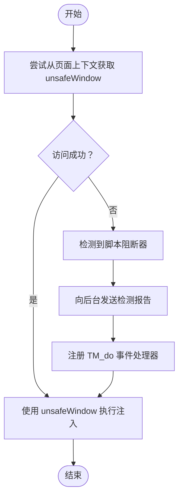

图表来源
- [content.js:456-530](file://src/content.js#L456-L530)
- [content.js:487-499](file://src/content.js#L487-L499)
- [content.js:509-528](file://src/content.js#L509-L528)

章节来源
- [content.js:456-530](file://src/content.js#L456-L530)
- [content.js:487-499](file://src/content.js#L487-L499)
- [content.js:509-528](file://src/content.js#L509-L528)

### TM_do 函数与自定义事件机制
- 在安全上下文下，创建并分派 MutationEvent（事件名形如 TM_do + 上下文ID），携带编码后的源码
- 页面侧事件处理器解析并执行该源码，实现跨上下文注入
- 支持在非安全上下文下直接 eval（但不推荐）

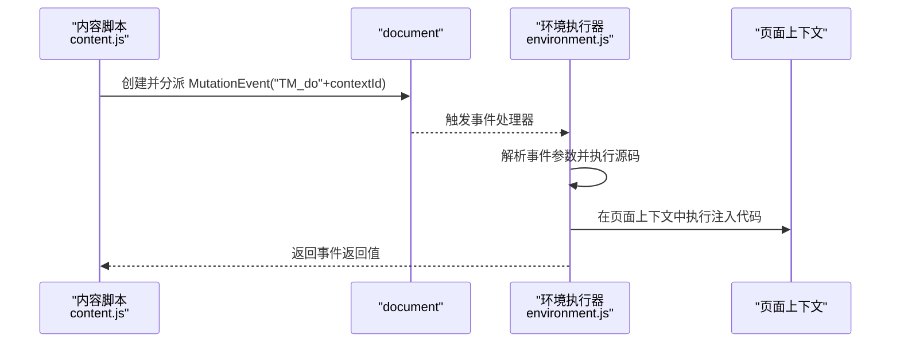

图表来源
- [content.js:612-628](file://src/content.js#L612-L628)
- [environment.js:628-644](file://src/environment.js#L628-L644)
- [environment.js:921-937](file://src/environment.js#L921-L937)

章节来源
- [content.js:612-628](file://src/content.js#L612-L628)
- [environment.js:628-644](file://src/environment.js#L628-L644)
- [environment.js:921-937](file://src/environment.js#L921-L937)

### 事件桥接与 DOM 事件修复
- Eventing：在内容脚本与页面上下文之间建立双向事件通道（TM_toPage/TM_toContent）
- DOMAttrModified 事件修复：当原生事件不可用时，使用 MutationObserver 或 DOMSubtreeModified 回退
- wrappedJSObject 修复：为 HTMLElement/Document 添加 wrappedJSObject 属性以兼容某些库

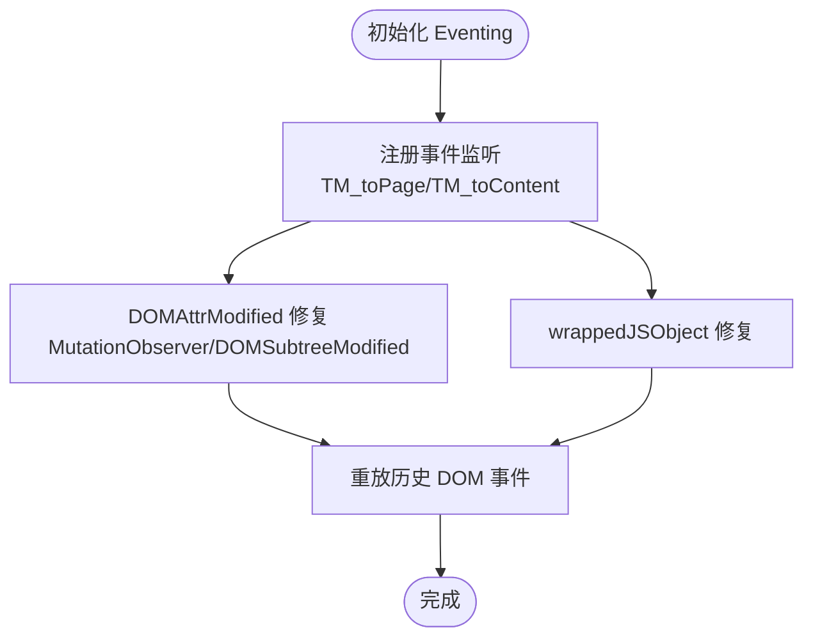

图表来源
- [content.js:828-962](file://src/content.js#L828-L962)
- [environment.js:380-493](file://src/environment.js#L380-L493)
- [environment.js:650-677](file://src/environment.js#L650-L677)

章节来源
- [content.js:828-962](file://src/content.js#L828-L962)
- [environment.js:380-493](file://src/environment.js#L380-L493)
- [environment.js:650-677](file://src/environment.js#L650-L677)

### 第二阶段注入与脚本执行
- 第二阶段在 DOMContentLoaded/首次节点插入后，向页面注入环境代码（调试变量、上下文ID、环境函数）
- 环境执行器在页面上下文中执行用户脚本，支持 runASAP/runBody、监听 load/DOMContentLoaded/DOMNodeInserted
- 通过 TM_runMyScript 等函数组织脚本运行生命周期

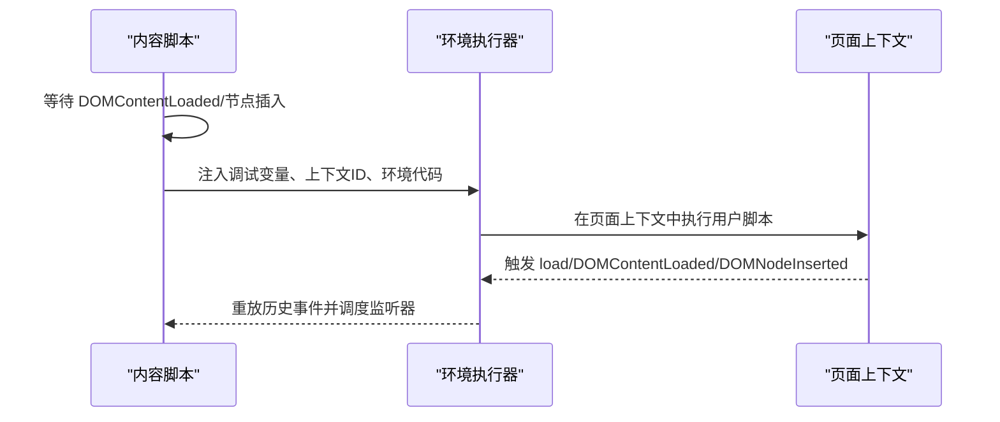

图表来源
- [content.js:968-1028](file://src/content.js#L968-L1028)
- [environment.js:345-380](file://src/environment.js#L345-L380)
- [environment.js:782-800](file://src/environment.js#L782-L800)

章节来源
- [content.js:968-1028](file://src/content.js#L968-L1028)
- [environment.js:345-380](file://src/environment.js#L345-L380)
- [environment.js:782-800](file://src/environment.js#L782-L800)

### chrome.* API 模拟与消息转发
- 模拟层封装 extension.sendMessage/connect、tabs.*、i18n 等 API
- 通过响应 ID 映射管理回调，支持连接型消息（onMessage/onDisconnect）
- 将请求转发至后台，后台再将结果回传给页面

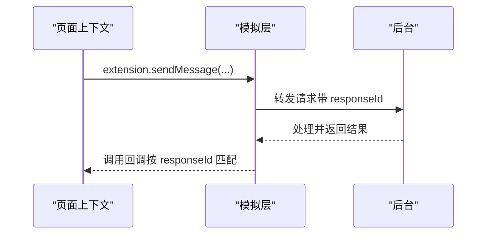

图表来源
- [emulation.js:209-273](file://src/emulation.js#L209-L273)
- [emulation.js:126-195](file://src/emulation.js#L126-L195)

章节来源
- [emulation.js:209-273](file://src/emulation.js#L209-L273)
- [emulation.js:126-195](file://src/emulation.js#L126-L195)

### 注入流程图与安全边界示意图
- 注入流程图：展示从后台准备、内容脚本初始化、事件桥接、unsafeWindow 访问、TM_do 注入、页面执行、事件回传、内存清理的完整链路
- 安全边界示意图：突出 safeContext 与 unsafeContext 的差异、脚本阻断器影响、事件桥接的安全边界

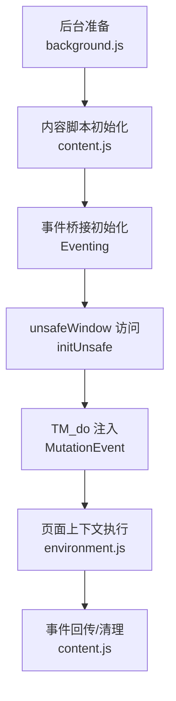

图表来源
- [background.js:560-640](file://src/background.js#L560-L640)
- [content.js:1065-1198](file://src/content.js#L1065-L1198)
- [content.js:828-962](file://src/content.js#L828-L962)
- [environment.js:520-644](file://src/environment.js#L520-L644)

## 依赖关系分析
- 注册表（registry.js）负责动态加载 environment.js、emulation.js 等模块
- xmlhttprequest.js 为注入与模拟层提供统一的 XHR 封装
- helper.js 提供正则、序列化、URL 匹配等通用能力
- compat.js 对用户脚本进行语法兼容转换
- background.js 协调上下文注册、脚本运行计划与消息路由

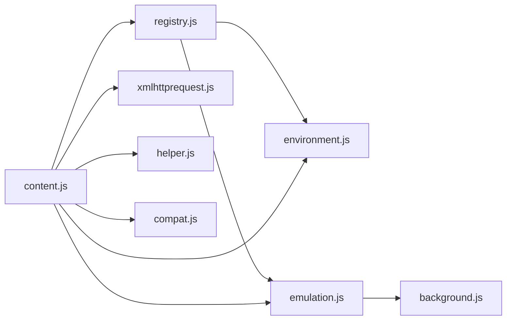

图表来源
- [registry.js:56-104](file://src/registry.js#L56-L104)
- [content.js:80-92](file://src/content.js#L80-L92)
- [xmlhttprequest.js:1-161](file://src/xmlhttprequest.js#L1-L161)
- [helper.js:1-209](file://src/helper.js#L1-L209)
- [compat.js:1-275](file://src/compat.js#L1-L275)
- [background.js:1-120](file://src/background.js#L1-L120)

章节来源
- [registry.js:56-104](file://src/registry.js#L56-L104)
- [content.js:80-92](file://src/content.js#L80-L92)
- [xmlhttprequest.js:1-161](file://src/xmlhttprequest.js#L1-L161)
- [helper.js:1-209](file://src/helper.js#L1-L209)
- [compat.js:1-275](file://src/compat.js#L1-L275)
- [background.js:1-120](file://src/background.js#L1-L120)

## 性能考量
- 事件桥接采用 MutationEvent 与回放策略，避免对页面性能造成显著影响
- DOMAttrModified 修复优先使用 MutationObserver，回退到 DOMSubtreeModified 时需谨慎，避免过度监听
- TM_do 注入应尽量减少频繁触发，避免阻断器检测导致的降级路径
- 清理策略：在 unload 时移除监听、删除临时属性、释放响应映射，防止内存泄漏

## 故障排查指南
- 脚本阻断器检测
  - 现象：无法访问 unsafeWindow，控制台提示检测到脚本阻断器
  - 处理：启用 TM_do 事件处理器，检查后台上报信息
- 事件未触发或延迟
  - 检查 Eventing.init 是否正确初始化，确认上下文 ID 一致
  - 确认 DOMContentLoaded/节点插入事件是否已发生
- 注入失败
  - 检查 safeContext 设置与 TM_do 调用
  - 确认环境执行器已加载并执行
- XHR 异常
  - 检查 UA/Referer 前缀是否被后台配置允许
  - 查看重试逻辑与错误回调

章节来源
- [content.js:487-499](file://src/content.js#L487-L499)
- [content.js:880-889](file://src/content.js#L880-L889)
- [environment.js:128-193](file://src/environment.js#L128-L193)
- [xmlhttprequest.js:115-152](file://src/xmlhttprequest.js#L115-L152)

## 结论
Tampermonkey 的脚本注入机制通过“内容脚本 + 环境执行器 + 模拟层”的分层设计，在保证安全的前提下实现了对目标页面的深度集成。其核心在于：
- 安全上下文下的事件驱动注入（TM_do + MutationEvent）
- 通过 unsafeWindow 实现对页面全局对象的访问
- 事件桥接与 DOM 事件修复确保脚本在页面生命周期中正确运行
- 模拟层将扩展 API 无缝暴露给用户脚本
- 完备的清理策略与错误处理保障稳定性

## 附录：流程图与示意图

### 注入流程图（代码级）
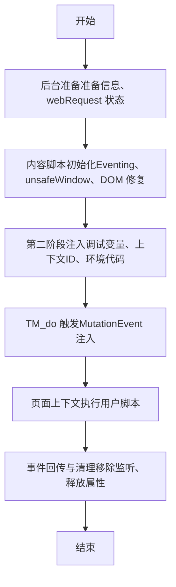

图表来源
- [content.js:1120-1198](file://src/content.js#L1120-L1198)
- [content.js:968-1028](file://src/content.js#L968-L1028)
- [content.js:612-628](file://src/content.js#L612-L628)
- [environment.js:520-644](file://src/environment.js#L520-L644)

### 安全边界示意图（概念图）
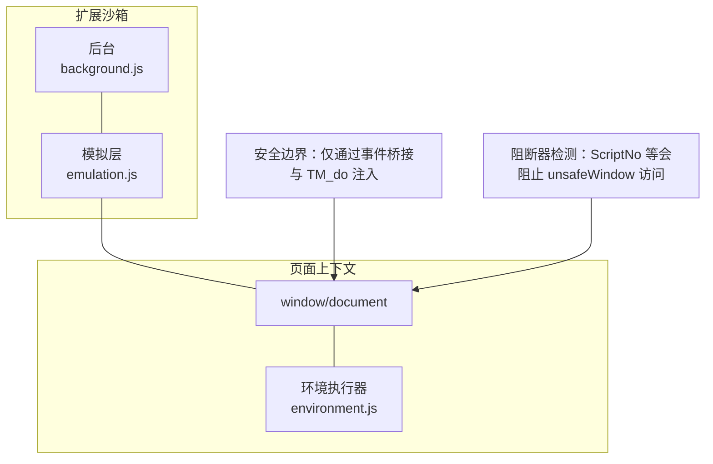

图表来源
- [content.js:456-530](file://src/content.js#L456-L530)
- [content.js:828-962](file://src/content.js#L828-L962)
- [emulation.js:40-120](file://src/emulation.js#L40-L120)