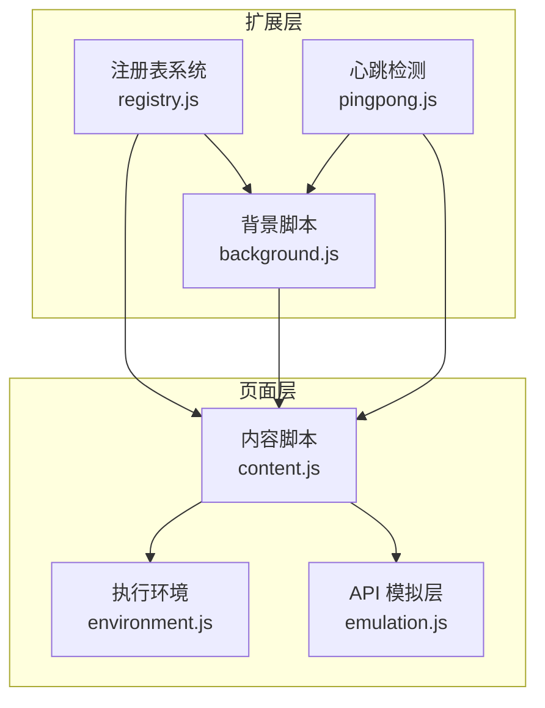
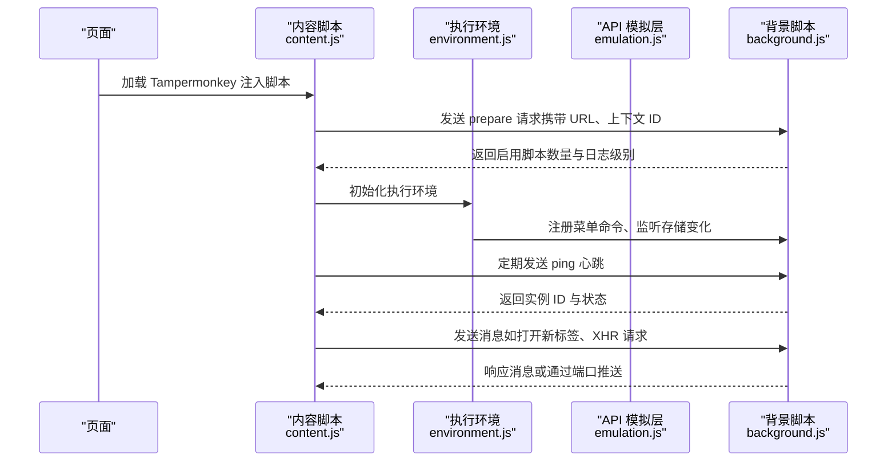
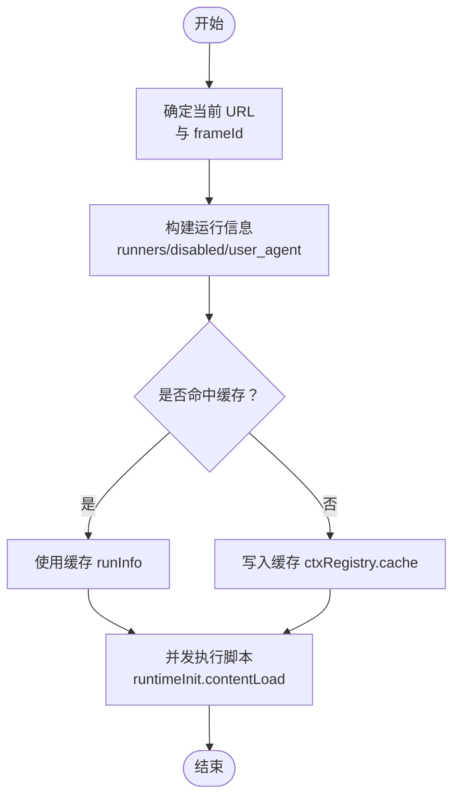
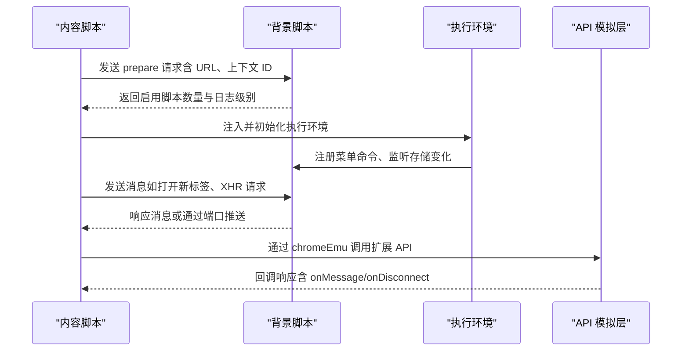
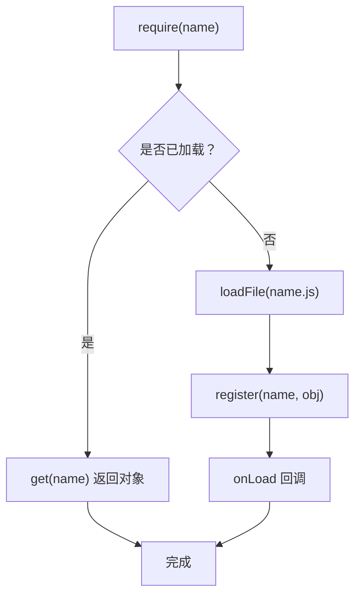
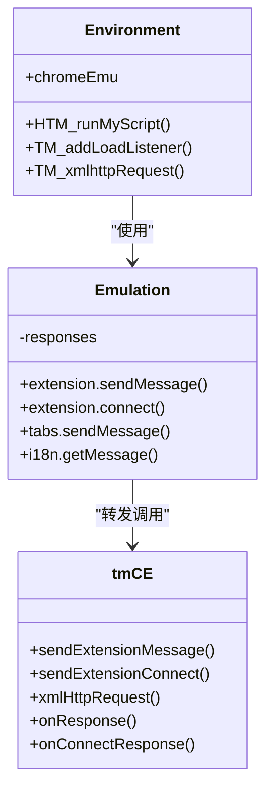
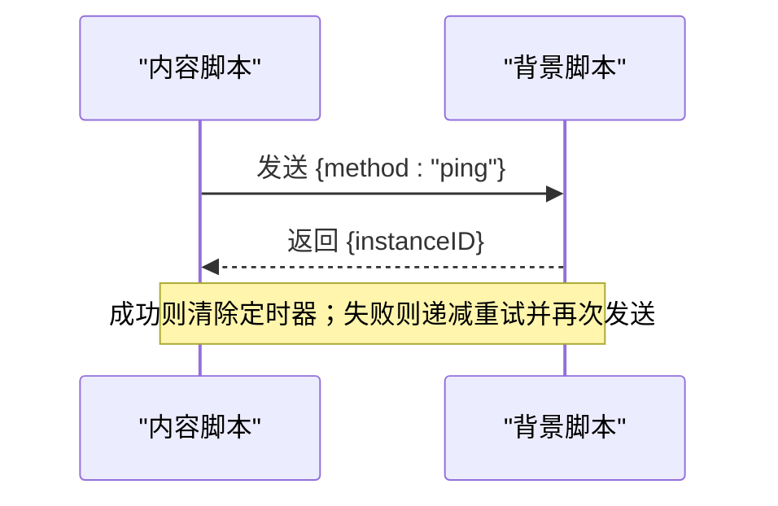
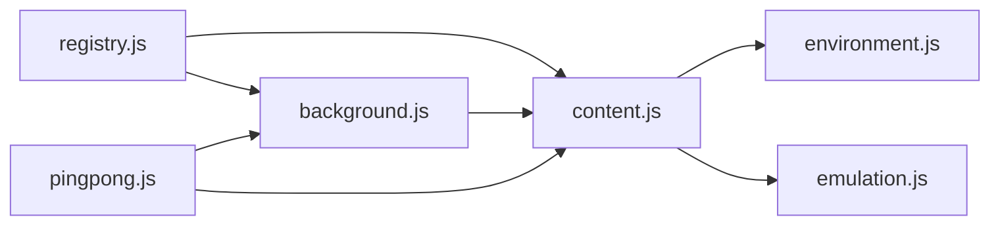

# 核心组件架构

<cite>
**本文档引用的文件**
- [background.js](file://src/background.js)
- [content.js](file://src/content.js)
- [registry.js](file://src/registry.js)
- [environment.js](file://src/environment.js)
- [emulation.js](file://src/emulation.js)
- [pingpong.js](file://src/pingpong.js)
</cite>

## 目录
1. [简介](#简介)
2. [项目结构](#项目结构)
3. [核心组件](#核心组件)
4. [架构总览](#架构总览)
5. [详细组件分析](#详细组件分析)
6. [依赖关系分析](#依赖关系分析)
7. [性能考量](#性能考量)
8. [故障排查指南](#故障排查指南)
9. [结论](#结论)

## 简介
本文件面向 Tampermonkey 的核心组件架构，系统性解析背景脚本（Background）、内容脚本（Content）与注册表系统（Registry）的设计原理与实现机制。重点阐述三者职责分工、交互方式与协作模式，文档化组件间的通信协议、消息传递机制与状态同步策略，并给出组件初始化流程、生命周期管理与错误处理机制。同时提供数据流与函数调用关系的可视化图示，以及性能优化与内存管理建议。

## 项目结构
Tampermonkey 的核心由三大模块构成：
- 背景脚本：负责脚本生命周期管理、存储、脚本选择与执行调度、数据库更新与状态维护。
- 内容脚本：在目标页面注入执行环境，桥接页面与扩展 API，实现事件分发与请求转发。
- 注册表系统：统一模块加载与依赖管理，支持按需加载与缓存，保证跨组件一致性。

**图表来源**
- [background.js:1-120](file://src/background.js#L1-L120)
- [content.js:1-120](file://src/content.js#L1-L120)
- [registry.js:1-107](file://src/registry.js#L1-L107)
- [environment.js:1-120](file://src/environment.js#L1-L120)
- [emulation.js:1-120](file://src/emulation.js#L1-L120)
- [pingpong.js:1-52](file://src/pingpong.js#L1-L52)

**章节来源**
- [background.js:1-120](file://src/background.js#L1-L120)
- [content.js:1-120](file://src/content.js#L1-L120)
- [registry.js:1-107](file://src/registry.js#L1-L107)
- [environment.js:1-120](file://src/environment.js#L1-L120)
- [emulation.js:1-120](file://src/emulation.js#L1-L120)
- [pingpong.js:1-52](file://src/pingpong.js#L1-L52)

## 核心组件
- 背景脚本（Background）
  - 负责脚本发现与排序、URL 匹配、执行计划生成、脚本存储与迁移、数据库更新、菜单命令与通知、本地文件访问等。
  - 维护上下文注册表（ctxRegistry）以跟踪每个标签页的脚本运行状态与 URL 缓存。
  - 提供脚本运行器（Tab.runScripts）与运行时初始化（runtimeInit）协调内容脚本执行。
- 内容脚本（Content）
  - 在页面中注入执行环境，建立事件通道（Eventing），通过 MutationEvent 触发自定义事件实现跨层通信。
  - 提供 tmCE（传输层）与 chromeEmu（API 模拟层）桥接扩展 API，实现消息转发与响应。
  - 处理页面卸载清理、DOM 事件修复与兼容性增强。
- 注册表系统（Registry）
  - 统一模块加载与依赖管理，支持 require/get/loadFile/register，按需加载与缓存。
  - 为背景与内容脚本提供一致的模块接口，避免循环依赖与重复加载。

**章节来源**
- [background.js:435-640](file://src/background.js#L435-L640)
- [content.js:108-215](file://src/content.js#L108-L215)
- [registry.js:11-104](file://src/registry.js#L11-L104)

## 架构总览
整体采用“背景调度 + 内容注入 + 注册表协同”的三层架构。背景负责全局策略与状态，内容负责页面级执行与事件，注册表负责模块化与依赖。

**图表来源**
- [content.js:1121-1198](file://src/content.js#L1121-L1198)
- [background.js:4503-4569](file://src/background.js#L4503-L4569)
- [pingpong.js:14-51](file://src/pingpong.js#L14-L51)

**章节来源**
- [content.js:1121-1198](file://src/content.js#L1121-L1198)
- [background.js:4503-4569](file://src/background.js#L4503-L4569)
- [pingpong.js:14-51](file://src/pingpong.js#L14-L51)

## 详细组件分析

### 背景脚本（Background）分析
- 职责
  - 脚本发现与排序：根据 URL 条件与位置信息确定待运行脚本集合。
  - 执行调度：生成运行信息（runInfo），通过 Tab.runScripts 并发触发内容脚本执行。
  - 上下文管理：ctxRegistry 记录每个标签页的 URL、UA、运行计数与缓存，支持统计与清理。
  - 存储与迁移：版本比较、数据转换、脚本重载与重新保存。
  - 数据库与远程更新：TamperFire 数据库初始化、更新检查与批量写入。
  - 本地文件访问：通过本地文件桥接（localFile）与 iframe message 实现安全读取。
- 关键数据结构
  - ctxRegistry：记录每个标签页的 URL 集合、用户代理、运行计数与缓存。
  - Tab：封装脚本准备、缓存命中与并发执行逻辑。
  - runtimeInit：负责资源加载顺序与递归执行，确保脚本按依赖顺序运行。
- 错误处理
  - 版本迁移失败、网络请求超时、数据库操作异常均有明确分支处理与回退策略。
  - 对于关键路径（如 XML 请求、端口连接）设置重试与超时控制。

**图表来源**
- [background.js:560-640](file://src/background.js#L560-L640)
- [background.js:2538-2720](file://src/background.js#L2538-L2720)

**章节来源**
- [background.js:560-640](file://src/background.js#L560-L640)
- [background.js:2538-2720](file://src/background.js#L2538-L2720)

### 内容脚本（Content）分析
- 职责
  - 初始化阶段：向背景请求 prepare，获取启用脚本数量与日志级别；初始化事件系统（Eventing）与执行环境（environment.js）。
  - 事件通道：通过 MutationEvent 触发自定义事件（TM_toPage/TM_toContent），实现双向通信。
  - API 模拟：tmCE 将扩展 API 调用转发至背景，chromeEmu 将页面 API 映射为扩展 API。
  - 兼容性修复：DOM 事件补丁、wrappedJSObject、XMLHttpRequest 行为修正。
- 关键数据结构
  - Eventing：生成上下文 ID，注册监听器，编码/解码消息并通过事件分发。
  - tmCE：封装消息发送、端口管理、XHR 代理与响应回调。
  - chromeEmu：模拟 extension、tabs、i18n 等 API，维护响应回调映射。
- 生命周期
  - 初始化 → 注册事件 → 启动执行环境 → 运行脚本 → 卸载清理。

**图表来源**
- [content.js:1077-1198](file://src/content.js#L1077-L1198)
- [content.js:828-965](file://src/content.js#L828-L965)
- [emulation.js:40-329](file://src/emulation.js#L40-L329)

**章节来源**
- [content.js:1077-1198](file://src/content.js#L1077-L1198)
- [content.js:828-965](file://src/content.js#L828-L965)
- [emulation.js:40-329](file://src/emulation.js#L40-L329)

### 注册表系统（Registry）分析
- 职责
  - 模块化加载：require/get/loadFile/register，支持按需加载与缓存。
  - 防循环依赖：未找到模块时标记为 null，避免无限等待。
  - 统一接口：为背景与内容脚本提供一致的模块访问能力。
- 关键流程
  - require → 若未加载则 loadFile → 注册到对象表 → onLoad 回调。
  - get → 返回已加载对象，未找到时报错。
  - getRaw → 直接读取脚本源码字符串，用于注入执行环境。

**图表来源**
- [registry.js:48-104](file://src/registry.js#L48-L104)

**章节来源**
- [registry.js:48-104](file://src/registry.js#L48-L104)

### 执行环境（Environment）与 API 模拟（Emulation）
- 执行环境（environment.js）
  - 生成脚本执行所需的上下文属性（props），注入 TM_* 与 GM_* API。
  - 监听存储变化、注册菜单命令、处理窗口与 DOM 事件修复。
  - 通过 chromeEmu 与背景通信，实现脚本执行、XHR、通知等能力。
- API 模拟（emulation.js）
  - 提供 extension.tabs.i18n 等 API 的模拟实现，维护响应回调映射。
  - 通过 tmCE 将调用转发至背景，接收响应后回调给页面脚本。

**图表来源**
- [environment.js:780-1247](file://src/environment.js#L780-L1247)
- [emulation.js:40-329](file://src/emulation.js#L40-L329)
- [content.js:309-453](file://src/content.js#L309-L453)

**章节来源**
- [environment.js:780-1247](file://src/environment.js#L780-L1247)
- [emulation.js:40-329](file://src/emulation.js#L40-L329)
- [content.js:309-453](file://src/content.js#L309-L453)

### 心跳检测（PingPong）
- 作用：验证背景可用性与实例 ID，定期发送 ping，超时自动重试。
- 流程：发送 ping → 等待响应 → 成功清除定时器，失败递减重试次数并再次发送。

**图表来源**
- [pingpong.js:14-51](file://src/pingpong.js#L14-L51)

**章节来源**
- [pingpong.js:14-51](file://src/pingpong.js#L14-L51)

## 依赖关系分析
- 背景脚本依赖注册表进行模块加载与工具函数复用。
- 内容脚本依赖注册表加载执行环境与模拟层，并通过 tmCE 与背景通信。
- 执行环境与模拟层相互协作，前者负责注入与事件，后者负责 API 映射与响应。
- 心跳检测独立运行，保障通信链路健康。

**图表来源**
- [registry.js:11-104](file://src/registry.js#L11-L104)
- [background.js:28-35](file://src/background.js#L28-L35)
- [content.js:80-91](file://src/content.js#L80-L91)
- [pingpong.js:51-52](file://src/pingpong.js#L51-L52)

**章节来源**
- [registry.js:11-104](file://src/registry.js#L11-L104)
- [background.js:28-35](file://src/background.js#L28-L35)
- [content.js:80-91](file://src/content.js#L80-L91)
- [pingpong.js:51-52](file://src/pingpong.js#L51-L52)

## 性能考量
- 模块按需加载与缓存
  - 注册表对 require 的模块进行缓存，减少重复加载开销。
- 脚本并发执行
  - 背景通过并发计数与缓存减少重复计算，提升页面首屏脚本执行效率。
- 数据库批处理
  - TamperFire 更新采用批量写入与分片处理，降低 I/O 压力。
- 事件与消息编码
  - 使用 base64 编解码传输复杂对象，避免序列化开销过大。
- 内存管理
  - 清理函数（Clean 数组）在卸载时释放临时变量与监听器，防止内存泄漏。
- 超时与重试
  - XHR 与端口连接设置超时与重试，避免阻塞主线程。

[本节为通用指导，无需具体文件分析]

## 故障排查指南
- 背景不可用或响应超时
  - 使用心跳检测（pingpong）确认背景可用性；若超时，检查消息通道与网络。
- 脚本未执行
  - 检查 URL 条件匹配与启用状态；查看 ctxRegistry 中的统计信息与缓存。
- 页面脚本报错
  - 查看执行环境中的语法错误输出与堆栈；确认 require 的模块是否正确加载。
- 存储监听失效
  - 确认存储端口连接与监听器注册；检查 onDisconnect 事件。
- 本地文件读取失败
  - 检查本地文件桥接（localFile）回调与 iframe message 通道。

**章节来源**
- [pingpong.js:14-51](file://src/pingpong.js#L14-L51)
- [background.js:435-558](file://src/background.js#L435-L558)
- [environment.js:169-193](file://src/environment.js#L169-L193)
- [content.js:1030-1061](file://src/content.js#L1030-L1061)

## 结论
Tampermonkey 的核心组件通过背景调度、内容注入与注册表协同，实现了稳定高效的脚本执行体系。背景负责全局策略与状态，内容负责页面级执行与事件，注册表提供模块化与依赖管理。通信协议基于消息与事件，配合心跳检测与超时重试，确保链路健壮。通过缓存、并发与批处理等优化手段，系统在功能完整性与性能之间取得平衡。建议在扩展新功能时遵循现有通信协议与生命周期管理规范，确保一致性与可维护性。