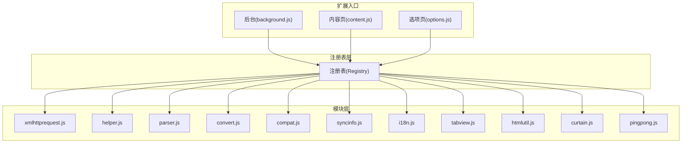
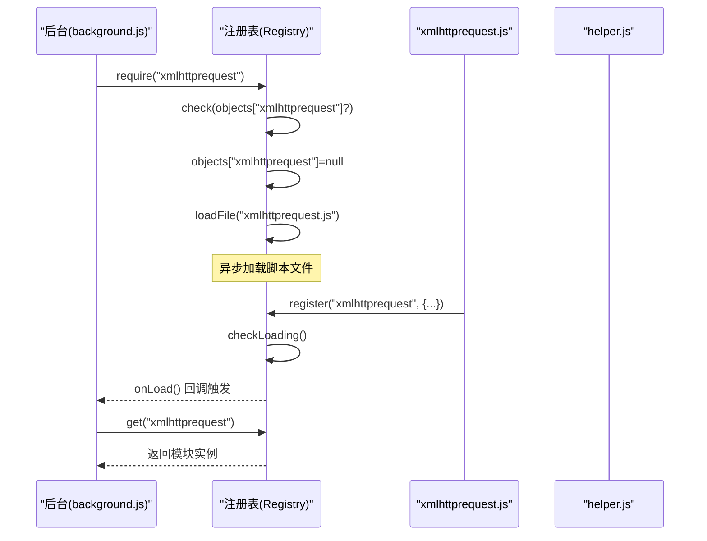
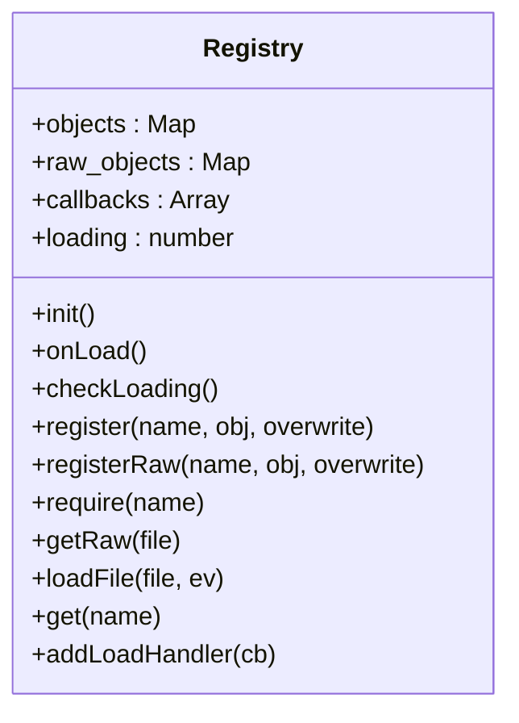
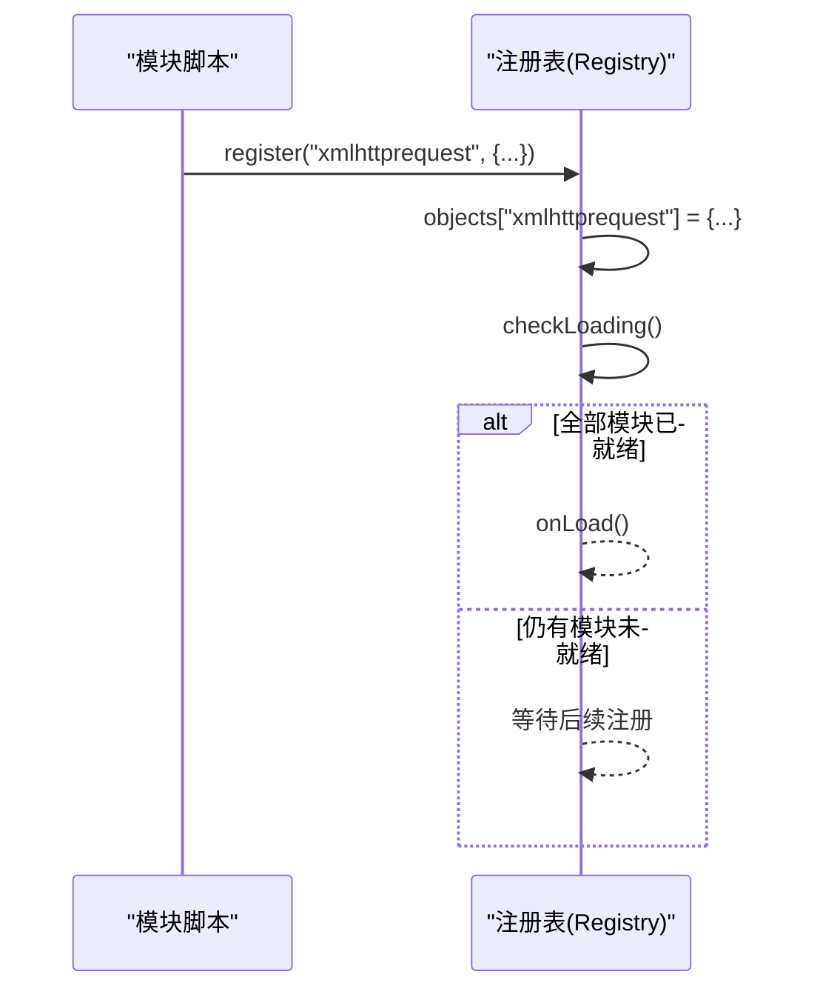
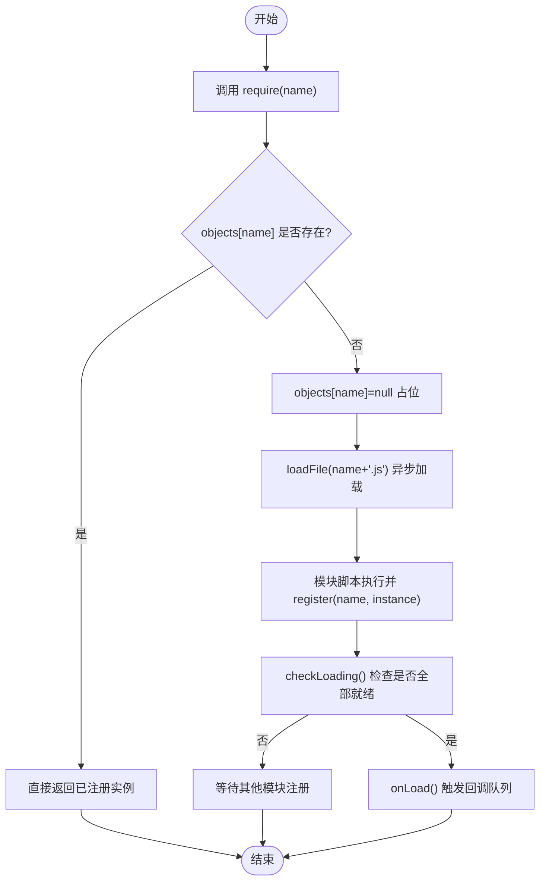
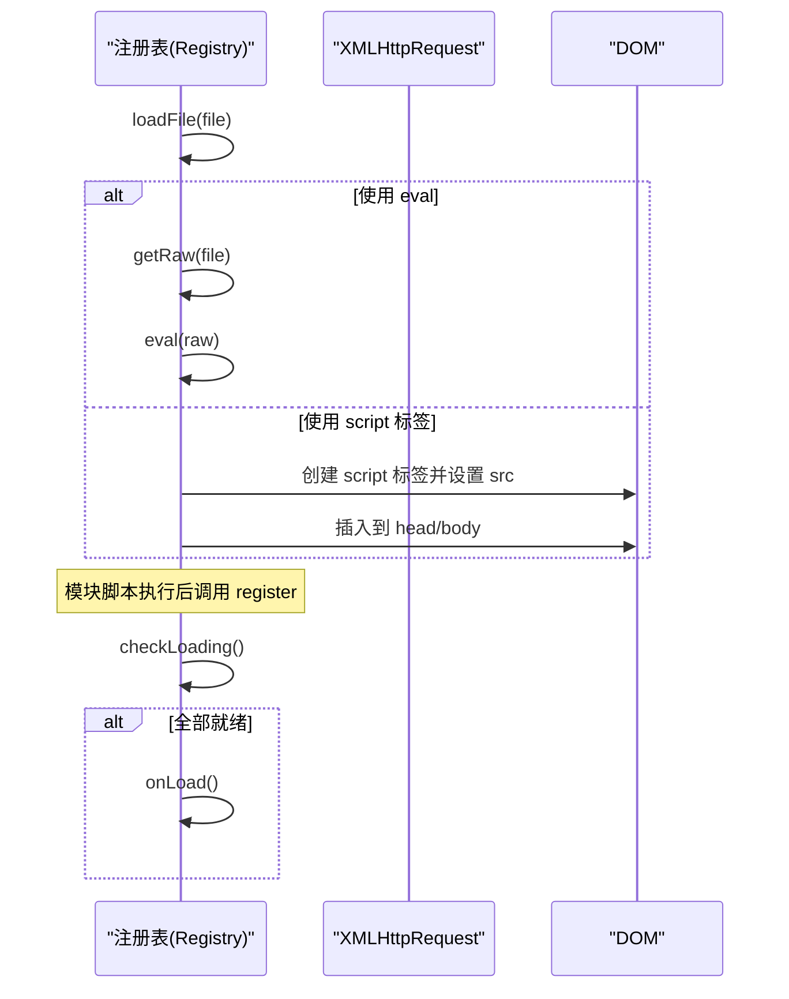
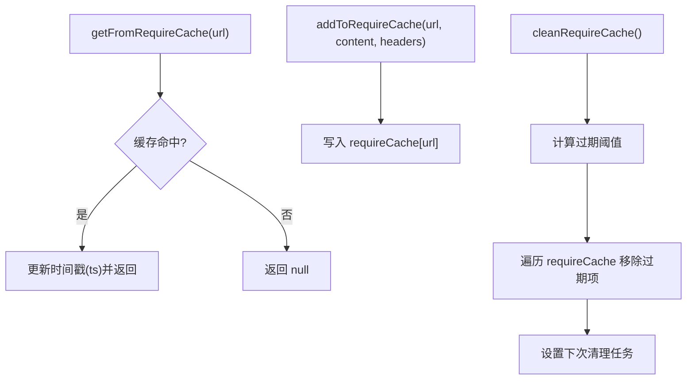

# 注册表系统

<cite>
**本文档引用的文件**
- [registry.js](file://src/registry.js)
- [background.js](file://src/background.js)
- [content.js](file://src/content.js)
- [options.js](file://src/options.js)
- [xmlhttprequest.js](file://src/xmlhttprequest.js)
- [helper.js](file://src/helper.js)
- [parser.js](file://src/parser.js)
- [convert.js](file://src/convert.js)
- [compat.js](file://src/compat.js)
- [syncinfo.js](file://src/syncinfo.js)
- [i18n.js](file://src/i18n.js)
- [tabview.js](file://src/tabview.js)
- [htmlutil.js](file://src/htmlutil.js)
- [curtain.js](file://src/curtain.js)
- [pingpong.js](file://src/pingpong.js)
</cite>

## 目录
1. [简介](#简介)
2. [项目结构](#项目结构)
3. [核心组件](#核心组件)
4. [架构总览](#架构总览)
5. [详细组件分析](#详细组件分析)
6. [依赖分析](#依赖分析)
7. [性能考虑](#性能考虑)
8. [故障排除指南](#故障排除指南)
9. [结论](#结论)
10. [附录](#附录)

## 简介
本文件系统性阐述 Tampermonkey 的注册表系统（Registry）设计与实现，覆盖模块注册、依赖管理、动态加载、循环依赖检测、异步加载处理、模块缓存策略、以及作为扩展依赖中心的协调机制。文档同时给出模块加载时序图与依赖关系图，并提供热重载、错误恢复与性能优化建议。

## 项目结构
Tampermonkey 将通用能力以“模块”形式注册到全局注册表，各页面脚本（后台、内容页、选项页等）通过统一的 require/get 接口按需加载与获取模块实例。注册表负责：
- 模块注册：将模块对象或原始资源注册到内存映射
- 模块获取：提供同步访问已注册模块的能力
- 动态加载：在模块未就绪时触发脚本文件的异步加载
- 加载完成回调：在所有模块加载完成后执行回调队列
- 原始资源读取：支持从扩展 URL 获取未注册的原始文本资源

图表来源
- [background.js:28-35](file://src/background.js#L28-L35)
- [content.js:80-83](file://src/content.js#L80-L83)
- [options.js:8-17](file://src/options.js#L8-L17)
- [registry.js:11-104](file://src/registry.js#L11-L104)

章节来源
- [registry.js:11-104](file://src/registry.js#L11-L104)
- [background.js:28-35](file://src/background.js#L28-L35)
- [content.js:80-83](file://src/content.js#L80-L83)
- [options.js:8-17](file://src/options.js#L8-L17)

## 核心组件
- 注册表对象（Registry）
  - 数据结构：objects（已注册模块）、raw_objects（原始资源缓存）、callbacks（加载完成回调队列）、loading（加载计数）
  - 关键方法：register、registerRaw、require、get、loadFile、getRaw、addLoadHandler、checkLoading、onLoad
- 背景页（background.js）
  - 在启动阶段集中调用 Registry.require 预加载核心模块（如 convert、xmlhttprequest、compat、parser、helper、syncinfo、i18n），并建立 require 缓存与清理机制
- 内容页（content.js）
  - 在注入时调用 Registry.require 预加载 xmlhttprequest、convert、helper 等模块，随后通过 Registry.get 获取模块实例
- 选项页（options.js）
  - 集中预加载大量 UI 与工具模块（xmlhttprequest、pingpong、crcrc、curtain、tabview、htmlutil、helper、convert、i18n、syncinfo）

章节来源
- [registry.js:11-104](file://src/registry.js#L11-L104)
- [background.js:28-35](file://src/background.js#L28-L35)
- [content.js:80-91](file://src/content.js#L80-L91)
- [options.js:8-17](file://src/options.js#L8-L17)

## 架构总览
注册表系统采用“声明式 require + 懒加载 + 同步获取”的模式：
- 模块在首次 require 时若未注册，则标记为“正在加载”，并通过 loadFile 异步加载对应脚本文件
- 模块脚本内部通过 Registry.register 完成注册；注册后检查加载状态，若全部模块就绪则触发回调
- get 接口提供同步访问能力，但要求模块必须已注册或已加载

图表来源
- [background.js:28-35](file://src/background.js#L28-L35)
- [registry.js:48-55](file://src/registry.js#L48-L55)
- [registry.js:76-92](file://src/registry.js#L76-L92)
- [registry.js:18-34](file://src/registry.js#L18-L34)
- [xmlhttprequest.js:159](file://src/xmlhttprequest.js#L159)

## 详细组件分析

### 注册表类与数据结构
- 对象映射 objects：键为模块名，值为模块实例或占位符（null 表示正在加载）
- 原始映射 raw_objects：键为文件路径，值为原始文本内容
- 回调队列 callbacks：用于在所有模块加载完成后依次执行
- 加载计数 loading：当前正在加载的模块数量（由 checkLoading 维护）

图表来源
- [registry.js:11-104](file://src/registry.js#L11-L104)

章节来源
- [registry.js:11-104](file://src/registry.js#L11-L104)

### 模块注册流程
- 模块脚本在执行时调用 Registry.register(name, instance[, overwrite]) 完成注册
- 注册成功后立即检查加载状态，若无仍在加载的模块则触发 onLoad 回调
- 支持 registerRaw 用于缓存原始文本资源（如国际化语言包）

图表来源
- [xmlhttprequest.js:159](file://src/xmlhttprequest.js#L159)
- [registry.js:35-41](file://src/registry.js#L35-L41)
- [registry.js:22-34](file://src/registry.js#L22-L34)

章节来源
- [xmlhttprequest.js:159](file://src/xmlhttprequest.js#L159)
- [registry.js:35-41](file://src/registry.js#L35-L41)
- [registry.js:22-34](file://src/registry.js#L22-L34)

### 依赖解析与加载优先级
- 依赖解析：模块通过 Registry.require(name) 声明依赖；若未注册则标记为 null 并触发 loadFile 异步加载
- 加载优先级：背景页在启动阶段集中 require 核心模块，确保后续流程可用；内容页与选项页按需 require
- 循环依赖检测：通过 objects[name]===null 占位避免重复加载；若再次 require 同名模块会直接返回 null 占位，防止死循环

图表来源
- [registry.js:48-55](file://src/registry.js#L48-L55)
- [registry.js:76-92](file://src/registry.js#L76-L92)
- [registry.js:35-41](file://src/registry.js#L35-L41)
- [registry.js:22-34](file://src/registry.js#L22-L34)

章节来源
- [registry.js:48-55](file://src/registry.js#L48-L55)
- [registry.js:76-92](file://src/registry.js#L76-L92)
- [registry.js:35-41](file://src/registry.js#L35-L41)
- [registry.js:22-34](file://src/registry.js#L22-L34)

### 异步加载与完成回调
- 异步加载：loadFile 支持两种方式
  - 同步读取后使用 eval 执行（manifest_version: 1 场景）
  - 创建 script 标签异步插入（manifest_version: 2 场景）
- 完成回调：onLoad 从回调栈弹出并执行，确保所有依赖模块就绪后再继续业务逻辑

图表来源
- [registry.js:76-92](file://src/registry.js#L76-L92)
- [registry.js:56-75](file://src/registry.js#L56-L75)

章节来源
- [registry.js:76-92](file://src/registry.js#L76-L92)
- [registry.js:56-75](file://src/registry.js#L56-L75)

### 模块缓存策略
- require 缓存：背景页维护 requireCache，包含内容与响应头，支持缓存有效期与定期清理
- 原始资源缓存：raw_objects 缓存从扩展 URL 获取的原始文本，避免重复请求
- 清理策略：定时器周期性扫描并移除过期条目

图表来源
- [background.js:398-431](file://src/background.js#L398-L431)
- [registry.js:56-75](file://src/registry.js#L56-L75)

章节来源
- [background.js:398-431](file://src/background.js#L398-L431)
- [registry.js:56-75](file://src/registry.js#L56-L75)

### 模块热重载与错误恢复
- 热重载：注册表不提供内置的热重载接口；可通过重新注册同名模块（overwrite=true）实现替换
- 错误恢复：loadFile 捕获异常并记录错误信息；get 访问未注册模块会输出警告日志
- 建议：在业务层增加重试与降级策略，结合 require 缓存提升稳定性

章节来源
- [registry.js:76-92](file://src/registry.js#L76-L92)
- [registry.js:93-99](file://src/registry.js#L93-L99)

### 模块注册与依赖关系图
以下图展示了关键模块的注册与依赖关系（基于 require 调用与 register 调用）：

```mermaid
graph TB
subgraph "后台(background.js)"
BG_REQ["require('convert')"]
BG_REQ2["require('xmlhttprequest')"]
BG_REQ3["require('compat')"]
BG_REQ4["require('parser')"]
BG_REQ5["require('helper')"]
BG_REQ6["require('syncinfo')"]
BG_REQ7["require('i18n')"]
end
subgraph "内容页(content.js)"
CT_REQ["require('xmlhttprequest')"]
CT_REQ2["require('convert')"]
CT_REQ3["require('helper')"]
end
subgraph "选项页(options.js)"
OP_REQ["require('xmlhttprequest')"]
OP_REQ2["require('pingpong')"]
OP_REQ3["require('crcrc')"]
OP_REQ4["require('curtain')"]
OP_REQ5["require('tabview')"]
OP_REQ6["require('htmlutil')"]
OP_REQ7["require('helper')"]
OP_REQ8["require('convert')"]
OP_REQ9["require('i18n')"]
OP_REQ10["require('syncinfo')"]
end
subgraph "模块"
XR["xmlhttprequest.js"]
HP["helper.js"]
PR["parser.js"]
CV["convert.js"]
CM["compat.js"]
SI["syncinfo.js"]
IN["i18n.js"]
TV["tabview.js"]
HT["htmlutil.js"]
CU["curtain.js"]
PP["pingpong.js"]
end
BG_REQ --> XR
BG_REQ2 --> XR
BG_REQ3 --> CM
BG_REQ4 --> PR
BG_REQ5 --> HP
BG_REQ6 --> SI
BG_REQ7 --> IN
CT_REQ --> XR
CT_REQ2 --> CV
CT_REQ3 --> HP
OP_REQ --> XR
OP_REQ2 --> PP
OP_REQ3 --> XR
OP_REQ4 --> CU
OP_REQ5 --> TV
OP_REQ6 --> HT
OP_REQ7 --> HP
OP_REQ8 --> CV
OP_REQ9 --> IN
OP_REQ10 --> SI
XR --> REG["Registry.register(...)"]
HP --> REG
PR --> REG
CV --> REG
CM --> REG
SI --> REG
IN --> REG
TV --> REG
HT --> REG
CU --> REG
PP --> REG
```

图表来源
- [background.js:28-35](file://src/background.js#L28-L35)
- [content.js:80-83](file://src/content.js#L80-L83)
- [options.js:8-17](file://src/options.js#L8-L17)
- [xmlhttprequest.js:159](file://src/xmlhttprequest.js#L159)
- [helper.js:184-207](file://src/helper.js#L184-L207)
- [parser.js:284](file://src/parser.js#L284)
- [convert.js:31-37](file://src/convert.js#L31-L37)
- [compat.js:273](file://src/compat.js#L273)
- [syncinfo.js:384-392](file://src/syncinfo.js#L384-L392)
- [i18n.js:132-138](file://src/i18n.js#L132-L138)
- [tabview.js:324](file://src/tabview.js#L324)
- [htmlutil.js:365-379](file://src/htmlutil.js#L365-L379)
- [curtain.js:217](file://src/curtain.js#L217)
- [pingpong.js:51](file://src/pingpong.js#L51)

## 依赖分析
- 模块间耦合
  - helper 是多数模块的基础依赖（被 xmlhttprequest、parser、i18n、tabview、htmlutil 等 require）
  - xmlhttprequest 作为网络层被多个模块依赖（background、content、options、syncinfo）
  - parser 依赖 helper、convert、compat
  - i18n 依赖 xmlhttprequest 与 helper
- 可能的循环依赖
  - 注册表通过 objects[name]=null 占位避免重复加载，天然规避循环依赖风险
- 外部集成点
  - 通过 chrome.extension.getURL 获取扩展内资源路径
  - 通过 chrome.storage 与 chrome.extension.sendMessage 进行跨模块通信

章节来源
- [helper.js:184-207](file://src/helper.js#L184-L207)
- [xmlhttprequest.js:159](file://src/xmlhttprequest.js#L159)
- [parser.js:9-15](file://src/parser.js#L9-L15)
- [i18n.js:8-13](file://src/i18n.js#L8-L13)
- [syncinfo.js:8-9](file://src/syncinfo.js#L8-L9)

## 性能考虑
- 减少重复加载：利用 require 缓存与 raw_objects 缓存，避免重复网络请求与脚本解析
- 控制并发：注册表本身不强制并发控制，建议在业务层限制一次性加载的模块数量
- 延迟初始化：仅在真正需要时调用 require，避免冷启动时的额外开销
- 缓存清理：合理设置缓存有效期与清理周期，平衡内存占用与命中率

## 故障排除指南
- 模块未注册
  - 现象：get(name) 输出“未找到”警告
  - 处理：确认模块脚本已执行并调用 register；检查 require 路径与文件名一致
- 加载失败
  - 现象：loadFile 抛出异常并记录错误
  - 处理：检查脚本语法、扩展 URL 权限与网络可达性
- 循环依赖
  - 现象：模块相互 require 导致加载卡住
  - 处理：拆分公共依赖至 helper 或独立模块，避免双向依赖
- 缓存污染
  - 现象：旧版本模块影响新版本行为
  - 处理：清理 requireCache 与 raw_objects；必要时禁用缓存进行调试

章节来源
- [registry.js:93-99](file://src/registry.js#L93-L99)
- [registry.js:76-92](file://src/registry.js#L76-L92)
- [background.js:398-431](file://src/background.js#L398-L431)

## 结论
注册表系统为 Tampermonkey 提供了简洁而强大的模块化基础设施：通过声明式依赖与懒加载，实现了模块间的低耦合与高内聚；配合缓存与回调机制，保证了扩展启动的稳定与高效。尽管缺乏内置的热重载与自动循环检测，但通过占位与缓存策略可有效规避常见问题。建议在业务层补充重试、降级与监控，进一步提升可靠性与可观测性。

## 附录
- 代码示例路径（不展示具体代码，仅提供定位）
  - [注册表核心实现:11-104](file://src/registry.js#L11-L104)
  - [后台模块预加载:28-35](file://src/background.js#L28-L35)
  - [内容页模块预加载:80-91](file://src/content.js#L80-L91)
  - [选项页模块预加载:8-17](file://src/options.js#L8-L17)
  - [模块注册示例（xmlhttprequest）](file://src/xmlhttprequest.js#L159)
  - [模块注册示例（helper）:184-207](file://src/helper.js#L184-L207)
  - [模块注册示例（parser）](file://src/parser.js#L284)
  - [模块注册示例（convert）:31-37](file://src/convert.js#L31-L37)
  - [模块注册示例（compat）](file://src/compat.js#L273)
  - [模块注册示例（syncinfo）:384-392](file://src/syncinfo.js#L384-L392)
  - [模块注册示例（i18n）:132-138](file://src/i18n.js#L132-L138)
  - [模块注册示例（tabview）](file://src/tabview.js#L324)
  - [模块注册示例（htmlutil）:365-379](file://src/htmlutil.js#L365-L379)
  - [模块注册示例（curtain）](file://src/curtain.js#L217)
  - [模块注册示例（pingpong）](file://src/pingpong.js#L51)