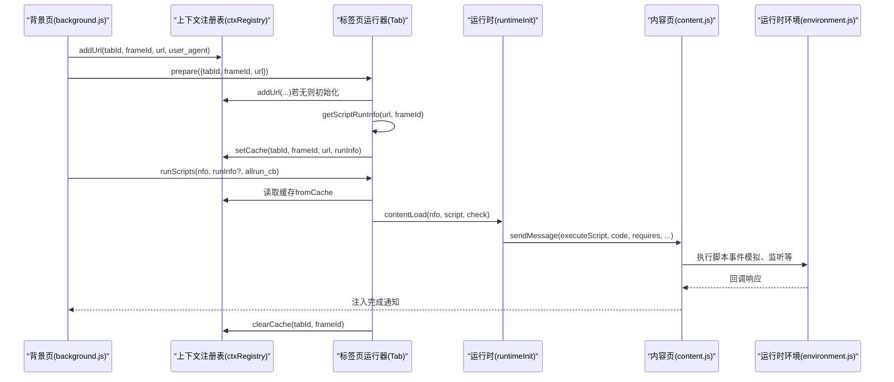
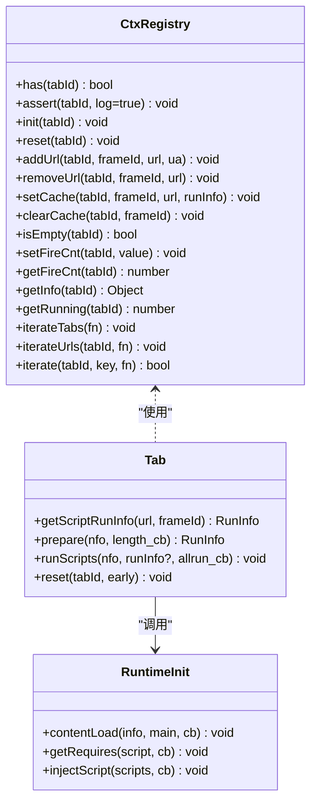
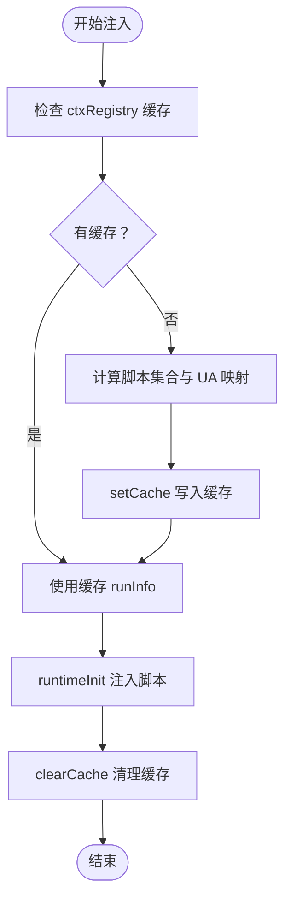
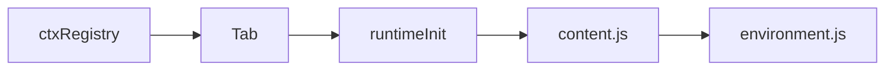
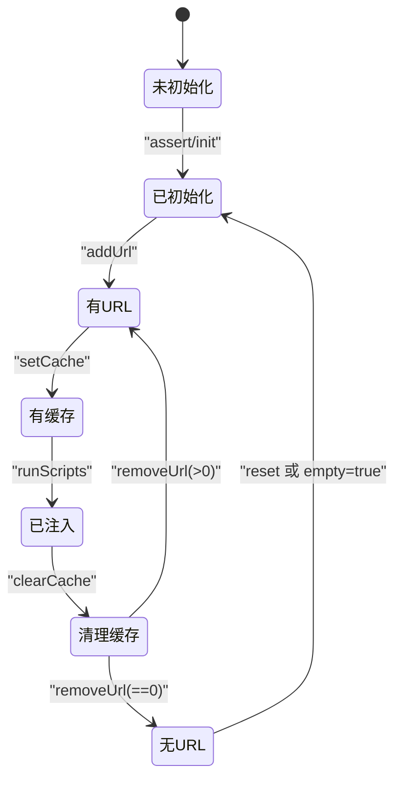

# 上下文注册表

<cite>
**本文档引用的文件**
- [background.js](file://src/background.js)
- [registry.js](file://src/registry.js)
- [content.js](file://src/content.js)
- [environment.js](file://src/environment.js)
</cite>

## 目录
1. [简介](#简介)
2. [项目结构](#项目结构)
3. [核心组件](#核心组件)
4. [架构总览](#架构总览)
5. [详细组件分析](#详细组件分析)
6. [依赖分析](#依赖分析)
7. [性能考虑](#性能考虑)
8. [故障排查指南](#故障排查指南)
9. [结论](#结论)
10. [附录：代码示例与路径](#附录代码示例与路径)

## 简介
本文件系统性阐述 Tampermonkey 背景脚本中的“上下文注册表”（Context Registry）机制，聚焦其在页面上下文管理中的职责：维护标签页状态、URL 映射、执行环境跟踪、缓存策略与生命周期控制。文档同时覆盖并发访问控制、线程安全与性能监控等主题，并通过图示与路径指引帮助读者快速定位实现细节。

## 项目结构
围绕上下文注册表的关键文件与角色如下：
- background.js：背景页主入口，包含上下文注册表对象、标签页运行器、脚本选择与注入流程、本地存储与更新检查等。
- registry.js：模块注册与懒加载框架，为背景页按需加载其他模块提供统一接口。
- content.js：内容脚本入口，负责与背景页通信、事件分发、环境初始化与脚本执行调度。
- environment.js：用户脚本运行时环境，负责事件模拟、DOM 事件重放、函数 ID 标记、XHR 请求桥接等。

```mermaid
graph TB
BG["background.js<br/>背景页主逻辑"] --> CTX["ctxRegistry<br/>上下文注册表"]
BG --> TAB["Tab<br/>标签页运行器"]
BG --> RT["runtimeInit<br/>脚本运行时初始化"]
BG --> REG["Registry<br/>模块注册/懒加载"]
CTX --> |记录| URLMAP["URL 映射"]
CTX --> |记录| STATS["统计/状态"]
CTX --> |缓存| CACHE["运行信息缓存"]
TAB --> |触发| RT
CONTENT["content.js<br/>内容脚本"] --> ENV["environment.js<br/>运行时环境"]
BG < --> CONTENT
BG < --> ENV
```

图表来源
- [background.js:435-558](file://src/background.js#L435-L558)
- [background.js:560-640](file://src/background.js#L560-L640)
- [background.js:2538-2796](file://src/background.js#L2538-L2796)
- [registry.js:11-104](file://src/registry.js#L11-L104)
- [content.js:108-215](file://src/content.js#L108-L215)
- [environment.js:1261-1336](file://src/environment.js#L1261-L1336)

章节来源
- [background.js:435-558](file://src/background.js#L435-L558)
- [background.js:560-640](file://src/background.js#L560-L640)
- [registry.js:11-104](file://src/registry.js#L11-L104)
- [content.js:108-215](file://src/content.js#L108-L215)
- [environment.js:1261-1336](file://src/environment.js#L1261-L1336)

## 核心组件
- 上下文注册表（ctxRegistry）
  - 职责：以 tabId 为键，维护每个标签页的上下文信息，包括 URL 计数映射、用户代理映射、运行统计、缓存、空闲标记等。
  - 关键方法：has、assert、init、reset、addUrl、removeUrl、setCache、clearCache、isEmpty、setFireCnt、getFireCnt、getInfo、getRunning、iterateTabs、iterateUrls、iterate。
- 标签页运行器（Tab）
  - 职责：根据 URL 与 frameId 决定需要运行的脚本集合；准备运行信息并触发脚本注入；支持从缓存读取运行信息以减少重复计算。
  - 关键方法：getScriptRunInfo、prepare、runScripts、reset。
- 运行时初始化（runtimeInit）
  - 职责：拉取脚本资源与 require 资源、构建运行时环境、向内容页注入脚本。
  - 关键方法：getNextResource、getRequires、contentLoad、injectScript。
- 模块注册（Registry）
  - 职责：统一注册与懒加载模块，避免循环依赖，提供 getRaw/loadFile 等能力。
  - 关键方法：register、registerRaw、require、get、getRaw、loadFile、addLoadHandler。

章节来源
- [background.js:435-558](file://src/background.js#L435-L558)
- [background.js:560-640](file://src/background.js#L560-L640)
- [background.js:2538-2796](file://src/background.js#L2538-L2796)
- [registry.js:11-104](file://src/registry.js#L11-L104)

## 架构总览
上下文注册表贯穿“决定要运行哪些脚本 → 缓存运行信息 → 注入执行”的完整链路。背景页在页面导航或帧加载时，先通过 ctxRegistry 维护 URL 与 UA 映射，再由 Tab.prepare 获取运行信息并写入缓存；随后 Tab.runScripts 从缓存读取并调用 runtimeInit 完成注入。



图表来源
- [background.js:466-494](file://src/background.js#L466-L494)
- [background.js:590-627](file://src/background.js#L590-L627)
- [background.js:2717-2795](file://src/background.js#L2717-L2795)
- [content.js:273-307](file://src/content.js#L273-L307)
- [environment.js:1261-1336](file://src/environment.js#L1261-L1336)

## 详细组件分析

### 上下文注册表数据结构与状态管理
- 数据结构
  - n[tabId]：包含时间戳 ts、URL 计数字典 urls、UA 字典 user_agent、运行统计 stats、缓存 cache、空闲标记 empty、火狐脚本计数 fire_cnt 等字段。
- 状态管理
  - assert/init/reset：确保上下文存在且初始化；reset 清理上下文并联动菜单与存储监听。
  - addUrl/removeUrl：维护 URL 计数与空闲标记；当计数归零时删除映射并更新 empty。
  - setCache/clearCache：在上下文上设置/清除运行信息缓存，用于后续 runScripts 直接复用。
  - setFireCnt/getFireCnt：与 TamperFire 计数联动，便于外部查询。
  - iterateTabs/iterateUrls/iterate：遍历上下文与 URL 映射，支持回调式处理。
- 生命周期控制
  - isEmpty：判断上下文是否为空（无 URL 记录）。
  - getRunning/getInfo：查询运行中脚本数量与上下文完整信息。



图表来源
- [background.js:435-558](file://src/background.js#L435-L558)
- [background.js:560-640](file://src/background.js#L560-L640)
- [background.js:2538-2796](file://src/background.js#L2538-L2796)

章节来源
- [background.js:435-558](file://src/background.js#L435-L558)
- [background.js:560-640](file://src/background.js#L560-L640)
- [background.js:2538-2796](file://src/background.js#L2538-L2796)

### 缓存策略、过期处理与内存优化
- 运行信息缓存
  - 在 ctxRegistry 中以 cache 字段保存最近一次的运行信息，供 runScripts 直接复用，避免重复计算脚本集合与 UA 映射。
  - 使用 setCache/clearCache 控制缓存生命周期，确保注入完成后及时清理，防止内存泄漏。
- 资源与 require 缓存
  - 背景页维护一个 requireCache，按 URL 存储内容与响应头，带时间戳；定时清理过期条目（默认有效期 30 分钟，检查周期 3 分钟）。
  - 该缓存策略与上下文注册表的运行信息缓存互补：前者降低网络与解析成本，后者降低脚本决策成本。
- 内存优化
  - removeUrl 将 URL 计数减至 0 时删除映射与 UA 条目，并更新 empty 标志；isEmpty 可用于判定是否可整体释放上下文。
  - clearCache 在注入完成后立即清理，避免长期驻留。



图表来源
- [background.js:590-627](file://src/background.js#L590-L627)
- [background.js:395-431](file://src/background.js#L395-L431)

章节来源
- [background.js:590-627](file://src/background.js#L590-L627)
- [background.js:395-431](file://src/background.js#L395-L431)

### 并发访问控制、线程安全与性能监控
- 并发与线程安全
  - ctxRegistry 采用纯对象 n[tabId] 存储，未见显式锁或原子操作；但其方法多为单次写入/读取，且在 runScripts 中通过闭包变量 running 控制并发注入计数，避免竞态。
  - runtimeInit 的 getNextResource/getRequires 逐个处理资源，内部通过回调推进，避免并发写同一资源。
- 性能监控
  - 日志开关（D/V/EV/RV/MV/UV/SV/CV/NV）用于精细控制日志级别，便于在生产环境观察关键路径耗时与异常。
  - requireCache 定时清理与命中/缺失日志，有助于评估缓存命中率与内存占用。
  - runScripts 对 fromCache 标记与注入完成后的 clearCache，减少重复工作量。

章节来源
- [background.js:38-48](file://src/background.js#L38-L48)
- [background.js:395-431](file://src/background.js#L395-L431)
- [background.js:599-627](file://src/background.js#L599-L627)
- [background.js:2542-2633](file://src/background.js#L2542-L2633)

### 上下文关系图与状态转换图
- 上下文关系图
  - 展示 ctxRegistry 与 Tab、runtimeInit 的协作关系，以及与内容页/运行时环境的交互。



图表来源
- [background.js:435-558](file://src/background.js#L435-L558)
- [background.js:560-640](file://src/background.js#L560-L640)
- [background.js:2538-2796](file://src/background.js#L2538-L2796)
- [content.js:108-215](file://src/content.js#L108-L215)
- [environment.js:1261-1336](file://src/environment.js#L1261-L1336)

- 状态转换图（基于上下文注册表）
  - 初始：ctxRegistry.assert 初始化上下文（empty=true）。
  - 添加 URL：addUrl 增加计数并清空 empty。
  - 注入前：prepare/setCache 写入运行信息缓存。
  - 注入后：clearCache 清理缓存；removeUrl 减计数，归零时删除映射并可能置 empty=true。
  - 重置：reset 清理上下文并联动菜单与存储监听。



图表来源
- [background.js:439-462](file://src/background.js#L439-L462)
- [background.js:466-494](file://src/background.js#L466-L494)
- [background.js:590-627](file://src/background.js#L590-L627)

## 依赖分析
- 模块注册与懒加载
  - background.js 在启动阶段通过 Registry.require 引入 convert、xmlhttprequest、compat、parser、helper、syncinfo、i18n 等模块，确保后续功能可用。
  - Registry 提供 register/registerRaw/get/loadFile 等能力，避免循环依赖并支持按需加载。
- 背景页与内容页通信
  - content.js 通过 _handler.sendMessage 与 background.js 通信，传递事件、响应与请求；environment.js 在内容页侧模拟 DOM 事件与运行时行为，二者配合完成脚本注入与执行。

```mermaid
graph TB
REG["Registry"] --> BG["background.js"]
BG --> MOD1["convert"]
BG --> MOD2["xmlhttprequest"]
BG --> MOD3["compat"]
BG --> MOD4["parser"]
BG --> MOD5["helper"]
BG --> MOD6["syncinfo"]
BG --> MOD7["i18n"]
BG < --> CNT["content.js"]
CNT < --> ENV["environment.js"]
```

图表来源
- [registry.js:11-104](file://src/registry.js#L11-L104)
- [background.js:28-34](file://src/background.js#L28-L34)
- [content.js:108-215](file://src/content.js#L108-L215)
- [environment.js:1261-1336](file://src/environment.js#L1261-L1336)

章节来源
- [registry.js:11-104](file://src/registry.js#L11-L104)
- [background.js:28-34](file://src/background.js#L28-L34)
- [content.js:108-215](file://src/content.js#L108-L215)
- [environment.js:1261-1336](file://src/environment.js#L1261-L1336)

## 性能考虑
- 缓存优先：优先使用 ctxRegistry 缓存与 requireCache，减少重复计算与网络请求。
- 资源加载：runtimeInit 串行处理资源与 require，避免并发竞争；对本地文件与远程资源分别处理，减少失败重试开销。
- 内存回收：注入完成后及时清理缓存与上下文映射，避免长期内存增长。
- 日志控制：通过日志开关在调试与生产环境间切换，避免高频日志影响性能。

## 故障排查指南
- 注入失败或无脚本运行
  - 检查 ctxRegistry.isEmpty 与 ctxRegistry.getInfo，确认上下文是否存在且 URL 映射正确。
  - 查看 runScripts 是否从缓存读取（fromCache），若无缓存则检查 Tab.prepare 的返回值。
- URL 匹配问题
  - 确认 determineScriptsToRun 的条件匹配逻辑与 URL 正则配置；必要时检查 TamperFire 计数与 include/exclude 规则。
- 资源加载失败
  - 检查 requireCache 命中情况与黑名单过滤；查看 runtimeInit 的资源加载回调与错误日志。
- 内存泄漏
  - 确认每次注入后 ctxRegistry.clearCache 是否被调用；removeUrl 归零后映射是否被删除。

章节来源
- [background.js:590-627](file://src/background.js#L590-L627)
- [background.js:466-494](file://src/background.js#L466-L494)
- [background.js:2542-2633](file://src/background.js#L2542-L2633)

## 结论
上下文注册表是 Tampermonkey 背景页中连接“脚本决策—运行注入—状态清理”的关键枢纽。通过合理的数据结构、缓存策略与生命周期管理，它在保证线程安全的前提下，显著降低了重复计算与网络请求的成本。结合 Registry 的模块化与 content.js/environment.js 的运行时协作，系统实现了稳定高效的用户脚本执行环境。

## 附录：代码示例与路径
以下为与上下文注册表相关的关键实现路径（仅提供路径，不展示具体代码内容）：
- 上下文注册表定义与方法
  - [ctxRegistry 定义与方法:435-558](file://src/background.js#L435-L558)
- 标签页运行器与缓存使用
  - [Tab.prepare 与 runScripts:590-627](file://src/background.js#L590-L627)
- 运行时初始化与资源缓存
  - [runtimeInit.getRequires/getNextResource:2658-2715](file://src/background.js#L2658-L2715)
  - [runtimeInit.contentLoad/injectScript:2717-2795](file://src/background.js#L2717-L2795)
- require 缓存与清理
  - [addToRequireCache/getFromRequireCache/cleanRequireCache:395-431](file://src/background.js#L395-L431)
- 模块注册与懒加载
  - [Registry.register/require/get/loadFile:11-104](file://src/registry.js#L11-L104)
- 内容页与运行时环境
  - [content.js 事件与消息处理:108-215](file://src/content.js#L108-L215)
  - [environment.js 事件模拟与脚本执行:1261-1336](file://src/environment.js#L1261-L1336)