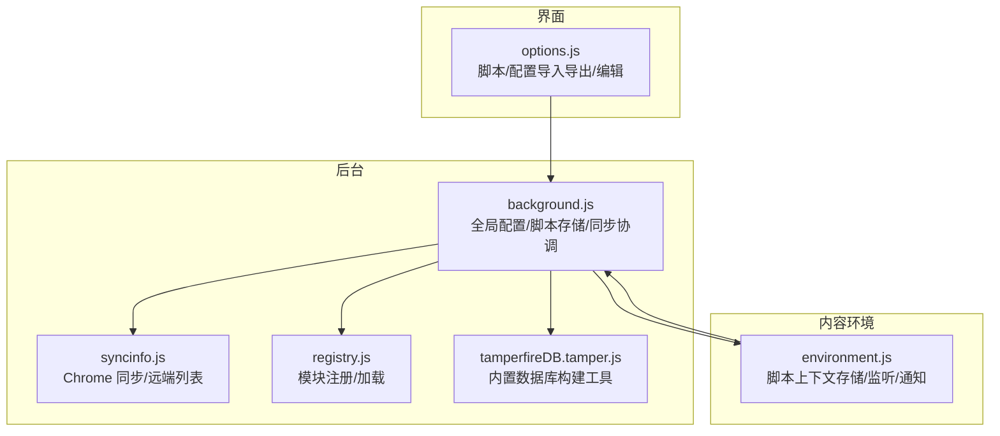
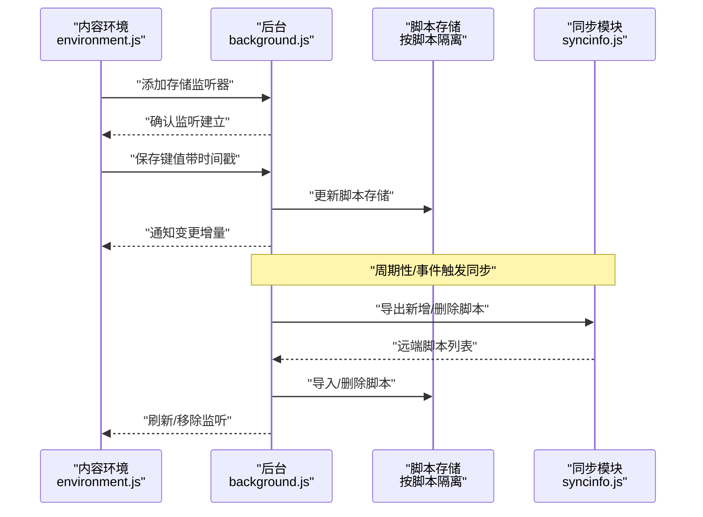
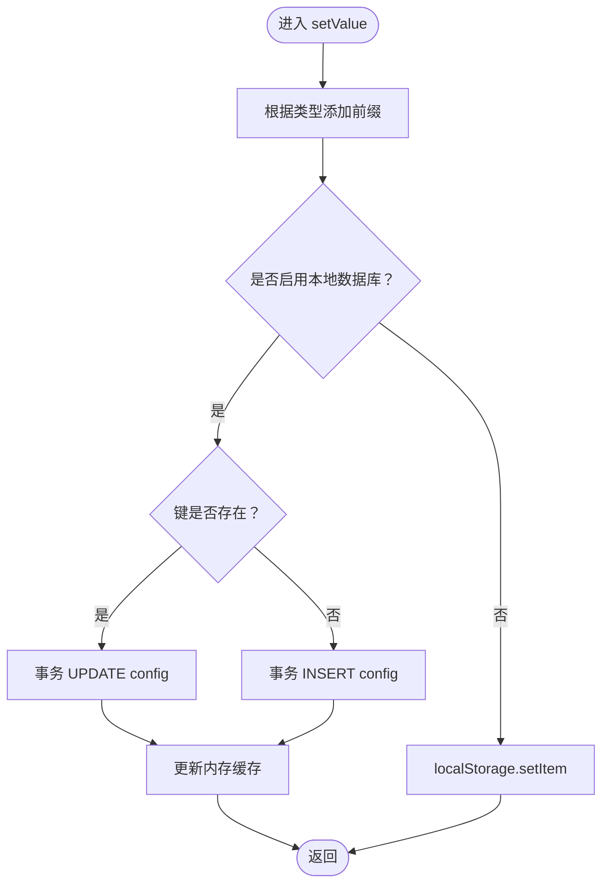
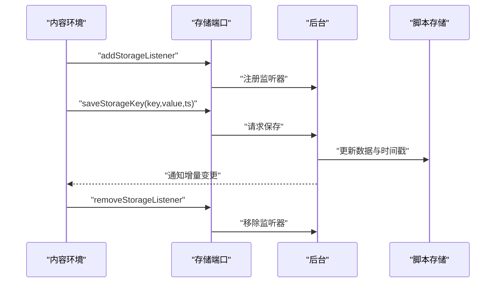
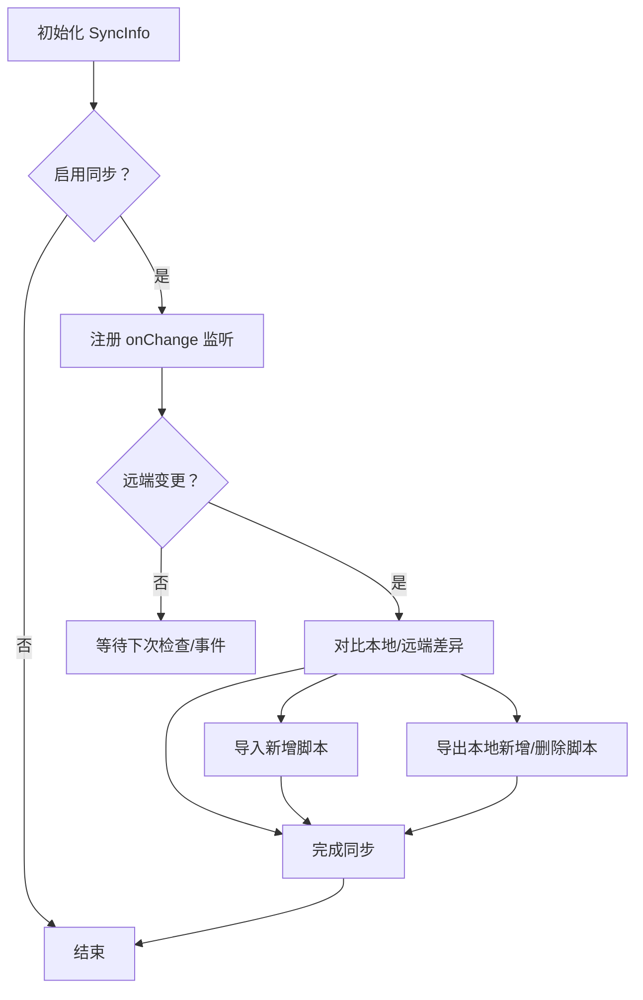
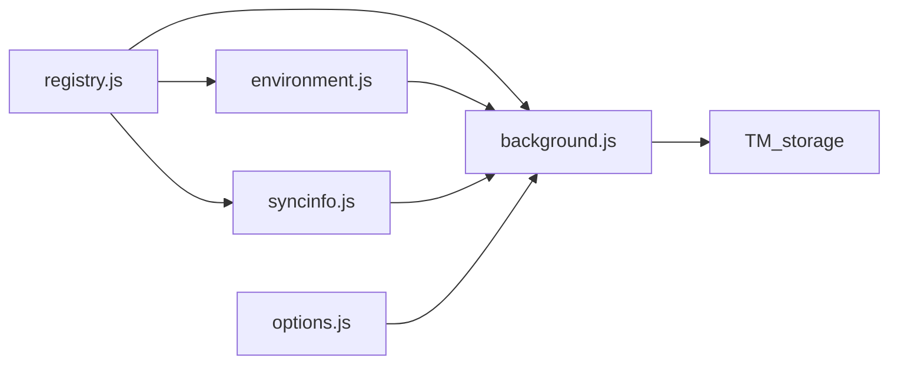

# 存储管理

<cite>
**本文引用的文件**
- [background.js](file://src/background.js)
- [environment.js](file://src/environment.js)
- [syncinfo.js](file://src/syncinfo.js)
- [options.js](file://src/options.js)
- [registry.js](file://src/registry.js)
- [tamperfireDB.tamper.js](file://src/system/tamperfireDB.tamper.js)
</cite>

## 目录
1. [简介](#简介)
2. [项目结构](#项目结构)
3. [核心组件](#核心组件)
4. [架构总览](#架构总览)
5. [详细组件分析](#详细组件分析)
6. [依赖关系分析](#依赖关系分析)
7. [性能考量](#性能考量)
8. [故障排查指南](#故障排查指南)
9. [结论](#结论)
10. [附录](#附录)

## 简介
本文件系统化梳理 Tampermonkey 的存储管理体系，重点覆盖后台脚本对扩展配置与用户脚本数据的持久化策略，包括本地存储（IndexedDB/SQLite 兼容层）、会话存储（内存缓存）与同步存储（Chrome 同步存储）的使用边界与协作方式；阐明数据序列化/反序列化机制、事务性保障、一致性维护与冲突处理策略；并提供架构图与数据流图，帮助开发者在不直接阅读源码的情况下理解存储子系统的运行机理。

## 项目结构
- 背景页负责全局配置、脚本元数据、脚本存储、同步协调与数据库初始化。
- 内容环境负责脚本上下文中的键值存储读写、变更通知与跨标签页同步。
- 同步模块负责与云端或浏览器同步服务交互，实现脚本列表的导入导出与冲突消解。
- 选项页负责脚本与配置的可视化编辑、导入导出与持久化。
- 注册表负责模块加载与依赖注入。
- 系统工具用于构建与维护内置数据库（TamperFire）。

图表来源
- [background.js](file://src/background.js)
- [environment.js](file://src/environment.js)
- [syncinfo.js](file://src/syncinfo.js)
- [options.js](file://src/options.js)
- [registry.js](file://src/registry.js)
- [tamperfireDB.tamper.js](file://src/system/tamperfireDB.tamper.js)

章节来源
- [background.js](file://src/background.js)
- [environment.js](file://src/environment.js)
- [syncinfo.js](file://src/syncinfo.js)
- [options.js](file://src/options.js)
- [registry.js](file://src/registry.js)
- [tamperfireDB.tamper.js](file://src/system/tamperfireDB.tamper.js)

## 核心组件
- 全局存储抽象 TM_storage：封装本地数据库（SQLite 兼容层）与 localStorage 的统一接口，提供类型前缀序列化、缓存与事务写入。
- 脚本存储（按脚本隔离）：以脚本名为命名空间的键值存储，通过端口通信与内容环境同步，支持增量通知。
- 同步客户端 SyncClient：基于 SyncInfo 模块，实现脚本列表的导入/导出与冲突消解（删除标记、时间戳）。
- 配置对象 Config：集中管理扩展配置项，变更时触发回调链与持久化。
- TamperFire 数据库：内置脚本索引数据库，支持批量导入、正则匹配与排除规则。

章节来源
- [background.js](file://src/background.js)
- [environment.js](file://src/environment.js)
- [syncinfo.js](file://src/syncinfo.js)

## 架构总览
下图展示了从“脚本上下文”到“后台存储”的关键数据通路，以及“同步模块”如何参与脚本列表的双向同步。

图表来源
- [environment.js](file://src/environment.js)
- [background.js](file://src/background.js)
- [syncinfo.js](file://src/syncinfo.js)

## 详细组件分析

### 组件一：全局存储 TM_storage（本地/会话）
- 设计要点
  - 类型前缀序列化：以首字符标识布尔/数值/对象等类型，确保读写一致。
  - 缓存层：内存缓存 config 表，减少频繁 SQL 查询。
  - 事务写入：统一使用事务执行 INSERT/UPDATE，保证原子性。
  - 双后端：优先 SQLite 兼容层（openDatabase），回退至 localStorage。
- 关键流程
  - 初始化：创建 config 表并填充缓存。
  - 写入：根据是否已存在决定 UPDATE 或 INSERT，并更新缓存。
  - 读取：从缓存或 localStorage 解析类型前缀并反序列化。
  - 列表/删除：遍历缓存或 localStorage 键集合。
- 事务性与一致性
  - 所有写操作均在事务中执行，失败回调统一记录日志。
  - 读取采用缓存命中优先策略，避免并发读写竞争。
- 冲突与回退
  - 当启用本地数据库失败时自动回退到 localStorage。
  - 版本迁移阶段通过转换函数将旧键值迁移到新存储后清理旧键。

图表来源
- [background.js](file://src/background.js)

章节来源
- [background.js](file://src/background.js)

### 组件二：脚本存储（按脚本隔离）
- 设计要点
  - 命名空间：每个脚本拥有独立的存储对象，包含数据字典与时间戳。
  - 端口通信：内容环境通过端口向后台提交键值变更，后台落盘并通知其他监听者。
  - 增量通知：仅发送受影响的键值，降低网络与渲染开销。
  - 监听生命周期：页面卸载或断开连接时移除监听，避免悬挂引用。
- 关键流程
  - 添加监听：后台记录监听器信息（名称、ID、标签页）。
  - 保存键值：后台更新脚本存储并持久化，随后通知对应监听器。
  - 移除监听：清理监听器并可选发送空响应。
- 一致性与冲突
  - 时间戳用于判定最新状态，避免过期写入覆盖。
  - 远端变更（Chrome 同步）通过 onChange 回调触发后台同步逻辑。

图表来源
- [environment.js](file://src/environment.js)
- [background.js](file://src/background.js)

章节来源
- [environment.js](file://src/environment.js)
- [background.js](file://src/background.js)

### 组件三：同步模块 SyncInfo 与 SyncClient
- 设计要点
  - 支持两类后端：Pastebin（HTTP 获取/写入）与 Chrome 同步（chrome.storage.sync）。
  - 远端变更监听：Chrome 同步模式下通过 onChanged 事件感知变化，过滤脚本键并触发回调。
  - 导入/导出：生成远端脚本清单，对比本地差异后执行导入或导出。
  - 冲突消解：通过“删除标记”字段与时间偏移检测，避免重复写入与竞态。
- 关键流程
  - 启用同步：根据配置初始化 SyncInfo 并注册监听。
  - 定时/事件触发：周期性检查或收到远端变更回调后执行同步。
  - 写入队列：批量写入使用延迟合并，减少 API 调用次数。
- 事务性与一致性
  - 写入过程具备重试与锁控制，防止并发写入导致的数据不一致。
  - 远端删除通过“removed”选项标记，本地同步删除对应脚本。

图表来源
- [syncinfo.js](file://src/syncinfo.js)
- [background.js](file://src/background.js)

章节来源
- [syncinfo.js](file://src/syncinfo.js)
- [background.js](file://src/background.js)

### 组件四：配置对象 Config 与版本迁移
- 设计要点
  - 使用代理 getter/setter 将内部值暴露为可观察的配置对象。
  - 变更监听：当配置项发生变化时，按名称分发回调，便于 UI 或后台逻辑响应。
  - 版本迁移：在启动时根据版本号执行一系列迁移步骤，包括键值迁移、脚本重载与配置修正。
- 关键流程
  - 加载默认值并从 TM_storage 读取持久化配置。
  - 设置变更监听器，保存时写入 TM_storage。
  - 首次运行或升级后执行迁移任务，确保数据结构兼容。

章节来源
- [background.js](file://src/background.js)

### 组件五：TamperFire 数据库（内置脚本索引）
- 设计要点
  - 提供 SQLite 兼容层的建表与批量写入能力，支持脚本元数据、包含/排除规则的索引。
  - 批量导入：分批写入，避免单次事务过大导致阻塞。
  - 正则匹配：基于包含/排除规则进行 URL 匹配，支持通用与精确两种模式。
- 关键流程
  - 初始化：按顺序创建 scripts、includes、excludes、scriptincludes、scriptexcludes 表。
  - 清理：按需删除旧表，重建新表。
  - 导入：解析 JSON，预处理正则与映射，分批写入。

章节来源
- [background.js](file://src/background.js)
- [tamperfireDB.tamper.js](file://src/system/tamperfireDB.tamper.js)

## 依赖关系分析
- 模块加载：registry.js 提供 require/register/get/loadFile 等能力，确保模块按需加载与依赖注入。
- 存储依赖：background.js 依赖 TM_storage 实现配置与脚本存储；environment.js 依赖后台提供的存储端口实现脚本上下文存储。
- 同步依赖：syncinfo.js 依赖 chrome.storage.sync 与 HTTP 请求模块；background.js 中的 SyncClient 作为编排层协调导入导出与冲突消解。
- 界面依赖：options.js 通过持久化接口与后台交互，实现脚本与配置的导入导出。

图表来源
- [registry.js](file://src/registry.js)
- [background.js](file://src/background.js)
- [environment.js](file://src/environment.js)
- [syncinfo.js](file://src/syncinfo.js)
- [options.js](file://src/options.js)

章节来源
- [registry.js](file://src/registry.js)
- [background.js](file://src/background.js)
- [environment.js](file://src/environment.js)
- [syncinfo.js](file://src/syncinfo.js)
- [options.js](file://src/options.js)

## 性能考量
- 序列化成本：类型前缀与 JSON 序列化在写入时产生 CPU 开销，建议对大对象进行懒序列化或分段写入。
- 事务批量：TM_storage 与 TamperFire 的批量写入显著降低事务数量，提升吞吐。
- 缓存命中：TM_storage 的内存缓存减少 SQLite 查询次数；内容环境的增量通知避免全量广播。
- 异步与节流：同步模块对写入进行延迟合并与重试，降低 API 调用频率与失败率。
- 存储容量：SQLite 兼容层设置固定大小上限，超出时需清理或迁移；localStorage 无明确上限但受浏览器限制。

## 故障排查指南
- 写入失败
  - 现象：setValue 报错或无响应。
  - 排查：检查本地数据库事务回调日志；确认是否启用本地数据库；必要时回退到 localStorage。
- 读取异常
  - 现象：getValue 返回默认值或类型错误。
  - 排查：确认类型前缀是否正确；检查 JSON 反序列化是否抛出异常；验证缓存是否被意外清空。
- 同步未生效
  - 现象：远端脚本未导入或本地删除未同步。
  - 排查：确认 SyncInfo 初始化参数（类型/ID）；检查 onChange 回调是否被触发；查看“删除标记”与时间戳是否正确。
- 监听器失效
  - 现象：页面卸载后存储变更不再通知。
  - 排查：确认 removeStorageListener 是否在断开连接时被调用；检查监听器列表是否被意外清空。

章节来源
- [background.js](file://src/background.js)
- [environment.js](file://src/environment.js)
- [syncinfo.js](file://src/syncinfo.js)

## 结论
Tampermonkey 的存储体系通过“全局存储 TM_storage + 脚本级存储 + 同步模块”的组合，实现了配置与脚本数据的可靠持久化、跨上下文一致性与云端协同。其核心优势在于：
- 统一的类型序列化与事务写入，确保数据结构与原子性；
- 内存缓存与增量通知，兼顾性能与实时性；
- 多后端与回退策略，增强健壮性；
- 明确的冲突消解与版本迁移，保障长期可用性。

## 附录
- 存储配置与使用建议
  - 对于小规模键值（如配置项），优先使用 TM_storage；对于大规模对象，考虑分段存储或压缩后再序列化。
  - 在需要跨设备同步的场景，启用 Chrome 同步；对于私有列表，可使用 Pastebin 方案。
  - 定期清理过期键与历史数据，避免缓存膨胀与查询变慢。
- 数据备份与恢复
  - 通过 options 页面的导入导出功能备份/恢复脚本与配置。
  - 对于内置数据库（TamperFire），可通过工具脚本导出/导入 JSON 数据集。