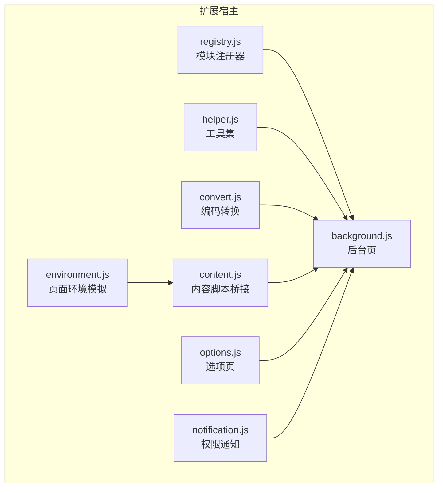
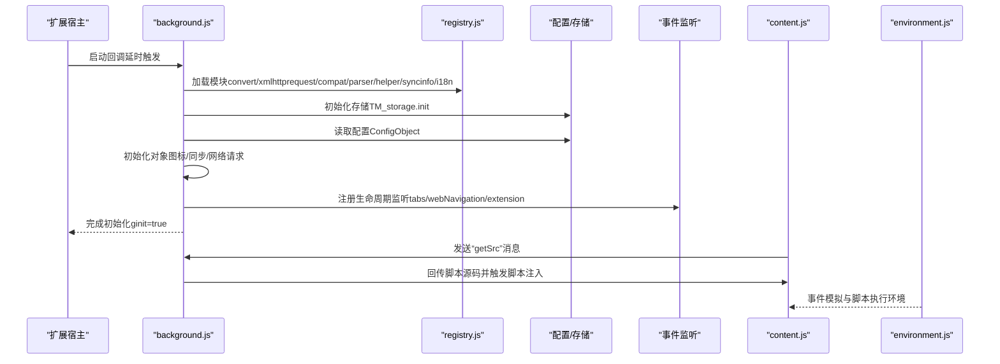
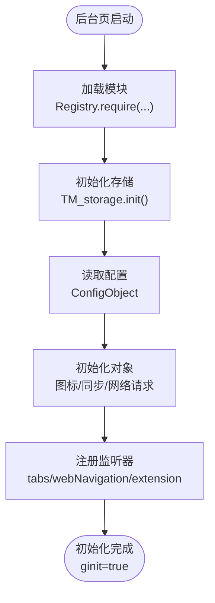
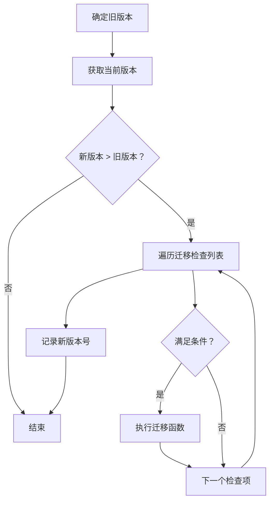
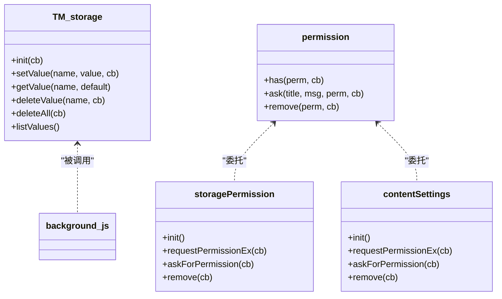
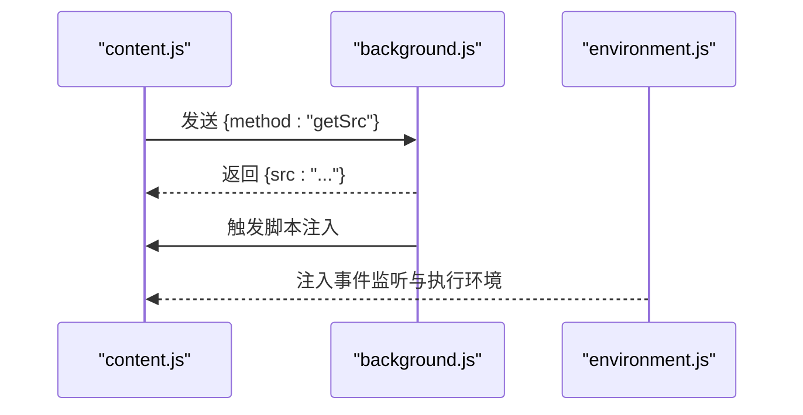
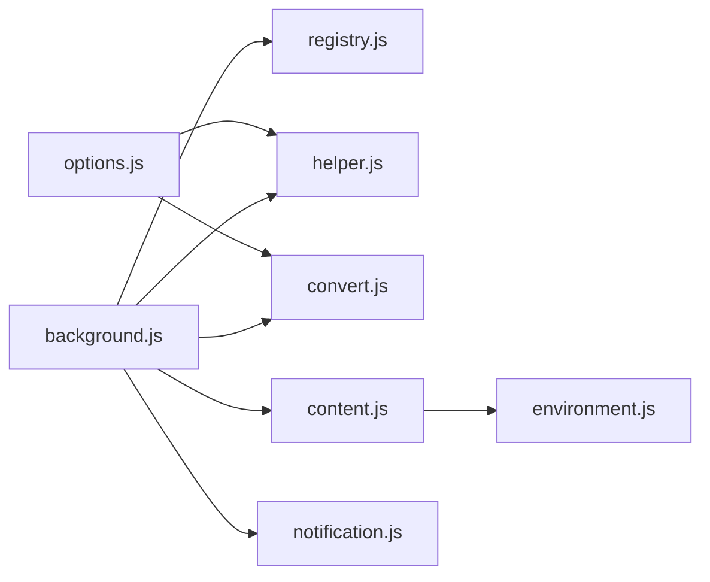

# 扩展生命周期管理

<cite>
**本文引用的文件**
- [background.js](file://src/background.js)
- [registry.js](file://src/registry.js)
- [environment.js](file://src/environment.js)
- [content.js](file://src/content.js)
- [helper.js](file://src/helper.js)
- [convert.js](file://src/convert.js)
- [options.js](file://src/options.js)
- [notification.js](file://src/notification.js)
</cite>

## 目录
1. [简介](#简介)
2. [项目结构](#项目结构)
3. [核心组件](#核心组件)
4. [架构总览](#架构总览)
5. [详细组件分析](#详细组件分析)
6. [依赖关系分析](#依赖关系分析)
7. [性能考量](#性能考量)
8. [故障排查指南](#故障排查指南)
9. [结论](#结论)
10. [附录](#附录)

## 简介
本文件系统性梳理 Tampermonkey 扩展的生命周期管理机制，覆盖从扩展启动、初始化、运行到关闭的完整流程；重点解析后台脚本如何监听与处理 Chrome 扩展生命周期事件（如安装、启动、更新等），以及版本升级检测与数据迁移策略；同时给出模块加载、存储初始化、权限检查等关键步骤的实现要点与可视化时序图，帮助开发者快速理解扩展在不同阶段的行为特征。

## 项目结构
- 背景页入口：src/background.js 提供扩展生命周期事件监听、初始化流程、存储与权限管理、内容脚本交互等核心能力。
- 模块注册与加载：src/registry.js 实现按需加载与模块注册，避免重复加载与循环依赖。
- 内容环境模拟：src/environment.js 与 src/content.js 协作，模拟页面环境、事件分发与脚本执行上下文。
- 工具与转换：src/helper.js 提供通用工具方法；src/convert.js 提供编码/解码辅助。
- 配置与选项页：src/options.js 提供配置界面与导入导出逻辑。
- 权限提示：src/notification.js 处理权限请求与用户交互。

图表来源
- [background.js:6266-6324](file://src/background.js#L6266-L6324)
- [registry.js:11-104](file://src/registry.js#L11-L104)
- [environment.js:7-35](file://src/environment.js#L7-L35)
- [content.js:56-92](file://src/content.js#L56-L92)
- [options.js:19-35](file://src/options.js#L19-L35)
- [helper.js:184-208](file://src/helper.js#L184-L208)
- [convert.js:31-38](file://src/convert.js#L31-L38)
- [notification.js:85-97](file://src/notification.js#L85-L97)

章节来源
- [background.js:6266-6324](file://src/background.js#L6266-L6324)
- [registry.js:11-104](file://src/registry.js#L11-L104)

## 核心组件
- 初始化调度器（init）：负责按顺序完成模块加载、配置读取、对象初始化、事件监听注册与最终完成标志设置。
- 存储子系统（TM_storage）：封装本地数据库与本地存储，支持类型化序列化/反序列化、缓存与事务操作。
- 权限管理（permission/storagePermission/contentSettings）：统一处理浏览器权限查询、请求与移除，支持重置流程。
- 版本迁移（convertData）：基于版本比较执行多阶段迁移，确保跨版本配置与数据兼容。
- 生命周期监听器：tabs.onUpdated/onRemoved/onSelectionChanged、webNavigation.onCommitted、extension.onMessage/onConnect 等。
- 内容脚本桥接（content.js + environment.js）：建立消息通道、事件模拟与脚本执行环境。

章节来源
- [background.js:6266-6324](file://src/background.js#L6266-L6324)
- [background.js:145-391](file://src/background.js#L145-L391)
- [background.js:5361-5452](file://src/background.js#L5361-L5452)
- [background.js:6127-6180](file://src/background.js#L6127-L6180)
- [content.js:108-182](file://src/content.js#L108-L182)
- [environment.js:7-35](file://src/environment.js#L7-L35)

## 架构总览
下图展示了扩展启动到运行的关键路径：后台页初始化、模块加载、配置与存储、权限检查、事件监听注册，以及与内容脚本的交互。

图表来源
- [background.js:6266-6324](file://src/background.js#L6266-L6324)
- [background.js:6302-6320](file://src/background.js#L6302-L6320)
- [content.js:108-182](file://src/content.js#L108-L182)
- [environment.js:7-35](file://src/environment.js#L7-L35)

## 详细组件分析

### 组件A：后台页初始化与生命周期监听
- 关键职责
  - 模块加载：通过 Registry.require 按需加载核心模块。
  - 存储初始化：TM_storage.init 完成本地数据库/缓存准备。
  - 配置读取：ConfigObject 异步加载后回调继续初始化。
  - 对象初始化：根据配置启用同步、网络请求、内容设置等。
  - 事件监听注册：tabs/webNavigation/extension 等。
  - 完成标志：ginit=true 表示初始化完成。
- 关键路径
  - 初始化入口：[background.js:6266-6324](file://src/background.js#L6266-L6324)
  - 监听器注册：[background.js:6302-6320](file://src/background.js#L6302-L6320)
  - 页面提交监听：[background.js:6171-6180](file://src/background.js#L6171-L6180)
  - 标签页更新监听：[background.js:6130-6169](file://src/background.js#L6130-L6169)

图表来源
- [background.js:6266-6324](file://src/background.js#L6266-L6324)

章节来源
- [background.js:6266-6324](file://src/background.js#L6266-L6324)
- [background.js:6302-6320](file://src/background.js#L6302-L6320)
- [background.js:6171-6180](file://src/background.js#L6171-L6180)
- [background.js:6130-6169](file://src/background.js#L6130-L6169)

### 组件B：版本升级检测与数据迁移
- 版本比较：versionCmp 支持语义化版本号比较。
- 迁移策略：convertData 基于版本差异执行一系列迁移任务（如重排脚本、复制 localStorage 到新存储、恢复脚本、重写配置字段等）。
- 迁移触发：仅在新版本大于旧版本时执行，最后记录新版本号。
- 关键路径
  - 版本比较：[background.js:83-106](file://src/background.js#L83-L106)
  - 数据迁移：[background.js:145-391](file://src/background.js#L145-L391)

图表来源
- [background.js:145-391](file://src/background.js#L145-L391)

章节来源
- [background.js:83-106](file://src/background.js#L83-L106)
- [background.js:145-391](file://src/background.js#L145-L391)

### 组件C：存储初始化与权限检查
- 存储初始化
  - 类型化序列化：支持布尔/数字/对象/字符串自动类型识别与转换。
  - 本地数据库：使用 SQLite 风格接口创建表、事务写入与错误处理。
  - 缓存策略：内存缓存 + 本地持久化，支持删除与全量清理。
- 权限检查
  - 统一权限接口：permission.has/ask/remove。
  - 存储权限：storagePermission.init/requestPermissionEx/askForPermission/remove。
  - 内容设置权限：contentSettings.init/requestPermissionEx/askForPermission/remove。
- 关键路径
  - 存储接口：[background.js:1732-1870](file://src/background.js#L1732-L1870)
  - 权限接口：[background.js:5361-5452](file://src/background.js#L5361-L5452)
  - 权限请求通知：[notification.js:85-97](file://src/notification.js#L85-L97)

图表来源
- [background.js:1732-1870](file://src/background.js#L1732-L1870)
- [background.js:5361-5452](file://src/background.js#L5361-L5452)
- [notification.js:85-97](file://src/notification.js#L85-L97)

章节来源
- [background.js:1732-1870](file://src/background.js#L1732-L1870)
- [background.js:5361-5452](file://src/background.js#L5361-L5452)
- [notification.js:85-97](file://src/notification.js#L85-L97)

### 组件D：内容脚本桥接与事件模拟
- 消息通道：content.js 通过 chrome.extension.sendMessage 与后台通信，发送“getSrc”请求以获取页面脚本源码。
- 环境模拟：environment.js 注入事件监听、DOM 事件重放、全局变量与安全上下文切换。
- 关键路径
  - 消息处理与注入：[content.js:108-182](file://src/content.js#L108-L182)
  - 事件模拟与监听：[environment.js:197-323](file://src/environment.js#L197-L323)

图表来源
- [content.js:108-182](file://src/content.js#L108-L182)
- [environment.js:197-323](file://src/environment.js#L197-L323)

章节来源
- [content.js:108-182](file://src/content.js#L108-L182)
- [environment.js:197-323](file://src/environment.js#L197-L323)

### 组件E：模块注册与加载
- 按需加载：Registry.require 在未加载时动态加载对应脚本。
- 原始内容获取：Registry.getRaw 支持直接读取资源文本。
- 加载策略：支持 eval 或插入 script 标签两种方式。
- 关键路径
  - 模块注册与加载：[registry.js:35-104](file://src/registry.js#L35-L104)

章节来源
- [registry.js:35-104](file://src/registry.js#L35-L104)

### 组件F：工具与转换
- 工具集：提供 URL 正则构造、唯一 ID 生成、序列化、确认对话框等。
- 编码转换：UTF8/Base64 编解码，用于脚本导入导出与数据传输。
- 关键路径
  - 工具注册：[helper.js:184-208](file://src/helper.js#L184-L208)
  - 转换注册：[convert.js:31-38](file://src/convert.js#L31-L38)

章节来源
- [helper.js:184-208](file://src/helper.js#L184-L208)
- [convert.js:31-38](file://src/convert.js#L31-L38)

## 依赖关系分析
- 模块依赖
  - background.js 依赖 registry.js 提供的模块加载能力。
  - environment.js 与 content.js 共同构成内容脚本执行环境。
  - options.js 依赖 helper/convert 等工具进行导入导出与界面渲染。
- 外部依赖
  - Chrome 扩展 API：tabs、webNavigation、extension、permissions、management、storage、contentSettings 等。
- 关键耦合点
  - 初始化链路强依赖 Config/TM_storage 的就绪状态。
  - 生命周期监听器与内容脚本消息处理存在时间窗口依赖。

图表来源
- [background.js:6266-6324](file://src/background.js#L6266-L6324)
- [registry.js:35-104](file://src/registry.js#L35-L104)
- [helper.js:184-208](file://src/helper.js#L184-L208)
- [convert.js:31-38](file://src/convert.js#L31-L38)
- [content.js:56-92](file://src/content.js#L56-L92)
- [options.js:19-35](file://src/options.js#L19-L35)
- [notification.js:85-97](file://src/notification.js#L85-L97)

章节来源
- [background.js:6266-6324](file://src/background.js#L6266-L6324)
- [registry.js:35-104](file://src/registry.js#L35-L104)

## 性能考量
- 模块按需加载：减少初始加载体积与时间，提升启动速度。
- 存储缓存：TM_storage 使用内存缓存与事务写入，降低频繁读写开销。
- 事件去抖：标签页加载监听中对脚本 URL 检测与延迟触发，避免重复注入。
- WebRequest 优化：按需启用请求头修改与验证，减少不必要的拦截回调。

## 故障排查指南
- 初始化未完成
  - 症状：监听器未注册、功能不可用。
  - 排查：确认 ginit 是否为 true；检查 Config/TM_storage 初始化是否成功。
  - 参考：[background.js:6302-6320](file://src/background.js#L6302-L6320)
- 权限缺失
  - 症状：无法访问存储或内容设置。
  - 排查：调用 permission.has 检查权限；必要时通过 storagePermission/contentSettings.requestPermissionEx 请求权限。
  - 参考：[background.js:5361-5452](file://src/background.js#L5361-L5452)，[notification.js:85-97](file://src/notification.js#L85-L97)
- 内容脚本未注入
  - 症状：页面无脚本执行。
  - 排查：确认 content.js 是否收到“getSrc”消息；检查 background.js 的 loadListener 是否正确触发注入。
  - 参考：[content.js:108-182](file://src/content.js#L108-L182)，[background.js:6130-6169](file://src/background.js#L6130-L6169)
- 版本迁移失败
  - 症状：配置异常或脚本丢失。
  - 排查：检查 convertData 中的迁移条件与日志输出；确认旧版本号与当前版本号比较结果。
  - 参考：[background.js:145-391](file://src/background.js#L145-L391)

章节来源
- [background.js:6302-6320](file://src/background.js#L6302-L6320)
- [background.js:5361-5452](file://src/background.js#L5361-L5452)
- [notification.js:85-97](file://src/notification.js#L85-L97)
- [content.js:108-182](file://src/content.js#L108-L182)
- [background.js:6130-6169](file://src/background.js#L6130-L6169)
- [background.js:145-391](file://src/background.js#L145-L391)

## 结论
Tampermonkey 的生命周期管理以 background.js 为核心，通过 Registry 模块化加载、TM_storage 存储抽象、权限统一管理与多级迁移策略，实现了稳定可靠的启动与运行保障。初始化链路清晰、事件监听完备、内容脚本桥接顺畅，配合版本迁移与权限请求机制，使扩展在不同版本与环境下均能保持一致的功能体验。

## 附录
- 关键实现路径索引
  - 初始化入口：[background.js:6266-6324](file://src/background.js#L6266-L6324)
  - 监听器注册：[background.js:6302-6320](file://src/background.js#L6302-L6320)
  - 页面提交监听：[background.js:6171-6180](file://src/background.js#L6171-L6180)
  - 标签页更新监听：[background.js:6130-6169](file://src/background.js#L6130-L6169)
  - 存储接口：[background.js:1732-1870](file://src/background.js#L1732-L1870)
  - 权限接口：[background.js:5361-5452](file://src/background.js#L5361-L5452)
  - 内容脚本注入：[content.js:108-182](file://src/content.js#L108-L182)
  - 事件模拟：[environment.js:197-323](file://src/environment.js#L197-L323)
  - 模块注册：[registry.js:35-104](file://src/registry.js#L35-L104)
  - 工具注册：[helper.js:184-208](file://src/helper.js#L184-L208)
  - 转换注册：[convert.js:31-38](file://src/convert.js#L31-L38)
  - 权限请求通知：[notification.js:85-97](file://src/notification.js#L85-L97)