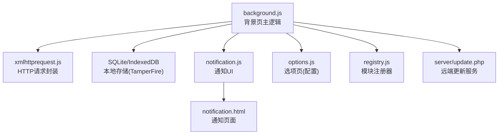
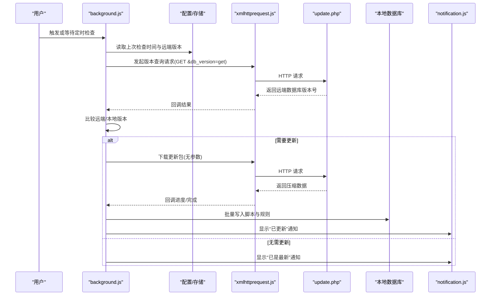
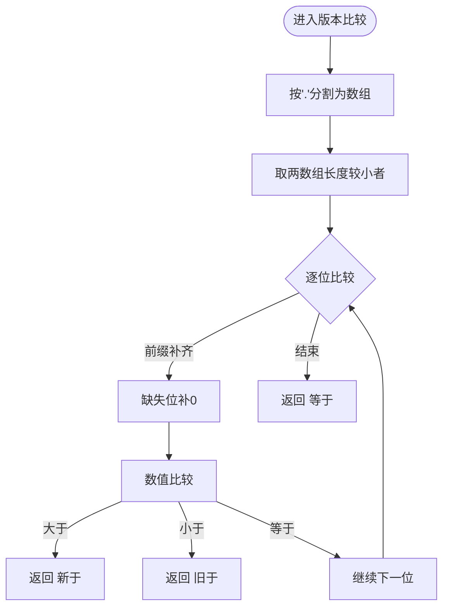
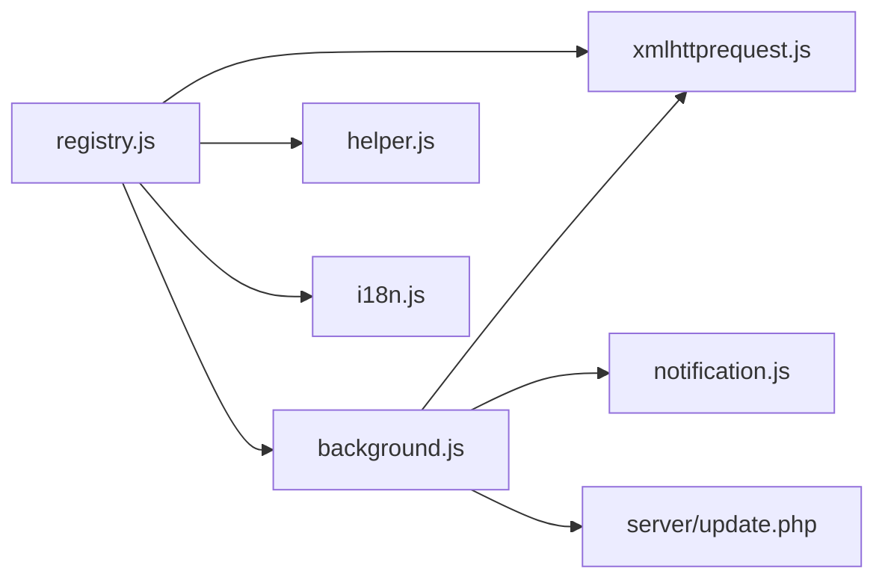
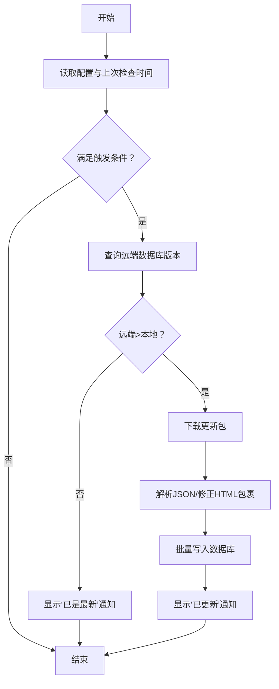

# 更新检查系统

<cite>
**本文引用的文件**
- [background.js](file://src/background.js)
- [xmlhttprequest.js](file://src/xmlhttprequest.js)
- [notification.js](file://src/notification.js)
- [notification.html](file://src/notification.html)
- [update.php](file://server/update.php)
- [registry.js](file://src/registry.js)
- [options.js](file://src/options.js)
</cite>

## 目录
1. [简介](#简介)
2. [项目结构](#项目结构)
3. [核心组件](#核心组件)
4. [架构总览](#架构总览)
5. [详细组件分析](#详细组件分析)
6. [依赖关系分析](#依赖关系分析)
7. [性能考量](#性能考量)
8. [故障排查指南](#故障排查指南)
9. [结论](#结论)
10. [附录](#附录)

## 简介
本文件系统性梳理 Tampermonkey 的“更新检查系统”，重点覆盖以下方面：
- 背景脚本如何实现自动更新检查、版本比较与更新通知
- 更新检查的触发条件、检查频率控制与网络请求处理策略
- 版本号解析算法、兼容性检查与更新包下载机制
- 具体流程图与版本演进图，说明从检查到安装的完整过程
- 网络异常处理、重试机制与用户交互设计

## 项目结构
与更新检查系统直接相关的模块包括：
- 背景页主逻辑：负责配置加载、版本比较、定时检查、网络请求与数据库写入
- XMLHTTPRequest 封装：统一处理 HTTP 请求、重试与进度回调
- 通知页面与脚本：用于弹出式更新提示与用户交互
- 远端更新服务：提供版本信息查询与压缩数据包下载
- 配置与国际化：提供配置项与本地化文案支持

图表来源
- [background.js](file://src/background.js)
- [xmlhttprequest.js](file://src/xmlhttprequest.js)
- [notification.js](file://src/notification.js)
- [notification.html](file://src/notification.html)
- [update.php](file://server/update.php)
- [registry.js](file://src/registry.js)
- [options.js](file://src/options.js)

章节来源
- [background.js](file://src/background.js)
- [xmlhttprequest.js](file://src/xmlhttprequest.js)
- [notification.js](file://src/notification.js)
- [notification.html](file://src/notification.html)
- [update.php](file://server/update.php)
- [registry.js](file://src/registry.js)
- [options.js](file://src/options.js)

## 核心组件
- 版本比较函数：对点分十进制版本字符串进行逐段数值比较，返回相对大小关系
- 更新检查配置：持久化记录上次检查时间、远端数据库版本号与条目数
- 检查调度：根据配置周期与强制标志决定是否发起检查
- 远端版本查询：通过 GET 请求携带参数查询远端数据库版本号
- 下载与导入：下载压缩包，解析 JSON，批量写入本地数据库
- 通知机制：在开始、失败、完成等阶段弹出通知，支持点击事件与权限请求

章节来源
- [background.js](file://src/background.js)
- [xmlhttprequest.js](file://src/xmlhttprequest.js)
- [notification.js](file://src/notification.js)
- [notification.html](file://src/notification.html)
- [update.php](file://server/update.php)

## 架构总览
更新检查系统由“配置—调度—网络—存储—通知”五层构成，整体流程如下：

图表来源
- [background.js](file://src/background.js)
- [xmlhttprequest.js](file://src/xmlhttprequest.js)
- [update.php](file://server/update.php)
- [notification.js](file://src/notification.js)

## 详细组件分析

### 版本比较与解析
- 版本号采用“.”分隔的数字串；比较时按位转为数值进行大小判断
- 若长度不一致，缺失位视为 0；相等则继续下一位
- 返回值定义了“新于/等于/旧于”的三态关系，用于后续流程决策

图表来源
- [background.js](file://src/background.js)

章节来源
- [background.js](file://src/background.js)

### 更新检查配置与触发条件
- 配置项包含：启用开关、检查周期、远端更新地址
- 触发条件：
  - 强制检查（手动或强制更新）
  - 周期到达且启用开关为真
  - 当前状态非“正在更新/下载”
- 上次检查时间与远端数据库版本号持久化保存，避免重复检查

章节来源
- [background.js](file://src/background.js)

### 网络请求与重试策略
- 统一封装在 xmlhttprequest 模块中，支持：
  - 自动重试：当状态码非 200 且剩余重试次数大于 0 时重试
  - 进度回调：基于响应头或文本长度计算下载进度
  - 头部改写：对特定头部（如 User-Agent、Referer）加前缀以绕过限制
  - 内部/外部模式：内部模式用于更新下载，可设置字符集与响应类型
- 更新检查使用 GET 查询远端数据库版本号，下载使用 GET 获取压缩包

章节来源
- [xmlhttprequest.js](file://src/xmlhttprequest.js)
- [background.js](file://src/background.js)

### 远端服务与数据格式
- 远端服务提供两个接口行为：
  - 查询数据库版本：POST/GET 参数带 db_version=get，返回 JSON 包含 db_version 字段
  - 下载数据包：无参数，返回压缩文件（gzip），客户端需正确处理字符集
- 客户端解析 JSON 后，按表结构写入本地数据库

章节来源
- [update.php](file://server/update.php)
- [background.js](file://src/background.js)

### 数据库写入与批量导入
- 本地数据库包含多张表（脚本、包含/排除规则及其关联表）
- 导入流程：
  - 解析 JSON，构建索引与正则集合
  - 分批写入：脚本、包含/排除规则与其关联表
  - 实时更新进度与状态，完成后显示“已是最新”通知
- 写入采用事务与批量插入，提升性能与一致性

章节来源
- [background.js](file://src/background.js)

### 通知机制与用户交互
- 通知页面支持标题、正文、链接、图标与延迟关闭
- 支持点击事件与权限请求两种交互场景：
  - 点击：向背景页派发自定义事件，用于关闭通知或执行后续动作
  - 权限请求：弹出权限对话框，将授权结果回传给背景页
- 背景页在更新开始/失败/完成等节点触发通知

章节来源
- [notification.js](file://src/notification.js)
- [notification.html](file://src/notification.html)
- [background.js](file://src/background.js)

### 选项页与配置联动
- 选项页提供更新检查周期、静默通知等配置项
- 配置变更通过监听器影响后台检查行为（如启用/禁用、周期调整）

章节来源
- [options.js](file://src/options.js)
- [background.js](file://src/background.js)

## 依赖关系分析
- 模块注册器负责按需加载与缓存依赖，确保 xmlhttprequest、helper、i18n 等模块可用
- 背景页通过 require 加载所需模块，避免全局污染
- 通知 UI 与背景页通过 DOM 事件桥接交互

图表来源
- [registry.js](file://src/registry.js)
- [background.js](file://src/background.js)
- [xmlhttprequest.js](file://src/xmlhttprequest.js)
- [notification.js](file://src/notification.js)
- [update.php](file://server/update.php)

章节来源
- [registry.js](file://src/registry.js)
- [background.js](file://src/background.js)

## 性能考量
- 缓存与批量写入：导入过程中分批写入，降低内存峰值与事务开销
- 进度上报：基于响应头与文本长度估算总大小，提供更准确的进度反馈
- 频率控制：通过配置周期与上次检查时间避免频繁请求
- 存储迁移：版本升级时的配置迁移与数据修复，减少后续运行时开销

## 故障排查指南
- 网络错误
  - 现象：下载失败、解析错误、状态码非 200
  - 排查：检查远端服务可达性、字符集设置、重试次数配置
  - 参考路径：[网络请求与重试策略](file://src/xmlhttprequest.js)
- 解析失败
  - 现象：返回内容非 JSON 或缺少关键字段
  - 排查：确认远端返回格式、压缩解码、容错处理
  - 参考路径：[远端服务与数据格式](file://server/update.php)
- 通知未显示
  - 现象：更新完成但未弹出通知
  - 排查：确认通知页面加载、参数传递、延时设置
  - 参考路径：[通知机制与用户交互](file://src/notification.js)
- 频繁检查
  - 现象：检查过于频繁或未按周期执行
  - 排查：核对配置项、上次检查时间、强制标志
  - 参考路径：[更新检查配置与触发条件](file://src/background.js)

章节来源
- [xmlhttprequest.js](file://src/xmlhttprequest.js)
- [update.php](file://server/update.php)
- [notification.js](file://src/notification.js)
- [background.js](file://src/background.js)

## 结论
该更新检查系统以“配置驱动+周期调度+统一网络封装+批量数据库写入+通知交互”为核心，实现了稳定、可控且可扩展的自动更新能力。通过版本比较与远端数据库版本对比，结合重试与进度反馈，确保用户体验与系统可靠性。

## 附录

### 更新检查流程图（代码级映射）

图表来源
- [background.js](file://src/background.js)
- [xmlhttprequest.js](file://src/xmlhttprequest.js)
- [update.php](file://server/update.php)
- [notification.js](file://src/notification.js)

### 版本演进图（配置迁移示例）

图表来源
- [background.js](file://src/background.js)