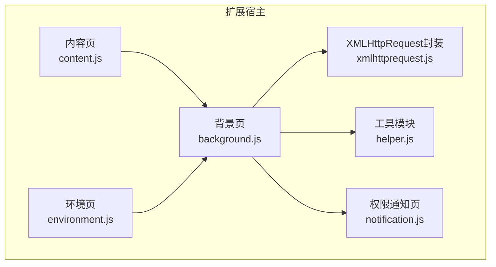
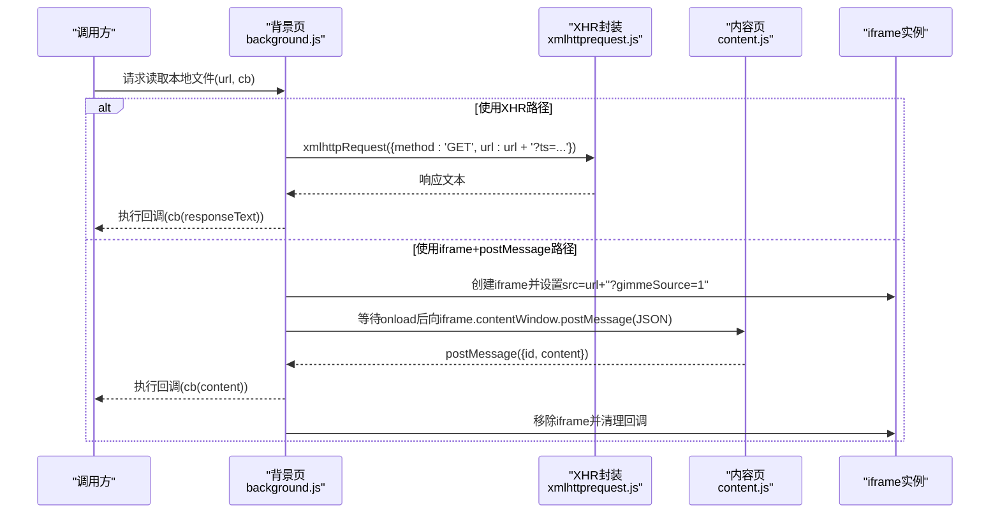
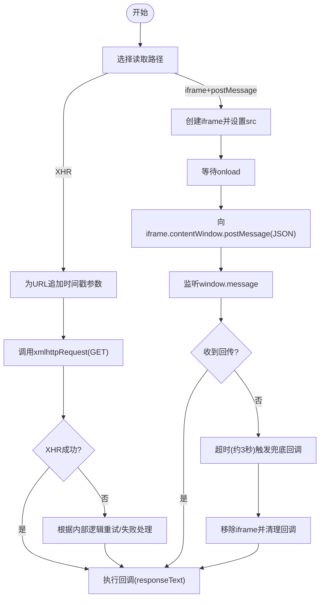
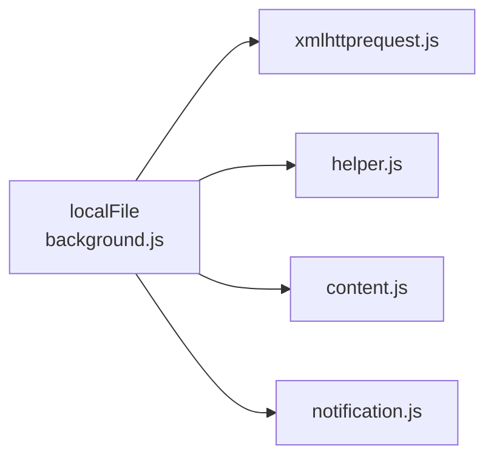

# 本地文件访问

<cite>
**本文引用的文件**
- [background.js](file://src/background.js)
- [xmlhttprequest.js](file://src/xmlhttprequest.js)
- [content.js](file://src/content.js)
- [environment.js](file://src/environment.js)
- [helper.js](file://src/helper.js)
- [notification.js](file://src/notification.js)
</cite>

## 目录
1. [简介](#简介)
2. [项目结构与角色定位](#项目结构与角色定位)
3. [核心组件](#核心组件)
4. [架构总览](#架构总览)
5. [详细组件分析](#详细组件分析)
6. [依赖关系分析](#依赖关系分析)
7. [性能与兼容性](#性能与兼容性)
8. [故障排查指南](#故障排查指南)
9. [结论](#结论)

## 简介
本文件聚焦 Tampermonkey 的“本地文件访问”能力：在扩展沙箱内安全地读取本地文件内容（如 file:// 协议或同源页面），并将其作为文本返回给调用方。系统通过两种路径实现：
- 使用内置的 XMLHttpRequest 封装（优先）
- 通过 iframe + postMessage 的跨上下文消息通道回传

同时，系统具备权限提示、错误处理、超时控制、缓存与重试等机制，以保证在不同浏览器环境下的稳定性与安全性。

## 项目结构与角色定位
- 背景页负责权限管理、本地文件读取调度、消息监听与清理。
- 内容页负责在目标页面中接收来自背景页的消息，读取当前页面内容并通过 postMessage 回传。
- 环境页负责在用户脚本运行环境中提供统一的请求封装与事件桥接。
- 工具模块提供 URL 校验、正则匹配、序列化等通用能力。
- 通知页用于弹窗请求权限与交互。

图表来源
- [background.js:661-765](file://src/background.js#L661-L765)
- [content.js:7-40](file://src/content.js#L7-L40)
- [environment.js:693-747](file://src/environment.js#L693-L747)
- [xmlhttprequest.js:17-153](file://src/xmlhttprequest.js#L17-L153)
- [helper.js:82-87](file://src/helper.js#L82-L87)
- [notification.js:69-91](file://src/notification.js#L69-L91)

章节来源
- [background.js:661-765](file://src/background.js#L661-L765)
- [content.js:7-40](file://src/content.js#L7-L40)
- [environment.js:693-747](file://src/environment.js#L693-L747)
- [xmlhttprequest.js:17-153](file://src/xmlhttprequest.js#L17-L153)
- [helper.js:82-87](file://src/helper.js#L82-L87)
- [notification.js:69-91](file://src/notification.js#L69-L91)

## 核心组件
- 本地文件读取器（localFile）：在背景页中实现，支持两种读取路径（XHR 或 iframe+postMessage），并维护回调映射与计时统计。
- XMLHttpRequest 封装：统一处理请求生命周期、重试、头部改写、响应状态与进度上报。
- 内容页消息处理器：当处于 file:// 页面且携带特定查询参数时，读取页面内容并通过 postMessage 返回。
- 权限与通知：通过通知页弹窗请求权限，结合后台权限模块进行授权与移除。
- 工具函数：URL 合法性校验、本地资源识别等。

章节来源
- [background.js:661-765](file://src/background.js#L661-L765)
- [xmlhttprequest.js:17-153](file://src/xmlhttprequest.js#L17-L153)
- [content.js:7-40](file://src/content.js#L7-L40)
- [notification.js:69-91](file://src/notification.js#L69-L91)
- [helper.js:82-87](file://src/helper.js#L82-L87)

## 架构总览
本地文件访问的关键流程如下：
- 调用方在背景页发起本地文件读取请求。
- 若启用 XHR 路径，则直接构造 GET 请求并附加时间戳参数避免缓存；若启用 iframe 路径，则动态插入 iframe 并等待其 onload 后发送消息。
- 目标页面（content.js）在满足条件时读取页面内容并通过 postMessage 回传。
- 背景页收到消息后执行回调，清理 iframe 与回调映射。

图表来源
- [background.js:698-765](file://src/background.js#L698-L765)
- [xmlhttprequest.js:17-153](file://src/xmlhttprequest.js#L17-L153)
- [content.js:7-40](file://src/content.js#L7-L40)

## 详细组件分析

### 组件A：本地文件读取器（localFile）
- 功能要点
  - 维护全局自增 id 与回调映射表，确保一次请求对应一个回调。
  - 支持两种读取路径：
    - XHR 路径：为 URL 追加时间戳参数，避免浏览器缓存；内部调用 xmlhttpRequest 封装。
    - iframe+postMessage 路径：创建隐藏 iframe，加载目标 URL；iframe 加载完成后向其窗口发送 JSON 数据；目标页面收到消息后读取页面内容并回传。
  - 监听 window 的 message 事件，解析回传数据并执行回调；超时未收到回传时触发兜底回调。
  - 提供初始化与清理逻辑，移除事件监听并清空回调表。

- 关键实现位置
  - 回调映射与消息监听：[background.js:666-684](file://src/background.js#L666-L684)
  - 初始化与清理：[background.js:685-697](file://src/background.js#L685-L697)
  - XHR 路径实现：[background.js:699-725](file://src/background.js#L699-L725)
  - iframe+postMessage 路径实现：[background.js:726-765](file://src/background.js#L726-L765)

- 优缺点对比
  - XHR 路径
    - 优点：无需额外 DOM 操作，调用简洁；可复用现有 XHR 封装。
    - 缺点：对 file:// 协议可能受浏览器策略限制；无法直接读取同源页面的 DOM 文本（需 iframe 路径）。
  - iframe+postMessage 路径
    - 优点：可读取当前页面内容（如 file:// 页面），适合需要页面 DOM 文本的场景。
    - 缺点：引入 iframe DOM 节点与事件监听，存在内存与安全风险；需要超时与清理。

- 适用场景
  - 需要读取本地文件内容（如本地 HTML/JS/CSS）：优先使用 XHR 路径。
  - 需要读取当前页面 DOM 文本（如 file:// 页面）：使用 iframe+postMessage 路径。

- 错误处理与超时
  - iframe 路径默认超时约 3 秒，超时后触发兜底回调并清理。
  - XHR 路径通过 xmlhttpRequest 的内部重试逻辑处理异常状态码。

- 安全边界
  - 仅在满足特定条件（如目标页面为 file:// 且携带查询参数）时才执行内容读取与回传。
  - 回传内容通过 postMessage 发送，避免直接暴露 DOM。

图表来源
- [background.js:698-765](file://src/background.js#L698-L765)
- [xmlhttprequest.js:62-92](file://src/xmlhttprequest.js#L62-L92)

章节来源
- [background.js:661-765](file://src/background.js#L661-L765)
- [xmlhttprequest.js:62-92](file://src/xmlhttprequest.js#L62-L92)

### 组件B：内容页消息处理器（content.js）
- 功能要点
  - 当页面为 file:// 且 URL 包含特定查询参数时，注册 message 事件监听。
  - 从 DOM 中提取文本内容（优先 body.innerText，否则递归取最后一个子节点的文本），构造回传对象并发送。
  - 发送后移除监听，避免重复处理。

- 关键实现位置
  - 条件判断与消息处理：[content.js:7-40](file://src/content.js#L7-L40)

- 安全边界
  - 仅在满足 file:// 且携带查询参数的条件下执行读取与回传，降低误触发风险。

章节来源
- [content.js:7-40](file://src/content.js#L7-L40)

### 组件C：XMLHttpRequest 封装（xmlhttprequest.js）
- 功能要点
  - 统一处理请求生命周期：onload/onerror/onreadystatechange。
  - 对响应头进行清洗（去除特定前缀），并支持最终 URL 获取。
  - 支持重试逻辑（基于状态码与剩余重试次数）。
  - 支持自定义请求头（对 UA/Referer 等进行前缀改写以绕过限制）。
  - 对非 http/https 的 URL 抛出错误（除非是本地图片资源）。

- 关键实现位置
  - 生命周期与状态封装：[xmlhttprequest.js:25-61](file://src/xmlhttprequest.js#L25-L61)
  - 重试与错误处理：[xmlhttprequest.js:62-93](file://src/xmlhttprequest.js#L62-L93)
  - URL 合法性校验与头部处理：[xmlhttprequest.js:114-138](file://src/xmlhttprequest.js#L114-L138)

- 与本地文件访问的关系
  - localFile 在 XHR 路径下直接调用该封装，确保一致的错误与重试行为。

章节来源
- [xmlhttprequest.js:17-153](file://src/xmlhttprequest.js#L17-L153)

### 组件D：权限与通知（background.js + notification.js）
- 功能要点
  - 背景页维护权限状态与请求流程，必要时通过通知页弹窗请求权限。
  - 通知页负责点击事件、调用 chrome.permissions.request 并将结果回传给背景页。

- 关键实现位置
  - 权限请求与移除：[background.js:5372-5398](file://src/background.js#L5372-L5398)
  - 通知页权限请求入口：[notification.js:69-91](file://src/notification.js#L69-L91)

- 与本地文件访问的关系
  - 本地文件访问可能涉及跨域/本地协议读取，权限弹窗可作为前置步骤提升成功率。

章节来源
- [background.js:5372-5398](file://src/background.js#L5372-L5398)
- [notification.js:69-91](file://src/notification.js#L69-L91)

## 依赖关系分析
- localFile 依赖
  - xmlhttprequest.js：XHR 路径的核心实现。
  - helper.js：URL 合法性校验（本地图片资源识别）。
  - content.js：iframe+postMessage 路径的目标页面处理。
  - notification.js：权限弹窗交互（间接影响可用性）。

图表来源
- [background.js:661-765](file://src/background.js#L661-L765)
- [xmlhttprequest.js:17-153](file://src/xmlhttprequest.js#L17-L153)
- [helper.js:82-87](file://src/helper.js#L82-L87)
- [content.js:7-40](file://src/content.js#L7-L40)
- [notification.js:69-91](file://src/notification.js#L69-L91)

章节来源
- [background.js:661-765](file://src/background.js#L661-L765)
- [xmlhttprequest.js:17-153](file://src/xmlhttprequest.js#L17-L153)
- [helper.js:82-87](file://src/helper.js#L82-L87)
- [content.js:7-40](file://src/content.js#L7-L40)
- [notification.js:69-91](file://src/notification.js#L69-L91)

## 性能与兼容性
- 性能优化
  - XHR 路径：为 file:// URL 追加时间戳参数，避免缓存导致的读取不更新。
  - 缓存与重试：XHR 封装支持按状态码重试；背景页还维护 require 缓存与清理周期，减少重复请求。
  - 回调清理：iframe 路径在收到回传或超时后及时移除 iframe 与回调映射，避免内存泄漏。

- 兼容性处理
  - URL 合法性校验：非 http/https 的 URL 默认拒绝，除非是本地图片资源。
  - 头部改写：对 UA/Referer 等敏感头部进行前缀改写，提高请求通过率。
  - Android 特殊分支：检测到特定运行环境时走专用路径。

章节来源
- [xmlhttprequest.js:12-15](file://src/xmlhttprequest.js#L12-L15)
- [xmlhttprequest.js:114-138](file://src/xmlhttprequest.js#L114-L138)
- [xmlhttprequest.js:17-23](file://src/xmlhttprequest.js#L17-L23)
- [background.js:707-709](file://src/background.js#L707-L709)

## 故障排查指南
- 症状：XHR 路径读取失败
  - 可能原因：URL 非 http/https；浏览器对 file:// 协议限制；网络异常。
  - 排查步骤：检查 URL 是否合法；确认是否为本地图片资源；查看 XHR 封装的错误回调与状态码。
  - 参考位置：[xmlhttprequest.js:114-153](file://src/xmlhttprequest.js#L114-L153)

- 症状：iframe+postMessage 路径无响应
  - 可能原因：目标页面未满足 file:// 且携带查询参数；iframe 未触发 onload；消息未送达。
  - 排查步骤：确认目标页面 URL 条件；检查 onload 与 postMessage 流程；查看超时与兜底回调。
  - 参考位置：[content.js:7-40](file://src/content.js#L7-L40)，[background.js:726-765](file://src/background.js#L726-L765)

- 症状：权限不足导致无法读取
  - 可能原因：缺少必要的权限。
  - 排查步骤：通过通知页弹窗请求权限；确认权限状态与移除流程。
  - 参考位置：[notification.js:69-91](file://src/notification.js#L69-L91)，[background.js:5372-5398](file://src/background.js#L5372-L5398)

- 症状：内存占用上升
  - 可能原因：iframe 未及时移除；回调映射未清理。
  - 排查步骤：确认回调清理逻辑；检查超时兜底路径是否执行。
  - 参考位置：[background.js:691-697](file://src/background.js#L691-L697)，[background.js:765](file://src/background.js#L765)

章节来源
- [xmlhttprequest.js:114-153](file://src/xmlhttprequest.js#L114-L153)
- [content.js:7-40](file://src/content.js#L7-L40)
- [background.js:691-697](file://src/background.js#L691-L697)
- [background.js:726-765](file://src/background.js#L726-L765)
- [notification.js:69-91](file://src/notification.js#L69-L91)
- [background.js:5372-5398](file://src/background.js#L5372-L5398)

## 结论
Tampermonkey 的本地文件访问系统通过“XHR 路径 + iframe+postMessage 路径”的双轨设计，在不同场景下实现了灵活而安全的本地文件读取。系统在安全性方面严格限定目标页面条件与消息回传范围，在可靠性方面提供了错误处理、重试与超时兜底，并通过权限弹窗与头部改写提升兼容性。建议在需要读取本地文件时优先使用 XHR 路径；在需要读取当前页面 DOM 文本时使用 iframe+postMessage 路径，并注意及时清理与超时控制。