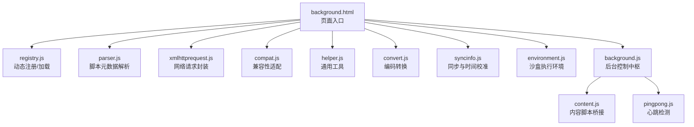
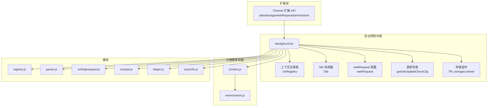
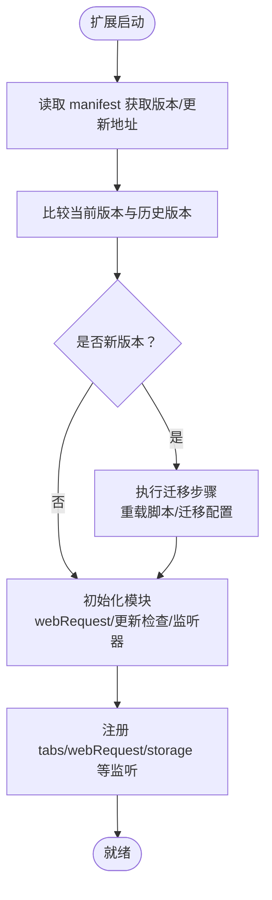
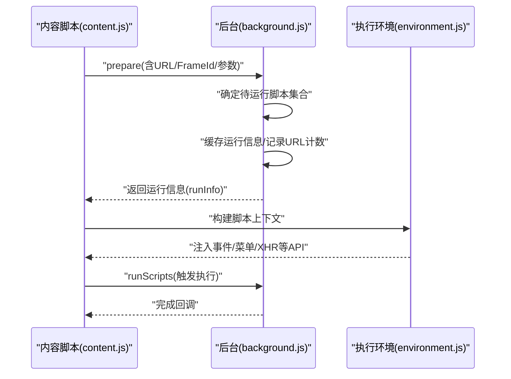
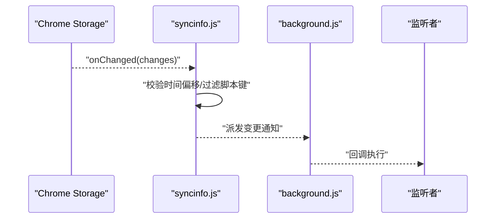
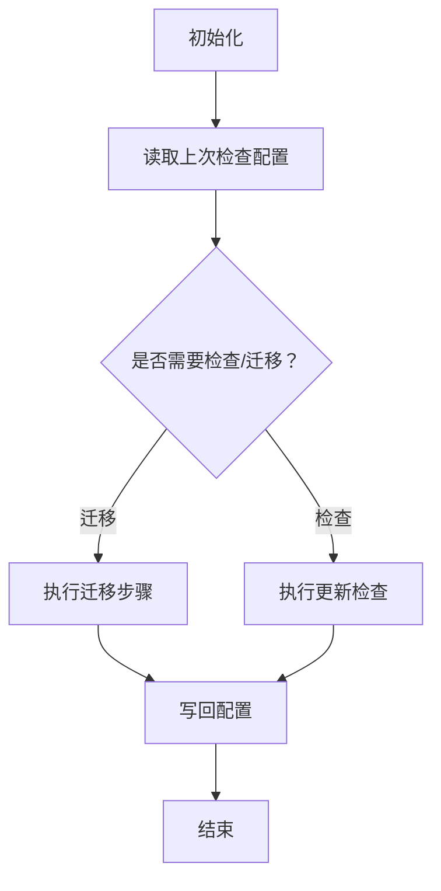
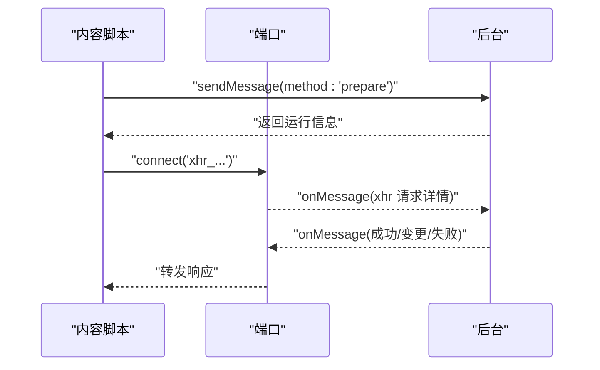
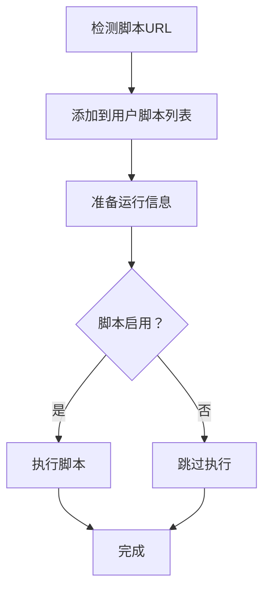
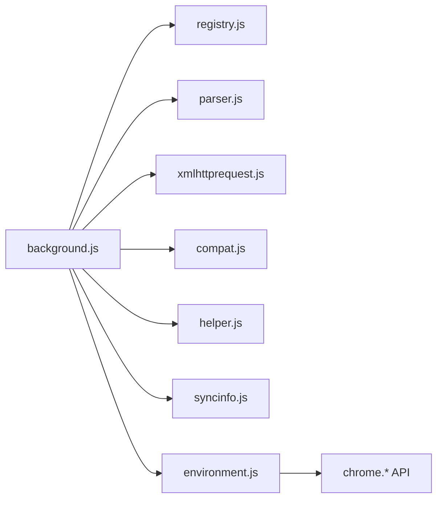

# 背景脚本系统

<cite>
**本文引用的文件**
- [background.js](file://src/background.js)
- [background.html](file://src/background.html)
- [registry.js](file://src/registry.js)
- [environment.js](file://src/environment.js)
- [helper.js](file://src/helper.js)
- [parser.js](file://src/parser.js)
- [xmlhttprequest.js](file://src/xmlhttprequest.js)
- [compat.js](file://src/compat.js)
- [syncinfo.js](file://src/syncinfo.js)
- [content.js](file://src/content.js)
- [pingpong.js](file://src/pingpong.js)
- [convert.js](file://src/convert.js)
</cite>

## 目录
1. [简介](#简介)
2. [项目结构](#项目结构)
3. [核心组件](#核心组件)
4. [架构总览](#架构总览)
5. [详细组件分析](#详细组件分析)
6. [依赖关系分析](#依赖关系分析)
7. [性能考量](#性能考量)
8. [故障排查指南](#故障排查指南)
9. [结论](#结论)
10. [附录](#附录)

## 简介
本文件系统性阐述 Tampermonkey 的背景脚本（Background）体系，聚焦其作为扩展核心控制器的设计理念与实现机制。内容覆盖扩展生命周期管理、脚本调度与执行、存储与同步、更新检查、与 Chrome 扩展 API 的集成、消息传递协议与状态同步策略，并给出脚本安装、启用/禁用、卸载的完整流程与时序图。同时提供性能优化建议、内存管理策略与错误处理机制，帮助开发者与用户理解背景脚本如何协调各子系统协同工作。

## 项目结构
Tampermonkey 的背景脚本由一个 HTML 页面加载多个模块脚本组成，通过注册表（Registry）按需加载与组织功能模块。核心入口为 background.html，内部引入 registry.js 与若干业务脚本，最终加载 background.js 作为后台控制中枢。

图表来源
- [background.html:1-19](file://src/background.html#L1-L19)
- [registry.js:1-107](file://src/registry.js#L1-L107)
- [background.js:1-120](file://src/background.js#L1-L120)

章节来源
- [background.html:1-19](file://src/background.html#L1-L19)
- [registry.js:1-107](file://src/registry.js#L1-L107)

## 核心组件
- 注册表（Registry）
  - 提供 require/get/register/loadFile 等能力，支持模块懒加载与回调式初始化完成通知。
- 脚本解析器（Script Parser）
  - 解析用户脚本头部元数据，生成脚本对象，支持 includes/matches/excludes、requires、resources、run-at、user-agent 等选项。
- 网络请求（XMLHttpRequest）
  - 封装 XHR 请求，支持重试、进度回调、响应头处理、UA/Referer 前缀改写以配合 webRequest。
- 兼容层（Compat）
  - 对脚本源进行兼容性转换，如修复语法差异、数组解构、for-in 语义等。
- 工具库（Helper）
  - 提供 URL 正则构造、序列化、类型判断、本地资源识别等通用能力。
- 编码转换（Convert）
  - 提供 UTF-8/Base64 等编解码工具。
- 同步与时间（SyncInfo）
  - 支持 Pastebin/Chrome Sync 等同步源，监听 storage 变更并进行时间偏移校准。
- 执行环境（Environment）
  - 构建脚本运行上下文，注入事件模拟、菜单命令、XHR 通道、标签页操作等 API。
- 背景控制中枢（Background）
  - 统筹版本迁移、脚本缓存、上下文注册、Tab/URL 状态机、更新检查、消息路由、权限与存储监听等。

章节来源
- [registry.js:11-104](file://src/registry.js#L11-L104)
- [parser.js:29-67](file://src/parser.js#L29-L67)
- [xmlhttprequest.js:17-153](file://src/xmlhttprequest.js#L17-L153)
- [compat.js:13-26](file://src/compat.js#L13-L26)
- [helper.js:184-208](file://src/helper.js#L184-L208)
- [convert.js:7-38](file://src/convert.js#L7-L38)
- [syncinfo.js:68-181](file://src/syncinfo.js#L68-L181)
- [environment.js:7-35](file://src/environment.js#L7-L35)
- [background.js:1-120](file://src/background.js#L1-L120)

## 架构总览
背景脚本以“模块化 + 注册表 + 消息路由”的方式组织，核心职责包括：
- 生命周期：版本迁移、初始化、监听器注册、清理。
- 调度与执行：根据 URL/FrameId 决策脚本集合，构建运行信息，驱动内容脚本执行。
- 存储与同步：本地存储、Chrome Storage 监听、时间校准、外部同步源。
- 更新检查：定时检查、配置持久化、状态统计。
- 权限与安全：webRequest 配置、权限申请、本地文件访问策略。

图表来源
- [background.js:4357-6326](file://src/background.js#L4357-L6326)
- [content.js:1158-1201](file://src/content.js#L1158-L1201)
- [environment.js:782-807](file://src/environment.js#L782-L807)

## 详细组件分析

### 生命周期与初始化流程
- 版本迁移与数据转换
  - 通过版本比较决定是否执行迁移步骤，包括脚本重载、配置字段迁移、默认值修正等。
- 初始化阶段
  - 注册 webRequest 监听、启动更新检查、注册消息与连接监听、等待导航事件。
- 清理阶段
  - 卸载时移除 webRequest 监听、停止同步客户端。

图表来源
- [background.js:145-391](file://src/background.js#L145-L391)
- [background.js:6127-6326](file://src/background.js#L6127-L6326)

章节来源
- [background.js:145-391](file://src/background.js#L145-L391)
- [background.js:6127-6326](file://src/background.js#L6127-L6326)

### 脚本调度与执行
- 上下文注册（ctxRegistry）
  - 记录每个 Tab 的 URL 计数、User-Agent、运行统计、缓存命中等。
- Tab 协调器（Tab）
  - 根据 URL/FrameId 决策启用脚本集合，准备运行信息，支持从缓存复用。
- 执行环境（Environment）
  - 在内容脚本侧构建脚本运行上下文，注入事件、菜单命令、XHR 端口、标签页操作等。
- 消息与端口
  - content.js 通过 extension.sendMessage 与 background.js 通信；XHR 使用 connect 建立端口通道。

图表来源
- [background.js:561-640](file://src/background.js#L561-L640)
- [environment.js:782-807](file://src/environment.js#L782-L807)
- [content.js:1158-1201](file://src/content.js#L1158-L1201)

章节来源
- [background.js:437-558](file://src/background.js#L437-L558)
- [background.js:561-640](file://src/background.js#L561-L640)
- [environment.js:782-807](file://src/environment.js#L782-L807)
- [content.js:1158-1201](file://src/content.js#L1158-L1201)

### 存储管理与同步
- 本地存储监听
  - background.js 维护存储监听列表，对指定键变更进行回调分发。
- Chrome Storage 同步
  - syncinfo.js 监听 chrome.storage.onChanged，过滤脚本相关键，进行时间偏移校准后通知监听者。
- 时间校准
  - 通过 HTTP HEAD/GET 服务端时间接口计算本地时间偏移，提升同步一致性。

图表来源
- [syncinfo.js:149-181](file://src/syncinfo.js#L149-L181)
- [background.js:3857-3871](file://src/background.js#L3857-L3871)

章节来源
- [syncinfo.js:68-181](file://src/syncinfo.js#L68-L181)
- [background.js:3857-3871](file://src/background.js#L3857-L3871)

### 更新检查与版本迁移
- 更新检查配置
  - 使用 getUpdateCheckCfg/setUpdateCheckCfg 持久化上次检查时间、条目数等。
- 迁移步骤
  - 多版本迁移链路，逐版本执行字段迁移、脚本重载、默认值修正等。

图表来源
- [background.js:770-786](file://src/background.js#L770-L786)
- [background.js:249-387](file://src/background.js#L249-L387)

章节来源
- [background.js:770-786](file://src/background.js#L770-L786)
- [background.js:249-387](file://src/background.js#L249-L387)

### 消息传递协议与状态同步
- 消息路由
  - background.js 通过 onMessage/onConnect 接收来自 content.js 的请求，分发到对应处理器（如 XHR、存储监听、菜单命令等）。
- 端口通信
  - content.js 使用 connect 建立端口，用于 XHR 流水线与断开通知。
- 心跳检测
  - pingpong.js 通过 sendMessage 触发后台响应，用于确认后台可用性。

图表来源
- [content.js:373-390](file://src/content.js#L373-L390)
- [background.js:3849-3871](file://src/background.js#L3849-L3871)
- [pingpong.js:14-49](file://src/pingpong.js#L14-L49)

章节来源
- [content.js:373-390](file://src/content.js#L373-L390)
- [background.js:3849-3871](file://src/background.js#L3849-L3871)
- [pingpong.js:14-49](file://src/pingpong.js#L14-L49)

### 脚本安装、启用/禁用、卸载流程
- 安装
  - 检测脚本 URL（ScriptDetector），在页面加载完成后拉取源码并添加到用户脚本列表。
- 启用/禁用
  - 通过脚本对象的 enabled 字段控制；Tab 协调器在准备阶段过滤禁用脚本。
- 卸载
  - 移除脚本存储、清理上下文注册表、更新图标状态、通知存储监听者。

图表来源
- [background.js:644-658](file://src/background.js#L644-L658)
- [background.js:6128-6156](file://src/background.js#L6128-L6156)

章节来源
- [background.js:644-658](file://src/background.js#L644-L658)
- [background.js:6128-6156](file://src/background.js#L6128-L6156)

## 依赖关系分析
- 模块依赖
  - background.js 通过 Registry.require 引入 convert、xmlhttprequest、compat、parser、helper、syncinfo、i18n 等模块。
  - environment.js 依赖 chromeEmu（模拟扩展 API）、JSLINT（可选）等。
- 外部依赖
  - Chrome 扩展 API：tabs、storage、webRequest、permissions、extension 等。
- 循环依赖规避
  - Registry 采用延迟加载与占位符避免循环 require；模块间通过函数接口耦合。

图表来源
- [background.js:28-34](file://src/background.js#L28-L34)
- [environment.js:35-35](file://src/environment.js#L35-L35)

章节来源
- [background.js:28-34](file://src/background.js#L28-L34)
- [environment.js:35-35](file://src/environment.js#L35-L35)

## 性能考量
- 脚本缓存
  - ctxRegistry 支持运行信息缓存与 URL 计数，减少重复计算与网络请求。
- 请求缓存
  - requireCache 以时间戳与有效期维护远程 require 缓存，定期清理过期项。
- XHR 重试
  - xmlhttprequest.js 在非 200/0 状态时自动重试，降低瞬时失败影响。
- 事件与监听
  - 合理使用 window.setTimeout 分散任务，避免阻塞主线程。
- 内存管理
  - 清理监听器与端口，及时释放闭包引用；在环境清理阶段统一回收资源。

章节来源
- [background.js:398-431](file://src/background.js#L398-L431)
- [xmlhttprequest.js:67-92](file://src/xmlhttprequest.js#L67-L92)
- [environment.js:309-323](file://src/environment.js#L309-L323)

## 故障排查指南
- 脚本执行异常
  - environment.js 在执行脚本时捕获异常并输出堆栈；可通过复制到剪贴板辅助调试。
- XHR 错误
  - xmlhttprequest.js 输出错误响应与状态；检查 URL 方案合法性与 webRequest 前缀改写。
- 存储监听无效
  - 确认 content.js 已发送 addStorageListener 请求且后台未断开连接。
- 权限问题
  - 使用 permission.ask/request/remove 管理 storage/webRequest 等权限；必要时弹窗提示用户授权。
- 更新检查失败
  - 检查 getUpdateCheckCfg 的持久化配置与网络可达性；关注重试次数与时间间隔。

章节来源
- [environment.js:128-193](file://src/environment.js#L128-L193)
- [xmlhttprequest.js:139-152](file://src/xmlhttprequest.js#L139-L152)
- [background.js:3857-3871](file://src/background.js#L3857-L3871)
- [background.js:5372-5398](file://src/background.js#L5372-L5398)
- [background.js:770-786](file://src/background.js#L770-L786)

## 结论
Tampermonkey 的背景脚本系统以模块化与注册表为核心，结合完善的生命周期管理、脚本调度与执行、存储与同步、更新检查与权限控制，形成稳定高效的扩展内核。通过消息路由与端口通信实现内容脚本与后台的低耦合协作，借助缓存与重试策略保障性能与可靠性。遵循本文提供的流程与时序图，可快速定位问题并进行优化与扩展。

## 附录
- 关键路径参考
  - 版本迁移与初始化：[background.js:145-391](file://src/background.js#L145-L391), [background.js:6127-6326](file://src/background.js#L6127-L6326)
  - 调度与执行：[background.js:561-640](file://src/background.js#L561-L640), [environment.js:782-807](file://src/environment.js#L782-L807)
  - 存储与同步：[syncinfo.js:149-181](file://src/syncinfo.js#L149-L181), [background.js:3857-3871](file://src/background.js#L3857-L3871)
  - 网络请求与重试：[xmlhttprequest.js:17-153](file://src/xmlhttprequest.js#L17-L153)
  - 脚本解析与元数据：[parser.js:72-200](file://src/parser.js#L72-L200)
  - 工具与编码：[helper.js:184-208](file://src/helper.js#L184-L208), [convert.js:7-38](file://src/convert.js#L7-L38)
  - 消息与端口：[content.js:373-390](file://src/content.js#L373-L390), [pingpong.js:14-49](file://src/pingpong.js#L14-L49)