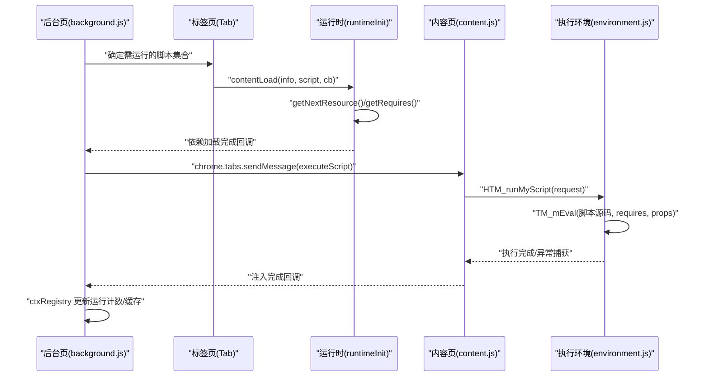
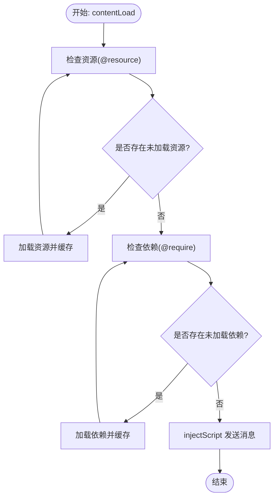
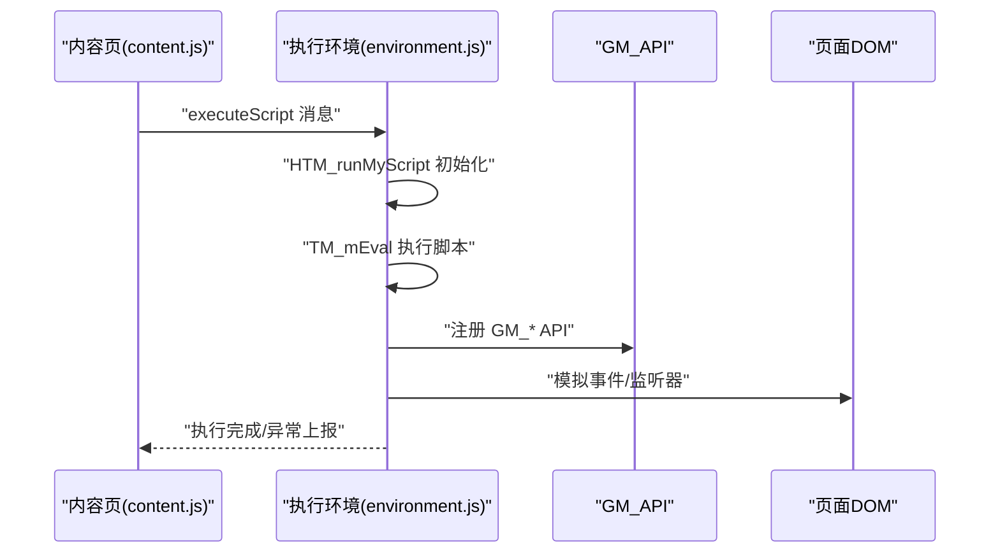
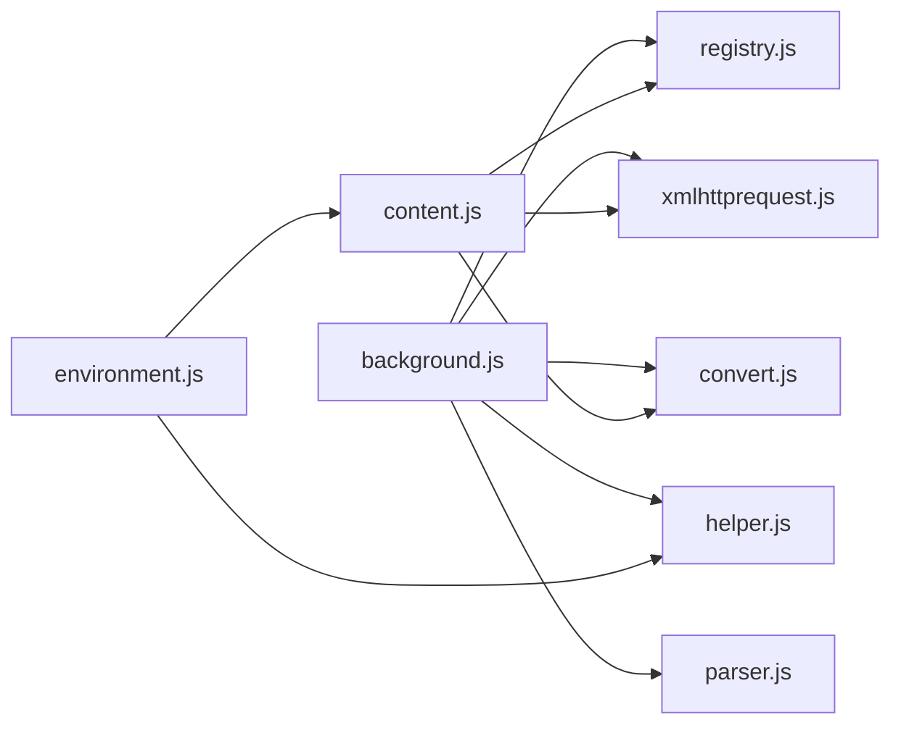

# 脚本调度和执行

<cite>
**本文引用的文件**
- [background.js](file://src/background.js)
- [content.js](file://src/content.js)
- [environment.js](file://src/environment.js)
- [registry.js](file://src/registry.js)
- [parser.js](file://src/parser.js)
- [helper.js](file://src/helper.js)
- [xmlhttprequest.js](file://src/xmlhttprequest.js)
- [convert.js](file://src/convert.js)
</cite>

## 目录
1. [简介](#简介)
2. [项目结构](#项目结构)
3. [核心组件](#核心组件)
4. [架构总览](#架构总览)
5. [详细组件分析](#详细组件分析)
6. [依赖关系分析](#依赖关系分析)
7. [性能考量](#性能考量)
8. [故障排查指南](#故障排查指南)
9. [结论](#结论)
10. [附录](#附录)

## 简介
本文件面向 Tampermonkey 脚本调度与执行系统，聚焦后台脚本（background）如何协调用户脚本的发现、解析、依赖加载、注入与执行，以及内容脚本（content）如何在页面上下文中安全地创建与销毁执行环境。文档覆盖以下主题：
- 调度与执行队列、并发控制与优先级
- 执行上下文生命周期（创建/销毁）
- 脚本间依赖（@require/@resource）与执行顺序
- 错误处理与状态跟踪
- 性能优化（缓存、延迟加载、内存管理）

## 项目结构
Tampermonkey 的脚本执行由“后台页 + 内容页 + 环境注入”三层协作完成：
- 后台页负责脚本发现、元数据解析、依赖加载、资源缓存、并发调度与状态统计
- 内容页负责在页面上下文中注入并执行脚本，维护事件与监听器，提供 GM_* API 兼容层
- 环境注入层负责在安全上下文中执行脚本源码，包装 require 文本，捕获异常并上报

```mermaid
graph TB
subgraph "后台页"
BG["background.js<br/>调度/并发/缓存/状态"]
REG["registry.js<br/>模块注册/懒加载"]
PARSER["parser.js<br/>元数据解析"]
HELPER["helper.js<br/>工具函数"]
XHR["xmlhttprequest.js<br/>网络请求封装"]
CONV["convert.js<br/>编码/解码"]
end
subgraph "内容页"
CT["content.js<br/>消息桥接/事件转发"]
ENV["environment.js<br/>执行环境/注入/GM_API"]
end
BG --> REG
BG --> PARSER
BG --> HELPER
BG --> XHR
BG --> CONV
BG <- --> CT
CT --> ENV
ENV --> CT
```

图表来源
- [background.js](file://src/background.js)
- [content.js](file://src/content.js)
- [environment.js](file://src/environment.js)
- [registry.js](file://src/registry.js)
- [parser.js](file://src/parser.js)
- [helper.js](file://src/helper.js)
- [xmlhttprequest.js](file://src/xmlhttprequest.js)
- [convert.js](file://src/convert.js)

章节来源
- [background.js](file://src/background.js)
- [content.js](file://src/content.js)
- [environment.js](file://src/environment.js)
- [registry.js](file://src/registry.js)
- [parser.js](file://src/parser.js)
- [helper.js](file://src/helper.js)
- [xmlhttprequest.js](file://src/xmlhttprequest.js)
- [convert.js](file://src/convert.js)

## 核心组件
- 调度与上下文注册表：用于记录每个标签页的 URL、UA、运行计数与缓存，支持快速复用与清理
- 运行时初始化器：负责 @require/@resource 的递归加载、缓存命中、注入前的兼容处理与最终注入
- 内容页执行环境：在页面上下文中创建/销毁执行环境，模拟 DOM 事件，暴露 GM_* API
- 模块注册与懒加载：通过 Registry 统一管理模块的 require/register/load 流程
- 解析器：解析用户脚本元数据（@include/@match/@require/@resource 等），生成脚本对象
- 工具与网络：正则构造、URL 匹配、HTTP 请求封装与重试、Base64/UTF8 编解码

章节来源
- [background.js](file://src/background.js)
- [content.js](file://src/content.js)
- [environment.js](file://src/environment.js)
- [registry.js](file://src/registry.js)
- [parser.js](file://src/parser.js)
- [helper.js](file://src/helper.js)
- [xmlhttprequest.js](file://src/xmlhttprequest.js)
- [convert.js](file://src/convert.js)

## 架构总览
下图展示了从脚本发现到执行完成的关键交互路径。



图表来源
- [background.js](file://src/background.js)
- [content.js](file://src/content.js)
- [environment.js](file://src/environment.js)

## 详细组件分析

### 调度与上下文注册表（ctxRegistry）
- 功能要点
  - 记录每个 tabId 的 URL 列表、UA、运行计数、空闲状态
  - 支持添加/移除 URL、设置/清空缓存、查询运行中数量
  - 作为“运行信息缓存”在同页多脚本注入时复用，减少重复计算
- 关键接口
  - addUrl/removeUrl/setCache/clearCache/getRunning/iterateUrls
- 并发与状态
  - 通过 stats.running 统计当前运行中的脚本数
  - 通过 empty 标记判断是否需要清理

章节来源
- [background.js](file://src/background.js)

### 运行时初始化器（runtimeInit）
- 作用
  - 递归加载 @require/@resource，命中缓存则直接使用
  - 对本地文件与黑名单进行特殊处理
  - 注入前进行兼容性转换与调试开关处理
  - 将脚本与依赖打包后通过消息发送至内容页执行
- 关键流程
  - getNextResource：逐个处理资源，识别图片类型并生成 dataURL 或 Base64
  - getRequires：加载外部依赖文本，支持缓存与黑名单
  - contentLoad：当资源与依赖均就绪后，调用 injectScript
  - injectScript：组装 header/code/requires/storage/script/id 并发送消息
- 并发控制
  - 使用闭包变量与回调计数控制并发注入
  - 通过 ctxRegistry 缓存运行信息，避免重复计算



图表来源
- [background.js](file://src/background.js)

章节来源
- [background.js](file://src/background.js)

### 内容页执行环境（environment.js）
- 作用
  - 接收后台页消息，按 run_at 时机（document-start/document-body/document-end）调度执行
  - 在安全上下文中执行脚本，包装 require 文本，捕获异常并输出堆栈
  - 提供 GM_* API 兼容层（存储、通知、XMLHttpRequest、菜单命令等）
  - 维护事件监听与 DOM 变更重放逻辑
- 关键点
  - HTM_runMyScript：组装脚本元信息、初始化存储监听端口、注入执行
  - TM_mEval：拼装 setID、require 文本与脚本主体，包裹 try/catch 输出错误
  - 事件修复：DOMAttrModified、XPath、window.open、定时器字符串参数等
- 生命周期
  - 注入前：准备 props、元素列表、GM_API 映射
  - 注入中：执行脚本，注册值变更监听
  - 注销时：断开存储端口、清理全局变量与监听器



图表来源
- [content.js](file://src/content.js)
- [environment.js](file://src/environment.js)

章节来源
- [content.js](file://src/content.js)
- [environment.js](file://src/environment.js)

### 脚本解析与元数据（parser.js）
- 作用
  - 解析用户脚本头部元数据，生成脚本对象（name/namespace/version/urls/matches/excludes/resources/...)
  - 处理 @require/@resource/@include/@match/@exclude/@run-at/@user-agent 等指令
- 关键点
  - processHeader：逐行扫描并提取元数据，构建 includes/matches/excludes/requires/resources/options
  - createScriptFromSrc：结合兼容选项标记，生成可执行脚本对象

章节来源
- [parser.js](file://src/parser.js)

### 模块注册与懒加载（registry.js）
- 作用
  - 统一管理模块的注册、获取与懒加载，避免循环依赖
  - 提供 onLoad 回调机制，确保依赖齐全后再继续
- 关键点
  - require/get/loadFile：按需加载脚本文件或返回已注册对象
  - register/registerRaw：注册模块与原始内容

章节来源
- [registry.js](file://src/registry.js)

### 工具与网络（helper.js、xmlhttprequest.js、convert.js）
- 工具函数：URL 正则构造、字符串处理、序列化、类型判断、本地资源检测
- 网络封装：XMLHttpRequest 封装，支持重试、进度回调、头字段改写（UA/Referer 前缀）
- 编解码：UTF8/Base64 编解码，消息传递时的转义/还原

章节来源
- [helper.js](file://src/helper.js)
- [xmlhttprequest.js](file://src/xmlhttprequest.js)
- [convert.js](file://src/convert.js)

## 依赖关系分析
- 调度层依赖
  - background.js 依赖 parser.js（解析元数据）、helper.js（URL/正则）、xmlhttprequest.js（网络）、convert.js（编解码）、registry.js（模块系统）
- 注入层依赖
  - content.js 依赖 registry.js（模块系统）、xmlhttprequest.js（XHR）、convert.js（消息编解码）
  - environment.js 依赖 content.js 的消息桥接、chromeEmu（扩展通信）、helper.js（工具）



图表来源
- [background.js](file://src/background.js)
- [content.js](file://src/content.js)
- [environment.js](file://src/environment.js)
- [registry.js](file://src/registry.js)
- [parser.js](file://src/parser.js)
- [helper.js](file://src/helper.js)
- [xmlhttprequest.js](file://src/xmlhttprequest.js)
- [convert.js](file://src/convert.js)

章节来源
- [background.js](file://src/background.js)
- [content.js](file://src/content.js)
- [environment.js](file://src/environment.js)
- [registry.js](file://src/registry.js)
- [parser.js](file://src/parser.js)
- [helper.js](file://src/helper.js)
- [xmlhttprequest.js](file://src/xmlhttprequest.js)
- [convert.js](file://src/convert.js)

## 性能考量
- 执行缓存
  - requireCache：对 @require 与 @resource 的响应体与响应头进行缓存，按时间窗口清理
  - ctxRegistry.cache：在同页注入前复用运行信息，避免重复计算
- 延迟加载
  - 仅在需要时加载依赖与资源；黑名单与本地文件路径进行特殊处理
  - @run-at 控制注入时机，避免过早执行导致 DOM 不可用
- 内存管理
  - 注入完成后清理全局变量、监听器与存储端口
  - 事件重放与 DOM 变更监听在合适时机关闭，防止泄漏

章节来源
- [background.js](file://src/background.js)
- [environment.js](file://src/environment.js)

## 故障排查指南
- 依赖加载失败
  - 检查黑名单配置与本地文件访问权限
  - 查看网络请求状态与重试次数
- 注入异常
  - 查看 environment.js 中的异常捕获与堆栈输出
  - 确认 run_at 时机与 DOM 可用性
- 缓存问题
  - 清理 requireCache 与 ctxRegistry.cache，确认缓存有效期与清理周期
- API 不可用
  - 确认 content.js 与 environment.js 的消息通道是否正常
  - 检查 GM_* API 的注册与端口连接状态

章节来源
- [background.js](file://src/background.js)
- [content.js](file://src/content.js)
- [environment.js](file://src/environment.js)

## 结论
Tampermonkey 的脚本调度与执行体系以“后台页 + 内容页 + 环境注入”为核心，通过上下文注册表、运行时初始化器与执行环境三者协作，实现了：
- 可靠的脚本发现与元数据解析
- 依赖与资源的高效加载与缓存
- 安全可控的执行上下文创建与销毁
- 面向用户的事件与 API 兼容层
在保证功能完整性的同时，兼顾了性能与稳定性，适合大规模用户脚本的并发执行场景。

## 附录
- 关键流程路径参考
  - 调度与注入：[background.js](file://src/background.js)
  - 注入与执行：[content.js](file://src/content.js) → [environment.js](file://src/environment.js)
  - 元数据解析：[parser.js](file://src/parser.js)
  - 模块系统：[registry.js](file://src/registry.js)
  - 工具与网络：[helper.js](file://src/helper.js)、[xmlhttprequest.js](file://src/xmlhttprequest.js)、[convert.js](file://src/convert.js)