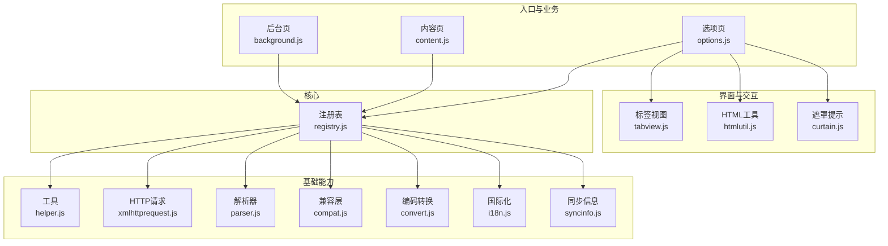
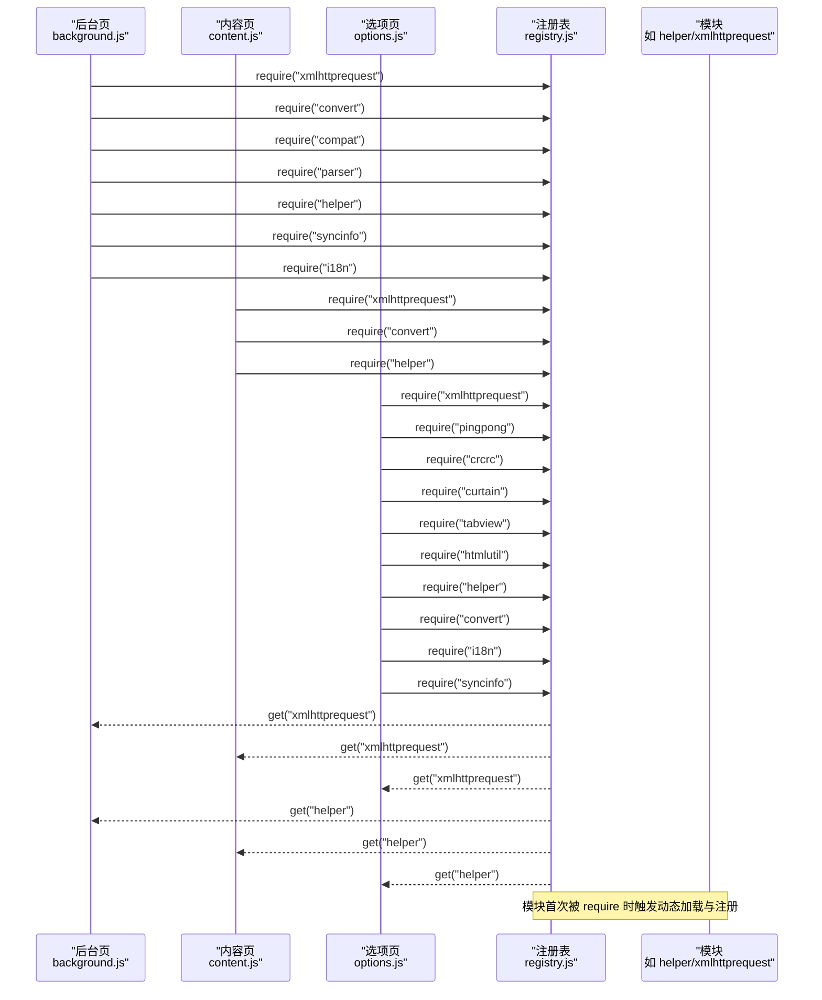
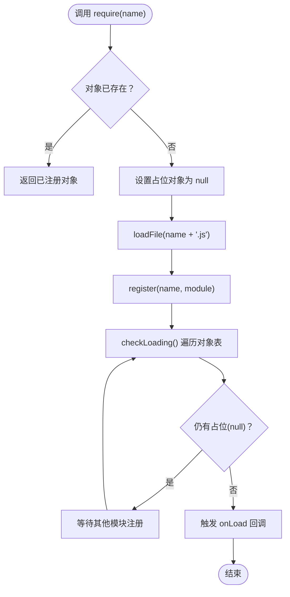
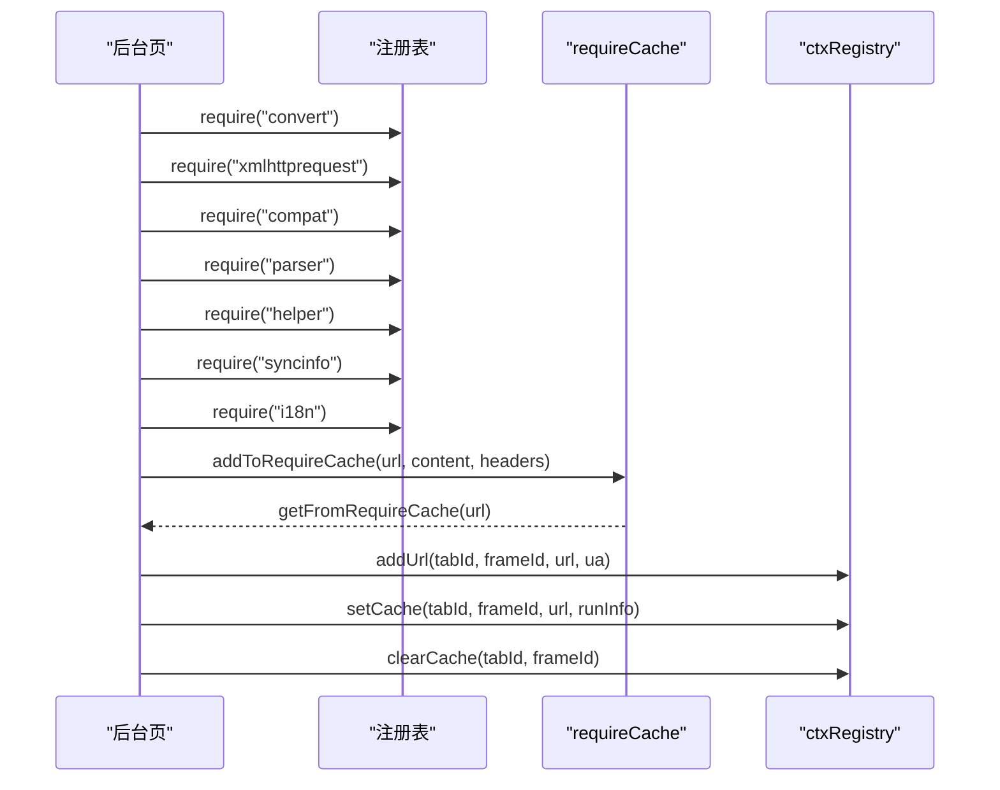
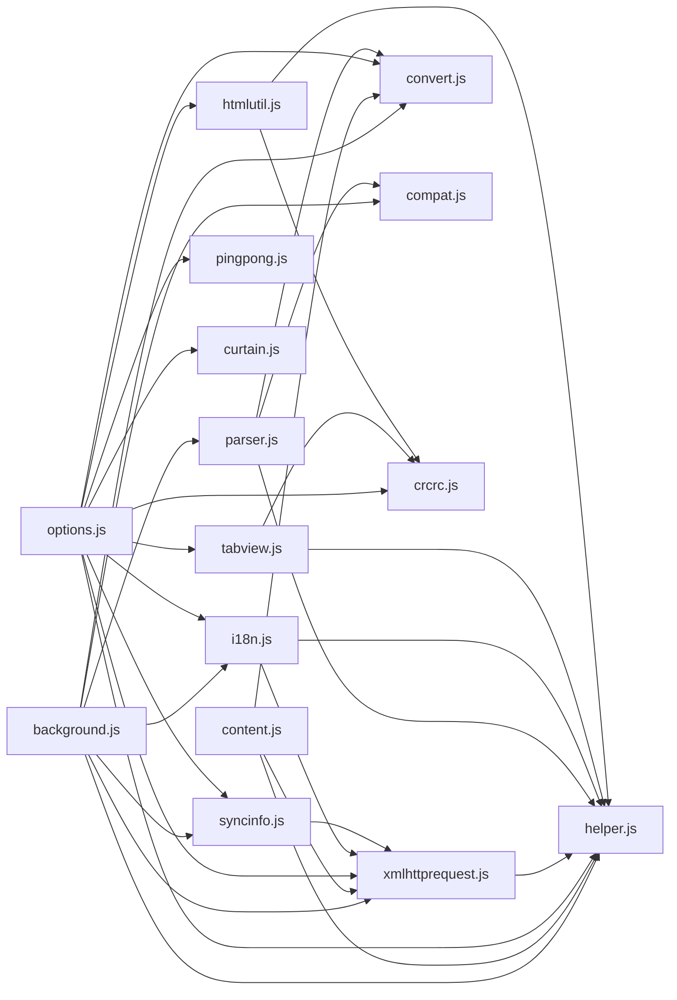

# 模块化设计

<cite>
**本文档引用的文件**
- [registry.js](file://src/registry.js)
- [background.js](file://src/background.js)
- [content.js](file://src/content.js)
- [options.js](file://src/options.js)
- [helper.js](file://src/helper.js)
- [xmlhttprequest.js](file://src/xmlhttprequest.js)
- [parser.js](file://src/parser.js)
- [compat.js](file://src/compat.js)
- [convert.js](file://src/convert.js)
- [i18n.js](file://src/i18n.js)
- [syncinfo.js](file://src/syncinfo.js)
- [tabview.js](file://src/tabview.js)
- [htmlutil.js](file://src/htmlutil.js)
- [curtain.js](file://src/curtain.js)
- [README.md](file://README.md)
</cite>

## 目录
1. [简介](#简介)
2. [项目结构](#项目结构)
3. [核心组件](#核心组件)
4. [架构总览](#架构总览)
5. [详细组件分析](#详细组件分析)
6. [依赖关系分析](#依赖关系分析)
7. [性能考量](#性能考量)
8. [故障排查指南](#故障排查指南)
9. [结论](#结论)
10. [附录](#附录)

## 简介
本文件系统性阐述 Tampermonkey 的模块化设计与注册表系统，重点覆盖以下主题：
- 注册表系统的模块注册机制、依赖管理与动态加载策略
- 模块间解耦设计、接口抽象与扩展点设计
- 模块初始化顺序、循环依赖检测与错误恢复机制
- 模块开发规范、命名约定与最佳实践
- 模块扩展示例与自定义模块开发指南
- 模块热加载、版本兼容性与向后兼容性策略
- 模块性能监控与调试技巧

## 项目结构
Tampermonkey 采用“按职责分模块”的组织方式，核心入口在后台页与内容页脚本中通过注册表进行模块化加载与协作。主要模块包括：
- 核心注册表：统一的模块注册、依赖声明与动态加载
- 工具与基础能力：辅助工具、HTTP 请求、解析器、兼容层、转换器、国际化等
- 视图与交互：选项页、标签视图、HTML 工具、遮罩提示等
- 背景页业务：脚本运行调度、上下文缓存、版本迁移、更新检查等

图表来源
- [registry.js:11-104](file://src/registry.js#L11-L104)
- [background.js:28-35](file://src/background.js#L28-L35)
- [content.js:80-92](file://src/content.js#L80-L92)
- [options.js:8-18](file://src/options.js#L8-L18)

章节来源
- [README.md:1-112](file://README.md#L1-L112)

## 核心组件
本节聚焦注册表系统与关键模块，阐明其职责、交互与扩展点。

- 注册表（Registry）
  - 提供模块注册、依赖声明、动态加载与回调机制
  - 支持原始资源缓存与按需加载
  - 提供加载完成通知与循环依赖规避
- 工具模块（helper.js）
  - 提供通用工具函数（序列化、正则、URL 处理、类型判断等）
  - 向注册表注册自身，供其他模块使用
- HTTP 请求模块（xmlhttprequest.js）
  - 封装跨域与本地资源访问，支持重试与进度回调
  - 向注册表注册运行接口
- 解析器模块（parser.js）
  - 解析用户脚本元数据与配置项
  - 生成脚本对象模型，供运行时使用
- 兼容层（compat.js）
  - 提供语法兼容转换，适配旧式脚本写法
- 编码转换（convert.js）
  - 提供 UTF-8/Base64 等编解码能力
- 国际化（i18n.js）
  - 提供消息获取与本地化切换
- 同步信息（syncinfo.js）
  - 提供脚本列表同步、时间校准与变更监听
- 视图与交互（tabview.js、htmlutil.js、curtain.js）
  - 提供选项页 UI 组件与交互提示

章节来源
- [registry.js:11-104](file://src/registry.js#L11-L104)
- [helper.js:184-208](file://src/helper.js#L184-L208)
- [xmlhttprequest.js:159-160](file://src/xmlhttprequest.js#L159-L160)
- [parser.js:284-285](file://src/parser.js#L284-L285)
- [compat.js:273-274](file://src/compat.js#L273-L274)
- [convert.js:31-38](file://src/convert.js#L31-L38)
- [i18n.js:132-139](file://src/i18n.js#L132-L139)
- [syncinfo.js:384-392](file://src/syncinfo.js#L384-L392)
- [tabview.js:324-325](file://src/tabview.js#L324-L325)
- [htmlutil.js:365-380](file://src/htmlutil.js#L365-L380)
- [curtain.js:217-218](file://src/curtain.js#L217-L218)

## 架构总览
注册表作为模块化中枢，贯穿后台页、内容页与选项页的模块加载与协作流程。下图展示了模块注册与依赖加载的总体流程：

图表来源
- [background.js:28-35](file://src/background.js#L28-L35)
- [content.js:80-92](file://src/content.js#L80-L92)
- [options.js:8-18](file://src/options.js#L8-L18)
- [registry.js:48-104](file://src/registry.js#L48-L104)

## 详细组件分析

### 注册表系统（Registry）
- 设计要点
  - 基于名称的模块注册与获取
  - 依赖声明与动态加载（按需拉取）
  - 加载完成回调队列与去重
  - 原始资源缓存与重复加载规避
- 关键流程
  - require：未注册则标记占位并发起加载
  - loadFile：通过 DOM 动态注入脚本或直接执行
  - register/get：注册模块对象并对外暴露
  - checkLoading/onLoad：检测所有依赖是否就绪并触发回调
- 循环依赖规避
  - 在 require 时将目标模块置空占位，避免重复加载
  - 通过占位与就绪检测实现基本的循环依赖防护

图表来源
- [registry.js:48-104](file://src/registry.js#L48-L104)

章节来源
- [registry.js:11-104](file://src/registry.js#L11-L104)

### 模块注册与依赖管理（以关键模块为例）
- helper.js
  - 通过注册表注册自身，提供通用工具函数
  - 被多个模块 require 使用
- xmlhttprequest.js
  - 依赖 helper，封装 HTTP 请求
  - 向注册表注册运行接口
- parser.js
  - 依赖 helper/convert/compat
  - 提供脚本解析与模型构建
- compat.js
  - 依赖 helper
  - 提供语法兼容转换
- convert.js
  - 提供编码转换能力
- i18n.js
  - 依赖 helper/xmlhttprequest
  - 提供本地化消息与语言包切换
- syncinfo.js
  - 依赖 xmlhttprequest
  - 提供脚本同步与时间校准
- tabview/htmlutil/curtain
  - 依赖 helper/crcrc 或其他模块
  - 提供 UI 组件与交互提示

章节来源
- [helper.js:184-208](file://src/helper.js#L184-L208)
- [xmlhttprequest.js:8-160](file://src/xmlhttprequest.js#L8-L160)
- [parser.js:9-285](file://src/parser.js#L9-L285)
- [compat.js:9-274](file://src/compat.js#L9-L274)
- [convert.js:31-38](file://src/convert.js#L31-L38)
- [i18n.js:8-139](file://src/i18n.js#L8-L139)
- [syncinfo.js:8-392](file://src/syncinfo.js#L8-L392)
- [tabview.js:8-325](file://src/tabview.js#L8-L325)
- [htmlutil.js:8-380](file://src/htmlutil.js#L8-L380)
- [curtain.js:10-218](file://src/curtain.js#L10-L218)

### 初始化顺序与上下文管理（背景页）
- 初始化阶段
  - 背景页在启动时声明所需模块依赖
  - 通过 requireCache 实现模块请求结果缓存，降低重复加载开销
  - 版本迁移与数据转换流程在初始化阶段执行
- 上下文注册（ctxRegistry）
  - 为每个标签页维护运行上下文，记录 URL、UA、统计信息等
  - 支持缓存命中与清理，减少重复计算
- 脚本运行调度
  - 根据 URL 与匹配规则确定待运行脚本集合
  - 支持缓存命中与运行统计

图表来源
- [background.js:28-35](file://src/background.js#L28-L35)
- [background.js:398-431](file://src/background.js#L398-L431)
- [background.js:437-558](file://src/background.js#L437-L558)

章节来源
- [background.js:28-391](file://src/background.js#L28-L391)
- [background.js:398-431](file://src/background.js#L398-L431)
- [background.js:437-558](file://src/background.js#L437-L558)

### 内容页模块加载与运行（content.js）
- 模块加载
  - 在内容页中声明所需模块依赖
  - 通过注册表获取模块实例并注入到页面环境
- 页面环境注入
  - 通过消息与事件机制将运行时能力注入页面上下文
  - 支持安全上下文与非安全上下文两种模式

章节来源
- [content.js:80-92](file://src/content.js#L80-L92)
- [content.js:108-215](file://src/content.js#L108-L215)
- [content.js:975-997](file://src/content.js#L975-L997)

### 选项页模块加载与 UI 构建（options.js）
- 模块加载
  - 选项页加载大量 UI 与工具模块
  - 通过 tabview/htmlutil/curtain 等模块构建复杂界面
- 数据处理
  - 使用 convert/i18n 等模块进行数据转换与本地化

章节来源
- [options.js:8-18](file://src/options.js#L8-L18)
- [options.js:25-35](file://src/options.js#L25-L35)

## 依赖关系分析
- 模块依赖图（部分）
  - background.js 依赖：xmlhttprequest、convert、compat、parser、helper、syncinfo、i18n
  - content.js 依赖：xmlhttprequest、convert、helper
  - options.js 依赖：xmlhttprequest、pingpong、crcrc、curtain、tabview、htmlutil、helper、convert、i18n、syncinfo
  - xmlhttprequest.js 依赖：helper
  - parser.js 依赖：helper、convert、compat
  - i18n.js 依赖：helper、xmlhttprequest
  - syncinfo.js 依赖：xmlhttprequest
  - tabview.js 依赖：crcrc、helper
  - htmlutil.js 依赖：crcrc、helper
  - helper.js 自身注册

图表来源
- [background.js:28-35](file://src/background.js#L28-L35)
- [content.js:80-92](file://src/content.js#L80-L92)
- [options.js:8-18](file://src/options.js#L8-L18)
- [xmlhttprequest.js:8-160](file://src/xmlhttprequest.js#L8-L160)
- [parser.js:9-285](file://src/parser.js#L9-L285)
- [i18n.js:8-139](file://src/i18n.js#L8-L139)
- [syncinfo.js:8-392](file://src/syncinfo.js#L8-L392)
- [tabview.js:8-325](file://src/tabview.js#L8-L325)
- [htmlutil.js:8-380](file://src/htmlutil.js#L8-L380)
- [helper.js:184-208](file://src/helper.js#L184-L208)

## 性能考量
- 模块缓存
  - requireCache：缓存最近请求的模块内容与响应头，降低重复网络开销
  - 清理周期：定期清理过期缓存，避免内存膨胀
- 加载策略
  - 动态注入脚本：通过 DOM 创建 script 标签异步加载，避免阻塞
  - 占位与就绪检测：防止重复加载与死锁
- 运行时优化
  - ctxRegistry 缓存：减少重复计算与状态查询
  - 事件与消息传递：最小化跨上下文通信成本

章节来源
- [background.js:398-431](file://src/background.js#L398-L431)
- [registry.js:76-92](file://src/registry.js#L76-L92)
- [background.js:437-558](file://src/background.js#L437-L558)

## 故障排查指南
- 模块未找到
  - 症状：控制台输出“未 require 或未找到”类日志
  - 排查：确认模块是否已通过 require 声明并在注册表中注册
- 循环依赖
  - 症状：模块加载卡住或报错
  - 排查：检查模块间相互 require 的链路，利用占位与就绪检测机制
- 加载失败
  - 症状：动态加载抛出异常
  - 排查：检查 loadFile 流程与网络权限；确认文件路径正确
- 国际化与本地化
  - 症状：消息未翻译或参数不匹配
  - 排查：确认 setLocale 成功加载语言包；检查消息键与占位符

章节来源
- [registry.js:48-104](file://src/registry.js#L48-L104)
- [i18n.js:94-139](file://src/i18n.js#L94-L139)

## 结论
Tampermonkey 的模块化设计以注册表为核心，实现了：
- 明确的模块注册与依赖声明
- 动态加载与缓存策略
- 解耦的模块接口与扩展点
- 初步的循环依赖规避与错误恢复
在此基础上，建议进一步完善：
- 显式的模块生命周期钩子（初始化/销毁）
- 更强的循环依赖检测与报告
- 模块热替换与增量更新支持
- 统一的版本与兼容性策略文档

## 附录

### 模块开发规范与最佳实践
- 命名约定
  - 模块名使用小写与下划线，避免特殊字符
  - 模块注册名与文件名保持一致
- 依赖声明
  - 在模块开头显式 require 所需依赖
  - 避免隐式全局依赖
- 接口抽象
  - 通过注册表统一导出接口，隐藏内部实现
  - 对外仅暴露必要方法与常量
- 错误处理
  - 对外部依赖进行健壮性检查
  - 记录可追踪的日志，便于调试
- 性能优化
  - 合理使用缓存与延迟加载
  - 控制模块体积与加载数量

### 模块扩展示例与自定义模块开发指南
- 新增模块步骤
  - 在模块文件顶部声明对 helper 等基础模块的依赖
  - 在模块末尾通过注册表注册导出对象
  - 在需要使用的入口（background/content/options）中 require 该模块
- 示例参考
  - helper.js：通用工具注册
  - xmlhttprequest.js：HTTP 请求封装与注册
  - parser.js：脚本解析与模型注册
  - i18n.js：本地化消息与语言包注册

章节来源
- [helper.js:184-208](file://src/helper.js#L184-L208)
- [xmlhttprequest.js:155-160](file://src/xmlhttprequest.js#L155-L160)
- [parser.js:284-285](file://src/parser.js#L284-L285)
- [i18n.js:132-139](file://src/i18n.js#L132-L139)