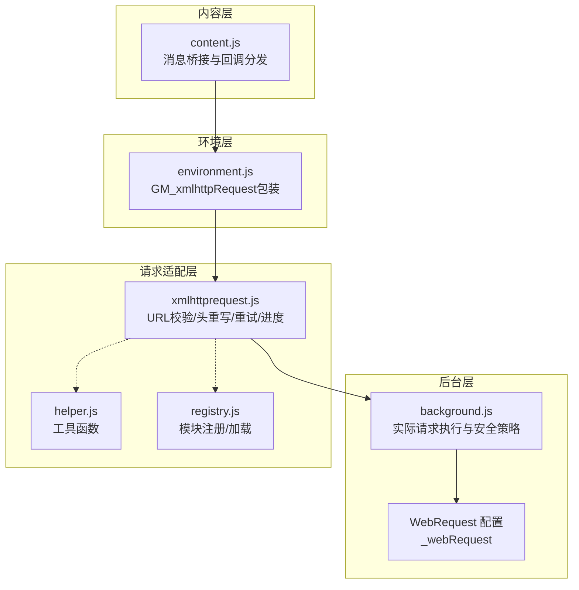
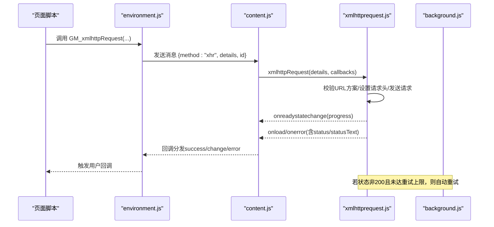
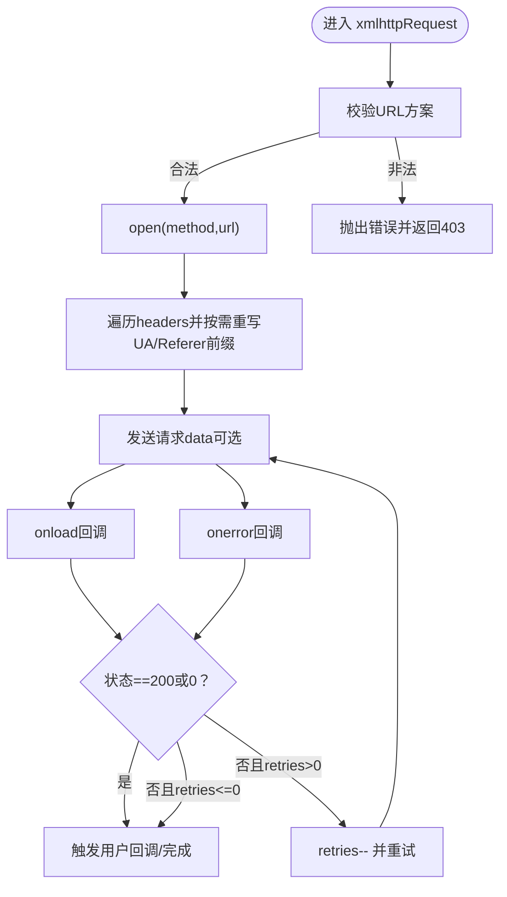
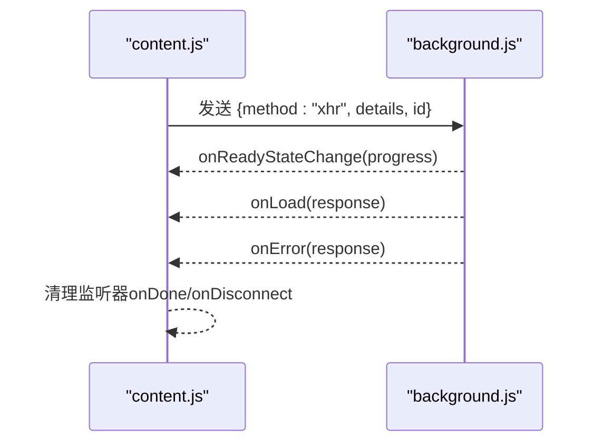
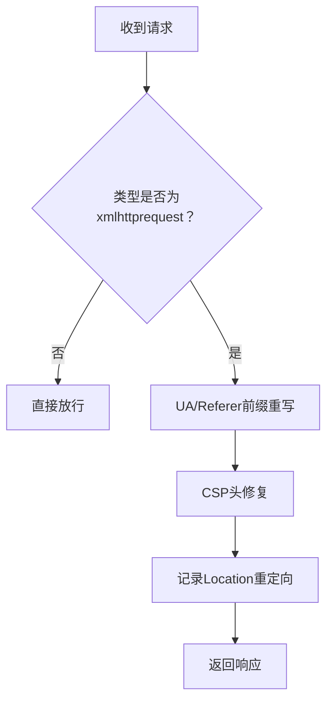
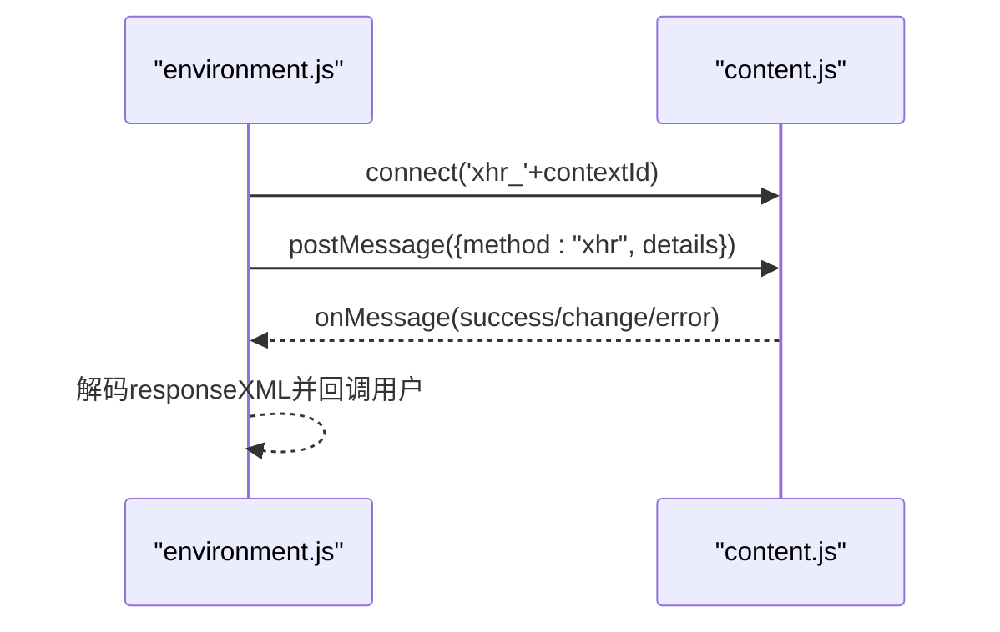
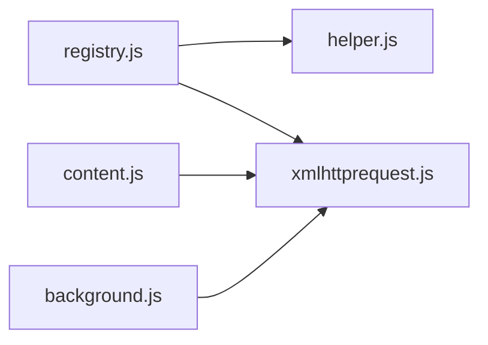

# XMLHTTP 请求处理

<cite>
**本文档引用的文件**
- [xmlhttprequest.js](file://src/xmlhttprequest.js)
- [content.js](file://src/content.js)
- [background.js](file://src/background.js)
- [environment.js](file://src/environment.js)
- [helper.js](file://src/helper.js)
- [registry.js](file://src/registry.js)
- [compat.js](file://src/compat.js)
</cite>

## 目录
1. [简介](#简介)
2. [项目结构](#项目结构)
3. [核心组件](#核心组件)
4. [架构总览](#架构总览)
5. [详细组件分析](#详细组件分析)
6. [依赖关系分析](#依赖关系分析)
7. [性能考量](#性能考量)
8. [故障排查指南](#故障排查指南)
9. [结论](#结论)
10. [附录](#附录)

## 简介
本文件系统性地解析 Tampermonkey 中的 XMLHTTP 请求处理机制，重点覆盖：
- 跨域请求支持与安全机制
- URL 方案验证、请求头重写与响应处理策略
- 错误重试与超时处理逻辑
- 支持的 HTTP 方法、头部字段与状态码处理
- 与浏览器安全策略（CSP、脚本拦截器）的兼容性与限制
- 性能优化建议与调试技巧

## 项目结构
XMLHTTP 请求处理由三部分协作完成：
- 内容层（content.js）：在页面上下文中封装 GM_xmlhttpRequest，负责消息传递与回调桥接
- 后台层（background.js）：执行实际的网络请求，处理请求头、CSP 修复、重定向与安全策略
- 请求适配层（xmlhttprequest.js）：统一的请求适配器，负责 URL 校验、请求头重写、响应状态与进度上报、错误重试

图表来源
- [content.js:309-342](file://src/content.js#L309-L342)
- [environment.js:700-747](file://src/environment.js#L700-L747)
- [xmlhttprequest.js:17-160](file://src/xmlhttprequest.js#L17-L160)
- [background.js:55-70](file://src/background.js#L55-L70)

章节来源
- [content.js:309-342](file://src/content.js#L309-L342)
- [environment.js:700-747](file://src/environment.js#L700-L747)
- [xmlhttprequest.js:17-160](file://src/xmlhttprequest.js#L17-L160)
- [background.js:55-70](file://src/background.js#L55-L70)

## 核心组件
- 请求适配器（xmlhttprequest.js）
  - 提供统一的 xmlhttpRequest(details, callback, onreadychange, onerr, done, internal)
  - 实现 URL 方案验证、请求头重写、响应状态与进度上报、错误重试
- 内容桥接（content.js）
  - 将页面调用转发到后台执行，处理响应回调与连接断开清理
- 后台执行（background.js）
  - 执行实际请求，应用 WebRequest 头重写策略，修复 CSP，处理重定向
- 工具与注册（helper.js, registry.js）
  - 提供 URL 校验、字符串解析等工具；模块注册与动态加载

章节来源
- [xmlhttprequest.js:17-160](file://src/xmlhttprequest.js#L17-L160)
- [content.js:309-342](file://src/content.js#L309-L342)
- [background.js:55-70](file://src/background.js#L55-L70)
- [helper.js:82-87](file://src/helper.js#L82-L87)
- [registry.js:35-47](file://src/registry.js#L35-L47)

## 架构总览
下图展示了从页面调用到后台执行再到响应返回的完整流程，包括错误重试与进度上报。

图表来源
- [environment.js:700-747](file://src/environment.js#L700-L747)
- [content.js:309-342](file://src/content.js#L309-L342)
- [xmlhttprequest.js:62-93](file://src/xmlhttprequest.js#L62-L93)
- [background.js:5970-5977](file://src/background.js#L5970-L5977)

## 详细组件分析

### 组件A：请求适配器（xmlhttprequest.js）
- URL 方案验证
  - 仅允许 http/https 或本地图片资源；非法方案直接抛错并返回 403 Forbidden
- 请求头重写
  - 当启用 WebRequest 时，对 User-Agent 与 Referer 进行前缀重写，避免被目标站点识别为扩展流量
- 响应处理
  - 统一 responseState 结构，包含 readyState、status、statusText、responseHeaders、finalUrl
  - 对 responseXML 进行转义处理，避免跨上下文传输破坏
  - 在 responseType 非空时直接透传底层 response
- 进度上报
  - 优先使用事件参数中的 lengthComputable/totalSize
  - 否则尝试从 Content-Length 解析总大小
- 错误重试
  - onload/onerror 时若状态非 200/0 且 retries > 0，则递减重试次数并重新发起请求
- 超时处理
  - 代码中未显式设置超时时间；可通过外部设置 details.timeout 控制（如存在），否则依赖浏览器默认行为

图表来源
- [xmlhttprequest.js:114-152](file://src/xmlhttprequest.js#L114-L152)
- [xmlhttprequest.js:62-93](file://src/xmlhttprequest.js#L62-L93)

章节来源
- [xmlhttprequest.js:12-15](file://src/xmlhttprequest.js#L12-L15)
- [xmlhttprequest.js:115-127](file://src/xmlhttprequest.js#L115-L127)
- [xmlhttprequest.js:118-138](file://src/xmlhttprequest.js#L118-L138)
- [xmlhttprequest.js:45-60](file://src/xmlhttprequest.js#L45-L60)
- [xmlhttprequest.js:94-110](file://src/xmlhttprequest.js#L94-L110)
- [xmlhttprequest.js:62-93](file://src/xmlhttprequest.js#L62-L93)

### 组件B：内容桥接（content.js）
- 消息路由
  - 将页面请求通过 chromeEmu.runRequest/runContentRequest 转发至后台
- 响应回调
  - 将后台返回的 onLoad/onReadyStateChange/onError 包装后回调给页面
- 连接断开清理
  - onDone 时发送断开信号，清理监听器

图表来源
- [content.js:309-342](file://src/content.js#L309-L342)
- [content.js:319-336](file://src/content.js#L319-L336)

章节来源
- [content.js:309-342](file://src/content.js#L309-L342)
- [content.js:319-336](file://src/content.js#L319-L336)

### 组件C：后台执行与安全策略（background.js）
- WebRequest 头重写
  - 通过 _webRequest.use/_webRequest.prefix 对 UA/Referer 进行前缀重写
  - 仅在类型为 xmlhttprequest 时生效
- CSP 修复
  - 自动替换 X-WebKit-CSP/X-Content-Security-Policy，允许扩展域名与内联脚本/求值
- 重定向跟踪
  - 记录 Location 头并在一定时间内清理，避免内存泄漏
- 全局重试与延迟
  - _retries 全局重试次数；_setTimeout 控制检查周期

图表来源
- [background.js:5970-5977](file://src/background.js#L5970-L5977)
- [background.js:5904-5913](file://src/background.js#L5904-L5913)
- [background.js:5886-5904](file://src/background.js#L5886-L5904)
- [background.js:60-62](file://src/background.js#L60-L62)

章节来源
- [background.js:5970-5977](file://src/background.js#L5970-L5977)
- [background.js:5904-5913](file://src/background.js#L5904-L5913)
- [background.js:5886-5904](file://src/background.js#L5886-L5904)
- [background.js:60-62](file://src/background.js#L60-L62)

### 组件D：环境包装（environment.js）
- GM_xmlhttpRequest 包装
  - 无 responseType 时通过端口连接后台执行；有 responseType 时直接调用后台
  - 将 responseXML 进行解码处理后再回调
- 回调分发
  - success/onreadystatechange/onerror 分别映射到用户回调

图表来源
- [environment.js:700-747](file://src/environment.js#L700-L747)

章节来源
- [environment.js:700-747](file://src/environment.js#L700-L747)

## 依赖关系分析
- 模块注册与加载
  - xmlhttprequest.js 通过 Registry.require('helper') 获取工具函数
  - content.js 通过 Registry.require("xmlhttprequest") 引入适配器
- 工具函数
  - helper.js 提供 isLocalImage 用于本地资源判断
  - 用于 validScheme 的 URL 校验

图表来源
- [registry.js:35-47](file://src/registry.js#L35-L47)
- [xmlhttprequest.js:8-9](file://src/xmlhttprequest.js#L8-L9)
- [content.js:80-82](file://src/content.js#L80-L82)

章节来源
- [registry.js:35-47](file://src/registry.js#L35-L47)
- [xmlhttprequest.js:8-9](file://src/xmlhttprequest.js#L8-L9)
- [content.js:80-82](file://src/content.js#L80-L82)

## 性能考量
- 重试策略
  - onload/onerror 时若状态非 200/0 且 retries > 0 则重试，避免瞬时失败导致任务失败
  - 建议合理设置 retries，避免无限重试造成资源浪费
- 进度上报
  - 优先使用事件参数中的长度信息；若不可用则回退到 Content-Length 解析
  - 注意 Content-Length 可能缺失，此时进度为未知
- 头重写与 CSP 修复
  - UA/Referer 前缀重写与 CSP 修复会增加少量 CPU 开销，但显著提升跨域成功率
- 缓存与复用
  - 背景页维护 requireCache，减少重复下载与解析成本（与 XMLHTTP 间接相关）

章节来源
- [xmlhttprequest.js:62-93](file://src/xmlhttprequest.js#L62-L93)
- [xmlhttprequest.js:94-110](file://src/xmlhttprequest.js#L94-L110)
- [background.js:398-431](file://src/background.js#L398-L431)

## 故障排查指南
- URL 方案错误
  - 现象：返回 403 Forbidden
  - 排查：确认 URL 是否为 http/https 或本地图片资源
  - 参考路径：[xmlhttprequest.js:115-117](file://src/xmlhttprequest.js#L115-L117)
- 跨域失败（CORS）
  - 现象：目标站点拒绝访问
  - 排查：检查后台 CSP 修复是否生效；确认 UA/Referer 前缀重写是否正确
  - 参考路径：[background.js:5904-5913](file://src/background.js#L5904-L5913)，[background.js:5970-5977](file://src/background.js#L5970-L5977)
- 进度不准确
  - 现象：progress.totalSize 未知
  - 排查：确认服务端是否返回 Content-Length；或使用 lengthComputable/totalSize
  - 参考路径：[xmlhttprequest.js:98-107](file://src/xmlhttprequest.js#L98-L107)
- 重试无效
  - 现象：状态非 200/0 仍不重试
  - 排查：确认 details.retries 是否大于 0；检查 onload/onerror 触发条件
  - 参考路径：[xmlhttprequest.js:64-72](file://src/xmlhttprequest.js#L64-L72)，[xmlhttprequest.js:78-85](file://src/xmlhttprequest.js#L78-L85)
- 回调未触发
  - 现象：onload/onerror 未回调
  - 排查：确认 content.js 的消息路由与回调分发；检查 onDone 是否清理了监听器
  - 参考路径：[content.js:319-336](file://src/content.js#L319-L336)，[content.js:332-335](file://src/content.js#L332-L335)

章节来源
- [xmlhttprequest.js:115-117](file://src/xmlhttprequest.js#L115-L117)
- [xmlhttprequest.js:64-72](file://src/xmlhttprequest.js#L64-L72)
- [xmlhttprequest.js:78-85](file://src/xmlhttprequest.js#L78-L85)
- [xmlhttprequest.js:98-107](file://src/xmlhttprequest.js#L98-L107)
- [background.js:5904-5913](file://src/background.js#L5904-L5913)
- [background.js:5970-5977](file://src/background.js#L5970-L5977)
- [content.js:319-336](file://src/content.js#L319-L336)
- [content.js:332-335](file://src/content.js#L332-L335)

## 结论
- 该实现通过“内容层消息桥接 + 后台执行 + 请求适配器”的分层设计，实现了对跨域请求的稳健支持
- URL 方案验证与请求头重写有效规避了部分安全限制，CSP 修复进一步提升兼容性
- 错误重试与进度上报增强了可用性；全局重试与延迟控制有助于平衡稳定性与性能
- 建议在生产环境中合理设置 retries 与超时，关注 Content-Length 缺失导致的进度未知问题

## 附录

### 支持的 HTTP 方法与头部字段
- HTTP 方法
  - 通过 details.method 传入，底层使用 XMLHttpRequest.open
  - 参考路径：[xmlhttprequest.js:118](file://src/xmlhttprequest.js#L118)
- 头部字段
  - 支持自定义 headers；UA/Referer 在启用 WebRequest 时会被前缀重写
  - 参考路径：[xmlhttprequest.js:119-127](file://src/xmlhttprequest.js#L119-L127)，[background.js:5970-5977](file://src/background.js#L5970-L5977)

### 状态码处理
- onload/onerror 时若状态非 200/0 且 retries > 0 则重试
- 返回 403 Forbidden 用于 URL 方案非法场景
- 参考路径：[xmlhttprequest.js:64-72](file://src/xmlhttprequest.js#L64-L72)，[xmlhttprequest.js:78-85](file://src/xmlhttprequest.js#L78-L85)，[xmlhttprequest.js:141-149](file://src/xmlhttprequest.js#L141-L149)

### 与浏览器安全策略的兼容性
- CSP 修复
  - 替换 X-WebKit-CSP/X-Content-Security-Policy，允许扩展域名与内联脚本/求值
  - 参考路径：[background.js:5904-5913](file://src/background.js#L5904-L5913)
- 脚本拦截器
  - 通过 unsafeWindow 与事件注入绕过部分脚本拦截器限制
  - 参考路径：[content.js:456-608](file://src/content.js#L456-L608)

### 代码示例（路径指引）
- 基本 GET 请求
  - [xmlhttprequest.js:118-138](file://src/xmlhttprequest.js#L118-L138)
- 自定义请求头与 UA/Referer 重写
  - [xmlhttprequest.js:119-127](file://src/xmlhttprequest.js#L119-L127)，[background.js:5970-5977](file://src/background.js#L5970-L5977)
- 进度上报
  - [xmlhttprequest.js:94-110](file://src/xmlhttprequest.js#L94-L110)
- 错误重试
  - [xmlhttprequest.js:62-93](file://src/xmlhttprequest.js#L62-L93)
- 页面调用包装
  - [environment.js:700-747](file://src/environment.js#L700-L747)