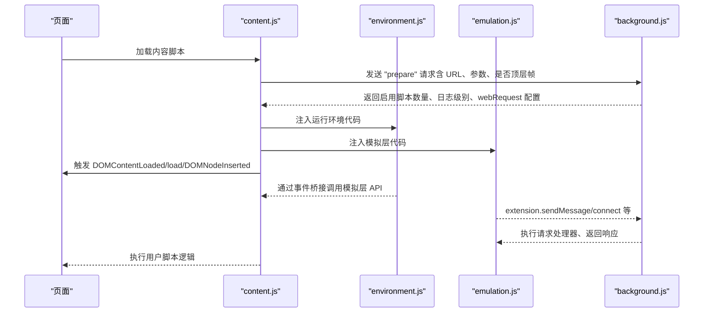
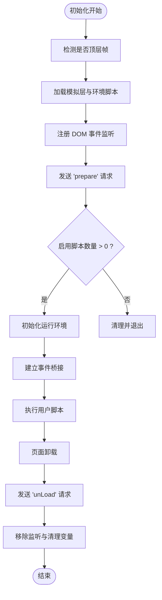
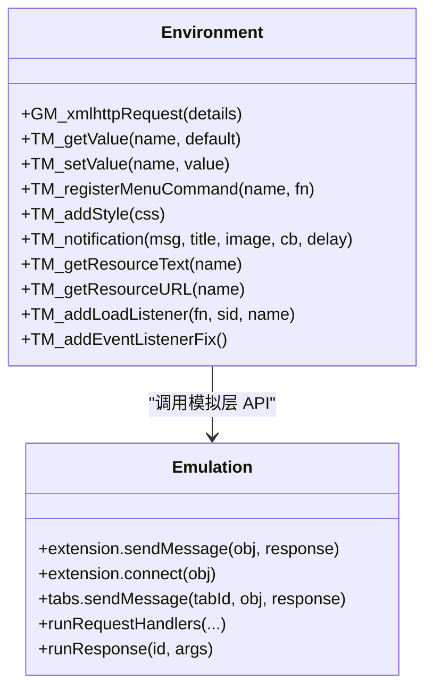
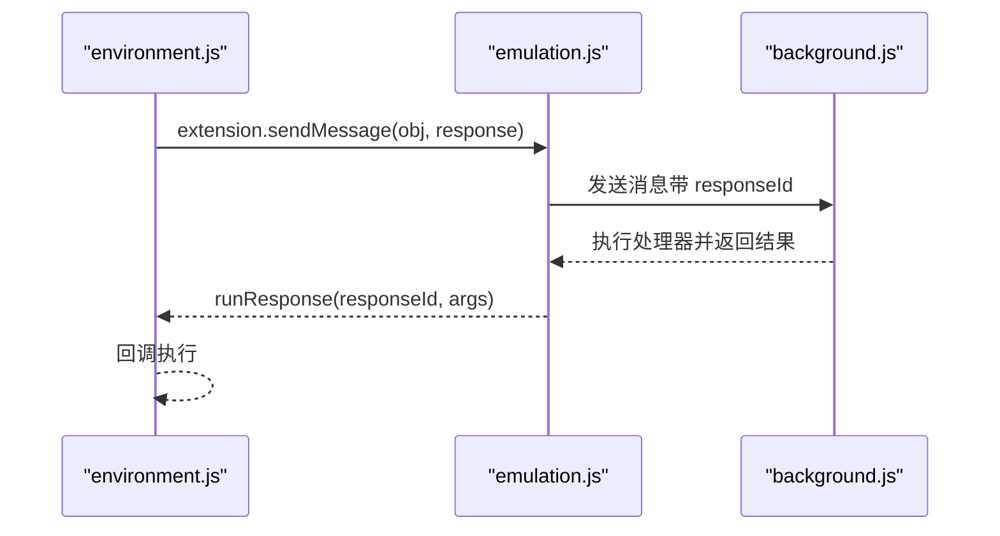
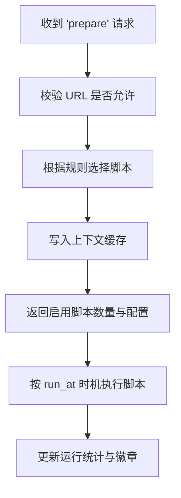
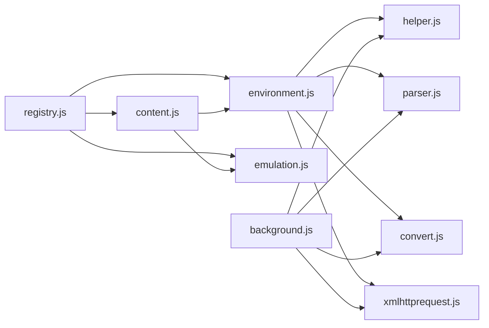

# 内容脚本系统

<cite>
**本文档引用的文件**
- [content.js](file://src/content.js)
- [environment.js](file://src/environment.js)
- [emulation.js](file://src/emulation.js)
- [background.js](file://src/background.js)
- [xmlhttprequest.js](file://src/xmlhttprequest.js)
- [registry.js](file://src/registry.js)
- [helper.js](file://src/helper.js)
- [parser.js](file://src/parser.js)
- [convert.js](file://src/convert.js)
- [README.md](file://README.md)
</cite>

## 目录
1. [简介](#简介)
2. [项目结构](#项目结构)
3. [核心组件](#核心组件)
4. [架构总览](#架构总览)
5. [详细组件分析](#详细组件分析)
6. [依赖关系分析](#依赖关系分析)
7. [性能考虑](#性能考虑)
8. [故障排除指南](#故障排除指南)
9. [结论](#结论)

## 简介
本文件系统性阐述 Tampermonkey 内容脚本（Content Script）系统的实现机制，重点覆盖以下方面：
- 内容脚本如何在网页环境中注入与执行用户脚本
- 环境模拟与 API 桥接机制
- 与页面 DOM 的交互方式与安全边界
- 脚本执行时机、条件匹配与动态加载策略
- 与后台脚本的通信协议与消息传递机制
- 性能优化与内存管理策略

该系统通过“内容页注入 + 后台调度”的双层架构，在保证安全的前提下，为用户脚本提供接近原生浏览器扩展的运行能力。

## 项目结构
项目采用模块化设计，核心文件职责如下：
- content.js：内容页入口，负责初始化、事件桥接、脚本注入与清理
- environment.js：用户脚本运行环境，提供 GM_* API、DOM 事件重发、存储监听等
- emulation.js：Chrome API 模拟层，将后台能力映射到内容页运行时
- background.js：后台调度器，决定何时何地运行哪些脚本，维护上下文注册表
- xmlhttprequest.js：网络请求封装，支持跨域与请求头改写
- registry.js：模块注册与懒加载机制
- helper.js：通用工具函数（正则、序列化、URL 处理等）
- parser.js：用户脚本元数据解析（@include/@match/@run-at 等）
- convert.js：编码转换工具（Base64、UTF-8）

```mermaid
graph TB
subgraph "内容页"
C["content.js<br/>内容页入口"]
E["environment.js<br/>运行环境"]
M["emulation.js<br/>Chrome API 模拟"]
R["registry.js<br/>模块注册"]
H["helper.js<br/>工具函数"]
X["xmlhttprequest.js<br/>网络请求"]
P["parser.js<br/>元数据解析"]
K["convert.js<br/>编码转换"]
end
subgraph "后台"
B["background.js<br/>调度与上下文管理"]
end
C --> E
C --> M
C --> R
E --> M
E --> X
E --> H
E --> P
E --> K
C <- --> B
M <- --> B
```

图表来源
- [content.js:1-1202](file://src/content.js#L1-1202)
- [environment.js:1-1337](file://src/environment.js#L1-1337)
- [emulation.js:1-329](file://src/emulation.js#L1-329)
- [background.js:1-6327](file://src/background.js#L1-6327)
- [xmlhttprequest.js:1-161](file://src/xmlhttprequest.js#L1-161)
- [registry.js:1-107](file://src/registry.js#L1-107)
- [helper.js:1-209](file://src/helper.js#L1-209)
- [parser.js:1-286](file://src/parser.js#L1-286)
- [convert.js:1-39](file://src/convert.js#L1-39)

章节来源
- [README.md:1-112](file://README.md#L1-L112)

## 核心组件
- 内容页初始化与事件桥接
  - 初始化阶段：检测是否为顶层帧、准备日志级别、加载模拟层与环境脚本
  - 事件桥接：通过自定义 MutationEvent 在内容页与后台之间传递消息
  - 清理机制：卸载时通知后台、移除监听、释放全局变量
- 运行环境（Environment）
  - 提供 GM_* API（GM_xmlhttpRequest、GM_setValue、GM_getValue 等）
  - DOM 事件重发与监听（DOMContentLoaded、load、DOMNodeInserted）
  - 存储监听端口、菜单命令注册、资源文本/URL 获取
- Chrome API 模拟（Emulation）
  - 将后台能力映射到内容页运行时，如 extension.sendMessage/connect、tabs 接口
  - 响应回调管理、端口消息转发、响应 ID 分配与回收
- 后台调度（Background）
  - 上下文注册表（按标签页维护），记录 URL、UA、运行统计
  - 条件匹配与脚本选择（基于 @include/@match/@run-at）
  - 动态加载与执行用户脚本，处理本地文件权限与 webRequest 配置
- 网络与工具
  - xmlhttprequest.js：统一网络请求封装，支持重试、进度回调、响应类型
  - helper.js：URL 正则转换、序列化、HTML 编解码
  - parser.js：元数据解析与兼容性处理
  - convert.js：Base64/UTF-8 编解码

章节来源
- [content.js:1-1202](file://src/content.js#L1-1202)
- [environment.js:1-1337](file://src/environment.js#L1-1337)
- [emulation.js:1-329](file://src/emulation.js#L1-329)
- [background.js:1-6327](file://src/background.js#L1-6327)
- [xmlhttprequest.js:1-161](file://src/xmlhttprequest.js#L1-161)
- [helper.js:1-209](file://src/helper.js#L1-209)
- [parser.js:1-286](file://src/parser.js#L1-286)
- [convert.js:1-39](file://src/convert.js#L1-39)

## 架构总览
内容脚本系统采用“内容页注入 + 后台调度”的分层架构：
- 内容页负责 DOM 注入、事件桥接与运行环境初始化
- 后台负责脚本选择、上下文注册与消息路由
- 模拟层将后台能力以安全可控的方式暴露给内容页运行时



图表来源
- [content.js:1120-1198](file://src/content.js#L1120-1198)
- [environment.js:1249-1332](file://src/environment.js#L1249-1332)
- [emulation.js:109-170](file://src/emulation.js#L109-170)
- [background.js:4322-4393](file://src/background.js#L4322-4393)

## 详细组件分析

### 组件A：内容页初始化与事件桥接
- 初始化流程
  - 检测顶层帧与本地文件场景，准备日志级别
  - 加载模拟层与环境脚本，设置 webRequest 配置
  - 注册 DOM 事件监听（DOMContentLoaded、DOMNodeInserted、unload）
  - 通过后台“prepare”接口确定是否需要运行脚本
- 事件桥接机制
  - 使用自定义 MutationEvent 名称（如 TM_toContent/TM_toPage）进行消息传递
  - 通过 Converter 对消息体进行编码/解码
  - 支持安全上下文与脚本拦截器绕过两种模式
- 清理与卸载
  - 卸载时发送“unLoad”请求，更新上下文统计
  - 移除所有监听与临时变量，触发环境清理



图表来源
- [content.js:1063-1198](file://src/content.js#L1063-1198)
- [content.js:827-962](file://src/content.js#L827-962)
- [content.js:1030-1061](file://src/content.js#L1030-1061)

章节来源
- [content.js:1-1202](file://src/content.js#L1-1202)

### 组件B：运行环境（Environment）
- GM_* API 实现
  - GM_xmlhttpRequest：支持 onload/readystatechange/error 回调与 responseType
  - 存储 API：TM_getValue/TM_setValue/TM_deleteValue/TM_listValues
  - 菜单命令：TM_registerMenuCommand
  - 页面操作：TM_addStyle、TM_notification、TM_setClipboard
  - 资源访问：TM_getResourceText/TM_getResourceURL
- DOM 事件重发
  - 重发 DOMContentLoaded/load/DOMNodeInserted 事件，确保用户脚本可感知
  - 修复 document.evaluate、window.open、定时器字符串执行等兼容问题
- 存储监听
  - 通过端口监听后台存储变化，实时通知用户脚本



图表来源
- [environment.js:646-1131](file://src/environment.js#L646-1131)
- [emulation.js:109-170](file://src/emulation.js#L109-170)

章节来源
- [environment.js:1-1337](file://src/environment.js#L1-1337)
- [emulation.js:1-329](file://src/emulation.js#L1-329)

### 组件C：Chrome API 模拟（Emulation）
- 消息与端口管理
  - 响应 ID 分配与回调注册，避免消息错配
  - extension.sendMessage/connect 包装，支持 onMessage/onDisconnect
- 请求处理链路
  - runRequest/runContentRequest：从内容页接收请求，转发至后台处理器
  - runResponse/runConnectResponse：将后台响应回传给内容页
- 兼容性与错误处理
  - JSON 解析失败时的降级处理
  - 端口断开时的清理逻辑



图表来源
- [emulation.js:109-170](file://src/emulation.js#L109-170)
- [background.js:4496-4541](file://src/background.js#L4496-4541)

章节来源
- [emulation.js:1-329](file://src/emulation.js#L1-329)
- [background.js:1-6327](file://src/background.js#L1-6327)

### 组件D：后台调度与上下文管理
- 上下文注册表
  - 按标签页维护 URL 计数、UA、运行统计、缓存
  - 支持空闲检测与清理
- 脚本选择与执行
  - 基于 @include/@match/@run-at/@noframes 等规则筛选
  - 优先级：document-start/document-body/document-end
- 本地文件与 webRequest
  - 本地文件权限检测与回退方案
  - webRequest 配置验证与重试



图表来源
- [background.js:4322-4393](file://src/background.js#L4322-4393)
- [background.js:560-640](file://src/background.js#L560-640)

章节来源
- [background.js:1-6327](file://src/background.js#L1-6327)

### 组件E：网络请求与工具库
- xmlhttprequest.js
  - 统一封装 XMLHttpRequest，支持重试、进度回调、响应类型
  - 支持 webRequest 头部改写与最终 URL 获取
- helper.js
  - URL 正则转换、序列化、HTML 编解码
  - 本地图片识别、URL 参数解析
- convert.js
  - Base64/UTF-8 编解码与通用转义/反转义

章节来源
- [xmlhttprequest.js:1-161](file://src/xmlhttprequest.js#L1-161)
- [helper.js:1-209](file://src/helper.js#L1-209)
- [convert.js:1-39](file://src/convert.js#L1-39)

## 依赖关系分析
- 模块注册与懒加载
  - registry.js 提供 require/register/get/loadFile 等能力
  - content.js 通过 Registry.require 引入 xmlhttprequest/convert/helper
- 运行时依赖链
  - content.js 依赖 environment.js 与 emulation.js（通过 Registry.getRaw 注入）
  - environment.js 依赖 emulation.js、xmlhttprequest.js、helper.js、parser.js、convert.js
  - background.js 依赖 parser.js、helper.js、convert.js、xmlhttprequest.js 等



图表来源
- [registry.js:1-107](file://src/registry.js#L1-107)
- [content.js:80-91](file://src/content.js#L80-91)
- [environment.js:1-35](file://src/environment.js#L1-35)
- [background.js:28-35](file://src/background.js#L28-35)

章节来源
- [registry.js:1-107](file://src/registry.js#L1-107)
- [content.js:1-1202](file://src/content.js#L1-1202)
- [environment.js:1-1337](file://src/environment.js#L1-1337)
- [background.js:1-6327](file://src/background.js#L1-6327)

## 性能考虑
- 事件桥接与延迟执行
  - DOMContentLoaded/load/DOMNodeInserted 事件通过队列与延迟（window.setTimeout）触发，避免阻塞主线程
- 网络请求优化
  - xmlhttprequest.js 支持重试与进度回调，减少失败重试对用户体验的影响
  - 响应类型判断（responseType）避免不必要的文本解析
- 内存管理
  - 清理数组 Clean 逐项释放属性与监听器，防止内存泄漏
  - 端口断开后及时清理监听器与临时对象
- 日志与调试
  - 可配置的日志级别（D/V/EV/ENV/EMV/TS/CV）用于性能分析与问题定位

章节来源
- [environment.js:309-323](file://src/environment.js#L309-323)
- [environment.js:1236-1244](file://src/environment.js#L1236-1244)
- [xmlhttprequest.js:62-92](file://src/xmlhttprequest.js#L62-92)
- [content.js:1053-1060](file://src/content.js#L1053-1060)

## 故障排除指南
- 脚本未执行
  - 检查后台“prepare”返回的启用脚本数量是否为 0
  - 确认 URL 是否被黑名单过滤或 @noframes 限制
- 事件未触发
  - 确认 DOMContentLoaded/load/DOMNodeInserted 是否已触发
  - 检查环境层是否正确重发事件（TM_addEventListenerFix）
- 网络请求失败
  - 检查 webRequest 配置与头部改写是否生效
  - 观察重试逻辑与最终 URL 获取
- 存储监听无效
  - 确认 storageListener 端口已连接且未断开
  - 检查键值变更通知是否被正确派发

章节来源
- [background.js:4322-4393](file://src/background.js#L4322-4393)
- [environment.js:820-850](file://src/environment.js#L820-850)
- [xmlhttprequest.js:114-152](file://src/xmlhttprequest.js#L114-152)

## 结论
Tampermonkey 的内容脚本系统通过“内容页注入 + 后台调度 + 模拟层桥接”的架构，在保障安全与稳定的同时，实现了对用户脚本的高效执行与丰富的 API 能力。其关键优势包括：
- 安全可控的事件桥接与 API 模拟
- 精细的脚本执行时机控制与条件匹配
- 完善的网络请求与存储监听机制
- 良好的性能与内存管理策略