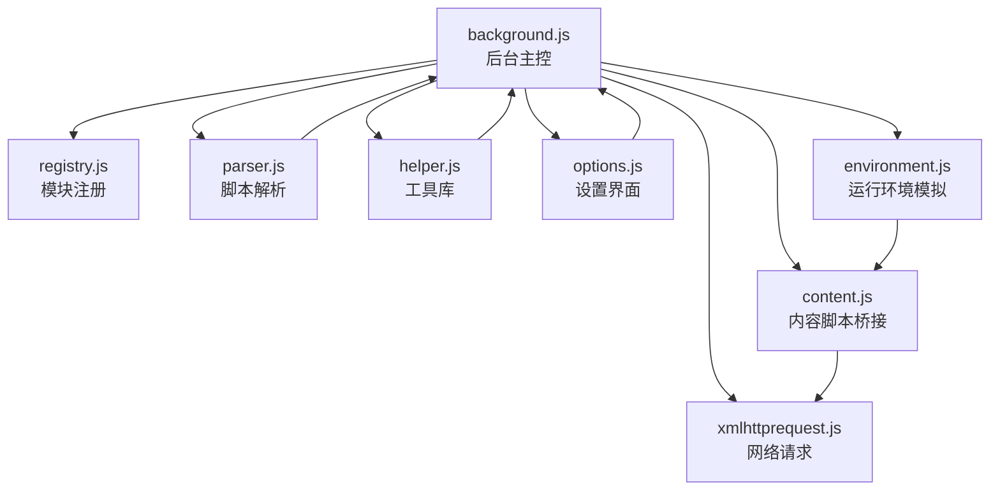
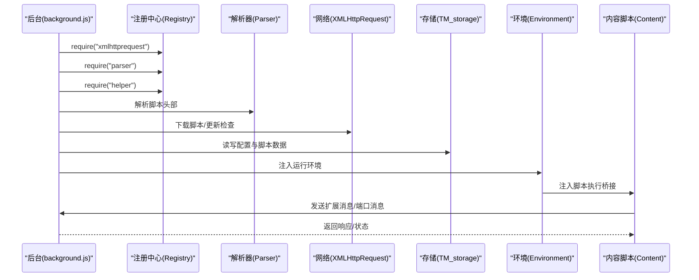
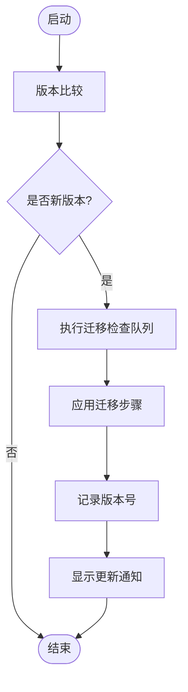
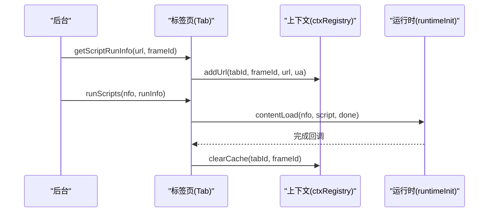
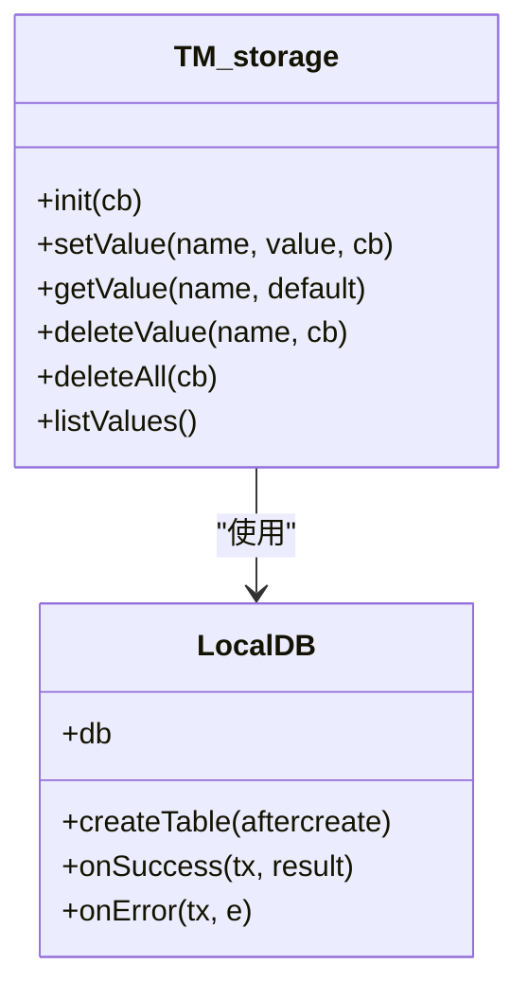
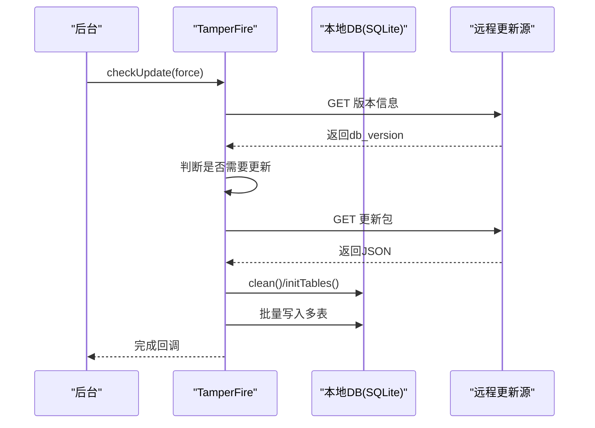
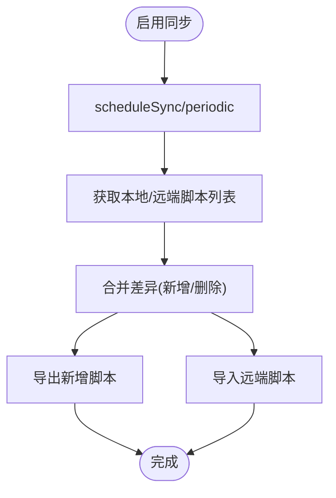
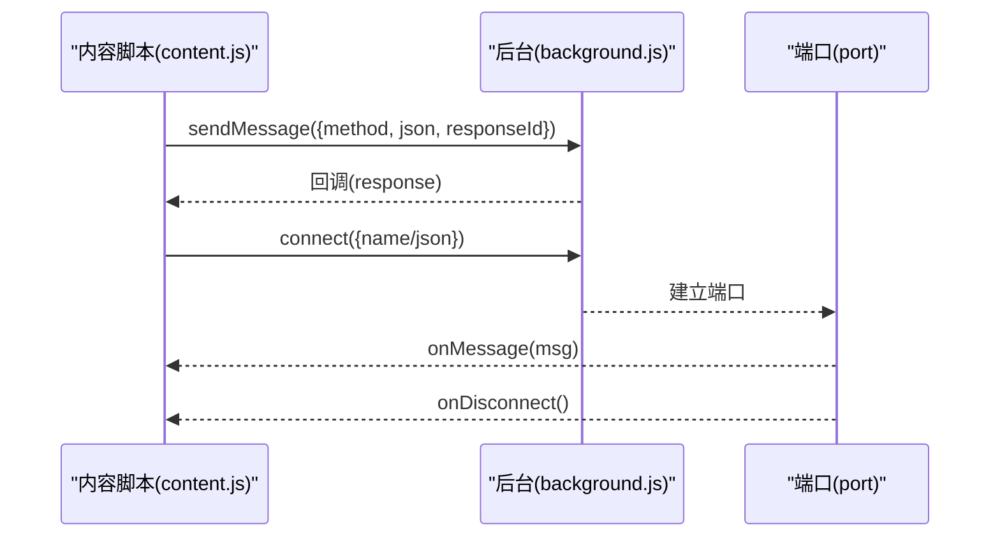
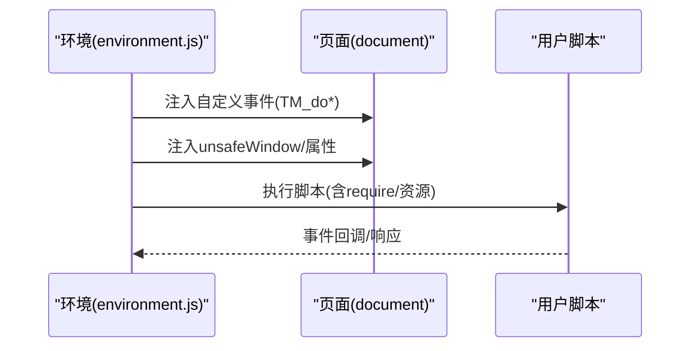
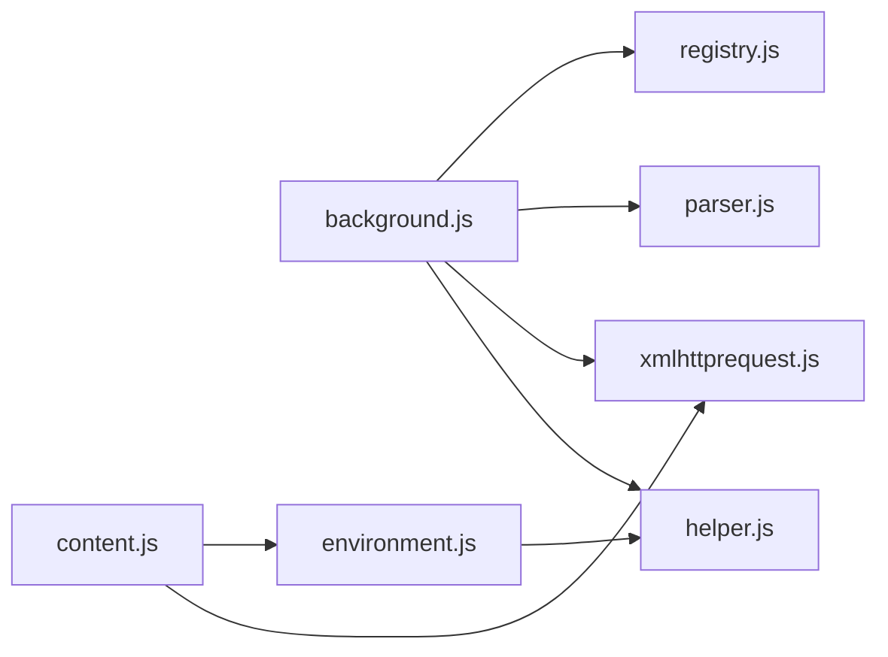

# 后台脚本系统

<cite>
**本文档引用的文件**
- [background.js](file://src/background.js)
- [content.js](file://src/content.js)
- [environment.js](file://src/environment.js)
- [registry.js](file://src/registry.js)
- [parser.js](file://src/parser.js)
- [xmlhttprequest.js](file://src/xmlhttprequest.js)
- [helper.js](file://src/helper.js)
- [options.js](file://src/options.js)
- [tamperfireDB.tamper.js](file://src/system/tamperfireDB.tamper.js)
</cite>

## 目录
1. [简介](#简介)
2. [项目结构](#项目结构)
3. [核心组件](#核心组件)
4. [架构总览](#架构总览)
5. [详细组件分析](#详细组件分析)
6. [依赖关系分析](#依赖关系分析)
7. [性能考量](#性能考量)
8. [故障排查指南](#故障排查指南)
9. [结论](#结论)
10. [附录](#附录)

## 简介
本文件系统性地文档化 Tampermonkey 的后台脚本系统，涵盖扩展生命周期管理、脚本调度与执行控制、存储管理、更新检查与消息路由等核心机制。文档重点解释后台脚本如何协调各子系统（解析器、网络请求、存储、同步、UI 状态等），并提供与内容脚本的通信协议与数据交换格式说明，最后给出安全与性能优化建议。

## 项目结构
- 背景页入口与核心逻辑：src/background.js
- 内容脚本桥接层：src/content.js
- 用户脚本运行环境模拟：src/environment.js
- 模块注册与动态加载：src/registry.js
- 脚本元数据解析：src/parser.js
- 网络请求封装：src/xmlhttprequest.js
- 工具库：src/helper.js
- 设置界面：src/options.js
- 系统辅助脚本（数据库生成工具）：src/system/tamperfireDB.tamper.js

图表来源
- [background.js:1-120](file://src/background.js#L1-L120)
- [registry.js:11-104](file://src/registry.js#L11-L104)
- [parser.js:72-282](file://src/parser.js#L72-L282)
- [xmlhttprequest.js:17-153](file://src/xmlhttprequest.js#L17-L153)
- [helper.js:184-206](file://src/helper.js#L184-L206)
- [options.js:19-792](file://src/options.js#L19-L792)
- [environment.js:7-35](file://src/environment.js#L7-L35)
- [content.js:56-215](file://src/content.js#L56-L215)

章节来源
- [background.js:1-120](file://src/background.js#L1-L120)
- [registry.js:11-104](file://src/registry.js#L11-L104)
- [parser.js:72-282](file://src/parser.js#L72-L282)
- [xmlhttprequest.js:17-153](file://src/xmlhttprequest.js#L17-L153)
- [helper.js:184-206](file://src/helper.js#L184-L206)
- [options.js:19-792](file://src/options.js#L19-L792)
- [environment.js:7-35](file://src/environment.js#L7-L35)
- [content.js:56-215](file://src/content.js#L56-L215)

## 核心组件
- 模块注册中心（Registry）
  - 动态 require/load 模块，支持原始内容读取与延迟加载回调。
- 脚本解析器（ScriptParser）
  - 解析用户脚本头部元数据，生成脚本对象，包含 includes/matches/excludes/requires 等规则。
- 网络请求封装（XMLHttpRequest）
  - 统一封装 XHR 行为，支持重试、进度回调、响应头处理与安全校验。
- 运行环境模拟（Environment）
  - 在页面上下文中注入并模拟 chrome.* API，实现脚本运行时能力。
- 内容脚本桥接（Content）
  - 将后台消息与端口通信转换为内容脚本可调用的接口，负责事件转发与响应。
- 存储与配置（TM_storage/Config）
  - 基于本地数据库或 localStorage 的键值存储，支持类型序列化与缓存。
- 更新与同步（TamperFire/SyncClient）
  - TamperFire 数据库更新与导入；跨设备脚本同步。
- 设置界面（Options）
  - 脚本列表、导入导出、同步配置、工具集等。

章节来源
- [registry.js:11-104](file://src/registry.js#L11-L104)
- [parser.js:72-282](file://src/parser.js#L72-L282)
- [xmlhttprequest.js:17-153](file://src/xmlhttprequest.js#L17-L153)
- [environment.js:7-35](file://src/environment.js#L7-L35)
- [content.js:56-215](file://src/content.js#L56-L215)
- [background.js:1705-1904](file://src/background.js#L1705-L1904)
- [background.js:1923-2303](file://src/background.js#L1923-L2303)
- [options.js:19-792](file://src/options.js#L19-L792)

## 架构总览
后台脚本系统以 background.js 为核心，通过 Registry 统一加载模块，借助 Parser 解析脚本元数据，使用 XMLHTTPRequest 执行网络操作，结合 TM_storage 提供持久化能力，并通过 Environment 与 Content 协作在页面中注入与执行用户脚本。同时集成 TamperFire 数据库与同步机制，提供脚本更新与跨设备同步能力。

图表来源
- [background.js:28-34](file://src/background.js#L28-L34)
- [registry.js:48-99](file://src/registry.js#L48-L99)
- [parser.js:72-282](file://src/parser.js#L72-L282)
- [xmlhttprequest.js:17-153](file://src/xmlhttprequest.js#L17-L153)
- [environment.js:7-35](file://src/environment.js#L7-L35)
- [content.js:56-215](file://src/content.js#L56-L215)

## 详细组件分析

### 生命周期管理与版本迁移
- 版本比较与迁移流程
  - 使用版本比较函数判断新旧版本，按版本阈值执行迁移步骤（如数据迁移、配置重排、脚本重保存等）。
  - 迁移检查以链式任务队列方式顺序执行，失败时回退并记录错误。
- 首次运行与通知
  - 新版本首次运行时记录版本号并触发通知提示。

图表来源
- [background.js:83-106](file://src/background.js#L83-L106)
- [background.js:249-387](file://src/background.js#L249-L387)
- [background.js:370-378](file://src/background.js#L370-L378)

章节来源
- [background.js:83-106](file://src/background.js#L83-L106)
- [background.js:249-387](file://src/background.js#L249-L387)
- [background.js:370-378](file://src/background.js#L370-L378)

### 脚本调度与执行控制
- URL 匹配与脚本选择
  - 根据当前 URL 与脚本的 includes/matches/excludes 规则计算待执行脚本集合，过滤禁用与 noframes 条件。
- 上下文注册与缓存
  - 维护每个标签页的上下文信息（URL 计数、UA、执行统计、缓存等），支持从缓存快速执行。
- 执行流程
  - 准备阶段：确定脚本集合与 UA 信息，写入上下文。
  - 执行阶段：逐个初始化运行时并执行脚本，完成后清理缓存。

图表来源
- [background.js:561-640](file://src/background.js#L561-L640)
- [background.js:437-558](file://src/background.js#L437-L558)

章节来源
- [background.js:561-640](file://src/background.js#L561-L640)
- [background.js:437-558](file://src/background.js#L437-L558)

### 存储管理与配置
- 存储后端
  - 支持基于本地数据库与 localStorage 的双栈存储，统一序列化/反序列化与缓存。
- 键值操作
  - 支持 setValue/getValue/deleteValue/listValues 等常用操作，内部进行类型标记与 JSON 编解码。
- 初始化与缓存
  - 启动时从数据库表加载配置到内存缓存，后续读写优先命中缓存。

图表来源
- [background.js:1705-1904](file://src/background.js#L1705-L1904)
- [background.js:1731-1746](file://src/background.js#L1731-L1746)

章节来源
- [background.js:1705-1904](file://src/background.js#L1705-L1904)
- [background.js:1731-1746](file://src/background.js#L1731-L1746)

### 更新检查与自动更新
- TamperFire 数据库更新
  - 定期检查远程数据库版本，下载增量并批量写入本地 SQLite 表，支持进度与错误处理。
- 版本对比与下载保护
  - 通过 watchdog 与重试机制保证下载稳定性，失败时显示通知并重置状态。
- 导入流程
  - 将 JSON 数据拆分为 scripts/includes/excludes/scriptincludes/scriptexcludes 多表批量写入，支持去重与通用匹配规则。

图表来源
- [background.js:814-1020](file://src/background.js#L814-L1020)
- [background.js:1091-1184](file://src/background.js#L1091-L1184)
- [background.js:1186-1374](file://src/background.js#L1186-L1374)

章节来源
- [background.js:814-1020](file://src/background.js#L814-L1020)
- [background.js:1091-1184](file://src/background.js#L1091-L1184)
- [background.js:1186-1374](file://src/background.js#L1186-L1374)

### 同步机制与跨设备脚本管理
- 同步客户端
  - 支持 Pastebin 与 Chrome Sync 两种后端，周期性检查远端脚本列表，合并本地差异并导出新增/删除。
- 调度与冲突处理
  - 通过定时器与权限检查调度同步，利用 URL 去重避免重复处理。
- 事件监听
  - 监听脚本增删改事件，自动触发导出或删除远端脚本。

图表来源
- [background.js:1923-2303](file://src/background.js#L1923-L2303)

章节来源
- [background.js:1923-2303](file://src/background.js#L1923-L2303)

### 与内容脚本的通信协议与数据交换
- 消息通道
  - content.js 通过 chrome.extension.sendMessage/connect/postMessage 与后台通信，支持响应回调与端口消息。
- 请求/响应模型
  - 请求对象包含方法名、参数与 responseId；后台处理后通过回调或端口消息返回 JSON 结构。
- 端口连接
  - 对于长连接场景（如 XHR），通过 connect 建立端口，监听 onMessage/onDisconnect 并发送响应。

图表来源
- [content.js:352-453](file://src/content.js#L352-L453)
- [content.js:290-307](file://src/content.js#L290-L307)
- [content.js:368-408](file://src/content.js#L368-L408)

章节来源
- [content.js:352-453](file://src/content.js#L352-L453)
- [content.js:290-307](file://src/content.js#L290-L307)
- [content.js:368-408](file://src/content.js#L368-L408)

### 运行环境模拟与脚本注入
- 环境注入
  - environment.js 在页面上下文中注入运行时函数与事件模拟，支持 DOMContentLoaded/DOMNodeInserted 等事件重放。
- 安全上下文与属性注入
  - 在安全上下文中通过自定义事件注入脚本执行环境，必要时降级并提示脚本拦截器检测。
- 脚本执行
  - 通过 eval 或注入 script 标签执行用户脚本，支持 require、资源加载与兼容性处理。

图表来源
- [environment.js:52-193](file://src/environment.js#L52-L193)
- [environment.js:628-644](file://src/environment.js#L628-L644)
- [content.js:456-608](file://src/content.js#L456-L608)

章节来源
- [environment.js:52-193](file://src/environment.js#L52-L193)
- [environment.js:628-644](file://src/environment.js#L628-L644)
- [content.js:456-608](file://src/content.js#L456-L608)

### 设置界面与脚本管理
- 脚本列表与编辑
  - 支持脚本名称、版本、类型、站点匹配、特性、主页、更新时间、排序与删除等列。
- 导入导出
  - 支持从文本区、沙盒文件系统与本地文件导入导出脚本集合。
- 工具集
  - 提供导出为特定格式、导入并修改选项、批量操作等功能。

章节来源
- [options.js:58-455](file://src/options.js#L58-L455)
- [options.js:496-718](file://src/options.js#L496-L718)

## 依赖关系分析
- 模块耦合
  - background.js 通过 Registry.require 引入 parser、xmlhttprequest、helper 等模块，形成清晰的分层。
  - content.js 与 environment.js 双向协作，前者负责消息桥接，后者负责运行时注入。
- 外部依赖
  - 依赖浏览器扩展 API（chrome.*）、IndexedDB/SQLite（本地数据库）、XMLHttpRequest。
- 循环依赖规避
  - Registry 采用延迟加载与回调机制，避免直接循环引用。

图表来源
- [background.js:28-34](file://src/background.js#L28-L34)
- [registry.js:48-99](file://src/registry.js#L48-L99)
- [content.js:80-91](file://src/content.js#L80-L91)
- [environment.js:7-35](file://src/environment.js#L7-L35)

章节来源
- [background.js:28-34](file://src/background.js#L28-L34)
- [registry.js:48-99](file://src/registry.js#L48-L99)
- [content.js:80-91](file://src/content.js#L80-L91)
- [environment.js:7-35](file://src/environment.js#L7-L35)

## 性能考量
- 缓存策略
  - requireCache：对外部资源进行缓存与定期清理，降低重复请求开销。
  - ctxRegistry 缓存：避免重复计算脚本集合，提升执行效率。
- 批量写入
  - TamperFire 导入采用批量 SQL 写入，分批处理与进度上报，减少主线程阻塞。
- 网络重试与超时
  - XHR 封装支持重试与进度回调，提高网络稳定性。
- 事件与监听
  - 使用 window.setTimeout 分片执行，避免长时间占用事件循环。

章节来源
- [background.js:395-433](file://src/background.js#L395-L433)
- [background.js:437-558](file://src/background.js#L437-L558)
- [background.js:1237-1267](file://src/background.js#L1237-L1267)
- [xmlhttprequest.js:67-72](file://src/xmlhttprequest.js#L67-L72)

## 故障排查指南
- 日志级别调整
  - 通过配置项调整日志等级，启用调试输出以定位问题。
- 网络错误
  - 检查 URL 方案合法性、重试次数与最终状态码；关注 TM-finalURL 响应头。
- 存储异常
  - 核对本地数据库表是否存在、序列化/反序列化是否成功、缓存一致性。
- 同步失败
  - 检查同步类型与权限（如 Chrome Sync 存储权限），确认远端列表可用性。
- TamperFire 更新失败
  - 关注下载 watchdog 与错误通知，检查远程更新 URL 与 JSON 格式。

章节来源
- [background.js:38-48](file://src/background.js#L38-L48)
- [xmlhttprequest.js:115-152](file://src/xmlhttprequest.js#L115-L152)
- [background.js:1753-1836](file://src/background.js#L1753-L1836)
- [background.js:1942-2014](file://src/background.js#L1942-L2014)
- [background.js:915-923](file://src/background.js#L915-L923)

## 结论
后台脚本系统通过模块化设计与清晰的职责划分，实现了脚本生命周期管理、调度执行、存储与同步、以及与内容脚本的稳定通信。其缓存、批量写入与重试机制有效提升了性能与可靠性；同时，完善的日志与错误处理为运维与调试提供了便利。建议在生产环境中持续监控日志、合理配置更新周期与同步策略，并关注浏览器 API 的兼容性变化。

## 附录
- 系统辅助脚本（数据库生成工具）
  - tamperfireDB.tamper.js 提供从远端源抓取脚本元数据并生成数据库脚本的工具，支持并发与断点续传。

章节来源
- [tamperfireDB.tamper.js:30-73](file://src/system/tamperfireDB.tamper.js#L30-L73)
- [tamperfireDB.tamper.js:236-318](file://src/system/tamperfireDB.tamper.js#L236-L318)