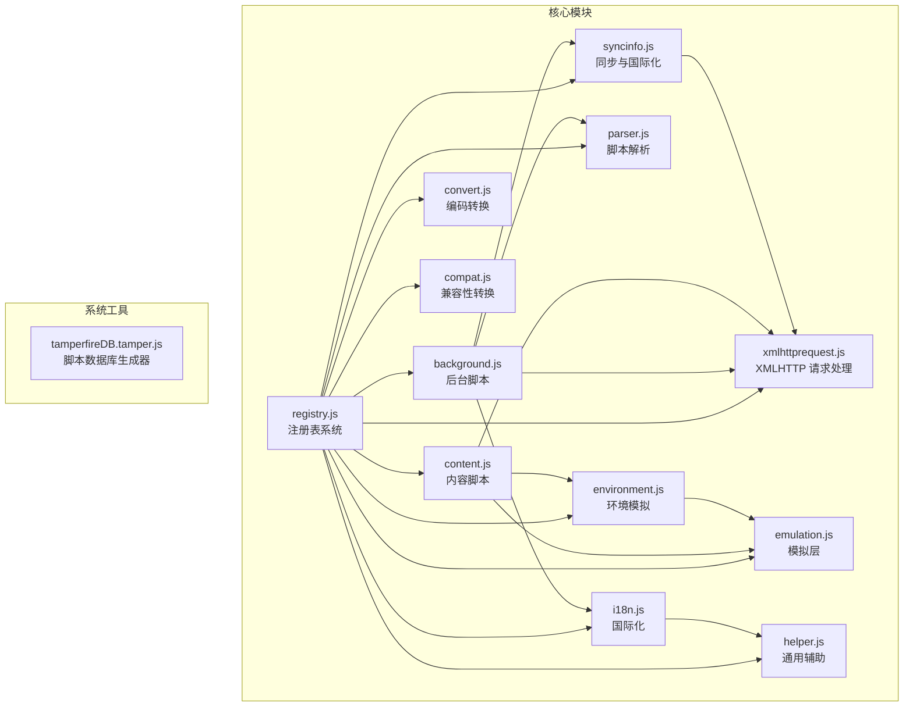
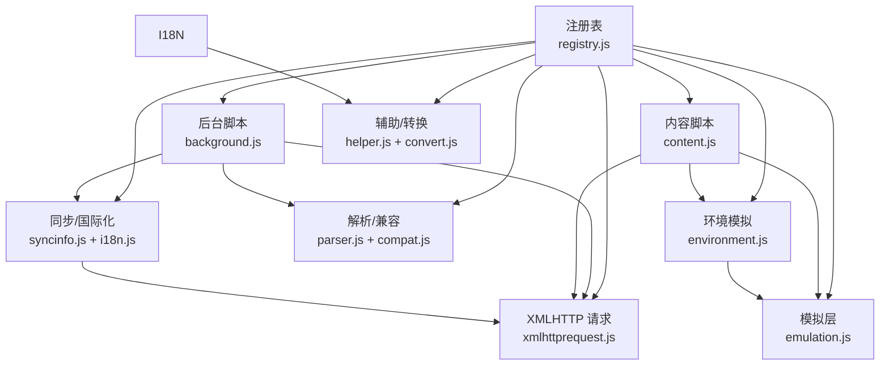
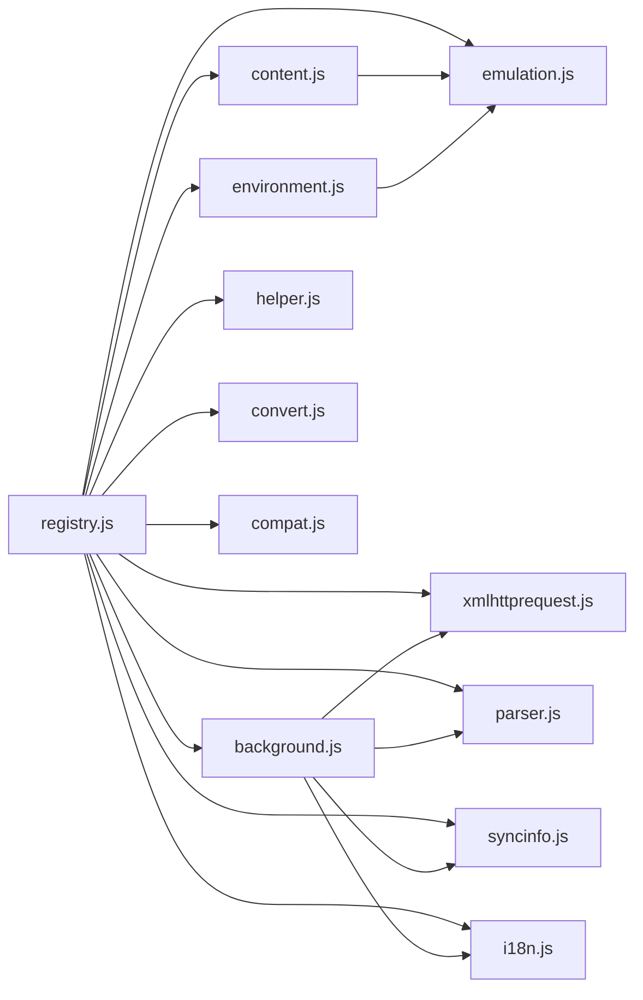

# 核心模块

<cite>
**本文引用的文件**
- [registry.js](file://src/registry.js)
- [background.js](file://src/background.js)
- [content.js](file://src/content.js)
- [xmlhttprequest.js](file://src/xmlhttprequest.js)
- [environment.js](file://src/environment.js)
- [emulation.js](file://src/emulation.js)
- [helper.js](file://src/helper.js)
- [convert.js](file://src/convert.js)
- [parser.js](file://src/parser.js)
- [compat.js](file://src/compat.js)
- [syncinfo.js](file://src/syncinfo.js)
- [i18n.js](file://src/i18n.js)
- [tamperfireDB.tamper.js](file://src/system/tamperfireDB.tamper.js)
- [README.md](file://README.md)
</cite>

## 目录
1. [简介](#简介)
2. [项目结构](#项目结构)
3. [核心组件](#核心组件)
4. [架构总览](#架构总览)
5. [详细组件分析](#详细组件分析)
6. [依赖关系分析](#依赖关系分析)
7. [性能考量](#性能考量)
8. [故障排查指南](#故障排查指南)
9. [结论](#结论)
10. [附录](#附录)

## 简介
本文件面向 Tampermonkey 核心模块的综合技术文档，聚焦于以下方面：
- 注册表系统（模块加载与延迟初始化）
- 后台脚本（脚本生命周期管理、版本迁移、缓存、上下文注册、本地文件访问、更新检查、存储与国际化）
- 内容脚本（页面注入、事件桥接、安全上下文、XMLHTTP 请求转发、环境模拟）
- XMLHTTP 请求处理（跨域、重试、进度、响应头处理）
- 环境模拟（事件桥接、GM_* 函数、unsafeWindow 访问、定时器修复、XPath 修复、窗口打开修复）
- 解析与兼容（元数据解析、兼容性转换、运行时选项）
- 同步与国际化（脚本列表同步、时间校准、消息本地化）

文档同时解释模块间依赖与协作机制，给出公共接口、参数规范、返回值格式、配置项、性能优化建议与扩展点，帮助开发者快速理解并定制 Tampermonkey 的核心行为。

## 项目结构
仓库采用按功能模块划分的组织方式，核心入口与模块化加载在 src 目录中，系统工具与示例脚本位于 system 子目录。

图表来源
- [registry.js:1-107](file://src/registry.js#L1-L107)
- [background.js:28-35](file://src/background.js#L28-L35)
- [content.js:80-91](file://src/content.js#L80-L91)
- [xmlhttprequest.js:7-160](file://src/xmlhttprequest.js#L7-L160)
- [environment.js:7-35](file://src/environment.js#L7-L35)
- [emulation.js:9-329](file://src/emulation.js#L9-L329)
- [helper.js:7-209](file://src/helper.js#L7-L209)
- [convert.js:7-39](file://src/convert.js#L7-L39)
- [parser.js:7-286](file://src/parser.js#L7-L286)
- [compat.js:7-275](file://src/compat.js#L7-L275)
- [syncinfo.js:7-395](file://src/syncinfo.js#L7-L395)
- [i18n.js:7-140](file://src/i18n.js#L7-L140)
- [tamperfireDB.tamper.js:1-352](file://src/system/tamperfireDB.tamper.js#L1-L352)

章节来源
- [README.md:1-112](file://README.md#L1-L112)

## 核心组件
- 注册表系统：提供模块延迟加载、原始资源读取、回调注册与加载完成通知，是所有模块的统一入口与依赖管理中枢。
- 后台脚本：负责脚本生命周期、版本迁移、上下文注册、本地文件访问、更新检查、存储与国际化、脚本运行调度。
- 内容脚本：负责页面注入、事件桥接、安全上下文初始化、XMLHTTP 请求转发、环境模拟调用。
- XMLHTTP 请求处理：封装跨域请求、重试、进度上报、响应头处理、UA/Referer 前缀处理。
- 环境模拟：提供事件桥接、GM_* 函数、unsafeWindow 访问、定时器修复、XPath 修复、窗口打开修复。
- 辅助与转换：提供 URL 匹配、序列化、HTML 编解码、Base64/UTF8 转换等通用能力。
- 解析与兼容：解析用户脚本元数据、生成运行时选项、执行兼容性转换。
- 同步与国际化：支持从 Pastebin 或 Chrome Sync 获取脚本列表，进行时间校准与变更监听；提供本地化消息获取。

章节来源
- [registry.js:11-104](file://src/registry.js#L11-L104)
- [background.js:28-391](file://src/background.js#L28-L391)
- [content.js:80-453](file://src/content.js#L80-L453)
- [xmlhttprequest.js:17-153](file://src/xmlhttprequest.js#L17-L153)
- [environment.js:7-800](file://src/environment.js#L7-L800)
- [emulation.js:9-329](file://src/emulation.js#L9-L329)
- [helper.js:184-209](file://src/helper.js#L184-L209)
- [convert.js:31-38](file://src/convert.js#L31-L38)
- [parser.js:29-285](file://src/parser.js#L29-L285)
- [compat.js:13-275](file://src/compat.js#L13-L275)
- [syncinfo.js:68-395](file://src/syncinfo.js#L68-L395)
- [i18n.js:72-140](file://src/i18n.js#L72-L140)

## 架构总览
下图展示了核心模块之间的交互关系与数据流，体现“注册表驱动、后台调度、内容脚本桥接、模拟层转发”的整体架构。

图表来源
- [registry.js:11-104](file://src/registry.js#L11-L104)
- [background.js:28-391](file://src/background.js#L28-L391)
- [content.js:80-453](file://src/content.js#L80-L453)
- [xmlhttprequest.js:17-153](file://src/xmlhttprequest.js#L17-L153)
- [environment.js:7-35](file://src/environment.js#L7-L35)
- [emulation.js:9-329](file://src/emulation.js#L9-L329)
- [helper.js:184-209](file://src/helper.js#L184-L209)
- [convert.js:31-38](file://src/convert.js#L31-L38)
- [parser.js:29-285](file://src/parser.js#L29-L285)
- [compat.js:13-275](file://src/compat.js#L13-L275)
- [syncinfo.js:68-395](file://src/syncinfo.js#L68-L395)
- [i18n.js:72-140](file://src/i18n.js#L72-L140)

## 详细组件分析

### 注册表系统（Registry）
- 职责
  - 模块延迟加载：通过 require 动态加载未就绪模块，避免一次性初始化开销。
  - 原始资源读取：通过 getRaw 读取扩展内静态资源，支持直接文本内容获取。
  - 回调注册：addLoadHandler 在模块加载完成后触发回调。
  - 加载状态检查：checkLoading 检测对象是否全部就绪，触发 onLoad。
- 关键接口
  - register(name, obj, overwrite?)
  - registerRaw(name, obj, overwrite?)
  - require(name)
  - getRaw(file)
  - loadFile(file, eval?)
  - get(name)
  - addLoadHandler(cb)
- 设计要点
  - 使用全局对象保存已注册模块与原始资源，避免重复加载。
  - 支持覆盖策略，便于调试或热替换。
  - 提供日志开关，便于开发期追踪加载流程。

章节来源
- [registry.js:11-104](file://src/registry.js#L11-L104)

### 后台脚本（Background）
- 职责
  - 版本迁移与数据转换：convertData 执行多版本升级逻辑，迁移旧数据到新格式。
  - 脚本运行调度：Tab.prepare 与 Tab.runScripts 根据 URL 与帧 ID 决定需要运行的脚本，并通过 runtimeInit 触发执行。
  - 上下文注册：ctxRegistry 维护每个标签页的上下文信息（URL、UA、统计），支持缓存与清理。
  - 本地文件访问：localFile 封装基于 XMLHttpRequest 或 iframe message 的本地文件读取。
  - 更新检查：维护更新检查配置，支持脚本与 Fire 数据库的更新。
  - 存储与国际化：集成 TM_storage 与 i18n，提供配置持久化与本地化消息。
  - 脚本检测：ScriptDetector 判断 URL 是否为可安装脚本源。
- 关键接口
  - convertData(cb)
  - Tab.prepare(nfo, length_cb)
  - Tab.runScripts(nfo, runInfo, allrun_cb)
  - ctxRegistry.addUrl / removeUrl / setCache / clearCache
  - localFile.getSource / getSourceXmlHttp / getSourceIframe
  - getUpdateCheckCfg / setUpdateCheckCfg
  - ScriptDetector.isScriptUrl(url)
- 性能与可靠性
  - requireCache 缓存远程资源，减少重复下载。
  - 清理周期定时任务，避免内存泄漏。
  - 重试机制用于网络错误场景。

章节来源
- [background.js:145-391](file://src/background.js#L145-L391)
- [background.js:437-558](file://src/background.js#L437-L558)
- [background.js:561-640](file://src/background.js#L561-L640)
- [background.js:661-766](file://src/background.js#L661-L766)
- [background.js:770-786](file://src/background.js#L770-L786)

### 内容脚本（Content）
- 职责
  - 页面注入：通过 _handler.sendMessage 将初始化脚本注入到页面上下文，建立事件桥接。
  - 安全上下文：initUnsafe 创建 unsafeWindow 访问与属性写入/重定义，必要时回退到 unsafe 属性名。
  - 事件桥接：Eventing 提供 DOMContentLoaded、DOMNodeInserted、load 等事件的模拟与重放。
  - XMLHTTP 请求转发：tmCE.xmlHttpRequest 将请求转发至后台，再由后台通过 xmlhttpRequest 执行。
  - 模拟层调用：tmCE.onResponse/onConnectResponse/onContentResponse 处理来自后台的响应。
  - 本地文件读取：当 URL 为 file:// 且带特殊查询参数时，作为本地文件源响应。
- 关键接口
  - _handler.sendMessage(msg)
  - initUnsafe()
  - Eventing.init / fireEvent / cleanup
  - tmCE.xmlHttpRequest / sendExtensionMessage / sendExtensionConnect / sendExtensionPortMessage
  - tmCE.onResponse / onConnectResponse / onContentResponse
- 安全与兼容
  - 使用 MutationEvent 触发自定义事件，绕过某些浏览器限制。
  - 对 wrappedJSObject、XPath、window.open 等进行修复。

章节来源
- [content.js:108-215](file://src/content.js#L108-L215)
- [content.js:217-453](file://src/content.js#L217-L453)
- [content.js:455-608](file://src/content.js#L455-L608)
- [content.js:610-800](file://src/content.js#L610-L800)

### XMLHTTP 请求处理（XMLHttpRequest）
- 职责
  - 封装 XMLHttpRequest，提供统一的请求接口与回调。
  - 支持重试、进度上报、响应头处理、finalUrl 追踪。
  - UA/Referer 自定义前缀，避免被拦截。
- 关键接口
  - xmlhttpRequest(details, callback, onreadystatechange, onerror, done, internal?)
  - setWebRequest(wr)
- 参数规范
  - details.method/url/headers/responseType/overrideMimeType/data/retries
  - 回调函数签名：onload/onreadystatechange/onerror，均接收标准化响应对象。
- 返回值格式
  - 标准化响应对象包含 readyState、responseHeaders、finalUrl、status、statusText、responseXML、responseText、response、progress（可选）。

章节来源
- [xmlhttprequest.js:17-153](file://src/xmlhttprequest.js#L17-L153)

### 环境模拟（Environment）
- 职责
  - 事件桥接：postLoadEvent/postDomEventListener/refireAllNodeInserts 等，模拟 DOM 事件。
  - GM_* 函数：TM_registerMenuCommand、TM_openInTab、TM_xmlhttpRequest、TM_getTab/TM_saveTab/TM_getTabs、TM_installScript。
  - unsafeWindow 访问：TM_do 通过 MutationEvent 触发，实现跨上下文执行。
  - 兼容修复：定时器修复、XPath 修复、window.open 修复、document.evaluate 修复。
  - 脚本运行：HTM_runMyScript 执行用户脚本，处理 storage、端口消息、运行时选项。
- 关键接口
  - TM_addLoadListener / TM_addEventListenerFix / TM_functionIdFix / TM_docEvalFix / TM_windowOpenFix
  - TM_xmlhttpRequest(details) 返回 { abort }
  - TM_openInTab(url, options) 返回 { close }
- 设计要点
  - 通过 chromeEmu 与 content 脚本桥接，实现与后台通信。
  - 对异常进行捕获与日志输出，便于调试。

章节来源
- [environment.js:195-380](file://src/environment.js#L195-L380)
- [environment.js:646-760](file://src/environment.js#L646-L760)
- [environment.js:773-800](file://src/environment.js#L773-L800)

### 模拟层（Emulation）
- 职责
  - 作为 content 与 background 的通信桥梁，封装 chrome.* API 的模拟实现。
  - 提供 extension.sendMessage/connect、tabs.sendMessage/create/getSelected/update、i18n.getMessage 等。
  - 响应 ID 管理与回调分发，支持连接式消息（onMessage/onDisconnect）。
- 关键接口
  - chromeEmu.xmlHttpRequest / runRequest / runContentRequest / runResponse / runConnectResponse
  - chromeEmu.extension.sendMessage/connect/onMessage
  - chromeEmu.tabs.sendMessage/create/getSelected/update/onUpdated
  - chromeEmu.i18n.getMessage
- 设计要点
  - 使用 Converter 进行数据编解码，确保跨上下文传输安全。
  - 响应 ID 避免冲突，支持连接生命周期内的消息复用。

章节来源
- [emulation.js:40-329](file://src/emulation.js#L40-L329)

### 辅助与转换（Helper/Convert）
- Helper
  - URL 匹配：getStringBetweenTags、getRegExpFromUrl、isLocalImage、getUrlArgs。
  - 序列化：serialize、toType、forEach。
  - HTML 编解码：decodeHtml/encodeHtml。
- Convert
  - Base64/UTF8 编解码，以及 escape/unescape 的便捷封装。
- 注册接口
  - Registry.register('helper', {...})
  - Registry.register('convert', {...})

章节来源
- [helper.js:184-209](file://src/helper.js#L184-L209)
- [convert.js:31-38](file://src/convert.js#L31-L38)

### 解析与兼容（Parser/Compat）
- Parser
  - Script 类型定义与默认选项。
  - 元数据解析：processHeader/processMetaHeader/getHeader/createScriptFromSrc。
  - 运行时选项推断：兼容性标记、UA、noframes、run-at 等。
- Compat
  - 兼容性转换：unEachify、unArrayOnLeftSideify、unMetaDataify、fixForVarXStatements。
  - 严格模式规避：将 "use strict" 替换为非断字形式。
- 注册接口
  - Registry.register('parser', scriptParser)
  - Registry.register('compat', compaMo)

章节来源
- [parser.js:29-285](file://src/parser.js#L29-L285)
- [compat.js:13-275](file://src/compat.js#L13-L275)

### 同步与国际化（SyncInfo/I18n）
- SyncInfo
  - 初始化类型与 ID，支持 Pastebin 与 Chrome Sync。
  - 时间校准：syncTime 通过多个服务器 HEAD/GET 获取时间偏移。
  - 变更监听：handleChange 监听 chrome.storage.onChanged 并过滤脚本键。
  - 列表获取：listFromUrl/listFromChromeSync。
  - 写入与删除：add/remove/reset，批量写入带去重与锁。
- I18n
  - 优先使用 chrome.i18n.getMessage，失败时回退到本地占位符替换。
  - 支持设置/获取本地语言包，动态加载 _locales/<lang>/messages.json。
  - 通过 askForLocale 与后台通信获取当前语言。
- 注册接口
  - Registry.register('syncinfo', {...})
  - Registry.register('i18n', {...})

章节来源
- [syncinfo.js:68-395](file://src/syncinfo.js#L68-L395)
- [i18n.js:72-140](file://src/i18n.js#L72-L140)

### 系统工具（TamperFireDB）
- 职责
  - 从 userscripts.org 抓取脚本元数据，构建脚本数据库。
  - 支持分段抓取、线程并发、重试与缺失 ID 记录。
- 使用场景
  - 生成脚本索引、统计脚本分布与依赖。

章节来源
- [tamperfireDB.tamper.js:1-352](file://src/system/tamperfireDB.tamper.js#L1-L352)

## 依赖关系分析
- 模块耦合
  - registry.js 是所有模块的依赖中心，content/background 通过其加载 xmlhttprequest、convert、helper、parser、i18n、syncinfo 等。
  - content 与 background 通过 emulation.js 与 tmCE 接口进行双向通信。
  - environment.js 依赖 emulation.js 提供的 chromeEmu 能力。
  - background 依赖 xmlhttprequest.js 执行网络请求，依赖 parser.js 解析脚本元数据，依赖 syncinfo.js/i18n.js 提供同步与本地化。
- 外部依赖
  - Chrome Extension API（chrome.*）、XMLHttpRequest、MutationObserver、Web Workers（部分场景）。
- 循环依赖
  - 通过注册表与接口分层避免循环依赖；content 与 background 通过消息通道解耦。

图表来源
- [registry.js:11-104](file://src/registry.js#L11-L104)
- [content.js:80-91](file://src/content.js#L80-L91)
- [background.js:28-35](file://src/background.js#L28-L35)
- [environment.js:7-35](file://src/environment.js#L7-L35)
- [emulation.js:9-329](file://src/emulation.js#L9-L329)
- [xmlhttprequest.js:7-160](file://src/xmlhttprequest.js#L7-L160)
- [helper.js:184-209](file://src/helper.js#L184-L209)
- [convert.js:31-38](file://src/convert.js#L31-L38)
- [parser.js:7-286](file://src/parser.js#L7-L286)
- [compat.js:7-275](file://src/compat.js#L7-L275)
- [syncinfo.js:7-395](file://src/syncinfo.js#L7-L395)
- [i18n.js:7-140](file://src/i18n.js#L7-L140)

## 性能考量
- 模块延迟加载：通过 require 按需加载，降低初始启动成本。
- 请求缓存：background 中的 requireCache 定期清理，避免重复下载。
- 重试与退避：xmlhttprequest.js 对非 200/0 状态自动重试，提升稳定性。
- 事件重放：environment.js 对 DOMContentLoaded/DOMNodeInserted 事件进行重放，保证监听顺序与一致性。
- 安全上下文：initUnsafe 仅在必要时写入属性，避免过度修改导致性能下降。
- 同步写入批处理：syncinfo.js 批量写入并去重，减少存储压力。

## 故障排查指南
- 模块未加载
  - 检查 registry.require 是否正确调用，确认 requireCache 与 getRaw 行为。
  - 查看 onLoad 回调是否被触发。
- 请求失败或被拦截
  - 检查 xmlhttprequest.js 的 validScheme 与 setWebRequest 配置。
  - 确认 UA/Referer 前缀是否正确设置。
- 事件未触发
  - 检查 environment.js 的 Eventing.init 与 refireAllNodeInserts。
  - 确认 DOMContentLoaded/DOMNodeInserted 是否被正确注册与重放。
- unsafeWindow 访问失败
  - 检查 content.js 的 initUnsafe 与 MutationEvent 触发。
  - 若被脚本拦截器阻止，会发送 scriptBlockerDetected 通知。
- 同步异常
  - 检查 syncinfo.js 的 handleChange 与时间校准流程。
  - 确认 chrome.storage.onChanged 事件是否触发。

章节来源
- [registry.js:18-34](file://src/registry.js#L18-L34)
- [xmlhttprequest.js:115-153](file://src/xmlhttprequest.js#L115-L153)
- [environment.js:263-286](file://src/environment.js#L263-L286)
- [content.js:456-500](file://src/content.js#L456-L500)
- [syncinfo.js:149-181](file://src/syncinfo.js#L149-L181)

## 结论
Tampermonkey 的核心模块以注册表系统为中心，通过后台脚本与内容脚本的协同，结合环境模拟与模拟层，实现了对用户脚本的完整生命周期管理与运行时支持。模块化设计使得各功能边界清晰、职责单一，既保证了扩展性，也提升了可维护性。通过合理的缓存、重试与事件重放机制，系统在复杂网页环境下仍能保持稳定与高效。

## 附录

### 公共接口与参数规范
- xmlhttpRequest(details, callback, onreadystatechange?, onerror?, done?, internal?)
  - 参数：method/url/headers/responseType/overrideMimeType/data/retries
  - 回调：onload/onreadystatechange/onerror，标准化响应对象
- tmCE.xmlHttpRequest(details, responseId)
  - 通过 content 脚本转发至后台执行
- chromeEmu.xmlHttpRequest(details, callback, onreadystatechange, onerror, done)
  - 模拟层封装，支持连接式消息与响应分发
- Environment GM_* 函数
  - TM_xmlhttpRequest(details) 返回 { abort }
  - TM_openInTab(url, options) 返回 { close }
- Parser
  - createScriptFromSrc(src) 返回包含元数据与选项的 Script 对象
- Compat
  - mkCompat(src, script, test?) 返回兼容后的源码
- SyncInfo
  - init(type, id)、list(callback)、add/remove/reset、addChangeListener(cb)
- I18n
  - getMessage(key, ...args)、askForLocale(cb)、getLocale/setLocale(locale)

章节来源
- [xmlhttprequest.js:17-153](file://src/xmlhttprequest.js#L17-L153)
- [emulation.js:52-82](file://src/emulation.js#L52-L82)
- [environment.js:693-747](file://src/environment.js#L693-L747)
- [parser.js:251-281](file://src/parser.js#L251-L281)
- [compat.js:14-26](file://src/compat.js#L14-L26)
- [syncinfo.js:384-392](file://src/syncinfo.js#L384-L392)
- [i18n.js:132-138](file://src/i18n.js#L132-L138)