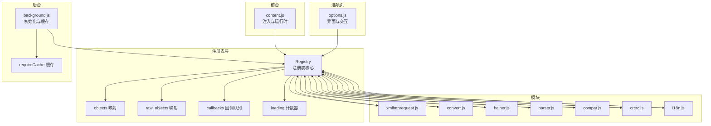
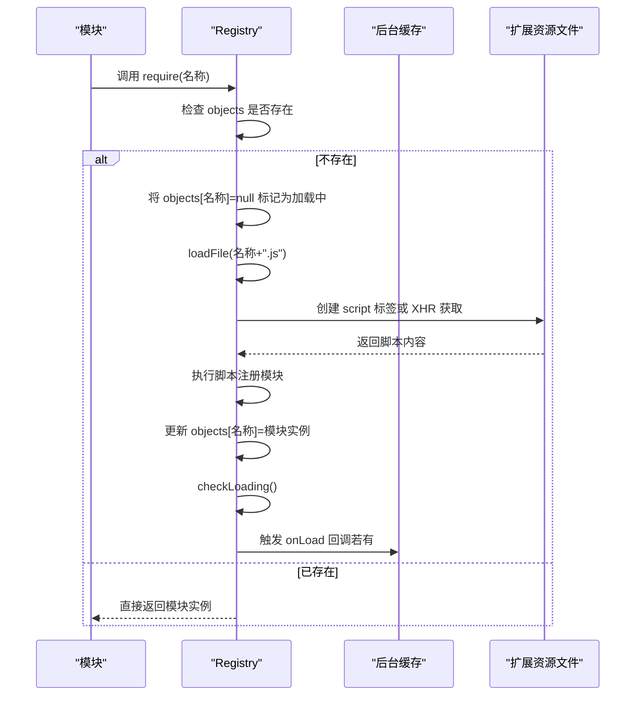
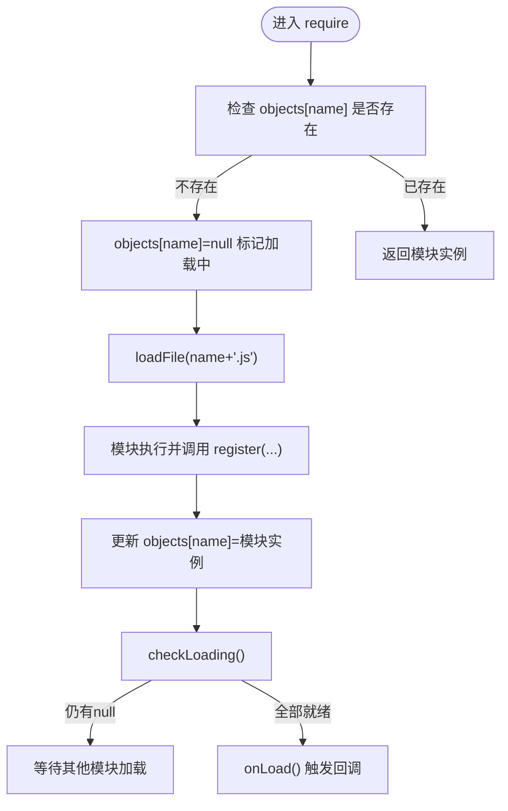
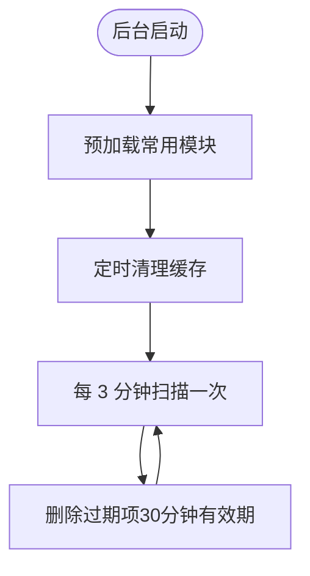
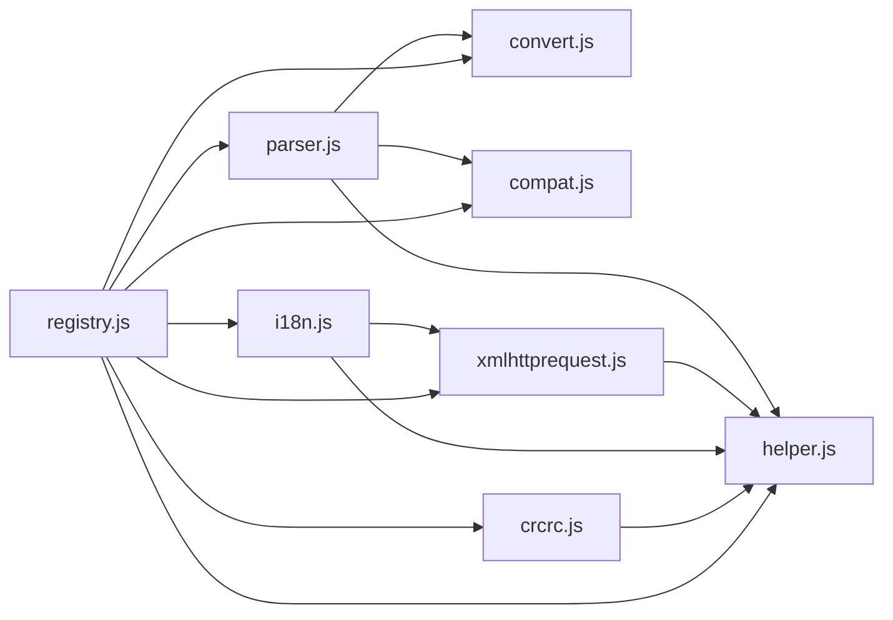

# 注册表系统

<cite>
**本文引用的文件**
- [registry.js](file://src/registry.js)
- [background.js](file://src/background.js)
- [content.js](file://src/content.js)
- [options.js](file://src/options.js)
- [xmlhttprequest.js](file://src/xmlhttprequest.js)
- [convert.js](file://src/convert.js)
- [helper.js](file://src/helper.js)
- [parser.js](file://src/parser.js)
- [compat.js](file://src/compat.js)
- [crcrc.js](file://src/crcrc.js)
- [i18n.js](file://src/i18n.js)
</cite>

## 目录
1. [简介](#简介)
2. [项目结构](#项目结构)
3. [核心组件](#核心组件)
4. [架构总览](#架构总览)
5. [详细组件分析](#详细组件分析)
6. [依赖关系分析](#依赖关系分析)
7. [性能考量](#性能考量)
8. [故障排查指南](#故障排查指南)
9. [结论](#结论)
10. [附录：使用与最佳实践](#附录使用与最佳实践)

## 简介
本文件系统性地解析 Tampermonkey 的“注册表系统”，围绕模块注册、依赖管理与动态加载展开，重点阐释以下能力：
- 模块注册与命名空间管理（register、registerRaw）
- 动态依赖声明与按需加载（require）
- 模块获取与访问（get）
- 脚本文件动态加载（loadFile）与原始内容获取（getRaw）
- 加载完成回调与异步加载处理（addLoadHandler、onLoad、checkLoading）
- 循环依赖检测与避免策略
- 配置选项、性能优化与最佳实践
- 在 Tampermonkey 中的模块化架构优势与应用场景

## 项目结构
注册表系统位于 src/registry.js，是 Tampermonkey 前后台脚本与各功能模块之间的统一“门面”。其他模块通过 require 声明依赖，通过 register 注册自身，通过 get 获取依赖模块；后台脚本负责初始化与缓存，前台脚本负责注入与运行时环境搭建。

图表来源
- [registry.js:11-104](file://src/registry.js#L11-L104)
- [background.js:28-34](file://src/background.js#L28-L34)
- [content.js:80-82](file://src/content.js#L80-L82)
- [options.js:8-17](file://src/options.js#L8-L17)
- [xmlhttprequest.js](file://src/xmlhttprequest.js#L159)
- [convert.js:31-37](file://src/convert.js#L31-L37)
- [helper.js:184-208](file://src/helper.js#L184-L208)
- [parser.js](file://src/parser.js#L284)
- [compat.js](file://src/compat.js#L273)
- [crcrc.js](file://src/crcrc.js#L64)
- [i18n.js:132-138](file://src/i18n.js#L132-L138)

章节来源
- [registry.js:11-104](file://src/registry.js#L11-L104)
- [background.js:28-34](file://src/background.js#L28-L34)
- [content.js:80-82](file://src/content.js#L80-L82)
- [options.js:8-17](file://src/options.js#L8-L17)

## 核心组件
- 注册表核心（Registry）
  - 对象映射：objects 存放已注册模块实例
  - 原始映射：raw_objects 存放已缓存的原始文本
  - 回调队列：callbacks 用于加载完成后的回调
  - 加载计数：loading 与 checkLoading 协助异步完成检测
- 后台初始化与缓存（background.js）
  - 初始化 requireCache 缓存，支持定时清理
  - 在后台启动阶段预加载常用模块
- 前台注入与运行时（content.js）
  - 注入运行时环境，通过 Registry.require/get 完成模块装配
- 选项页（options.js）
  - 通过 Registry.require/get 组装界面与交互逻辑
- 典型模块
  - xmlhttprequest、convert、helper、parser、compat、crcrc、i18n 等均通过 Registry.register 注册

章节来源
- [registry.js:11-104](file://src/registry.js#L11-L104)
- [background.js:395-433](file://src/background.js#L395-L433)
- [content.js:80-91](file://src/content.js#L80-L91)
- [options.js:8-17](file://src/options.js#L8-L17)
- [xmlhttprequest.js](file://src/xmlhttprequest.js#L159)
- [convert.js:31-37](file://src/convert.js#L31-L37)
- [helper.js:184-208](file://src/helper.js#L184-L208)
- [parser.js](file://src/parser.js#L284)
- [compat.js](file://src/compat.js#L273)
- [crcrc.js](file://src/crcrc.js#L64)
- [i18n.js:132-138](file://src/i18n.js#L132-L138)

## 架构总览
注册表系统采用“声明式依赖 + 懒加载 + 缓存”的架构：
- 声明式依赖：模块在初始化时通过 Registry.require 声明所需依赖
- 懒加载：当依赖未就绪时，触发 loadFile 异步加载对应脚本文件
- 缓存：后台维护 requireCache，减少重复网络请求；注册表维护 raw_objects，缓存原始文本
- 完成通知：模块注册后通过 checkLoading 检测是否全部加载完成，触发回调

图表来源
- [registry.js:48-55](file://src/registry.js#L48-L55)
- [registry.js:76-92](file://src/registry.js#L76-L92)
- [registry.js:22-34](file://src/registry.js#L22-L34)
- [registry.js:18-21](file://src/registry.js#L18-L21)
- [background.js:398-431](file://src/background.js#L398-L431)

## 详细组件分析

### 注册表核心（Registry）
- register(name, obj, overwrite?)
  - 将模块实例写入 objects，支持覆盖
  - 写入后立即检查加载状态，可能触发 onLoad
- registerRaw(name, obj, overwrite?)
  - 将原始文本写入 raw_objects，供 getRaw 使用
- require(name)
  - 若未注册且未加载中，则标记为 null 并触发 loadFile
  - 该标记可避免循环依赖导致的无限 require
- get(name)
  - 获取已注册模块，未找到时输出错误日志
- getRaw(file)
  - 优先从 raw_objects 返回；否则通过 XHR 获取扩展内资源
- loadFile(file, ev?)
  - 支持两种执行路径：
    - 提供 ev：直接以 eval 方式执行（兼容旧版）
    - 无 ev：动态插入 script 标签，由浏览器加载执行
- checkLoading()
  - 遍历 objects，若仍有 null 则仍在加载中；否则触发 onLoad
- onLoad()
  - 弹出并执行回调
- addLoadHandler(cb)
  - 注册加载完成回调

图表来源
- [registry.js:48-55](file://src/registry.js#L48-L55)
- [registry.js:76-92](file://src/registry.js#L76-L92)
- [registry.js:35-41](file://src/registry.js#L35-L41)
- [registry.js:22-34](file://src/registry.js#L22-L34)
- [registry.js:18-21](file://src/registry.js#L18-L21)

章节来源
- [registry.js:35-104](file://src/registry.js#L35-L104)

### 后台初始化与缓存（background.js）
- requireCache 缓存
  - addToRequireCache(url, content, headers)
  - getFromRequireCache(url)
  - cleanRequireCache() 定时清理过期条目
- 初始化阶段预加载常用模块（convert、xmlhttprequest、compat、parser、helper、syncinfo、i18n）

图表来源
- [background.js:28-34](file://src/background.js#L28-L34)
- [background.js:395-433](file://src/background.js#L395-L433)

章节来源
- [background.js:28-34](file://src/background.js#L28-L34)
- [background.js:395-433](file://src/background.js#L395-L433)

### 前台注入与运行时（content.js）
- 在页面上下文中通过 Registry.require 注入必要模块（如 xmlhttprequest、convert、helper）
- 通过 Registry.get 获取模块实例并绑定到全局变量（如 Converter、Helper）
- 提供事件与消息桥接，配合后台完成跨上下文通信

章节来源
- [content.js:80-91](file://src/content.js#L80-L91)

### 选项页（options.js）
- 通过 Registry.require 预加载界面与交互所需的模块（xmlhttprequest、pingpong、crcrc、curtain、tabview、htmlutil、helper、convert、i18n、syncinfo）
- 通过 Registry.get 获取模块实例，构建 UI 与交互逻辑

章节来源
- [options.js:8-17](file://src/options.js#L8-L17)

### 典型模块注册与使用
- xmlhttprequest.js
  - 通过 Registry.require('helper') 声明依赖
  - 通过 Registry.register('xmlhttprequest', { run, setWebRequest }) 注册模块
- convert.js
  - 注册 UTF8/Base64 编解码工具集
- helper.js
  - 注册 URL 处理、序列化、正则构造等通用工具
- parser.js
  - 通过 Registry.require('helper','convert','compat') 声明依赖
  - 注册 Script 解析器与元数据处理函数
- compat.js
  - 通过 Registry.require('helper') 声明依赖
  - 注册脚本兼容转换函数
- crcrc.js
  - 通过 Registry.require('helper') 声明依赖
  - 注册 DOM 元素创建与替换工具
- i18n.js
  - 通过 Registry.require('helper','xmlhttprequest') 声明依赖
  - 注册国际化消息获取与本地化设置

章节来源
- [xmlhttprequest.js:8-159](file://src/xmlhttprequest.js#L8-L159)
- [convert.js:31-37](file://src/convert.js#L31-L37)
- [helper.js:184-208](file://src/helper.js#L184-L208)
- [parser.js:9-15](file://src/parser.js#L9-L15)
- [parser.js](file://src/parser.js#L284)
- [compat.js:9-11](file://src/compat.js#L9-L11)
- [compat.js](file://src/compat.js#L273)
- [crcrc.js:9-10](file://src/crcrc.js#L9-L10)
- [crcrc.js](file://src/crcrc.js#L64)
- [i18n.js:8-9](file://src/i18n.js#L8-L9)
- [i18n.js:132-138](file://src/i18n.js#L132-L138)

## 依赖关系分析
- 模块间依赖
  - parser 依赖 helper、convert、compat
  - xmlhttprequest 依赖 helper
  - i18n 依赖 helper、xmlhttprequest
  - crcrc 依赖 helper
  - 其他模块通过 require 声明依赖 helper
- 注册表耦合
  - 所有模块通过 Registry.register 注册，通过 Registry.get 获取
  - require 与 loadFile 形成“懒加载”闭环，避免一次性全量加载
- 可能的循环依赖
  - require 在发现未注册时会将 objects[name] 设为 null，防止重复触发 loadFile
  - 若出现循环依赖，应通过拆分职责或延迟初始化规避

图表来源
- [parser.js:9-15](file://src/parser.js#L9-L15)
- [xmlhttprequest.js:8-15](file://src/xmlhttprequest.js#L8-L15)
- [i18n.js:8-9](file://src/i18n.js#L8-L9)
- [crcrc.js:9-10](file://src/crcrc.js#L9-L10)
- [registry.js:35-104](file://src/registry.js#L35-L104)

章节来源
- [parser.js:9-15](file://src/parser.js#L9-L15)
- [xmlhttprequest.js:8-15](file://src/xmlhttprequest.js#L8-L15)
- [i18n.js:8-9](file://src/i18n.js#L8-L9)
- [crcrc.js:9-10](file://src/crcrc.js#L9-L10)
- [registry.js:35-104](file://src/registry.js#L35-L104)

## 性能考量
- 懒加载与按需执行
  - 仅在 require 时加载对应脚本，降低初始启动开销
- 缓存策略
  - 后台 requireCache：30 分钟有效期，3 分钟清理一次，减少重复网络请求
  - 注册表 raw_objects：缓存原始文本，避免重复 XHR
- 异步加载
  - loadFile 默认通过动态 script 标签加载，执行完成后由模块自行调用 register
  - 若提供 ev 参数，可直接以 eval 执行（兼容旧版），但不推荐
- 日志与调试
  - 通过 V、RV、RD 等开关控制日志输出，便于定位问题

章节来源
- [background.js:395-433](file://src/background.js#L395-L433)
- [registry.js:76-92](file://src/registry.js#L76-L92)
- [registry.js:18-21](file://src/registry.js#L18-L21)

## 故障排查指南
- 模块未找到
  - 症状：get 报错“未被 require 或未找到”
  - 排查：确认模块是否在 requireCache 或已通过 require 加载
- 循环依赖
  - 症状：require 互相触发，长时间无响应
  - 排查：检查 objects[name] 是否为 null；确保模块注册顺序合理
- 加载失败
  - 症状：loadFile 抛错或 getRaw 返回空
  - 排查：检查扩展资源 URL、权限与网络状态；查看控制台日志
- 回调未触发
  - 症状：addLoadHandler 未执行
  - 排查：确认所有依赖模块均已注册；检查 checkLoading 逻辑

章节来源
- [registry.js:93-100](file://src/registry.js#L93-L100)
- [registry.js:48-55](file://src/registry.js#L48-L55)
- [registry.js:76-92](file://src/registry.js#L76-L92)
- [registry.js:18-21](file://src/registry.js#L18-L21)

## 结论
注册表系统在 Tampermonkey 中承担了模块化的核心角色：通过声明式依赖、懒加载与缓存机制，实现了高效、可维护的模块装配与运行时管理。其设计兼顾了易用性与性能，适合在浏览器扩展中推广使用。建议在实际工程中遵循本文的最佳实践，进一步提升稳定性与可维护性。

## 附录：使用与最佳实践
- 如何注册自定义模块
  - 在模块初始化时调用 Registry.require 声明依赖
  - 在模块末尾调用 Registry.register 注册模块实例
  - 示例参考：[xmlhttprequest.js](file://src/xmlhttprequest.js#L159)、[convert.js:31-37](file://src/convert.js#L31-L37)、[helper.js:184-208](file://src/helper.js#L184-L208)
- 如何正确使用 require/get/loadFile
  - 在模块初始化阶段调用 Registry.require
  - 使用 Registry.get 获取依赖模块实例
  - 需要动态加载脚本时调用 Registry.loadFile
  - 示例参考：[content.js:80-91](file://src/content.js#L80-L91)、[options.js:8-17](file://src/options.js#L8-L17)
- 循环依赖检测与规避
  - require 会在未注册时将对象标记为 null，避免重复触发
  - 建议拆分职责，避免双向依赖
  - 示例参考：[registry.js:48-55](file://src/registry.js#L48-L55)
- 异步加载处理策略
  - 通过 addLoadHandler 注册回调，等待所有依赖就绪
  - 示例参考：[registry.js:101-103](file://src/registry.js#L101-L103)
- 配置选项与调试
  - 通过 V、RV、RD 等开关控制日志输出
  - 示例参考：[registry.js:7-9](file://src/registry.js#L7-L9)
- 模块化架构优势
  - 低耦合高内聚、按需加载、易于测试与维护
  - 在 Tampermonkey 中广泛应用于后台、前台与选项页的模块装配

章节来源
- [xmlhttprequest.js](file://src/xmlhttprequest.js#L159)
- [convert.js:31-37](file://src/convert.js#L31-L37)
- [helper.js:184-208](file://src/helper.js#L184-L208)
- [content.js:80-91](file://src/content.js#L80-L91)
- [options.js:8-17](file://src/options.js#L8-L17)
- [registry.js:48-55](file://src/registry.js#L48-L55)
- [registry.js:101-103](file://src/registry.js#L101-L103)
- [registry.js:7-9](file://src/registry.js#L7-L9)