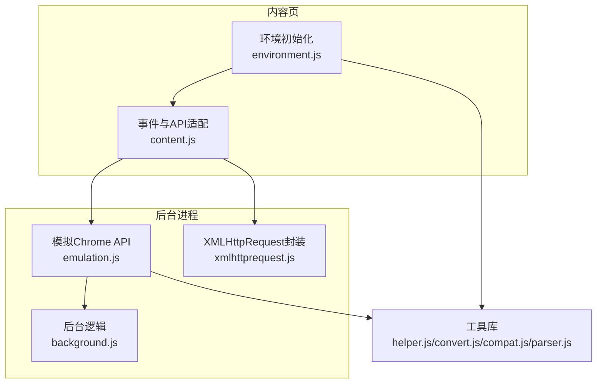
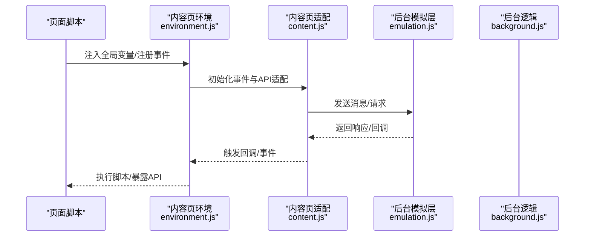
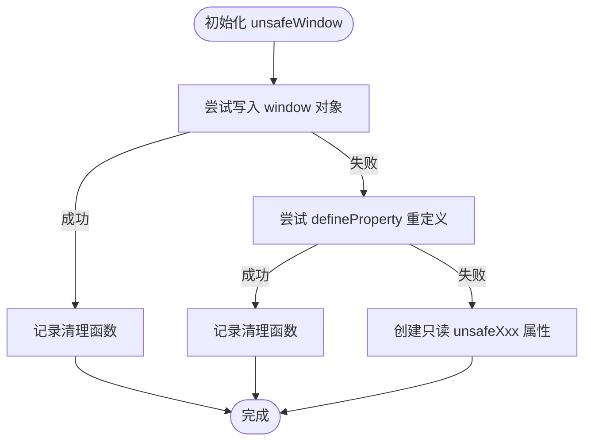
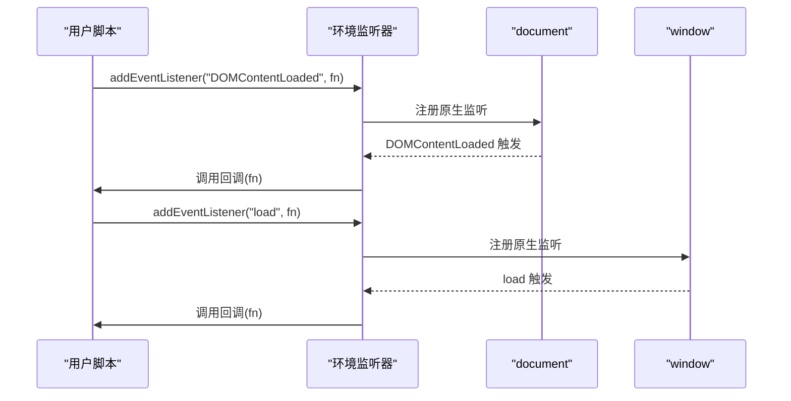
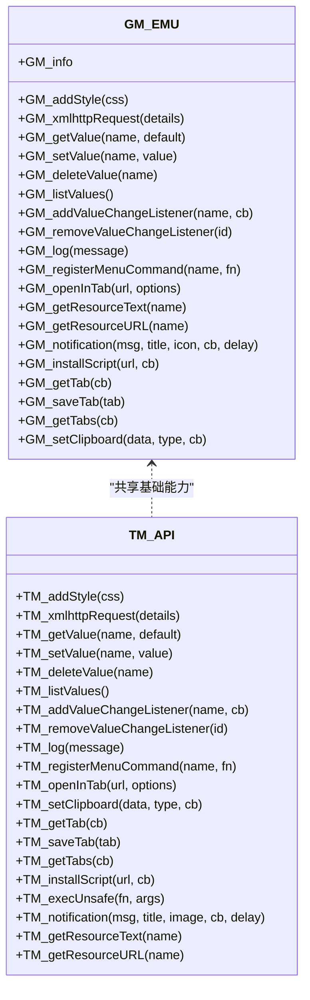
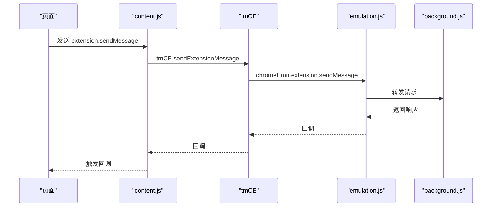
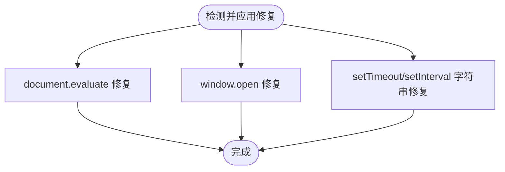
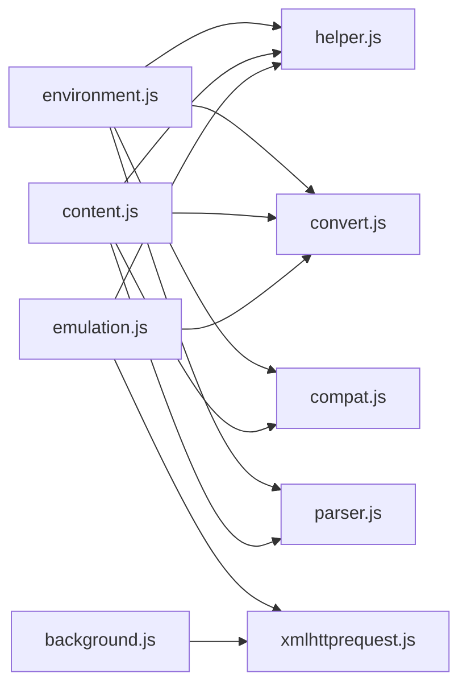

# 环境模拟系统

<cite>
**本文档引用的文件**
- [environment.js](file://src/environment.js)
- [emulation.js](file://src/emulation.js)
- [content.js](file://src/content.js)
- [background.js](file://src/background.js)
- [xmlhttprequest.js](file://src/xmlhttprequest.js)
- [helper.js](file://src/helper.js)
- [convert.js](file://src/convert.js)
- [parser.js](file://src/parser.js)
- [compat.js](file://src/compat.js)
- [README.md](file://README.md)
</cite>

## 目录
1. [简介](#简介)
2. [项目结构](#项目结构)
3. [核心组件](#核心组件)
4. [架构总览](#架构总览)
5. [详细组件分析](#详细组件分析)
6. [依赖关系分析](#依赖关系分析)
7. [性能考虑](#性能考虑)
8. [故障排除指南](#故障排除指南)
9. [结论](#结论)
10. [附录](#附录)

## 简介
本文件系统性地文档化了 Tampermonkey 的环境模拟系统，重点阐述如何在安全环境中模拟用户脚本的执行环境，包括：
- unsafeWindow 访问与全局变量注入机制
- API 暴露与兼容性处理策略
- 环境隔离与安全边界设计
- 事件分发与 DOMContentLoaded/load 事件模拟
- 性能影响与优化建议
- 与原生浏览器环境的差异与注意事项

该系统通过“内容页环境”与“后台模拟层”的协作，为用户脚本提供接近原生浏览器行为的运行时，同时确保安全边界与可控的 API 暴露。

## 项目结构
项目采用模块化组织，核心围绕“内容页环境”、“后台模拟层”和“通用工具库”三大块：
- 内容页环境：负责在页面上下文中初始化环境、注入全局变量、模拟事件、暴露 API 等
- 后台模拟层：在后台进程中模拟 Chrome 扩展 API，转发消息、处理 XHR、管理存储等
- 工具库：提供通用辅助函数（序列化、正则、转换、兼容性处理等）

图表来源
- [environment.js:1-1337](file://src/environment.js#L1-L1337)
- [content.js:1-1202](file://src/content.js#L1-L1202)
- [emulation.js:1-329](file://src/emulation.js#L1-L329)
- [xmlhttprequest.js:1-161](file://src/xmlhttprequest.js#L1-L161)
- [helper.js:1-209](file://src/helper.js#L1-L209)
- [convert.js:1-39](file://src/convert.js#L1-L39)
- [compat.js:1-275](file://src/compat.js#L1-L275)
- [parser.js:1-286](file://src/parser.js#L1-L286)

章节来源
- [README.md:1-112](file://README.md#L1-L112)

## 核心组件
- 环境初始化与全局注入：在内容页中创建安全沙箱，注入全局变量、GM_* API、TM_* API，并处理事件监听与 DOMContentLoaded/load 事件
- 后台模拟层：在后台进程中模拟 chrome.* API，处理消息转发、端口通信、XHR 请求、标签页操作等
- 事件与 DOM 兼容：模拟 MutationEvent/DOMAttrModified 等事件，适配不同浏览器的事件模型
- 安全边界：通过 unsafeWindow 访问原生窗口对象，同时限制可写属性，避免脚本破坏页面上下文
- 兼容性处理：对旧式语法（如 for each、数组解构赋值）进行转换，保证用户脚本在新环境下正常运行

章节来源
- [environment.js:1-1337](file://src/environment.js#L1-L1337)
- [content.js:1-1202](file://src/content.js#L1-L1202)
- [emulation.js:1-329](file://src/emulation.js#L1-L329)

## 架构总览
整体架构由“内容页环境”和“后台模拟层”组成，二者通过事件与消息桥接，形成统一的用户脚本运行时。

图表来源
- [environment.js:1251-1337](file://src/environment.js#L1251-L1337)
- [content.js:273-307](file://src/content.js#L273-L307)
- [emulation.js:96-146](file://src/emulation.js#L96-L146)

## 详细组件分析

### 1) unsafeWindow 访问与全局变量注入
- unsafeWindow 获取：通过在 unsafeWindow 中注入临时脚本，读取 window/top/frames/parent/opener 等属性，然后在内容页中将其写入或以只读属性形式暴露
- 全局变量注入：将 GM_*、TM_*、CDAT、uneval 等符号注入到脚本命名空间下，支持按需覆盖或备份
- 安全写入策略：优先尝试直接写入 window，若不可写则使用 Object.defineProperty 重新定义属性；否则创建只读的 unsafeXxx 属性

图表来源
- [content.js:505-608](file://src/content.js#L505-L608)

章节来源
- [content.js:505-608](file://src/content.js#L505-L608)
- [environment.js:1134-1194](file://src/environment.js#L1134-L1194)

### 2) 事件系统与 DOMContentLoaded/load 模拟
- 事件监听适配：拦截 addEventListener/removeEventListener，针对 DOMContentLoaded、load、DOMNodeInserted 进行特殊处理，确保脚本在正确时机触发
- 事件重放：当 DOMContentLoaded 已发生时，自动重放历史事件，保证脚本注册的监听器能够收到已发生的事件
- MutationObserver 兼容：在不支持 DOMAttrModified 的环境中，使用 MutationObserver 或字符串解析方式模拟属性变更事件

图表来源
- [environment.js:380-493](file://src/environment.js#L380-L493)
- [content.js:679-777](file://src/content.js#L679-L777)

章节来源
- [environment.js:197-343](file://src/environment.js#L197-L343)
- [content.js:679-777](file://src/content.js#L679-L777)

### 3) API 暴露与兼容性处理
- GM_* API：通过 GM_EMU 对象暴露 GM_addStyle、GM_xmlhttpRequest、GM_getValue、GM_setValue 等常用 API
- TM_* API：提供 TM_addStyle、TM_xmlhttpRequest、TM_getValue、TM_setValue、TM_execUnsafe 等扩展能力
- 兼容性转换：对旧式语法（for each、数组解构赋值、CDATA 区块）进行转换，提升脚本兼容性

图表来源
- [environment.js:1053-1131](file://src/environment.js#L1053-L1131)
- [environment.js:1167-1194](file://src/environment.js#L1167-L1194)

章节来源
- [environment.js:1053-1131](file://src/environment.js#L1053-L1131)
- [environment.js:1167-1194](file://src/environment.js#L1167-L1194)
- [compat.js:14-275](file://src/compat.js#L14-L275)

### 4) 后台模拟层与消息桥接
- 消息转发：content.js 将来自页面的消息转发至后台，后台通过 tmCE.onMessage/onContentRequest 处理并调用 chrome.* API
- XHR 模拟：后台通过 xmlhttprequest.js 封装 XHR，支持进度回调、错误处理与重试
- 存储与通知：后台维护存储监听、通知、剪贴板等服务，通过端口与页面交互

图表来源
- [content.js:290-307](file://src/content.js#L290-L307)
- [emulation.js:260-273](file://src/emulation.js#L260-L273)
- [background.js:1-800](file://src/background.js#L1-L800)

章节来源
- [content.js:217-453](file://src/content.js#L217-L453)
- [emulation.js:40-313](file://src/emulation.js#L40-L313)
- [xmlhttprequest.js:17-160](file://src/xmlhttprequest.js#L17-L160)

### 5) 事件与 DOM 兼容修复
- document.evaluate 修复：在查询不在 DOM 中的元素时自动添加前缀，提升 XPath 查询成功率
- window.open 修复：在安全上下文中重定向 window.open，返回打开窗口的 DOMWindow
- setTimeout/setInterval 字符串参数修复：将字符串参数包装为函数，确保在安全上下文中执行

图表来源
- [environment.js:520-624](file://src/environment.js#L520-L624)

章节来源
- [environment.js:520-624](file://src/environment.js#L520-L624)

## 依赖关系分析
- 环境初始化依赖工具库（helper/convert/compat/parser），用于序列化、正则、编码、兼容性转换与脚本解析
- 后台模拟层依赖 xmlhttprequest.js 提供的 XHR 封装
- 内容页与后台通过 tmCE 与 chromeEmu 建立消息通道

图表来源
- [environment.js:1-1337](file://src/environment.js#L1-L1337)
- [content.js:1-1202](file://src/content.js#L1-L1202)
- [emulation.js:1-329](file://src/emulation.js#L1-L329)
- [xmlhttprequest.js:1-161](file://src/xmlhttprequest.js#L1-L161)
- [helper.js:1-209](file://src/helper.js#L1-L209)
- [convert.js:1-39](file://src/convert.js#L1-L39)
- [compat.js:1-275](file://src/compat.js#L1-L275)
- [parser.js:1-286](file://src/parser.js#L1-L286)

章节来源
- [environment.js:1-1337](file://src/environment.js#L1-L1337)
- [content.js:1-1202](file://src/content.js#L1-L1202)
- [emulation.js:1-329](file://src/emulation.js#L1-L329)

## 性能考虑
- 事件重放与监听器管理：在 DOMContentLoaded 已发生时重放历史事件，避免重复监听带来的开销
- XHR 缓存与重试：后台维护 require 缓存，减少重复网络请求；XHR 封装支持重试与进度回调
- 清理与回收：所有注入的属性与监听器均在卸载时清理，防止内存泄漏
- 日志级别控制：通过日志等级开关（D/V/EV/EMV）控制调试输出，降低生产环境开销

章节来源
- [environment.js:325-343](file://src/environment.js#L325-L343)
- [background.js:395-431](file://src/background.js#L395-L431)
- [xmlhttprequest.js:62-93](file://src/xmlhttprequest.js#L62-L93)

## 故障排除指南
- unsafeWindow 获取失败：当存在脚本拦截器（如 ScriptNo）时，会记录警告并上报后台，建议检查拦截器设置
- 事件未触发：确认脚本注册时机（document-start/document-body/document-end），必要时使用 TM_addLoadListener
- XHR 失败：检查 URL 协议合法性与跨域策略，查看后台日志定位错误
- 兼容性问题：启用 compat 选项或使用兼容性转换函数，确保旧式语法被正确转换

章节来源
- [content.js:456-504](file://src/content.js#L456-L504)
- [environment.js:1266-1275](file://src/environment.js#L1266-L1275)
- [xmlhttprequest.js:114-152](file://src/xmlhttprequest.js#L114-L152)
- [compat.js:14-275](file://src/compat.js#L14-L275)

## 结论
该环境模拟系统通过“内容页环境 + 后台模拟层”的双层架构，在保证安全边界的同时，提供了接近原生浏览器的用户脚本运行时。其核心优势在于：
- 可控的 API 暴露与全局变量注入
- 完善的事件模拟与 DOM 兼容修复
- 高效的消息桥接与后台服务
- 良好的性能与内存管理

对于开发者而言，理解 unsafeWindow 的访问机制、事件触发时机与 API 兼容性转换，是编写高质量用户脚本的关键。

## 附录
- 与原生浏览器差异
  - 事件模型：在某些浏览器中 DOMAttrModified 不可用，系统通过 MutationObserver 或字符串解析模拟
  - window.open：在安全上下文中返回打开窗口的 DOMWindow
  - setTimeout/setInterval：字符串参数会被包装为函数执行
- 最佳实践
  - 明确 run-at 时机，避免过早访问 DOM
  - 使用 TM_xmlhttpRequest 替代原生 XHR，确保跨域与进度回调
  - 合理使用 unsafeWindow，仅在必要时绕过沙箱限制

章节来源
- [environment.js:520-624](file://src/environment.js#L520-L624)
- [content.js:679-777](file://src/content.js#L679-L777)
- [README.md:12-17](file://README.md#L12-L17)