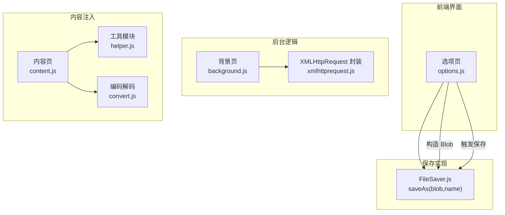
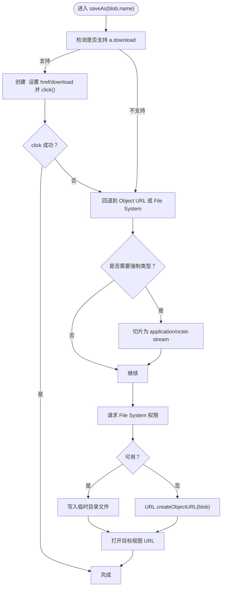
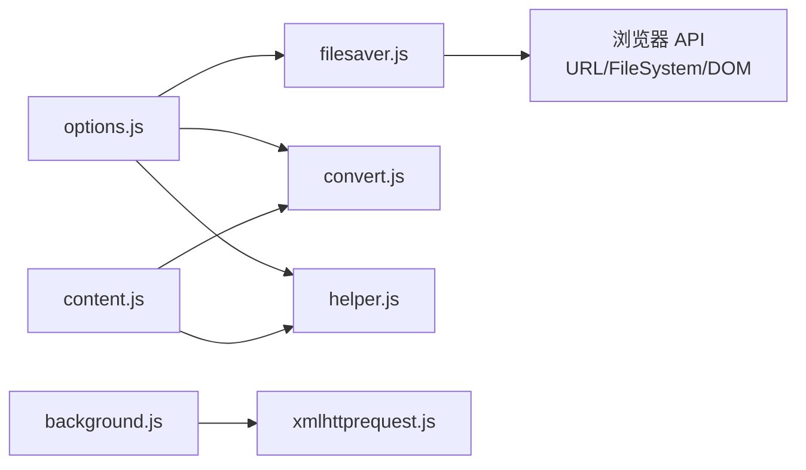

# 文件保存功能

<cite>
**本文引用的文件列表**
- [filesaver.js](file://src/saveas/filesaver.js)
- [options.js](file://src/options.js)
- [background.js](file://src/background.js)
- [content.js](file://src/content.js)
- [convert.js](file://src/convert.js)
- [xmlhttprequest.js](file://src/xmlhttprequest.js)
- [helper.js](file://src/helper.js)
- [parser.js](file://src/parser.js)
</cite>

## 目录
1. [简介](#简介)
2. [项目结构与定位](#项目结构与定位)
3. [核心组件](#核心组件)
4. [架构总览](#架构总览)
5. [详细组件分析](#详细组件分析)
6. [依赖关系分析](#依赖关系分析)
7. [性能考量](#性能考量)
8. [故障排查指南](#故障排查指南)
9. [结论](#结论)

## 简介
本文件系统性地文档化 Tampermonkey 中的“文件保存”能力，重点围绕 FileSaver.js 的集成与使用、浏览器兼容性与功能支持范围、二进制数据处理（ArrayBuffer、Blob）、MIME 类型与文件格式支持、文件命名与下载行为配置、浏览器安全限制与用户交互要求、错误处理与异常策略，以及性能优化与最佳实践。文档同时给出关键流程图与时序图，帮助开发者快速理解与扩展该功能。

## 项目结构与定位
- FileSaver.js 是一个独立的保存实现，位于 saveas 目录，提供 saveAs(blob, name) 接口。
- 在选项页中，通过 Blob 构造文本内容并调用 saveAs 完成导出。
- 背景页负责脚本更新下载等网络请求，内部使用 XMLHttpRequest 封装以支持进度与重试。
- 内容页与背景页之间通过消息通道传递数据，避免直接跨域或不安全对象传输问题。
- 工具模块提供编码解码、正则匹配、序列化等辅助能力，服务于保存与导入流程。



图表来源
- [filesaver.js](file://src/saveas/filesaver.js)
- [options.js](file://src/options.js)
- [background.js](file://src/background.js)
- [xmlhttprequest.js](file://src/xmlhttprequest.js)
- [content.js](file://src/content.js)
- [helper.js](file://src/helper.js)
- [convert.js](file://src/convert.js)

章节来源
- [filesaver.js](file://src/saveas/filesaver.js)
- [options.js](file://src/options.js)

## 核心组件
- FileSaver.js：提供 saveAs(blob, name) 的统一保存入口，内部优先尝试 a.download，其次使用 Web File System，最后回退到 Object URL。
- 选项页导出：在 options.js 中，将导出内容封装为 Blob（例如 text/plain），然后调用 saveAs 触发下载。
- 背景页下载：background.js 使用 xmlhttprequest.js 的封装进行网络请求，支持进度回调与重试，用于脚本更新等场景。
- 内容页与工具：content.js 提供本地文件读取与消息桥接；helper.js 提供 URL 匹配、序列化等；convert.js 提供 Base64/UTF8 编解码。

章节来源
- [filesaver.js](file://src/saveas/filesaver.js)
- [options.js](file://src/options.js)
- [background.js](file://src/background.js)
- [xmlhttprequest.js](file://src/xmlhttprequest.js)
- [content.js](file://src/content.js)
- [helper.js](file://src/helper.js)
- [convert.js](file://src/convert.js)

## 架构总览
下图展示从“导出按钮点击”到“浏览器触发下载”的端到端流程，涵盖 Blob 创建、FileSaver 调用、事件派发与回退路径。

```mermaid
sequenceDiagram
participant UI as "选项页 UI"
participant Opt as "选项页逻辑<br/>options.js"
participant FS as "FileSaver<br/>filesaver.js"
participant DOM as "页面 DOM"
participant FS_API as "Web FileSystem"
participant URL as "Object URL"
participant Browser as "浏览器下载"
UI->>Opt : 点击“导出到文件”
Opt->>Opt : 组装导出内容
Opt->>Opt : new Blob([...], {type : 'text/plain'})
Opt->>FS : saveAs(blob, "tmScripts.txt")
FS->>DOM : 创建 <a download> 并设置 href
alt 可用 a.download
DOM-->>FS : 触发 click()
FS-->>Browser : 下载完成
else 不可用 a.download
FS->>URL : URL.createObjectURL(blob)
FS->>Browser : 打开 Object URL
Browser-->>FS : 下载完成
end
```

图表来源
- [options.js](file://src/options.js)
- [filesaver.js](file://src/saveas/filesaver.js)

## 详细组件分析

### FileSaver.js 实现与兼容性
- 兼容性策略
  - 优先使用 a.download 属性触发下载，若失败则回退到 Web File System（webkitRequestFileSystem/requestFileSystem）写入临时目录，再通过 URL 打开。
  - 若 Web FileSystem 不可用，则回退到 URL.createObjectURL 并打开新窗口或当前窗口地址。
  - 针对 Chrome 的已知问题，当类型非 application/octet-stream 且处于标签页时，会强制将 Blob 切片为 application/octet-stream 以确保下载行为。
  - WebKit 环境下，若文件名不含 .download 后缀，会追加 .download 以确保触发下载。
- 事件与状态
  - 支持 writestart/progress/write/writeend/abort/error 等事件回调。
  - 内部维护 INIT/WRITING/DONE 状态机，便于上层监听。
- 资源清理
  - 通过删除队列在卸载时回收 Object URL 或删除临时文件，避免内存泄漏。



图表来源
- [filesaver.js](file://src/saveas/filesaver.js)

章节来源
- [filesaver.js](file://src/saveas/filesaver.js)

### 二进制数据处理与 Blob 构造
- 文本导出
  - 选项页将导出内容字符串封装为 Blob，并指定 MIME 类型为 text/plain，随后调用 saveAs 触发下载。
- ArrayBuffer 与二进制
  - FileSaver.js 内部通过 Blob.slice 或 webkitSlice 将 Blob 强制切分为 application/octet-stream，从而绕过浏览器对未知 MIME 的预览行为，确保下载。
  - Web FileSystem 写入时直接接收 Blob，底层由浏览器文件系统管理。
- 数据流要点
  - 由于扩展的消息传递机制限制，特殊对象（如 ArrayBuffer）会被规避传输，相关内容见 content.js 中的注释说明。
  - 保存场景通常以 Blob 作为输入，避免直接传递二进制缓冲区。

章节来源
- [options.js](file://src/options.js)
- [filesaver.js](file://src/saveas/filesaver.js)
- [content.js](file://src/content.js)

### MIME 类型与文件格式支持
- 文本文件
  - 通过 Blob 构造时指定 type: 'text/plain'，可正确识别为文本文件并触发下载。
- JSON 数据
  - 导出 JSON 时可指定 type: 'application/json' 或 'text/plain'，浏览器会根据 MIME 与文件扩展名决定打开方式或下载行为。
- 其他二进制格式
  - 通过 Blob 的 type 参数传入相应 MIME（如 image/png、application/octet-stream 等），FileSaver 会按上述兼容性策略处理。
  - 对于未知或非下载型 MIME，FileSaver 会在 Chrome 环境下强制切片为 application/octet-stream，确保下载。

章节来源
- [options.js](file://src/options.js)
- [filesaver.js](file://src/saveas/filesaver.js)

### 文件命名与下载行为配置
- 文件名
  - saveAs(blob, name) 第二参数即为默认文件名；若未提供，默认使用 "download"。
  - WebKit 环境下，若文件名不含 .download 后缀，会自动追加 .download 以确保触发下载。
- 下载目标
  - 当类型为 application/octet-stream 或存在 Web FileSystem 时，下载在当前视图触发；否则会打开新窗口以承载下载。
- 用户交互要求
  - FileSaver 通过模拟鼠标事件触发 a.download，因此需要用户手势（如点击）才能成功触发下载。
  - 回退到 Object URL 时，同样需要用户手势或受信任上下文，避免被浏览器拦截。

章节来源
- [filesaver.js](file://src/saveas/filesaver.js)

### 浏览器安全限制与用户交互
- Chrome 已知问题
  - 在标签页中，当 Blob 类型不是 application/octet-stream 时，Object URL 或 File System URL 可能无法触发下载，FileSaver 会自动切片为 application/octet-stream 并回退到 Object URL。
- WebKit 行为差异
  - WebKit 会根据文件名后缀与 MIME 判断是否触发下载，因此在非 "download" 名称下会追加 .download 后缀。
- 用户手势
  - saveAs 的触发必须来自用户手势（如点击），否则会被浏览器阻止。

章节来源
- [filesaver.js](file://src/saveas/filesaver.js)

### 错误处理与异常策略
- File System 失败回退
  - 当请求 File System 失败或不可用时，立即回退到 URL.createObjectURL 并打开目标视图，保证下载可用性。
- 写入错误
  - File System 写入过程中捕获错误，若非 ABORT_ERR，则回退到 Object URL。
- 进度与重试
  - 背景页下载使用 xmlhttprequest.js 的封装，支持进度回调与重试逻辑，提升大文件下载的稳定性。
- 资源清理
  - 页面卸载时统一回收删除队列中的 Object URL 与临时文件，防止资源泄漏。

章节来源
- [filesaver.js](file://src/saveas/filesaver.js)
- [background.js](file://src/background.js)
- [xmlhttprequest.js](file://src/xmlhttprequest.js)

### 性能优化与最佳实践
- 减少不必要的类型切换
  - 若已知目标为二进制下载，可直接传入 application/octet-stream，减少切片与回退路径。
- 控制 Blob 大小
  - 大文件导出时建议分块生成 Blob 或采用流式写入（若浏览器支持），避免一次性构造超大 Blob 导致内存峰值过高。
- 合理使用 File System
  - Web FileSystem 适合持久化或批量写入，但需注意权限与容量限制；对于一次性导出，Object URL 更简单可靠。
- 用户交互前置
  - 将 saveAs 调用置于用户手势之后，避免被浏览器拦截。
- 进度与提示
  - 结合 xmlhttprequest.js 的进度回调，在长任务中提供可视化反馈，改善用户体验。

章节来源
- [filesaver.js](file://src/saveas/filesaver.js)
- [xmlhttprequest.js](file://src/xmlhttprequest.js)

## 依赖关系分析
- 选项页依赖 FileSaver.js 完成导出；同时依赖 convert.js 与 helper.js 提供编码与工具能力。
- 背景页通过 xmlhttprequest.js 封装网络请求，支持进度与重试；与内容页通过消息通道交互，避免直接传输复杂对象。
- FileSaver.js 依赖浏览器原生 API：URL.createObjectURL、File System API、DOM 事件等。



图表来源
- [options.js](file://src/options.js)
- [filesaver.js](file://src/saveas/filesaver.js)
- [convert.js](file://src/convert.js)
- [helper.js](file://src/helper.js)
- [background.js](file://src/background.js)
- [xmlhttprequest.js](file://src/xmlhttprequest.js)
- [content.js](file://src/content.js)

章节来源
- [options.js](file://src/options.js)
- [filesaver.js](file://src/saveas/filesaver.js)
- [background.js](file://src/background.js)
- [xmlhttprequest.js](file://src/xmlhttprequest.js)
- [content.js](file://src/content.js)
- [convert.js](file://src/convert.js)
- [helper.js](file://src/helper.js)

## 性能考量
- Blob 构造成本
  - 大量字符串拼接后再构造 Blob 比多次小块构造更高效；必要时可考虑分块写入或流式输出。
- File System 写入
  - 写入前计算总大小并一次性申请空间，减少碎片化与多次 IO。
- 回退路径选择
  - 在高版本浏览器中优先使用 a.download；在低版本或受限环境使用 Object URL，避免额外的文件系统操作。
- 进度与提示
  - 长时间下载时提供进度条与取消按钮，提升用户体验。

[本节为通用指导，无需特定文件来源]

## 故障排查指南
- 下载未触发
  - 确认 saveAs 调用来自用户手势；检查浏览器是否拦截无手势触发的下载。
  - 若为未知 MIME，确认是否被浏览器视为预览而非下载；可改为 application/octet-stream。
- 文件名异常
  - WebKit 环境下，非 "download" 的文件名可能被追加 .download；可在调用 saveAs 时显式传入期望文件名。
- 存储空间不足
  - File System 写入失败时会回退到 Object URL；若仍失败，检查磁盘空间与浏览器配额。
- 进度不显示
  - 背景页下载使用 xmlhttprequest.js 的进度回调，请确认回调函数已注册并正确处理响应头与响应体长度。
- 特殊对象传输问题
  - content.js 中明确指出某些特殊对象（如 ArrayBuffer）在消息传递中会被规避，应改用 Blob 或字符串形式传输。

章节来源
- [filesaver.js](file://src/saveas/filesaver.js)
- [xmlhttprequest.js](file://src/xmlhttprequest.js)
- [content.js](file://src/content.js)

## 结论
Tampermonkey 的文件保存功能以 FileSaver.js 为核心，结合 Blob 构造与浏览器兼容性策略，实现了稳定可靠的导出能力。通过合理的 MIME 类型选择、文件命名与下载行为配置，以及完善的错误回退与资源清理机制，能够在不同浏览器环境下提供一致的用户体验。配合进度回调与用户交互前置策略，可进一步提升性能与可靠性。未来如需支持更多二进制格式或流式写入，可在现有架构基础上扩展 Blob 切片与 File System 写入策略。