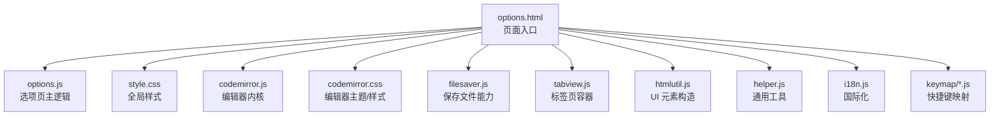
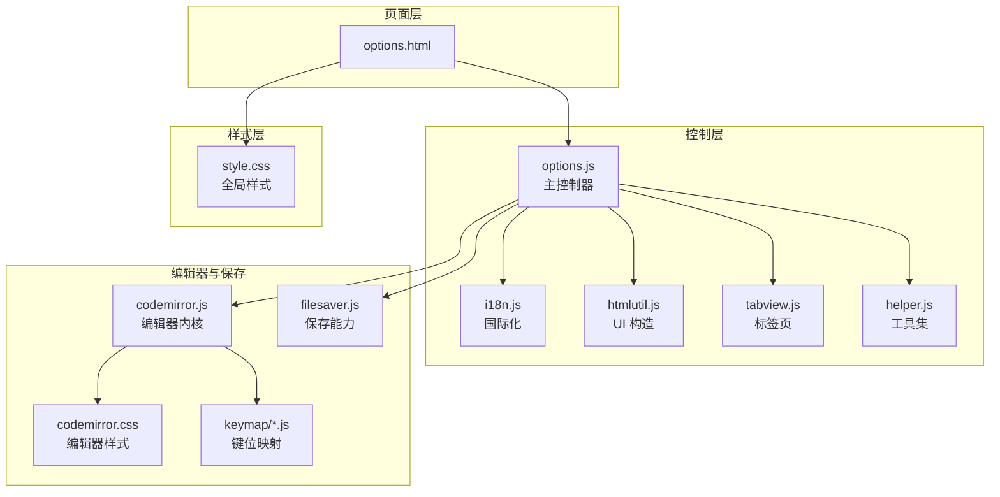
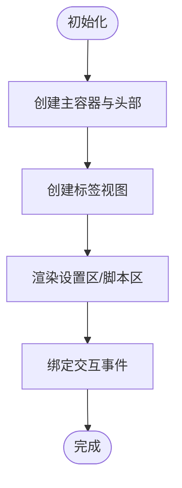
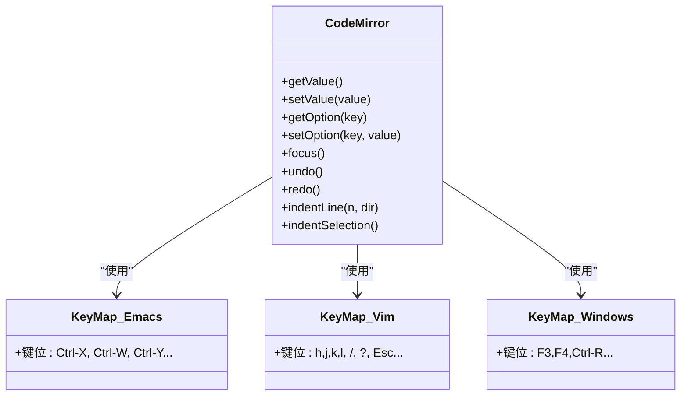
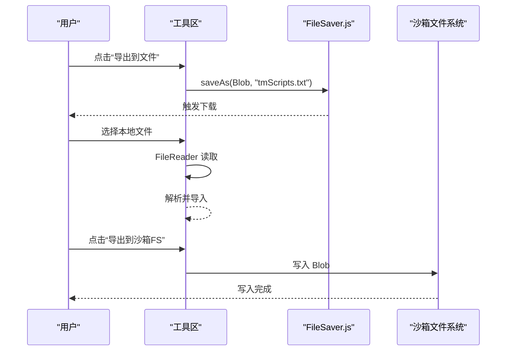
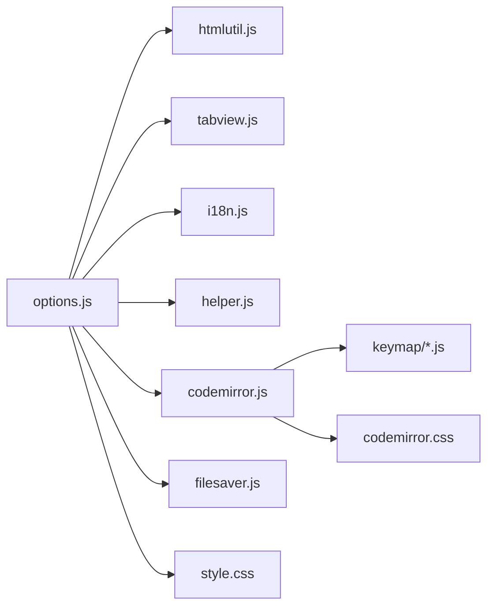

# 用户界面系统

<cite>
**本文引用的文件**
- [options.html](file://src/options.html)
- [options.js](file://src/options.js)
- [style.css](file://src/style.css)
- [codemirror.js](file://src/cm/codemirror.js)
- [codemirror.css](file://src/cm/codemirror.css)
- [emacs.js](file://src/cm/keymap/emacs.js)
- [vim.js](file://src/cm/keymap/vim.js)
- [windows.js](file://src/cm/keymap/windows.js)
- [filesaver.js](file://src/saveas/filesaver.js)
- [tabview.js](file://src/tabview.js)
- [htmlutil.js](file://src/htmlutil.js)
- [helper.js](file://src/helper.js)
- [i18n.js](file://src/i18n.js)
</cite>

## 目录
1. [简介](#简介)
2. [项目结构](#项目结构)
3. [核心组件](#核心组件)
4. [架构总览](#架构总览)
5. [详细组件分析](#详细组件分析)
6. [依赖关系分析](#依赖关系分析)
7. [性能考量](#性能考量)
8. [故障排查指南](#故障排查指南)
9. [结论](#结论)
10. [附录](#附录)

## 简介
本文件面向 Tampermonkey 的“设置与脚本编辑”用户界面系统，聚焦以下目标：
- 设置面板的页面结构与布局设计
- 功能模块的组织方式与用户交互模式
- CodeMirror 编辑器的集成与配置（语法高亮、智能提示、快捷键映射）
- 文件保存功能的实现（FileSaver.js 使用与二进制数据处理）
- 界面定制与主题支持（CSS 组织与响应式设计）
- 用户交互设计原则与无障碍支持
- 界面扩展与自定义指导

## 项目结构
设置页面由 HTML 模板加载多个脚本与样式资源，核心逻辑集中在选项页脚本中，编辑器与工具模块按职责拆分。



图表来源
- [options.html](file://src/options.html)
- [options.js](file://src/options.js)
- [style.css](file://src/style.css)
- [codemirror.js](file://src/cm/codemirror.js)
- [codemirror.css](file://src/cm/codemirror.css)
- [filesaver.js](file://src/saveas/filesaver.js)
- [tabview.js](file://src/tabview.js)
- [htmlutil.js](file://src/htmlutil.js)
- [helper.js](file://src/helper.js)
- [i18n.js](file://src/i18n.js)
- [emacs.js](file://src/cm/keymap/emacs.js)
- [vim.js](file://src/cm/keymap/vim.js)
- [windows.js](file://src/cm/keymap/windows.js)

章节来源
- [options.html](file://src/options.html)
- [options.js](file://src/options.js)

## 核心组件
- 页面容器与布局：通过选项页主逻辑构建主容器、头部与标签视图，承载设置项与脚本列表。
- 表单控件生成：基于 HTML 工具模块动态创建输入框、下拉框、复选框、按钮等。
- 标签页系统：统一管理标签页切换、可见性与内容渲染。
- 编辑器集成：在设置页中嵌入 CodeMirror，支持多种键鼠映射与主题。
- 文件保存：通过 FileSaver.js 提供下载与沙箱文件系统写入能力。
- 国际化：消息获取与本地化资源加载。

章节来源
- [options.js](file://src/options.js)
- [tabview.js](file://src/tabview.js)
- [htmlutil.js](file://src/htmlutil.js)
- [i18n.js](file://src/i18n.js)

## 架构总览
设置页面采用“模板 + 主控制器 + 工具模块”的分层架构。主控制器负责解析配置、生成 UI、绑定事件；工具模块提供通用能力（DOM 构造、国际化、辅助函数）；编辑器与保存模块作为可插拔组件被调用。



图表来源
- [options.html](file://src/options.html)
- [options.js](file://src/options.js)
- [i18n.js](file://src/i18n.js)
- [htmlutil.js](file://src/htmlutil.js)
- [tabview.js](file://src/tabview.js)
- [helper.js](file://src/helper.js)
- [codemirror.js](file://src/cm/codemirror.js)
- [codemirror.css](file://src/cm/codemirror.css)
- [emacs.js](file://src/cm/keymap/emacs.js)
- [vim.js](file://src/cm/keymap/vim.js)
- [windows.js](file://src/cm/keymap/windows.js)
- [filesaver.js](file://src/saveas/filesaver.js)
- [style.css](file://src/style.css)

## 详细组件分析

### 设置面板页面结构与布局
- 容器与头部：主容器包含头部与标签视图区域，头部展示品牌元素与版本信息，标签视图用于承载各功能区。
- 标签页系统：通过标签页容器统一管理标签与内容区，支持选择、隐藏、显示与移除操作。
- 表格与表单项：脚本列表以表格形式呈现，包含名称、版本、类型、站点、特性、更新时间、排序与删除等列；普通设置项以行级控件展示。



图表来源
- [options.js](file://src/options.js)
- [tabview.js](file://src/tabview.js)

章节来源
- [options.js](file://src/options.js)

### 功能模块组织与用户交互
- 设置项生成：根据配置对象动态创建不同类型的控件（文本、密码、下拉、复选、按钮），并支持提示、启用条件与保存按钮。
- 脚本列表：支持多选、批量动作、启用/禁用、编辑、删除与排序；导入导出工具提供多种介质（文本区、文件、沙箱文件系统）。
- 交互流程：点击事件触发回调，部分变更即时生效，部分需要显式点击“保存”。

```mermaid
sequenceDiagram
participant U as "用户"
participant UI as "选项页"
participant HV as "HTML 工具"
participant OPT as "主控制器"
U->>UI : 点击设置项
UI->>HV : 创建控件/绑定事件
HV-->>UI : 返回控件元素
UI->>OPT : 触发回调(如 setOption)
OPT-->>UI : 更新状态/提示
```

图表来源
- [options.js](file://src/options.js)
- [htmlutil.js](file://src/htmlutil.js)

章节来源
- [options.js](file://src/options.js)
- [htmlutil.js](file://src/htmlutil.js)

### CodeMirror 编辑器集成与配置
- 集成方式：在页面中引入编辑器内核与样式，主控制器中创建实例并挂载到指定容器。
- 语法高亮：默认主题覆盖关键字、字符串、注释、括号等语义类别，支持打印时隐藏光标。
- 快捷键映射：内置多种键位映射（Emacs、Vim、Windows），可通过设置切换；Vim 模式支持移动、删除、粘贴、替换等常用命令。
- 交互增强：支持查找/替换、自动缩进、历史记录、只读模式等。



图表来源
- [codemirror.js](file://src/cm/codemirror.js)
- [codemirror.css](file://src/cm/codemirror.css)
- [emacs.js](file://src/cm/keymap/emacs.js)
- [vim.js](file://src/cm/keymap/vim.js)
- [windows.js](file://src/cm/keymap/windows.js)

章节来源
- [codemirror.js](file://src/cm/codemirror.js)
- [codemirror.css](file://src/cm/codemirror.css)
- [emacs.js](file://src/cm/keymap/emacs.js)
- [vim.js](file://src/cm/keymap/vim.js)
- [windows.js](file://src/cm/keymap/windows.js)

### 文件保存功能实现
- FileSaver.js：提供 saveAs 方法，优先使用原生 download 属性，回退至对象 URL 或 WebKit 文件系统。
- 导出/导入工具：支持导出为文件、文本区或沙箱文件系统；导入支持文件读取与沙箱文件读取。
- 错误处理：封装文件系统错误码，统一弹窗提示。



图表来源
- [options.js](file://src/options.js)
- [filesaver.js](file://src/saveas/filesaver.js)

章节来源
- [options.js](file://src/options.js)
- [filesaver.js](file://src/saveas/filesaver.js)

### 界面定制与主题支持
- 全局样式：定义基础排版、颜色、间距与容器布局，确保页面在不同尺寸下保持可读性。
- 编辑器样式：主题类名与高亮规则分离，便于切换与扩展；打印媒体查询隐藏光标。
- 响应式设计：通过绝对定位与表格布局结合，使编辑器与设置区自适应窗口变化。

章节来源
- [style.css](file://src/style.css)
- [codemirror.css](file://src/cm/codemirror.css)

### 用户交互设计原则与无障碍支持
- 可见性控制：通过统一的可见/不可见状态管理，避免元素闪烁与布局抖动。
- 国际化：消息占位符与回退机制，保证语言缺失时仍能正确显示。
- 一致性：控件命名规范、事件绑定策略一致，降低学习成本。
- 无障碍：建议补充键盘可达性与屏幕阅读器友好的标题/说明文本（当前实现以视觉为主）。

章节来源
- [helper.js](file://src/helper.js)
- [i18n.js](file://src/i18n.js)

### 界面扩展与自定义指导
- 新增设置项：在配置对象中添加条目，主控制器会自动识别并生成对应控件。
- 自定义键位映射：可在键位映射文件中扩展命令映射，或新增独立映射文件并在主控制器中注册。
- 扩展标签页：通过标签页容器 API 追加新标签与内容，注意维护可见性与选中状态。
- 主题扩展：在编辑器样式中增加新的语义类或主题类，配合主控制器的主题切换接口使用。

章节来源
- [options.js](file://src/options.js)
- [tabview.js](file://src/tabview.js)
- [htmlutil.js](file://src/htmlutil.js)
- [codemirror.js](file://src/cm/codemirror.js)

## 依赖关系分析
- 选项页主控制器依赖工具模块（HTML 构造、国际化、通用工具）、标签页容器与编辑器内核。
- 编辑器依赖键位映射模块与样式文件；保存功能依赖 FileSaver.js。
- 样式文件为全局与编辑器两套体系，分别作用于页面布局与编辑器外观。



图表来源
- [options.js](file://src/options.js)
- [htmlutil.js](file://src/htmlutil.js)
- [tabview.js](file://src/tabview.js)
- [i18n.js](file://src/i18n.js)
- [helper.js](file://src/helper.js)
- [codemirror.js](file://src/cm/codemirror.js)
- [codemirror.css](file://src/cm/codemirror.css)
- [emacs.js](file://src/cm/keymap/emacs.js)
- [vim.js](file://src/cm/keymap/vim.js)
- [windows.js](file://src/cm/keymap/windows.js)
- [filesaver.js](file://src/saveas/filesaver.js)
- [style.css](file://src/style.css)

章节来源
- [options.js](file://src/options.js)

## 性能考量
- DOM 构造：大量控件一次性生成，建议在大数据量场景下采用虚拟滚动或延迟渲染策略。
- 事件绑定：统一委托与按需绑定，避免重复绑定导致的内存泄漏。
- 编辑器实例：避免频繁销毁重建，必要时复用实例并合理设置选项。
- 文件读写：大文件导入/导出采用流式处理与分块写入，减少主线程阻塞。

## 故障排查指南
- 无法保存设置：检查“保存”按钮是否正确收集子元素值，确认 setOption 回调执行路径。
- 编辑器无响应：确认键位映射已正确加载，主题切换后是否重新计算显示。
- 下载失败：检查 FileSaver.js 的回退链路（对象 URL、文件系统），查看错误码并提示用户。
- 国际化异常：确认本地化资源加载成功，占位符参数数量与顺序匹配。

章节来源
- [options.js](file://src/options.js)
- [filesaver.js](file://src/saveas/filesaver.js)
- [i18n.js](file://src/i18n.js)

## 结论
该用户界面系统以清晰的分层架构实现了设置面板与脚本编辑的完整体验。通过模块化的工具与组件，既保证了可维护性，也为扩展与定制提供了良好基础。建议在后续迭代中进一步强化无障碍支持与性能优化，提升复杂场景下的稳定性与用户体验。

## 附录
- 关键实现位置参考：
  - 设置面板构建与交互：[options.js](file://src/options.js)
  - 标签页容器：[tabview.js](file://src/tabview.js)
  - UI 控件生成：[htmlutil.js](file://src/htmlutil.js)
  - 编辑器内核与样式：[codemirror.js](file://src/cm/codemirror.js)，[codemirror.css](file://src/cm/codemirror.css)
  - 键位映射：[emacs.js](file://src/cm/keymap/emacs.js)，[vim.js](file://src/cm/keymap/vim.js)，[windows.js](file://src/cm/keymap/windows.js)
  - 文件保存：[filesaver.js](file://src/saveas/filesaver.js)
  - 国际化：[i18n.js](file://src/i18n.js)
  - 页面入口：[options.html](file://src/options.html)