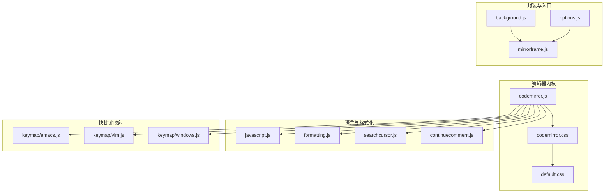
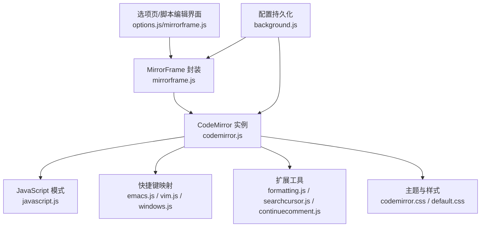
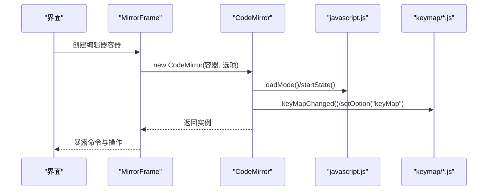
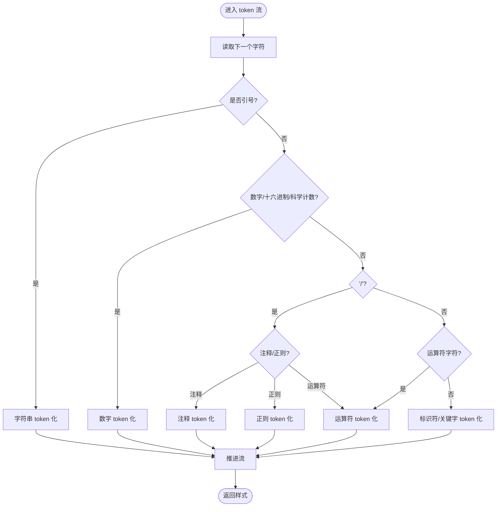
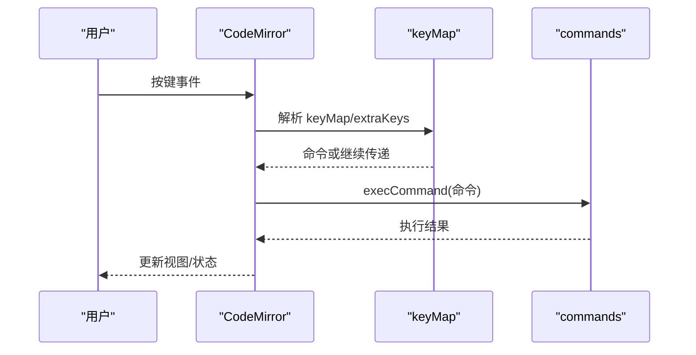
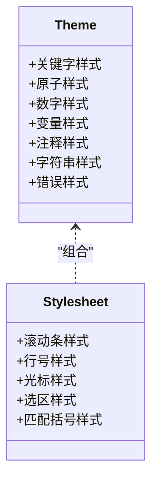
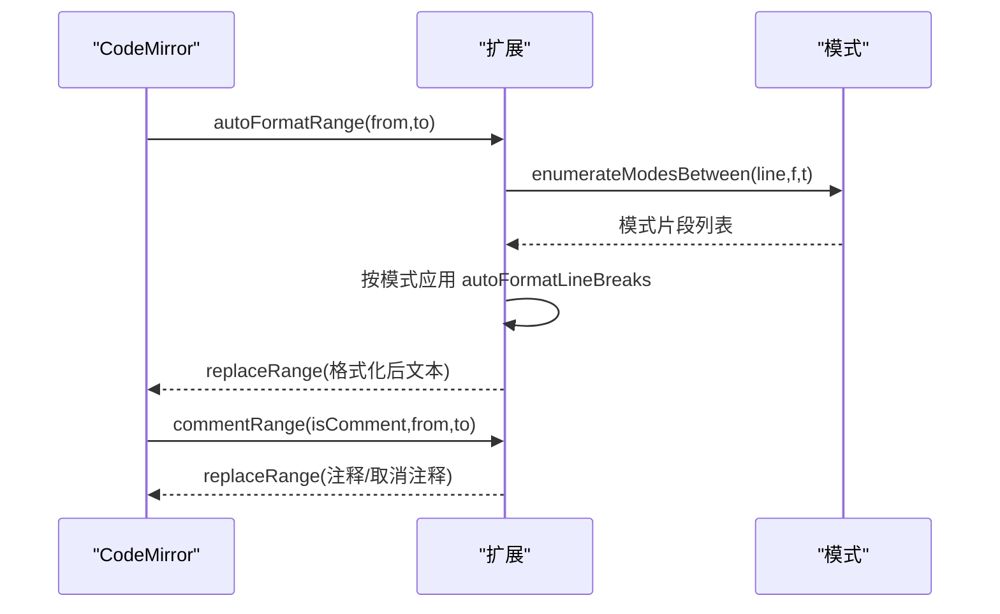
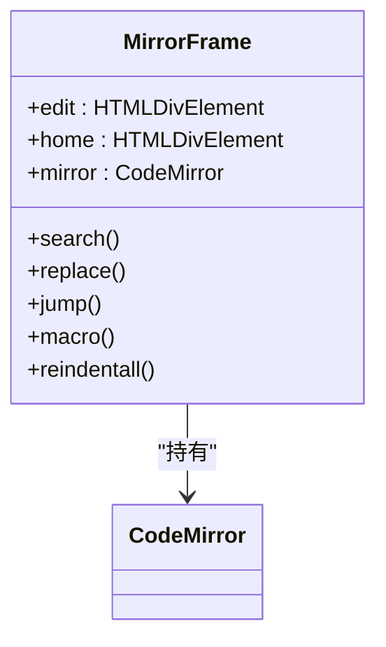
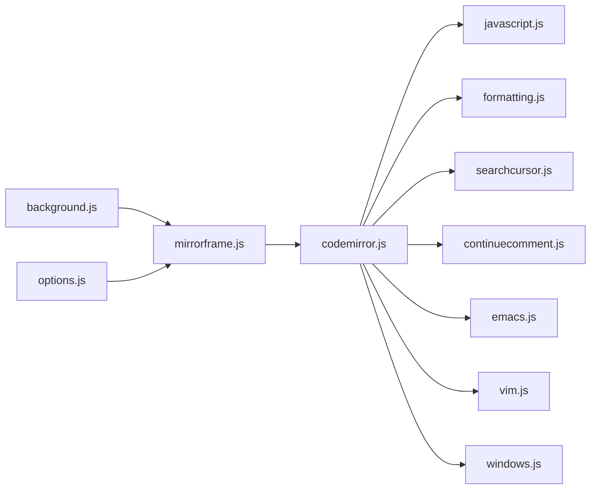

# 编辑器系统

<cite>
**本文引用的文件**
- [codemirror.js](file://src/cm/codemirror.js)
- [codemirror.css](file://src/cm/codemirror.css)
- [default.css](file://src/cm/default.css)
- [javascript.js](file://src/cm/javascript.js)
- [formatting.js](file://src/cm/formatting.js)
- [searchcursor.js](file://src/cm/searchcursor.js)
- [continuecomment.js](file://src/cm/continuecomment.js)
- [mirrorframe.js](file://src/cm/mirrorframe.js)
- [emacs.js](file://src/cm/keymap/emacs.js)
- [vim.js](file://src/cm/keymap/vim.js)
- [windows.js](file://src/cm/keymap/windows.js)
- [background.js](file://src/background.js)
- [options.js](file://src/options.js)
</cite>

## 目录
1. [简介](#简介)
2. [项目结构](#项目结构)
3. [核心组件](#核心组件)
4. [架构总览](#架构总览)
5. [详细组件分析](#详细组件分析)
6. [依赖关系分析](#依赖关系分析)
7. [性能考虑](#性能考虑)
8. [故障排查指南](#故障排查指南)
9. [结论](#结论)
10. [附录](#附录)

## 简介
本文件面向 Tampermonkey 的内置编辑器系统，聚焦于 CodeMirror 2.36 的集成与配置，涵盖以下主题：
- 编辑器实例初始化、配置参数与插件扩展机制
- JavaScript 语法高亮与代码着色规则
- 快捷键映射（Emacs、Vim、Windows 风格）及切换策略
- 主题系统与样式定制
- 扩展与插件开发（自定义语法高亮、自动格式化、注释工具）
- 性能优化与内存管理最佳实践

## 项目结构
编辑器相关的核心文件位于 src/cm 目录，Tampermonkey 在后台与选项页面中对编辑器进行配置与持久化。

图表来源
- [codemirror.js](file://src/cm/codemirror.js)
- [codemirror.css](file://src/cm/codemirror.css)
- [default.css](file://src/cm/default.css)
- [javascript.js](file://src/cm/javascript.js)
- [formatting.js](file://src/cm/formatting.js)
- [searchcursor.js](file://src/cm/searchcursor.js)
- [continuecomment.js](file://src/cm/continuecomment.js)
- [mirrorframe.js](file://src/cm/mirrorframe.js)
- [emacs.js](file://src/cm/keymap/emacs.js)
- [vim.js](file://src/cm/keymap/vim.js)
- [windows.js](file://src/cm/keymap/windows.js)
- [background.js](file://src/background.js)
- [options.js](file://src/options.js)

章节来源
- [codemirror.js:2003-2039](file://src/cm/codemirror.js#L2003-L2039)
- [codemirror.css:1-171](file://src/cm/codemirror.css#L1-L171)
- [default.css:1-19](file://src/cm/default.css#L1-L19)
- [javascript.js:359-406](file://src/cm/javascript.js#L359-L406)
- [formatting.js:1-197](file://src/cm/formatting.js#L1-L197)
- [searchcursor.js:1-120](file://src/cm/searchcursor.js#L1-L120)
- [continuecomment.js:1-37](file://src/cm/continuecomment.js#L1-L37)
- [mirrorframe.js:1-119](file://src/cm/mirrorframe.js#L1-L119)
- [emacs.js:1-31](file://src/cm/keymap/emacs.js#L1-L31)
- [vim.js:1-909](file://src/cm/keymap/vim.js#L1-L909)
- [windows.js:1-12](file://src/cm/keymap/windows.js#L1-L12)
- [background.js:4957-5019](file://src/background.js#L4957-L5019)
- [options.js:707-1483](file://src/options.js#L707-L1483)

## 核心组件
- CodeMirror 内核：提供编辑器实例、事件处理、命令执行、历史记录、滚动与显示更新等能力。
- 语言模式：javascript.js 定义 JavaScript/TypeScript 语法解析与 token 化规则。
- 快捷键映射：emacs.js、vim.js、windows.js 提供三套键盘交互风格。
- 格式化与注释：formatting.js 提供多模式自动换行、注释/取消注释、智能缩进；continuecomment.js 支持块注释续写。
- 搜索光标：searchcursor.js 提供字符串/正则搜索游标。
- 封装容器：mirrorframe.js 将 CodeMirror 与菜单按钮整合为“镜像框架”。
- 主题与样式：codemirror.css 与 default.css 定义默认主题与通用样式。

章节来源
- [codemirror.js:12-2000](file://src/cm/codemirror.js#L12-L2000)
- [javascript.js:359-406](file://src/cm/javascript.js#L359-L406)
- [formatting.js:43-196](file://src/cm/formatting.js#L43-L196)
- [continuecomment.js:1-37](file://src/cm/continuecomment.js#L1-L37)
- [searchcursor.js:1-120](file://src/cm/searchcursor.js#L1-L120)
- [mirrorframe.js:22-52](file://src/cm/mirrorframe.js#L22-L52)
- [codemirror.css:127-171](file://src/cm/codemirror.css#L127-L171)
- [default.css:1-19](file://src/cm/default.css#L1-L19)

## 架构总览
编辑器系统以 CodeMirror 为核心，通过模式扩展、快捷键映射、格式化工具与封装容器协同工作，并在 Tampermonkey 后台与选项页中进行配置持久化与界面集成。

图表来源
- [mirrorframe.js:42-52](file://src/cm/mirrorframe.js#L42-L52)
- [codemirror.js:12-2000](file://src/cm/codemirror.js#L12-L2000)
- [javascript.js:359-406](file://src/cm/javascript.js#L359-L406)
- [formatting.js:1-197](file://src/cm/formatting.js#L1-L197)
- [searchcursor.js:1-120](file://src/cm/searchcursor.js#L1-L120)
- [continuecomment.js:1-37](file://src/cm/continuecomment.js#L1-L37)
- [codemirror.css:1-171](file://src/cm/codemirror.css#L1-L171)
- [default.css:1-19](file://src/cm/default.css#L1-L19)
- [background.js:4957-5019](file://src/background.js#L4957-L5019)

## 详细组件分析

### CodeMirror 实例与初始化
- 初始化流程：构造 DOM 结构（滚动条、行号、文本区域、光标等），绑定事件监听，加载模式与快捷键，应用主题与布局。
- 关键配置项：indentUnit、tabSize、keyMap、theme、lineWrapping、lineNumbers、readOnly、electricChars、undoDepth、autofocus 等。
- 命令系统：通过 setCommand 注入用户命令，execCommand 统一调度；支持撤销/重做、选择、替换、缩进行列等。

图表来源
- [mirrorframe.js:42-52](file://src/cm/mirrorframe.js#L42-L52)
- [codemirror.js:12-2000](file://src/cm/codemirror.js#L12-L2000)
- [javascript.js:359-406](file://src/cm/javascript.js#L359-L406)
- [emacs.js:12-31](file://src/cm/keymap/emacs.js#L12-L31)
- [vim.js:304-404](file://src/cm/keymap/vim.js#L304-L404)
- [windows.js:2-11](file://src/cm/keymap/windows.js#L2-L11)

章节来源
- [codemirror.js:12-2000](file://src/cm/codemirror.js#L12-L2000)
- [codemirror.js:2003-2039](file://src/cm/codemirror.js#L2003-L2039)
- [mirrorframe.js:42-52](file://src/cm/mirrorframe.js#L42-L52)

### 语法高亮与 JavaScript 模式
- 词法分析：识别关键字、字面量、运算符、注释、字符串、正则、标识符等，并赋予对应样式类名。
- 语法解析：基于状态机推进，处理变量声明、函数定义、对象字面量、控制流等结构，计算缩进。
- MIME 映射：text/javascript、application/json、text/typescript 等映射到 javascript 模式，支持 TypeScript 关键字扩展。

图表来源
- [javascript.js:80-147](file://src/cm/javascript.js#L80-L147)
- [javascript.js:359-406](file://src/cm/javascript.js#L359-L406)

章节来源
- [javascript.js:10-127](file://src/cm/javascript.js#L10-L127)
- [javascript.js:149-406](file://src/cm/javascript.js#L149-L406)

### 快捷键映射系统
- Emacs 风格：提供 kill-ring、复制/粘贴、查找/替换、撤销、分页滚动、自动补全等快捷键映射，支持嵌套 keyMap 切换。
- Vim 风格：实现移动、插入、删除、复制/粘贴、替换、标记、重复次数、字符级动作等，包含前缀键与复合命令。
- Windows 风格：提供 Ctrl+Q 关闭、F3/F4 上下查找、Ctrl+R 替换、ESC 关闭等常用快捷键。

图表来源
- [codemirror.js:621-666](file://src/cm/codemirror.js#L621-L666)
- [emacs.js:12-31](file://src/cm/keymap/emacs.js#L12-L31)
- [vim.js:304-909](file://src/cm/keymap/vim.js#L304-L909)
- [windows.js:2-11](file://src/cm/keymap/windows.js#L2-L11)

章节来源
- [codemirror.js:621-666](file://src/cm/codemirror.js#L621-L666)
- [emacs.js:1-31](file://src/cm/keymap/emacs.js#L1-L31)
- [vim.js:1-909](file://src/cm/keymap/vim.js#L1-L909)
- [windows.js:1-12](file://src/cm/keymap/windows.js#L1-L12)

### 主题系统与样式定制
- 默认主题：.cm-s-default 类下的各类 token 样式（关键字、原子、数字、变量、注释、字符串等）。
- 全局样式：codemirror.css 定义滚动条、行号、光标、选区、匹配括号等视觉元素。
- 主题切换：setOption("theme") 触发 themeChanged() 应用新主题。

图表来源
- [codemirror.css:127-171](file://src/cm/codemirror.css#L127-L171)
- [default.css:1-19](file://src/cm/default.css#L1-L19)

章节来源
- [codemirror.css:1-171](file://src/cm/codemirror.css#L1-L171)
- [default.css:1-19](file://src/cm/default.css#L1-L19)
- [codemirror.js:169](file://src/cm/codemirror.js#L169)

### 扩展与插件开发
- 自定义语法高亮：通过 defineMode 定义 token 化与解析逻辑，结合 defineMIME 建立类型映射。
- 自动格式化：利用 extendMode 为模式添加注释边界与换行规则，调用 autoFormatRange 对范围进行格式化。
- 注释工具：commentRange 支持多模式注释/取消注释，配合 innerMode 识别嵌套模式。
- 搜索与替换：getSearchCursor 提供正则/字符串搜索，支持跨行匹配与替换。
- 块注释续写：newlineAndIndentContinueComment 在注释块内按模式自动续写注释前缀。

图表来源
- [formatting.js:100-196](file://src/cm/formatting.js#L100-L196)
- [searchcursor.js:116-119](file://src/cm/searchcursor.js#L116-L119)
- [continuecomment.js:8-36](file://src/cm/continuecomment.js#L8-L36)

章节来源
- [javascript.js:359-406](file://src/cm/javascript.js#L359-L406)
- [formatting.js:1-197](file://src/cm/formatting.js#L1-L197)
- [searchcursor.js:1-120](file://src/cm/searchcursor.js#L1-L120)
- [continuecomment.js:1-37](file://src/cm/continuecomment.js#L1-L37)

### 编辑器封装与入口（MirrorFrame）
- 菜单按钮：提供 Search、Replace、Jump to line、Insert constructor、Auto-Indent all 等常用操作。
- 命令注册：通过 setCommand 将按钮行为注入编辑器命令空间，统一由 CodeMirror.execCommand 分发。
- 搜索游标：封装 getSearchCursor，支持循环查找与选区设置。

图表来源
- [mirrorframe.js:22-119](file://src/cm/mirrorframe.js#L22-L119)

章节来源
- [mirrorframe.js:1-119](file://src/cm/mirrorframe.js#L1-L119)

## 依赖关系分析
- 内核依赖：codemirror.js 作为唯一全局变量，承载所有编辑器状态与操作。
- 模式依赖：javascript.js 依赖 codemirror.js 的 token 化与状态机接口。
- 扩展依赖：formatting.js、searchcursor.js、continuecomment.js 依赖 codemirror.js 的扩展机制与模式接口。
- 快捷键依赖：keymap/*.js 依赖 codemirror.js 的 keyMap 与命令系统。
- 封装依赖：mirrorframe.js 依赖 codemirror.js 并注入命令。
- 配置依赖：background.js 与 options.js 通过持久化配置影响编辑器初始化参数。

图表来源
- [codemirror.js:12-2000](file://src/cm/codemirror.js#L12-L2000)
- [javascript.js:359-406](file://src/cm/javascript.js#L359-L406)
- [formatting.js:1-197](file://src/cm/formatting.js#L1-L197)
- [searchcursor.js:1-120](file://src/cm/searchcursor.js#L1-L120)
- [continuecomment.js:1-37](file://src/cm/continuecomment.js#L1-L37)
- [mirrorframe.js:42-52](file://src/cm/mirrorframe.js#L42-L52)
- [background.js:4957-5019](file://src/background.js#L4957-L5019)
- [options.js:707-1483](file://src/options.js#L707-L1483)

章节来源
- [codemirror.js:12-2000](file://src/cm/codemirror.js#L12-L2000)
- [mirrorframe.js:42-52](file://src/cm/mirrorframe.js#L42-L52)
- [background.js:4957-5019](file://src/background.js#L4957-L5019)
- [options.js:707-1483](file://src/options.js#L707-L1483)

## 性能考虑
- 渲染与显示
  - 使用延迟更新与可视窗口裁剪减少重绘开销。
  - 行高缓存与最大行长跟踪避免水平滚动条抖动。
- 事件处理
  - 键盘事件采用快速轮询与节流，避免高频输入导致的卡顿。
  - 仅在焦点变化时启动/停止闪烁与轮询。
- 模式与解析
  - 仅在需要时解析当前行或可视范围内的行，避免全量扫描。
  - 正则表达式与字符串匹配尽量局部化，避免回溯风暴。
- 历史与撤销
  - 控制 undoDepth，限制历史记录长度，降低内存占用。
- 扩展与格式化
  - autoFormatRange 逐行处理并批量替换，减少多次 DOM 变更。
  - enumerateModesBetween 仅在必要时拆分模式段，避免过度分割。

## 故障排查指南
- 快捷键无效
  - 检查 keyMap 设置与 extraKeys 是否冲突；确认 handleKeyBinding 流程未被阻止。
  - 参考路径：[codemirror.js:621-666](file://src/cm/codemirror.js#L621-L666)
- 语法高亮异常
  - 确认 mode 已正确加载且 MIME 映射正确；检查 token 化分支与状态推进。
  - 参考路径：[javascript.js:80-147](file://src/cm/javascript.js#L80-L147)
- 搜索/替换不生效
  - 使用 getSearchCursor 验证查询条件与方向；确保选区与位置正确。
  - 参考路径：[searchcursor.js:116-119](file://src/cm/searchcursor.js#L116-L119)
- 注释/取消注释失败
  - 检查当前模式的注释边界与 innerMode；确认 commentRange 的起止位置。
  - 参考路径：[formatting.js:133-156](file://src/cm/formatting.js#L133-L156)
- 块注释续写不符合预期
  - 确认 blockCommentStart/End/blockCommentContinue 设置；检查 newlineAndIndentContinueComment 的判定逻辑。
  - 参考路径：[continuecomment.js:8-36](file://src/cm/continuecomment.js#L8-L36)
- 主题样式未生效
  - 检查 theme 切换与 CSS 类名；确认 .cm-s-<name> 样式存在。
  - 参考路径：[codemirror.css:127-171](file://src/cm/codemirror.css#L127-L171)

章节来源
- [codemirror.js:621-666](file://src/cm/codemirror.js#L621-L666)
- [javascript.js:80-147](file://src/cm/javascript.js#L80-L147)
- [searchcursor.js:116-119](file://src/cm/searchcursor.js#L116-L119)
- [formatting.js:133-156](file://src/cm/formatting.js#L133-L156)
- [continuecomment.js:8-36](file://src/cm/continuecomment.js#L8-L36)
- [codemirror.css:127-171](file://src/cm/codemirror.css#L127-L171)

## 结论
Tampermonkey 的编辑器系统以 CodeMirror 为核心，通过完善的模式、快捷键映射、扩展工具与封装容器，提供了可配置、可扩展且高性能的脚本编辑体验。开发者可在不破坏现有架构的前提下，通过扩展机制实现自定义语法高亮、智能格式化与交互增强。

## 附录
- 编辑器配置项（部分）
  - indentUnit、tabSize、keyMap、theme、lineWrapping、lineNumbers、readOnly、electricChars、undoDepth、autofocus、lineNumberFormatter 等。
  - 参考路径：[codemirror.js:2003-2039](file://src/cm/codemirror.js#L2003-L2039)
- 选项页中的编辑器相关设置
  - 缩进宽度、缩进方式（Tab/Space）、Tab 行为（Classic/Smart）、电场字符、显示行号等。
  - 参考路径：[background.js:4957-5019](file://src/background.js#L4957-L5019)
- 编辑器实例生命周期与命令注册
  - MirrorFrame 在初始化时注入命令，随后由 CodeMirror.execCommand 统一分发。
  - 参考路径：[mirrorframe.js:42-52](file://src/cm/mirrorframe.js#L42-L52)