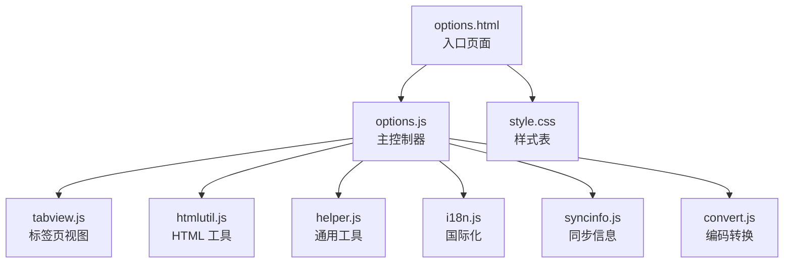
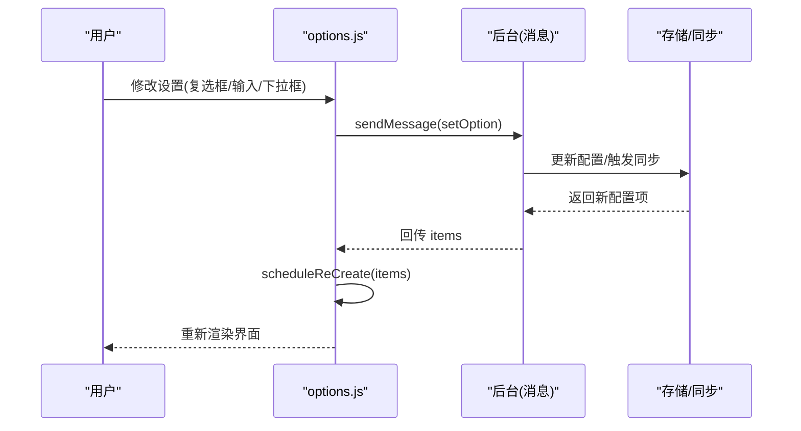
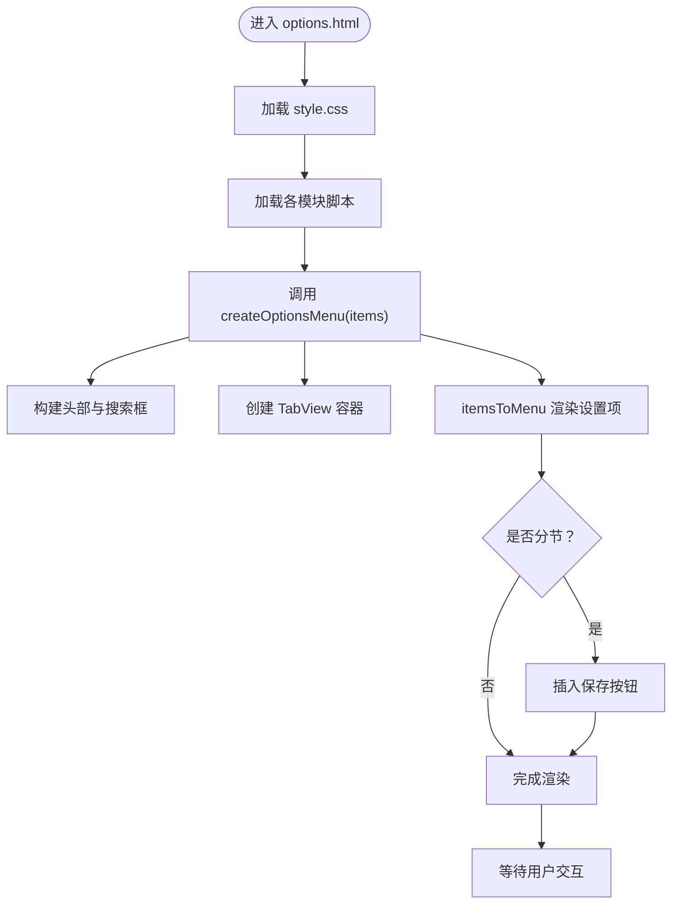
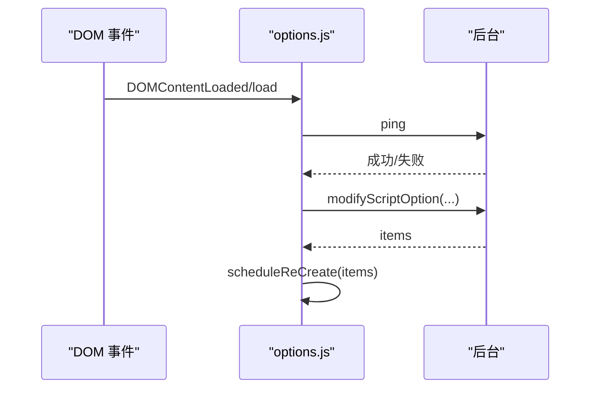
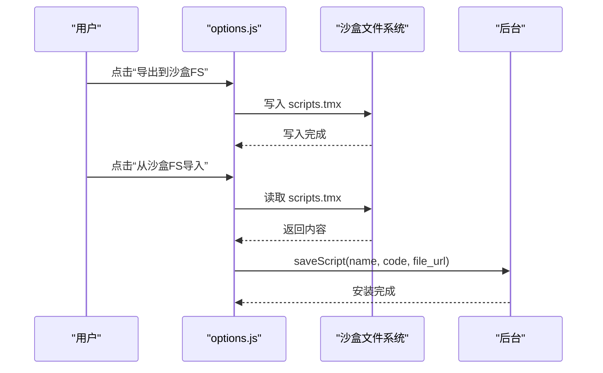
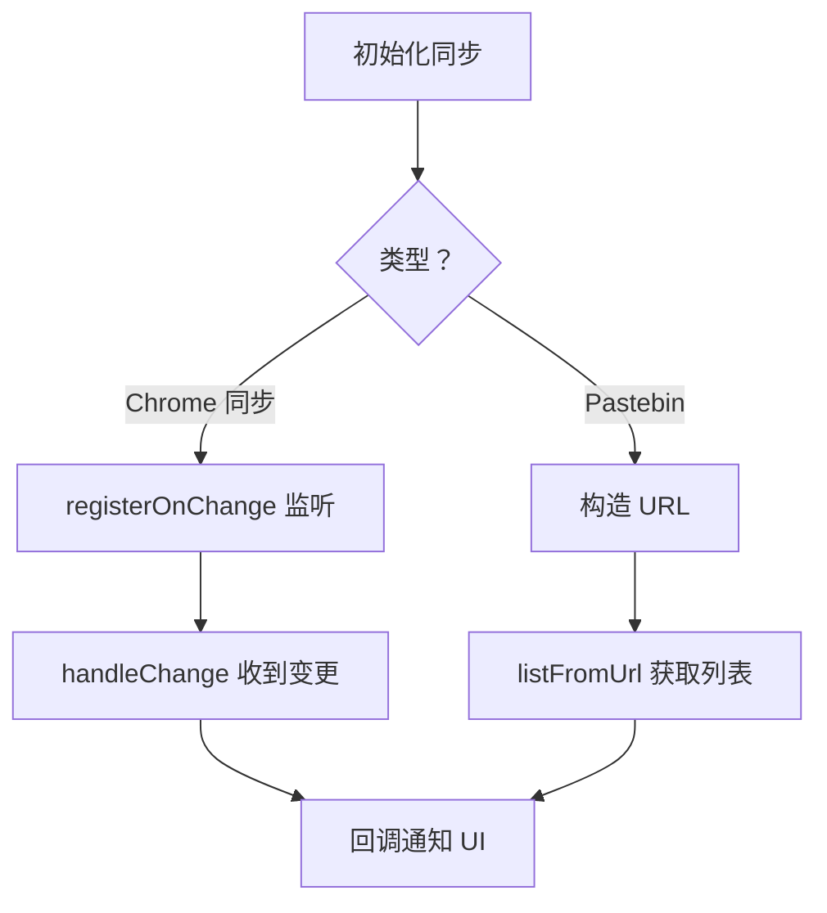
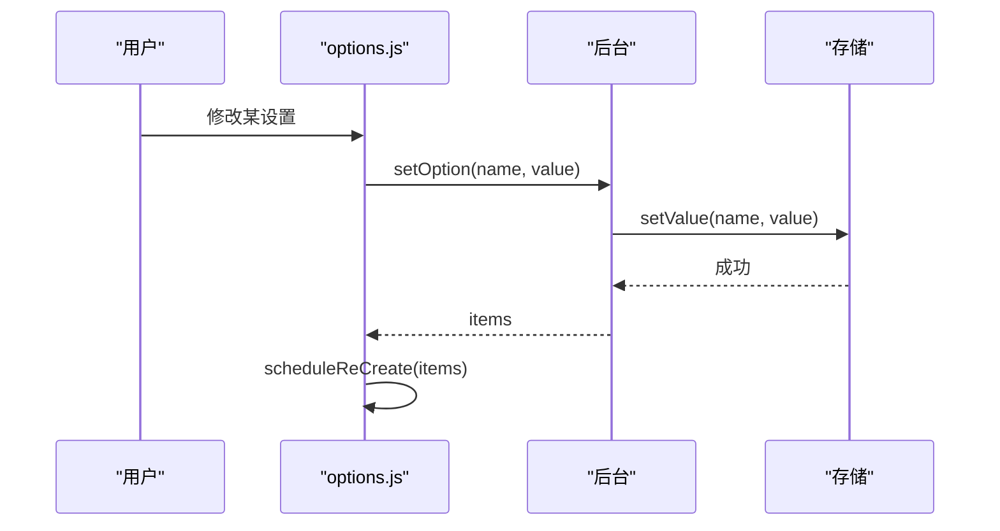
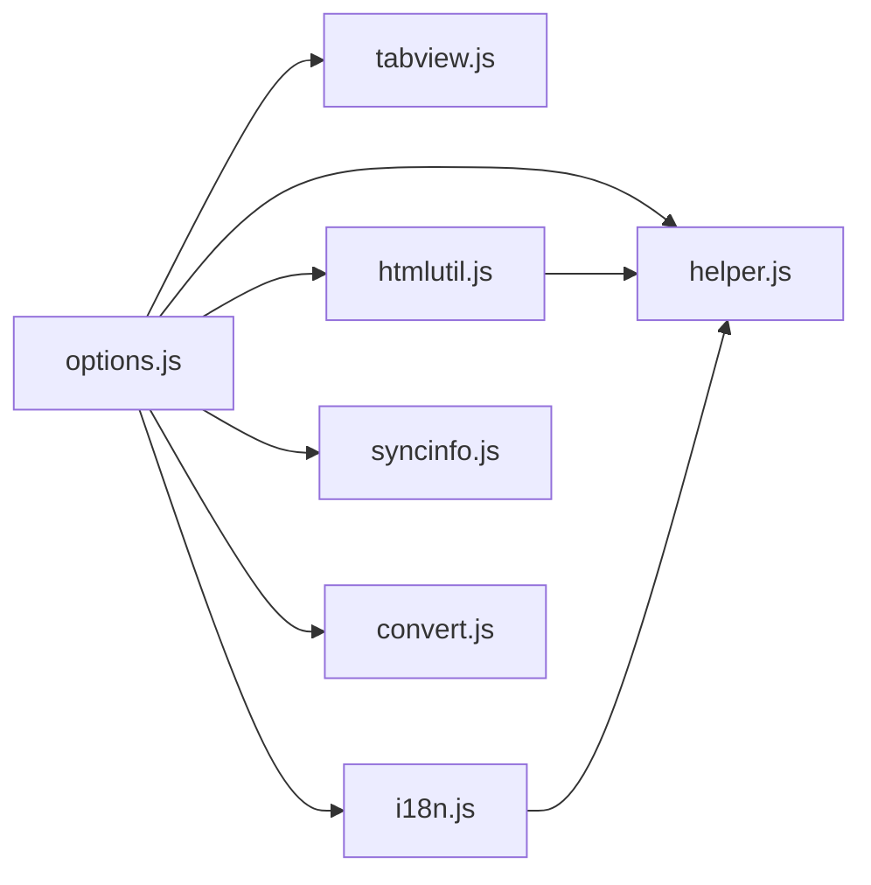

# 设置面板架构

<cite>
**本文引用的文件**
- [options.html](file://src/options.html)
- [options.js](file://src/options.js)
- [style.css](file://src/style.css)
- [tabview.js](file://src/tabview.js)
- [syncinfo.js](file://src/syncinfo.js)
- [htmlutil.js](file://src/htmlutil.js)
- [helper.js](file://src/helper.js)
- [i18n.js](file://src/i18n.js)
- [convert.js](file://src/convert.js)
</cite>

## 目录
1. [简介](#简介)
2. [项目结构](#项目结构)
3. [核心组件](#核心组件)
4. [架构总览](#架构总览)
5. [详细组件分析](#详细组件分析)
6. [依赖关系分析](#依赖关系分析)
7. [性能考量](#性能考量)
8. [故障排查指南](#故障排查指南)
9. [结论](#结论)
10. [附录](#附录)

## 简介
本文件系统化梳理 Tampermonkey 设置面板（options.html）的架构与实现，覆盖页面结构与布局、初始化与事件处理、样式组织、功能模块划分、可访问性与用户体验、以及设置数据持久化与配置同步机制。目标是帮助开发者与维护者快速理解设置面板的代码组织、交互流程与扩展点。

## 项目结构
设置面板由一个独立的 HTML 页面承载，通过多个模块化的 JS 组件协作完成渲染、交互与数据持久化。关键文件与职责如下：
- options.html：设置面板入口页面，加载样式与脚本，挂载根容器。
- options.js：设置面板主逻辑，负责初始化、渲染、事件绑定、消息通信与刷新。
- style.css：全局样式与主题类名，定义布局、表格、标签页、工具区等视觉规范。
- tabview.js：标签页视图组件，提供可复用的标签页容器与切换能力。
- syncinfo.js：同步信息与存储封装，支持 Chrome 同步与外部服务列表拉取。
- htmlutil.js：HTML 元素工厂，统一创建输入控件、按钮、下拉框、搜索框等。
- helper.js：通用工具集，包含可见性控制、URL 正则、本地化参数解析等。
- i18n.js：国际化消息获取与本地化资源加载。
- convert.js：编码转换工具（UTF8/Base64），用于导入导出脚本时的数据处理。

图表来源
- [options.html:1-38](file://src/options.html#L1-L38)
- [options.js:1-100](file://src/options.js#L1-L100)
- [tabview.js:1-60](file://src/tabview.js#L1-L60)
- [htmlutil.js:1-60](file://src/htmlutil.js#L1-L60)
- [helper.js:1-60](file://src/helper.js#L1-L60)
- [i18n.js:1-60](file://src/i18n.js#L1-L60)
- [syncinfo.js:1-60](file://src/syncinfo.js#L1-L60)
- [convert.js:1-39](file://src/convert.js#L1-L39)
- [style.css:1-60](file://src/style.css#L1-L60)

章节来源
- [options.html:1-38](file://src/options.html#L1-L38)
- [options.js:1-120](file://src/options.js#L1-L120)
- [style.css:1-120](file://src/style.css#L1-L120)

## 核心组件
- 初始化与渲染
  - 通过 createOptionsMenu 接收配置项集合，构建头部、标签页容器与内容区。
  - 使用 itemsToMenu 将配置项映射为表格或分组区域，并按类型生成控件（复选框、输入框、下拉框、按钮、链接等）。
  - 支持“分节”（section）与“保存”按钮，允许在分节内批量保存。
- 事件处理与交互
  - 复选框、输入框、下拉框变更通过 setOption 发送消息到后台进行持久化。
  - 按钮点击通过 buttonPress 触发后台动作（如重置、导出、导入等）。
  - 标签页切换由 tabview 提供，支持关闭、显示/隐藏与选择回调。
- 数据持久化与同步
  - setOption 通过 chrome.extension.sendMessage 调用后台存储接口，更新配置后触发重新渲染。
  - 同步模块支持 Chrome 同步与外部 Pastebin 列表，提供添加、移除、列出与监听变更的能力。
- 国际化与本地化
  - I18N 组件负责从扩展消息或本地资源中获取翻译文本，支持占位符替换与回退逻辑。
- 工具与辅助
  - Helper 提供可见性控制、URL 正则构造、参数解析等；HTML 工具统一控件创建；Convert 提供编码转换。

章节来源
- [options.js:720-792](file://src/options.js#L720-L792)
- [options.js:109-455](file://src/options.js#L109-L455)
- [options.js:2564-2642](file://src/options.js#L2564-L2642)
- [syncinfo.js:68-84](file://src/syncinfo.js#L68-L84)
- [i18n.js:72-88](file://src/i18n.js#L72-L88)
- [helper.js:199-206](file://src/helper.js#L199-L206)

## 架构总览
设置面板采用“页面 + 模块化 JS + 样式”的分层架构：
- 页面层：options.html 加载样式与脚本，挂载根容器。
- 控制层：options.js 负责初始化、渲染、事件绑定、消息通信。
- 视图层：tabview.js 提供标签页容器；htmlutil.js 统一控件创建。
- 数据层：helper.js 提供通用能力；i18n.js 提供本地化；syncinfo.js 提供同步能力；convert.js 提供编码转换。
- 样式层：style.css 定义布局、表格、标签页、工具区、分节等视觉规范。

图表来源
- [options.js:2564-2594](file://src/options.js#L2564-L2594)
- [options.js:2674-2694](file://src/options.js#L2674-L2694)

章节来源
- [options.js:2564-2694](file://src/options.js#L2564-L2694)

## 详细组件分析

### 页面结构与布局
- 布局容器
  - 主容器 main_container 包含头部 head_container 与标签页容器 tv_container。
  - 头部包含图标、标题、版本号与搜索框。
  - 标签页容器使用 TabView 创建多标签页内容区。
- 表格与分节
  - 设置项以表格形式呈现，支持脚本管理表格与普通设置表格。
  - 分节 section 可容纳多个控件，并在需要时提供“保存”按钮，批量提交。
- 工具区
  - “实用工具”标签页提供脚本导入/导出、沙盒文件系统存取等功能。

图表来源
- [options.html:1-38](file://src/options.html#L1-L38)
- [options.js:720-792](file://src/options.js#L720-L792)
- [options.js:109-455](file://src/options.js#L109-L455)

章节来源
- [options.html:1-38](file://src/options.html#L1-L38)
- [options.js:720-792](file://src/options.js#L720-L792)
- [options.js:109-455](file://src/options.js#L109-L455)

### 初始化流程与事件处理机制
- 初始化
  - 通过 DOMContentLoaded/load 事件触发 domListener，向后台发送 ping 请求，成功后调用 modifyScriptOption 刷新设置项。
  - 后台返回 items 后，scheduleReCreate 触发重新渲染。
- 事件绑定
  - 复选框、输入框、下拉框变更通过 setOption 发送到后台；按钮点击通过 buttonPress 执行后台动作。
  - 标签页切换由 TabView 提供，支持关闭与选择回调。
- 消息通信
  - options.js 注册 onMessage 监听，处理 updateOptions、confirm、showMsg 等后台推送的消息。

图表来源
- [options.js:2674-2694](file://src/options.js#L2674-L2694)
- [options.js:2698-2717](file://src/options.js#L2698-L2717)

章节来源
- [options.js:2674-2717](file://src/options.js#L2674-L2717)

### 样式组织与主题支持
- 样式分类
  - 布局与容器：main、head、tv、section 等。
  - 表格与单元格：settingstable、scripttable、settingstr、settingstd、scripttr 等。
  - 标签页：tv、tv_tab、tv_content、tv_selected 等。
  - 工具与输入：searchbox、button、checkbox、textarea、select 等。
  - 分节与内容：section、section_head、section_content、section_td 等。
- 主题与背景
  - 通过背景图片与颜色变量实现主题风格，如头部背景、标签页背景等。
- 响应式设计
  - 使用绝对定位与百分比宽度适配不同窗口尺寸；搜索框与内容区通过定位实现自适应。
- 可访问性
  - 控件具备 title、alt 属性；复选框与下拉框提供描述文本；表格列头语义明确。

章节来源
- [style.css:1-200](file://src/style.css#L1-L200)
- [style.css:200-450](file://src/style.css#L200-L450)
- [style.css:450-849](file://src/style.css#L450-L849)

### 功能模块详解

#### 脚本管理
- 脚本表格
  - 支持名称、版本、类型、站点匹配、特性、主页、最后更新、排序、删除等列。
  - 支持多选操作与批量动作（启用/禁用、删除、排序调整）。
- 单个脚本项
  - 生成脚本行，包含启用开关、编辑链接、删除按钮、位置选择等。
- 导入/导出
  - 支持从文本、文件、沙盒文件系统导入导出脚本包。
  - 导出为 JSON 字符串，导入时解析并逐个保存脚本。

图表来源
- [options.js:474-556](file://src/options.js#L474-L556)
- [options.js:589-635](file://src/options.js#L589-L635)

章节来源
- [options.js:474-556](file://src/options.js#L474-L556)
- [options.js:589-635](file://src/options.js#L589-L635)

#### 同步设置
- 同步类型
  - 支持 Chrome 同步与 Pastebin 列表两种方式。
- 列表与变更监听
  - listFromChromeSync/listFromUrl 获取远端脚本列表；onChange 监听存储变化并触发回调。
- 添加/移除/重置
  - add/remove 用于注册脚本的添加与移除；reset 清空同步存储。
- 时间校准
  - 通过 HTTP 头或 JSON 接口获取服务器时间偏移，保证同步时间一致性。

图表来源
- [syncinfo.js:68-84](file://src/syncinfo.js#L68-L84)
- [syncinfo.js:143-181](file://src/syncinfo.js#L143-L181)
- [syncinfo.js:220-242](file://src/syncinfo.js#L220-L242)

章节来源
- [syncinfo.js:68-181](file://src/syncinfo.js#L68-L181)
- [syncinfo.js:220-288](file://src/syncinfo.js#L220-L288)
- [syncinfo.js:333-377](file://src/syncinfo.js#L333-L377)

#### 安全选项与高级设置
- 配置模式等级
  - 通过 configMode 控制某些高级功能的可见性（例如“实用工具”仅在特定等级显示）。
- 警告与确认
  - 对可能破坏性的设置变更（如切换某些选项）弹出确认对话框。
- 本地化与提示
  - 使用 I18N 获取翻译文本；控件旁提供 hint 文本提示。

章节来源
- [options.js:466-470](file://src/options.js#L466-L470)
- [htmlutil.js:102-118](file://src/htmlutil.js#L102-L118)
- [i18n.js:72-88](file://src/i18n.js#L72-L88)

#### 用户交互与可访问性
- 可见性控制
  - Helper 提供静态变量控制元素显示/隐藏与移动定位，避免布局抖动。
- 键盘与焦点
  - 输入框支持回车触发搜索；下拉框支持 enabledBy 机制动态显示/隐藏相关控件。
- 提示与警告
  - 复杂设置提供 warning 提示；错误场景通过 Helper.alert 或 confirm 引导用户。

章节来源
- [helper.js:199-206](file://src/helper.js#L199-L206)
- [htmlutil.js:332-363](file://src/htmlutil.js#L332-L363)
- [options.js:174-182](file://src/options.js#L174-L182)

### 数据持久化与配置同步
- 持久化路径
  - setOption 通过消息发送到后台，后台写入存储（localStorage 或本地数据库），并触发重新渲染。
- 同步机制
  - 后台根据同步类型定期检查远端列表，比较本地与远端差异，执行导入/导出/删除等操作。
  - 同步状态变更通过 onChange 通知 UI，必要时刷新设置面板。
- 编码与传输
  - 导出脚本时使用 UTF8/Base64 编码，确保跨平台兼容性。

图表来源
- [options.js:2564-2576](file://src/options.js#L2564-L2576)
- [options.js:2674-2694](file://src/options.js#L2674-L2694)

章节来源
- [options.js:2564-2576](file://src/options.js#L2564-L2576)
- [options.js:2674-2694](file://src/options.js#L2674-L2694)
- [convert.js:8-29](file://src/convert.js#L8-L29)

## 依赖关系分析
- 模块依赖
  - options.js 依赖 tabview、htmlutil、helper、i18n、syncinfo、convert 等模块。
  - htmlutil 依赖 helper 与 crcrc；i18n 依赖 helper 与 xmlhttprequest。
- 耦合与内聚
  - 控制层（options.js）与视图层（tabview、htmlutil）通过接口解耦；数据层（helper、i18n、syncinfo）提供稳定抽象。
- 循环依赖
  - 未发现循环依赖迹象；模块间通过 Registry.register/require 解耦。

图表来源
- [options.js:7-17](file://src/options.js#L7-L17)
- [htmlutil.js:7-14](file://src/htmlutil.js#L7-L14)
- [i18n.js:7-14](file://src/i18n.js#L7-L14)

章节来源
- [options.js:7-17](file://src/options.js#L7-L17)
- [htmlutil.js:7-14](file://src/htmlutil.js#L7-L14)
- [i18n.js:7-14](file://src/i18n.js#L7-L14)

## 性能考量
- 渲染优化
  - 使用分节与批量保存减少重复渲染；仅在收到后台回传 items 后触发 scheduleReCreate。
- 事件绑定
  - 控件变更通过 setOption 一次性提交，避免频繁重绘。
- 存储与同步
  - 同步写入采用延迟合并（setTimeout）减少写入频率；错误重试与锁机制避免并发冲突。
- 样式与布局
  - 使用绝对定位与表格布局提升渲染效率；避免过度使用复杂选择器。

## 故障排查指南
- 设置不生效
  - 检查 setOption 是否正确发送消息；确认后台存储是否成功；查看 scheduleReCreate 是否被调用。
- 同步异常
  - 检查 sync_enabled 与 sync_type 配置；验证网络连通性；查看 handleChange 是否被触发。
- 导入/导出失败
  - 确认 JSON 格式正确；检查沙盒文件系统权限；验证 Base64/UTF8 编码是否一致。
- UI 不响应
  - 检查 TabView 是否正确创建；确认事件监听是否绑定；查看 Helper 的可见性控制是否影响布局。

章节来源
- [options.js:2564-2594](file://src/options.js#L2564-L2594)
- [options.js:2674-2694](file://src/options.js#L2674-L2694)
- [syncinfo.js:290-361](file://src/syncinfo.js#L290-L361)

## 结论
设置面板通过清晰的模块化架构实现了高可维护性与可扩展性：页面负责承载，控制层负责渲染与交互，视图与工具层提供复用能力，数据层提供存储与同步抽象。该架构既满足了当前的功能需求，也为后续扩展（如更多同步源、更丰富的脚本管理功能）提供了良好基础。

## 附录
- 关键流程参考
  - 初始化与渲染：[options.js:720-792](file://src/options.js#L720-L792)
  - 事件处理与消息通信：[options.js:2564-2694](file://src/options.js#L2564-L2694)
  - 同步机制：[syncinfo.js:68-181](file://src/syncinfo.js#L68-L181)
  - 样式规范：[style.css:1-849](file://src/style.css#L1-L849)