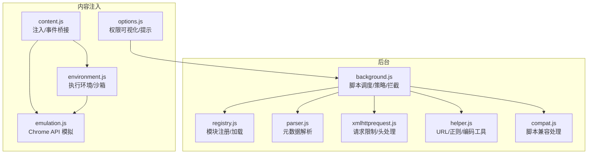
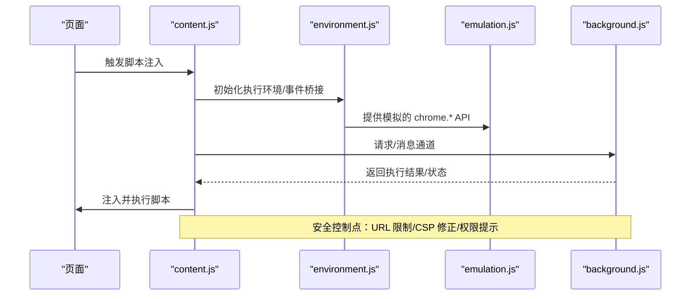
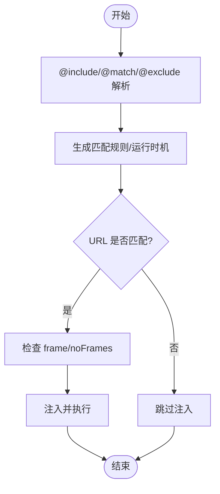
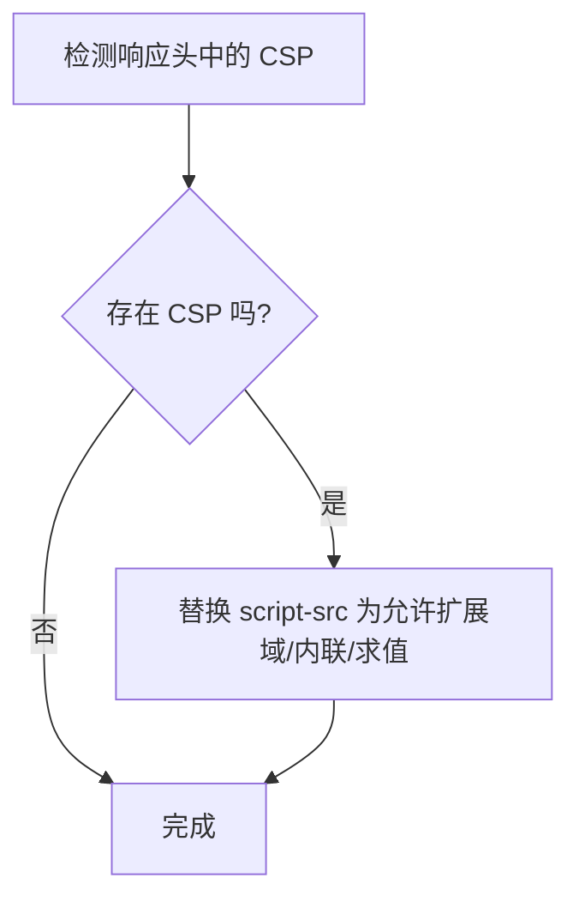
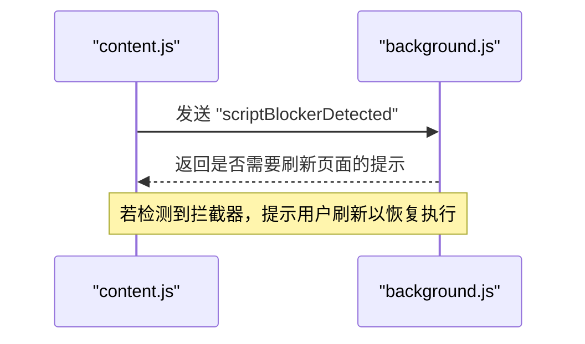
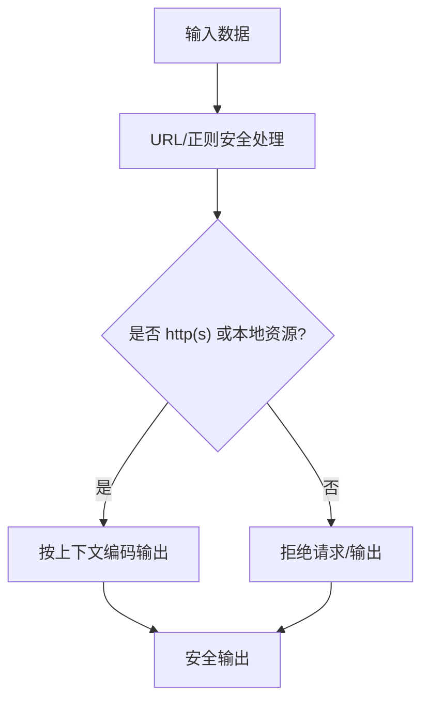
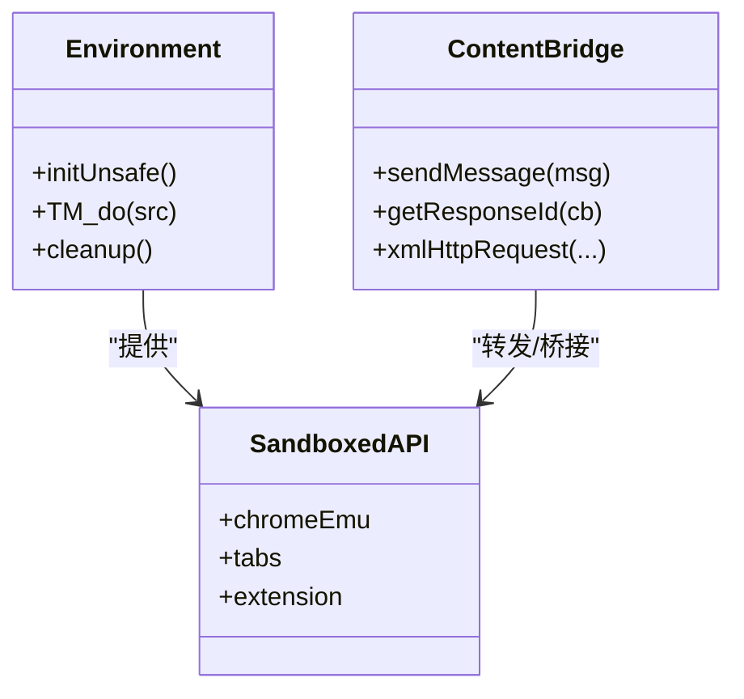
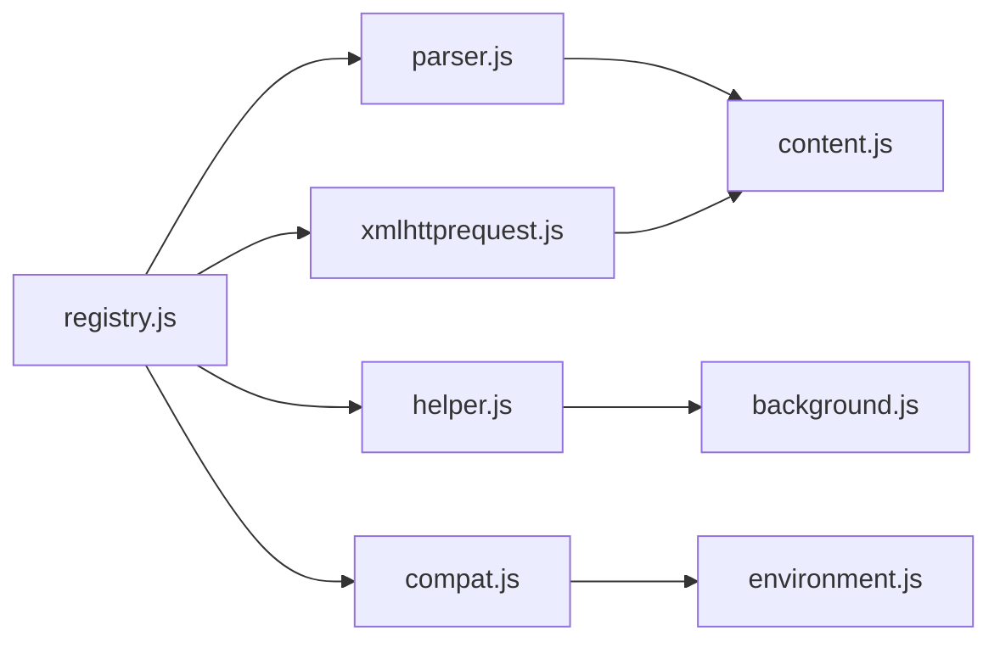

# 安全机制

<cite>
**本文引用的文件**
- [background.js](file://src/background.js)
- [content.js](file://src/content.js)
- [environment.js](file://src/environment.js)
- [options.js](file://src/options.js)
- [parser.js](file://src/parser.js)
- [registry.js](file://src/registry.js)
- [xmlhttprequest.js](file://src/xmlhttprequest.js)
- [helper.js](file://src/helper.js)
- [compat.js](file://src/compat.js)
- [emulation.js](file://src/emulation.js)
</cite>

## 目录
1. [简介](#简介)
2. [项目结构](#项目结构)
3. [核心组件](#核心组件)
4. [架构总览](#架构总览)
5. [详细组件分析](#详细组件分析)
6. [依赖关系分析](#依赖关系分析)
7. [性能考量](#性能考量)
8. [故障排查指南](#故障排查指南)
9. [结论](#结论)
10. [附录](#附录)

## 简介
本文件面向 Tampermonkey 脚本安全管理系统的综合技术文档，聚焦以下主题：
- 权限声明与检查：脚本元数据解析、站点匹配规则、运行时机与访问限制。
- 内容安全策略（CSP）兼容与实施：对页面 CSP 的修正与扩展，以保障脚本在受限环境下的可用性。
- 恶意脚本检测：基于行为与异常的监控与告警机制。
- XSS 防护：输入校验、输出编码与上下文感知的防护策略。
- 脚本隔离与沙箱：通过上下文隔离、unsafeWindow 访问控制与执行环境限制，降低脚本间恶意交互风险。
- 安全审计与日志：错误捕获、堆栈回溯与调试信息输出，辅助定位与修复安全问题。

## 项目结构
Tampermonkey 的安全相关能力由多模块协同实现：
- 后台与内容注入层：负责脚本生命周期管理、注入与执行环境初始化。
- 解析与注册：解析用户脚本元数据、注册模块与依赖加载。
- 请求与兼容：网络请求限制与脚本兼容处理。
- 工具与配置：URL 匹配、正则转换、本地资源判断等辅助能力。

图表来源
- [background.js](file://src/background.js)
- [content.js](file://src/content.js)
- [environment.js](file://src/environment.js)
- [emulation.js](file://src/emulation.js)
- [parser.js](file://src/parser.js)
- [registry.js](file://src/registry.js)
- [xmlhttprequest.js](file://src/xmlhttprequest.js)
- [helper.js](file://src/helper.js)
- [compat.js](file://src/compat.js)
- [options.js](file://src/options.js)

章节来源
- [background.js](file://src/background.js)
- [content.js](file://src/content.js)
- [environment.js](file://src/environment.js)
- [emulation.js](file://src/emulation.js)
- [parser.js](file://src/parser.js)
- [registry.js](file://src/registry.js)
- [xmlhttprequest.js](file://src/xmlhttprequest.js)
- [helper.js](file://src/helper.js)
- [compat.js](file://src/compat.js)
- [options.js](file://src/options.js)

## 核心组件
- 脚本元数据解析与策略
  - 解析 @include/@match/@exclude/@run-at/@user-agent 等元数据，生成脚本运行规则与选项。
  - 依据站点匹配与运行时机决定是否注入与执行。
- 注入与执行环境
  - 在安全上下文中注入脚本，提供受限的全局对象与事件桥接。
  - 通过 unsafeWindow 访问与属性写入控制，避免直接篡改顶层窗口。
- 请求与 CSP 兼容
  - 限定仅允许 http(s) 或本地资源访问；对页面 CSP 头进行修正，放宽脚本执行限制。
- 权限可视化与提示
  - 在选项页根据脚本代码特征提示网络访问、存储、unsafeWindow 等高危能力。
- 日志与错误捕获
  - 统一的日志级别与错误捕获，输出堆栈与调试信息，便于审计与定位。

章节来源
- [parser.js](file://src/parser.js)
- [content.js](file://src/content.js)
- [environment.js](file://src/environment.js)
- [xmlhttprequest.js](file://src/xmlhttprequest.js)
- [options.js](file://src/options.js)

## 架构总览
下图展示从页面到后台再到脚本执行的整体流程，以及安全控制点：

图表来源
- [content.js](file://src/content.js)
- [environment.js](file://src/environment.js)
- [emulation.js](file://src/emulation.js)
- [background.js](file://src/background.js)

## 详细组件分析

### 权限声明与检查机制
- 元数据解析与规则生成
  - 解析 @include/@match/@exclude，生成匹配正则；解析 @run-at/@user-agent 设置运行时机与 UA。
  - 依据元数据生成脚本 ID 与选项，用于后续注入与执行控制。
- 注入前的站点匹配与访问控制
  - 基于匹配规则与“禁止页面”列表，决定是否注入脚本。
  - 对 frameId 进行区分，支持 noframes 选项。
- 权限可视化与用户提示
  - 通过扫描脚本代码中的高危调用或特性，向用户展示网络访问、存储、unsafeWindow 等风险提示。

图表来源
- [parser.js](file://src/parser.js)
- [background.js](file://src/background.js)
- [options.js](file://src/options.js)

章节来源
- [parser.js](file://src/parser.js)
- [background.js](file://src/background.js)
- [options.js](file://src/options.js)

### CSP 兼容性与实施
- 页面 CSP 修正
  - 当检测到页面设置 X-WebKit-CSP 或 X-Content-Security-Policy 时，后台会替换 script-src 为包含扩展 ID 与允许内联/求值的策略，以保证脚本可正常执行。
- 执行环境中的 CSP 协同
  - 注入层通过事件桥接与模拟 API，尽量减少对页面 CSP 的直接冲突。

图表来源
- [background.js](file://src/background.js)

章节来源
- [background.js](file://src/background.js)

### 恶意脚本检测与用户告警
- 行为监控与异常检测
  - 注入层对 DOM 事件与属性变更进行模拟与转发，若发现异常行为（如频繁 DOM 修改），可通过日志与告警机制提示用户。
- 用户警告系统
  - 当检测到脚本拦截器（如 ScriptNo）导致无法获取 unsafeWindow 时，后台会发送“脚本拦截检测”消息，并在必要时弹出提示，引导用户刷新页面以恢复脚本执行。

图表来源
- [content.js](file://src/content.js)
- [background.js](file://src/background.js)

章节来源
- [content.js](file://src/content.js)
- [background.js](file://src/background.js)

### XSS 防护技术实现
- 输入校验与 URL 安全
  - URL 正则转换与安全修正逻辑，避免危险通配符与路径片段被误用。
  - 仅允许 http(s) 或本地资源访问，拒绝 file 等高风险协议。
- 输出编码与上下文感知
  - 提供 HTML 实体解码/编码工具函数，建议在输出到 HTML/XML/JavaScript 上下文时使用相应编码方法。
- 执行环境隔离
  - 通过安全上下文与事件桥接，避免脚本直接操作顶层窗口，降低反射型与存储型 XSS 的传播面。

图表来源
- [helper.js](file://src/helper.js)
- [xmlhttprequest.js](file://src/xmlhttprequest.js)
- [environment.js](file://src/environment.js)

章节来源
- [helper.js](file://src/helper.js)
- [xmlhttprequest.js](file://src/xmlhttprequest.js)
- [environment.js](file://src/environment.js)

### 脚本隔离与沙箱机制
- 上下文隔离
  - 注入层通过自定义事件与桥接函数，将脚本执行限制在安全上下文中，避免直接修改顶层全局对象。
- unsafeWindow 访问控制
  - 通过构造与清理属性，仅暴露必要的只读或受控属性，防止脚本越权访问页面脚本或篡改顶层对象。
- 执行环境限制
  - 通过模拟的 chrome.* API 与事件桥接，减少脚本对页面原生接口的直接依赖，降低跨脚本交互风险。

图表来源
- [content.js](file://src/content.js)
- [environment.js](file://src/environment.js)
- [emulation.js](file://src/emulation.js)

章节来源
- [content.js](file://src/content.js)
- [environment.js](file://src/environment.js)
- [emulation.js](file://src/emulation.js)

### 安全审计与日志记录
- 统一日志级别与开关
  - 通过调整日志等级，启用调试、事件、执行等多级日志输出，便于审计与排障。
- 错误捕获与堆栈输出
  - 执行失败时输出错误信息与堆栈，必要时提供复制到剪贴板的功能，辅助开发者快速定位问题。
- 审计要点
  - 关注脚本注入失败、CSP 修正、unsafeWindow 获取失败、XMLHttpRequest 异常等关键事件。

章节来源
- [environment.js](file://src/environment.js)
- [background.js](file://src/background.js)
- [content.js](file://src/content.js)

## 依赖关系分析
- 模块注册与加载
  - Registry 负责模块注册、延迟加载与回调触发，确保各安全相关模块按需加载且顺序正确。
- 解析与注入链路
  - Parser 产出脚本规则，Registry 加载并传递给注入层；XMLHttpRequest 提供受限网络访问；Helper 提供 URL/正则/编码工具；Compat 提供脚本兼容处理。

图表来源
- [registry.js](file://src/registry.js)
- [parser.js](file://src/parser.js)
- [xmlhttprequest.js](file://src/xmlhttprequest.js)
- [helper.js](file://src/helper.js)
- [compat.js](file://src/compat.js)
- [content.js](file://src/content.js)
- [environment.js](file://src/environment.js)
- [background.js](file://src/background.js)

章节来源
- [registry.js](file://src/registry.js)
- [parser.js](file://src/parser.js)
- [xmlhttprequest.js](file://src/xmlhttprequest.js)
- [helper.js](file://src/helper.js)
- [compat.js](file://src/compat.js)
- [content.js](file://src/content.js)
- [environment.js](file://src/environment.js)
- [background.js](file://src/background.js)

## 性能考量
- 注入与执行延迟
  - 通过事件桥接与异步消息，避免阻塞页面主线程；仅在 DOMContentLoaded/DOMNodeInserted 等关键时机触发脚本执行。
- 请求重试与进度反馈
  - XMLHTTPRequest 封装支持重试与进度上报，提升弱网环境下的稳定性。
- 缓存与清理
  - 注册表与执行环境在卸载时进行清理，释放内存与监听器，降低长期运行的资源占用。

## 故障排查指南
- 注入失败
  - 检查 @include/@match 是否覆盖当前 URL；确认 noframes 与 frameId 判定；查看日志中“脚本注入失败”的提示。
- CSP 导致脚本不可用
  - 确认后台已对 CSP 进行修正；若仍失败，尝试刷新页面或禁用可能干扰的浏览器扩展。
- unsafeWindow 获取失败
  - 若检测到脚本拦截器，按提示刷新页面；必要时在选项中调整兼容设置。
- 网络请求被拒
  - 确认请求 URL 为 http(s) 或本地资源；检查请求头是否包含被屏蔽的字段；查看错误状态与响应头。

章节来源
- [background.js](file://src/background.js)
- [content.js](file://src/content.js)
- [xmlhttprequest.js](file://src/xmlhttprequest.js)

## 结论
Tampermonkey 的安全机制围绕“元数据驱动的权限声明、注入前的站点与访问控制、CSP 兼容修正、执行环境隔离与沙箱、以及完善的日志与告警”展开。通过模块化的注册与加载体系，结合严格的 URL 与头处理策略，系统在保证功能性的同时显著降低了脚本间恶意交互与 XSS 等常见安全风险。建议在实际部署中配合严格的元数据规范与用户提示策略，持续完善审计与日志体系，以进一步提升整体安全性。

## 附录
- 关键实现位置参考
  - 权限声明与注入控制：[background.js](file://src/background.js)
  - 注入与执行环境：[content.js](file://src/content.js)、[environment.js](file://src/environment.js)
  - CSP 修正：[background.js](file://src/background.js)
  - 请求与协议限制：[xmlhttprequest.js](file://src/xmlhttprequest.js)
  - 元数据解析：[parser.js](file://src/parser.js)
  - 模块注册与加载：[registry.js](file://src/registry.js)
  - 工具与编码：[helper.js](file://src/helper.js)
  - 脚本兼容处理：[compat.js](file://src/compat.js)
  - Chrome API 模拟：[emulation.js](file://src/emulation.js)
  - 权限可视化与提示：[options.js](file://src/options.js)