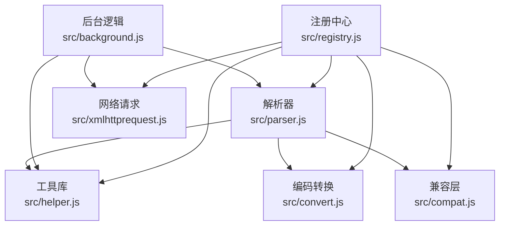
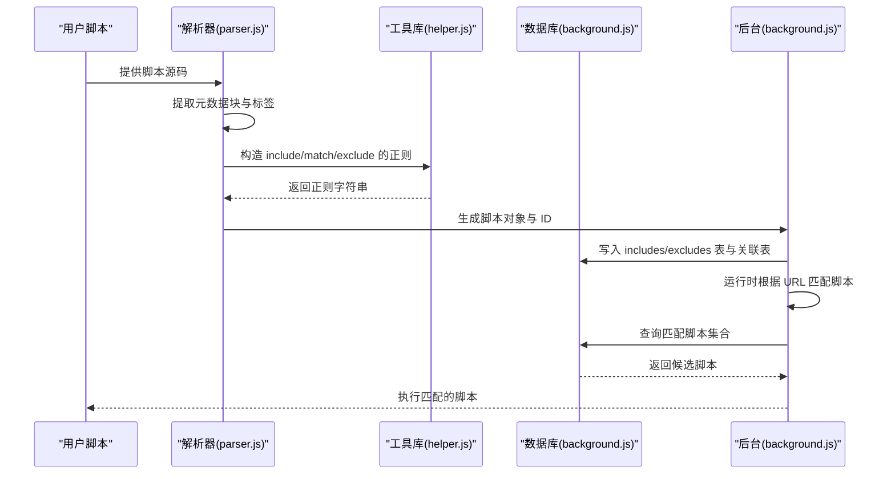
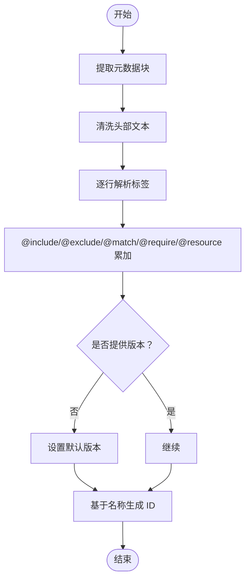
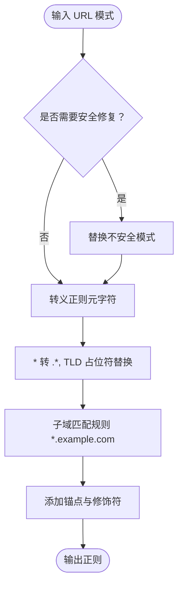
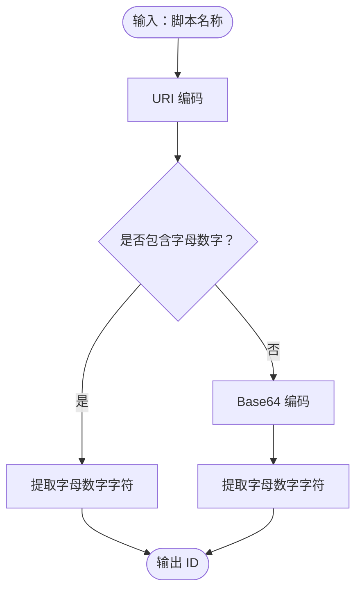
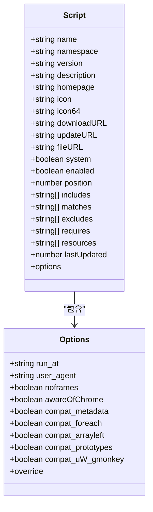
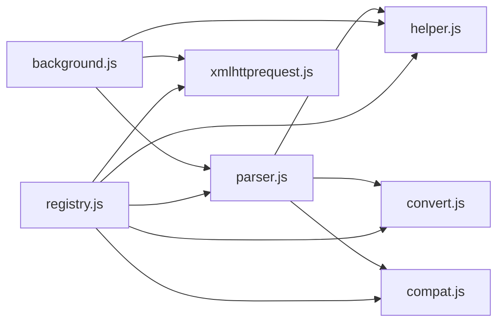
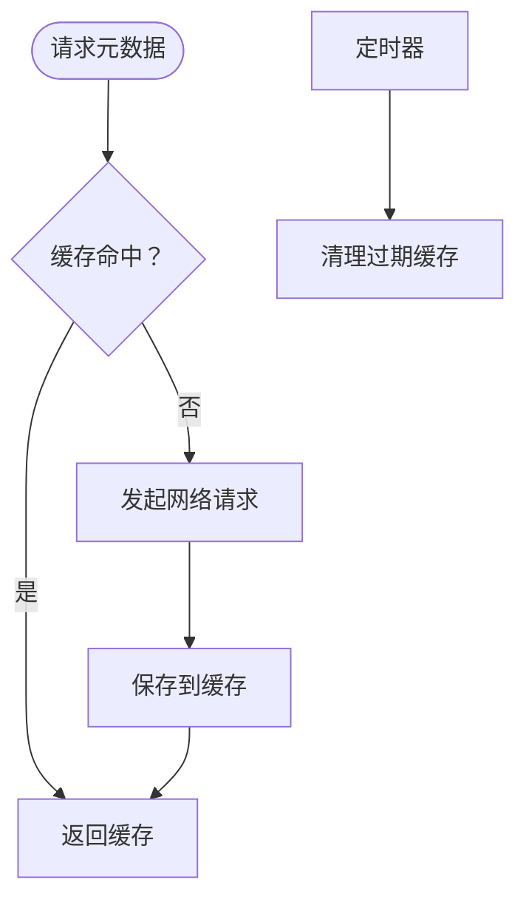

# 脚本元数据处理

<cite>
**本文引用的文件**
- [README.md](file://README.md)
- [src/parser.js](file://src/parser.js)
- [src/helper.js](file://src/helper.js)
- [src/convert.js](file://src/convert.js)
- [src/compat.js](file://src/compat.js)
- [src/registry.js](file://src/registry.js)
- [src/background.js](file://src/background.js)
- [src/xmlhttprequest.js](file://src/xmlhttprequest.js)
</cite>

## 目录
1. [简介](#简介)
2. [项目结构](#项目结构)
3. [核心组件](#核心组件)
4. [架构总览](#架构总览)
5. [组件详解](#组件详解)
6. [依赖关系分析](#依赖关系分析)
7. [性能与缓存](#性能与缓存)
8. [故障排查指南](#故障排查指南)
9. [结论](#结论)
10. [附录](#附录)

## 简介
本文件面向开发者，系统化阐述 Tampermonkey 中“脚本元数据处理”的技术实现，覆盖以下主题：
- 元数据标签解析（@include/@exclude/@match）与 URL 匹配规则、通配符与正则表达式支持
- 元数据字段的验证与兼容性处理
- 脚本头部信息的提取与处理流程
- 脚本 ID 生成算法与唯一性保障
- 元数据转换与版本兼容策略
- 元数据缓存与性能优化（含数据库与内存缓存）

## 项目结构
该仓库为 Tampermonkey 扩展源码的一部分，聚焦于后台逻辑与元数据处理。与本文相关的模块主要分布在 src 目录下：
- 解析器：负责从用户脚本中提取元数据块与标签
- 工具库：提供字符串处理、URL 安全转义、正则构造等通用能力
- 兼容层：将旧式语法转换为浏览器可接受形式
- 后台：负责脚本运行条件判断、URL 匹配、元数据拉取与缓存管理
- 请求封装：统一网络请求与重试、头信息处理

图表来源
- [src/parser.js:1-286](file://src/parser.js#L1-L286)
- [src/helper.js:1-209](file://src/helper.js#L1-L209)
- [src/convert.js:1-39](file://src/convert.js#L1-L39)
- [src/compat.js:1-275](file://src/compat.js#L1-L275)
- [src/registry.js:1-107](file://src/registry.js#L1-L107)
- [src/background.js:1-200](file://src/background.js#L1-L200)
- [src/xmlhttprequest.js:1-161](file://src/xmlhttprequest.js#L1-L161)

章节来源
- [README.md:1-112](file://README.md#L1-L112)
- [src/parser.js:1-286](file://src/parser.js#L1-L286)
- [src/helper.js:1-209](file://src/helper.js#L1-L209)
- [src/convert.js:1-39](file://src/convert.js#L1-L39)
- [src/compat.js:1-275](file://src/compat.js#L1-L275)
- [src/registry.js:1-107](file://src/registry.js#L1-L107)
- [src/background.js:1-200](file://src/background.js#L1-L200)
- [src/xmlhttprequest.js:1-161](file://src/xmlhttprequest.js#L1-L161)

## 核心组件
- 解析器（parser.js）
  - 提取用户脚本头部的元数据块
  - 解析 @include/@exclude/@match/@require/@resource/@run-at/@user-agent/@noframes/@nocompat 等标签
  - 生成脚本对象与 ID
- 工具库（helper.js）
  - 字符串截取、正则转义、URL 正则构造、安全 URL 处理
- 编码转换（convert.js）
  - Base64/UTF8 编解码，辅助 ID 生成
- 兼容层（compat.js）
  - 将旧式语法（如 CDATA、数组左值赋值、for each）转换为现代可用形式
- 注册中心（registry.js）
  - 模块加载与依赖注入
- 后台（background.js）
  - URL 匹配、元数据拉取、脚本运行条件判定、缓存清理与写入
- 网络请求（xmlhttprequest.js）
  - 统一 XHR 封装、重试、头信息处理

章节来源
- [src/parser.js:29-67](file://src/parser.js#L29-L67)
- [src/helper.js:29-80](file://src/helper.js#L29-L80)
- [src/convert.js:18-37](file://src/convert.js#L18-L37)
- [src/compat.js:13-271](file://src/compat.js#L13-L271)
- [src/registry.js:11-104](file://src/registry.js#L11-L104)
- [src/background.js:393-433](file://src/background.js#L393-L433)
- [src/xmlhttprequest.js:17-153](file://src/xmlhttprequest.js#L17-L153)

## 架构总览
下图展示从用户脚本到运行时匹配的关键流程：解析元数据 → 构造正则 → 数据库存储 → 运行时匹配 → 缓存与更新。

图表来源
- [src/parser.js:75-281](file://src/parser.js#L75-L281)
- [src/helper.js:56-80](file://src/helper.js#L56-L80)
- [src/background.js:1344-1595](file://src/background.js#L1344-L1595)

## 组件详解

### 元数据解析与头部提取
- 元数据块定位
  - 使用定界符标记元数据起止位置，避免误判 HTML 文档中的内容
- 标签解析
  - 支持 @include/@exclude/@match/@require/@resource/@run-at/@user-agent/@noframes/@nocompat 等
  - 对标签值进行清洗（去引号、制表符规范化、换行归并）
- 版本与 ID
  - 若未提供版本，默认填充默认值
  - 基于脚本名称生成 ID；若名称无字母数字字符，则使用 Base64 编码后提取字母数字字符作为 ID

图表来源
- [src/parser.js:95-222](file://src/parser.js#L95-L222)
- [src/parser.js:17-27](file://src/parser.js#L17-L27)
- [src/convert.js:18-29](file://src/convert.js#L18-L29)

章节来源
- [src/parser.js:75-281](file://src/parser.js#L75-L281)
- [src/parser.js:17-27](file://src/parser.js#L17-L27)
- [src/convert.js:18-29](file://src/convert.js#L18-L29)

### URL 匹配规则与正则构造
- 正则构造流程
  - 安全修复：对不安全的通配符组合进行替换，避免跨域或路径逃逸
  - 通配符转换：将 * 转为 .*
  - 特殊占位符：对 TLD 占位符进行替换
  - 子域匹配：对 *.example.com 进行特殊处理，确保只匹配子域而非任意前缀
  - 结尾锚定：在必要时添加 ^/$ 锚点
- 匹配函数
  - 对 @include 使用大小写不敏感正则
  - 对 @match 使用严格模式正则，并启用子域与协议锚定
  - 排除优先级高于包含，最终结果为“包含命中且未被排除”才执行

图表来源
- [src/helper.js:56-80](file://src/helper.js#L56-L80)
- [src/background.js:3583-3640](file://src/background.js#L3583-L3640)

章节来源
- [src/helper.js:46-80](file://src/helper.js#L46-L80)
- [src/background.js:3583-3640](file://src/background.js#L3583-L3640)

### 脚本 ID 生成算法与唯一性
- 生成步骤
  - 对脚本名称进行 URI 编码
  - 从编码后的名称中提取字母数字字符组成基础 ID
  - 若无字母数字字符，则对编码名称进行 Base64 编码，再提取字母数字字符
- 唯一性保障
  - 通过名称派生，避免重复冲突
  - 在数据库层面配合 sid 与名称索引，确保脚本标识稳定

图表来源
- [src/parser.js:17-27](file://src/parser.js#L17-L27)
- [src/convert.js:18-29](file://src/convert.js#L18-L29)

章节来源
- [src/parser.js:17-27](file://src/parser.js#L17-L27)
- [src/convert.js:18-29](file://src/convert.js#L18-L29)

### 元数据字段验证与兼容性
- 必需字段检查
  - 名称字段为必填；未提供时解析器会回退到默认值
  - 版本字段未提供时设置默认值
- 格式验证
  - 标签值在解析阶段进行清洗与归并，去除多余空白与注释干扰
  - 对 @match 标签自动启用 Chrome 兼容标志，便于后续行为一致
- 兼容性处理
  - 自动检测并转换旧式语法（CDATA、数组左值赋值、for each、原型扩展等）
  - 提供选项控制兼容行为（如是否转换 CDATA、是否修复 for var in）

图表来源
- [src/parser.js:29-67](file://src/parser.js#L29-L67)

章节来源
- [src/parser.js:95-222](file://src/parser.js#L95-L222)
- [src/compat.js:13-271](file://src/compat.js#L13-L271)

### 元数据转换与版本兼容策略
- 元数据转换
  - 将 CDATA 形式的内联代码转换为浏览器可接受的字符串拼接形式
  - 将数组左值赋值（如 [,a,b]=line.match(...)）转换为普通变量赋值序列
  - 将 for each 语句转换为标准 for in 循环
- 版本迁移
  - 后台在启动时根据版本比较执行数据迁移（如从 localStorage 迁移到新存储）
  - 针对旧版配置项进行补丁与默认值注入，确保向后兼容

章节来源
- [src/compat.js:13-271](file://src/compat.js#L13-L271)
- [src/background.js:145-200](file://src/background.js#L145-L200)

### 脚本头部信息提取与处理流程
- 头部提取
  - 使用定界符定位元数据块，同时检查是否为 HTML 文档，避免误判
- 头部处理
  - 清洗注释、制表符、换行，统一为单行
  - 逐行扫描标签，按类型分类累加到脚本对象
- 元数据块解析
  - 对特定元数据（如 Uso 哈希）进行独立解析与校验

章节来源
- [src/parser.js:229-281](file://src/parser.js#L229-L281)
- [src/parser.js:75-93](file://src/parser.js#L75-L93)

## 依赖关系分析
- 模块耦合
  - 解析器依赖工具库与编码转换，用于字符串处理与 ID 生成
  - 后台依赖解析器与工具库，用于运行时匹配与数据库操作
  - 兼容层与解析器相互协作，确保旧语法可用
- 外部依赖
  - 网络请求封装统一处理跨域与重试
  - 注册中心负责模块加载与依赖注入

图表来源
- [src/registry.js:11-104](file://src/registry.js#L11-L104)
- [src/parser.js:9-15](file://src/parser.js#L9-L15)
- [src/background.js:28-34](file://src/background.js#L28-L34)

章节来源
- [src/registry.js:11-104](file://src/registry.js#L11-L104)
- [src/parser.js:9-15](file://src/parser.js#L9-L15)
- [src/background.js:28-34](file://src/background.js#L28-L34)

## 性能与缓存
- 元数据拉取缓存
  - 后台定时清理过期缓存，避免内存膨胀
  - 对远程资源（如 @require）进行本地缓存，减少重复下载
- 数据库存储优化
  - 将 include/match/exclude 规则编译为正则并持久化
  - 通过“通用规则”标记与 SQL 查询优化，加速匹配
- 运行时匹配
  - 使用预编译正则与黑名单过滤，降低每次匹配成本

图表来源
- [src/background.js:393-433](file://src/background.js#L393-L433)
- [src/background.js:2846-2875](file://src/background.js#L2846-L2875)

章节来源
- [src/background.js:393-433](file://src/background.js#L393-L433)
- [src/background.js:2846-2875](file://src/background.js#L2846-L2875)
- [src/xmlhttprequest.js:17-153](file://src/xmlhttprequest.js#L17-L153)

## 故障排查指南
- 元数据未生效
  - 检查元数据块是否被识别为 HTML 文档而被忽略
  - 确认标签值是否包含非法字符或换行未正确清洗
- URL 不匹配
  - 检查 @match 是否启用了严格模式，确认子域与协议是否符合预期
  - 排除规则优先级高于包含规则，确认是否存在误命中
- 兼容性问题
  - 开启兼容选项（如 CDATA 转换、for each 修复），或在脚本中避免使用旧式语法
- 缓存异常
  - 清理过期缓存或禁用缓存以复现问题
  - 检查网络请求状态与重试次数

章节来源
- [src/parser.js:229-281](file://src/parser.js#L229-L281)
- [src/background.js:3583-3640](file://src/background.js#L3583-L3640)
- [src/compat.js:13-271](file://src/compat.js#L13-L271)
- [src/background.js:393-433](file://src/background.js#L393-L433)
- [src/xmlhttprequest.js:17-153](file://src/xmlhttprequest.js#L17-L153)

## 结论
本系统通过“解析器 + 工具库 + 兼容层 + 后台 + 缓存”的分层设计，实现了对用户脚本元数据的可靠解析、安全匹配与高效运行。其关键优势在于：
- 明确的标签解析与清洗流程，确保元数据一致性
- 可靠的 URL 正则构造与匹配策略，兼顾安全性与灵活性
- 完善的兼容层与版本迁移机制，平滑过渡旧式语法
- 多层次缓存与数据库优化，显著提升匹配性能

## 附录
- 关键实现参考路径
  - 元数据解析与头部提取：[src/parser.js:75-281](file://src/parser.js#L75-L281)
  - URL 正则构造与匹配：[src/helper.js:56-80](file://src/helper.js#L56-L80)、[src/background.js:3583-3640](file://src/background.js#L3583-L3640)
  - 脚本 ID 生成：[src/parser.js:17-27](file://src/parser.js#L17-L27)、[src/convert.js:18-29](file://src/convert.js#L18-L29)
  - 元数据转换与兼容：[src/compat.js:13-271](file://src/compat.js#L13-L271)
  - 缓存与网络请求：[src/background.js:393-433](file://src/background.js#L393-L433)、[src/xmlhttprequest.js:17-153](file://src/xmlhttprequest.js#L17-L153)