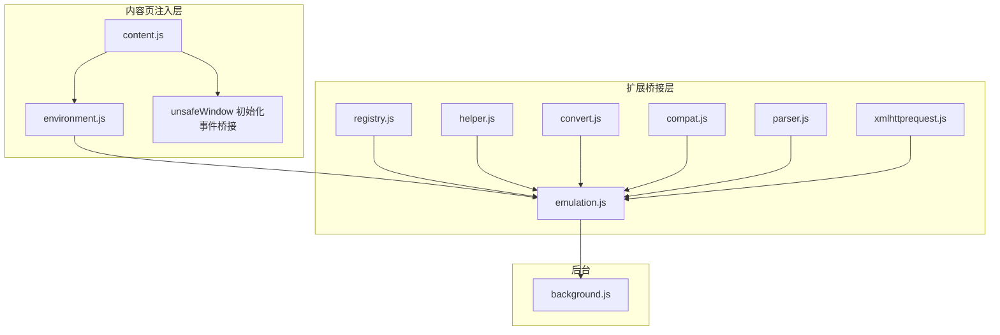
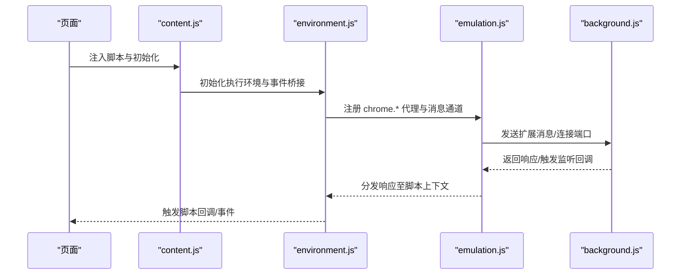
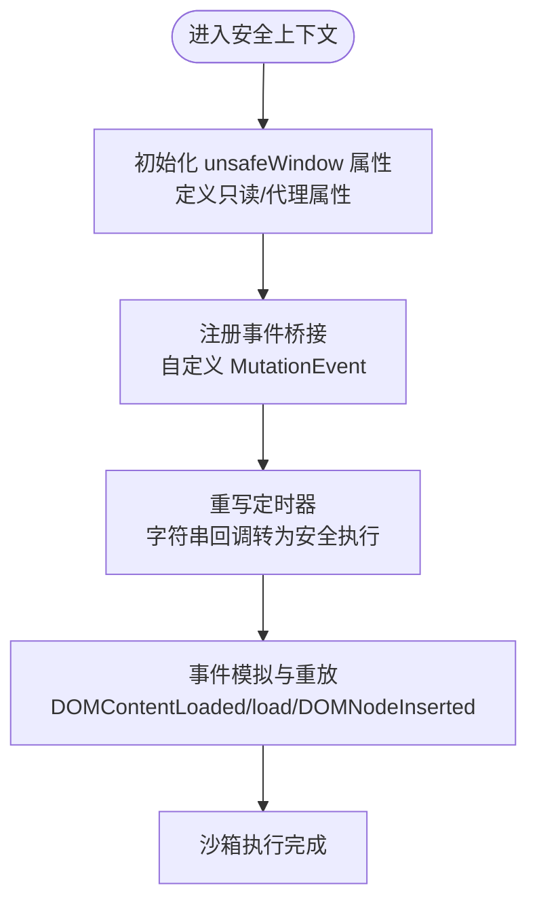
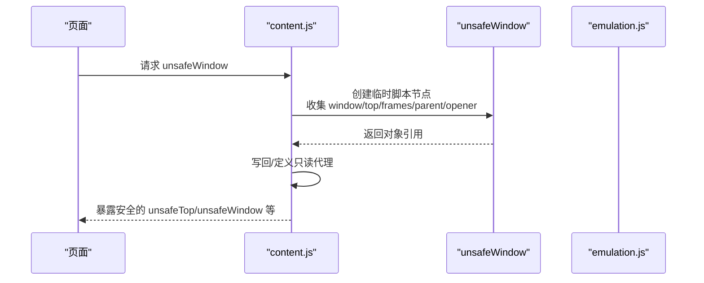
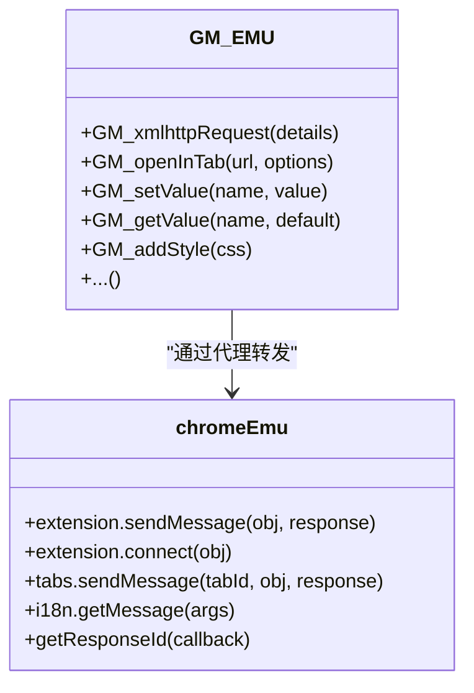
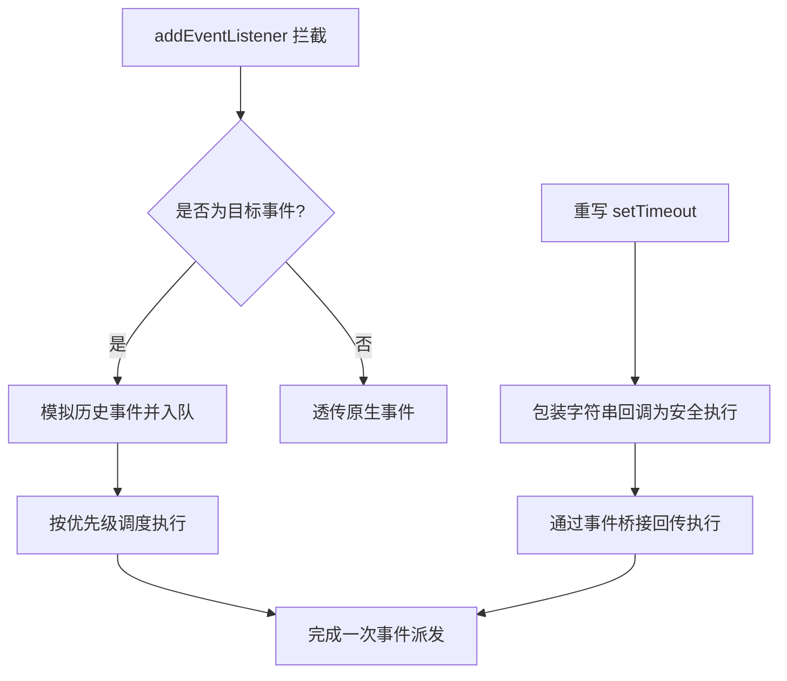
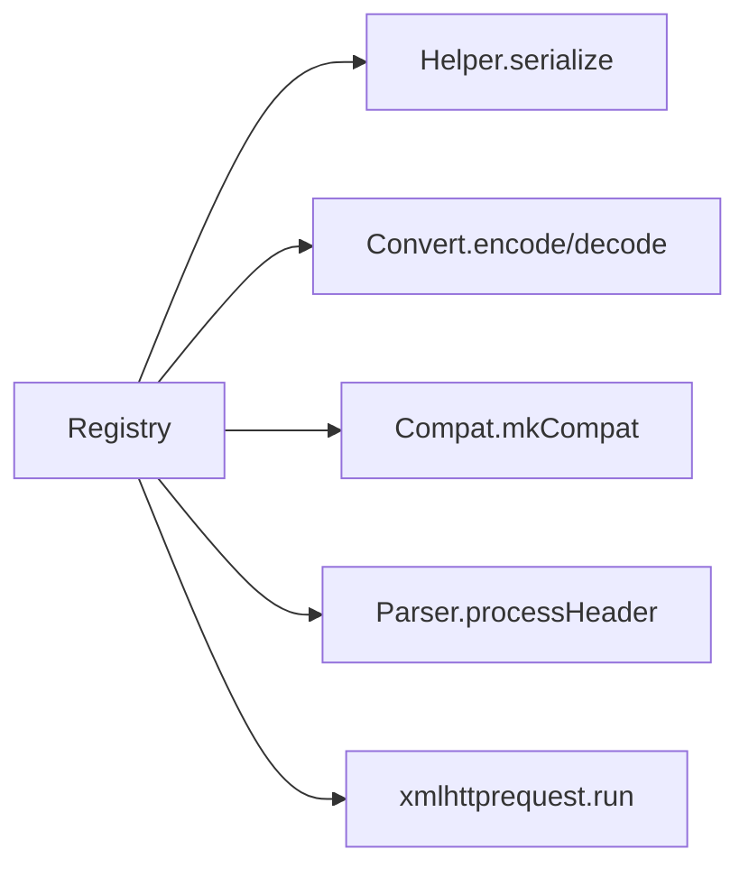
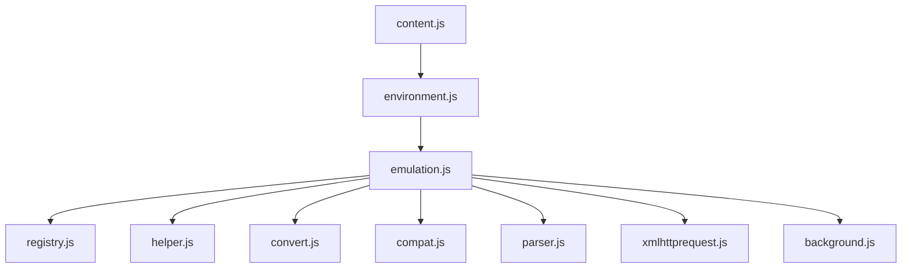

# 脚本执行环境

<cite>
**本文档引用的文件**
- [environment.js](file://src/environment.js)
- [content.js](file://src/content.js)
- [background.js](file://src/background.js)
- [emulation.js](file://src/emulation.js)
- [xmlhttprequest.js](file://src/xmlhttprequest.js)
- [helper.js](file://src/helper.js)
- [registry.js](file://src/registry.js)
- [compat.js](file://src/compat.js)
- [parser.js](file://src/parser.js)
- [convert.js](file://src/convert.js)
</cite>

## 目录
1. [简介](#简介)
2. [项目结构](#项目结构)
3. [核心组件](#核心组件)
4. [架构总览](#架构总览)
5. [详细组件分析](#详细组件分析)
6. [依赖关系分析](#依赖关系分析)
7. [性能考量](#性能考量)
8. [故障排查指南](#故障排查指南)
9. [结论](#结论)
10. [附录](#附录)

## 简介
本文件面向 Tampermonkey 脚本执行环境，系统性阐述其沙箱设计、安全隔离、DOM 访问、GM_* API 实现、事件与定时器机制、内存与垃圾回收策略、性能监控与调试支持，以及与浏览器扩展环境的交互协议。目标是帮助开发者与使用者在理解安全边界的同时，高效地使用与扩展脚本功能。

## 项目结构
该仓库采用模块化组织，核心执行环境由内容页注入层（content.js）与脚本执行环境层（environment.js）协同工作，并通过扩展桥接层（emulation.js）与后台（background.js）进行通信。工具与基础设施模块（如注册表、辅助工具、兼容层、解析器、转换器等）为执行环境提供基础能力支撑。

图示来源
- [content.js:1-120](file://src/content.js#L1-L120)
- [environment.js:1-120](file://src/environment.js#L1-L120)
- [emulation.js:1-60](file://src/emulation.js#L1-L60)
- [background.js:1-80](file://src/background.js#L1-L80)
- [registry.js:1-60](file://src/registry.js#L1-L60)
- [helper.js:1-60](file://src/helper.js#L1-L60)
- [convert.js:1-40](file://src/convert.js#L1-L40)
- [compat.js:1-60](file://src/compat.js#L1-L60)
- [parser.js:1-60](file://src/parser.js#L1-L60)
- [xmlhttprequest.js:1-60](file://src/xmlhttprequest.js#L1-L60)

章节来源
- [content.js:1-120](file://src/content.js#L1-L120)
- [environment.js:1-120](file://src/environment.js#L1-L120)
- [emulation.js:1-60](file://src/emulation.js#L1-L60)
- [background.js:1-80](file://src/background.js#L1-L80)
- [registry.js:1-60](file://src/registry.js#L1-L60)

## 核心组件
- 内容页注入与事件桥接：负责在页面上下文中初始化执行环境、建立事件桥接、管理生命周期清理。
- 脚本执行环境（沙箱）：提供受限的全局对象、DOM 访问模拟、GM_* API 映射、事件与定时器适配。
- 扩展桥接层：封装 chrome.* API 的代理与消息通道，实现跨上下文调用与响应。
- 后台服务：处理请求、存储、菜单命令、更新检查等扩展级能力。
- 基础设施模块：注册表、序列化/反序列化、正则匹配、兼容性转换、脚本解析、HTTP 请求等。

章节来源
- [content.js:455-608](file://src/content.js#L455-L608)
- [environment.js:52-193](file://src/environment.js#L52-L193)
- [emulation.js:40-120](file://src/emulation.js#L40-L120)
- [background.js:1-120](file://src/background.js#L1-L120)

## 架构总览
下图展示从页面到扩展后台的完整调用链路，包括事件桥接、消息传递与响应处理。

图示来源
- [content.js:108-182](file://src/content.js#L108-L182)
- [environment.js:628-644](file://src/environment.js#L628-L644)
- [emulation.js:209-273](file://src/emulation.js#L209-L273)
- [background.js:4523-4540](file://src/background.js#L4523-L4540)

## 详细组件分析

### 沙箱与安全隔离
- 全局对象模拟与限制
  - 在安全上下文中，通过在页面窗口上定义属性或重写原型方法，向脚本暴露有限的全局对象与能力，避免直接访问宿主敏感接口。
  - 对 window 上的关键属性（如 top、frames、parent、opener）采用“强制非可写”或“只读代理”的方式，防止被篡改。
- 事件桥接与 MutationEvent
  - 使用自定义 MutationEvent 类型在页面与扩展之间传递脚本代码片段，确保在安全上下文中执行用户脚本。
  - 提供 DOMContentLoaded、load、DOMNodeInserted 等事件的模拟与重放，保证脚本在合适时机运行。
- 定时器与字符串回调适配
  - 重写 setTimeout/setInterval，将字符串形式的回调转为在扩展侧执行的安全包装，再通过事件桥接回传执行。

图示来源
- [content.js:455-608](file://src/content.js#L455-L608)
- [environment.js:573-624](file://src/environment.js#L573-L624)
- [environment.js:195-380](file://src/environment.js#L195-L380)

章节来源
- [content.js:455-608](file://src/content.js#L455-L608)
- [environment.js:573-624](file://src/environment.js#L573-L624)
- [environment.js:195-380](file://src/environment.js#L195-L380)

### unsafeWindow 访问与安全考虑
- 获取策略
  - 通过在页面中插入临时脚本节点，利用元素属性的 getter 行为收集 window/top/frames/parent/opener 等对象引用。
  - 将这些引用以安全方式回传给扩展侧，再在扩展侧写入到受控的 window 属性或以只读属性暴露。
- 安全边界
  - 对可写属性尝试写回，不可写或不可配置的属性通过 Object.defineProperty 定义为只读代理。
  - 若检测到脚本拦截器（如 ScriptNo），记录告警并通过扩展消息通知后台，避免潜在攻击面。
- 回调执行
  - 通过事件桥接在扩展侧执行用户代码，避免直接在页面上下文执行可能带来的 XSS 风险。

图示来源
- [content.js:455-608](file://src/content.js#L455-L608)
- [environment.js:573-589](file://src/environment.js#L573-L589)

章节来源
- [content.js:455-608](file://src/content.js#L455-L608)
- [environment.js:573-589](file://src/environment.js#L573-L589)

### GM_* API 实现机制
- 函数映射与代理
  - 在脚本执行环境中构造 GM_EMU 对象，将 GM_* 方法映射到内部实现（如 GM_xmlhttpRequest、GM_openInTab、GM_setValue 等）。
  - 这些实现通过 emulation.js 中的 chromeEmu 代理层转发到后台，或通过事件桥接在扩展侧执行。
- 参数处理与返回值封装
  - 对于需要跨上下文传递的对象，使用 convert.js 的编码/解码工具进行序列化与反序列化。
  - 对于长耗时或异步操作（如 XHR），通过响应 ID 与回调队列管理响应分发。
- 与扩展 API 的对接
  - chromeEmu 封装了 extension.sendMessage/connect、tabs.sendMessage/create/getSelected/update、i18n.getMessage 等，统一响应格式与错误处理。

图示来源
- [environment.js:1053-1131](file://src/environment.js#L1053-L1131)
- [emulation.js:209-313](file://src/emulation.js#L209-L313)
- [convert.js:31-37](file://src/convert.js#L31-L37)

章节来源
- [environment.js:1053-1131](file://src/environment.js#L1053-L1131)
- [emulation.js:209-313](file://src/emulation.js#L209-L313)
- [convert.js:31-37](file://src/convert.js#L31-L37)

### 事件系统与定时器机制
- 事件系统
  - 重写 addEventListener/removeEventListener，拦截特定事件类型（如 load、DOMContentLoaded、DOMNodeInserted），在脚本首次注册时立即模拟历史事件并按优先级调度。
  - 维护事件重放队列，确保 DOM 变更事件的顺序与一致性。
- 定时器机制
  - 重写 setTimeout/setInterval，将字符串形式的回调包装为在扩展侧执行的函数，再通过事件桥接回传执行。
  - 使用 window.setTimeout 包装回调，确保异步执行与错误捕获。
- DOM 访问增强
  - 对 document.evaluate 进行适配，自动修正查询上下文与 DOM 关联，提升 XPath 查询的可用性。

图示来源
- [environment.js:380-493](file://src/environment.js#L380-L493)
- [environment.js:591-624](file://src/environment.js#L591-L624)
- [environment.js:520-571](file://src/environment.js#L520-L571)

章节来源
- [environment.js:380-493](file://src/environment.js#L380-L493)
- [environment.js:591-624](file://src/environment.js#L591-L624)
- [environment.js:520-571](file://src/environment.js#L520-L571)

### 内存管理与垃圾回收策略
- 清理清单（Clean 数组）
  - 在环境初始化过程中，将需要清理的属性与监听器注册到 Clean 列表，在卸载或清理阶段统一移除，避免内存泄漏。
- 属性定义与只读代理
  - 对关键属性使用 Object.defineProperty 定义为只读或可配置但不可写，减少意外修改导致的资源占用。
- 事件与端口管理
  - 在扩展桥接层中维护响应 ID 与回调队列，及时清理已完成的响应，避免长期持有闭包引用。

章节来源
- [environment.js:309-323](file://src/environment.js#L309-L323)
- [content.js:547-602](file://src/content.js#L547-L602)
- [emulation.js:43-50](file://src/emulation.js#L43-L50)

### 性能监控与调试支持
- 日志级别与开关
  - 通过 adjustLogLevel 动态调整日志等级，启用详细日志（ENV、EV、EMV、TS 等）以定位问题。
- 时间统计
  - 在事件处理与桥接调用处记录时间戳，计算处理耗时，便于性能分析。
- 错误捕获与降级
  - 在脚本执行与 XHR 处理中增加 try/catch 与降级逻辑，避免异常中断整个流程。

章节来源
- [content.js:69-76](file://src/content.js#L69-L76)
- [environment.js:22-31](file://src/environment.js#L22-L31)
- [content.js:939-955](file://src/content.js#L939-L955)

### 与浏览器环境的交互模式与通信协议
- 注册表与模块加载
  - Registry 提供 require/register/get/loadFile 等能力，支持按需加载与模块注册，保证执行环境的动态装配。
- 序列化与编码
  - Helper 提供 serialize 工具；Convert 提供 Base64/UTF8 编解码；用于跨上下文传递复杂对象与文本。
- 兼容性与解析
  - Compat 提供多种语法兼容转换（如 for each、数组解构、CDATA 等）；Parser 解析脚本元数据与选项，生成运行配置。
- HTTP 请求与 WebRequest
  - xmlhttprequest.js 封装 XHR，支持重试、进度回调、头信息处理与安全校验，满足脚本网络需求。

图示来源
- [registry.js:35-104](file://src/registry.js#L35-L104)
- [helper.js:148-166](file://src/helper.js#L148-L166)
- [convert.js:31-37](file://src/convert.js#L31-L37)
- [compat.js:14-26](file://src/compat.js#L14-L26)
- [parser.js:72-120](file://src/parser.js#L72-L120)
- [xmlhttprequest.js:17-61](file://src/xmlhttprequest.js#L17-L61)

章节来源
- [registry.js:35-104](file://src/registry.js#L35-L104)
- [helper.js:148-166](file://src/helper.js#L148-L166)
- [convert.js:31-37](file://src/convert.js#L31-L37)
- [compat.js:14-26](file://src/compat.js#L14-L26)
- [parser.js:72-120](file://src/parser.js#L72-L120)
- [xmlhttprequest.js:17-61](file://src/xmlhttprequest.js#L17-L61)

## 依赖关系分析
- 组件耦合
  - content.js 与 environment.js 强耦合，前者负责注入与桥接，后者负责沙箱与 API 映射。
  - emulation.js 作为扩展桥接层，依赖 registry、helper、convert、compat、parser、xmlhttprequest 等模块。
  - background.js 通过消息路由与权限校验，协调扩展能力与脚本执行。
- 外部依赖
  - 依赖浏览器扩展 API（chrome.*）、DOM API、XMLHttpRequest。
- 循环依赖
  - 通过注册表与延迟加载避免直接循环依赖；模块间通过接口契约解耦。

图示来源
- [content.js:80-92](file://src/content.js#L80-L92)
- [environment.js:628-644](file://src/environment.js#L628-L644)
- [emulation.js:9-329](file://src/emulation.js#L9-L329)
- [background.js:28-35](file://src/background.js#L28-L35)

章节来源
- [content.js:80-92](file://src/content.js#L80-L92)
- [environment.js:628-644](file://src/environment.js#L628-L644)
- [emulation.js:9-329](file://src/emulation.js#L9-L329)
- [background.js:28-35](file://src/background.js#L28-L35)

## 性能考量
- 事件与定时器
  - 使用 window.setTimeout 包装回调，避免阻塞主线程；事件重放按优先级调度，减少重复触发。
- XHR 与缓存
  - xmlhttprequest.js 支持重试与进度回调；background.js 维护 require 缓存与清理周期，降低网络开销。
- 日志与统计
  - 在关键路径记录耗时与响应状态，便于定位性能瓶颈。

## 故障排查指南
- 调试开关
  - 通过调整日志级别（adjustLogLevel）开启详细日志（ENV、EV、EMV、TS），观察事件桥接与响应分发过程。
- 常见问题
  - unsafeWindow 获取失败：检查是否存在脚本拦截器（如 ScriptNo），查看控制台告警与后台通知。
  - 事件未触发：确认事件类型是否被拦截与模拟，检查 DOMContentLoaded/load/DOMNodeInserted 的触发顺序。
  - 定时器无效：确认回调是否为字符串，应被重写为安全执行包装。
  - XHR 失败：检查 URL 方案合法性与重试次数，关注响应头与状态码。

章节来源
- [content.js:69-76](file://src/content.js#L69-L76)
- [content.js:487-499](file://src/content.js#L487-L499)
- [environment.js:591-624](file://src/environment.js#L591-L624)
- [xmlhttprequest.js:115-152](file://src/xmlhttprequest.js#L115-L152)

## 结论
该执行环境通过“安全上下文 + 事件桥接 + 扩展代理”的组合，实现了对脚本的可控执行与安全隔离。unsafeWindow 的安全暴露、GM_* API 的统一映射、事件与定时器的适配，以及完善的清理与调试机制，共同构成了稳定可靠的脚本运行平台。建议在开发与使用中遵循最小权限原则，合理设置运行时机与日志级别，以获得最佳的安全性与性能表现。

## 附录
- 关键实现位置参考
  - 沙箱初始化与事件桥接：[content.js:455-608](file://src/content.js#L455-L608)
  - GM_* API 映射：[environment.js:1053-1131](file://src/environment.js#L1053-L1131)
  - 扩展桥接层：[emulation.js:40-313](file://src/emulation.js#L40-L313)
  - HTTP 请求封装：[xmlhttprequest.js:17-153](file://src/xmlhttprequest.js#L17-L153)
  - 注册表与模块加载：[registry.js:35-104](file://src/registry.js#L35-L104)
  - 辅助工具与序列化：[helper.js:148-166](file://src/helper.js#L148-L166)
  - 兼容性转换：[compat.js:14-270](file://src/compat.js#L14-L270)
  - 脚本解析与选项：[parser.js:72-281](file://src/parser.js#L72-L281)
  - 编解码工具：[convert.js:31-37](file://src/convert.js#L31-L37)