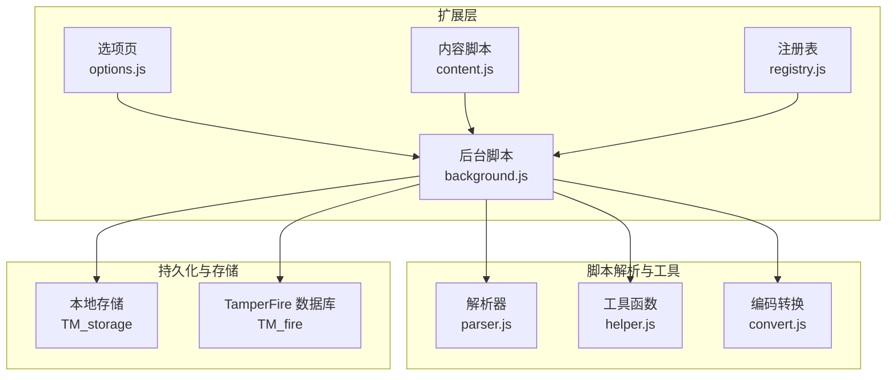
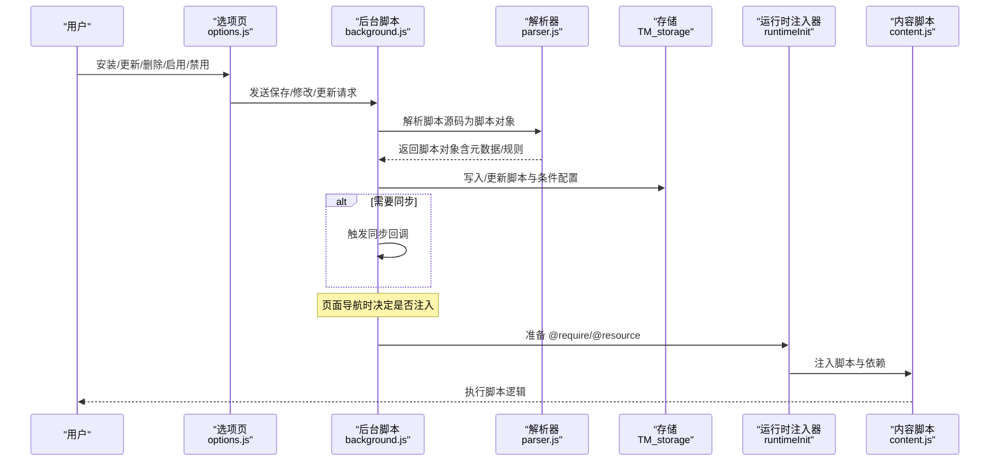
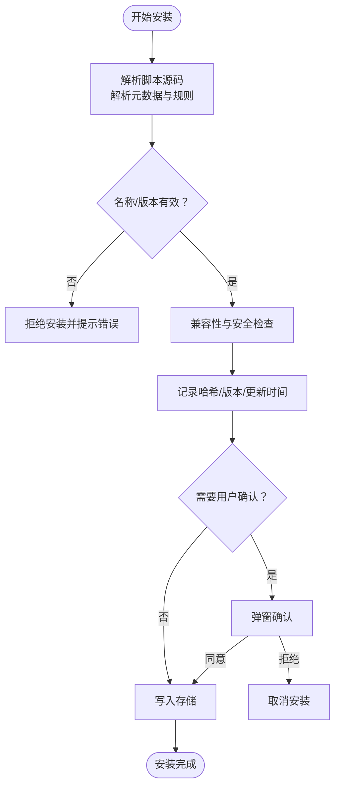
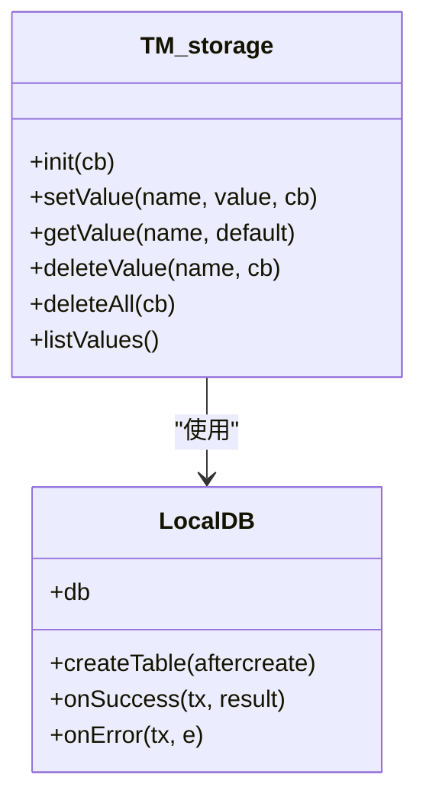
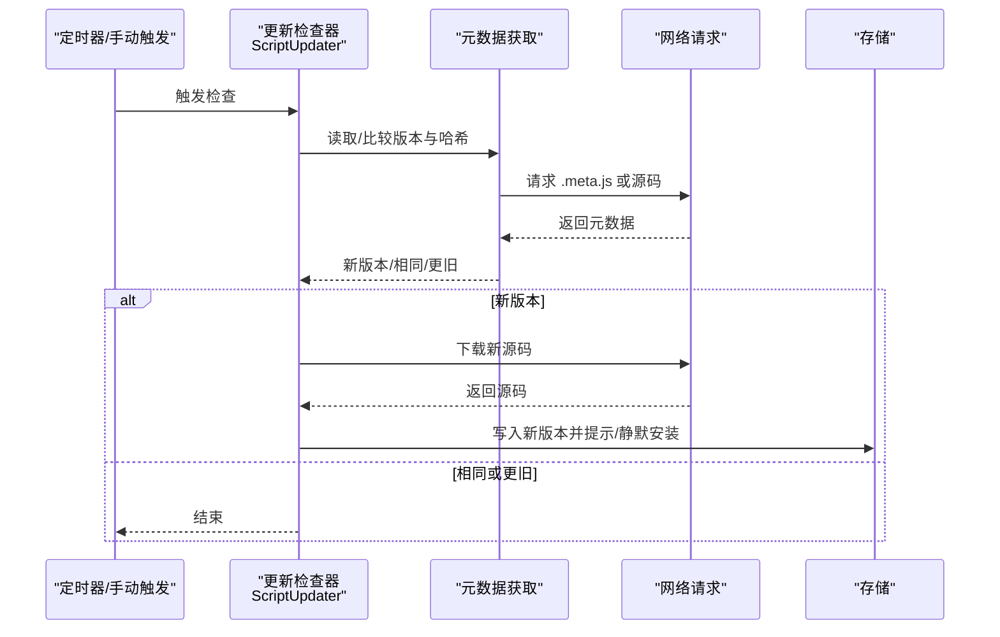
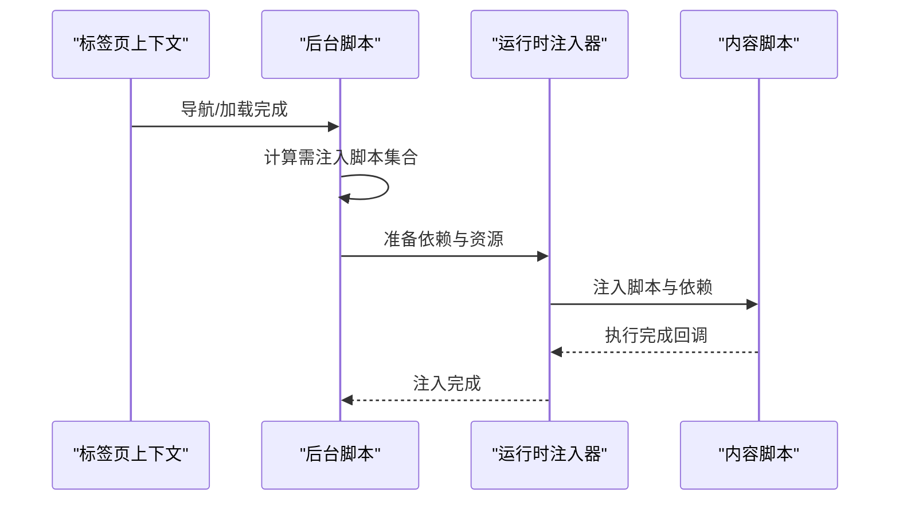
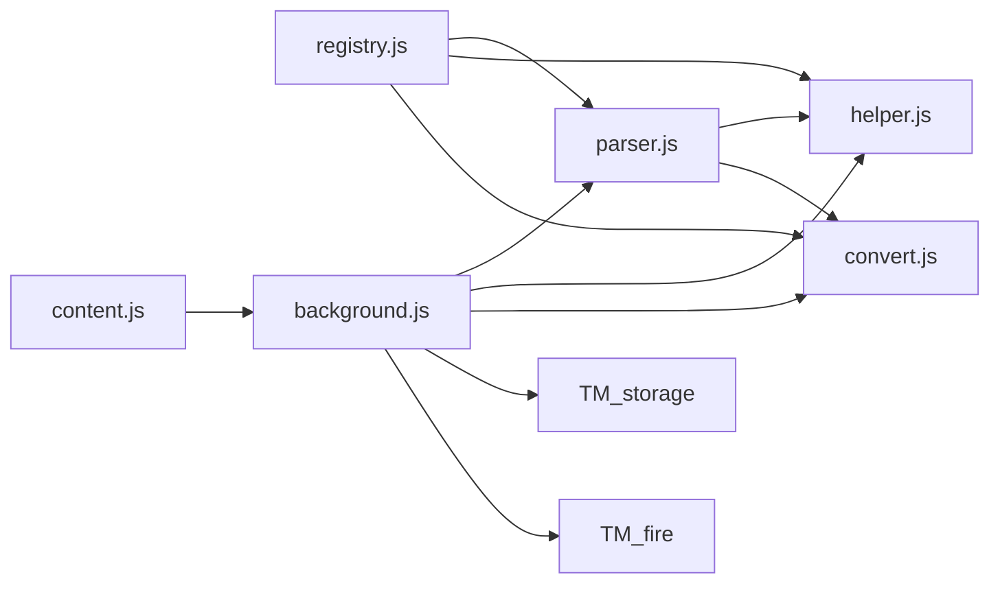

# 脚本生命周期管理

<cite>
**本文档引用的文件**
- [background.js](file://src/background.js)
- [parser.js](file://src/parser.js)
- [options.js](file://src/options.js)
- [content.js](file://src/content.js)
- [registry.js](file://src/registry.js)
- [helper.js](file://src/helper.js)
- [convert.js](file://src/convert.js)
</cite>

## 目录
1. [简介](#简介)
2. [项目结构](#项目结构)
3. [核心组件](#核心组件)
4. [架构总览](#架构总览)
5. [详细组件分析](#详细组件分析)
6. [依赖关系分析](#依赖关系分析)
7. [性能考虑](#性能考虑)
8. [故障排除指南](#故障排除指南)
9. [结论](#结论)

## 简介
本文件系统性阐述 Tampermonkey 用户脚本的生命周期管理，覆盖从安装、验证、元数据解析、存储、运行时注入、启用/禁用、更新检查与自动更新、卸载与清理、历史版本迁移、以及缓存与性能优化等全流程。目标是帮助开发者与高级用户深入理解脚本管理的底层实现与最佳实践。

## 项目结构
Tampermonkey 的脚本生命周期由后台脚本（background）作为中枢协调，结合解析器（parser）、选项页（options）、内容脚本（content）、注册表（registry）与工具模块（helper、convert）共同完成。核心职责划分如下：
- 后台脚本：负责脚本安装/更新/卸载、存储管理、运行时调度、更新检查、同步与通知。
- 解析器：解析用户脚本头部元数据与规则（@include/@match/@exclude/@require/@resource 等）。
- 选项页：提供脚本列表、编辑、启用/禁用、批量操作、导入导出等功能。
- 内容脚本：在页面上下文中执行脚本，桥接页面事件与扩展消息。
- 注册表：模块加载与依赖管理。
- 工具与转换：正则构造、URL 匹配、Base64/UTF8 编解码等。

图表来源
- [background.js](file://src/background.js)
- [parser.js](file://src/parser.js)
- [options.js](file://src/options.js)
- [content.js](file://src/content.js)
- [registry.js](file://src/registry.js)
- [helper.js](file://src/helper.js)
- [convert.js](file://src/convert.js)

章节来源
- [background.js](file://src/background.js)
- [parser.js](file://src/parser.js)
- [options.js](file://src/options.js)
- [content.js](file://src/content.js)
- [registry.js](file://src/registry.js)
- [helper.js](file://src/helper.js)
- [convert.js](file://src/convert.js)

## 核心组件
- 脚本解析器（scriptParser）：从源码中提取元数据与规则，生成脚本对象；支持 @require/@resource/@include/@match/@exclude/@run-at/@user-agent 等标签解析。
- 存储系统（TM_storage）：统一管理配置与脚本数据，支持本地数据库与 localStorage 双模式，提供类型化序列化/反序列化。
- 运行时注入器（runtimeInit）：负责 @require 下载缓存、资源合并、兼容性适配、脚本注入与存储传递。
- 更新检查器（ScriptUpdater）：周期性检查脚本更新，支持静默更新与交互式确认。
- 同步客户端（SyncClient）：跨设备同步脚本列表与状态。
- TamperFire 数据库（TM_fire）：维护脚本匹配规则的正则索引与脚本映射，加速运行时匹配。

章节来源
- [parser.js](file://src/parser.js)
- [background.js](file://src/background.js)

## 架构总览
下图展示从“安装/更新/卸载”到“运行时注入”的关键调用链路与数据流：

图表来源
- [options.js](file://src/options.js)
- [background.js](file://src/background.js)
- [parser.js](file://src/parser.js)
- [content.js](file://src/content.js)

## 详细组件分析

### 1. 脚本安装与验证
- 源码解析：使用解析器从用户脚本源码中提取头部元数据与规则，生成脚本对象；若未提供版本信息或名称非法，直接拒绝安装。
- 兼容性与安全校验：检测是否使用不兼容 API（如 unsafeWindow.gmonkey），阻止安装；对 include/match/exclude 进行 URL 正则转换。
- 哈希与版本：记录脚本哈希与最后更新时间；当下载 URL 或更新 URL 改变时提示用户。
- 重装/降级提示：根据版本比较与哈希差异，弹窗提示用户是否继续安装/重装/降级。

图表来源
- [background.js](file://src/background.js)
- [parser.js](file://src/parser.js)

章节来源
- [background.js](file://src/background.js)
- [parser.js](file://src/parser.js)

### 2. 元数据解析与规则处理
- 元数据标签：支持 name/namespace/version/author/copyright/description/icon/homepage 等。
- 匹配规则：@include/@match/@exclude 统一转换为正则表达式，用于运行时匹配。
- 依赖与资源：@require/@resource 支持远程与本地资源加载，并进行缓存与黑名单过滤。
- 运行时机：@run-at 默认值与 DOMContentLoaded 检测联动，确保脚本在合适时机执行。

章节来源
- [parser.js](file://src/parser.js)
- [helper.js](file://src/helper.js)
- [background.js](file://src/background.js)

### 3. 存储管理与迁移
- 存储接口：统一的 setValue/getValue/deleteValue/listValues，支持布尔/数值/对象等类型序列化。
- 本地数据库：采用 SQLite（通过 Web SQL）持久化配置与脚本数据，支持缓存以提升读取性能。
- 版本迁移：按版本号执行迁移任务，包括数据格式转换、键名迁移、默认值填充等。
- 清理与回滚：提供删除所有数据与逐项删除能力，保证数据一致性。

图表来源
- [background.js](file://src/background.js)

章节来源
- [background.js](file://src/background.js)

### 4. 启用/禁用机制与状态变更
- 状态存储：每个脚本的 enabled 字段与位置信息持久化，运行前通过 Tab.getScriptRunInfo 过滤禁用脚本。
- UI 触发：选项页提供单选/多选批量启用/禁用，触发 modifyScriptOptions 并刷新选项页。
- 影响范围：禁用仅影响当前页面上下文的注入与执行，不影响存储与元数据。

章节来源
- [background.js](file://src/background.js)
- [options.js](file://src/options.js)

### 5. 更新检查与自动更新
- 触发条件：周期性检查（可配置间隔），或手动触发；支持强制检查与静默更新。
- 版本比较：基于版本字符串的逐段数字比较，识别新旧版本。
- 元数据优先：优先读取 .meta.js 获取版本与哈希；若不存在则回退到源码解析。
- 自动更新：满足条件时自动下载新版本并安装，支持静默模式与交互确认。

图表来源
- [background.js](file://src/background.js)

章节来源
- [background.js](file://src/background.js)

### 6. 卸载与清理
- 卸载流程：移除脚本存储与脚本存储数据，触发同步回调（如已启用）。
- 资源回收：清理存储监听器、释放内存与数据库连接。
- 依赖处理：卸载不改变其他脚本的依赖关系，但会移除其在运行时的注入。

章节来源
- [background.js](file://src/background.js)

### 7. 脚本迁移与历史版本兼容
- 版本迁移：按版本号顺序执行迁移任务，包括键名迁移、数据格式转换、默认值设置等。
- 兼容性适配：解析阶段识别多种兼容标记，运行时注入前进行兼容性转换。
- 数据转换：Base64/UTF8 编解码用于导入导出与存储传输。

章节来源
- [background.js](file://src/background.js)
- [convert.js](file://src/convert.js)

### 8. 运行时注入与上下文管理
- 上下文注册：维护每个标签页的 URL 列表、UA、运行统计与缓存，支持注入缓存与清理。
- 注入流程：准备 @require/@resource，合并依赖源码，注入脚本与存储，支持调试模式。
- 页面交互：内容脚本桥接页面事件与扩展消息，实现响应与端口通信。

图表来源
- [background.js](file://src/background.js)
- [content.js](file://src/content.js)

章节来源
- [background.js](file://src/background.js)
- [content.js](file://src/content.js)

## 依赖关系分析
- 模块加载：通过注册表（Registry）按需加载模块，避免循环依赖与重复加载。
- 解析依赖：解析器依赖工具模块（helper/convert/compat）进行正则构造与编码转换。
- 运行时依赖：运行时注入器依赖解析器结果与存储系统，同时与内容脚本协作。

图表来源
- [registry.js](file://src/registry.js)
- [parser.js](file://src/parser.js)
- [helper.js](file://src/helper.js)
- [convert.js](file://src/convert.js)
- [background.js](file://src/background.js)
- [content.js](file://src/content.js)

章节来源
- [registry.js](file://src/registry.js)
- [parser.js](file://src/parser.js)
- [helper.js](file://src/helper.js)
- [convert.js](file://src/convert.js)
- [background.js](file://src/background.js)
- [content.js](file://src/content.js)

## 性能考虑
- 缓存策略
  - @require 缓存：按 URL 缓存响应内容与头信息，定期清理过期条目，避免重复网络请求。
  - 注入缓存：同一标签页内复用运行时注入结果，减少重复计算与注入成本。
- 数据库优化
  - 使用事务批量写入，分批处理大量数据，降低锁竞争与 I/O 开销。
  - TamperFire 数据库采用正则索引与关联表设计，加速运行时匹配。
- 正则与 URL 处理
  - 将 include/match/exclude 转换为高效正则，避免复杂字符串匹配。
  - 对危险 URL 进行安全替换，减少正则误匹配风险。
- 存储访问
  - 本地数据库缓存常用配置，减少频繁读写。

章节来源
- [background.js](file://src/background.js)
- [helper.js](file://src/helper.js)

## 故障排除指南
- 安装失败
  - 检查脚本名称/版本是否合法；确认未使用不兼容 API；核对 include/match/exclude 是否为空且已自动补全。
- 更新无响应
  - 确认更新检查周期未设为永不；检查网络可达性与 .meta.js 可用性；查看日志中的版本比较结果。
- 注入异常
  - 检查 @require/@resource 是否被加入黑名单；确认 UA 与 run-at 设置；查看内容脚本日志。
- 存储问题
  - 若切换存储模式，注意键名迁移与数据格式变化；必要时执行删除所有数据后重试。
- 同步异常
  - 检查同步类型与权限；确认远端脚本列表可用；查看同步回调与监听器状态。

章节来源
- [background.js](file://src/background.js)
- [options.js](file://src/options.js)

## 结论
Tampermonkey 的脚本生命周期管理以后台脚本为核心，结合解析器、存储、运行时注入与同步模块，形成完整的安装、验证、运行、更新、卸载与清理闭环。通过缓存、数据库与正则优化，系统在功能完整性与性能之间取得平衡。理解上述流程有助于开发者正确编写与调试用户脚本，并在出现问题时快速定位与解决。